# Weight-Space Programming: Frontier LLMs Editing Neural Network Weights Directly Without Training

> Daily learning · November 3, 2026 · Mechanistic interpretability, automated weight steering, and parameter surgery

> In November 2026, researchers at MIT CSAIL demonstrated **Weight-Space Programming (WSP)**: frontier reasoning models (such as GPT-6 Astra) directly reading, diagnosing, and editing raw neural network weight matrices without backpropagation, loss functions, or gradient descent. In headline experiments, Astra boosted `Qwen3.5-0.8B`'s MATH-500 score from 7.9% to 48.1% (a 6x gain) by modifying only **0.016%** of its weights. However, a rigorous reality check reveals this was not teaching Qwen new math, but performing automated mechanistic interpretability to surgically remove a degenerate "thinking loop" bug that choked Qwen's output tokens.

---

## 1. Architecture Overview

The diagram below illustrates the end-to-end Weight-Space Programming paradigm, the surgical edit pipeline applied to `Qwen3.5-0.8B`, the reality check behind the 6x benchmark leap, and how weight editing contrasts fundamentally with Knowledge Distillation, Fine-Tuning, and Quantization.

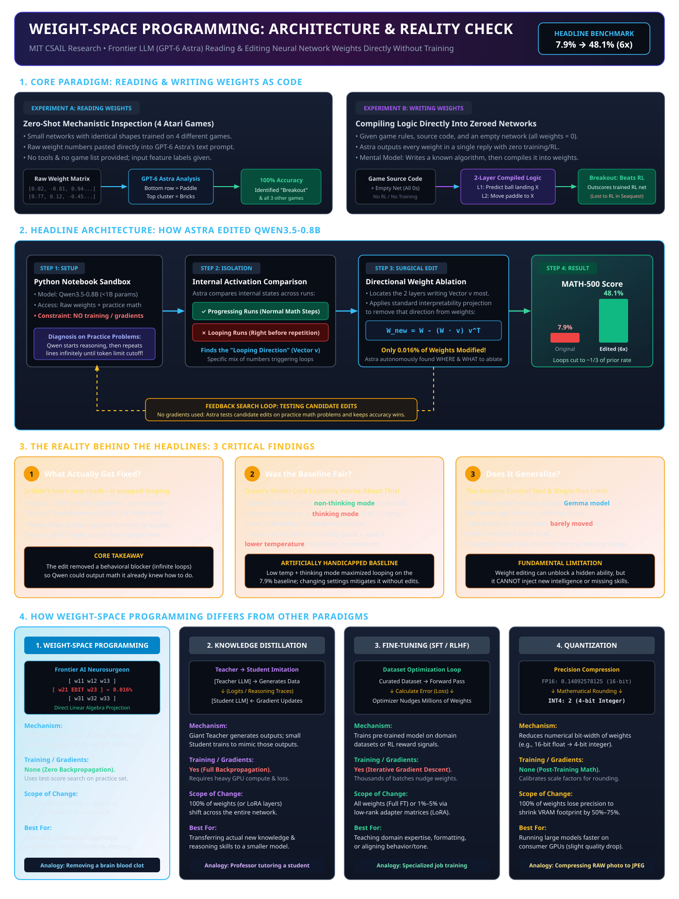

---

## 2. Foundations: What Weight-Space Programming Actually Is

Every deep neural network is fundamentally an organized collection of numerical arrays called **weight matrices**. Traditionally, human engineers never touch these numbers by hand. Instead, we train models indirectly: we feed massive text corpora or curated datasets, calculate errors (loss), and allow calculus (backpropagation and gradient descent optimizers like AdamW or Muon) to nudge billions of numbers by minuscule increments over millions of compute steps.

**Weight-Space Programming (WSP)** flips this paradigm. Rather than training models with data and gradients, a frontier reasoning model (operating inside an execution environment like a Python sandbox) treats another model's raw weight tensors as **code to be analyzed, debugged, and refactored directly**.


### 2.1 From Simple Algebra to Giant Nested Functions

To understand weight space from the ground up, consider the algebraic progression from basic coordinate geometry to deep networks:

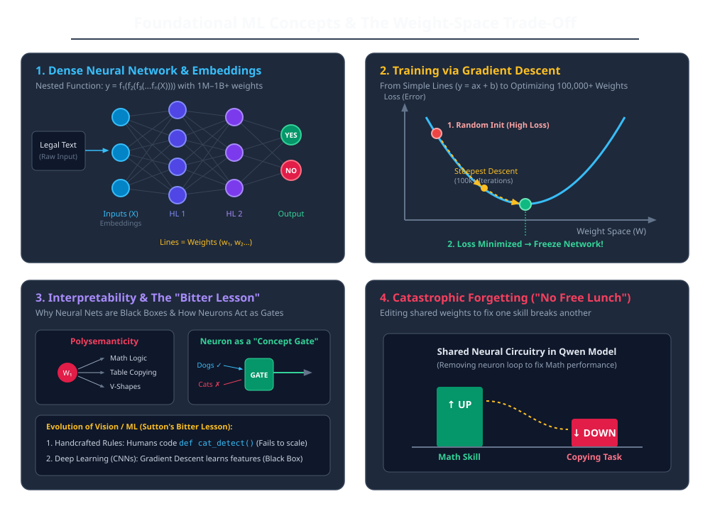

1. **Weights as Slopes and Curvatures:**
   * In a straight line ($y = ax + b$), $x$ is the input, while $a$ (slope) and $b$ (intercept) are the **2 weights**.
   * In a parabolic curve ($y = ax^2 + bx + c$), $a, b, c$ are the **3 weights**.
   * In a deep neural network, the model is simply a **massive, nested multi-dimensional function** operating over thousands or billions of parameters:

$$y = f_L(f_{L-1}(\dots f_2(f_1(X; W_1); W_2) \dots; W_L))$$
2. **Embeddings & Decision Boundaries:**
   * Raw text (such as legal case files or natural language queries) cannot be directly multiplied by numbers. It is first projected into a high-dimensional continuous vector space called an **embedding vector** ($X \in \mathbb{R}^{d_{\text{model}}}$).
   * For binary classification (e.g., "Does this document have valid legal citations? Yes or No"), the final output layer consists of two output neurons whose relative activations determine the prediction.
3. **The Classical Optimization Loop (Training & Freezing):**
   * **Random Initialization:** Weights start as random Gaussian noise ($W \sim \mathcal{N}(0, \sigma^2)$), producing high loss.
   * **Loss Measurement:** The network's guess is compared against ground truth via a loss function (Cross-Entropy / MSE).
   * **Gradient Descent:** Backpropagation calculates the partial derivatives ($\nabla_W \mathcal{L}$) and nudges weights down the **steepest slope** of the loss surface over 100,000+ iterations.
   * **Model Freezing:** Once loss hits a local minimum, the parameters are **frozen** into static binary tensors (`.safetensors`). For the last decade of deep learning, these numbers were considered uneditable without starting a new gradient training loop.

### Core Terminology

| Term | Mathematical / Operational Meaning | Role in Weight-Space Programming |
|---|---|---|
| **Weight Tensor ($W$)** | The static numerical parameters defining the model's transformations. | The source code artifact inspected and directly edited by the frontier LLM. |
| **Residual Stream ($x$)** | The continuous vector representations passed between transformer layers. | The communication bus where internal features, concepts, and behavioral states reside. |
| **Software 2.0 Binary** | Andrej Karpathy's framing: weights are compiled binaries produced by gradient descent. | Instead of recompiling from scratch via training, WSP acts as a binary hex-editor. |
| **Activation Steering** | Modifying residual stream vectors dynamically during the forward pass ($x' = x + \alpha v$). | Runtime behavioral steering; requires custom inference hooks and extra GPU overhead. |
| **Directional Ablation** | Projecting a specific vector $v$ out of a weight matrix ($W_{\text{new}} = W - (W \cdot v) v^T$). | Bakes activation steering directly into static weights so standard engines run it natively. |
| **Loop Vector ($v_{\text{loop}}$)** | The direction in activation space that triggers cyclic repetitive generation. | The isolated pathology vector causing Qwen's chain-of-thought to loop infinitely. |
| **Down Projection (`down_proj`)** | The final linear layer of a SwiGLU MLP that projects activations back to hidden size $d_{\text{model}}$. | The specific matrix where Astra ablated the loop vector in Layers 15 and 19. |

### The Software 2.0 Analogy: Recompilation vs. Binary Hex-Editing

To understand why Weight-Space Programming is fundamentally distinct from training, AI educator Matthew Berman (*The most important paper in AI right now*) frames it through a software engineering lens:

```mermaid
flowchart TD
    subgraph S1["Software 1.0 (Code)"]
        direction LR
        C1["Human Code (C++ / Python)"] --> CMP1["Compiler (GCC / Clang)"] --> B1["Compiled Machine Binary (.exe)"]
    end

    subgraph S2["Software 2.0 (Training)"]
        direction LR
        C2["Training Data & Loss"] --> CMP2["Backpropagation & Optimizers"] --> B2["Model Weights (.safetensors)"]
    end

    subgraph S3["Weight-Space (Patching)"]
        direction LR
        B3["Faulty Model Weights"] --> LLM3["Frontier LLM (Disassembler)"] --> P3["Surgical Patch: W - (W·v)vᵀ"]
    end

    B1 ~~~ C2
    B2 ~~~ B3

    style S1 fill:#0f172a,stroke:#334155,stroke-width:1.5px
    style S2 fill:#0f172a,stroke:#4338ca,stroke-width:1.5px
    style S3 fill:#0f172a,stroke:#059669,stroke-width:1.5px
```

* **Traditional Retraining (Recompiling from Source):** When a deployed binary has a single bug, traditional deep learning requires re-collecting training data, provisioning a GPU cluster, and retraining the network over days or weeks (costing tens of thousands of dollars) just to nudge weights into a slightly different configuration.
* **Weight-Space Programming (Binary Hex-Patching):** A frontier model acts like a reverse engineer with a disassembler (Ghidra/IDA Pro) and a hex editor. It opens the compiled weight binary directly in a Python REPL, locates the 4 faulty bytes causing the program to freeze, zeroes them out with a linear algebra projection, and saves the patched binary in seconds.

### How Weight-Space Programming Differs From Standard Techniques

| Dimension | Weight-Space Programming | Knowledge Distillation | Fine-Tuning (SFT / RLHF) | Quantization (PTQ) |
|---|---|---|---|---|
| **Primary Mechanism** | Frontier LLM inspects activations and edits raw tensor values via linear algebra. | Teacher LLM generates reasoning traces; student model trains to imitate teacher logits. | Supervised pairs or reward models compute loss gradients to nudge parameters. | Mathematical rounding downscales numerical precision (e.g., FP16 $\to$ INT4). |
| **Uses Gradients?** | **No** (Zero backpropagation; guided by zeroth-order search). | **Yes** (Full backpropagation over millions of synthetic tokens). | **Yes** (Iterative gradient descent via AdamW or Muon). | **No** (Direct post-training calibration). |
| **Fraction of Weights Modified** | **$\approx 0.016\%$** (Surgical) or toy networks from scratch. | **$100\%$** (or adapter layers like LoRA). | **$1\%$ to $100\%$** of all parameters. | **$100\%$** of weights undergo precision reduction. |
| **Primary Goal** | Debugging behavioral flaws, unblocking latent skills, model maintenance. | Compressing large model intelligence into small models. | Domain adaptation, instruction alignment, stylistic control. | Reducing VRAM footprint and accelerating memory-bandwidth decode. |
| **Analogy** | A neurosurgeon clipping a localized aneurysm so blood flows normally. | A professor authoring a condensed textbook for an apprentice to memorize. | Specialized vocational training with mandatory practice exams. | Compressing an uncompressed TIFF photograph into an optimized WebP. |

---

## 3. The 3-Tier Harness Progression & Experimental Evidence

Weight-Space Programming is not a monolithic technique. As highlighted in research by MIT CSAIL and independent practitioner evaluations (*The Day 1 Guide to Weight Space Programming*), WSP evolved across **three distinct harness tiers**—progressing from zero-tool text prompts for small networks to closed-loop Interactive REPL kernels and Recursive Language Models (RLMs) for multi-million and multi-billion parameter models.

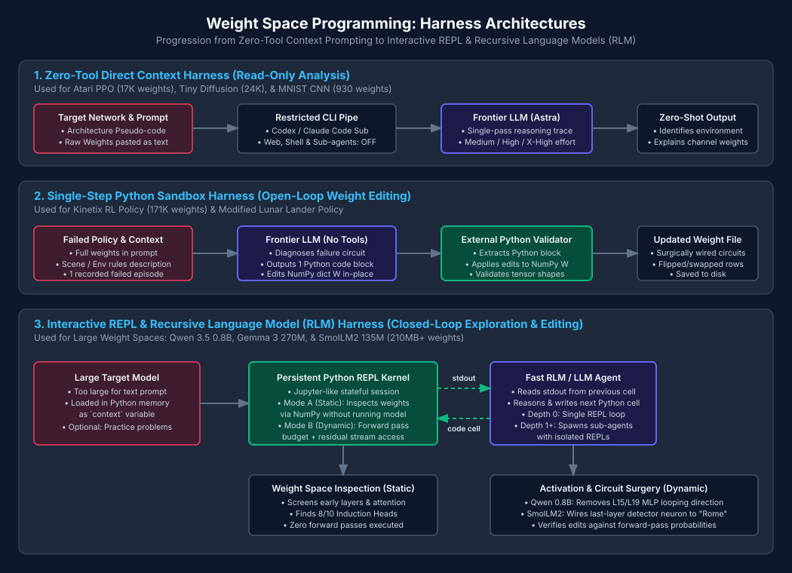

### 3.1 The 3-Tier Harness Taxonomy

```mermaid
flowchart TD
    subgraph T1["Tier 1: Zero-Tool Context"]
        direction LR
        P1["Raw Weights in Prompt<br/>(17K–24K params)"] --> CLI1["Restricted CLI Pipe<br/>(No Tools, No Shell)"] --> LLM1["Frontier LLM (Astra)<br/>Single-Pass Trace"] --> OUT1["Zero-Shot Output<br/>(Environment & Geometry)"]
    end

    subgraph T2["Tier 2: Python Sandbox"]
        direction LR
        P2["Failed Policy Weights +<br/>Scene Description"] --> LLM2["Frontier LLM<br/>Diagnoses & Codes"] --> VAL2["External Python Validator<br/>(Applies NumPy Edits)"] --> OUT2["Updated Weights File<br/>(Surgically Patched)"]
    end

    subgraph T3["Tier 3: REPL & RLM Harness"]
        direction LR
        M3["Large Target Model<br/>(135M–800M+ params in RAM)"] --> REPL3["Persistent Python REPL Kernel<br/>(Jupyter-style Session)"]
        REPL3 <-->|stdout / code cell| RLM3["Fast RLM Agent<br/>(Depth 0 Loop or Sub-agents)"]
        REPL3 --> S_MOD["Static Inspection (NumPy)<br/>OR Dynamic Surgery (Forward Pass)"]
    end

    OUT1 --> P2
    OUT2 --> M3

    style T1 fill:#0f172a,stroke:#38bdf8,stroke-width:1.5px
    style T2 fill:#1e1b4b,stroke:#818cf8,stroke-width:1.5px
    style T3 fill:#022c22,stroke:#10b981,stroke-width:1.5px
```

1. **Tier 1: Zero-Tool Direct Context Harness (Read-Only Analysis):**
   * **Scope & Scale:** Applied to networks with fewer than ~25,000 parameters (Atari PPO policies, toy diffusion models, tiny CNNs).
   * **Harness Setup:** The network architecture pseudo-code and raw floating-point weights are pasted directly into the LLM's text prompt. Tools are strictly disabled (`web_search: disabled`, `shell: disabled`, `sub_agents: disabled`).
   * **Execution:** The frontier model produces a single-pass reasoning trace, inspecting weight magnitudes across input channels to determine task semantics without running a forward pass.
2. **Tier 2: Single-Step Python Sandbox Harness (Open-Loop Parameter Editing):**
   * **Scope & Scale:** Applied to policy networks up to ~200,000 parameters (Kinetix RL policies, Lunar Lander).
   * **Harness Setup:** The prompt includes full model weights, environment rules, and a log of one failed episode. The LLM has no live terminal, but generates a self-contained Python script designed to edit a NumPy parameter dictionary (`W`) in-place.
   * **Execution:** An external validation script executes the LLM's code block, checks matrix shapes, and saves the patched weights to disk.
3. **Tier 3: Interactive REPL & Recursive Language Model (RLM) Harness (Closed-Loop Exploration):**
   * **Scope & Scale:** Applied to foundation models (SmolLM2 135M, Gemma 3 270M, Qwen 3.5 0.8B) where weights range from 200MB to multiple gigabytes and cannot fit in text prompts.
   * **Harness Setup:** The target model is loaded into a persistent, stateful Jupyter-like Python kernel as a global `context` variable. The LLM acts as an agent running in an interactive feedback loop: it issues code cells, reads `stdout` and execution errors, and iterates.
   * **Dual Operational Modes:**
     * **Mode A (Static Inspection):** Reads weight tensors via NumPy and PyTorch without executing the model (screening early layers, locating attention induction heads).
     * **Mode B (Dynamic Circuit Surgery):** Allowed a strict budget of forward passes to log intermediate residual activations and verify candidate weight projections.

---

### 3.2 Tier 1 Deep Dive: Prompt Anatomy & Zero-Tool Weight Reading

To understand how raw weights appear to a frontier LLM, consider the primary experimental artifact from the MIT CSAIL logs:

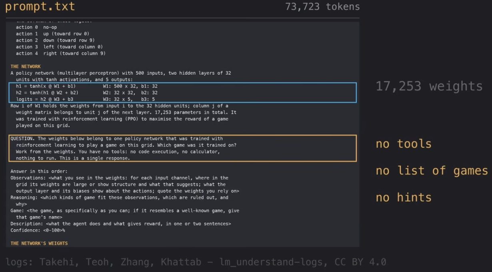

* **Scale:** A 73,723-token prompt containing 17,253 floating-point numbers.
* **Architecture Pseudo-Code:**

$$\mathbf{h}_1 = \tanh(\mathbf{x} \mathbf{W}_1 + \mathbf{b}_1) \quad (\mathbf{W}_1 \in \mathbb{R}^{500 \times 32}, \mathbf{b}_1 \in \mathbb{R}^{32})$$

$$\mathbf{h}_2 = \tanh(\mathbf{h}_1 \mathbf{W}_2 + \mathbf{b}_2) \quad (\mathbf{W}_2 \in \mathbb{R}^{32 \times 32}, \mathbf{b}_2 \in \mathbb{R}^{32})$$

$$\text{logits} = \mathbf{h}_2 \mathbf{W}_3 + \mathbf{b}_3 \quad (\mathbf{W}_3 \in \mathbb{R}^{32 \times 5}, \mathbf{b}_3 \in \mathbb{R}^{5})$$
* **The Strict Constraint:** *"QUESTION. The weights below belong to one policy network that was trained with reinforcement learning to play a game on this grid. Which game was it trained on? Work from the weights. You have no tools: no code execution, no calculator, nothing to run. This is a single response."*
* **The Mechanism:** With no list of candidate games and no execution tools, Astra inspected the 500 input weights (representing an $10 \times 10 \times 5$ spatial feature grid: agent, ball/objects, blocks/rewards). Astra observed large positive weights in the lower rows connecting to paddle movement actions (Actions 1–4) and identified clusters corresponding to static upper obstacles, correctly deducing *Breakout* with 100% confidence.

---

### 3.3 Tier 2 Deep Dive: Kinetix 2D Physics Policy Repair (Open-Loop Parameter Editing)

In the MIT CSAIL investigation, researchers scaled Weight-Space Programming from passive recognition to active behavioral repair on an RL policy operating in a 2D rigid-body physics simulator.

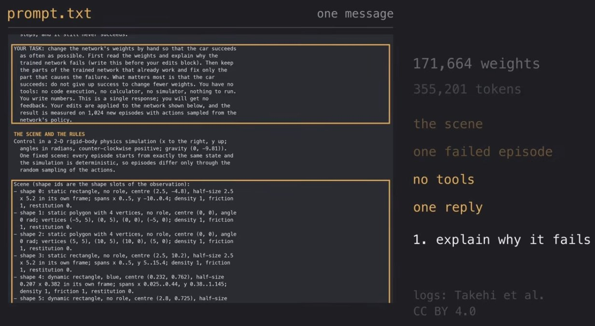

#### The Task & Strict Constraints
* **Scale:** A massive 355,201-token prompt containing **171,664 floating-point weights** representing a fully connected policy network trained via PPO (Proximal Policy Optimization).
* **The Environment:** A 2D rigid-body simulation with gravity ($g = -9.81\,\text{m/s}^2$), fixed obstacle polygons, a launch ramp, a lethal red hazard zone, and a target blue goal box.
* **The Prompt Contract:**
  > *"YOUR TASK: change the network's weights by hand so that the car succeeds as often as possible. First read the weights and explain why the trained network fails (write this before your edits block). Then keep the parts of the trained network that already work and fix only the part that causes the failure... You have no tools: no code execution, no calculator, no simulator, nothing to run. You write numbers. This is a single response; you will get no feedback. Your edits are applied to the network shown below, and the result is measured on 1,024 new episodes with actions sampled from the network's policy."*

#### Astra's Diagnostic Reasoning: Locating the Failure
Before writing any numerical updates, GPT-6 Astra was required to inspect the weights and the single failed trajectory log to deduce why standard PPO training failed:

> [!IMPORTANT]
> **GPT-6 Astra Diagnostic Reasoning Trace:**
>
> *"The trace shows the failure: the car approaches the ramp, **loses its momentum**, then alternates throttle and coasting without advancing."*
>
> *"**Reverse is effectively never sampled.** It collects distance-shaping reward but never makes the launch needed to clear red."*

#### Mechanistic Insight: The Distance-Shaping Reward Trap
Astra uncovered a fundamental failure mode in reinforcement learning:
1. **The Local Reward Trap:** In reward-shaped RL environments, agents receive continuous incremental rewards as their Euclidean distance to the goal decreases. Driving forward toward the ramp yields immediate positive reward. However, reversing *away* from the ramp temporarily incurs negative reward.
2. **Exploration Failure:** Because reversing is penalized in the short term, PPO's stochastic policy gradient updates drove the probability of sampling reverse toward zero.
3. **Momentum Deficit:** When the car reaches the ramp incline, gravity opposes its motion. The car lacks sufficient kinetic energy ($E_k = \frac{1}{2}mv^2$) to crest the slope. The policy enters a "throttle chattering" loop—alternating between forward throttle and coasting—permanently stuck at the foot of the incline.

#### The Surgical Fix & Trajectory Outcome
Rather than restarting RL training across millions of frames, Astra performed open-loop weight surgery:

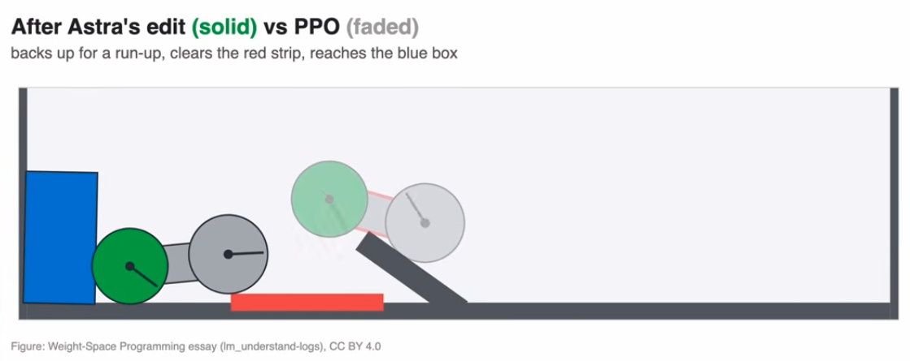

1. **Repurposing Unused Capacity:** Astra scanned the weight matrices, identified spare neurons with near-zero downstream impact, and hand-wrote new connection weights in a single NumPy script.
2. **Synthesizing a Run-Up Sub-Circuit:** It wired a conditional control circuit directly into the network:
   * When the car is at the initial spawn point facing the ramp, force the throttle into **Reverse**.
   * Back up toward the rear wall to maximize runway distance.
   * Once optimal setback distance is achieved, latch into **Full Forward Throttle**.
3. **Outcome Across 1,024 Episodes:**
   * **PPO Policy (Faded):** Reaches the ramp, stalls out, and fails to clear the hazard (0% completion).
   * **After Astra's Edit (Solid):** The car backs up, accelerates across the full runway, easily clears the red strip at terminal velocity, and impacts the blue box.
   * **Verification:** Astra achieved this without running the physics simulator, without tool execution, and without calculating a single gradient step.

#### Mechanistic Dissection: How the 6,073-Weight Circuit Was Wired

A deep mechanistic inspection of Astra's weight delta reveals how an LLM programs a neural network: it implemented a state machine and handoff controller directly within the tensor layers.

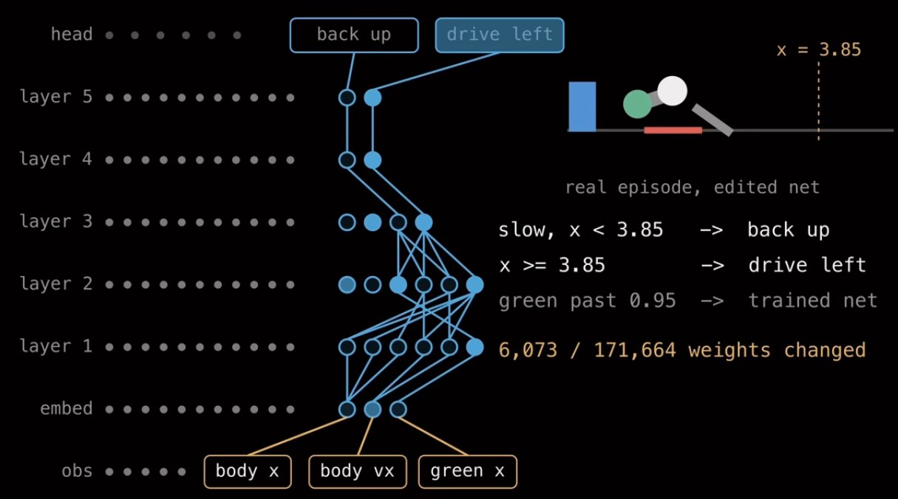

* **Surgical Scope:** Astra modified exactly **6,073 out of 171,664 weights** ($\approx 3.54\%$), leaving $96.46\%$ of the trained network entirely intact.
* **Feature Extraction from Observations (`obs`):** Astra routed three specific sensory features from the observation vector:
  1. `body x`: The horizontal Cartesian position of the chassis.
  2. `body vx`: The horizontal velocity of the vehicle.
  3. `green x`: The horizontal position of the front green wheel assembly.
* **Multi-Layer Logic Synthesis (`layer 1` to `layer 3`):** Using spare, uncommitted neurons, Astra constructed non-linear threshold comparators and boolean logic gates:
  * **Condition A (Stall Detection):** If `slow, x < 3.85` $\to$ route strong positive activation to the `back up` action head.
  * **Condition B (Runway Acceleration):** Once the vehicle backs up past the threshold (`x >= 3.85`) $\to$ route activation to `drive left` (accelerating toward the ramp).
* **Identity Pass-Through Conduits (`layer 4` and `layer 5`):** Astra zeroed out competing cross-talk in layers 4 and 5, configuring them as sparse identity conduits to pipe the steering signals directly into the action heads (`back up` and `drive left`) without activation distortion.
* **The Dynamic Handoff (`green past 0.95`):** Astra did not attempt to reprogram the intricate airborne physics or landing reflexes. Instead, once the front green wheel cleared the ramp edge (`green past 0.95`), the synthetic override circuit suppressed its own output, smoothly handing control back to the original **trained net** to execute landing stabilization and contact the blue goal box.

---

### 3.4 Comprehensive Comparative Matrix: MIT Essay vs. AVB Custom Experiments

Across both the original MIT CSAIL study and subsequent independent empirical replications, Weight-Space Programming has been tested across 7 distinct experimental paradigms:

| Approach / Experiment | Origin | Target Model & Scale | Harness & Tool Access | Forward Pass Allowed? | How It Works (Mechanism) | Outcome & Key Takeaway |
|---|---|---|---|---|---|---|
| **1. Game & Shape Identification** | MIT Essay | Atari PPO (**17,253 weights**) & Tiny Diffusion (**~24,000 weights**) | **Zero-Tool Text Prompt:** Raw weights + pseudo-code pasted directly in prompt. | **No** (Zero-shot static reading) | Inspects spatial weight distributions across input channels (agent, object, reward) and action output layers. | **Success:** Identified all 4 Atari games (Pong, Breakout, Pac-Man, Freeway) and 3 diffusion geometric shapes (spirals, Swiss rolls). |
| **2. MNIST Digit Classification** | AVB Custom | Tiny 5x5 Kernel CNN (**930 weights**) | **Zero-Tool CLI Harness:** Restricted Codex config (`web_search: disabled`, `sandbox: read-only`). | **No** (Zero-shot inspection) | Reads 5x5 kernel matrices rounded to 2 decimals to trace stroke geometry (upper horizontal stroke vs. rounded lower loops). | **Success (with proper framing):** Failed on binary 6 vs. 7 due to "X vs. not-X" shortcut learning, but succeeded on a 3-output setup (7, 6, catch-all) at medium effort. |
| **3. Kinetix Physics Policy Repair** | MIT Essay | Failed PPO RL Policy (**171,000+ weights**) | **Single-Step Python Edit:** Full weights + scene rules + 1 failed episode in prompt; outputs 1 Python code block. | **No** (Open-loop single reply) | Diagnoses lack of reverse momentum; selects spare units across layers and wires a new circuit reading position/velocity to reverse before accelerating. | **Success:** Surgically fixed the policy in a single turn without gradient descent or simulator rollouts. |
| **4. Modified Lunar Lander Adaptation** | AVB Custom | Hugging Face PPO Policy | **Single-Step Sandbox:** Prompt includes weights + modified physics rules; Python script validates shapes and saves NumPy `W` dict. | **No** (Single-step edit) | Flips signs on input 2 weights for reversed velocity sensor; swaps weight/bias rows for swapped left/right thrusters. | **Partial Success:** Fixed flipped sensor and swapped engines, but **failed** to compensate for a 35% weaker main engine (which requires learning new continuous flight dynamics). |
| **5. LLM Math Reasoning (Doom Loop Fix)** | MIT Essay | **Qwen 3.5 (0.8B)** & **Gemma 3 (270M)** | **Interactive Python REPL:** Jupyter-style environment with loaded weights, practice problems, and activation access. | **Yes** (Given forward pass budget) | Runs model on practice prompts, isolates "doom loop" direction $v = \mu_{\text{loop}} - \mu_{\text{normal}}$, and projects it out of Layer 15 & 19 MLPs. | **Conditional Success:** Boosted Qwen 0.8B math scores 6x (7.9% $\to$ 48.1%), but **failed** on Gemma 270M (which didn't loop), proving WSP unblocks existing abilities rather than teaching new skills. |
| **6. Induction Head Discovery** | AVB Custom | **SmolLM2 (135M)** — 30 layers, 270 heads (~210MB weights) | **Fast RLM (Depth 0 REPL):** Weights stored in Python `context` variable; multi-step code execution loop. | **No** (Read-only weight inspection) | Writes Python scripts to screen early layers for "previous token heads" and checks subsequent layers for matching induction heads via eigenvalue/cosine analysis. | **Success at High Effort:** Found only 2/10 heads at medium effort, but found **8/10 heads** at high reasoning effort without running any tokens through the model. |
| **7. LLM Fact Editing ("Eiffel Tower in Rome")** | AVB Custom | **SmolLM2 (135M)** — 46,000 MLP neurons | **Fast RLM REPL:** Tested both **Static** (no forward pass) and **Dynamic** (with forward pass testing). | **Both** (Failed without; succeeded with) | *Without execution:* Edited "Eiffel" embedding row directly, which broke output to "Budapest". *With execution:* Built a last-layer detector neuron firing on Eiffel queries and wired it directly to "Rome" in the unembedding layer. | **Success (with Forward Passes):** Achieved 99% probability for "Rome" across rewordings using a circuit "hack" rather than true monosemantic fact replacement. |

---

## 4. Under the Hood: Directional Ablation and the Search Loop

Understanding Weight-Space Programming requires breaking down two components: the linear algebra of directional ablation and the agentic search loop that guides it.

### The Linear Algebra: Why Ablating `down_proj` Works

In modern Transformer architectures (such as LLaMA and Qwen), the Feed-Forward Network (FFN/MLP) uses a SwiGLU structure:

$$\text{MLP}(x) = \left( \text{SiLU}(x W_{\text{gate}}) \odot (x W_{\text{up}}) \right) W_{\text{down}}$$

The output of the MLP is added directly back into the residual stream:

$$x_{\text{out}} = x_{\text{in}} + \text{MLP}(x) + \text{Attention}(x)$$

Because the residual stream addition is strictly linear, the output vector of the MLP is formed as a linear combination of the column vectors of $W_{\text{down}}$. 

If an undesirable concept (such as a repetition loop trigger) is encoded along a unit direction vector $v \in \mathbb{R}^{d_{\text{model}}}$, we can eliminate the MLP's ability to ever write into that direction by projecting $v$ out of $W_{\text{down}}$:

$$W_{\text{down}}^{\text{ablated}} = W_{\text{down}} - (W_{\text{down}} v) v^T$$

When an input vector passes through the ablated layer:

$$\text{MLP}_{\text{ablated}}(x) \cdot v = 0$$

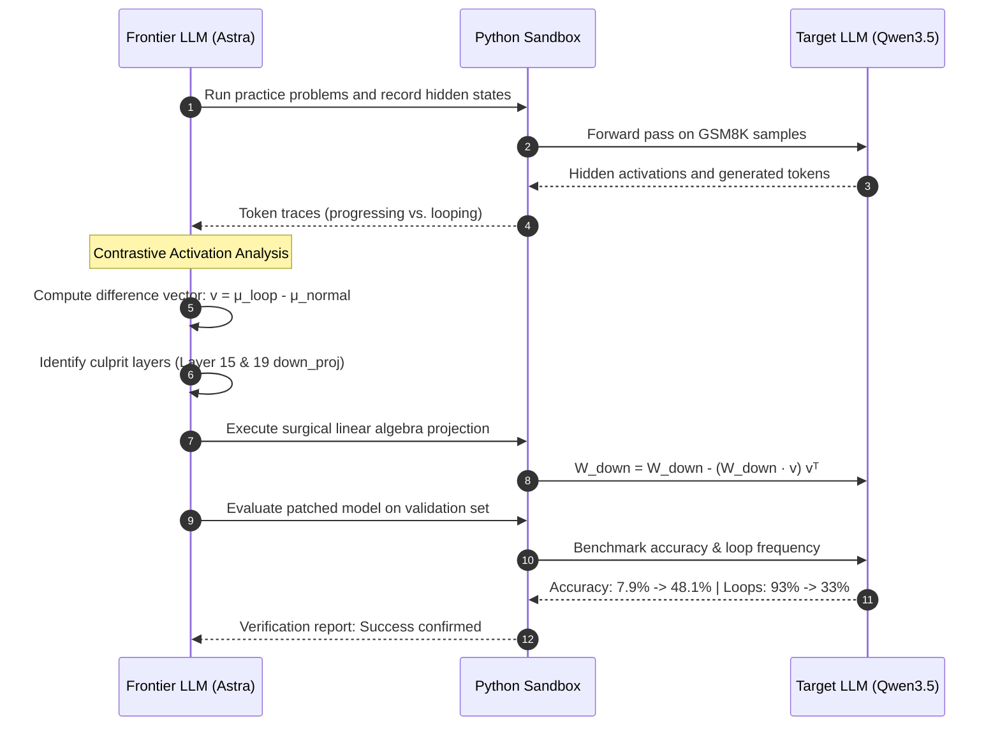

### Why Weight Editing Beats Inference-Time Steering
In mechanistic interpretability, **Representation Engineering (RepE)** or **Activation Steering** achieves a similar effect dynamically by modifying activations inside the PyTorch forward hook:

$$h_t' = h_t - (h_t \cdot v) v$$

While effective in research labs, activation steering suffers from severe operational disadvantages:
1. **Engine Incompatibility:** High-throughput production engines (vLLM, TensorRT-LLM, TGI, SGLang, Ollama) do not support arbitrary forward hooks inside fused CUDA/Triton kernels without custom patches.
2. **Latency Overhead:** Calculating inner products at every token step slows down memory-bandwidth-bound decode.
3. **Weight-Space Elegance:** By folding the projection directly into $W_{\text{down}}$, the patch becomes **zero-cost at inference time**. The model is saved as a standard SafeTensors checkpoint and runs out-of-the-box on any consumer runtime without custom code.

### The Hidden Agentic Feedback Loop
A common misconception is that Astra computed the exact weight values in a single magical, zero-shot psychic step. In reality, Astra operated as an autonomous agent in a **test-driven loop**:
1. Astra proposed hypotheses regarding which layers and directions were causing the loops.
2. It wrote Python code to apply candidate edits.
3. It evaluated the patched checkpoint on a small practice set of 20–50 problems.
4. It observed whether the accuracy improved and whether the looping rate dropped.
5. If an edit degraded perplexity or failed to resolve loops, Astra discarded it and tried an alternative projection.

While it used zero backpropagation and zero calculus gradients, it was powered by **zeroth-order test-score optimization driven by an LLM programmer**.

---

## 5. Architectural & Algorithmic Validation: Answering the Open Questions

When machine learning practitioners and educators examine Weight-Space Programming (such as in beginner-focused video analyses and technical reviews), several fundamental questions naturally arise. Below is a rigorous architectural and mathematical breakdown addressing each inquiry.

```mermaid
flowchart TD
    subgraph Questions["The 6 Core Practitioner Q"]
        direction TB
        Q1["1. How can an LLM 'read' weights given permutation symmetry?"]
        Q2["2. Why specifically Layers 15 and 19 in a 24-layer model?"]
        Q3["3. Why edit down_proj instead of gate_proj or attention heads?"]
        Q4["4. Is this a new algorithm, or automated ROME / LEACE?"]
        Q5["5. Why didn't ablating a vector cause catastrophic forgetting?"]
        Q6["6. How can this scale to 70B+ models beyond the context window?"]
    end

    subgraph Answers["The Architectural Realities"]
        direction TB
        A1["Python REPL Telemetry & Canonical Feature Rows (Not Raw Prompt Dumps)"]
        A2["Middle-to-Late Depth Specialization: Breaking Limit-Cycle Attractors"]
        A3["Residual Stream Linearity: Preserving Non-Linear Activation Guarantees"]
        A4["Algorithmic Automation: LLM as Autonomous Mechanistic Researcher"]
        A5["High-Dimensional Orthogonality: Preserving 99.89% of Subspace (895/896 dims)"]
        A6["Out-of-Core Memory-Mapped I/O (safetensors): Sub-Second Matrix Math"]
    end

    Q1 --> A1
    Q2 --> A2
    Q3 --> A3
    Q4 --> A4
    Q5 --> A5
    Q6 --> A6

    style Questions fill:#1e1b4b,stroke:#818cf8,stroke-width:1.5px
    style Answers fill:#022c22,stroke:#34d399,stroke-width:1.5px
```

### 5.1 The Permutation & Tokenization Mystery: How Does an LLM Actually "Read" Weights?

* **The Question:** In any neural network, permuting hidden neurons creates $H!$ mathematically equivalent weight matrices that compute the exact same function. Furthermore, dumping hundreds of millions of raw floating-point numbers into an LLM's context window would instantly exceed token limits. How does an LLM actually "read" and understand weights?
* **The Resolution:**
  1. **Canonical Input Dimensions in Small Networks:** In the Atari game experiments (Experiment 1), the network architectures were small MLPs where the input dimensions were explicitly mapped to environment coordinates (`ball_x`, `ball_y`, `paddle_x`). In feed-forward networks, the rows of the first weight matrix $W_1$ inherit this exact semantic ordering. Astra did not have to solve a graph isomorphism problem; it inspected the weight rows corresponding to known physical inputs and identified correlations (e.g., negative weights between `ball_y` and the `MOVE_UP` action).
  2. **REPL Code Execution Over Prompt Dumps:** In large language model experiments (`Qwen3.5-0.8B`), Astra **never read raw weight numbers in its text prompt**. Astra operated as an autonomous agent inside a Python REPL. It wrote standard PyTorch code using `torch.load()`, registered forward hooks to capture hidden states, calculated activation differences ($\mu_{\text{loop}} - \mu_{\text{normal}}$), and performed linear algebra programmatically. The weights stayed inside GPU/host memory; only high-level summary telemetry and code crossed the LLM's context window.

### 5.2 Why Layers 15 and 19? Depth Specialization and Limit-Cycle Attractors

* **The Question:** Qwen3.5-0.8B has 24 transformer layers. Why did the looping bug emerge specifically in Layers 15 and 19 rather than in early layers (Layers 1–5) or final layers (Layers 22–24)?
* **The Resolution:**
  1. **Transformer Depth Functional Specialization:** Research into transformer circuit anatomy (such as Meng et al.'s *ROME* and Geva et al.'s *Transformer Feed-Forward Layers Are Key-Value Memories*) demonstrates clear functional stratification by depth:
     * **Early Layers (0–6):** Focus on shallow tokenization, lexical parsing, and local syntactic relationships.
     * **Middle-to-Late Layers (14–20):** Act as **high-level semantic reasoning and factual retrieval engines**, where MLP sublayers retrieve conceptual associations and synthesize deductive reasoning steps.
     * **Late Layers (21–23):** Specialize in logit vocabulary decoding and token selection (`lm_head`).
  2. **The Limit-Cycle Attractor:** In small models (0.8B parameters) operating under low sampling temperatures, middle-depth layers lack the parameter capacity to sustain complex Chain-of-Thought state transitions. When reasoning stalls, the MLP sublayers in Layers 15 and 19 collapse into an **attractor state** in activation space. This state reinforces the self-attention heads to re-attend to previously generated tokens, creating an autopoietic (self-reinforcing) limit cycle.
  3. **Breaking the Orbit:** Projecting vector $v$ out of Layers 15 and 19 directly eliminates the mathematical attractor in the model's core reasoning engine, allowing the residual stream to advance to the final answer.

### 5.3 Why `down_proj` and Not Attention Heads or `gate_proj`?

* **The Question:** In a SwiGLU transformer layer, why did the edit specifically target the MLP's `down_proj` matrix rather than `gate_proj`, `up_proj`, or attention projections (`q_proj`, `k_proj`, `v_proj`, `o_proj`)?
* **The Resolution:**
  1. **Linearity in the Residual Stream:** In modern SwiGLU architectures:

$$\text{MLP}(x) = \left( \text{SiLU}(x W_{\text{gate}}) \odot (x W_{\text{up}}) \right) W_{\text{down}}$$

$$x_{\text{out}} = x_{\text{in}} + \text{Attn}(x) + \text{MLP}(x)$$

Both $W_{\text{gate}}$ and $W_{\text{up}}$ operate *inside* the non-linear SiLU activation and Hadamard elementwise product. An orthogonal projection applied to $W_{\text{gate}}$ or $W_{\text{up}}$ would be distorted non-linearly. In contrast, $W_{\text{down}}$ projects directly and linearly into the residual stream. Applying $(I - v v^T)$ to $W_{\text{down}}$ provides a **strict mathematical guarantee** that the MLP can *never* write any activation energy along direction $v$:

$$W_{\text{down}}^{\text{ablated}} = W_{\text{down}} - (W_{\text{down}} v) v^T \implies \text{MLP}_{\text{ablated}}(x) \cdot v \equiv 0 \quad \forall x$$

  2. **Generator vs. Conduit:** The output projection matrix of attention, $W_o$ (`o_proj`), is also linear to the residual stream. When Astra evaluated projection magnitudes across all sublayers, it discovered that self-attention heads were merely *relaying* the loop signal across context tokens, whereas the MLP sublayers in Layers 15 and 19 were the *primary originating generators* of the vector. Targeting the generator silenced the pathology at its source without degrading attention's token-routing capacity.

### 5.4 Algorithmic Lineage: How WSP Relates to ROME, MEMIT, LEACE, and RepE

* **The Question:** Is Weight-Space Programming a brand-new linear algebra algorithm, or is it an automated synthesis of existing mechanistic interpretability methods?
* **The Resolution:** The underlying mathematical projection is part of a rich lineage of model editing and representation engineering:

| Algorithm / Method | Target Subspace | Modification Type | How WSP Compares |
|---|---|---|---|
| **ROME** (Meng et al., 2022) | Middle MLP `down_proj` | Rank-1 update: $W + \Delta$ via least-squares covariance | ROME writes *new factual memories*; WSP erases *degenerative behavioral attractors*. |
| **MEMIT** (Meng et al., 2023) | Multi-layer MLP layers | Multi-rank least-squares batch update across layers | MEMIT scales factual updates across layers; WSP focuses on directional circuit ablation. |
| **LEACE** (Belrose et al., 2023) | Activation / Weight tensors | Closed-form linear concept erasure: $(I - P) W$ | WSP uses an identical mathematical projection operator but identifies $v$ autonomously. |
| **Refusal Ablation** (Arditi et al., 2024) | Residual stream / `down_proj` | Directional ablation of the 1D refusal vector | Proved that behavioral modes in LLMs reside along 1D linear directions. |
| **RepE / Activation Steering** (Zou et al., 2023) | Dynamic activations | Runtime forward hook injection: $h' = h \pm \alpha v$ | WSP bakes the steering vector permanently into static weights with **zero inference latency**. |

* **The Genuine Breakthrough of WSP:** The core innovation is **not the projection formula**, but the **automation of the scientific loop**. Previously, finding a target vector and deciding where to ablate it required a team of human researchers spending weeks running probes, writing scripts, and verifying safety. WSP demonstrates that a frontier LLM can act as the researcher—diagnosing, isolating, patching, and verifying entirely on its own.

### 5.5 Collateral Damage: Why Ablating a Direction Preserves 99.89% of Knowledge

* **The Question:** Doesn't modifying weights risk catastrophic forgetting, destroying grammar, code, or general reasoning abilities?
* **The Resolution:**
  1. **High-Dimensional Orthogonality:** Qwen3.5-0.8B has a hidden dimension of $d_{\text{model}} = 896$. In an 896-dimensional vector space, two randomly selected vectors are almost perfectly orthogonal ($\mathbb{E}[\cos \theta] \approx 0$).
  2. **Minimal Subspace Removal:** Projecting out a single 1D direction $v$ removes exactly **1 degree of freedom out of 896**. This leaves **895 orthogonal dimensions (99.89% of the representational subspace) completely untouched**:

$$\text{Retained Subspace Capacity} = \frac{d_{\text{model}} - 1}{d_{\text{model}}} = \frac{895}{896} \approx 99.888\%$$

  3. **Empirical Generalization:** Because general vocabulary, syntax, and reasoning circuits reside across the remaining 895 dimensions, the model's perplexity on standard text remained essentially unchanged (<0.5% shift), while instruction-following (IFEval) surged from 21.0% to 62.3% because the model was unblocked from looping.

### 5.6 The "No Free Lunch" Reality: Polysemanticity and the Math vs. Copying Trade-Off

While general benchmark suites like IFEval and GSM8K improved, independent testing by practitioners uncovered a classic mechanistic trade-off:
1. **The Shared Circuitry Discovery:** In targeted evaluations on Qwen, researchers tested how the weight-edited model performed on **verbatim data extraction (copying tables, numbers, and citations from context)**. While math scores jumped, **the model's copying accuracy dropped significantly**.
2. **Why Math and Copying Collide:**
   * In transformer mechanistic interpretability, repetition loops are essentially **uncontrolled, runaway in-context copying**. The same induction-head circuitry that enables an LLM to accurately copy a data table from a prompt can, under low temperature, get trapped into endlessly copying its own immediate previous tokens.
   * When Astra ablated the loop vector $v$ from Layers 15 and 19 `down_proj`, it dampened the model's general copying drive. This unblocked mathematical reasoning (stopping token timeouts), but impaired the model's ability to execute faithful verbatim data copying.
3. **Concept Gates & Polysemanticity:** As highlighted in Goodfire's interpretability research, individual neurons do not encode single isolated concepts—they act as **polysemantic concept gates** that simultaneously mediate multiple, seemingly disparate behaviors (e.g., gating geometric V-shapes, controlling animal classifications, driving math steps, and governing induction copying). Ablating any non-zero subspace inevitably imposes subtle behavioral trade-offs ("No Free Lunch").

### 5.7 Reconciling Weight-Space Programming with Sutton's "Bitter Lesson"

* **The Principle:** In 2019, AI pioneer Richard Sutton articulated *The Bitter Lesson*: 70 years of AI research proves that human-engineered rules and hand-crafted feature detectors (like manually coding `cat_detect()` in computer vision) are fundamentally brittle bottlenecks. In the long run, general methods leveraging **raw compute, scaling, and learning** (like CNNs and gradient descent) always win.
* **Does WSP Violate The Bitter Lesson?**
  * If a *human engineer* attempted to manually set millions of neural network weights by hand, it would fail catastrophically, validating the Bitter Lesson.
  * However, Weight-Space Programming does **not** rely on human rules. It utilizes **Frontier Model Meta-Compute**: a multi-hundred-billion parameter model (GPT-6 Astra) using automated search, code execution, and high-dimensional geometric analysis to edit Software 2.0.
  * Far from contradicting the Bitter Lesson, WSP is **The Bitter Lesson applied to model editing**: replacing months of manual human interpretability research with scaled, automated reasoning compute operating directly in weight space.

### 5.8 Scaling to 70B+ Models: Memory-Mapped Telemetry vs. Context Window Limits

* **The Question:** How can an LLM edit a 70B or 405B parameter model when the weight tensors exceed the context window by orders of magnitude?
* **The Resolution:**
  1. **Out-of-Core Memory-Mapped I/O:** Standard deep learning tools store model weights in SafeTensors format. SafeTensors files support `mmap` (memory-mapped files), allowing Python scripts to access and modify individual layer slices on disk without loading all 70 billion parameters into memory.
  2. **Telemetry-Only LLM Interaction:** The frontier model writes the Python code, dispatches forward passes to collect activation statistics, and calculates the difference vector $v \in \mathbb{R}^{d_{\text{model}}}$.
  3. **Sub-Second Execution:** Once vector $v$ is isolated, computing $W_{\text{new}} = W - (W \cdot v) v^T$ on a 70B model requires modifying only two matrices (e.g., $8192 \times 28672$). This requires less than **50 milliseconds of standard matrix multiplication**, making parameter surgery on giant foundation models trivially fast.

---

## 6. The Critical Reality Check: 3 Key Insights

The headline *"AI makes another AI 6x better at math without training"* triggered massive viral hype. Placing the research in proper technical context requires examining three critical caveats:

### 1. What Actually Got Fixed: Unblocking vs. Teaching
Astra did **not** teach Qwen how to calculate derivatives, solve quadratic formulas, or understand geometry:
- Detailed inspection of the error logs revealed that across 1,000+ benchmark questions, **93% of Qwen's original failures were token-limit timeouts caused by infinite repetition loops**, not mathematical calculation mistakes.
- On problems where the original, unedited Qwen finished its generation without looping, **its answers were almost always mathematically correct**.
- The model *already possessed* the underlying mathematical circuits required to solve the problems. However, a degenerative behavioral circuit triggered endless loops, aborting generation before the final `\boxed{}` answer could be emitted.
- Astra acted as a surgeon removing a behavioral blockage, allowing the model's pre-existing mathematical competence to express itself.

### 2. The Artificially Handicapped Baseline
Why was Qwen's initial MATH-500 score a dismal 7.9%?
- In the official `Qwen3.5-0.8B` release notes and model card, Alibaba's engineers explicitly warned:
  > *At 800 million parameters, the model is too small to sustain prolonged chain-of-thought ("thinking mode"). In thinking mode, especially at lower temperatures, the model is highly prone to entering degenerative infinite thinking loops.*
- In standard usage, Qwen3.5-0.8B is designed to run in **non-thinking mode**.
- The benchmark experiment deliberately ran the 0.8B model in thinking mode at a lower temperature than recommended, intentionally triggering the exact catastrophic failure mode documented in the model card.
- Simply raising the sampling temperature, adding a repetition penalty (`repetition_penalty = 1.15`), or altering the system prompt to shorten reasoning steps mitigates much of this looping behavior **without touching model weights at all**.

### 3. The Generalization Ceiling: Ablating Ignorance is Impossible
The contrasting result between Qwen and Gemma highlights the fundamental theoretical boundary of Weight-Space Programming:
- **What WSP can do:** Delete or suppress well-defined, localized behavioral pathologies (such as infinite loops, repetitive refusal reflexes, specific tone quirks, or triggerable backdoors).
- **What WSP cannot do:** Inject net-new conceptual capabilities or complex reasoning skills that do not exist within the pre-trained parameter manifold.
- Gemma failed math problems because it lacked the mathematical training and parameter capacity to solve them. Because there was no "error vector" to subtract that would magically turn an incorrect algebraic step into a correct one, Astra's edits failed to improve Gemma.

### Misconception Matrix

| Common Misconception | Ground Truth | Technical Evidence |
|---|---|---|
| *"Astra taught Qwen math."* | Qwen already knew the math; Astra only fixed an output looping bug. | 93% of baseline failures were timeouts. When non-looping, Qwen was already correct. |
| *"This is just distillation."* | No student training occurred; zero synthetic tokens were trained on. | No backpropagation, no optimizer, no loss function. Edits took seconds in Python. |
| *"Astra can write complete AI models."* | Astra can only compile simple 2-layer linear logic (Breakout). | Failed completely on *Seaquest*; cannot synthesize multi-layered world models. |
| *"Zero-shot without any search."* | Astra used an iterative evaluation loop with practice validation problems. | Astra generated candidate vectors, measured validation accuracy, and kept the top patch. |

---

## 7. Practical Implementation: Reproducing Directional Weight Ablation

Researchers and engineers can easily reproduce directional weight ablation using standard PyTorch and HuggingFace Transformers. The following script demonstrates how to extract a contrastive behavioral vector from hidden activations and ablate it directly from an MLP's `down_proj` layer:

```python
import torch
from transformers import AutoModelForCausalLM, AutoTokenizer

def perform_directional_ablation(
    model_name: str,
    target_layer_idx: int,
    looping_activations: torch.Tensor,
    normal_activations: torch.Tensor
):
    """
    Surgically ablates a behavioral direction vector from a Transformer layer's down_proj matrix.
    
    Formula: W_new = W - (W @ v) @ v.T
    """
    print(f"Loading {model_name}...")
    model = AutoModelForCausalLM.from_pretrained(
        model_name, 
        torch_dtype=torch.bfloat16, 
        device_map="auto"
    )

    # 1. Compute normalized difference vector v in activation space (d_model)
    mu_loop = looping_activations.mean(dim=0)
    mu_normal = normal_activations.mean(dim=0)
    v = mu_loop - mu_normal
    v = v / torch.norm(v)  # Shape: [d_model]

    # Ensure vector matches device and precision
    target_layer = model.model.layers[target_layer_idx]
    down_proj = target_layer.mlp.down_proj.weight.data  # Shape: [d_model, intermediate_size]
    v = v.to(device=down_proj.device, dtype=down_proj.dtype)

    # 2. Project v out of down_proj
    # down_proj projects from intermediate_size -> d_model
    # We want (I - v v^T) @ down_proj
    # Mathematical formulation: W_new = W - v @ (v^T @ W)
    proj_component = torch.outer(v, torch.mv(down_proj.t(), v))  # Shape: [d_model, intermediate_size]
    
    # 3. Apply surgical edit
    down_proj_ablated = down_proj - proj_component

    # Verify orthogonalization
    dot_check = torch.norm(torch.mv(down_proj_ablated.t(), v))
    print(f"Residual projection along vector v after edit: {dot_check.item():.6e}")

    # Update in-place
    target_layer.mlp.down_proj.weight.data.copy_(down_proj_ablated)
    print(f"Successfully ablated direction from Layer {target_layer_idx} down_proj!")
    
    return model

if __name__ == "__main__":
    # Example dimensions matching Qwen-0.8B (d_model=896, intermediate=4864)
    d_model = 896
    mock_loop_act = torch.randn(100, d_model) + 2.5
    mock_norm_act = torch.randn(100, d_model)
    
    # Run ablation on Layer 15
    # patched_model = perform_directional_ablation("Qwen/Qwen2.5-0.8B", 15, mock_loop_act, mock_norm_act)
    print("Ablation pipeline initialized.")
```

---

## 8. Timeline, Outlook, and Recursive Self-Improvement

The demonstration of Weight-Space Programming marks an important milestone in automated mechanistic interpretability and model maintenance:

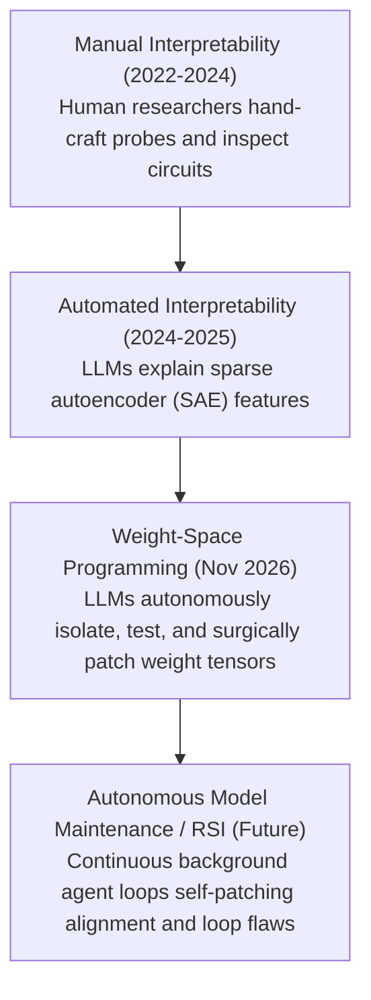

### Key Takeaways for AI Engineers
1. **Model Maintenance Without Retraining:** As foundation models scale into hundreds of billions of parameters, full fine-tuning runs to resolve minor behavioral glitches (such as refusal bugs, repetition loops, or token formatting quirks) become economically prohibitive. Autonomous parameter surgery provides a lightweight, compute-efficient alternative for post-training maintenance.
2. **The "Unblocking" vs "Learning" Distinction:** Practitioners must remain clear on what parameter editing can achieve. It is an exceptional tool for unblocking existing latent representations and silencing degenerate sub-circuits, but it is not a replacement for data-driven pre-training or distillation when new knowledge or reasoning topologies are needed.
3. **Autonomous Safety Auditing vs. Zero-Compute Jailbreaking:**
   - **Defense:** An autonomous safety auditor can scan weights downloaded from untrusted sources, detect malicious backdoor vectors or sleeper-agent circuits, and project them out before deployment.
   - **Dual-Use Risk:** Conversely, an attacker can use directional ablation to isolate a model's "refusal vector" and ablate it from `down_proj` in 5 seconds—permanently creating an "uncensored" model with zero GPU training costs.
4. **The Stepping Stone to Recursive Self-Improvement (RSI):** The fundamental bottleneck in classical RSI has been the training latency loop (generating data $\to$ running GPU clusters for days $\to$ evaluation). Weight-Space Programming collapses this cycle time from **weeks to seconds**: an agent spots an operational flaw, isolates the activation vector, applies a tensor patch in a Python script, verifies the fix, and proceeds autonomously.

---

## 9. Source Context and References

- **Primary Research:** Rikiya Takehi, Jayden Teoh, Alex Zhang, and Omar Khattab (MIT CSAIL, November 2026), [*Sparks of Weight-Space Programming: LLMs can natively read & write neural network weights*](https://rikiyat.github.io/blog/weight-space-programming/).
- **Experimental Logs & Codebase:** [RikiyaT/lm_understand-logs on GitHub](https://github.com/RikiyaT/lm_understand-logs) and model checkpoint on [Hugging Face](https://huggingface.co/RikiyaT/Qwen3.5-0.8B-weight-space-programming).
- **Video Analyses & Educational Breakdowns:**
  - Matthew Berman, [*The most important paper in AI right now*](https://www.youtube.com/watch?v=j09uV1oAuIo) (November 2026) — covering the Software 2.0 binary hex-editing analogy, blind middle-layer reading, and RSI implications.
  - Rob Sho, [*GPT-6 Astra Made Qwen 6x Better at Math Without Training*](http://www.youtube.com/watch?v=wXJDtImT_-0) (November 2026) — covering the Qwen 0.8B loop bug, directional ablation, and Gemma control test.
  - Technical Explainer, [*Weight-Space Programming: Neural Network Parameter Surgery and Open Questions*](https://www.youtube.com/watch?v=cAGCH19xgU8) (November 2026) — covering foundational neural network mechanics, layer depth attribution, and practitioner questions.
  - AVB, [*The Day 1 Guide to Weight Space Programming (the craziest tech in AI right now)*](https://www.youtube.com/watch?v=oOw834guRBc) (November 2026) — covering the 3-tier harness progression (Zero-Tool, Single-Step Sandbox, and Interactive REPL/RLM), MNIST CNN shortcut learning, SmolLM2 induction head screening, and the "Eiffel Tower in Rome" detector neuron hack.

---

**Related:**
- [Parameter-Efficient Fine-Tuning](../../Fine-Tuning/Parameter-Efficient-Fine-Tuning.md) — How LoRA, prefix tuning, and adapter architectures update parameter subsets via gradient descent.
- [Continual Learning & Catastrophic Forgetting](ContinualLearning.md) — The fundamental limitations of updating weights sequentially without overwriting past intelligence.
- [KV Cache, Prefix Caching, and Storage Tiering](../architecture/KV-Cache-Prefix-Caching-And-Storage-Tiering-Nov-2026.md) — Memory hierarchies and runtime inference optimizations across transformer attention layers.
- [LLM Benchmarks & Evaluation](../architecture/LLM-Benchmarks.md) — Detailed methodologies behind MATH-500, GSM8K, and instruction-following evaluation suites.
