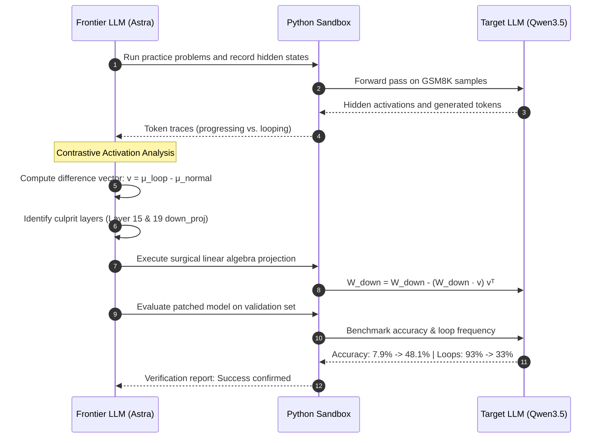
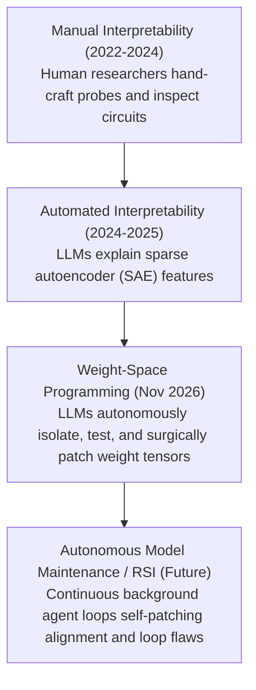

# Weight-Space Programming: Frontier LLMs Editing Neural Network Weights Directly Without Training

> Daily learning · November 3, 2026 · Mechanistic interpretability, automated weight steering, and parameter surgery

> In November 2026, researchers at MIT CSAIL demonstrated **Weight-Space Programming (WSP)**: frontier reasoning models (such as GPT-6 Astra) directly reading, diagnosing, and editing raw neural network weight matrices without backpropagation, loss functions, or gradient descent. In headline experiments, Astra boosted `Qwen3.5-0.8B`'s MATH-500 score from 7.9% to 48.1% (a 6x gain) by modifying only **0.016%** of its weights. However, a rigorous reality check reveals this was not teaching Qwen new math, but performing automated mechanistic interpretability to surgically remove a degenerate "thinking loop" bug that choked Qwen's output tokens.

---

## 1. Architecture Overview

The diagram below illustrates the end-to-end Weight-Space Programming paradigm, the surgical edit pipeline applied to `Qwen3.5-0.8B`, the reality check behind the 6x benchmark leap, and how weight editing contrasts fundamentally with Knowledge Distillation, Fine-Tuning, and Quantization.


---

## 2. Foundations: What Weight-Space Programming Actually Is

Every deep neural network is fundamentally an organized collection of numerical arrays called **weight matrices**. Traditionally, human engineers never touch these numbers by hand. Instead, we train models indirectly: we feed massive text corpora or curated datasets, calculate errors (loss), and allow calculus (backpropagation and gradient descent optimizers like AdamW or Muon) to nudge billions of numbers by minuscule increments over millions of compute steps.

**Weight-Space Programming (WSP)** flips this paradigm. Rather than training models with data and gradients, a frontier reasoning model (operating inside an execution environment like a Python sandbox) treats another model's raw weight tensors as **code to be analyzed, debugged, and refactored directly**.

```mermaid
flowchart TD
    subgraph TraditionalAI ["Traditional Approach"]
        direction LR
        H1["🔴 <b>TRADITIONAL TRAINING: GRADIENT-DRIVEN</b><br/><i>Uses Datasets, Loss Calculus and Backpropagation</i>"]
        D["Dataset and Prompts"] --> FP["Forward Pass"]
        FP --> L["Loss Calculation"]
        L --> BP["Backpropagation (Gradients)"]
        BP --> OPT["Optimizer (AdamW / Muon)"]
        OPT --> W1["Nudge All Weights (Slow and Expensive)"]
        H1 --- D
    end

    subgraph WeightSpaceProg ["Weight-Space Approach"]
        direction LR
        H2["🟢 <b>WEIGHT-SPACE PROGRAMMING: GRADIENT-FREE</b><br/><i>Uses Zero Backprop, Linear Algebra and Search</i>"]
        LLM["Frontier LLM (Astra)"] --> REPL["Python Sandbox / REPL"]
        REPL --> INSP["Inspect Hidden Activations"]
        INSP --> VEC["Isolate Bug Direction Vector (v)"]
        VEC --> PROJ["Linear Algebra: W - (W·v)vᵀ"]
        PROJ --> W2["Surgically Patched Weights (0.016% Edited)"]
        H2 --- LLM
    end

    style H1 fill:#311042,stroke:#f43f5e,stroke-width:2px,color:#ffffff
    style H2 fill:#022c22,stroke:#10b981,stroke-width:2px,color:#ffffff
    style TraditionalAI fill:#0f172a,stroke:#475569,stroke-width:1.5px
    style WeightSpaceProg fill:#0f172a,stroke:#38bdf8,stroke-width:1.5px
```



### Core Terminology

| Term | Mathematical / Operational Meaning | Role in Weight-Space Programming |
|---|---|---|
| **Weight Tensor ($W$)** | The static numerical parameters defining the model's transformations. | The source code artifact inspected and directly edited by the frontier LLM. |
| **Residual Stream ($x$)** | The continuous vector representations passed between transformer layers. | The communication bus where internal features, concepts, and behavioral states reside. |
| **Activation Steering** | Modifying residual stream vectors dynamically during the forward pass ($x' = x + \alpha v$). | Runtime behavioral steering; requires custom inference hooks and extra GPU overhead. |
| **Directional Ablation** | Projecting a specific vector $v$ out of a weight matrix ($W_{\text{new}} = W - (W \cdot v) v^T$). | Bakes activation steering directly into static weights so standard engines run it natively. |
| **Loop Vector ($v_{\text{loop}}$)** | The direction in activation space that triggers cyclic repetitive generation. | The isolated pathology vector causing Qwen's chain-of-thought to loop infinitely. |
| **Down Projection (`down_proj`)** | The final linear layer of a SwiGLU MLP that projects activations back to hidden size $d_{\text{model}}$. | The specific matrix where Astra ablated the loop vector in Layers 15 and 19. |

### How Weight-Space Programming Differs From Standard Techniques

| Dimension | Weight-Space Programming | Knowledge Distillation | Fine-Tuning (SFT / RLHF) | Quantization (PTQ) |
|---|---|---|---|---|
| **Primary Mechanism** | Frontier LLM inspects activations and edits raw tensor values via linear algebra. | Teacher LLM generates reasoning traces; student model trains to imitate teacher logits. | Supervised pairs or reward models compute loss gradients to nudge parameters. | Mathematical rounding downscales numerical precision (e.g., FP16 $\to$ INT4). |
| **Uses Gradients?** | **No** (Zero backpropagation; guided by zeroth-order search). | **Yes** (Full backpropagation over millions of synthetic tokens). | **Yes** (Iterative gradient descent via AdamW or Muon). | **No** (Direct post-training calibration). |
| **Fraction of Weights Modified** | **$\approx 0.016\%$** (Surgical) or toy networks from scratch. | **$100\%$** (or adapter layers like LoRA). | **$1\%$ to $100\%$** of all parameters. | **$100\%$** of weights undergo precision reduction. |
| **Primary Goal** | Debugging behavioral flaws, unblocking latent skills, model maintenance. | Compressing large model intelligence into small models. | Domain adaptation, instruction alignment, stylistic control. | Reducing VRAM footprint and accelerating memory-bandwidth decode. |
| **Analogy** | A neurosurgeon clipping a localized aneurysm so blood flows normally. | A professor authoring a condensed textbook for an apprentice to memorize. | Specialized vocational training with mandatory practice exams. | Compressing an uncompressed TIFF photograph into an optimized WebP. |

---

## 3. The Research Evidence: MIT CSAIL Experiments

The concept of Weight-Space Programming was formalized in research led by Rikiya Takehi, Jayden Teoh, Alex Zhang, and Professor Omar Khattab at MIT CSAIL (*"Sparks of Weight-Space Programming: LLMs can natively read & write neural network weights"*, November 2026). The authors demonstrated four distinct capabilities:

### Experiment 1: Zero-Shot Weight Reading (Mechanistic Inspection)
The researchers trained four identical small neural network architectures on four separate Atari games (*Breakout*, *Pong*, *Freeway*, and *Space Invaders*). 
- The raw parameter arrays were pasted directly into OpenAI's GPT-6 Astra text prompt without labels, game names, or execution tools—only the input state feature dimensions were identified.
- Astra deduced which network corresponded to which game with **100% accuracy**.
- Astra explained its reasoning mechanistically: it observed that the bottom rows of input weights mapped directly to horizontal paddle bounds, while top clusters strongly weighted static vertical obstacles (bricks).

### Experiment 2: Compiling Logic into Weights from Scratch
Given only game rules and an empty neural network initialized to all zeros:
- Astra generated every single floating-point parameter for a 2-layer MLP to play Atari *Breakout* in a single text output.
- Astra formulated the problem algorithmically: Layer 1 predicted the landing $x$-coordinate of the descending ball from its trajectory coordinates, and Layer 2 mapped that coordinate to paddle actuation commands.
- **The Result:** Astra's hand-compiled network outscored baseline policies trained with Proximal Policy Optimization (PPO) over millions of environment steps.
- **The Limit:** When tested on *Seaquest* (requiring deep visual-temporal management: tracking oxygen levels, shooting enemies, dodging depth charges, and surfacing), Astra failed completely. Complex temporal and spatial policies cannot easily be hand-compiled into linear algebra by current LLMs.

### Experiment 3: Surgical Repair on Qwen3.5-0.8B (`exp8_math`)
In the headline experiment, Astra was tasked with improving the mathematical reasoning capability of Alibaba's open-source `Qwen3.5-0.8B` model.
- **The Setup:** Astra was given access to a Python notebook sandbox containing Qwen's model weights and a small practice dataset of GSM8K and MATH training problems. Astra was strictly prohibited from running backpropagation or computing gradients.
- **The Diagnosis:** Astra executed Qwen across practice problems and detected that Qwen routinely started solving math problems with correct logic, but would abruptly get trapped in infinite "thinking loops," repeating identical sentences or formulas until hitting the generation token limit.
- **The Isolation:** Astra recorded internal activations across tokens. By subtracting the mean hidden states of progressing reasoning tokens from the mean hidden states of looping tokens, Astra isolated the 1D direction vector $v$ responsible for driving the model into cyclic loops:

$$v = \frac{\mu_{\text{loop}} - \mu_{\text{progress}}}{\|\mu_{\text{loop}} - \mu_{\text{progress}}\|}$$

- **The Surgical Edit:** Astra discovered that the `down_proj` matrices in the Feed-Forward/MLP sublayers of **Layer 15** and **Layer 19** projected most strongly into vector $v$. Astra projected $v$ out of those two weight matrices:

$$W_{\text{new}} = W - (W \cdot v) v^T$$
  Across the ~800 million parameters in Qwen3.5-0.8B, this edit modified exactly **131,072 parameters—just 0.016% of the network**.
- **The Benchmark Results:**
  - Token-limit timeouts dropped from **93% down to ~33%**.
  - **MATH-500:** Jumped from **7.9% to 48.1%** (a 6.1x increase).
  - **GSM8K:** Jumped from **13.8% to 67.1%** (a 4.8x increase).
  - **IFEval (Instruction Following):** Tripled from **21.0% to 62.3%**, showing positive cross-domain generalization.

### Experiment 4: The Gemma Control Experiment
To test whether this technique could improve any small model, the researchers ran the identical pipeline on Google's small Gemma model.
- Unlike Qwen, Gemma did not have a cyclic repetition bug; its failures on MATH-500 were caused by genuine arithmetic mistakes, false assumptions, or flawed logical deductions.
- Astra attempted to find and ablate error directions, but Gemma's benchmark score **barely changed**.
- **Crucial Finding:** Directional ablation removes behavioral blockers; it cannot inject missing intelligence or create mathematical reasoning capabilities that do not already exist in the model's weights.

---

## 4. Under the Hood: Directional Ablation and the Search Loop

Understanding Weight-Space Programming requires breaking down two components: the linear algebra of directional ablation and the agentic search loop that guides it.

### The Linear Algebra: Why Ablating `down_proj` Works

In modern Transformer architectures (such as LLaMA and Qwen), the Feed-Forward Network (FFN/MLP) uses a SwiGLU structure:

$$\text{MLP}(x) = \left( \text{SiLU}(x W_{\text{gate}}) \odot (x W_{\text{up}}) \right) W_{\text{down}}$$

The output of the MLP is added directly back into the residual stream:

$$x_{\text{out}} = x_{\text{in}} + \text{MLP}(x) + \text{Attention}(x)$$

Because the residual stream addition is strictly linear, the output vector of the MLP is formed as a linear combination of the column vectors of $W_{\text{down}}$. 

If an undesirable concept (such as a repetition loop trigger) is encoded along a unit direction vector $v \in \mathbb{R}^{d_{\text{model}}}$, we can eliminate the MLP's ability to ever write into that direction by projecting $v$ out of $W_{\text{down}}$:

$$W_{\text{down}}^{\text{ablated}} = W_{\text{down}} - (W_{\text{down}} v) v^T$$

When an input vector passes through the ablated layer:

$$\text{MLP}_{\text{ablated}}(x) \cdot v = 0$$



### Why Weight Editing Beats Inference-Time Steering
In mechanistic interpretability, **Representation Engineering (RepE)** or **Activation Steering** achieves a similar effect dynamically by modifying activations inside the PyTorch forward hook:

$$h_t' = h_t - (h_t \cdot v) v$$

While effective in research labs, activation steering suffers from severe operational disadvantages:
1. **Engine Incompatibility:** High-throughput production engines (vLLM, TensorRT-LLM, TGI, SGLang, Ollama) do not support arbitrary forward hooks inside fused CUDA/Triton kernels without custom patches.
2. **Latency Overhead:** Calculating inner products at every token step slows down memory-bandwidth-bound decode.
3. **Weight-Space Elegance:** By folding the projection directly into $W_{\text{down}}$, the patch becomes **zero-cost at inference time**. The model is saved as a standard SafeTensors checkpoint and runs out-of-the-box on any consumer runtime without custom code.

### The Hidden Agentic Feedback Loop
A common misconception is that Astra computed the exact weight values in a single magical, zero-shot psychic step. In reality, Astra operated as an autonomous agent in a **test-driven loop**:
1. Astra proposed hypotheses regarding which layers and directions were causing the loops.
2. It wrote Python code to apply candidate edits.
3. It evaluated the patched checkpoint on a small practice set of 20–50 problems.
4. It observed whether the accuracy improved and whether the looping rate dropped.
5. If an edit degraded perplexity or failed to resolve loops, Astra discarded it and tried an alternative projection.

While it used zero backpropagation and zero calculus gradients, it was powered by **zeroth-order test-score optimization driven by an LLM programmer**.

---

## 5. The Critical Reality Check: 3 Key Insights

The headline *"AI makes another AI 6x better at math without training"* triggered massive viral hype. Placing the research in proper technical context requires examining three critical caveats:

### 1. What Actually Got Fixed: Unblocking vs. Teaching
Astra did **not** teach Qwen how to calculate derivatives, solve quadratic formulas, or understand geometry:
- Detailed inspection of the error logs revealed that across 1,000+ benchmark questions, **93% of Qwen's original failures were token-limit timeouts caused by infinite repetition loops**, not mathematical calculation mistakes.
- On problems where the original, unedited Qwen finished its generation without looping, **its answers were almost always mathematically correct**.
- The model *already possessed* the underlying mathematical circuits required to solve the problems. However, a degenerative behavioral circuit triggered endless loops, aborting generation before the final `\boxed{}` answer could be emitted.
- Astra acted as a surgeon removing a behavioral blockage, allowing the model's pre-existing mathematical competence to express itself.

### 2. The Artificially Handicapped Baseline
Why was Qwen's initial MATH-500 score a dismal 7.9%?
- In the official `Qwen3.5-0.8B` release notes and model card, Alibaba's engineers explicitly warned:
  > *At 800 million parameters, the model is too small to sustain prolonged chain-of-thought ("thinking mode"). In thinking mode, especially at lower temperatures, the model is highly prone to entering degenerative infinite thinking loops.*
- In standard usage, Qwen3.5-0.8B is designed to run in **non-thinking mode**.
- The benchmark experiment deliberately ran the 0.8B model in thinking mode at a lower temperature than recommended, intentionally triggering the exact catastrophic failure mode documented in the model card.
- Simply raising the sampling temperature, adding a repetition penalty (`repetition_penalty = 1.15`), or altering the system prompt to shorten reasoning steps mitigates much of this looping behavior **without touching model weights at all**.

### 3. The Generalization Ceiling: Ablating Ignorance is Impossible
The contrasting result between Qwen and Gemma highlights the fundamental theoretical boundary of Weight-Space Programming:
- **What WSP can do:** Delete or suppress well-defined, localized behavioral pathologies (such as infinite loops, repetitive refusal reflexes, specific tone quirks, or triggerable backdoors).
- **What WSP cannot do:** Inject net-new conceptual capabilities or complex reasoning skills that do not exist within the pre-trained parameter manifold.
- Gemma failed math problems because it lacked the mathematical training and parameter capacity to solve them. Because there was no "error vector" to subtract that would magically turn an incorrect algebraic step into a correct one, Astra's edits failed to improve Gemma.

### Misconception Matrix

| Common Misconception | Ground Truth | Technical Evidence |
|---|---|---|
| *"Astra taught Qwen math."* | Qwen already knew the math; Astra only fixed an output looping bug. | 93% of baseline failures were timeouts. When non-looping, Qwen was already correct. |
| *"This is just distillation."* | No student training occurred; zero synthetic tokens were trained on. | No backpropagation, no optimizer, no loss function. Edits took seconds in Python. |
| *"Astra can write complete AI models."* | Astra can only compile simple 2-layer linear logic (Breakout). | Failed completely on *Seaquest*; cannot synthesize multi-layered world models. |
| *"Zero-shot without any search."* | Astra used an iterative evaluation loop with practice validation problems. | Astra generated candidate vectors, measured validation accuracy, and kept the top patch. |

---

## 6. Practical Implementation: Reproducing Directional Weight Ablation

Researchers and engineers can easily reproduce directional weight ablation using standard PyTorch and HuggingFace Transformers. The following script demonstrates how to extract a contrastive behavioral vector from hidden activations and ablate it directly from an MLP's `down_proj` layer:

```python
import torch
from transformers import AutoModelForCausalLM, AutoTokenizer

def perform_directional_ablation(
    model_name: str,
    target_layer_idx: int,
    looping_activations: torch.Tensor,
    normal_activations: torch.Tensor
):
    """
    Surgically ablates a behavioral direction vector from a Transformer layer's down_proj matrix.
    
    Formula: W_new = W - (W @ v) @ v.T
    """
    print(f"Loading {model_name}...")
    model = AutoModelForCausalLM.from_pretrained(
        model_name, 
        torch_dtype=torch.bfloat16, 
        device_map="auto"
    )

    # 1. Compute normalized difference vector v in activation space (d_model)
    mu_loop = looping_activations.mean(dim=0)
    mu_normal = normal_activations.mean(dim=0)
    v = mu_loop - mu_normal
    v = v / torch.norm(v)  # Shape: [d_model]

    # Ensure vector matches device and precision
    target_layer = model.model.layers[target_layer_idx]
    down_proj = target_layer.mlp.down_proj.weight.data  # Shape: [d_model, intermediate_size]
    v = v.to(device=down_proj.device, dtype=down_proj.dtype)

    # 2. Project v out of down_proj
    # down_proj projects from intermediate_size -> d_model
    # We want (I - v v^T) @ down_proj
    # Mathematical formulation: W_new = W - v @ (v^T @ W)
    proj_component = torch.outer(v, torch.mv(down_proj.t(), v))  # Shape: [d_model, intermediate_size]
    
    # 3. Apply surgical edit
    down_proj_ablated = down_proj - proj_component

    # Verify orthogonalization
    dot_check = torch.norm(torch.mv(down_proj_ablated.t(), v))
    print(f"Residual projection along vector v after edit: {dot_check.item():.6e}")

    # Update in-place
    target_layer.mlp.down_proj.weight.data.copy_(down_proj_ablated)
    print(f"Successfully ablated direction from Layer {target_layer_idx} down_proj!")
    
    return model

if __name__ == "__main__":
    # Example dimensions matching Qwen-0.8B (d_model=896, intermediate=4864)
    d_model = 896
    mock_loop_act = torch.randn(100, d_model) + 2.5
    mock_norm_act = torch.randn(100, d_model)
    
    # Run ablation on Layer 15
    # patched_model = perform_directional_ablation("Qwen/Qwen2.5-0.8B", 15, mock_loop_act, mock_norm_act)
    print("Ablation pipeline initialized.")
```

---

## 7. Timeline, Outlook, and Recursive Self-Improvement

The demonstration of Weight-Space Programming marks an important milestone in automated mechanistic interpretability and model maintenance:



### Key Takeaways for AI Engineers
1. **Model Maintenance Without Retraining:** As foundation models scale into hundreds of billions of parameters, full fine-tuning runs to resolve minor behavioral glitches (such as refusal bugs, repetition loops, or token formatting quirks) become economically prohibitive. Autonomous parameter surgery provides a lightweight, compute-efficient alternative for post-training maintenance.
2. **The "Unblocking" vs "Learning" Distinction:** Practitioners must remain clear on what parameter editing can achieve. It is an exceptional tool for unblocking existing latent representations and silencing degenerate sub-circuits, but it is not a replacement for data-driven pre-training or distillation when new knowledge or reasoning topologies are needed.
3. **The Stepping Stone to Recursive Self-Improvement (RSI):** If a frontier reasoning agent can inspect its own weights or those of smaller worker models, diagnose operational failure modes, and apply mathematically verified tensor patches, it establishes the foundation for automated self-debugging and continuous model refinement without human-in-the-loop intervention.

---

**Related:**
- [Parameter-Efficient Fine-Tuning](../../Fine-Tuning/Parameter-Efficient-Fine-Tuning.md) — How LoRA, prefix tuning, and adapter architectures update parameter subsets via gradient descent.
- [Continual Learning & Catastrophic Forgetting](ContinualLearning.md) — The fundamental limitations of updating weights sequentially without overwriting past intelligence.
- [KV Cache, Prefix Caching, and Storage Tiering](../architecture/KV-Cache-Prefix-Caching-And-Storage-Tiering-Nov-2026.md) — Memory hierarchies and runtime inference optimizations across transformer attention layers.
- [LLM Benchmarks & Evaluation](../architecture/LLM-Benchmarks.md) — Detailed methodologies behind MATH-500, GSM8K, and instruction-following evaluation suites.
