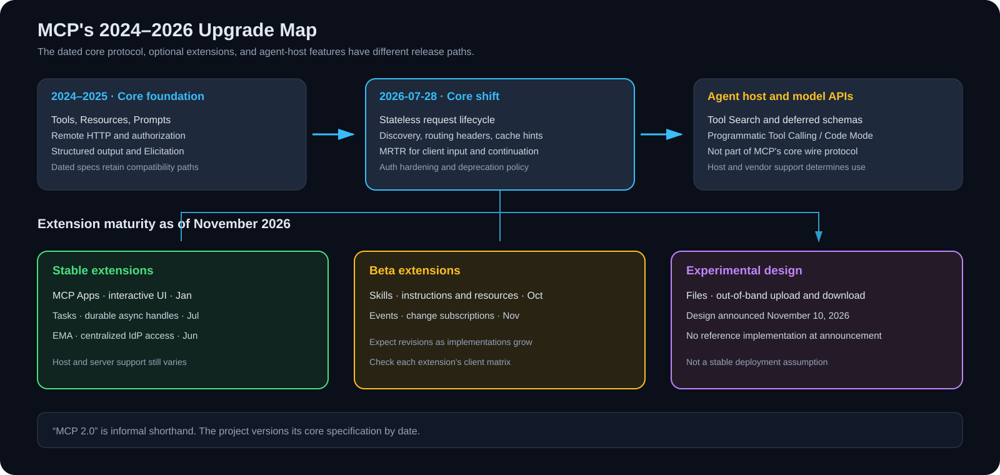
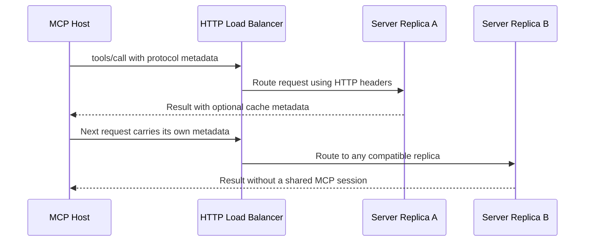
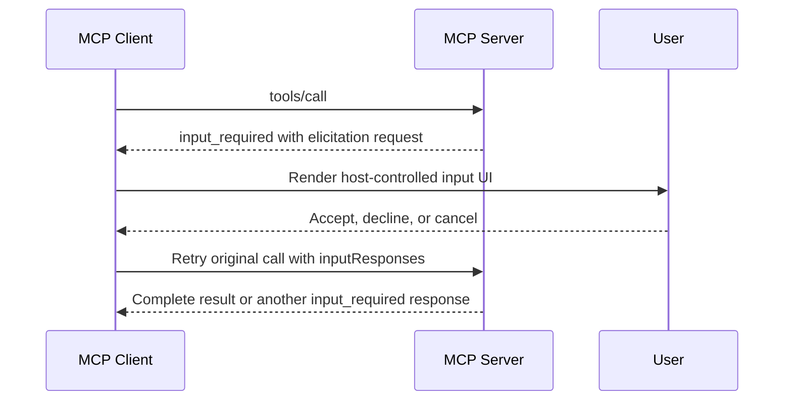
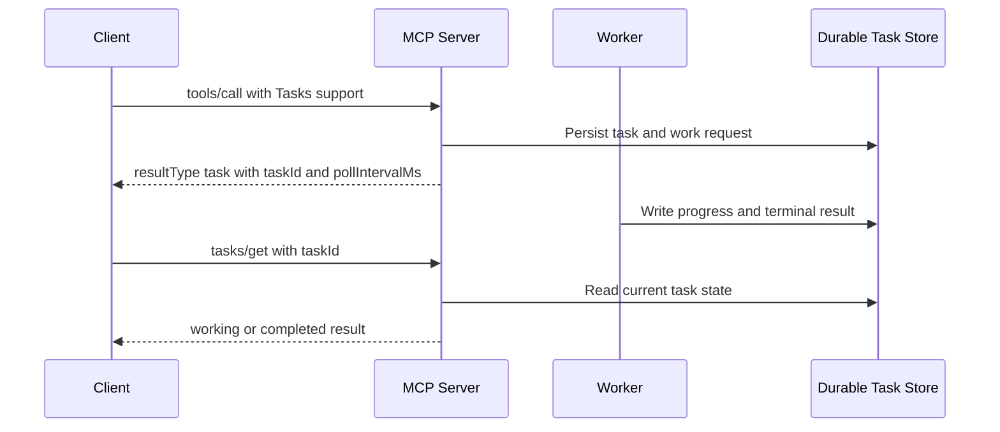

# MCP at Two: The 2026 Upgrades Behind “MCP 2.0”

Daily learning · November 26, 2026  
*By Srinivasan Ragothaman ([@rsrini7](https://github.com/rsrini7))*

> “MCP 2.0” is a useful shorthand for MCP’s second-year evolution, not an official protocol version. The latest dated core specification as of November 26, 2026 is 2026-07-28. Its central change is a stateless HTTP lifecycle, surrounded by optional extensions for interactive UI, long-running work, skills, events, enterprise authorization, and file transfer—each at a different maturity stage.



---

## 1. What Changed, and What “MCP 2.0” Means

MCP began as an open way for an AI host to connect to tools and data through a shared client-server protocol. Its second year expanded that foundation in two directions:

1. **The core HTTP protocol became easier to scale.** Revision 2026-07-28 removes the protocol-level `initialize` handshake and session ID for peers speaking that revision. Requests carry their own protocol context, so a load balancer can route each request to any compatible replica.
2. **Optional extensions add richer workflows.** MCP Apps, Tasks, Enterprise-Managed Authorization, Skills, Events, and Files add interactive UI, background work, centralized authorization, workflow guidance, triggers, and large-file transfer.
3. **Host features address agent context and execution.** Anthropic’s Tool Search and Programmatic Tool Calling are examples of model/API-side capabilities that can work with MCP tools, but they are not MCP protocol features.

The project continues to identify protocol versions by date. As of this note, the released core version is 2026-07-28. Calling the second-year changes “MCP 2.0” should not be taken to mean a formal version 2.0 was announced.

| Area | Change | Status on Nov 26, 2026 |
|---|---|---|
| Core protocol | Stateless lifecycle, discovery, header-based routing, cache hints, MRTR, auth hardening | Released in 2026-07-28 |
| Interactive UI | MCP Apps | Stable extension, launched Jan 2026 |
| Long-running work | Tasks | Stable extension schema for 2026-07-28 |
| Enterprise access | Enterprise-Managed Authorization (EMA) | Stable extension since Jun 2026 |
| Workflow instructions | Skills over MCP | Beta |
| Event-driven work | Events | Beta |
| Large files | File Uploads and Downloads | Experimental design; no reference implementation at announcement |
| Tool discovery | Anthropic Tool Search and deferred tools | Anthropic API feature, outside the MCP specification |

The MCP project reported more than **700 million SDK downloads in the 30 days through November 23, 2026**, and more than five billion total SDK downloads. These are project-reported package-download counts, not active installations, users, or production servers. The project’s anniversary post describes its coverage and methodology. ([MCP: Two Years of MCP Builders](https://blog.modelcontextprotocol.io/posts/mcp-turns-two/))

---

## 2. Foundations: MCP’s Parts and Their Jobs

An MCP host is an application such as an IDE or assistant. It manages one or more MCP clients, each of which communicates with an MCP server. The model may choose a tool, but the host controls the connection, permissions, presentation, and results returned to the model.

| Term | Meaning |
|---|---|
| **Host** | The AI application and its policy/UI layer |
| **Client** | The protocol implementation inside the host that talks to one server |
| **Server** | A local process or remote service exposing tools and context |
| **Tool** | A named operation the client can invoke, usually with a JSON Schema input |
| **Resource** | Data addressed by a URI and read through MCP methods |
| **Prompt** | A server-provided prompt template |
| **Extension** | An optional, namespaced protocol capability built on MCP; both sides must support it |
| **MRTR** | Multi-Round-Trip Requests: a stateless way to pause a request, collect client-side input, and retry it |

Extensions are additive. A client and server advertise support, and unsupported extensions should not be assumed. A host’s support also matters: a server may implement a feature that the user’s chosen MCP client cannot render or operate.

---

## 3. Evolution Timeline

| Date | Milestone | Why it matters |
|---|---|---|
| **Nov 25, 2024** | MCP open-sourced with initial spec 2024-11-05 | Established the common client/server protocol and local stdio transport |
| **Mar 26, 2025** | Spec 2025-03-26 | Added Streamable HTTP for remote servers, OAuth authorization, and tool annotations |
| **Jun 18, 2025** | Spec 2025-06-18 | Added form-mode Elicitation and structured tool output |
| **Jul 2025** | MCP formalized community governance | Created a public process for proposals and working groups |
| **Sep 2025** | MCP Registry preview | Added a discovery and distribution surface for server metadata |
| **Nov 21, 2025** | MCP Bundle (`MCPB`) joined the project | Packaged local servers with runtime metadata to simplify installation and distribution |
| **Nov 24, 2025** | Anthropic announced Tool Search and other advanced tool-use features | Deferred tool schemas to address context growth; this is a host/API feature, not an MCP spec change |
| **Nov 25, 2025** | Spec 2025-11-25 | Added URL-mode Elicitation, experimental Tasks, and `tool-enabled Sampling` |
| **Dec 2025** | MCP joined the Linux Foundation’s Agentic AI Foundation | Moved stewardship into a vendor-neutral foundation |
| **Jan 26, 2026** | MCP Apps launched as the first official extension | Standardized interactive server-provided UI across supporting hosts |
| **Jun 18, 2026** | Enterprise-Managed Authorization became stable | Enabled centralized enterprise policy through an identity provider |
| **Jul 28, 2026** | Spec 2026-07-28 | Introduced stateless lifecycle, MRTR, routed HTTP headers, list caching, auth changes, extension framework, and deprecations |
| **Oct 2026** | Skills over MCP entered Beta | Standardized skill discovery and retrieval through MCP Resources |
| **Nov 2026** | Events entered Beta | Began standardizing subscriptions that let agents react to external changes |
| **Nov 10, 2026** | File Uploads and Downloads design published | Started an experimental out-of-band file-transfer extension |
| **Nov 11, 2026** | MCP announced a regular release cycle | Targeted the next dated core version, 2027-03-30 |

The dates distinguish a core specification release from extension lifecycle changes and proposals. A feature being discussed, implemented by one SDK, or marked “Final” as a SEP does not by itself mean every host and server supports it.

---

## 4. Tool Search and Context: Useful, but Not a Core MCP Feature

A client may expose every connected tool schema to a model before the model knows which tools it needs. Large catalogs consume context and can make tool selection harder. This is a real integration problem, but the solution often belongs to the model API or agent host rather than the MCP wire protocol.

Anthropic’s **Tool Search** keeps deferred tool definitions out of the initial model context. The API receives the catalog, marks selected tools with the defer_loading flag, and exposes a search tool. When the model searches, the host loads matching schemas. Anthropic reported an 85% reduction in a particular large-tool-library example and improved results on its internal MCP evaluations. These are vendor-reported measurements, not an MCP conformance guarantee. ([Anthropic: Introducing Advanced Tool Use](https://www.anthropic.com/research/advanced-tool-use))

```json
{
  "type": "tool_search_tool_regex_20251119",
  "name": "tool_search_tool_regex"
}
```

A deferred tool entry can look like this in the Anthropic Messages API:

```json
{
  "name": "github.createPullRequest",
  "description": "Create a pull request",
  "input_schema": {
    "type": "object",
    "properties": {
      "title": { "type": "string" }
    },
    "required": ["title"]
  },
  "defer_loading": true
}
```

Tool Search and MCP Skills solve related but different problems:

- **Tool Search** finds a callable operation and loads its schema into the model’s available tools.
- **Skills over MCP** gives a host access to workflow instructions and supporting files. The host decides when to fetch and use them.
- **Programmatic Tool Calling / Code Mode** changes how an agent orchestrates execution and handles intermediate data. It also lives above the MCP protocol.

MCP still standardizes the connection and tool call. A host can add progressive discovery or code execution around it. The related [MCP scalability review](MCP-Scalability-Architecture-And-Federation-2026.md) covers Tool Search and Code Mode in more detail.

---

## 5. Core Upgrade: Stateless HTTP and Scalable Servers

### 5.1 From a negotiated session to self-describing requests

For protocol revision 2026-07-28, the `initialize` / `initialized` exchange and `Mcp-Session-Id` lifecycle are removed. A client sends each request with the protocol version and client metadata it needs. A server implements `server/discover` to advertise supported versions and capabilities; a client may call it before using an extension, but clients that already know the target version can skip discovery.

This means the **protocol request path** can be stateless. It does not mean the application has no state. A shopping cart, browser session, or data export can still be stateful; the server can issue an explicit resource or task handle and require it on later requests.



A representative request using the new HTTP revision looks like this:

```bash
curl -i https://mcp.example.com/mcp -H 'Content-Type: application/json' -H 'MCP-Protocol-Version: 2026-07-28' -H 'Mcp-Method: tools/call' -H 'Mcp-Name: search' --data '{"jsonrpc":"2.0","id":1,"method":"tools/call","params":{"name":"search","arguments":{"q":"otters"},"_meta":{"io.modelcontextprotocol/protocolVersion":"2026-07-28","io.modelcontextprotocol/clientCapabilities":{},"io.modelcontextprotocol/clientInfo":{"name":"sample-client","version":"1.0"}}}}'
```

This is a remote Streamable HTTP example. Stdio remains appropriate for local server processes. Older protocol revisions retain their own handshake and compatibility behavior; a migration should version-gate behavior instead of assuming every peer has upgraded. See the [official 2026-07-28 release notes](https://blog.modelcontextprotocol.io/posts/2026-07-28/) and the [protocol-version specification](https://modelcontextprotocol.io/specification/2026-07-28/basic/versioning).

### 5.2 Routing and cache behavior

Streamable HTTP requests at this revision must include `Mcp-Method` and, when the request names a tool, prompt, or resource, `Mcp-Name`. These headers expose method and named-operation information to infrastructure. A gateway can route, meter, or apply policy without parsing the JSON-RPC body. They do not replace authentication, authorization, or input validation.

Discovery, list, and resource-read responses can carry `ttlMs` and `cacheScope` metadata. The scope distinguishes public from private results, while the TTL expresses freshness in milliseconds. Stable tool ordering can keep the serialized catalog consistent across reconnects, improving prompt-cache reuse. Caching is correct only when the client respects the server’s scope and expiry.

### 5.3 Authorization and deprecation policy

The July 2026 revision also tightened remote authorization and made deprecation more predictable:

- Authorization-server issuer validation follows RFC 9207, reducing the risk of accepting a token from the wrong issuer.
- Client credentials are bound to the authorization server that issued them.
- Desktop and command-line clients can identify their application type during registration, avoiding incorrect treatment of loopback redirects as web clients.
- Step-up authorization accumulates requested scopes so a retry does not drop scopes already needed by the operation.
- `Dynamic Client Registration` (DCR) is formally deprecated in favor of `Client ID Metadata Documents` (CIMD). DCR remains available for compatibility in this revision.
- Roots, Sampling, Logging, and the legacy HTTP+SSE transport are deprecated, with a minimum twelve-month deprecation window. The July 2026 release says existing support continues during that period; new implementations should avoid depending on deprecated features.

The November 2025 release added tool-enabled Sampling, but the July 2026 spec deprecated Sampling. Teams should check the version and use case before building new server-side agent loops around it. See the [2026-07-28 release notes](https://blog.modelcontextprotocol.io/posts/2026-07-28/), the [versioned changelog](https://github.com/modelcontextprotocol/modelcontextprotocol/blob/main/docs/specification/2026-07-28/changelog.mdx), [SEP-2468](https://github.com/modelcontextprotocol/modelcontextprotocol/blob/main/seps/2468-recommend-issuer-for-auth.md), and [SEP-2577](https://github.com/modelcontextprotocol/modelcontextprotocol/blob/main/seps/2577-deprecate-roots-sampling-and-logging.md).

### 5.4 Other practical core changes

The July 2026 revision also refines how clients discover changes and interpret results:

| Change | Effect |
|---|---|
| `subscriptions/listen` | Replaces the old HTTP GET notification endpoint and resource subscribe/unsubscribe flow with an opted-in stream for change notifications. |
| Typed result variants | Results use `resultType` to distinguish a completed result from an interim `input_required` response. |
| Broader JSON Schema support | Tool input and output schemas accept JSON Schema 2020-12 constructs, with schema validation and reference handling still bounded by implementation policy. |
| Standard error semantics | A missing resource now uses JSON-RPC Invalid Params (`-32602`) rather than the former MCP-specific code (`-32002`). |
| Trace context | OpenTelemetry trace fields can be carried through reserved metadata keys. |

The versioned [specification changelog](https://github.com/modelcontextprotocol/modelcontextprotocol/blob/main/docs/specification/2026-07-28/changelog.mdx) lists these changes and their associated SEPs. Implementations must not automatically dereference external schema references, and should bound schema depth and validation time. The release also formalizes the extension framework: extensions use reverse-DNS identifiers and capability negotiation, and can evolve independently of the core specification. This keeps optional features out of the mandatory protocol surface.

### 5.5 What stateless operation changes in production

| Before | With 2026-07-28 |
|---|---|
| Server and client establish a protocol session | Each request carries the protocol context it needs |
| Load balancer may need sticky routing for session continuity | Any compatible replica can handle a request |
| Some server-to-client interactions depend on an open stream | MRTR returns requests inside a response and lets the client retry |
| Re-fetching server lists may repeat on reconnect | Responses can communicate cache scope and TTL |
| Gateways may inspect JSON-RPC bodies to identify operations | HTTP method/name headers provide routing metadata |

Removing protocol sessions reduces one source of shared infrastructure, but it does not eliminate application state, durable task storage, authorization state, idempotency controls, or data locality requirements.

---

## 6. Interaction and Long-Running Work

### 6.1 Elicitation matured across multiple releases

Elicitation was not a November 2026 launch. Form-mode Elicitation entered the core specification in 2025-06-18. URL mode followed in 2025-11-25, allowing a host to send a user to an external authorization or credential flow without collecting the secret in the MCP form. The 2026-07-28 revision changes how server requests are carried over a stateless connection. ([2025-06-18 and 2025-11-25 release history](https://blog.modelcontextprotocol.io/posts/2025-11-25-first-mcp-anniversary/), [MRTR in the 2026-07-28 release](https://blog.modelcontextprotocol.io/posts/2026-07-28/))

In form mode, the server requests structured fields and the client decides how to present them. In URL mode, the server provides a URL and an explanatory message; the host controls how it opens and validates the navigation. The server’s request is not itself an authorization decision. The application must still check permissions and validate the returned input.

### 6.2 MRTR: pause, collect input, retry

Under Multi-Round-Trip Requests, the server can return an `input_required` result with one or more pending requests. The client fulfills them through its usual handlers and retries the original operation with the responses and any `requestState` supplied by the server.



`requestState` is opaque to the client. The server chooses its representation and must validate it when it is returned. The specification does not require every server to use HMAC; where tampering or disclosure matters, the server should protect state with an appropriate integrity and confidentiality mechanism. Never treat an untrusted continuation token as proof of user authorization.

MRTR can support more than user questions: a server can yield and resume work across replicas or use the round trip for load shedding. It avoids making the transport session the only place where progress can live. ([SEP-2322: Multi-Round-Trip Requests](https://github.com/modelcontextprotocol/modelcontextprotocol/blob/main/seps/2322-MRTR.md))

### 6.3 Tasks: durable handles for asynchronous work

The Tasks extension moves long-running operations out of the synchronous response path. A client and server negotiate support; the server decides whether a particular request should return a task handle. The client then polls `tasks/get`, provides requested input with `tasks/update`, or signals cancellation with `tasks/cancel`.

| Status | Meaning |
|---|---|
| **working** | Work is in progress |
| **`input_required`** | The task has outstanding client requests, such as an elicitation |
| **completed** | The final result is available |
| **failed** | The task ended with a JSON-RPC error |
| **cancelled** | The task has been cancelled; cancellation may be cooperative |

A task response carries timing and retention information such as `pollIntervalMs` and `ttlMs`. The server must persist the task before returning its handle if it promises that the task can be recovered after a disconnect. Cross-replica or restart recovery depends on the server’s storage and worker design; it is not supplied automatically by the protocol.

Task IDs must be difficult to guess and should be treated as bearer-like references to task state. There is no general `tasks/list` method. Servers still need to enforce caller authorization, retention, and access checks. Cancellation is a request to stop, not a guarantee that already-running external work has been rolled back.



Tasks first appeared experimentally in the November 2025 core release, then were redesigned as the io.modelcontextprotocol/tasks extension for 2026-07-28. The stable extension schema documents the polling lifecycle and its limits. ([MCP Tasks Extension specification](https://tasks.extensions.modelcontextprotocol.io/specification/2026-07-28/tasks), [SEP-2663](https://github.com/modelcontextprotocol/ext-tasks/blob/main/seps/2663-tasks-extension.md))

---

## 7. Extensions Beyond the Core

### 7.1 MCP Apps: interactive UI in the host

MCP Apps became the first official MCP extension in January 2026. The shared design grew from MCP-UI and the OpenAI Apps SDK, giving servers a portable way to provide interactive interfaces through MCP. A server associates a tool with a ui:// resource. The host fetches and renders that resource in a sandboxed iframe; the UI can receive tool results and request follow-up tool calls through the host. The host remains responsible for sandbox policy, user consent, and auditing. Support varies by client. ([MCP Apps launch and security model](https://blog.modelcontextprotocol.io/posts/2026-01-26-mcp-apps/))

Example client-side app code from the official Apps documentation:

```typescript
import { App } from "@modelcontextprotocol/ext-apps";

const app = new App();
await app.connect();

app.ontoolresult = (result) => {
  renderChart(result.data);
};

const response = await app.callServerTool({
  name: "fetch_details",
  arguments: { id: "123" },
});
```

This is a client-side excerpt, not a complete server or build setup. It assumes the host app and tool resource are already configured.

### 7.2 Skills over MCP: distribute workflow knowledge

The Skills extension serves directories of instructions and supporting files through the existing Resources primitive. A skill has a `SKILL.md` file with frontmatter. `skills/list` enumerates available entries, `skills/get` returns one entry by URI, and `resources/read` retrieves the listed files. The manifest includes per-file size and digest information so the host can verify what it reads.

The extension standardizes **discovery and delivery**. It does not require a host to load every skill, automatically run its scripts, or associate every skill with a tool. The host decides when instructions are relevant and should verify the content before using it. Servers with large or generated catalogs may return a partial or empty listing. ([SEP-2640: Skills Extension](https://github.com/modelcontextprotocol/modelcontextprotocol/blob/main/seps/2640-skills-extension.md), [official extension repository and lifecycle](https://github.com/modelcontextprotocol/ext-skills))

As of November 2026, the SEP is Final but the extension lifecycle stage is **Beta**. “Final” describes the proposal’s acceptance; “Beta” describes the extension’s current maturity and allowance for change.

### 7.3 Events: trigger agent work from changes

The Events extension entered Beta in November 2026. It is intended for subscriptions to changes in upstream systems—such as a repository push or a new message—so a client can initiate agent work without waiting for a user to ask. The extension’s draft describes poll, stream, and webhook delivery modes. Because the design is still evolving, implementers should pin the current Beta specification and check client/server support before depending on a particular mode. ([MCP’s two-year update](https://blog.modelcontextprotocol.io/posts/mcp-turns-two/), [Events extension repository](https://github.com/modelcontextprotocol/ext-events))

Events complement Tasks: Events tell a client that something happened; Tasks track a unit of work after it starts. A production system still needs deduplication, replay policy, authorization, and backpressure across event delivery and agent execution.

### 7.4 Enterprise-Managed Authorization

EMA became a stable extension in June 2026. It lets an organization’s identity provider centrally determine which MCP servers a user may access, reducing repeated per-server OAuth setup. The extension builds on Cross-App Access and depends on adoption by the identity provider, MCP host, and server. It does not mean one login grants unrestricted access to every server. ([Enterprise-Managed Authorization launch](https://blog.modelcontextprotocol.io/posts/enterprise-managed-auth/))

### 7.5 File Uploads and Downloads: experimental, not shipped

The file-transfer work is a draft extension named `io.modelcontextprotocol/files`. It targets protocol 2026-07-28 and marks file arguments with `x-mcp-file`. Small files can be inlined within a server-advertised `maxInlineBytes` limit. For a larger file, the server can first check metadata and permissions, then return an `upload_required` result with an upload target and opaque `requestState`. The client uploads the bytes directly to that target and retries the original call. Download targets can accompany a completed result in `_meta`.

This design keeps large file bytes out of the JSON-RPC exchange; it does not guarantee the model or host never sees file contents. The host may inspect, preview, scan, or pass file data to another component. The draft had no reference implementation when announced, and the maintainers explicitly described it as experimental. Do not present it as a stable, broadly deployed MCP capability. ([Exploring File Uploads and Downloads in MCP](https://blog.modelcontextprotocol.io/posts/exploring-file-uploads-and-downloads-in-mcp/))

---

## 8. Impact, Security, and Common Claims vs. Technical Realities

| Common claim | Technical reality |
|---|---|
| “MCP 2.0 is a new numbered spec.” | The project versions the core specification by date. MCP 2.0 is informal shorthand. |
| “All MCP servers are stateless now.” | Stateless request handling applies to the 2026-07-28 revision. Older revisions still use their own lifecycle, and application state remains a design choice. |
| “Removing sessions means the application needs no state store.” | The protocol no longer needs per-session state for that revision. Tasks, jobs, business objects, deduplication records, and user data may still need durable storage. |
| “Tool Search is an MCP standard.” | Anthropic’s Tool Search is an API/host feature. MCP itself standardizes the server’s tools; a host can add deferred discovery. |
| “Skills automatically prevent tool-schema bloat.” | Skills provide workflow guidance. Tool Search or host-side catalog filtering addresses deferred tool-schema loading. |
| “Tasks guarantee exactly-once execution and recovery.” | Tasks provide an addressable lifecycle. The server still owns persistence, idempotency, retries, and compensation for external side effects. |
| “An MCP App can run arbitrary UI actions.” | Its UI is sandboxed and communicates through the host. The host controls the tool-call and consent boundary. |
| “Elicitation makes user approval equivalent to authorization.” | A user response is input to a workflow. The server must independently authenticate the caller and authorize the requested operation. |
| “File transfer means the model never sees the document.” | Out-of-band transfer keeps large bytes out of the JSON-RPC payload. Host, model, and downstream processors may still receive content depending on implementation. |
| “A task ID is harmless because it is opaque.” | Task IDs can act like bearer references. Keep them unguessable, short-lived where possible, and protected by server-side authorization. |

### 8.1 Threat boundaries to keep explicit

- **MRTR state:** Treat returned request state as untrusted input when it comes back. Validate it and protect sensitive state for integrity and confidentiality. A signed token alone does not authorize a business operation.
- **Elicitation:** The server supplies a request; the host controls the interface. Keep secrets out of form-mode collection when URL mode is appropriate, and protect users from unexpected or lookalike authorization URLs.
- **Skills:** Instructions retrieved from a server are still external content. Verify size, digest, and frontmatter as specified, review trust and provenance, and apply host policy before using them.
- **Tasks:** Task IDs should not become the sole authorization check. Enforce user or tenant access in addition to unguessability, bound retention, and make side-effecting operations idempotent.
- **MCP Apps:** Sandbox remote UI, restrict host APIs, require appropriate consent for UI-initiated tools, and audit tool calls.
- **Files:** Validate claimed MIME type and actual content, enforce size limits, expire upload URLs, verify digests where used, scan files where risk warrants it, and authorize the destination before issuing the upload target.
- **HTTP routing:** Treat `Mcp-Method` and `Mcp-Name` as routing metadata. They do not establish caller identity or permission.

---

## 9. Adoption and Verification Blueprint

### 9.1 Migrate the core protocol in stages

1. **Inventory protocol versions.** Record which clients, servers, gateways, and SDK versions can speak 2026-07-28. Keep a compatibility path for clients that still use handshake-era revisions.
2. **Remove hidden session assumptions from the new path.** Put required context in explicit arguments or durable records. Test that a follow-up request can reach another replica.
3. **Expose discovery and extension support accurately.** Advertise only what the server implements and what the host can safely consume.
4. **Use routing and caching deliberately.** Route by standard headers where supported. Honor `cacheScope` and `ttlMs`; measure cache hit rate and stale-result incidents.
5. **Harden authorization before adding more tools.** Validate issuers and audiences, use least-privilege scopes, and plan the transition from `Dynamic Client Registration` to `Client ID Metadata Documents`.
6. **Enable optional extensions independently.** Start with a client/server support matrix. Add Tasks, Apps, EMA, Skills, Events, or Files only when each extension’s lifecycle stage and fallback behavior fit the workload.
7. **Treat side effects as application responsibilities.** Define idempotency keys, retry semantics, retention, audit records, and compensation for operations such as payments, deployments, and deletion.

### 9.2 Probe a remote server

Use the correct endpoint and authentication for your server. This request asks a 2026-07-28 endpoint for capability and version information:

```bash
curl -i https://mcp.example.com/mcp -H 'Content-Type: application/json' -H 'MCP-Protocol-Version: 2026-07-28' -H 'Mcp-Method: server/discover' --data '{"jsonrpc":"2.0","id":1,"method":"server/discover","params":{"_meta":{"io.modelcontextprotocol/protocolVersion":"2026-07-28","io.modelcontextprotocol/clientCapabilities":{},"io.modelcontextprotocol/clientInfo":{"name":"sample-client","version":"1.0"}}}}' | jq .
```

For a tool call, include `Mcp-Name` as in the earlier example. Do not use the new headers against an older endpoint unless its documentation says it supports the revision.

The [MCP Inspector](https://github.com/modelcontextprotocol/inspector) is useful for interactively connecting to servers, inspecting capabilities, and trying tool calls. It does not replace authorization tests, load-balancer tests, or extension-specific conformance checks.

### 9.3 Production checks

| Area | Verification |
|---|---|
| Stateless routing | Send sequential requests through a load balancer with stickiness disabled; confirm different replicas can serve them |
| Application state | Restart a worker during a long task and verify expected recovery, TTL, and terminal result |
| Request replay | Repeat side-effecting calls and retries; confirm idempotency and deduplication behavior |
| Capability negotiation | Test with a client that does not declare each optional extension |
| List caching | Verify cache decisions respect TTL and scope; change a tool catalog and measure when clients observe it |
| MRTR | Exercise accept, decline, cancel, timeout, and repeat-round paths; verify state validation |
| Tasks | Check polling intervals, TTL expiration, cancellation semantics, task access controls, and worker/store failure |
| Skills | Verify manifest, size, digest, and frontmatter before loading content |
| Events | Test duplicate delivery, reconnect/replay, expired subscriptions, and overloaded consumers |
| File transfer | Test rejection before upload, expiry, wrong content type, oversized files, interrupted transfer, and retry |
| Authorization | Test issuer mismatch, wrong audience, insufficient scope, expired tokens, and tenant separation |

Track request rate, p50/p95/p99 latency, timeout and error rate, tool-list cache hit rate, task age and terminal-state counts, extension fallback rate, authorization failures, and upload/download failure rate. Set targets from workload-specific user-facing SLOs; the protocol does not prescribe universal latency or availability numbers.

### 9.4 When to use each capability

| Need | First option to evaluate | Main operational cost |
|---|---|---|
| Few stable tools | Direct tool schemas | Schemas remain part of host/model setup |
| Large tool catalog | Host-side deferred discovery such as Tool Search | Search quality and an extra discovery step |
| Long-running tool call | Tasks | Durable storage, polling or notification delivery, and retry semantics |
| Human input during a call | Elicitation via MRTR on 2026-07-28 | Host UX, timeouts, and authorization checks |
| Interactive chart, form, or editor | MCP Apps | Sandboxed UI and host compatibility |
| Centrally governed enterprise access | EMA | IdP, client, and server support alignment |
| Instructions that should travel with a server | Skills over MCP | Beta compatibility and host trust policy |
| Agent work triggered by changes | Events | Beta semantics, delivery, replay, and backpressure |
| Large file input or output | File transfer draft only where supported | Experimental status, storage, consent, URL lifetime, and scanning |

---

## 10. Timeline and Current State

As of **November 26, 2026**:

- The latest released core version is 2026-07-28. The official project announced a regular six-month release schedule and targeted 2027-03-30 for the next dated version.
- MCP Apps, Tasks, and Enterprise-Managed Authorization have released extension specifications. Host and server implementation coverage still varies.
- Skills and Events are in Beta. Their wire behavior and support matrix may evolve.
- File Uploads and Downloads remain experimental; the maintainers asked for prototyping feedback and had not announced a reference implementation.
- Tool Search and Programmatic Tool Calling are agent-platform capabilities, not additions to MCP’s core specification.
- Server Cards, a .well-known metadata convention for discovering servers without connecting first, remained under working-group development; treat it as roadmap work until a dated spec or stable extension is published.
- MCP’s specification stewardship is under the Linux Foundation’s Agentic AI Foundation. The maintainers reported over 2,500 unique contributors and more than 700 million SDK downloads in the last 30 days, a project-reported metric.

These status labels describe different things: a core spec release, an extension maturity stage, an implementation release, and an adoption claim should not be collapsed into a single “MCP 2.0 launch.”

---

## 11. Primary Sources & References

1. [Model Context Protocol: The 2026-07-28 Specification](https://blog.modelcontextprotocol.io/posts/2026-07-28/) — Maintainers’ summary of stateless requests, discovery, MRTR, routing headers, cache hints, authorization, extensions, and deprecations.
2. [MCP Specification 2026-07-28](https://modelcontextprotocol.io/specification/2026-07-28) — Normative core protocol revision and its versioned schemas.
3. [SEP-2322: Multi-Round-Trip Requests](https://github.com/modelcontextprotocol/modelcontextprotocol/blob/main/seps/2322-MRTR.md) — Defines input requests, opaque request state, retry behavior, and stateless continuation.
4. [MCP Tasks Extension, stable 2026-07-28 schema](https://tasks.extensions.modelcontextprotocol.io/specification/2026-07-28/tasks) — Task creation, polling, input updates, cancellation, expiry, and task state.
5. [MCP Apps launch and security model](https://blog.modelcontextprotocol.io/posts/2026-01-26-mcp-apps/) — Official extension announcement, client support, sandboxed UI, and host-mediated tool access.
6. [SEP-2640: Skills Extension](https://github.com/modelcontextprotocol/modelcontextprotocol/blob/main/seps/2640-skills-extension.md) — Skills discovery and resource conventions, manifests, and digests.
7. [Official Skills extension repository](https://github.com/modelcontextprotocol/ext-skills) — Current Beta specification, lifecycle state, and implementation matrix.
8. [MCP Events extension repository](https://github.com/modelcontextprotocol/ext-events) — Beta work for event discovery and subscription delivery.
9. [Exploring File Uploads and Downloads in MCP](https://blog.modelcontextprotocol.io/posts/exploring-file-uploads-and-downloads-in-mcp/) — Maintainers’ experimental design and explicit maturity limits.
10. [Enterprise-Managed Authorization: Zero-touch OAuth for MCP](https://blog.modelcontextprotocol.io/posts/enterprise-managed-auth/) — Stable EMA extension and intended enterprise identity-provider model.
11. [Anthropic: Introducing Advanced Tool Use](https://www.anthropic.com/research/advanced-tool-use) — Vendor description and evaluation data for Tool Search and deferred tools.
12. [One Year of MCP: November 2025 Spec Release](https://blog.modelcontextprotocol.io/posts/2025-11-25-first-mcp-anniversary/) — Historical source for URL-mode Elicitation and other 2025-11-25 changes.
13. [Two Years of MCP Builders](https://blog.modelcontextprotocol.io/posts/mcp-turns-two/) — Maintainer timeline and adoption claims as of November 2026.
14. [A More Predictable Release Cycle for MCP](https://blog.modelcontextprotocol.io/posts/mcp-release-cycle/) — Release cadence and the targeted 2027-03-30 version.
15. [2026-07-28 specification changelog](https://github.com/modelcontextprotocol/modelcontextprotocol/blob/main/docs/specification/2026-07-28/changelog.mdx) — Detailed schema and protocol changes, including OAuth hardening, changed error codes, and deprecated features.
16. [SEP-2575: Make MCP Stateless](https://github.com/modelcontextprotocol/modelcontextprotocol/blob/main/seps/2575-stateless-mcp.md) and [SEP-2567: Sessionless MCP via Explicit State Handles](https://github.com/modelcontextprotocol/modelcontextprotocol/pull/2567) — Proposals behind the modern request lifecycle.
17. [MCP Bundle format adopted by the project](https://blog.modelcontextprotocol.io/posts/2025-11-20-adopting-mcpb/) — Packaging and distribution improvement for local servers.
18. [The New MCP Roadmap](https://blog.modelcontextprotocol.io/posts/mcp-roadmap/) — Maintainers’ status for Server Cards and other work beyond the July 2026 release.

---

## 12. Source Context

| Evidence | Date / status | Supports | Limit |
|---|---|---|---|
| MCP core specification announcement | Jul 28, 2026 | Stateless lifecycle, MRTR, routed headers, caching, authorization changes, extension framework, deprecations | Maintainer summary; wire-level requirements are in the versioned spec and SEPs |
| SEP-2322 | Final for 2026-07-28 | Input requests and opaque state across stateless round trips | Does not mandate HMAC or a single request-state encoding |
| Tasks extension schema | Stable snapshot for 2026-07-28 | Task methods, statuses, TTL, polling, task updates | Persistence and side-effect handling remain server responsibilities |
| Skills SEP and extension repo | SEP Final; extension Beta as of Nov 2026 | Discovery/retrieval behavior and current maturity stage | Beta may change; client support varies |
| MCP two-year anniversary post | Nov 24, 2026; download chart through Nov 23 | Milestone timeline, contributor and download metrics, Skills/Events status | Adoption data is reported by the project and is not an independent usage census |
| File transfer announcement | Nov 10, 2026; experimental | Draft upload/download flow and current implementation limits | No reference implementation was announced at publication |
| Anthropic Advanced Tool Use | Anthropic API feature | Tool Search workflow and vendor-reported evaluations | Results are Anthropic’s internal measurements, not MCP protocol benchmarks |
| MCP Apps and EMA announcements | Jan and Jun 2026 | Extension purpose and announced lifecycle/support | Host/IdP/server coverage changes over time |

---

**Related:**
- [MCP-Scalability-Architecture-And-Federation-2026](MCP-Scalability-Architecture-And-Federation-2026.md) — Deep dive on context growth, Tool Search, Code Mode, and execution trade-offs surrounding MCP tool use.
- [MoSPI-India-MCP](MoSPI-India-MCP.md) — A concrete public-sector MCP deployment example.
- [claude-agents-vs-sub-agents-vs-projects-vs-workflow-vs-rules-vs-mcp-vs-skills](../Agents/skills/claude-agents-vs-sub-agents-vs-projects-vs-workflow-vs-rules-vs-mcp-vs-skills.md) — Distinguishes MCP’s tool and resource protocol from agent-local skills and workflow controls.
- [HTTP-Egress-Credential-Proxies-Vs-MCP-Gateways-Nov-2026](../../News/Security/HTTP-Egress-Credential-Proxies-Vs-MCP-Gateways-Nov-2026.md) — Security boundaries for tool gateways, credentials, and model-directed requests.

