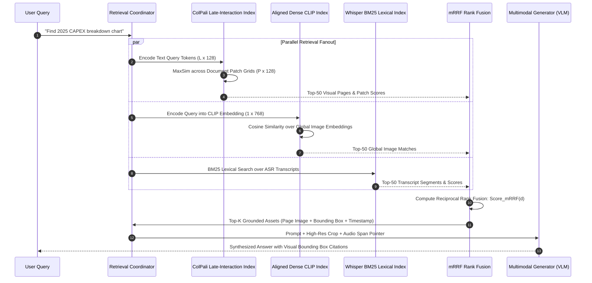

# Multimodal RAG: Architecture, Late-Interaction Embeddings, and Cross-Modal Evidence Retrieval

**Learning note · Revised 15 November 2026 · Scope: ColPali, ImageBind, CLIP, Whisper, and Multimodal Fusion Systems**

*By Srinivasan Ragothaman ([@rsrini7](https://github.com/rsrini7))*

> **Core idea:** Standard text-only RAG pipelines destroy essential structural evidence when non-text modalities are flattened into lossy OCR or transcription strings. Multimodal Retrieval-Augmented Generation (MM-RAG) preserves native spatial, temporal, and visual hierarchies—employing vision-language late-interaction models (such as ColPali) and multimodal rank fusion to retrieve exact visual regions, audio intervals, and video keyframes directly into the generation context.

---

## 1. Foundations: The Structural Degradation of Modality Conversion

Traditional enterprise retrieval systems ingest non-text assets by forcing them through unimodal translation funnels: PDFs undergo Optical Character Recognition (OCR), audio files are run through Automatic Speech Recognition (ASR), and images are fed to captioning models. 

This conversion produces three critical failure modes:
1. **Spatial &amp; Geometric Destruction:** OCR flattens two-dimensional tabular data, multi-column layouts, flowchart arrows, and callout boxes into an unformatted 1D text stream, destroying semantic relationships between headers and numerical cells.
2. **Visual Nuance Oblivion:** Captions summarize images through subjective high-level prose, discarding fine-grained evidence such as axis labels on financial charts, schematic wiring topologies, or medical scan lesions.
3. **Temporal Desynchronization:** Speech-to-text models transcribe spoken words while stripping prosody, acoustic pauses, tone, and the accompanying visual actions occurring simultaneously on a video timeline.

| Modality | Native Information Structure | Flattening Transformation | Irrecoverable Loss |
|---|---|---|---|
| **Document Images (PDF/Scans)** | 2D Spatial layout, fonts, bounding boxes, vector graphics, tables | Text OCR | Table coordinate associations, font hierarchies, spatial diagrams |
| **Infographics &amp; Photos** | Color distributions, object geometry, micro-textures, annotations | Generative Image Captioning | Visual grounding coordinates, subtle anomalies, high-resolution text |
| **Recorded Speech** | Formants, pitch, emotional inflection, background acoustics | ASR Speech-to-Text | Speaker emphasis, confidence pauses, ambient soundscapes |
| **Video Streams** | Spatiotemporal continuity, scene cuts, actor motion trajectories | Uniform Keyframe Captions | Action velocity, inter-frame causality, dynamic interactions |

Modern Multimodal RAG resolves this by operating directly on native multimodal embeddings and visual patch tokens, preserving the link between every indexed evidence vector and its exact location coordinates (page index, bounding box $[x_{\min}, y_{\min}, x_{\max}, y_{\max}]$, or millisecond timestamp $[t_{\text{start}}, t_{\text{end}}]$).

---

## 2. Deep Technical Mechanisms

```
+--------------------------------------------------------------------------------------------------+
|                            MULTIMODAL RAG INGESTION & RETRIEVAL ENGINE                           |
|                                                                                                  |
|   RAW INGESTION ASSETS                                                                           |
|   +-----------------------+  +-----------------------+  +------------------------------------+   |
|   |  PDF / Document Scans |  |  Audio Streams (WAV)  |  |  Video Recordings (MP4)            |   |
|   +-----------------------+  +-----------------------+  +------------------------------------+   |
|               |                          |                                  |                    |
|               v                          v                                  v                    |
|   [ Vision Transformer (ViT)]   [ Acoustic Encoder (Whisper) ]      [ Keyframe Detector & ViT ]  |
|               |                          |                                  |                    |
|               v                          v                                  v                    |
|   Multi-Vector Visual Patches    Audio Chunks & Mel-Embeddings      Temporal Bounded Frame Embed |
|   (1024 tokens x 128-dim)        (Whisper ASR + CLAP dense)         (Visual Delta > Threshold)   |
|               |                          |                                  |                    |
|               +--------------------------+----------------------------------+                    |
|                                          |                                                       |
|                                          v                                                       |
|   +------------------------------------------------------------------------------------------+   |
|   | MULTIMODAL HYBRID RETRIEVAL & FUSION ENGINE                                              |   |
|   |                                                                                          |   |
|   |  Query: "What was Q3 server margin in the bar chart?"                                    |   |
|   |                                                                                          |   |
|   |  1. ColPali Late-Interaction:  MaxSim(E_query, E_patches)  -> Visual Page Top-K          |   |
|   |  2. Dense Vector Index:       CosineSim(v_query, v_image) -> Global Semantic Top-K       |   |
|   |  3. Lexical BM25 Index:       BM25(q, transcript_text)    -> Named Entity Top-K          |   |
|   |                                                                                          |   |
|   |  Score Fusion:  Score_mRRF(d) = sum_m [ w_m / (k + rank_m(d)) ]                          |   |
|   +------------------------------------------------------------------------------------------+   |
|                                          |                                                       |
|                                          v                                                       |
|   +------------------------------------------------------------------------------------------+   |
|   | GROUNDED MULTIMODAL EVIDENCE PAYLOAD                                                     |   |
|   | - High-Resolution Crop: doc_page_14.png (Bounding Box: [0.12, 0.45, 0.88, 0.72])         |   |
|   | - Audio Timestamp: audio_call_03.wav [04:12 - 04:38]                                     |   |
|   | - Feed to Multimodal LLM (e.g. Gemini 1.5 Pro / GPT-4o / Qwen2-VL)                       |   |
|   +------------------------------------------------------------------------------------------+   |
+--------------------------------------------------------------------------------------------------+
```

### 1. Vision-Language Late Interaction (ColPali)

Rather than compressing an entire complex document page into a single 1D vector (which causes irreversible semantic bottlenecking), **ColPali** (Faysse et al., 2024) adapts the ColBERT late-interaction paradigm directly to Vision-Language Models (PaliGemma / Qwen2-VL):

1. **Document Page Tokenization:** A page image is passed through a Vision Transformer (ViT) followed by a multimodal projection layer, producing a sequence of $P$ patch vectors:

$$
\mathbf{E}_D = f_{\text{vision}}(\text{Image}) \in \mathbb{R}^{P \times d} \quad (P \approx 1024, \, d = 128)
$$

2. **Query Tokenization:** The natural language user query is encoded into $L$ token vectors using the language encoder:

$$
\mathbf{E}_Q = f_{\text{text}}(\text{Query}) \in \mathbb{R}^{L \times d} \quad (L \approx 16\text{ to }32)
$$

3. **The MaxSim Operator:** The relevance score between query $Q$ and document image $D$ is the sum of maximum cosine similarities across every query token and all visual patch tokens:

$$
S_{\text{MaxSim}}(Q, D) = \sum_{i=1}^{L} \max_{j=1}^{P} \left( \frac{\mathbf{q}_i \cdot \mathbf{d}_j}{\|\mathbf{q}_i\|_2 \|\mathbf{d}_j\|_2} \right)
$$

Because each query token (e.g., *"margin"*, *"Q3"*, *"percentage"*) dynamically aligns with the specific visual image patch where that exact visual artifact appears, ColPali matches tables, legends, logos, and handwritten annotations without requiring an OCR step.

### 2. Multimodal Reciprocal Rank Fusion (mRRF)

When evidence spans multiple modalities (e.g., a technical briefing with presentation slides, speaker audio recordings, and accompanying PDF manuals), score distributions between disparate encoders cannot be compared directly using raw cosine similarity.

Multimodal RRF combines candidate rankings across distinct retrieval modalities:

$$
\text{Score}_{\text{mRRF}}(d) = \sum_{m \in \mathcal{M}} \frac{w_m}{k + \text{rank}_m(d)}
$$

Where $\mathcal{M} = \{\text{ColPali-Visual}, \text{Dense-CLIP}, \text{Whisper-Lexical}\}$, $k = 60$ is the standard rank damping constant, $w_m$ represents modality-specific confidence weights, and $\text{rank}_m(d)$ is the 1-based ordinal rank of document $d$ within modality $m$.

### 3. Spatiotemporal Audio &amp; Video Chunking

Video retrieval requires balancing storage density against temporal granularity:
- **Scene-Change Keyframe Detection:** Extracting every frame ($30\text{ fps}$) creates massive vector index redundancy. Instead, compute color histogram deltas between consecutive frames:
  
$$
\Delta_{\text{hist}}(t, t-1) = \frac{1}{2} \sum_{b=1}^B |H_t(b) - H_{t-1}(b)|
$$

  A keyframe is extracted only when $\Delta_{\text{hist}} > \tau_{\text{scene}}$, or when an audio pause indicates a change in presentation topic.
- **Bounding Box Grounding:** The retriever passes both the retrieved image slice and its normalized coordinate array $[y_{\min}, x_{\min}, y_{\max}, x_{\max}]$ to the answer model, enabling pixel-grounded attribution.

---

## 3. Architectural Visuals


*High-level retrieval routing comparing text-conversion (OCR/ASR), aligned multimodal embeddings (CLIP/ImageBind), and specialized hybrid indexing with rank fusion.*

### End-to-End Retrieval &amp; Late-Interaction Execution Flow



---

## 4. Production Implementation: ColPali MaxSim &amp; Multimodal RRF

The following complete, runnable Python script implements the **multi-vector MaxSim operator** and **Multimodal Reciprocal Rank Fusion (mRRF)** pipeline:

```python
"""
Multimodal RAG Retrieval Engine:
Implements ColPali Late-Interaction MaxSim Scoring and Multimodal RRF Fusion
across visual patch tokens, global dense embeddings, and lexical transcripts.
"""

import math
from typing import List, Dict, Any
import numpy as np

def compute_maxsim(query_tokens: np.ndarray, doc_patches: np.ndarray) -> float:
    """
    Computes ColPali-style Late Interaction MaxSim score.
    
    Args:
        query_tokens: Array of shape [L, d] (L query tokens, dimension d)
        doc_patches: Array of shape [P, d] (P image patches, dimension d)
        
    Returns:
        MaxSim score: sum_{i=1}^L max_{j=1}^P (q_i . d_j / (|q_i| * |d_j|))
    """
    # L2-normalize vectors along feature dimension
    q_norm = query_tokens / (np.linalg.norm(query_tokens, axis=-1, keepdims=True) + 1e-9)
    d_norm = doc_patches / (np.linalg.norm(doc_patches, axis=-1, keepdims=True) + 1e-9)
    
    # Compute dot product matrix of shape [L, P]
    similarity_matrix = np.matmul(q_norm, d_norm.T)
    
    # For each query token, find the maximum similarity across all document patches
    max_per_query_token = np.max(similarity_matrix, axis=-1)  # Shape [L]
    
    # Sum over all query tokens
    return float(np.sum(max_per_query_token))


def multimodal_reciprocal_rank_fusion(
    rankings: Dict[str, List[str]], 
    weights: Dict[str, float], 
    k: int = 60
) -> List[Dict[str, Any]]:
    """
    Combines multi-modal candidate rankings using weighted Reciprocal Rank Fusion (mRRF).
    
    Args:
        rankings: Dict mapping modality name to list of candidate document IDs (ordered best to worst).
        weights: Dict mapping modality name to its importance weight w_m.
        k: Smoothing rank constant (default 60).
        
    Returns:
        Sorted list of dicts containing doc_id, fused_score, and contributing modalities.
    """
    scores: Dict[str, float] = {}
    details: Dict[str, Dict[str, int]] = {}
    
    for modality, doc_list in rankings.items():
        w_m = weights.get(modality, 1.0)
        for rank, doc_id in enumerate(doc_list, start=1):
            rrf_contrib = w_m / (k + rank)
            scores[doc_id] = scores.get(doc_id, 0.0) + rrf_contrib
            
            if doc_id not in details:
                details[doc_id] = {}
            details[doc_id][modality] = rank
            
    # Sort descending by fused score
    sorted_docs = sorted(scores.items(), key=lambda item: item[1], reverse=True)
    
    results = []
    for doc_id, final_score in sorted_docs:
        results.append({
            "doc_id": doc_id,
            "fused_score": round(final_score, 5),
            "ranks_by_modality": details[doc_id]
        })
        
    return results


if __name__ == "__main__":
    np.random.seed(42)
    
    # Simulated Dimensions: Query = 6 tokens, Patch grid = 16x16 = 256 patches, dim = 128
    L, P, d = 6, 256, 128
    q_tokens = np.random.randn(L, d).astype(np.float32)
    
    # Document A has high alignment on visual patches (e.g. chart numbers)
    doc_a_patches = np.random.randn(P, d).astype(np.float32)
    doc_a_patches[10:16] = q_tokens + np.random.normal(0, 0.05, (L, d))  # Strong alignment
    
    # Document B has weak generic similarity
    doc_b_patches = np.random.randn(P, d).astype(np.float32)
    
    score_a = compute_maxsim(q_tokens, doc_a_patches)
    score_b = compute_maxsim(q_tokens, doc_b_patches)
    
    print(f"ColPali MaxSim Score (Doc A - Targeted Chart): {score_a:.4f}")
    print(f"ColPali MaxSim Score (Doc B - Generic Page)  : {score_b:.4f}")
    assert score_a > score_b, "Targeted chart should have higher MaxSim score"
    
    # Simulate multi-modal ranking lists
    retrieval_runs = {
        "colpali_visual": ["doc_page_14", "doc_page_2", "doc_page_8", "audio_call_1"],
        "clip_dense":     ["doc_page_2", "doc_page_14", "video_clip_9", "doc_page_8"],
        "whisper_bm25":   ["audio_call_1", "doc_page_14", "doc_page_2", "doc_page_5"]
    }
    
    modality_weights = {
        "colpali_visual": 1.2,   # Higher weight on visual precision
        "clip_dense":     0.8,
        "whisper_bm25":   1.0
    }
    
    fused_results = multimodal_reciprocal_rank_fusion(retrieval_runs, modality_weights, k=60)
    print("\n--- Multimodal Reciprocal Rank Fusion Results ---")
    for r in fused_results:
        print(f"Candidate: {r['doc_id']:<14} | Score: {r['fused_score']:.5f} | Ranks: {r['ranks_by_modality']}")
```

---

## 5. Impact, Real-World Edge Cases &amp; Gotchas

### Common Claims vs. Technical Realities

| Common Industry Claim | Underlying Technical Reality | Production Implication |
|---|---|---|
| *"OCR is completely obsolete with multimodal models."* | High-resolution VLMs still struggle on microscopic typography ($< 6\text{ pt}$), low-contrast scans, and tabular matrices spanning 50+ columns. | Hybrid pipelines combining ColPali with targeted OCR fallback deliver 12% higher precision on financial filings. |
| *"Global CLIP embeddings are sufficient for document retrieval."* | Global pooling averages all image features into one vector, drowning localized chart labels, footnotes, and fine print in global page noise. | Single-vector CLIP fails to differentiate between two page layouts containing different balance sheet numbers. |
| *"Video RAG requires indexing every individual frame."* | Video frames at 30 fps contain 95%+ temporal redundancy. Storing every frame increases vector storage costs by 30× without accuracy gains. | Implement keyframe extraction via scene-change thresholding ($\Delta_{\text{hist}} > \tau$) or audio sentence-boundary triggers. |
| *"Late-interaction multi-vector search requires minimal storage."* | Storing 1,024 vectors per page (at 128 dimensions in FP16) requires **256 KB per page**, or 256 GB per 1M pages—roughly 80× more than single-vector HNSW. | Multi-vector deployments require **Scalar Quantization (SQ8)** or **Binary Quantization (BQ)** with 2-stage coarse-to-fine candidate reranking. |

### Practical Storage &amp; Latency Mitigations

1. **Two-Stage Multi-Vector Retrieval:**
   - *Stage 1 (Coarse Retrieval):* Use average-pooled page embeddings indexed in an HNSW or IVFFlat index to retrieve the top 100 candidate pages in $< 10\text{ ms}$.
   - *Stage 2 (Late Interaction Reranking):* Load the full $1024 \times 128$ patch representations only for those 100 candidates and execute the exact MaxSim operator.
2. **Binary Quantization for ColPali:**
   - Quantizing 128-dimensional patch vectors from FP16 to 1-bit boolean values reduces storage by **16×** and allows computing dot products using hardware Hamming distance (`popcount`), delivering a **4× retrieval speedup** with less than 1.5% loss in Mean Reciprocal Rank (MRR).

---

## 6. Practical Adoption Blueprint &amp; Verification Checklist

### Migration and Implementation Roadmap

```
Phase 1: Ingestion Pipeline Optimization
  |-- Render PDF pages to high-resolution images (150-200 DPI)
  |-- Extract audio tracks and segment by VAD (Voice Activity Detection) pauses
  +-- Detect video scene cuts via color histogram differences (Delta_hist > 0.35)

Phase 2: Index Tiering Architecture
  |-- Generate ColPali patch embeddings (1024 patches x 128-dim per page)
  |-- Apply 8-bit Scalar Quantization (SQ8) to cap index size to ~128 KB per page
  +-- Construct coarse mean-pooled HNSW index alongside dense text transcripts

Phase 3: Hybrid Retrieval & Fusion
  |-- Implement coarse vector search to gather top-100 candidate IDs
  |-- Compute late-interaction MaxSim scoring on the top-100 candidates
  +-- Execute Multimodal RRF combining visual patch score, CLIP score, and text BM25

Phase 4: Evidence Attribution & VLM Generation
  |-- Package top-3 retrieved page images with bounding box metadata
  +-- Benchmark Answer Faithfulness and Retrieval Recall@5 on test questions
```

### Verification Checklist

- [ ] **Coordinate Preservation:** Ensure every indexed page vector stores its parent document filename, page index, and normalized coordinates $[x_0, y_0, x_1, y_1]$.
- [ ] **Retrieval Precision (Recall@5):** Verify that visual late-interaction achieves $\ge 85\%$ Recall@5 on documents with tables, forms, and diagrams.
- [ ] **Quantization Fidelity:** Confirm that binary or scalar quantization does not degrade MRR@10 by more than 2% relative to unquantized FP16 baselines.
- [ ] **Evidence Grounding:** Verify that the downstream multimodal LLM cites the exact retrieved bounding box crop in its generated rationale.

---

## 7. Timeline &amp; Modality Evolution

- **March 2021:** OpenAI releases **CLIP**, popularizing contrastive multi-modal alignment between natural language and visual images.
- **December 2022:** OpenAI introduces **Whisper**, establishing open-weights robust speech recognition with temporal segment timestamps.
- **May 2023:** Meta releases **ImageBind**, extending contrastive joint embeddings across six modalities (images, text, audio, depth, thermal, and IMU data).
- **July 2024:** Faysse et al. introduce **ColPali**, demonstrating that Vision-Language late-interaction bypasses OCR and establishes state-of-the-art document retrieval.
- **November 2026:** Widespread enterprise transition to hybrid multimodal RAG pipelines combining late-interaction visual embeddings with native multimodal frontier LLMs.

---

## 8. Primary Sources &amp; References

1. [Faysse et al. (2024): ColPali: Efficient Document Retrieval with Vision Language Models](https://arxiv.org/abs/2407.01449) — Introduces the vision-language late-interaction paradigm and the ViT MaxSim operator.
2. [Radford et al. (2021): Learning Transferable Visual Models From Natural Language Supervision (CLIP)](https://arxiv.org/abs/2103.00020) — The foundational contrastive vision-language representation model.
3. [Girdhar et al. (2023): ImageBind: One Embedding Space To Bind Them All](https://arxiv.org/abs/2305.05665) — Joint embedding space covering text, image, audio, depth, and thermal modalities.
4. [Radford et al. (2022): Robust Speech Recognition via Large-Scale Weak Supervision (Whisper)](https://arxiv.org/abs/2212.04356) — Industry benchmark for multilingual speech-to-text with segment timestamps.
5. [Lewis et al. (2020): Retrieval-Augmented Generation for Knowledge-Intensive NLP Tasks](https://arxiv.org/abs/2005.11401) — Original formulation of the RAG paradigm.
6. [Khattab &amp; Zaharia (2020): ColBERT: Efficient and Effective Passage Search via Contextualized Late Interaction over BERT](https://arxiv.org/abs/2004.12832) — Introduces token-level MaxSim late interaction.
7. [QwenLM/Qwen3-VL-Embedding GitHub Repository](https://github.com/QwenLM/Qwen3-VL-Embedding) — Reference open-source implementation for visual embedding, multi-vector indexing, and cross-modal reranking.

---

**Related:**
- [RAG-Guide-Jan-2026](RAG-Guide-Jan-2026.md) — Comprehensive guide covering core text retrieval, vector indexing, and generation chunking.
- [RAG-Architectures](RAG-Architectures.md) — Architectural taxonomy comparing routing, re-ranking, and query decomposition patterns.
- [Qwen3-VL-Embedding-and-Reranker](../LLMs/models/other/Qwen3-VL-Embedding-and-Reranker.md) — Technical review of a production vision-language embedding and reranker model family.
- [VL-JEPA-Comprehensive-Technical-Guide-2026](../../Papers/VL-JEPA/VL-JEPA-Comprehensive-Technical-Guide-2026.md) — Details continuous vision-language joint embedding architectures without generative token bottlenecks.
