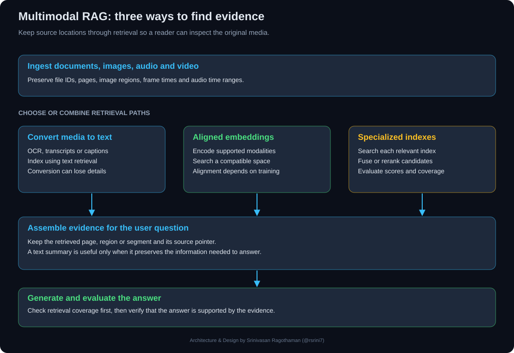

# Multimodal RAG: Retrieval Across Images, Audio, Video and Documents

**Learning note · Revised 15 November 2026 · Primary papers and model repository checked**

> **Core idea:** Multimodal retrieval-augmented generation (RAG) finds evidence in non-text media, then gives the relevant evidence and its source location to a model. Systems can convert media to text, search across aligned embeddings, or combine specialized indexes.

## 1. Foundations

RAG retrieves source material for a question and supplies it to a language model before the model answers. With text-only data, a system usually splits documents into passages, embeds or otherwise indexes them, retrieves candidates, and adds the best passages to the prompt.

Multimodal systems must also preserve evidence that is not naturally a text passage: an image region, a page layout, a video frame or an audio segment. **An embedding** is a numeric representation used to find items that a model considers similar. A shared embedding space is useful only for the modalities and query types the model was trained to align. For example, [CLIP](https://arxiv.org/abs/2103.00020) aligns images and text; [ImageBind](https://arxiv.org/abs/2305.05665) studies a shared space across image, text, audio and other modalities.

## 2. A typical retrieval flow

During ingestion, keep a link from each indexed item to the original file and its location. Useful locations include a document page, image region, video timestamp or audio time range. At answer time, return those references with the evidence so a reviewer can inspect the original.

## 3. Three retrieval patterns

These patterns can be combined in one system; they are not mutually exclusive architectures.

| Pattern | How retrieval works | Strength | Main limitation |
|---|---|---|---|
| **Convert to text** | Apply OCR to images or documents, transcribe speech, or generate captions, then index the resulting text. | Reuses familiar text-search and RAG components. | Text conversion can omit layout, visual details, speaker cues or other information in the original media. |
| **Aligned multimodal embeddings** | Use a model trained to compare a query in one modality with items in another, such as text queries against images. | Searches media directly without requiring every item to become a caption. | Alignment is model- and modality-specific; semantic similarity may miss exact text or small visual details. |
| **Separate indexes with fusion or reranking** | Search specialized text, image, audio or video indexes, then combine or rerank their results. | Lets each modality use a suitable encoder and retrieval method. | Adds systems to operate and requires careful score calibration, deduplication and evaluation. |

Visual document retrieval is one example of direct media search: [ColPali](https://arxiv.org/abs/2407.01449) represents document pages visually for retrieval. For speech, [Whisper](https://arxiv.org/abs/2212.04356) is a multilingual speech-recognition model that can support a transcript-based indexing path.

## 4. Choosing a design

Start from the evidence users need to find, not from the number of encoders available.

1. **Use text conversion** when OCR or transcripts preserve the details users ask about and the text pipeline is already reliable.
2. **Use aligned embeddings** when users need semantic search across modalities and an encoder supports the relevant query and media types.
3. **Use separate indexes and fusion** when each modality needs different parsing or retrieval behavior, or when one retriever misses evidence found by another.
4. **Keep the original media and locations.** Captions and embeddings are indexes, not substitutes for the evidence.
5. **Evaluate retrieval and answers separately.** Check whether the correct page, region, frame or segment appears in the retrieved set, then check whether the answer is supported by it.

## 5. An implementation to explore

The [Qwen3-VL-Embedding repository](https://github.com/QwenLM/Qwen3-VL-Embedding) includes reference models and examples for visual and text retrieval and reranking. Start with its installation and inference examples, then test on representative data. It is one model family, so supported inputs, hardware needs and retrieval quality may not fit every corpus.

## 6. Limits to account for

- Captions and transcripts can lose exact wording, spatial relationships, tables, visual attributes or speaker information.
- A single global image embedding may not retrieve a small object, a chart label or a precise page region.
- Video indexing needs to balance frame sampling, scene changes, transcript timing, storage and search cost.
- Similarity scores are not proof that evidence supports an answer. Preserve citations or source pointers and verify the retrieved content.
- Retrieval quality depends on the model, data preparation, query distribution and evaluation set. Benchmark with real questions from each modality.

## 7. Source context and references

Reworked from collected repository notes. The retrieval mechanisms were checked against the original RAG, CLIP, ImageBind, ColPali and Whisper papers, with the Qwen repository used as an implementation example. The three patterns are a design framework, not a claim that one model supports every modality.

- Lewis et al., [Retrieval-Augmented Generation for Knowledge-Intensive NLP Tasks](https://arxiv.org/abs/2005.11401), 2020.
- Radford et al., [Learning Transferable Visual Models From Natural Language Supervision (CLIP)](https://arxiv.org/abs/2103.00020), 2021.
- Girdhar et al., [ImageBind: One Embedding Space To Bind Them All](https://arxiv.org/abs/2305.05665), 2023.
- Faysse et al., [ColPali: Efficient Document Retrieval with Vision Language Models](https://arxiv.org/abs/2407.01449), 2024.
- Radford et al., [Robust Speech Recognition via Large-Scale Weak Supervision](https://arxiv.org/abs/2212.04356), 2022.

---

**Related:**
- [RAG Guide](RAG-Guide-Jan-2026.md) — Covers the text retrieval and generation foundations used by multimodal pipelines.
- [RAG Architectures](RAG-Architectures.md) — Compares retrieval pipelines, indexing choices and reranking patterns.
- [Qwen3-VL Embedding and Reranker](../LLMs/models/other/Qwen3-VL-Embedding-and-Reranker.md) — Documents one current model family for text and visual retrieval and reranking.
