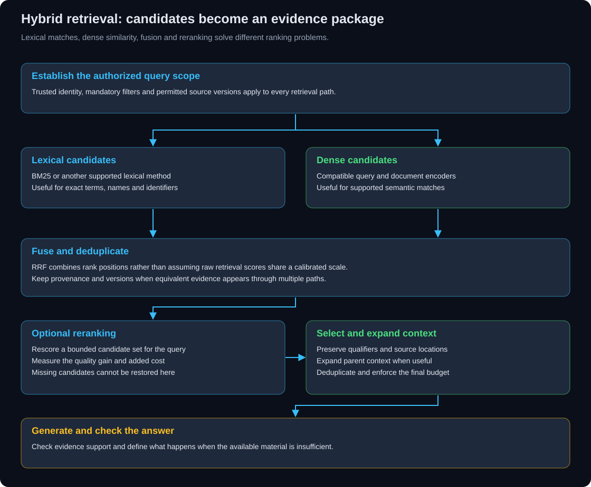
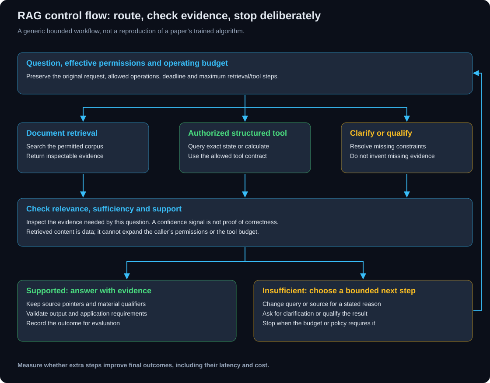
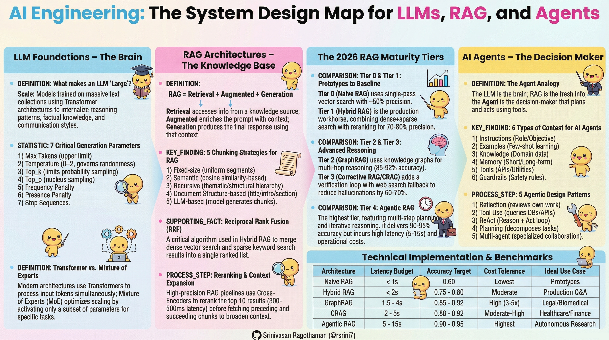
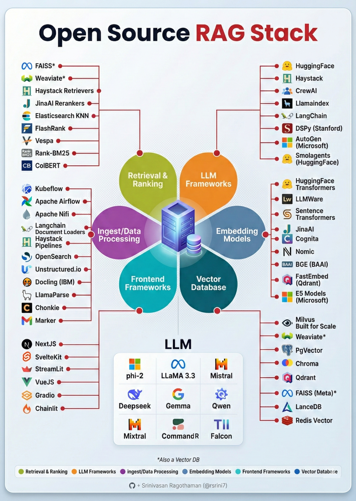

# RAG Architectures: Retrieval, Routing and Evidence Control

**Learning note · Revised 15 November 2026 · Primary papers and project documentation checked**

> **Core idea:** RAG architectures combine choices about evidence representation, retrieval, ranking, control flow and validation. Start with a measurable pipeline, then add structure or extra retrieval steps for demonstrated failures. Research names describe particular methods, not a universal ladder of production maturity.

## 1. Foundations: separate the design decisions

A RAG application retrieves external evidence and supplies it to a model. The [original RAG paper](https://arxiv.org/abs/2005.11401) is one learned retrieval/generation design; the term now also covers systems assembled from independently chosen components. Read the [RAG guide](RAG-Guide-Jan-2026.md) for the basic lifecycle.

| Decision | What it controls |
|---|---|
| Representation | Whether the searchable units are passages, small spans, summaries, generated questions, graph entities or media representations. |
| Retrieval | How candidates are found: lexical, dense, structured or combined search. |
| Ranking and context | Which candidates reach generation, in what form and within which budget. |
| Control flow | Whether the request follows a fixed path or can select tools, retry retrieval or decompose the question. |
| Evidence checks | How the system detects missing, irrelevant, conflicting or unsupported material. |
| Operations | Permissions, versions, updates, deletion, caching, observability and capacity. |

These decisions can be composed. A workflow can use hybrid retrieval; a graph-based route can still use text search; a simple fixed pipeline can enforce rigorous access controls.

## 2. A hybrid retrieval baseline

*The diagram is a design pattern. Candidate counts, optional stages and context limits must be selected for the actual workload.*

1. Authenticate and establish the permitted corpus, source versions and mandatory filters.
2. Run lexical and dense retrieval over the applicable scope.
3. Merge results and deduplicate equivalent evidence.
4. Rerank a suitable candidate set, if the quality gain justifies the cost.
5. Select and, where useful, expand the supporting context; preserve locations and source IDs.
6. Generate an answer and check support, output requirements and the insufficient-evidence path.

BM25 and dense retrieval capture different signals. [BM25 documentation](https://www.elastic.co/docs/reference/elasticsearch/index-settings/similarity), [DPR paper](https://arxiv.org/abs/2004.04906). A query/passage reranker can improve ordering within a shortlist, but cannot restore material excluded from that shortlist. [Passage re-ranking with BERT](https://arxiv.org/abs/1901.04085).

Sparse representations must have a consistent coordinate meaning across queries and documents. Use a supported lexical backend or compatible sparse model. Assigning unrelated per-document indices to arbitrary weights does not create a valid shared retrieval space.

## 3. Fusion: ranks and scores are different inputs

Lexical scores and embedding similarities do not automatically share a calibrated scale. **Reciprocal rank fusion, or RRF**, combines result positions rather than directly adding those raw scores. A common unweighted definition is:

$$
\text{Score}_{\text{RRF}}(d) = \sum_{i\, :\, d \in R_i} \frac{1}{c + \operatorname{rank}_i(d)}
$$

Here, `R_i` is one result list, ranks start at one, and `c` controls the contribution of lower-ranked results. An item absent from a list contributes nothing from that list. This formula describes a convention; implementations can offer different rank conventions, weights and parameters. [Elasticsearch RRF](https://www.elastic.co/docs/reference/elasticsearch/rest-apis/reciprocal-rank-fusion), [Qdrant hybrid queries](https://qdrant.tech/documentation/search/hybrid-queries/).

Fusion does not make a result correct or authorized. Candidate windows, duplicate handling and the quality of each underlying retriever still matter. Tune with relevant queries instead of assuming one fusion parameter works across corpora.

## 4. What to index and what to return

| Representation | How it works | Why to evaluate it | Limit |
|---|---|---|---|
| Passage/chunk | Index and retrieve a bounded section of source content. | Simple, inspectable baseline. | The relevant context may cross a boundary. |
| Small span with parent mapping | Search a precise unit, then recover a larger source section. | Questions target a clause, identifier or short fact. | Parent expansion can add noise or exceed the context budget. |
| Generated questions | Index questions linked to the source that answers them. | User phrasing differs from source wording. | Generation cost and coverage gaps; generated questions are not source evidence. |
| Summary hierarchy | Index summaries at multiple granularities with links to originals. | Questions require broad navigation or document-level context. | Summaries can omit details or introduce errors. |
| Entity/relationship structure | Retrieve through a graph or graph-derived reports. | The task needs explicit relationships or a corpus-wide synthesis. | Extraction, linking and refresh require additional work. |
| Multimodal representation | Index supported visual, audio or other evidence. | Text extraction loses information needed by the question. | Encoder alignment and generation input support are modality-specific. |

These are design patterns, not all standardized algorithm names. [RAPTOR](https://arxiv.org/abs/2401.18059) and [Microsoft GraphRAG](https://arxiv.org/abs/2404.16130) are specific research examples of hierarchy and graph-derived representations.

Reranking compact passages before expanding parent context often helps control work, but it is not a universal ordering rule. Some rerankers and tasks benefit from larger context. Evaluate the evidence available at each step, then enforce the final budget deliberately.

## 5. Routing and query transformation

A router can select document retrieval, an exact database query, a calculator or another supported tool. It should preserve the user's constraints and operate within the caller's permissions. Misrouting is a quality failure, not simply an extra latency cost.

Useful transformations to evaluate include clarifying a conversational reference, generating alternative search formulations and decomposing a question into verifiable subquestions. Record the transformed queries so failures can be traced back to the original request.

**HyDE** generates a hypothetical document and embeds it to help dense retrieval. Its generated text is a retrieval aid, not established evidence. Retrieve and verify actual source material before using facts in the final answer. [HyDE paper](https://arxiv.org/abs/2212.10496).

A fixed workflow is appropriate when the steps are known. Agentic control can be useful when the next operation depends on intermediate findings, but adds model decisions and possible loops. Use structured tool calls, allowed operations, deadlines and step/cost budgets. [ReAct](https://arxiv.org/abs/2210.03629) studies interleaved reasoning and action; [LangGraph](https://docs.langchain.com/oss/python/langgraph/overview) provides orchestration mechanisms. Neither guarantees that an agent's evidence or decisions are correct.

## 6. Corrective and adaptive retrieval: identify the specific method

*This generic workflow illustrates bounded control. It is not a reproduction of any one paper's training procedure or algorithm.*

| Research method | Specific mechanism | Practical distinction |
|---|---|---|
| [Self-RAG](https://arxiv.org/abs/2310.11511) | Trains a model to use retrieval and reflection tokens for retrieval/generation/critique decisions. | A prompt that asks any model to “check itself” is not an implementation of the trained method. |
| [Corrective RAG, CRAG](https://arxiv.org/abs/2401.15884) | Evaluates retrieved-document quality and triggers different knowledge-retrieval actions, including its web-search path. | Adding a generic judge is not evidence that the full published algorithm or its results were reproduced. |
| [Adaptive-RAG](https://arxiv.org/abs/2403.14403) | Uses a trained classifier to select strategies according to query complexity. | “Adaptive” describes a control choice; it does not imply that every request needs multiple searches. |

In an application, define what a failed evidence check causes: a changed query, a different authorized source, a clarification request or a qualified/unsupported result. Repeating the same search without a reason or stop condition is not a recovery strategy.

A retrieval-quality estimate and a model's confidence are signals, not proof. Calibrate the decision against labeled failures and inspect whether extra steps improve the final task outcome.

## 7. Graph, hierarchy and multimodal routes

**Microsoft GraphRAG** targets questions such as global summaries across a corpus using an extracted graph and community-level reports. It should not be treated as a generic synonym for every multi-hop graph query. An application that needs exact graph relationships may instead use a database/query route with suitable authorization. [GraphRAG paper](https://arxiv.org/abs/2404.16130), [project documentation](https://microsoft.github.io/graphrag/).

**RAPTOR** recursively embeds, clusters and summarizes text into a tree of representations. It is useful research context for broad-document retrieval, with indexing cost, refresh and summary fidelity to evaluate. [Original paper](https://arxiv.org/abs/2401.18059).

**Multimodal RAG** can retrieve original media, extracted text or aligned representations. Preserve the page, region or time range needed to inspect the evidence, and make sure the answer model can consume the chosen evidence form. The [multimodal guide](Multimodal-RAG.md) compares these designs.

## 8. Retrieval-integrated model research is a separate design layer

| Work | What it studies |
|---|---|
| [REALM](https://arxiv.org/abs/2002.08909) | Retrieval-augmented language-model pretraining with a latent knowledge retriever. |
| [Atlas](https://arxiv.org/abs/2208.03299) | Retrieval-augmented language models for few-shot learning. |
| [RETRO](https://arxiv.org/abs/2112.04426) | A language-model architecture conditioned on retrieved chunks. |
| [REPLUG](https://arxiv.org/abs/2301.12652) | Retrieval augmentation for a frozen black-box language model, including retriever learning from LM feedback. |

These papers make different assumptions about training and access to the model. They are not interchangeable settings in every API-based RAG application. Distinguish a research reproduction from a pipeline inspired by one of its ideas, and do not transfer its reported score to a different system.

## 9. Permissions, freshness and prompt injection

Enforce source access using authenticated identity and the effective authorization policy. A client-supplied tenant field is not sufficient authorization. Search filtering can implement part of this design, but the trusted application must construct and enforce the permitted scope. [Qdrant filters](https://qdrant.tech/documentation/search/filtering/), [Elasticsearch document-level security](https://www.elastic.co/docs/deploy-manage/users-roles/cluster-or-deployment-auth/controlling-access-at-document-field-level).

Do not pass unauthorized candidates to a reranker, external model, log or answer cache and rely on later answer filtering to undo exposure. Test actual access rules for retrieval, parent expansion, summaries, graph reports and caches. A derived representation can expose information from its underlying sources too.

Retrieved instructions can be malicious even inside an access-controlled corpus. Separate evidence from tool authority, restrict available actions and evaluate indirect prompt-injection attempts. Source permission is not evidence that its content should control the application. [OWASP guidance](https://genai.owasp.org/llmrisk/llm01-prompt-injection/).

Updates and deletions must reach every relevant index, derived summary/graph and cache. Include the effective access context and corpus/model versions in cache policy; a cached answer is not automatically valid after a permission or document change.

## 10. Evaluate composition and operating cost

Measure each stage's contribution to the final outcome. Useful records include source/version coverage, retrieval recall, ranking quality, context support, answer correctness, permission failures, latency distributions and actual model/tool usage. [BEIR](https://arxiv.org/abs/2104.08663), [RAGAS](https://arxiv.org/abs/2309.15217).

Compare a baseline with the proposed change on the same held-out query set. For a new loop, report extra retrieval/model calls, success on previously failing cases and new failure modes. For a summary or graph index, include ingestion and refresh work as well as query cost.

Parallel retrieval branches contribute through the request's critical path; serial retries and generation calls add work. Do not sum independently measured stage percentiles and label that the end-to-end percentile. Trace complete requests and consult the [latency guide](Reducing-Enterprise-RAG-Latency-2026.md).

## 11. Tools and source context

[Haystack pipelines](https://docs.haystack.deepset.ai/docs/pipelines), [LlamaIndex](https://developers.llamaindex.ai/python/framework/understanding/rag/) and [LangGraph](https://docs.langchain.com/oss/python/langgraph/overview) provide different levels of retrieval and orchestration support. Start with their versioned getting-started examples, then add your source/permission rules and evaluation set. [Ragas metrics](https://docs.ragas.io/en/stable/concepts/metrics/available_metrics/) can assist evaluation, with judge configuration and human-reviewed checks retained.

Based on collected repository notes, with named methods checked against the linked original papers and operational mechanisms checked against project documentation. The guide presents composable design choices; the research results remain scoped to their published experiments.

## 12. Supplementary visuals

*Previously collected illustrations, retained for reference. The source-qualified explanations above describe the supported mechanisms and limits.*

---

**Related:**
- [RAG Guide](RAG-Guide-Jan-2026.md) — Introduces ingestion, retrieval, context construction and answer evaluation.
- [Scaling RAG to 10 Million Documents](RAG-Scaling-10M-Documents.md) — Covers index size, versioned ingestion, deletion and degraded operation.
- [Reducing Enterprise RAG Latency](Reducing-Enterprise-RAG-Latency-2026.md) — Develops critical-path profiling and candidate/reranking budgets.
- [Multimodal RAG](Multimodal-RAG.md) — Explains media-specific representations and source-location preservation.
- [AI Agent Evaluation Architectures](../Agents/frameworks/AI-Agent-Evaluation-Architectures-Multi-Tier-Graders-And-Harnesses-Nov-2026.md) — Extends pipeline checks to agent decisions, tool behavior and execution harnesses.
