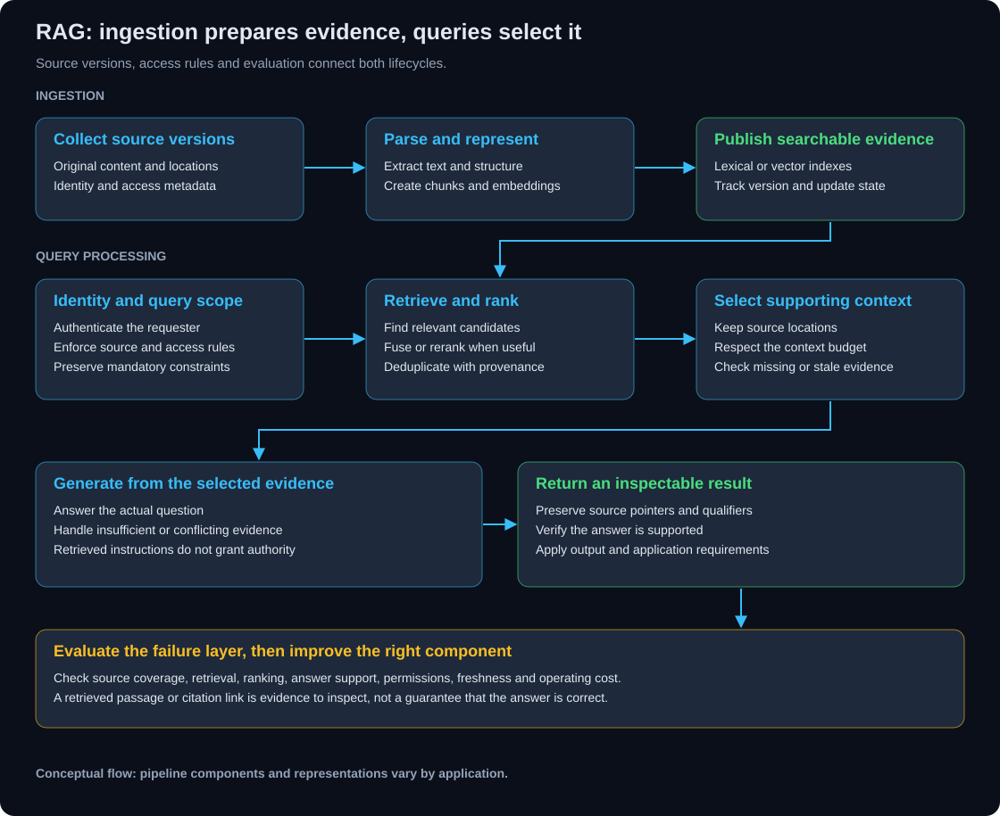
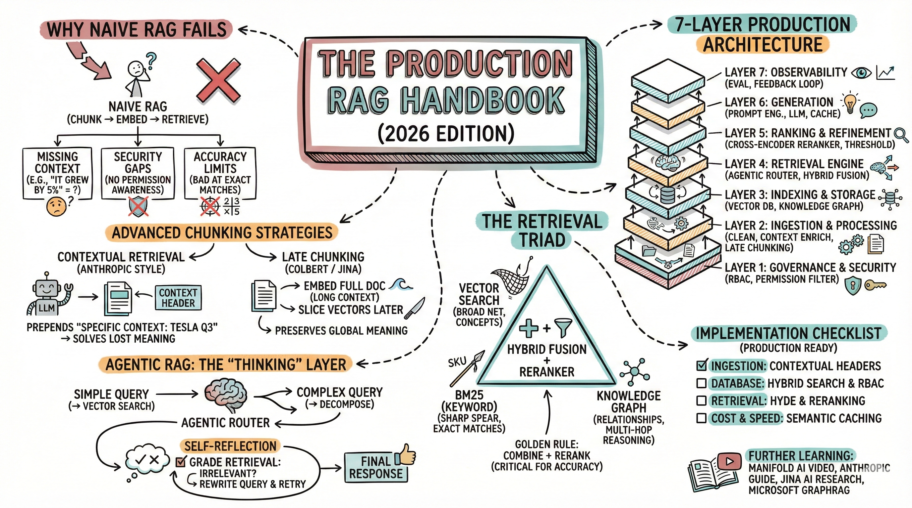
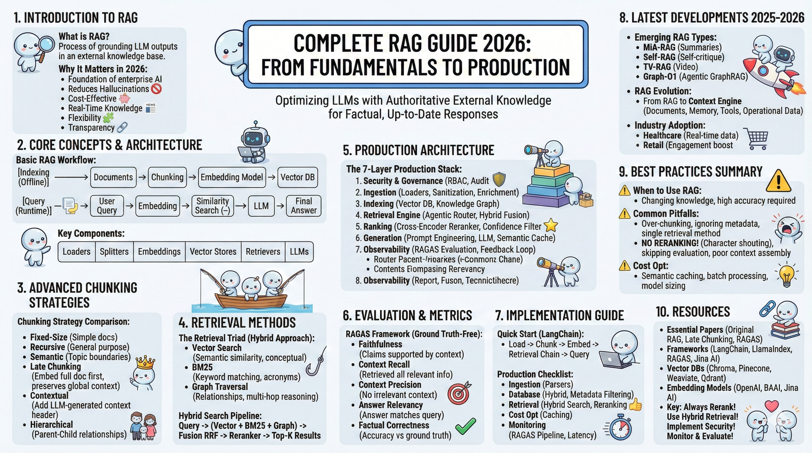

# RAG: From Source Documents to Supported Answers

**Learning note · Revised 15 November 2026 · Primary papers and project documentation checked**

> **Core idea:** Retrieval-augmented generation, or RAG, finds relevant external material and supplies it to a model before it answers. A reliable system must retrieve the right evidence, respect access rules and check whether the answer is supported; adding a vector database alone does not achieve those goals.

## 1. Foundations: what RAG adds to a language model

A language model stores patterns in its parameters from training. It may not know a recently updated procedure, a private document or the authoritative wording of a policy. RAG makes selected external information available at answer time without requiring a weight update for every document change.

The [original RAG paper](https://arxiv.org/abs/2005.11401) studied combining a pretrained model with retrieved non-parametric memory. Modern applications use the term more broadly for pipelines that retrieve evidence and include it in the model's input. Those pipelines differ in training, retrieval and generation details.

For example, an assistant answering a product-support question can retrieve the current support procedure and cite the relevant section. Retrieval supplies evidence; the application still has to choose the right version, preserve its meaning and handle missing information.

| Component | Job |
|---|---|
| Source store | Holds the original documents and the authority for their content and permissions. |
| Parser | Extracts text, structure and locations from source formats. |
| Chunk | A retrieval unit, such as a passage, section or table with its context. |
| Embedding | A numeric representation used by a compatible similarity model. |
| Index | Makes documents or representations searchable. It may support lexical, vector or other retrieval. |
| Reranker | Rescores a candidate set for a particular query using a more expensive ranking method. |
| Generator | Uses the question, instructions and selected evidence to produce an answer. |
| Evaluator | Checks relevant properties of retrieval, answers and application behavior. |

## 2. Two connected lifecycles

*Ingestion prepares searchable evidence. Query processing selects evidence for one question. Updates and evaluation connect the two paths.*

**Ingestion:** collect authorized sources, parse them, preserve source locations and versions, split or otherwise represent the content, build indexes and publish a searchable version. Permissions and deletions need to propagate too.

**Query processing:** authenticate the requester, apply the applicable scope, retrieve candidates, optionally fuse or rerank them, select evidence within a context budget and ask the model to answer. Return source pointers and handle cases where the available evidence is insufficient.

This split appears in the [LlamaIndex RAG overview](https://developers.llamaindex.ai/python/framework/understanding/rag/) and component-oriented systems such as [Haystack pipelines](https://docs.haystack.deepset.ai/docs/pipelines). A framework coordinates components; its presence does not establish retrieval quality or permission correctness.

## 3. Chunking: preserve the information a question needs

Fixed-size splitting is a useful baseline, not an automatic mistake. It is easy to measure and reproduce. Structure-aware splitting may work better when headings, code blocks, tables or document sections carry essential relationships. Choose based on actual retrieval and answer failures.

| Choice | Benefit | Limit to inspect |
|---|---|---|
| Fixed token windows | Predictable size and a simple baseline. | Can split definitions, tables or procedures across boundaries. |
| Structure-aware sections | Preserves meaningful boundaries. | Sections vary in size; parser quality becomes important. |
| Overlapping chunks | Can retain context around a boundary. | Duplicates text, storage and retrieved evidence; it does not guarantee better answers. |
| Small retrieval units with parent context | Finds a precise span while returning a larger supporting section. | Expansion can consume the context budget or introduce unrelated text. |
| Summaries or hierarchy nodes | Helps navigate long documents and broad questions. | A summary is generated material and can omit or distort details; retain the original evidence. |

[RAPTOR](https://arxiv.org/abs/2401.18059) is one research example of recursively clustering and summarizing text into a retrieval hierarchy. That is a particular method, not evidence that every corpus needs a summary tree.

Record whether a size is measured in **characters, words or model tokens**. These units are not interchangeable. Preserve document IDs, version, section/page locations and provenance so the system can return to the source after retrieval.

## 4. Retrieve for meaning and exact terms

**Lexical retrieval**, such as BM25, scores matches using term statistics. It is useful when exact identifiers, product names or error codes matter. **Dense retrieval** searches embeddings learned to match queries and passages; it can find relevant paraphrases. [BM25 configuration](https://www.elastic.co/docs/reference/elasticsearch/index-settings/similarity), [Dense Passage Retrieval paper](https://arxiv.org/abs/2004.04906).

**Hybrid retrieval** combines signals, often by merging separate lexical and dense candidate lists. It is an option to evaluate, not a guarantee that every query improves. Retrieval results still depend on parsing, model compatibility, corpus coverage, filters and ranking settings. [Qdrant hybrid-query documentation](https://qdrant.tech/documentation/search/hybrid-queries/).

A reranker can then compare the query and candidate passages more closely. BERT-based passage reranking is an early example of this approach. Reranking a shortlist is usually more affordable than applying the same scoring process to the entire corpus. It cannot recover evidence that never entered the candidate set. [Passage re-ranking paper](https://arxiv.org/abs/1901.04085).

Treat tenant, permission, version and date requirements as enforceable constraints when they are mandatory. Similarity is not authorization. The [architecture guide](RAG-Architectures.md) explains fusion, routing and context selection in more detail.

## 5. Build an answer from evidence, not just retrieved text

Choose a context budget appropriate to the model and task. Deduplicate overlapping passages, preserve necessary qualifiers and attach source locations to the selected evidence. More retrieved text can add useful coverage or bury the answer in irrelevant material; measure the trade-off.

The application should specify what to do when evidence is missing, conflicting or outdated: ask a clarifying question, describe the limitation, retrieve from another authorized source or decline an unsupported conclusion. A source link alone does not prove that the linked passage supports the answer.

Retrieved documents are input data, including when they contain instructions. RAG does not remove the risk of **indirect prompt injection**, where external content attempts to influence model behavior or tool use. Authorization, tool permissions and validation remain application responsibilities. [OWASP prompt-injection guidance](https://genai.owasp.org/llmrisk/llm01-prompt-injection/).

## 6. Evaluate where the failure occurs

| Layer | Useful question | Evidence to collect |
|---|---|---|
| Source and parsing | Was the required information available and extracted correctly? | Missing documents, wrong versions, lost tables or locations. |
| Retrieval | Did relevant evidence enter the candidate set? | Recall at the chosen cutoff, based on suitable relevance labels. |
| Ranking and context | Did useful evidence survive selection? | Ranking quality, duplication, context relevance and retained qualifiers. |
| Answer | Is it correct for the question and supported by the evidence? | Reference answers where appropriate, support checks and human-reviewed failures. |
| Application | Did the system respect scope, freshness and operating requirements? | Permission tests, update/delete checks, latency, cost and failure behavior. |

[BEIR](https://arxiv.org/abs/2104.08663) illustrates why retrieval performance needs evaluation across different tasks. [RAGAS](https://arxiv.org/abs/2309.15217) and its [metric documentation](https://docs.ragas.io/en/stable/concepts/metrics/available_metrics/) provide tools for assessing aspects of RAG quality. Model-judged scores are estimates whose prompts, judge and dataset should be recorded; a high score is not proof that every answer is factual.

Keep a representative held-out set, inspect failures by category and change one important design choice at a time. For example, compare chunking strategies with the same queries and retrieval settings before attributing a gain to chunking alone.

## 7. RAG, fine-tuning and structured tools

| Need | Starting point to evaluate |
|---|---|
| Frequently changing or private source facts with provenance | Retrieval over current, authorized sources. |
| Consistent style, task behavior or domain adaptation | Prompting or fine-tuning, with task evaluation. |
| Exact totals, transactional state or calculations | A suitable structured query or calculation tool, with authorization. |
| Answers requiring multiple sources or operations | A bounded workflow that can combine retrieval and tools. |

These choices can be combined. Fine-tuning does not automatically maintain an external knowledge base, and RAG does not automatically teach the model a new behavior. A sampled set of retrieved passages is also not a reliable substitute for an exact database aggregate.

## 8. Tools, practical start and source context

[Haystack](https://docs.haystack.deepset.ai/docs/pipelines) and [LlamaIndex](https://developers.llamaindex.ai/python/framework/understanding/rag/) document ways to assemble ingestion and query components. Begin with a small representative corpus and questions for which you can inspect the expected evidence. Add lexical/dense combinations, reranking or extra model calls only when evaluation identifies the problem they should solve.

Based on collected repository notes, with mechanisms checked against the original RAG, DPR, RAPTOR, reranking, BEIR and RAGAS papers and linked project documentation. Examples are design guidance; this note does not claim a fixed chunk size, speedup or benchmark score applies to every corpus.

## 9. Supplementary visuals

*Previously collected illustrations, retained for reference. The source-qualified explanations above describe the supported mechanisms and limits.*

---

**Related:**
- [RAG Architectures](RAG-Architectures.md) — Develops hybrid retrieval, indexing choices, routing and evidence-checking patterns.
- [Scaling RAG to 10 Million Documents](RAG-Scaling-10M-Documents.md) — Adds capacity arithmetic, index lifecycle and operational controls.
- [Reducing Enterprise RAG Latency](Reducing-Enterprise-RAG-Latency-2026.md) — Explains critical-path profiling and retrieval/reranking latency trade-offs.
- [Multimodal RAG](Multimodal-RAG.md) — Extends evidence retrieval to images, documents, audio and video.
- [LLM Benchmarks](../LLMs/architecture/LLM-Benchmarks.md) — Explains how to record evaluation conditions and separate quality from serving performance.
