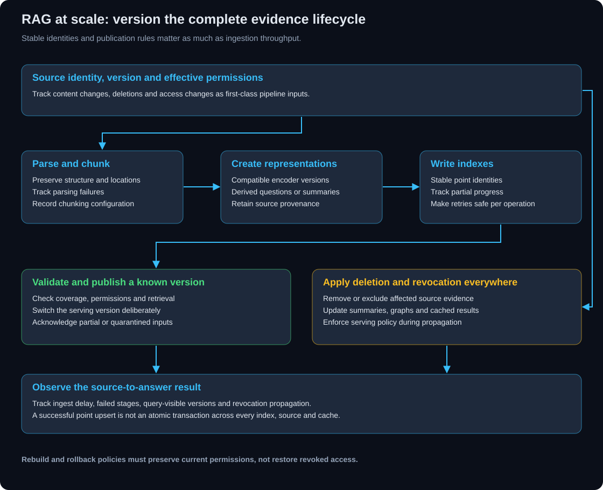
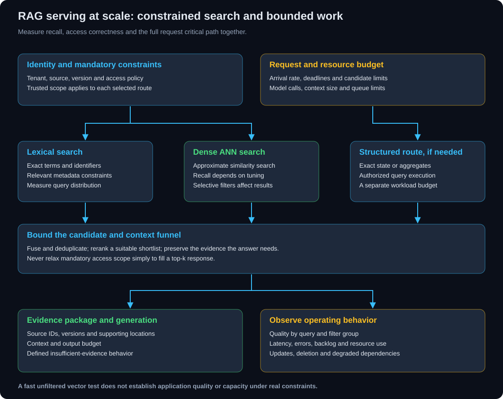

# Scaling RAG to 10 Million Documents: Index Size, Freshness and Control

**Learning note · Revised 15 November 2026 · Capacity examples with primary-source mechanisms**

> **Core idea:** Document count alone does not determine RAG capacity. Plan for the resulting chunks and representations, the rate of change, query constraints and failure behavior. Reliable scale requires an ingestion and deletion lifecycle as well as a fast search path.

## 1. Foundations: documents, chunks and queries are different counts

A document may be one short page or a long report. Parsing and chunking can turn it into several searchable units. Summaries, generated questions or multiple representations may add further index entries. Query traffic creates a different load again: retrieval, reranking, context assembly and generation.

Before sizing a deployment, measure a representative corpus: source formats, extracted tokens, chunk counts, duplicated material, permission groups, update frequency and the queries users actually ask. The [RAG guide](RAG-Guide-Jan-2026.md) explains the lifecycle; the [architecture reference](RAG-Architectures.md) compares representations and retrieval paths.

## 2. Calculate raw storage, then add the system around it

For one dense vector per chunk:

$$
N_{\text{vectors}} = N_{\text{documents}} \times \text{Mean chunks per document}
$$

$$
\text{Raw vector bytes} = N_{\text{vectors}} \times \text{Dimensions} \times \text{Bytes per element}
$$

**Illustrative scenario:** 10 million documents averaging 20 chunks produce **200 million vectors**. With float32 values at four bytes each:

| Dimensions per vector | Raw vector storage, decimal units |
|---|---|
| 384 | 307.2 GB |
| 768 | 614.4 GB |
| 1,536 | 1,228.8 GB, or about 1.23 TB |

These are arithmetic examples, not measured database footprints. Add graph/index structures, lexical indexes, payloads, text, original files, replicas, backups and temporary rebuild capacity. Multiple vectors per chunk or derived representations change the vector count. Compression and quantization change representation and retrieval behavior; measure their quality and performance trade-offs. [Qdrant quantization](https://qdrant.tech/documentation/manage-data/quantization/).

Use actual chunk distributions rather than assuming every document has the average size. Long documents and high-change tenants can dominate capacity or refresh work.

## 3. Ingestion is a versioned data pipeline

*Publishing makes a known source/index version searchable. Updates and revocations must reach derived representations and cached results as well as the original file.*

A practical ingestion flow has explicit state: discovered, fetched, parsed, represented, indexed, validated and published. Persist progress so a retry can resume without silently duplicating content. Use stable source identities and track content version, parser/chunker configuration and the paired query/document encoder configuration.

| Control | Why it matters |
|---|---|
| Per-stage retry and quarantine | A malformed file should be visible and recoverable without blocking all ingestion. |
| Stable IDs and idempotent writes | Reprocessing the same version should not create unrelated duplicate points. |
| Provenance and location | A retrieved unit needs its source ID, version and page/section/media location. |
| Permission metadata | The indexed representation must preserve the source's effective access policy. |
| Compatibility/version boundary | Queries must use an encoder compatible with the indexed representations. |
| Publication rule | A half-written or unvalidated index version should not silently become the default. |

Vector-store idempotence is useful but narrower than an end-to-end ingestion guarantee. Qdrant, for example, documents repeatable point operations with stable IDs; this does not create an atomic transaction across the source store, lexical index and every cache. [Point operations](https://qdrant.tech/documentation/manage-data/points/).

For initial backfills, batch and parallelize supported operations while bounding memory and load. Bulk-loading settings can trade immediate indexing work for later build/recovery work, so distinguish a backfill from continuously serving fresh updates. [Qdrant bulk-upload guidance](https://qdrant.tech/documentation/manage-data/bulk-upload/).

## 4. Search is a constrained candidate funnel

*The diagram shows a conceptual query path. Exact filtering, index layout and routing depend on the chosen retrieval system and access policy.*

**Lexical retrieval** helps exact identifiers and terms. **Dense retrieval** matches supported semantic relationships. **Hybrid retrieval** combines candidates, and an optional reranker performs more expensive scoring on a shortlist. The generator receives selected evidence, not an instruction to search every document. [DPR](https://arxiv.org/abs/2004.04906), [hybrid-query documentation](https://qdrant.tech/documentation/search/hybrid-queries/), [passage reranking](https://arxiv.org/abs/1901.04085).

Approximate nearest-neighbor search trades resources and recall. **HNSW** uses a navigable graph to search efficiently, but its behavior depends on build/search settings, dimensions, data distribution and filters. It is not a guarantee of constant latency as the corpus grows. [HNSW paper](https://arxiv.org/abs/1603.09320).

Mandatory tenant, source and access constraints must remain enforced even when they yield few results. Do not broaden permission scope to fill a top-k response. Filter selectivity can affect both quality and execution: pgvector documents how approximate-index filtering can reduce returned matches and describes iterative scanning controls. [pgvector filtering](https://github.com/pgvector/pgvector), [Qdrant filtering](https://qdrant.tech/documentation/search/filtering/).

Partitioning or sharding can distribute work, but introduces routing, fan-out, memory and recovery choices. Benchmark the real filter/query distribution, not just an unfiltered random-vector workload. Compare candidate recall against a suitable reference on representative subsets.

## 5. Updates, deletion and access revocation are serving requirements

Changing the source text can require new chunks, embeddings, lexical entries and derived summaries. Removing a source file does not automatically remove its old vectors or cached answer. An access change can make unchanged content unsafe to return under an earlier cache key.

Define a freshness and revocation objective, then trace propagation through each representation and cache. Where index changes are asynchronous, use a serving policy that prevents stale or revoked content from being exposed during the gap. Audit the query path as well as the ingestion job's completion state.

When changing encoders or chunking, keep the index version explicit. Validate a new version on held-out queries before switching the serving route. Retain a recovery option consistent with current permissions; rolling back an index must not restore revoked access.

Deduplication also needs provenance. Identical text in two source documents may have different owners, access rules or deletion requirements. Shared storage should not erase those distinctions.

## 6. Budget change volume, latency and cost separately

In the earlier example, changing **1% of documents per day** means 100,000 changed documents. If every changed document's 20 chunks are regenerated, that is **2 million chunk representations/day**, before retries, derived summaries or a full reindex. Partial-update strategies can change the amount of work.

For each workload, account for:

- **Ingestion:** fetch/OCR/parsing, token counts, embeddings, indexing, validation and reprocessing.
- **Queries:** query transformation, retrieval, reranking, context size, generation and any tool loops.
- **Operations:** replicas, backups, monitoring, temporary rebuild space and failure headroom.

Use measured durations and current unit prices or local resource costs. A document count does not establish a cost per query or a required GPU count. Caching can reduce repeated work, but cache keys and invalidation must include the relevant data/model versions and authorization context.

For latency, record complete traces and the critical path. Parallel retrieval is not the sum of every branch's duration, while serial retries add delay. Bound candidate sets, reranking inputs, model calls and timeouts against the intended service objective. See [RAG latency engineering](Reducing-Enterprise-RAG-Latency-2026.md).

## 7. Verify scale with representative and degraded workloads

| Check | What the result should establish |
|---|---|
| Corpus and parsing samples | Required facts, tables and source locations survive ingestion. |
| Retrieval quality by query/filter group | Relevant evidence remains discoverable for small tenants, selective filters and exact-identifier questions. |
| Answer support | The selected context actually supports the answer, including qualifiers and dates. |
| Change propagation | New versions become searchable within the stated objective; deleted/revoked evidence stops appearing. |
| Ingestion and serving contention | A backfill or reindex does not silently consume all interactive capacity. |
| Failure and overload | Dependency loss, slow rerankers, growing queues and retries have bounded, observable behavior. |
| Security | Retrieved instructions cannot grant permissions, and unauthorized material does not reach models, logs or caches. |

Use labeled retrieval cases and appropriate answer evaluation rather than only a demonstration conversation. [BEIR](https://arxiv.org/abs/2104.08663), [RAGAS](https://arxiv.org/abs/2309.15217). Treat model-generated judgments as part of the evaluation system, and calibrate them with inspected failures.

Indirect prompt injection can enter through a permitted internal document as well as an external upload. Access control and instruction trust are different questions. [OWASP prompt-injection guidance](https://genai.owasp.org/llmrisk/llm01-prompt-injection/).

## 8. Tools, practical start and source context

[Qdrant](https://qdrant.tech/documentation/manage-data/bulk-upload/) documents bulk ingestion, point operations, filtering and hybrid retrieval. [pgvector](https://github.com/pgvector/pgvector) documents exact/approximate vector search and filtering within PostgreSQL. Start with their supported examples, load a representative subset and measure quality plus resource use before projecting a full deployment. Neither project name establishes a capacity result for your corpus.

Based on collected repository notes, with retrieval and operating mechanisms checked against original research and the linked project documentation. Storage and update-volume numbers are explicitly labeled calculations. The document explains a capacity-planning method; it does not assert a tested ten-million-document deployment.

---

**Related:**
- [RAG Guide](RAG-Guide-Jan-2026.md) — Defines the ingestion/query lifecycles and the evidence required for useful answers.
- [RAG Architectures](RAG-Architectures.md) — Compares indexing, retrieval, routing and evidence-checking choices.
- [Reducing Enterprise RAG Latency](Reducing-Enterprise-RAG-Latency-2026.md) — Develops request tracing, selective filters and candidate/reranking budgets.
- [Multimodal RAG](Multimodal-RAG.md) — Adds media-specific parsing, representations and source locations.
- [LLM Inference Engines](../LLMs/architecture/LLM-Inference-Engines.md) — Explains the separate generation-serving layer, its scheduling and memory budgets.
