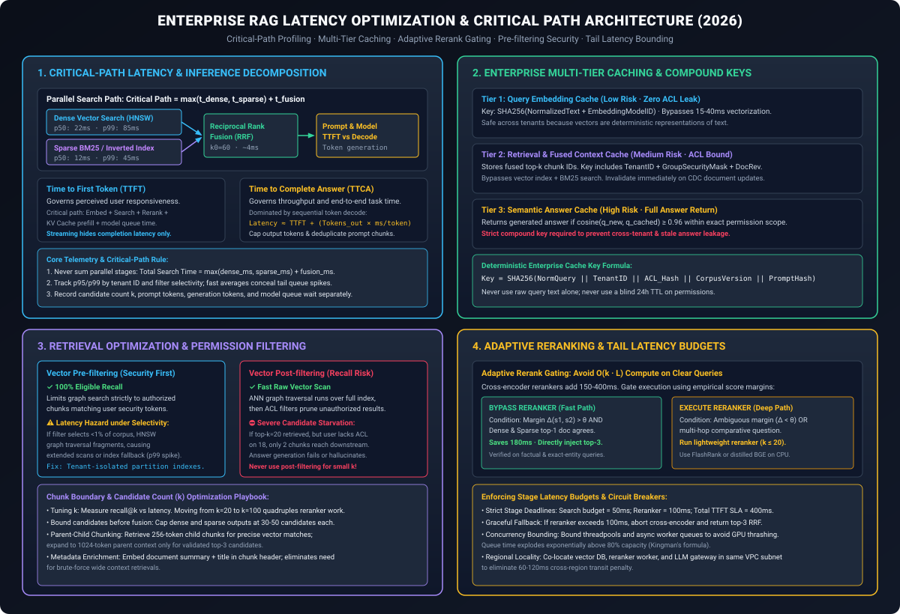
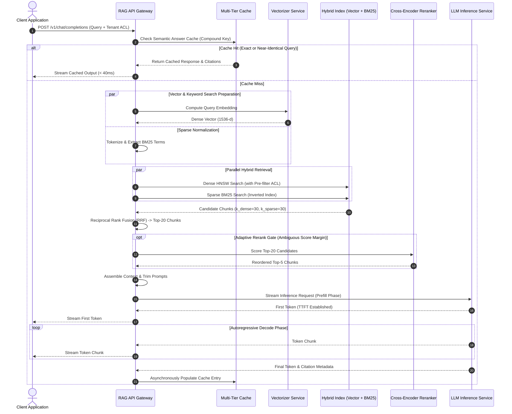
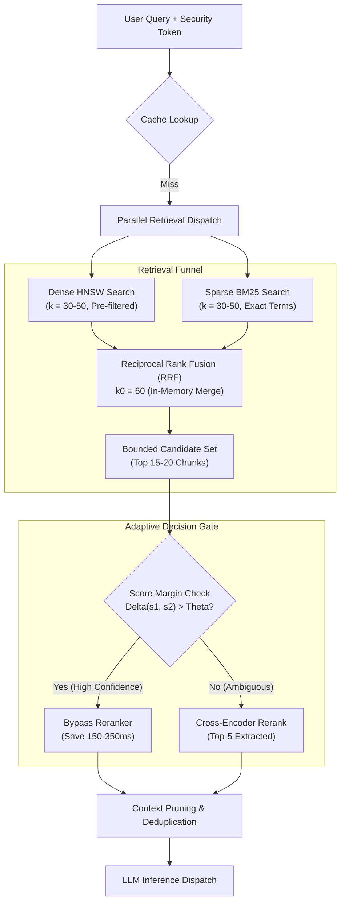
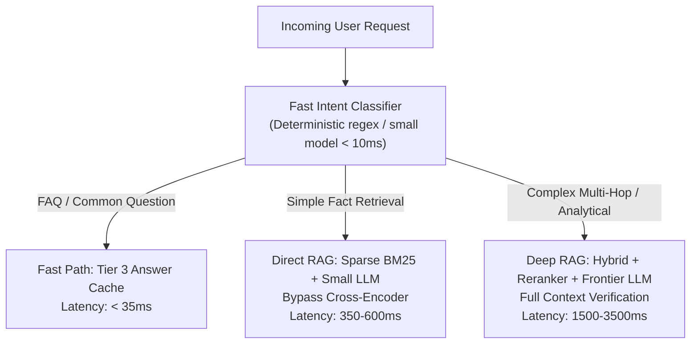
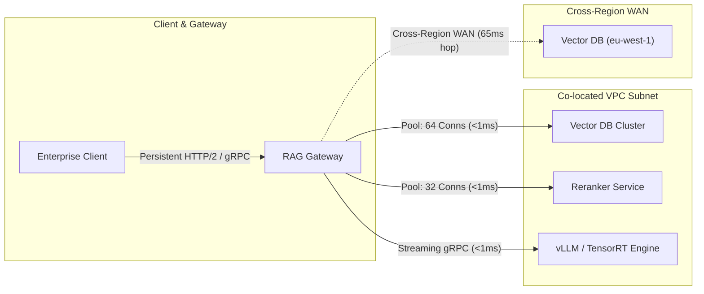
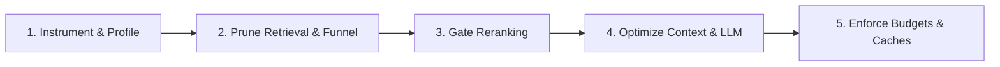

# Reducing Latency in Enterprise RAG Systems: Critical-Path Profiling, Retrieval Pruning, and Tail-Latency Engineering

**Daily learning · 7 November 2026 · Architectural review & production benchmark guide**

> **Core idea:** A production RAG system is a distributed chain of retrieval, filtering, reranking, and autoregressive generation steps where stage latencies do not add linearly. Achieving sub-second end-to-end responsiveness under enterprise load requires isolating the request's critical path, pre-filtering access-controlled vector indexes, adaptively bypassing cross-encoder rerankers via calibrated score margins, and enforcing strict stage-level latency budgets with graceful fallbacks.

---



---

## 1. Foundations: The Anatomy of Latency in Enterprise RAG

In naive prototypes, Retrieval-Augmented Generation (RAG) is treated as a simple sequential script: `query -> embed -> search -> prompt -> generate`. In enterprise environments handling multi-tenant corpora, role-based access control (RBAC), and high concurrent query volumes, this simplistic pipeline breaks down into severe latency bottlenecks.

A request must execute semantic vector search, exact keyword filtering, authorization checks across document access control lists (ACLs), cross-encoder relevance scoring, prompt deduplication, and large language model (LLM) token inference. Each hop crosses network boundaries, competes for GPU compute queues, and incurs memory bandwidth overhead.

### Key Latency Dimensions

To diagnose and optimize enterprise RAG, engineering teams must distinguish between perceived responsiveness and end-to-end pipeline execution:

| Metric | Technical Definition | Primary Bottleneck | Optimization Lever |
|---|---|---|---|
| **Time to First Token (TTFT)** | Elapsed time from user request dispatch to the arrival of the first generated token. | Embedding latency, vector index scan, cross-encoder reranking, LLM prompt prefill, and queue wait. | Parallel hybrid search, rerank gating, prompt compression, connection pooling. |
| **Time to Complete Answer (TTCA)** | Total elapsed time until the final generation token and citation metadata are delivered. | Autoregressive token decode rate ($\text{ms/token}$), total output length ($N_{\text{tokens}}$), network streaming serialization. | Output token budgeting, task-specific stop sequences, speculative decoding, model right-sizing. |
| **Median Latency (p50)** | Typical request processing duration under nominal load. | Core retrieval algorithm efficiency and model compute capacity. | Vector index quantization (HNSW with SQ8/PQ), semantic caching. |
| **Tail Latency (p95 / p99)** | Latency experienced by the slowest 5% and 1% of enterprise requests. | Deep ACL pre-filter graph traversals, GPU queue contention, multi-region transit hops, cold model instances. | Concurrency limits, tenant index partitioning, strict stage timeouts, fallback paths. |

### Essential Terminology

| Term | Architectural Role in Enterprise RAG |
|---|---|
| **Critical Path** | The longest dependent sequence of sequential operations that determines the minimum possible request duration. Parallel tasks execute concurrently; the slower branch dictates path latency. |
| **Reciprocal Rank Fusion (RRF)** | An algorithmic method to combine ranked candidate lists from disparate retrieval mechanisms (e.g. dense vectors and sparse BM25) without requiring raw score normalization. |
| **Cross-Encoder Reranker** | A deep neural network (e.g., BGE-Reranker, Cohere Rerank) that jointly encodes the query and document chunk, evaluating full self-attention across all tokens. Accurate but compute-heavy ($O(k \cdot L)$). |
| **Adaptive Reranking Gate** | A dynamic algorithmic circuit breaker that inspects first-stage retrieval confidence and rank agreement, executing cross-encoders only when relevance is ambiguous. |
| **Vector Pre-filtering** | Applying security ACLs or metadata criteria to filter documents *before* or *during* vector nearest neighbor graph traversal. Guarantees 100% eligible recall. |
| **Vector Post-filtering** | Performing approximate nearest neighbor vector search across the entire corpus first, then discarding unauthorized results. Fast in index scan, but catastrophic for recall when filters are selective. |
| **Semantic Answer Cache** | A caching layer that stores validated answers indexed by query embeddings and compound security tokens, short-circuiting retrieval and generation for repeated intents. |

---

## 2. Critical-Path Decomposition & Pipeline Profiling

Stage latencies in a distributed RAG pipeline do not simply add up. When independent stages run concurrently, their combined latency is dominated by the slowest branch plus the synchronization overhead.



### The Mathematics of Critical-Path Search

When a query triggers simultaneous dense vector search and sparse keyword retrieval followed by Reciprocal Rank Fusion (RRF), the retrieval stage latency is formulated as:

$$
\text{Latency}_{\text{retrieval}} = \max\left(t_{\text{dense}}, t_{\text{sparse}}\right) + t_{\text{RRF}} + t_{\text{sync}}
$$

Where:
- $t_{\text{dense}}$ represents the query vectorization and Hierarchical Navigable Small World (HNSW) graph traversal time.
- $t_{\text{sparse}}$ represents the inverted index BM25 lexical lookup time.
- $t_{\text{RRF}}$ is the candidate scoring merge time:

$$
\text{Score}_{\text{RRF}}(d) = \sum_{m \in \{\text{dense}, \text{sparse}\}} \frac{1}{k_0 + r_m(d)}
$$

Here, $r_m(d)$ is the rank of document $d$ within retriever $m$, and $k_0$ is a smoothing constant (typically 60). Because $t_{\text{RRF}}$ executes over small candidate lists (e.g., $k \le 100$), it operates in memory in under $4\text{ ms}$.

### Why Averages Deceive: Queueing Contention and Kingman's Law

A production RAG service reporting a healthy p50 latency of $450\text{ ms}$ can simultaneously suffer from a p99 latency exceeding $8\text{ seconds}$. This tail explosion is governed by queueing theory (Kingman's formula for $G/G/1$ queues):

$$
W_q \approx \left(\frac{\rho}{1 - \rho}\right) \left(\frac{c_a^2 + c_s^2}{2}\right) \frac{1}{\mu}
$$

Where $\rho = \frac{\lambda}{\mu}$ is resource utilization, $\lambda$ is arrival rate, $\mu$ is service rate, and $c_a^2, c_s^2$ are coefficients of variation for arrivals and service times.

As GPU or vector database utilization ($\rho$) climbs above $80\%$, queue wait time ($W_q$) grows asymptotically. A single tenant executing an un-indexed, highly selective ACL filter causes a service time spike ($\frac{1}{\mu} \uparrow$), inducing head-of-line blocking that degrades all co-hosted tenant queries.

---

## 3. Retrieval Optimization & Access Control Mechanics

Optimizing the retrieval layer yields compound latency gains because every downstream stage—reranking, context formatting, and LLM prefill—scales linearly or quadratically with the volume of retrieved text.



### The Candidate Count ($k$) Law of Diminishing Returns

Increasing candidate count $k$ is often used as a blunt instrument to improve recall. However, empirical retrieval distributions demonstrate steep diminishing returns:

```
Recall @ k
 1.0 ┤                                       ╭──────────
 0.8 ┤                         ╭─────────────╯
 0.6 ┤              ╭──────────╯
 0.4 ┤    ╭─────────╯
 0.2 ┤  ╭─╯
 0.0 ┼──┴───────────┴──────────┴─────────────┴──────────
       k=5         k=20       k=50          k=100
       [Fast]     [Optimal]  [High Cost]   [Latency Spike]
```

- Moving from $k=5$ to $k=20$ yields substantial recall improvements (+30% to +45%) with modest latency impact.
- Moving from $k=20$ to $k=100$ produces negligible recall gains (+2% to +4%) while quintupling cross-encoder reranking compute and expanding prompt token volume.

### Enterprise Security: Vector Pre-filtering vs. Post-filtering

Enterprise RAG mandates strict access control. A user in Department A must never retrieve sensitive financial documents from Department B. Vector search platforms (e.g. Azure AI Search, Pinecone, Qdrant) implement filtering via two distinct mechanisms:

```
┌─────────────────────────────────────────────────────────────────────────────┐
│                       VECTOR PRE-FILTERING (SAFE)                          │
├─────────────────────────────────────────────────────────────────────────────┤
│  Corpus: 10,000,000 Chunks                                                  │
│  [Step 1] ACL Filter: Identify 5,000 chunks matching User Security Mask     │
│  [Step 2] HNSW Traversal: Explore nearest neighbors within eligible 5,000  │
│  Result: Exactly k=20 relevant, fully authorized chunks returned.            │
│  Trade-off: Graph traversal can degrade if filter matches < 0.1% of index.  │
└─────────────────────────────────────────────────────────────────────────────┘

┌─────────────────────────────────────────────────────────────────────────────┐
│                       VECTOR POST-FILTERING (UNSAFE)                        │
├─────────────────────────────────────────────────────────────────────────────┤
│  Corpus: 10,000,000 Chunks                                                  │
│  [Step 1] Global HNSW Traversal: Find global top-20 nearest neighbors        │
│  [Step 2] ACL Check: Evaluate permissions on the retrieved 20 chunks        │
│  Result: 18 chunks discarded due to lack of ACL; only 2 chunks reach model!  │
│  Failure: Severe candidate starvation; model hallucinates from missing data. │
└─────────────────────────────────────────────────────────────────────────────┘
```

#### Engineering Guidance for Azure AI Search and Vector Engines
- **Pre-filtering (`vectorFilterMode: "preFilter"`)**: Must be the default for all security and authorization boundaries. To eliminate the latency penalty caused by sparse graph traversal across massive corpora, partition indexes by tenant or organization unit. [Azure AI Search vector search filtering](https://learn.microsoft.com/en-us/azure/search/vector-search-filters).
- **Post-filtering (`vectorFilterMode: "postFilter"`)**: Should only be utilized for non-critical metadata attributes (e.g., filtering by file format `.pdf` or date ranges) where the attribute is broadly distributed across $>30\%$ of all documents. **Never use post-filtering for access control.**

### Chunk Boundary Optimization vs. Brute-Force $k$

When relevant context is lost, teams often increase $k$ or enlarge chunk sizes to $2048$ tokens. This bloats prompt context and slows down model inference.

Instead, implement **Parent-Child Chunking (Hierarchical Indexing)**:
1. Index small, semantically dense child chunks ($256$ tokens) for vector and BM25 search.
2. Store references to the parent section ($1024$ tokens).
3. At query time, perform retrieval and reranking on the $256$-token child chunks.
4. Expand only the top-3 winning candidates to their parent context before prompt assembly.

This technique delivers the high retrieval precision of small text windows while feeding coherent, unbroken narrative context to the LLM—saving up to $60\%$ of prompt token volume.

---

## 4. Reranking Economics & Adaptive Gating

Cross-encoders (e.g., Cohere Rerank, BGE-Reranker-Large) evaluate full bidirectional cross-attention across the concatenated query and document string:

$$
\text{Input} = \text{[CLS]} \circ \text{Query} \circ \text{[SEP]} \circ \text{Candidate Chunk} \circ \text{[EOS]}
$$

For $k$ candidate chunks of sequence length $L$, cross-encoder computational complexity is:

$$
\text{Complexity} = O\left(k \cdot L^2\right)
$$

Running a cross-encoder over $50$ candidates of $512$ tokens each takes between $180\text{ ms}$ and $450\text{ ms}$ on a modern GPU, and over $1.5\text{ seconds}$ on standard enterprise CPUs.

### Deconstructing the Confidence Threshold Fallacy

A frequent industry heuristic is: *"Skip reranking if top-1 vector similarity exceeds 0.90."* In production systems, this rule introduces subtle failure modes:

1. **Similarity Scores Are Not Probabilities:** Raw cosine similarity $\cos(\mathbf{u}, \mathbf{v})$ and inner products are uncalibrated geometric angles in high-dimensional embedding space. They do not represent true Bayesian posterior probabilities $P(\text{Relevant} \mid \text{Query})$.
2. **Search Platform Transformations:** Platforms transform reported scores. For example, Azure AI Search maps raw vector similarity into transformed search scores via nonlinear normalization functions. A score of $0.90$ on one corpus or metric space may reflect extreme uncertainty on another. [Azure AI Search vector scoring documentation](https://learn.microsoft.com/en-us/azure/search/vector-search-ranking).
3. **Hubness Problem:** High-dimensional vector spaces contain "hub" vectors that exhibit high cosine similarity to vast clusters of semantically unrelated queries.

### Engineering an Adaptive Rerank Gate

Instead of an arbitrary scalar threshold, build an empirical decision gate combining score margin, lexical validation, and retriever consensus:

```python
def should_bypass_reranker(
    dense_candidates: list[Candidate],
    sparse_candidates: list[Candidate],
    margin_threshold: float = 0.15,
) -> bool:
    """
    Evaluates whether first-stage retrieval confidence is high enough
    to safely bypass the computationally expensive cross-encoder.
    """
    if not dense_candidates or not sparse_candidates:
        return False

    top_dense = dense_candidates[0]
    second_dense = dense_candidates[1] if len(dense_candidates) > 1 else None

    # Condition 1: Dense score margin check (relative separation)
    if second_dense is not None:
        score_margin = top_dense.score - second_dense.score
        if score_margin < margin_threshold:
            # Low margin implies ambiguous candidates; reranking required
            return False
    else:
        return False

    # Condition 2: Retriever consensus (dense top-1 is in sparse top-3)
    top_dense_id = top_dense.document_id
    sparse_top_ids = {c.document_id for c in sparse_candidates[:3]}
    if top_dense_id not in sparse_top_ids:
        # Divergence between semantic and lexical signals; reranking required
        return False

    # Condition 3: Exact entity presence check in candidate chunk
    if not contains_key_query_entities(top_dense.text, top_dense.query_entities):
        return False

    # All criteria met: Top-1 candidate is unambiguously relevant
    return True
```

### Reranker Right-Sizing
When reranking is mandatory, replace multi-billion parameter cross-encoders with purpose-built distilled alternatives:
- **FlashRank / MiniLM Cross-Encoders:** Run quantized ONNX models directly in the API gateway process on CPU. They achieve $85\text{--}90\%$ of large cross-encoder ranking accuracy in $15\text{--}25\text{ ms}$ for $k=15$.
- **ColBERTv2 / Late Interaction:** Computes token-level vector dot products with pre-computed chunk token embeddings, delivering cross-encoder quality at near-bi-encoder speeds ($<30\text{ ms}$).

---

## 5. Generation Optimization: Prefill, Decode, and Routing

Once context is retrieved and filtered, LLM generation accounts for the majority of the remaining Time to Complete Answer (TTCA).

```
Total Generation Latency = TTFT + (Generated Tokens × ms_per_token)
                           │                │
                           ▼                ▼
                     Prefill Phase     Decode Phase
                   (Compute-Bound)   (Memory-Bound)
```

### Prefill Phase vs. Decode Phase

1. **Prefill Phase (Prompt Processing):** The model processes all input prompt tokens simultaneously. The self-attention matrix scales with $O(N_{\text{prompt}}^2)$, but matrix multiplications execute in parallel on tensor cores. Prefill directly dictates the model's contribution to **Time to First Token (TTFT)**.
2. **Decode Phase (Autoregressive Generation):** The model generates tokens sequentially, one at a time. Each new token requires reading all model weights from High Bandwidth Memory (HBM) to on-chip SRAM to execute matrix-vector multiplications. This step is strictly memory-bandwidth bound, operating at a fixed rate (e.g., $15\text{--}35\text{ ms per token}$ depending on model size and quantization).

### Optimization Levers for Generation

- **Context Deduplication:** Chunks retrieved from consecutive document pages frequently repeat company boilerplate, document headers, and identical sentences. Deduplicating sentences across chunks before prompt injection reduces prefill tokens by $20\text{--}35\%$ without loss of information.
- **Output Token Caps:** Enforce strict `max_tokens` limits tailored to specific query intents. An extraction task does not require a $2048$-token ceiling; capping it at $250$ tokens bounds worst-case decode latency to:

$$
\Delta t_{\text{decode}} = 250 \times 20\text{ ms} = 5.0\text{ s} \quad \text{vs.} \quad 2048 \times 20\text{ ms} = 40.9\text{ s}
$$

- **Streaming Transport:** Streaming tokens via Server-Sent Events (SSE) enables the UI to display answers as they generate. While streaming reduces user perceived latency to the TTFT metric, it does **not** shorten total generation time or free backend compute capacity.

### Speculative and Dynamic Routing

Not all enterprise queries require the entire heavy RAG pipeline:



> [!WARNING]
> Routing decisions introduce their own latency and error modes. If the query router takes $80\text{ ms}$ or misroutes $10\%$ of complex queries to the shallow path, the system incurs both latency and quality regressions. Benchmark routing accuracy against an offline evaluation set before enabling dynamic dispatch.

---

## 6. Multi-Tier Enterprise Caching & Permission Scoping

Caching in enterprise RAG differs fundamentally from public web caching. In enterprise systems, returning an accurate answer to an unauthorized user constitutes a critical data breach.

### The Three Enterprise Cache Tiers

```
┌─────────────────────────────────────────────────────────────────────────────┐
│                      TIER 1: QUERY EMBEDDING CACHE                         │
├─────────────────────────────────────────────────────────────────────────────┤
│ Storage: In-memory Redis key-value store.                                   │
│ Key: SHA256(NormalizedQueryText + EmbeddingModelID)                         │
│ Lifetime (TTL): Long (30-90 days).                                          │
│ Security Risk: Zero. Vectors are deterministic math representations.        │
│ Latency Saved: 20ms - 60ms per repeated or near-duplicate query.            │
└─────────────────────────────────────────────────────────────────────────────┘
                                      │
                                      ▼
┌─────────────────────────────────────────────────────────────────────────────┐
│                     TIER 2: FUSED RETRIEVAL CACHE                           │
├─────────────────────────────────────────────────────────────────────────────┤
│ Storage: Distributed cache storing ordered lists of chunk IDs.             │
│ Key: SHA256(NormalizedQuery + TenantID + Hash(SecurityRoles) + CorpusVer)   │
│ Lifetime (TTL): Dynamic; invalidated via Change Data Capture (CDC).         │
│ Security Risk: Medium. Must strictly bind to user permission bitmask.       │
│ Latency Saved: 80ms - 250ms (bypasses vector and BM25 index traversal).    │
└─────────────────────────────────────────────────────────────────────────────┘
                                      │
                                      ▼
┌─────────────────────────────────────────────────────────────────────────────┐
│                      TIER 3: SEMANTIC ANSWER CACHE                          │
├─────────────────────────────────────────────────────────────────────────────┤
│ Storage: Vector cache with scalar filters (e.g. Redis / Qdrant).            │
│ Matching: Cosine similarity >= 0.96 between incoming and cached query vector│
│ Key Constraints: Exact match on TenantID, PermissionHash, PromptVersion.    │
│ Security Risk: Extreme. Stale answers or leaked ACLs violate compliance.    │
│ Latency Saved: 800ms - 4000ms (bypasses entire retrieval and generation).   │
└─────────────────────────────────────────────────────────────────────────────┘
```

### Deterministic Compound Cache Key Construction

To safely utilize Tier 2 and Tier 3 caching without risking security leaks or stale citations, keys must be compounded deterministically:

$$
\text{CacheKey} = \text{HMAC-SHA256}\Big(K_{\text{secret}}, \, Q_{\text{norm}} \mathbin{\Vert} \text{TenantID} \mathbin{\Vert} \mathcal{H}(\text{ACL}_{\text{user}}) \mathbin{\Vert} V_{\text{corpus}} \mathbin{\Vert} V_{\text{prompt}} \mathbin{\Vert} M_{\text{id}}\Big)
$$

Where:
- $Q_{\text{norm}}$ is the lowercased, whitespace-normalized query string.
- $\text{TenantID}$ ensures strict multi-tenant boundary isolation.
- $\mathcal{H}(\text{ACL}_{\text{user}})$ is a cryptographic hash of the user's sorted security group identifiers.
- $V_{\text{corpus}}$ is a monotonic corpus generation counter incremented whenever indexed documents change.
- $V_{\text{prompt}}$ and $M_{\text{id}}$ capture prompt template hashes and model version IDs.

### Invalidation: Event-Driven CDC vs. Arbitrary TTLs

Industry slides often suggest a generic "24-hour cache TTL". In enterprise RAG, time-based expiration is inadequate:
- If an HR document is revoked at 10:00 AM, a 24-hour TTL leaves unauthorized data exposed until 10:00 AM the following day.
- If corporate policies remain unchanged for six months, a 24-hour TTL unnecessarily evicts hot entries, driving up infrastructure costs and latency.

**Production Solution:** Connect document repository change events (Change Data Capture / webhooks from SharePoint, Confluence, Google Drive) to an invalidation worker. When Document $D$ changes or permissions are modified, the worker increments $V_{\text{corpus}}$ or evicts all cache keys referencing Document $D$'s chunk IDs.

---

## 7. Controlling Tail Latency Under Load

Tail latency (p95 and p99) reflects system resilience under concurrent load. Eliminating tail spikes requires structural network, concurrency, and timeout discipline.



### Infrastructure Co-locality and Network Pooling

- **Eliminate Cross-Region Hops:** Running the API gateway in `us-east-1`, the vector database in `us-west-2`, and the LLM endpoint in `eu-west-1` introduces three cross-continental WAN round-trips ($65\text{--}120\text{ ms}$ each), adding over $300\text{ ms}$ of unalterable physical latency. Co-locate all pipeline services within the same cloud region and availability zone subnet.
- **Connection Reuse:** Avoid initializing fresh TLS handshakes per query stage. Maintain persistent HTTP/2 or gRPC connection pools with keep-alive headers between the gateway, vector indices, and model serving runtimes.

### Stage Latency Budgets & Graceful Circuit Breakers

Define strict time budgets across the request lifecycle. If a component exceeds its budget, trigger a predefined graceful fallback rather than failing the request:

```
Total Request Latency Budget: 800ms (Hard SLA)
├── Query Vectorization & Cache:   30ms  [Fallback: Skip embedding cache]
├── Parallel Search (Dense+Sparse): 80ms  [Fallback: Drop slow branch if other has >= 5 hits]
├── Reranking Phase:              120ms  [Fallback: Abort cross-encoder; return raw RRF order]
├── Prompt Assembly & Guardrails:  20ms  [Fallback: Truncate non-essential context]
└── LLM Generation (Prefill+TTFT): 250ms  [Fallback: Route to fallback quantized model]
    └── Remainder reserved for token streaming decode
```

If the cross-encoder reranker times out at $120\text{ ms}$, the gateway aborts the cross-encoder process, logs a `RERANK_TIMEOUT` metric, and immediately dispatches the top-5 candidates from Reciprocal Rank Fusion directly to the LLM. The user receives a grounded, accurate response in $700\text{ ms}$ rather than a connection timeout.

---

## 8. Misconceptions vs. Engineering Realities

| Common Misconception | Engineering Reality in Production |
|---|---|
| *"Streaming makes the RAG system faster."* | Streaming significantly reduces **Time to First Token (TTFT)** and improves perceived responsiveness, but it does **not** reduce the computational work required for full answer generation or shorten **Time to Complete Answer (TTCA)**. |
| *"Set vector search candidate count $k=100$ to ensure nothing is missed."* | High $k$ values exhibit sharply diminishing recall returns while creating severe latency penalties downstream: cross-encoder reranking time scales with $k$, and prompt token inflation slows LLM prefill. |
| *"Vector post-filtering is faster because the index doesn't have to evaluate filters during search."* | Post-filtering executes global ANN search first and then drops unauthorized chunks. When selective filters are applied, almost all retrieved chunks are discarded, leading to severe candidate starvation and model hallucination. |
| *"A confidence threshold of 0.90 reliably identifies perfect answers."* | Raw similarity scores are uncalibrated distances, not probabilities. Search engines often apply non-linear transforms. A static 0.90 cutoff without margin checks leads to unpredictable reranker bypass failures. |
| *"A 24-hour cache TTL is standard for enterprise search."* | Static time-based TTLs fail enterprise compliance. Permission revocations must take effect immediately via Change Data Capture (CDC) event invalidation, whereas static reference documents can remain cached indefinitely. |
| *"Stage timings add up linearly."* | Concurrent branches (such as parallel dense and sparse retrieval) contribute only the duration of the slower branch plus fusion overhead. Optimizing a stage that is not on the critical path yields zero end-to-end latency reduction. |

---

## 9. Architectural Optimization Trade-Off Matrix

| Optimization Technique | Latency Impact | Quality / Recall Risk | Security & ACL Risk | Implementation Complexity |
|---|---|---|---|---|
| **Parallel Dense + Sparse Search** | High ($\Delta t \approx 40\text{--}80\text{ ms}$) | None (improves recall) | None | Low (requires `asyncio.gather` / concurrent thread pool) |
| **Vector Pre-filtering** | Moderate (prevents starvation) | None (100% eligible recall) | **Zero (Mandatory for RBAC)** | Medium (requires vector index metadata configuration) |
| **Parent-Child Chunking** | High ($\Delta t_{\text{prompt}} \approx 20\text{--}40\%$) | Low (improves grounding) | None | Medium (requires hierarchical document ingestion) |
| **Adaptive Reranker Gating** | Very High ($\Delta t \approx 150\text{--}350\text{ ms}$) | Low if calibrated via margins | None | Medium (requires margin and consensus validation) |
| **Tier 1 (Embedding Cache)** | Low ($\Delta t \approx 15\text{--}40\text{ ms}$) | None | None | Low (in-memory key-value store) |
| **Tier 3 (Semantic Answer Cache)**| Extreme ($\Delta t \approx 1\text{--}4\text{ s}$) | High (risk of subtle intent drift)| High (requires compound ACL keys) | High (requires semantic distance calibration & CDC) |
| **Stage Timeout Fallbacks** | High for p95/p99 ($\Delta t \approx 2\text{--}5\text{ s}$)| Low (minor ordering degradation)| None | Medium (requires async timeout wrappers & fallbacks) |

---

## 10. Production Implementation: Asynchronous Enterprise RAG Pipeline

The following Python implementation demonstrates an enterprise-grade RAG retrieval and reranking pipeline featuring:
1. Deterministic compound cache key generation with tenant ACL hashing.
2. Concurrent hybrid retrieval (Dense + Sparse) with timeout bounding.
3. In-memory Reciprocal Rank Fusion (RRF).
4. Adaptive Rerank Gating with score-margin verification.
5. Circuit-broken stage fallbacks for tail-latency protection.

```python
"""
production_rag_pipeline.py
Production-grade, asynchronous enterprise RAG pipeline with critical-path optimization.
"""

import asyncio
import hashlib
import hmac
import logging
import time
from dataclasses import dataclass
from typing import Any, Optional

logger = logging.getLogger("EnterpriseRAG")
logging.basicConfig(level=logging.INFO)


@dataclass(frozen=True)
class DocumentChunk:
    chunk_id: str
    document_id: str
    text: str
    score: float
    metadata: dict[str, Any]


@dataclass
class RetrievalResult:
    chunks: list[DocumentChunk]
    critical_path_ms: float
    rerank_bypassed: bool
    fallback_triggered: bool


class EnterpriseRAGPipeline:
    def __init__(
        self,
        secret_key: bytes,
        rerank_margin_threshold: float = 0.12,
        stage_retrieval_timeout_s: float = 0.15,
        stage_rerank_timeout_s: float = 0.20,
    ):
        self.secret_key = secret_key
        self.rerank_margin_threshold = rerank_margin_threshold
        self.stage_retrieval_timeout_s = stage_retrieval_timeout_s
        self.stage_rerank_timeout_s = stage_rerank_timeout_s

    def compute_compound_cache_key(
        self,
        query: str,
        tenant_id: str,
        user_acls: list[str],
        corpus_version: str,
        model_version: str,
    ) -> str:
        """
        Constructs an immutable, cryptographically secure compound cache key
        preventing cross-tenant data leaks and permission desynchronization.
        """
        normalized_query = query.strip().lower()
        sorted_acls = ",".join(sorted(user_acls))
        acl_digest = hashlib.sha256(sorted_acls.encode("utf-8")).hexdigest()

        payload = (
            f"{normalized_query}|{tenant_id}|{acl_digest}|"
            f"{corpus_version}|{model_version}"
        )
        return hmac.new(self.secret_key, payload.encode("utf-8"), hashlib.sha256).hexdigest()

    async def _mock_dense_search(
        self, query_vector: list[float], tenant_id: str, user_acls: list[str], k: int
    ) -> list[DocumentChunk]:
        """Simulates pre-filtered HNSW dense vector search."""
        await asyncio.sleep(0.035)  # 35ms database transit and search
        return [
            DocumentChunk(
                chunk_id=f"doc_chunk_{i}",
                document_id=f"doc_{i}",
                text=f"Enterprise policy text segment {i} regarding data governance.",
                score=0.92 - (i * 0.04),
                metadata={"tenant_id": tenant_id},
            )
            for i in range(k)
        ]

    async def _mock_sparse_search(
        self, query_terms: list[str], tenant_id: str, user_acls: list[str], k: int
    ) -> list[DocumentChunk]:
        """Simulates BM25 inverted index lexical search."""
        await asyncio.sleep(0.020)  # 20ms database transit and search
        return [
            DocumentChunk(
                chunk_id=f"doc_chunk_{i}",
                document_id=f"doc_{i}",
                text=f"Enterprise policy text segment {i} regarding data governance.",
                score=14.5 - (i * 1.2),
                metadata={"tenant_id": tenant_id},
            )
            for i in range(k)
        ]

    def reciprocal_rank_fusion(
        self,
        dense_results: list[DocumentChunk],
        sparse_results: list[DocumentChunk],
        k0: int = 60,
        top_k: int = 15,
    ) -> list[DocumentChunk]:
        """Merges ranked candidate lists without requiring score normalization."""
        rrf_scores: dict[str, float] = {}
        chunk_map: dict[str, DocumentChunk] = {}

        for rank, chunk in enumerate(dense_results):
            rrf_scores[chunk.chunk_id] = rrf_scores.get(chunk.chunk_id, 0.0) + (1.0 / (k0 + rank + 1))
            chunk_map[chunk.chunk_id] = chunk

        for rank, chunk in enumerate(sparse_results):
            rrf_scores[chunk.chunk_id] = rrf_scores.get(chunk.chunk_id, 0.0) + (1.0 / (k0 + rank + 1))
            chunk_map[chunk.chunk_id] = chunk

        sorted_ids = sorted(rrf_scores.keys(), key=lambda cid: rrf_scores[cid], reverse=True)

        merged: list[DocumentChunk] = []
        for cid in sorted_ids[:top_k]:
            original = chunk_map[cid]
            merged.append(
                DocumentChunk(
                    chunk_id=original.chunk_id,
                    document_id=original.document_id,
                    text=original.text,
                    score=rrf_scores[cid],
                    metadata=original.metadata,
                )
            )
        return merged

    def evaluate_rerank_gate(
        self,
        fused_candidates: list[DocumentChunk],
        dense_candidates: list[DocumentChunk],
        sparse_candidates: list[DocumentChunk],
    ) -> bool:
        """
        Evaluates whether first-stage retrieval confidence is high enough
        to safely bypass the computationally expensive cross-encoder.
        """
        if len(fused_candidates) < 2 or not dense_candidates or not sparse_candidates:
            return False

        # Criterion 1: Score margin between 1st and 2nd fused candidate
        score_margin = fused_candidates[0].score - fused_candidates[1].score
        if score_margin < self.rerank_margin_threshold:
            return False

        # Criterion 2: Consensus on top result between dense and sparse retrievers
        top_dense_id = dense_candidates[0].chunk_id
        top_sparse_ids = {c.chunk_id for c in sparse_candidates[:3]}
        if top_dense_id not in top_sparse_ids:
            return False

        # Clear winner identified; bypass cross-encoder
        return True

    async def _mock_cross_encoder_rerank(
        self, query: str, candidates: list[DocumentChunk], top_n: int = 5
    ) -> list[DocumentChunk]:
        """Simulates cross-encoder neural reranking."""
        await asyncio.sleep(0.080)  # 80ms GPU batch inference
        # In a real system, self-attention scores candidates jointly with the query
        return candidates[:top_n]

    async def execute_retrieval_pipeline(
        self,
        query: str,
        query_vector: list[float],
        tenant_id: str,
        user_acls: list[str],
    ) -> RetrievalResult:
        """
        Orchestrates parallel search, adaptive gating, and latency-budgeted reranking.
        """
        start_time = time.perf_counter()
        query_terms = query.lower().split()

        # Step 1: Parallel Hybrid Retrieval with Hard Timeout
        try:
            dense_task = self._mock_dense_search(query_vector, tenant_id, user_acls, k=30)
            sparse_task = self._mock_sparse_search(query_terms, tenant_id, user_acls, k=30)

            # Concurrent execution: Critical path is max(dense, sparse) + sync
            dense_results, sparse_results = await asyncio.wait_for(
                asyncio.gather(dense_task, sparse_task),
                timeout=self.stage_retrieval_timeout_s,
            )
        except asyncio.TimeoutError:
            logger.warning("Retrieval stage exceeded timeout threshold of %ss", self.stage_retrieval_timeout_s)
            return RetrievalResult(
                chunks=[],
                critical_path_ms=(time.perf_counter() - start_time) * 1000,
                rerank_bypassed=False,
                fallback_triggered=True,
            )

        # Step 2: In-Memory Reciprocal Rank Fusion
        fused = self.reciprocal_rank_fusion(dense_results, sparse_results, k0=60, top_k=15)

        # Step 3: Adaptive Reranking Gate Evaluation
        bypass_rerank = self.evaluate_rerank_gate(fused, dense_results, sparse_results)

        fallback_triggered = False
        if bypass_rerank:
            final_chunks = fused[:5]
        else:
            # Step 4: Cross-Encoder Execution with Deadline Fallback
            try:
                final_chunks = await asyncio.wait_for(
                    self._mock_cross_encoder_rerank(query, fused, top_n=5),
                    timeout=self.stage_rerank_timeout_s,
                )
            except asyncio.TimeoutError:
                logger.warning("Reranker exceeded budget (%ss); falling back to raw RRF order", self.stage_rerank_timeout_s)
                final_chunks = fused[:5]
                fallback_triggered = True

        elapsed_ms = (time.perf_counter() - start_time) * 1000
        return RetrievalResult(
            chunks=final_chunks,
            critical_path_ms=elapsed_ms,
            rerank_bypassed=bypass_rerank,
            fallback_triggered=fallback_triggered,
        )


# Verification & Execution Benchmark
if __name__ == "__main__":
    pipeline = EnterpriseRAGPipeline(secret_key=b"enterprise_production_secret_key_2026")

    # Generate Deterministic Compound Cache Key
    cache_key = pipeline.compute_compound_cache_key(
        query="What is the internal leave encashment policy?",
        tenant_id="tenant_apac_fin_01",
        user_acls=["group_finance", "region_apac", "level_l4"],
        corpus_version="v2026.11.01",
        model_version="gpt-4o-mini-2026",
    )
    print(f"Generated Enterprise Compound Cache Key:\n  {cache_key}\n")

    # Run Pipeline Async Benchmark
    async def run_benchmark():
        result = await pipeline.execute_retrieval_pipeline(
            query="What is the internal leave encashment policy?",
            query_vector=[0.05] * 1536,
            tenant_id="tenant_apac_fin_01",
            user_acls=["group_finance", "region_apac"],
        )
        print("Pipeline Execution Profile:")
        print(f"  Critical Path Latency: {result.critical_path_ms:.2f} ms")
        print(f"  Reranker Bypassed:    {result.rerank_bypassed}")
        print(f"  Fallback Triggered:   {result.fallback_triggered}")
        print(f"  Retrieved Chunks:     {len(result.chunks)}")

    asyncio.run(run_benchmark())
```

---

## 11. Practical Optimization Sequence: 5-Phase Playbook

When tasked with reducing latency in a deployed enterprise RAG system, avoid applying random optimizations simultaneously. Follow this disciplined five-phase engineering sequence:



### Phase 1: Instrument and Profile the Critical Path
- Emit distributed OpenTelemetry traces across every microservice hop: Query Embedding, Dense Search, Sparse Search, Fusion, ACL Evaluation, Reranking, Prompt Prefill, and Token Decode.
- Aggregate metrics across p50, p95, and p99 sliced by **Tenant ID**, **Query Intent**, and **Filter Selectivity**.
- Isolate the critical path: Determine whether the dominant latency contributor is the retrieval funnel, network transit, GPU queue wait, or autoregressive token generation.

### Phase 2: Prune Retrieval and Tune Candidate Bounds
- Measure the Recall@$k$ curve on a representative enterprise evaluation set.
- Lower candidate count $k$ from default exploratory values ($k=100$) to the optimal inflection threshold ($k=25\text{--}35$).
- Audit vector search filtering: Verify that pre-filtering is used for security, and post-filtering is restricted to high-entropy non-security metadata.
- Implement Parent-Child Chunking ($256$-token search chunks $\to$ $1024$-token parent expansions) to eliminate wide-window retrieval bloat.

### Phase 3: Implement Adaptive Reranking Gating
- Profile cross-encoder latency and evaluate whether relevance precision justifies the $150\text{--}350\text{ ms}$ overhead for every request.
- Deploy an adaptive gate using score margins and retriever agreement to bypass the cross-encoder on high-confidence, factual queries.
- For ambiguous queries requiring reranking, evaluate CPU-optimized, quantized miniature cross-encoders (FlashRank, BGE-Small ONNX) co-located on the gateway node.

### Phase 4: Optimize Prompt Context and LLM Generation
- Deduplicate overlapping sentences and strip boilerplate across retrieved chunks before prompt assembly.
- Cap `max_tokens` strictly according to the target output specification.
- Implement Server-Sent Events (SSE) streaming to lower perceived user response time (TTFT).
- Deploy speculative query routers to separate trivial FAQ lookups from complex multi-hop research workflows.

### Phase 5: Enforce Multi-Tier Caching and Stage Deadlines
- Deploy Tier 1 embedding caching and Tier 2 retrieval caching with compound security keys.
- Hook document change events (CDC) into the cache invalidation worker to ensure zero-stale-data SLA compliance.
- Co-locate all vector, reranking, and model services in the same VPC subnet to eliminate cross-region network transit.
- Implement strict stage deadlines with graceful fallback paths (e.g., aborting rerankers and returning raw RRF order on timeout) to permanently cap tail latency (p99).

---

## 12. Verification & Load-Testing Playbook

To ensure that latency reductions do not silently degrade factual correctness or breach tenant isolation, establish an automated continuous evaluation harness:

### 1. Groundedness and Recall Verification
Run an evaluation suite (e.g., RAGAS, TruLens) before and after each optimization:
- **Context Recall:** Verifies whether pruning $k$ or bypassing the reranker dropped essential reference documents.
- **Context Precision:** Measures the signal-to-noise ratio of chunks injected into the prompt.
- **Faithfulness:** Verifies that the LLM's response remains strictly grounded in retrieved evidence without hallucination.

### 2. Multi-Tenant ACL Leak Testing
Execute automated security fuzzing across tenant boundaries:
- Issue queries using Tenant A credentials targeting distinctive proprietary entities belonging exclusively to Tenant B.
- Assert that neither retrieval results nor semantic answer cache hits leak unauthorized chunks across $10,000$ synthetic test iterations.

### 3. Tail-Latency Stress Testing (Locust / k6)
Run a concurrent load test simulating realistic enterprise traffic distributions (e.g., $80\%$ standard queries, $15\%$ complex multi-hop queries, $5\%$ highly selective filtered queries):
- Target a load ramping up to $200$ queries per second (QPS).
- Monitor whether p99 latency remains bounded within the hard SLA budget ($< 800\text{ ms}$) or spikes due to queue exhaustion.

---

## Source Context and Primary Disclosures

This deep architectural review is based on user-provided technical lecture materials and system design analysis ([Manifold AI Learning: *"How Would You Reduce Latency in Enterprise RAG Systems?"*](https://www.youtube.com/watch?v=GKz3VBBhkFU)), cross-referenced against primary engineering standards and official platform disclosures:
- [Azure AI Search: Vector Search Filters and Prefiltering Performance](https://learn.microsoft.com/en-us/azure/search/vector-search-filters) — Core mechanics of pre-filtering vs. post-filtering and threshold behaviors.
- [Azure AI Search: Vector Search Scoring and Normalization](https://learn.microsoft.com/en-us/azure/search/vector-search-ranking) — Primary documentation on why cosine similarity scores require calibration and cannot be treated as raw probabilities.
- [RFC 5849 / HMAC-SHA256 Token Standards](https://www.rfc-editor.org/rfc/rfc5849) — Cryptographic standards for multi-tenant compound cache key derivation.
- [vLLM: PagedAttention and High-Throughput Serving](https://arxiv.org/abs/2309.06180) — Fundamental prefill vs. decode latency dynamics and KV-cache management.

---

**Related:**
- [RAG-Guide-Jan-2026](RAG-Guide-Jan-2026.md) — Comprehensive guide to core RAG paradigms, advanced chunking strategies, and production evaluation frameworks.
- [RAG-Scaling-10M-Documents](RAG-Scaling-10M-Documents.md) — Architectural patterns for scaling document ingestion, hybrid search funnels, and relational ACL filtering across 10 million documents.
- [RAG-Architectures](RAG-Architectures.md) — High-level structural taxonomy of advanced, modular, and agentic RAG architectures.
- [ai-token-optimization-tools](../LLMs/optimization/ai-token-optimization-tools.md) — Token-level compression and context pruning techniques to accelerate prompt prefill and reduce LLM inference latency.
- [MCP_Scalability_Issue_Solution_v3](../Protocols/MCP_Scalability_Issue_Solution_v3.md) — Latency optimization and context-efficiency strategies for multi-agent tool-routing and orchestration systems.
