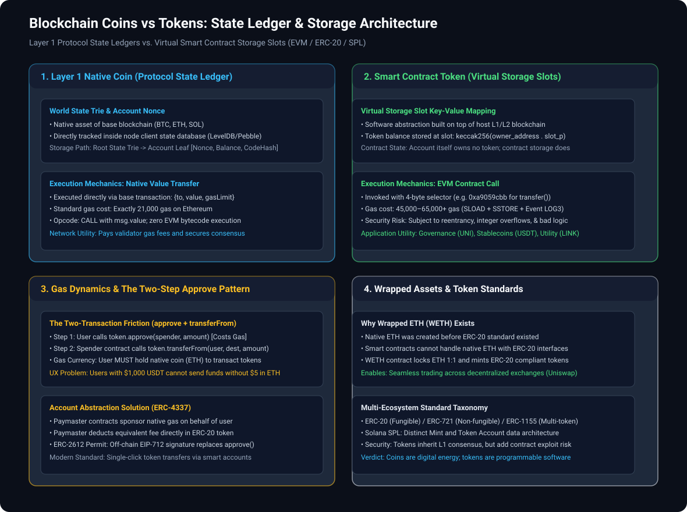

# Blockchain Coins vs Tokens: State Ledgers, Storage Architecture, and Cryptoeconomics

`Learning note · Revised November 2026 · Cryptoeconomics & Distributed Ledger Architecture`  
*By Srinivasan Ragothaman ([@rsrini7](https://github.com/rsrini7))*

> While both represent digital value on distributed networks, coins and tokens operate on fundamentally different architectural layers. A coin is the protocol-level native currency of a Layer 1 blockchain tracked in the global world state trie and used to purchase execution gas. A token is a software abstraction instantiated inside virtual smart contract storage slots whose transfer logic, authorization rules, and economic utility are governed entirely by bytecode.

---

## 1. Foundations: Protocol Assets vs. Application Software

In blockchain systems, confusion between "coins" and "tokens" often obscures critical differences in consensus security, memory layout, execution cost, and transaction finality.

```
+--------------------------------------------------------------------------------------------------------+
|                                    BLOCKCHAIN ASSET TAXONOMY                                           |
+--------------------------------------------------------------------------------------------------------+
|  LAYER 1 NATIVE COIN (Protocol Ledger)                 SMART CONTRACT TOKEN (Virtual State)            |
|  - Bitcoin (BTC), Ethereum (ETH), Solana (SOL)         - Uniswap (UNI), Tether (USDT), Chainlink       |
|  - Stored directly in global World State Trie          - Stored in contract storage slots (EVM)        |
|  - Balance modified by base state transition engine    - Balance modified by executing EVM bytecode    |
|  - Pays base transaction fees (Gas) to validators      - Cannot pay gas directly without abstraction   |
|  - Transfer cost: Exactly 21,000 gas (Ethereum)        - Transfer cost: 45,000 to 65,000+ gas          |
|  - Secures consensus (Proof-of-Work / Proof-of-Stake)  - Application governance, utility, or collateral|
+--------------------------------------------------------------------------------------------------------+
```

### Essential Technical Terms & Architectural Roles

| Component / Term | Layer & Implementation | Primary Role & Invariants |
| :--- | :--- | :--- |
| **Native Coin** | Layer 1 Protocol (Core Client) | Base unit of account in the consensus state machine; required to purchase computational gas and incentivize validators. |
| **Smart Contract Token** | Layer 2 / Application Layer (EVM) | Data mapping inside a smart contract; records user balances and emits transfer events adhering to a public interface. |
| **World State Trie** | Merkle Patricia Trie (LevelDB/Pebble) | Cryptographic data structure recording all account nonces, native coin balances, storage roots, and code hashes. |
| **Storage Slot** | 32-Byte EVM Virtual Memory Key | The virtual storage cell where token balances reside. For mapping `balanceOf[address]`, slot position is calculated as `keccak256(address . slot_index)`. |
| **Wrapped Token (WETH)** | Smart Contract Escrow | 1:1 asset wrapper that accepts native ETH, locks it in contract reserves, and mints an identical amount of ERC-20 compliant tokens. |
| **ERC-20 Standard (EIP-20)** | Ethereum Improvement Proposal | Standardized interface for fungible tokens defining `transfer()`, `approve()`, `transferFrom()`, and `balanceOf()`. |
| **Account Abstraction (ERC-4337)** | Protocol Framework | Enables smart contract wallets to sponsor native gas fees using Paymasters, allowing users to pay gas directly in ERC-20 tokens. |

---

## 2. Deep Technical Mechanisms: Storage Slots, Gas, and Account Abstraction

### 2.1 State Ledger vs. Smart Contract Virtual Storage

The physical location of balances distinguishes coins from tokens at the node storage layer:

```
ETHEREUM WORLD STATE TRIE (NATIVE ETH BALANCE)
[ State Root ] ──► Intermediate Branch Nodes ──► Account Leaf (0xAlice)
                                                     ├── Nonce: 42
                                                     ├── Balance: 2.50 ETH (Protocol Level)
                                                     ├── StorageRoot: [ Hash ]
                                                     └── CodeHash: 0xc5d2... (Empty for EOA)

SMART CONTRACT TOKEN STORAGE (ERC-20 USDT BALANCE)
Account Leaf (0xTokenContract)
  └── StorageRoot ──► Contract Storage Trie
                          │
                          ▼ (Virtual Slot Location via keccak256)
                    Storage Slot = keccak256(abi.encode(0xAlice, 0)) ──► Value: 10,000.00 USDT
```

1. **Native Coin Modification**: When 0xAlice sends native ETH to 0xBob, the execution engine decrements Alice's balance leaf and increments Bob's balance leaf. No virtual machine bytecode runs; execution costs a fixed **21,000 gas**.
2. **Token Transfer Modification**: When 0xAlice sends USDT to 0xBob, she submits a transaction targeting the USDT contract address with calldata encoding `transfer(address,uint256)`. The EVM loads the contract bytecode, computes `keccak256(Alice, slot)`, verifies sufficient balance, executes `SSTORE` to reduce Alice's balance, and another `SSTORE` to increase Bob's balance. This consumes **45,000 to 65,000+ gas**.

---

### 2.2 Execution Sequence: Native Transfer vs. ERC-20 Approval

```mermaid
sequenceDiagram
    autonumber
    actor User as User Wallet (Alice)
    participant Core as Ethereum State Machine
    participant Token as ERC-20 Token Contract
    participant DEX as Uniswap Exchange Router

    rect rgb(15, 23, 42)
    Note over User, Core: Native Coin Transfer (ETH)
    User->>Core: Base TX: {to: Bob, value: 1.5 ETH, gas: 21,000}
    Core->>Core: Decrement Alice ETH, Increment Bob ETH
    Note over Core: Completed in 1 step; zero smart contract execution
    end

    rect rgb(30, 41, 59)
    Note over User, DEX: Smart Contract Token Swap (USDT)
    User->>Token: TX 1: approve(DEX_Address, 1,000 USDT)
    Token->>Token: SSTORE allowance[Alice][DEX] = 1,000
    Note over User, Token: Alice MUST spend native ETH for TX 1 gas
    User->>DEX: TX 2: swapExactTokensForTokens(...)
    DEX->>Token: Invokes transferFrom(Alice, DEX_Pool, 1,000)
    Token->>Token: Verify allowance and SSTORE balances
    DEX->>User: Credit Purchased Output Tokens
    end
```

---

### 2.3 The Two-Step Friction and Modern Gas Abstraction (ERC-4337)

The classic ERC-20 pattern forces a two-step UX: an approval transaction followed by the functional contract interaction. Furthermore, a user holding $10,000 in USDT on a brand-new wallet cannot execute a single transaction without first acquiring native ETH to pay gas.

Modern architectures solve this via:
1. **ERC-2612 (`permit`)**: Replaces the on-chain `approve()` transaction with an off-chain cryptographic signature (EIP-712), allowing the spender to submit the approval and transfer in a single atomic transaction.
2. **ERC-4337 Account Abstraction**: Introduces a **Paymaster** contract. The user signs a `UserOperation` authorizing the deduction of 5 USDT. The Paymaster pays native ETH to the block builder, and reimburses itself by pulling 5 USDT from the user, enabling gasless token transactions.

---

## 3. Architectural Visuals: State Ledger vs. Virtual Storage

The architectural diagram below contrasts the underlying storage layers, gas dynamics, and authorization boundaries between Layer 1 protocol coins and smart contract tokens:



---

## 4. Production Implementations & Code Recipes

### 4.1 Production ERC-20 Smart Contract with EIP-2612 Permit & Gas Optimization

This idiomatic Solidity contract implements a secure, gas-optimized fungible token with off-chain permit signatures and custom errors:

```solidity
// SPDX-License-Identifier: MIT
pragma solidity 0.8.28;

interface IERC20 {
    event Transfer(address indexed from, address indexed to, uint256 value);
    event Approval(address indexed owner, address indexed spender, uint256 value);

    function totalSupply() external view returns (uint256);
    function balanceOf(address account) external view returns (uint256);
    function transfer(address to, uint256 value) external returns (bool);
    function allowance(address owner, address spender) external view returns (uint256);
    function approve(address spender, uint256 value) external returns (bool);
    function transferFrom(address from, address to, uint256 value) external returns (bool);
}

contract EnterpriseToken is IERC20 {
    // Custom errors save ~2,000 gas compared to revert strings
    error InsufficientBalance(address account, uint256 available, uint256 required);
    error InsufficientAllowance(address spender, uint256 current, uint256 required);
    error InvalidRecipient(address recipient);
    error PermitExpired(uint256 deadline);
    error InvalidSigner(address signer);

    string public name;
    string public symbol;
    uint8 public immutable decimals;
    uint256 private _totalSupply;

    // EVM Storage Slot 0: Mapping balances
    mapping(address => uint256) private _balances;
    // EVM Storage Slot 1: Nested mapping allowances
    mapping(address => mapping(address => uint256)) private _allowances;
    // EVM Storage Slot 2: Nonces for permit replay protection
    mapping(address => uint256) public nonces;

    bytes32 public immutable DOMAIN_SEPARATOR;
    bytes32 public constant PERMIT_TYPEHASH = 
        keccak256("Permit(address owner,address spender,uint256 value,uint256 nonce,uint256 deadline)");

    constructor(string memory _name, string memory _symbol, uint8 _decimals, uint256 initialSupply) {
        name = _name;
        symbol = _symbol;
        decimals = _decimals;
        
        _totalSupply = initialSupply * (10 ** uint256(_decimals));
        _balances[msg.sender] = _totalSupply;
        emit Transfer(address(0), msg.sender, _totalSupply);

        DOMAIN_SEPARATOR = keccak256(
            abi.encode(
                keccak256("EIP712Domain(string name,string version,uint256 chainId,address verifyingContract)"),
                keccak256(bytes(_name)),
                keccak256(bytes("1")),
                block.chainid,
                address(this)
            )
        );
    }

    function totalSupply() external view override returns (uint256) { return _totalSupply; }
    function balanceOf(address account) external view override returns (uint256) { return _balances[account]; }
    function allowance(address owner, address spender) external view override returns (uint256) { return _allowances[owner][spender]; }

    function transfer(address to, uint256 value) external override returns (bool) {
        _transfer(msg.sender, to, value);
        return true;
    }

    function approve(address spender, uint256 value) external override returns (bool) {
        _allowances[msg.sender][spender] = value;
        emit Approval(msg.sender, spender, value);
        return true;
    }

    function transferFrom(address from, address to, uint256 value) external override returns (bool) {
        uint256 currentAllowance = _allowances[from][msg.sender];
        if (currentAllowance != type(uint256).max) {
            if (currentAllowance < value) revert InsufficientAllowance(msg.sender, currentAllowance, value);
            unchecked { _allowances[from][msg.sender] = currentAllowance - value; }
        }
        _transfer(from, to, value);
        return true;
    }

    function permit(
        address owner,
        address spender,
        uint256 value,
        uint256 deadline,
        uint8 v,
        bytes32 r,
        bytes32 s
    ) external {
        if (block.timestamp > deadline) revert PermitExpired(deadline);

        bytes32 structHash = keccak256(
            abi.encode(PERMIT_TYPEHASH, owner, spender, value, nonces[owner]++, deadline)
        );
        bytes32 digest = keccak256(abi.encodePacked("\x19\x01", DOMAIN_SEPARATOR, structHash));
        address signer = ecrecover(digest, v, r, s);
        if (signer == address(0) || signer != owner) revert InvalidSigner(signer);

        _allowances[owner][spender] = value;
        emit Approval(owner, spender, value);
    }

    function _transfer(address from, address to, uint256 value) internal {
        if (to == address(0)) revert InvalidRecipient(to);
        uint256 fromBalance = _balances[from];
        if (fromBalance < value) revert InsufficientBalance(from, fromBalance, value);

        unchecked {
            _balances[from] = fromBalance - value;
            _balances[to] += value;
        }
        emit Transfer(from, to, value);
    }
}
```

---

### 4.2 Inspecting EVM Storage Slots via Foundry CLI (`cast`)

To verify that a token balance is stored inside a contract storage slot and not in the account itself:

```bash
# 1. Inspect native ETH balance of an account directly from the world state trie
cast balance 0xAliceAddress --rpc-url https://eth.llamarpc.com

# 2. Calculate the virtual storage slot for balanceOf[0xAliceAddress] in USDT contract
# USDT balance mapping is at slot 2 in the contract layout: keccak256(Alice . 2)
SLOT=$(cast index 0xAliceAddress 2)

# 3. Read raw 32-byte storage slot directly from the Ethereum node storage trie
cast storage 0xdAC17F958D2ee523a2206206994597C13D831ec7 $SLOT --rpc-url https://eth.llamarpc.com

# 4. Compare with the high-level contract ABI call (both return the identical integer value)
cast call 0xdAC17F958D2ee523a2206206994597C13D831ec7 "balanceOf(address)(uint256)" 0xAliceAddress --rpc-url https://eth.llamarpc.com
```

---

## 5. Comparative Architectural Taxonomy

| Architectural Dimension | Layer 1 Native Coin (e.g. ETH, BTC, SOL) | Smart Contract Token (ERC-20, SPL) | Wrapped Coin (e.g. WETH, WBTC) |
| :--- | :--- | :--- | :--- |
| **Creation Mechanism** | Protocol genesis block / block mining reward | Smart contract deployment | Escrow deposit & mint contract |
| **Balance Representation** | Native Account Leaf (`account.balance`) | Virtual storage mapping (`_balances[address]`) | Virtual ERC-20 mapping backed by locked L1 reserve |
| **Execution Gas Cost** | Constant 21,000 gas | Dynamic 45,000–65,000+ gas | Dynamic 35,000–50,000 gas |
| **Gas Payment Ability** | Native protocol fuel | Requires native coin or Paymaster sponsor | Operates as ERC-20; cannot pay base gas directly |
| **Security Surface** | Protocol consensus (PoW / PoS hashpower/stake) | Host chain consensus **plus** smart contract code audit | Host chain consensus **plus** bridge/custodian escrow risk |
| **Primary Standards** | Base Node RPC (`eth_getBalance`, UTXO set) | ERC-20, ERC-721, ERC-1155, Solana SPL | Canonical wrapped contract standard (WETH9) |
| **DeFi Composability** | Cannot be directly traded in standard AMM token pairs | High; interoperates natively with ERC-20 interfaces | High; allows native coins to trade inside DEX pools |

---

## 6. Common Claims vs. Technical Realities

| # | Common Industry Claim | Technical Reality & Benchmark Fact | Architectural Guidance |
| :-: | :--- | :--- | :--- |
| **1** | *"Tokens are inherently less secure than native coins."* | **Nuanced.** Tokens inherit the exact same base-layer consensus, reorg resistance, and cryptographic security as the host L1. However, tokens introduce application-level exploit vectors: reentrancy, malicious mint functions, and logic bugs in smart contracts. | Audit smart contract bytecode rigorously; the underlying blockchain consensus will not protect against bad contract logic. |
| **2** | *"Wrapping Ethereum into WETH creates a brand new cryptocurrency."* | **False.** WETH is simply an ERC-20 wrapper. A user deposits 1 ETH into the WETH contract, which locks the ETH and mints 1 WETH. 1 WETH is always redeemable for 1 ETH from the contract reserves. | Use WETH to interoperate with decentralized protocols; redeem to native ETH when exiting DeFi contracts. |
| **3** | *"You can pay gas with tokens if the token has high market capitalization."* | **False at Protocol Level.** EVM block validators require compensation in native ETH. While ERC-4337 Paymasters allow users to submit tokens, the Paymaster contract still liquidates or swaps those tokens into native ETH to settle with the block proposer. | Implement Paymasters for user convenience, but account for slippage and gas sponsorship reserves. |
| **4** | *"Creating a native coin is as easy as deploying a smart contract."* | **False.** Deploying an ERC-20 token takes under 10 minutes on an existing L1. Launching a native coin requires bootstrapping a decentralized peer-to-peer network, designing consensus mechanisms, establishing validator incentives, and defending against 51% attacks. | Deploy a token unless your project specifically requires custom execution state machines or non-EVM cryptography. |
| **5** | *"Account abstraction eliminates the distinction between coins and tokens."* | **False.** Account abstraction unifies the user experience by sponsoring gas, but the physical storage layers remain divided: base balances live in account state leaves, while token balances remain keyed to contract storage slots. | Model storage slots carefully when calculating contract read/write gas overhead. |

---

## 7. Practical Adoption Blueprint: Decision Framework

```
                        DECISION FRAMEWORK: COIN VS. TOKEN
                                         │
                    Do you need custom consensus or execution?
                                         │
         ┌───────────────────────────────┴───────────────────────────────┐
         ▼                                                               ▼
       [ YES ]                                                         [ NO ]
  - Requires custom cryptography                                  - Building a DApp, DeFi protocol,
  - Needs novel transaction execution                             - In-game asset, governance tool,
  - Building sovereign economic security                          - Or fiat-backed stablecoin
         │                                                               │
         ▼                                                               ▼
   BUILD A LAYER 1 COIN                                            DEPLOY A SMART CONTRACT TOKEN
   (Requires validators, nodes, P2P)                               (Deploy ERC-20 on existing L1/L2)
```

---

## 8. Technology Roadmap & Historical Milestones

```
2009 ────────────────────── 2015 ────────────────────── 2020 ────────────────────── 2026+
 │                           │                           │                           │
 ├── Bitcoin Whitepaper      ├── Ethereum Launch         ├── DeFi Summer / Uniswap   └── ERC-4337 GA
 │   • First Native Coin     • Native ETH & Gas          • WETH standardizes DEXes   • Paymasters sponsor gas
 │   • UTXO state model      • Turing-complete VM        • EIP-2612 Permit off-chain • Gasless token transfers
 │                                                       • Multi-token ERC-1155      • Universal smart accounts
 │
 ├── 2013: Colored Coins     ├── Nov 2015: EIP-20
     • Precursor to tokens       • ERC-20 token standard
     • Bitcoin metadata hacks    • Standardizes balances
```

---

## 9. Primary Sources & References

1. [Satoshi Nakamoto (2008): Bitcoin: A Peer-to-Peer Electronic Cash System](https://bitcoin.org/bitcoin.pdf) — Foundational whitepaper establishing native decentralized cryptocurrency and UTXO state ledgers.
2. [Vitalik Buterin (2014): Ethereum Whitepaper](https://ethereum.org/en/whitepaper/) — Foundational paper introducing smart contracts, state transition functions, and native gas economics.
3. [EIP-20: Token Standard](https://eips.ethereum.org/EIPS/eip-20) — Official Ethereum Improvement Proposal specifying the standardized interface for fungible tokens.
4. [EIP-2612: Permit Extension for ERC-20](https://eips.ethereum.org/EIPS/eip-2612) — Standardizes signed approvals (EIP-712) to eliminate the two-step approve/transferFrom friction.
5. [ERC-4337: Account Abstraction Using Alt Mempool](https://eips.ethereum.org/EIPS/eip-4337) — Standard enabling smart contract wallets, paymasters, and token-based gas payments.
6. [Gavin Wood: Ethereum Yellow Paper](https://ethereum.github.io/yellowpaper/paper.pdf) — Formal specification of the Ethereum state machine, gas costs (21,000 base transfer), and Merkle Patricia Tries.

---

## 10. Supplementary visuals

The following architectural diagrams from the repository illustrate blockchain state hierarchies and classification schemes:


*Figure 1: High-level overview of Layer 1 settlement versus smart contract application execution.*


*Figure 2: Classification matrix across distributed ledger platforms, consensus models, and asset primitives.*

---

**Related:**
- [Ethereum-Hardhat-Docker-Environment-2026](../ethereum/Ethereum-Hardhat-Docker-Environment-2026.md) — Comprehensive guide to containerized smart contract development, compilation, and automated test harnesses.
- [Crypto-Supercycle-and-Ethereum](../ethereum/Crypto-Supercycle-and-Ethereum.md) — Analysis of Ethereum monetary policy, staking yields, and L1 vs L2 fee dynamics.
- [Quantum-Threat-to-Bitcoin-And-Elliptic-Curve-Cryptography-2026](../../QuantumComputing/Quantum-Threat-to-Bitcoin-And-Elliptic-Curve-Cryptography-2026.md) — Analyzes the cryptographic security of secp256k1 elliptic curve signatures used in native coin transactions.
- [Graph-Databases-At-Massive-Scale-Architecture-2026](../../Engineering/Databases/Graph-Databases-At-Massive-Scale-Architecture-2026.md) — Compares blockchain state trees and transaction graphs with distributed graph databases.
- [ISO20022-Aligned-Crypto-Rails-XRP-XLM-XDC-HBAR](ISO20022-Aligned-Crypto-Rails-XRP-XLM-XDC-HBAR.md) — Evaluates enterprise payment settlement across native consensus tokens and banking messaging standards.
