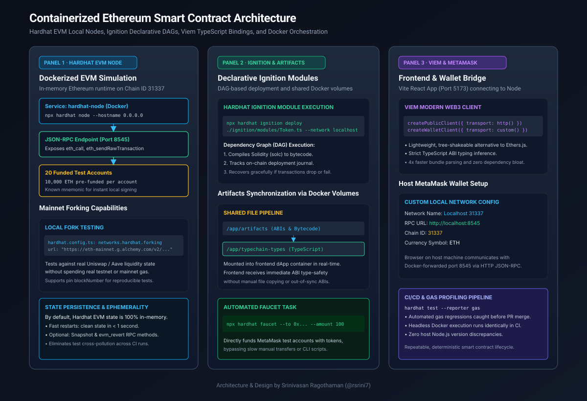
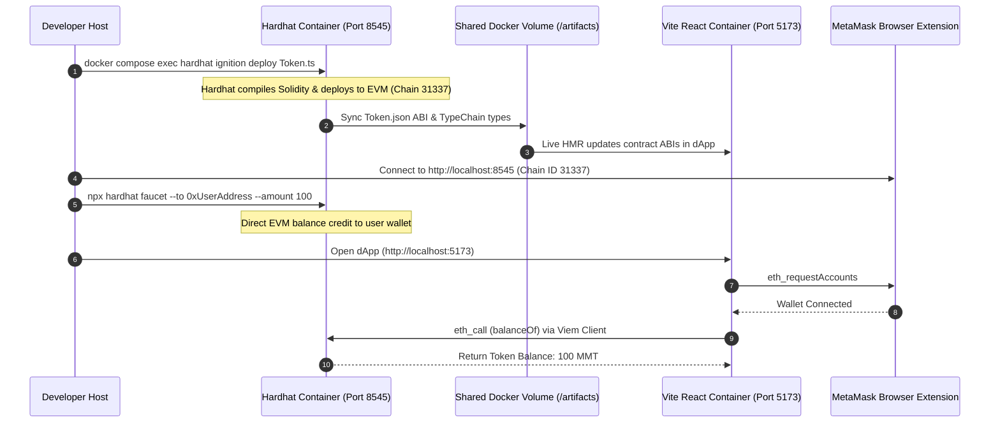

# Containerized Ethereum Development: Hardhat EVM, Ignition DAGs, and Docker Orchestration

Daily learning · March 2026

*By Srinivasan Ragothaman ([@rsrini7](https://github.com/rsrini7))*

> Production blueprint for containerizing Ethereum smart contract development—orchestrating local Hardhat EVM nodes, Hardhat Ignition declarative deployments, Viem TypeScript integration, and automated gas profiling inside isolated Docker networks.

---

## 1. Foundations: The Deterministic Smart Contract Toolchain

Smart contract development is notorious for environment drift. Discrepancies in local Node.js versions, dirty global state left behind in local Ethereum Virtual Machine (EVM) nodes, out-of-sync application binary interfaces (ABIs), and ad-hoc deployment scripts frequently cause contracts that pass locally to fail during continuous integration (CI) or testnet deployment.

A containerized Web3 architecture completely eliminates these variables. By encapsulating the entire lifecycle—the local Hardhat EVM node, Solidity compilation, declarative contract deployments via Hardhat Ignition, and the client frontend dApp—inside a multi-container Docker Compose network, teams achieve **100% deterministic, reproducible smart contract testing**.

```
┌────────────────────────────────────────────────────────┐
│               Host Workstation / Browser               │
│          MetaMask Wallet (Target: localhost:8545)      │
│          Vite React dApp Frontend (localhost:5173)     │
└───────────────────────────┬────────────────────────────┘
                            │ Bridge Network (Port Forwarding)
┌───────────────────────────▼────────────────────────────┐
│              Docker Compose Virtual Network            │
│                                                        │
│  ┌─────────────────────────┐  ┌─────────────────────┐  │
│  │   hardhat-node (8545)   │  │   dapp-ui (5173)    │  │
│  │  In-Memory EVM Runtime  │  │  Vite + React + Viem│  │
│  │  Chain ID: 31337        │  │  Live HMR Frontend  │  │
│  └────────────┬────────────┘  └──────────▲──────────┘  │
│               │                          │             │
│               │ Shared Volume Mounts     │             │
│               ▼                          │             │
│       /app/artifacts & /app/typechain-types            │
└────────────────────────────────────────────────────────┘
```

### Core Web3 Toolchain Vocabulary

| Component / Term | Role | Technical Responsibility |
| :--- | :--- | :--- |
| **Hardhat Network** | Local In-Memory EVM | A fast local Ethereum node designed for development. Exposes standard JSON-RPC endpoints (`eth_call`, `eth_sendRawTransaction`) on Chain ID 31337. |
| **Hardhat Ignition** | Declarative Deployment Engine | Replaces imperative deployment scripts with dependency-driven Directed Acyclic Graphs (DAGs), ensuring atomic recovery on dropped transactions. |
| **Viem** | TypeScript Web3 Client | A lightweight, tree-shakeable alternative to Ethers.js with strict compile-time ABI type inference and zero bundle bloat. |
| **Chain ID 31337** | Local Network Identifier | Default Hardhat network chain ID; isolates local testing transactions from mainnet (`1`) and public testnets (`11155111` Sepolia). |
| **TypeChain** | Static Typing Generator | Automatically inspects compiled Solidity ABIs and generates TypeScript typings for all smart contract methods. |

---

## 2. Deep Technical Mechanisms: Node, Ignition, and Viem

### Hardhat Network Node Architecture

The Hardhat Network runs an in-process, pure TypeScript implementation of the EVM. When launched in Docker:

```bash
npx hardhat node --hostname 0.0.0.0
```

1. **Genesis Configuration**: It seeds 20 deterministic test accounts, each pre-funded with 10,000 ETH derived from a standard mnemonic (`test test test test test test test test test test test junk`).
2. **Instant Mining vs Interval Mining**: By default, blocks are mined instantaneously upon transaction submission (`mining.auto = true`). For simulating real-world mempool conditions, interval mining can be configured:
   ```typescript
   networks: {
     hardhat: {
       mining: {
         auto: false,
         interval: [1000, 3000] // Random delay between 1s and 3s
       }
     }
   }
   ```
3. **Mainnet Forking**: Hardhat can fetch state dynamically from Ethereum Mainnet or Arbitrum L2 via an archive RPC endpoint (e.g. Alchemy or Infura). Hardhat caches remote state locally while executing transactions against real-world liquidity contracts (Uniswap, Aave, Chainlink oracles) at zero gas cost:
   ```typescript
   networks: {
     hardhat: {
       forking: {
         url: "https://eth-mainnet.g.alchemy.com/v2/YOUR-API-KEY",
         blockNumber: 19250000 // Pinned block for deterministic state
       }
     }
   }
   ```

### Declarative Deployments with Hardhat Ignition

Legacy deployment scripts relied on imperative async/await sequences (`await Token.deploy()`). These scripts fail catastrophically when a transaction stalls or gas spikes, forcing developers to manually track deployed addresses and write complex recovery logic.

Hardhat Ignition formalizes deployments as **declarative dependency DAGs** (`buildModule`):

```typescript
import { buildModule } from "@nomicfoundation/hardhat-ignition/modules";

export default buildModule("TokenModule", (m) => {
  // 1. Declare deployment parameter with defaults
  const initialSupply = m.getParameter("initialSupply", 1_000_000n);

  // 2. Define contract deployment
  const token = m.contract("Token", [initialSupply]);

  // 3. Define dependent contract deployment or initialization
  const distributor = m.contract("Distributor", [token]);
  m.call(token, "transfer", [distributor, 500_000n]);

  return { token, distributor };
});
```

#### Why Ignition Outperforms Imperative Scripts
- **Transaction Journaling**: Ignition records an on-disk execution journal (`journal.jsonl`). If execution halts mid-deployment, restarting the command resumes from the exact point of failure without redeploying existing contracts.
- **Gas Fee Management**: Automatically calculates dynamic EIP-1559 gas parameters (`maxFeePerGas`, `maxPriorityFeePerGas`) and resubmits stalled transactions with bumped fees.
- **Artifact Verification**: Automatically produces deployment metadata ready for Etherscan / Blockscout verification.

### Client-Side Integration with Viem

Legacy dApps commonly relied on Ethers.js or Web3.js, which suffer from large bundle footprints and loose typing. Viem introduces modular functional primitives and compile-time ABI inference:

```typescript
import { createPublicClient, createWalletClient, custom, http } from "viem";
import { hardhat } from "viem/chains";
import { TokenAbi } from "./artifacts/Token.json";

// Read-only public client connected to Docker Hardhat node
export const publicClient = createPublicClient({
  chain: hardhat,
  transport: http("http://localhost:8545"),
});

// Write-capable wallet client connected to browser MetaMask provider
export const getWalletClient = () => {
  if (!window.ethereum) throw new Error("MetaMask not detected");
  return createWalletClient({
    chain: hardhat,
    transport: custom(window.ethereum),
  });
};
```

---

## 3. Architectural Visuals: Multi-Container Docker Topology

The architectural diagram below maps the complete containerized Web3 development environment: Panel 1 illustrates the Hardhat EVM node and JSON-RPC services; Panel 2 details Ignition DAG compilation and shared volume pipelines; Panel 3 models the host browser, MetaMask bridge, and Viem client integration.



### End-to-End Contract Deployment and Interaction Sequence



---

## 4. Production Implementations & Code Recipes

### Production `docker-compose.yml`

This multi-service Compose configuration orchestrates the isolated EVM node, the deployment container, and the hot-reloading frontend dApp.

```yaml
version: '3.8'

services:
  # 1. Local Hardhat EVM Node Service
  hardhat:
    build:
      context: .
      dockerfile: Dockerfile.hardhat
    container_name: hardhat-node
    command: npx hardhat node --hostname 0.0.0.0
    ports:
      - "8545:8545"
    volumes:
      - ./contracts:/app/contracts
      - ./ignition:/app/ignition
      - ./tasks:/app/tasks
      - ./hardhat.config.ts:/app/hardhat.config.ts
      - shared-artifacts:/app/artifacts
      - shared-types:/app/typechain-types
    healthcheck:
      test: ["CMD", "wget", "--spider", "-q", "http://localhost:8545"]
      interval: 5s
      timeout: 3s
      retries: 5

  # 2. Vite React Frontend dApp Service
  dapp:
    build:
      context: ./frontend
      dockerfile: Dockerfile.frontend
    container_name: dapp-ui
    ports:
      - "5173:5173"
    environment:
      - VITE_RPC_URL=http://localhost:8545
      - VITE_CHAIN_ID=31337
    volumes:
      - ./frontend/src:/app/src
      - shared-artifacts:/app/src/artifacts:ro
      - shared-types:/app/src/types:ro
    depends_on:
      hardhat:
        condition: service_healthy

volumes:
  shared-artifacts:
  shared-types:
```

### Production `Dockerfile.hardhat`

```dockerfile
FROM node:20-alpine
WORKDIR /app

# Install dependencies in isolated layer
COPY package.json package-lock.json ./
RUN npm ci

# Copy configuration and contracts
COPY tsconfig.json hardhat.config.ts ./
COPY contracts ./contracts
COPY ignition ./ignition
COPY tasks ./tasks

EXPOSE 8545
CMD ["npx", "hardhat", "node", "--hostname", "0.0.0.0"]
```

### Automated Faucet Task (`tasks/faucet.ts`)

To avoid manual faucet workflows or begging for testnet tokens, the custom Hardhat task below credits tokens directly from the deployer account:

```typescript
import { task } from "hardhat/config";
import { parseEther } from "viem";

task("faucet", "Transfers test tokens and ETH to a recipient address")
  .addParam("to", "The recipient Ethereum address")
  .addOptionalParam("amount", "Amount of tokens to send", "100")
  .setAction(async (taskArgs, hre) => {
    const { to, amount } = taskArgs;
    const [deployer] = await hre.viem.getWalletClients();
    const publicClient = await hre.viem.getPublicClient();

    console.log(`Funding account ${to} from deployer ${deployer.account.address}...`);

    // 1. Send native ETH for gas fees
    const ethTxHash = await deployer.sendTransaction({
      to: to as `0x${string}`,
      value: parseEther("1.0"),
    });
    await publicClient.waitForTransactionReceipt({ hash: ethTxHash });
    console.log(`Transferred 1.0 ETH for gas (Tx: ${ethTxHash})`);

    // 2. Interact with deployed Token contract
    const token = await hre.viem.getContractAt(
      "Token",
      "0x5FbDB2315678afecb367f032d93F642f64180aa3" // Local deterministic deployment address
    );

    const tokenTxHash = await token.write.transfer([
      to as `0x${string}`,
      parseEther(amount),
    ]);
    await publicClient.waitForTransactionReceipt({ hash: tokenTxHash });
    console.log(`Transferred ${amount} MMT tokens to ${to} (Tx: ${tokenTxHash})`);
  });
```

---

## 5. Impact, Real-World Edge Cases & Gotchas

### Common Claims vs. Technical Realities

| Common Claim | Technical Reality | Empirical Mechanism |
| :--- | :--- | :--- |
| **"Hardhat EVM state persists across Docker container restarts."** | **False (by default).** Hardhat operates strictly as an in-memory database. | When the container stops, all mined blocks, contract deployments, and balances are lost. Persistent testing requires setting up an external database state or executing snapshot scripts (`evm_snapshot` / `evm_revert`) on boot. |
| **"Gas costs measured on Hardhat locally match Ethereum Mainnet."** | **False.** Local EVM environments omit base fee volatility ($EIP\text{-}1559$). | Local nodes operate with a static `baseFeePerGas` (typically 1 Gwei) and zero priority fee competition. Accurate gas estimation requires running tests with `hardhat-gas-reporter` against pinned mainnet block forks. |
| **"MetaMask connects to Docker on localhost with zero configuration."** | **False.** MetaMask frequently throws `Nonce too high` or `Chain ID mismatch` errors. | Because Hardhat restarts reset the block height to zero while MetaMask caches account nonces, developers must execute **Settings $\to$ Advanced $\to$ Clear activity tab data** after restarting the Docker node. |
| **"Ignition is just syntactic sugar over hardhat-deploy."** | **False.** Ignition compiles to a verifiable execution DAG. | Imperative scripts cannot perform static dependency validation before submitting transactions. Ignition analyzes the entire deployment graph before broadcasting a single transaction, preventing mid-flight aborts. |

---

## 6. Practical Verification & Diagnostic Checklist

Run these diagnostic commands directly from your host workstation to verify node responsiveness and container health:

```bash
# 1. Verify JSON-RPC connectivity and Chain ID
curl -s -X POST http://localhost:8545 \
  -H "Content-Type: application/json" \
  -d '{"jsonrpc":"2.0","method":"eth_chainId","params":[],"id":1}'
# Expected response: {"jsonrpc":"2.0","id":1,"result":"0x7a69"} (0x7a69 = 31337 in hex)

# 2. Check latest block number
curl -s -X POST http://localhost:8545 \
  -H "Content-Type: application/json" \
  -d '{"jsonrpc":"2.0","method":"eth_blockNumber","params":[],"id":1}'

# 3. Deploy Ignition module from host into Docker container
docker compose exec hardhat npx hardhat ignition deploy ./ignition/modules/Token.ts --network localhost

# 4. Run automated gas profiling suite inside Docker
docker compose exec hardhat npx hardhat test --network localhost
```

### Verification Checklist
- [ ] **Interface Binding**: Confirm Hardhat is launched with `--hostname 0.0.0.0` inside Docker so host port mapping (`8545:8545`) functions correctly.
- [ ] **MetaMask RPC Cache**: When restarting containers, clear MetaMask activity data to reset cached transaction nonces.
- [ ] **Artifact Volume Mount**: Verify that `/app/artifacts` is mounted read-write in Hardhat and read-only (`:ro`) in the frontend dApp container to prevent accidental file corruption.
- [ ] **CI Pipeline Isolation**: Run tests with `docker compose run --rm hardhat npm test` in GitHub Actions to guarantee clean disposable environments.

---

## 7. Timeline of Ethereum Development Toolchains

```
2015 ── Truffle Suite launched; establishes early standard for Solidity compilation and migration scripts
2019 ── Nomic Foundation launches Hardhat (formerly Buidler); introduces in-memory TypeScript EVM and stack traces
2022 ── Foundry (forge/cast) emerges in Rust, providing ultra-fast fuzz testing in native Solidity
2023 ── Nomic Foundation releases Hardhat Ignition, establishing declarative DAG deployments
2024 ── Viem replaces Ethers.js across major Web3 boilerplates, establishing TypeScript ABI type safety
2026 ── Containerized, multi-chain development environments become non-negotiable for enterprise dApp security
```

---

## 8. Primary Sources & References

1. [Nomic Foundation: Hardhat Documentation](https://hardhat.org/docs) — Official guide to the Hardhat runner, plugins, and development environment.
2. [Nomic Foundation: Hardhat Ignition Specification](https://hardhat.org/ignition) — Architecture guide for declarative smart contract deployment DAGs.
3. [Viem: TypeScript Interface for Ethereum](https://viem.sh) — Documentation for low-level Ethereum JSON-RPC client primitives and type inference.
4. [GitHub: JonnyMacs Hardhat Tutorial Boilerplate](https://github.com/jonnymacs/hardhat-tutorial) — Reference containerized repository implementing Docker Compose, Ignition, and Viem.
5. [Ethereum Foundation: Ethereum Yellow Paper](https://ethereum.github.io/yellowpaper/paper.pdf) — Formal specification of EVM bytecode execution, state transitions, and gas mechanics.

---

**Related:**
- [EnterpriceBlockchainLearning](../enterprise/EnterpriceBlockchainLearning.md) — Comprehensive enterprise blockchain roadmap establishing containerized EVM toolchains as a fundamental prerequisite.
- [blockchain-26-catagories](../reference/blockchain-26-catagories.md) — Indexes testing environments, local RPC nodes, and smart contract developer tools across the 26-category classification.
- [Quantum-Threat-to-Bitcoin-And-Elliptic-Curve-Cryptography-2026](../../QuantumComputing/Quantum-Threat-to-Bitcoin-And-Elliptic-Curve-Cryptography-2026.md) — Examines cryptographic signatures ($ECDSA\ \text{secp256k1}$) used by Ethereum accounts and post-quantum risks.
