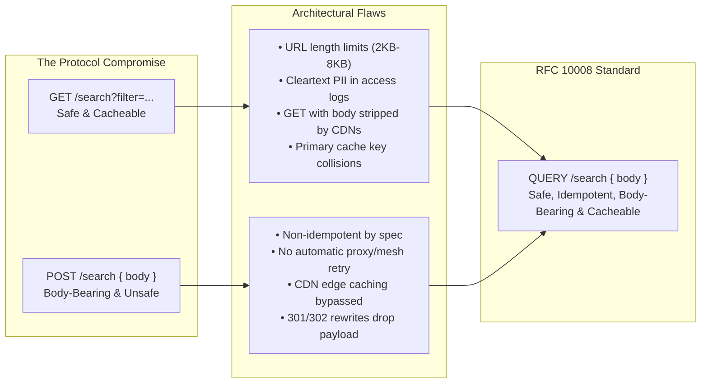
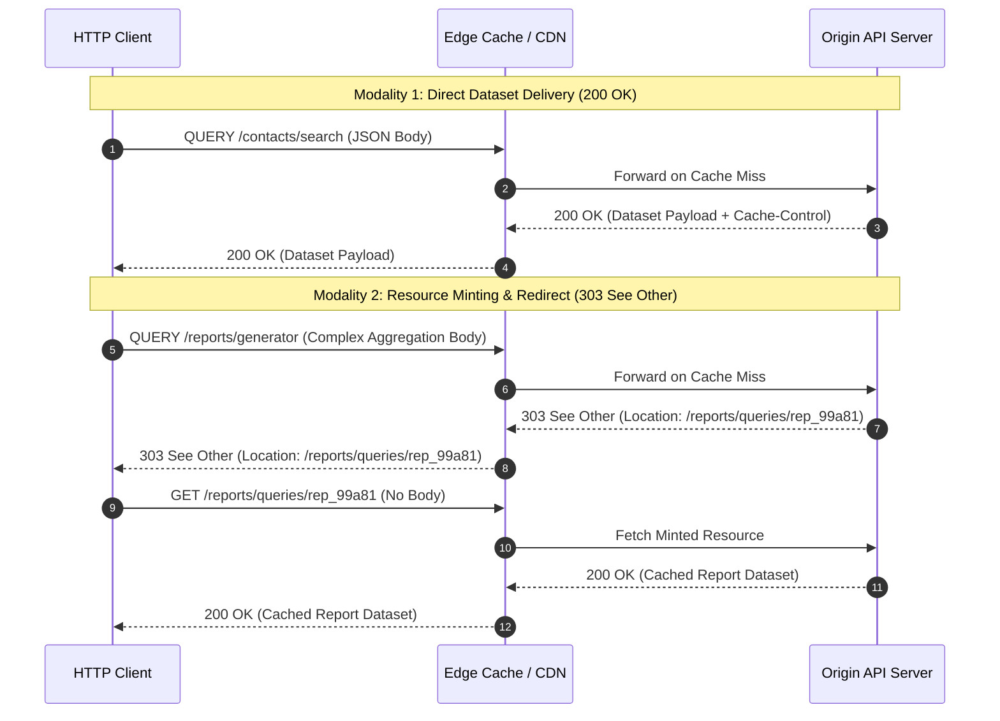
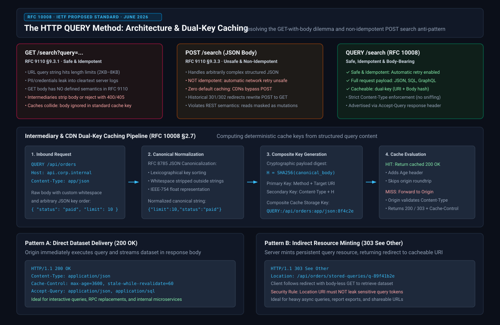
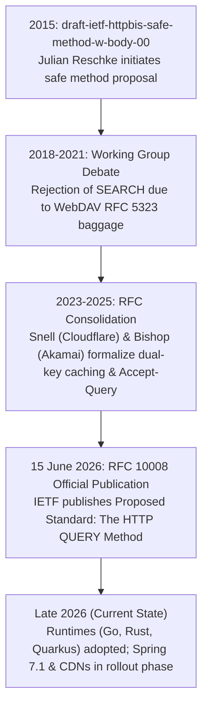
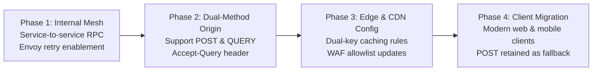

# HTTP QUERY Method (RFC 10008): Resolving the GET-with-Body Dilemma and POST Search Anti-Pattern

**Daily learning · 6 November 2026 · Technical specifications verified against RFC 10008 and IETF Standards**

> **Core idea:** For over a decade, backend APIs had to choose between URL-crammed `GET` requests that leak sensitive parameters into access logs or `POST /search` endpoints that strip HTTP caching and break automatic retry safety. Officially standardized in June 2026 as **RFC 10008**, the HTTP `QUERY` method establishes a safe, idempotent, cacheable verb with a request body, transforming how complex searches, analytical queries, and API filters are executed across the web.

## 1. The Architectural Dilemma: Why Modern APIs Broke HTTP

Every nontrivial REST, GraphQL, or RPC API eventually runs into the same architectural dilemma when implementing complex queries, faceted filtering, or analytical aggregations. The HTTP/1.1 and HTTP/2 standards defined clear roles for reading (`GET`) and mutating (`POST`), but left an architectural void for safe read operations that carry structured payloads.



### The Three Inadequate Workarounds

1. **Massive URL Query Strings (`GET /search?dept=hr&status=active&created_after=...`):**
   - **Length limitations:** Browsers and edge intermediaries enforce strict URL length caps (historically 2,048 characters in Internet Explorer/Edge, 4,096 bytes in common reverse proxies, and 8,192 bytes in standard web servers).
   - **Access log and PII leakage:** Query parameters appear in cleartext in server `access.log` files, proxy logs, CDN request metrics, browser history, and HTTP `Referer` headers sent to external domains.
   - **Encoding overhead:** Complex nested structures or arrays require verbose serialization schemes (e.g., bracket notation or base64 encoding), drastically bloating header byte counts.

2. **Sending a Request Body with `GET`:**
   - **No defined semantics:** Section 9.3.1 of [RFC 9110 (HTTP Semantics)](https://www.rfc-editor.org/rfc/rfc9110.html) explicitly states: *"A client SHOULD NOT generate content in a GET request unless a particular form of GET has defined such semantics... The presence of content in a GET request has no defined semantics."*
   - **Middlebox stripping and rejection:** Major load balancers, reverse proxies (such as older Nginx and HAProxy setups), API gateways, and Web Application Firewalls (WAFs) either drop the body during forwarding or reject the entire request with `400 Bad Request` or `405 Method Not Allowed`.
   - **Catastrophic cache collisions:** Standard HTTP caches (RFC 9111) compute cache keys using only the request method and the target URI (plus any headers in `Vary`). If two clients send `GET /analytics` with different bodies, a standard cache returns the first client's cached response to the second client—causing tenant data leaks and silent data corruption.

3. **Falling Back to `POST /search`:**
   - **Loss of idempotency and safety:** [RFC 9110 Section 9.2](https://www.rfc-editor.org/rfc/rfc9110.html) defines `POST` as neither safe nor idempotent. Middleboxes and HTTP client libraries assume `POST` modifies state.
   - **Broken automatic network retries:** If a TCP connection drops or a 503 Service Unavailable occurs before response headers return, service meshes (Envoy, Istio) and HTTP clients cannot automatically retry `POST` requests without risking duplicated mutations (e.g., duplicate charges or double orders).
   - **Caching disabled by default:** While RFC 9111 allows caching `POST` under rare, explicit conditions, nearly all commercial CDNs (Cloudflare, Akamai, Fastly, AWS CloudFront) bypass caching for `POST` requests out of the box.
   - **Redirect method corruption:** Historical browser quirks on `301 Moved Permanently` and `302 Found` redirects cause user agents to rewrite `POST` to `GET`, silently discarding the request payload.

---

### Protocol Property Comparison

| Request Property | `GET` (RFC 9110) | `POST` (RFC 9110) | `QUERY` (RFC 10008) |
|---|---|---|---|
| **Request Body Allowed** | Allowed, but **no defined semantics** | Required or optional | **Expected (Carries Query)** |
| **Safe (Read-Only)** | Yes (RFC 9110 §9.2.1) | No | **Yes (RFC 10008 §2.1)** |
| **Idempotent (Retryable)** | Yes (RFC 9110 §9.2.2) | No | **Yes (RFC 10008 §2.2)** |
| **Cacheable by Intermediaries** | Yes (Default) | Rarely (Bypassed by CDNs) | **Yes (Dual-Key: URI + Body)** |
| **Cache Key Inputs** | Method + URI + `Vary` | Method + URI (if enabled) | **Method + URI + Content-Type + Body Digest** |
| **Automatic Retry by Mesh/Proxy** | Enabled | Disabled (Unsafe) | **Enabled (Zero mutation risk)** |
| **Access Log Security** | PII leaked in URL strings | Safe (Body omitted from logs) | **Safe (Body omitted from logs)** |
| **Redirect Body Retention** | Not applicable (no body) | Often lost on 301/302 rewrites | **Preserved across all 3xx redirects** |
| **CORS Preflight Required** | No (Simple Request) | No (if simple Content-Type) | **Yes (Always triggers preflight)** |

---

### Essential Terminology

| Term | Meaning |
|---|---|
| **RFC 10008** | The IETF Proposed Standard (*The HTTP QUERY Method*), published in June 2026, defining the `QUERY` verb and discovery headers. |
| **Safe Method** | An HTTP method whose semantics are read-only and whose invocation does not cause origin server state changes (RFC 9110 §9.2.1). |
| **Idempotent Method** | An HTTP method where the intended effect of multiple identical requests is identical to that of a single request, allowing safe automatic retries (RFC 9110 §9.2.2). |
| **Dual-Key Caching** | A caching strategy where the cache lookup key is derived from both the target URI and a cryptographic hash of the normalized request body. |
| **JCS (RFC 8785)** | JSON Canonicalization Scheme: A standard for formatting JSON (key sorting, whitespace elimination, number canonicalization) so semantically identical JSON produces identical byte hashes. |
| **`Accept-Query`** | A structured response header field sent by origins to advertise support for `QUERY` and list accepted payload media types. |
| **Content Sniffing** | The practice of inspecting payload bytes to guess a content format rather than trusting the `Content-Type` header; strictly forbidden in RFC 10008. |
| **Resource Minting** | Using a `303 See Other` response with a `Location` header to generate a persistent or temporary bookmarkable URL for query results. |

---

## 2. Technical Mechanism: RFC 10008 Under the Hood

The `QUERY` method acts as a safe, idempotent counterpart to `POST`, specifically designed for read-only query processing where request parameters exceed the capacity, security boundaries, or structural convenience of URI query strings.

### The Wire Protocol and Request Anatomy

An HTTP `QUERY` request transmits its filtering or query expression entirely within the request payload, accompanied by explicit media typing:

```http
QUERY /api/v1/telemetry/events HTTP/1.1
Host: observability.internal.net
Content-Type: application/json
Accept: application/json
Accept-Encoding: gzip, zstd
Cache-Control: max-age=300

{
  "service": "billing-service",
  "time_window": {
    "start": "2026-11-06T00:00:00Z",
    "end": "2026-11-06T12:00:00Z"
  },
  "filters": [
    {"field": "status_code", "operator": "gte", "value": 500},
    {"field": "customer_tier", "operator": "in", "value": ["enterprise", "growth"]}
  ],
  "aggregations": ["count()", "p99(latency_ms)"],
  "group_by": ["cluster_id"]
}
```

### Strict Content-Type Enforcement and No-Sniffing Rule

Unlike legacy HTTP endpoints that frequently tolerate missing headers or employ speculative MIME sniffing, RFC 10008 mandates strict server validation:

1. **Payload Agnostic:** The specification does not restrict queries to JSON. An origin can accept `application/json`, `application/sql`, `application/graphql`, `text/plain`, or binary encodings such as `application/cbor`.
2. **Mandatory `Content-Type`:** The client **must** supply a valid `Content-Type` header indicating the query language or schema of the payload.
3. **No Content Sniffing:** Servers and intermediaries are explicitly forbidden from inspecting payload bytes to deduce the format.
4. **Deterministic Status Codes:**
   - **`400 Bad Request`:** Emitted if the `Content-Type` header is omitted or syntactically malformed.
   - **`415 Unsupported Media Type`:** Emitted if the query format is not supported by the endpoint (e.g., sending `application/graphql` to a SQL-only query endpoint).
   - **`422 Unprocessable Content`:** Emitted if the payload is syntactically well-formed JSON or SQL, but fails semantic validation (e.g., referencing a nonexistent field or invalid date range).

---

### Discovery via `Accept-Query`

Endpoints advertise their query capabilities in response to `GET`, `OPTIONS`, `HEAD`, or `QUERY` requests using the structured header `Accept-Query`:

```http
HTTP/1.1 200 OK
Date: Fri, 06 Nov 2026 08:50:00 GMT
Allow: GET, HEAD, QUERY, OPTIONS
Accept-Query: application/json, application/sql;charset="UTF-8"
```

A client receiving this header knows it can dispatch subsequent read operations against `/api/v1/telemetry/events` using `QUERY` with either JSON or SQL representations.

---

### Direct vs. Indirect Responses (Resource Minting)

RFC 10008 outlines two distinct response modalities:



1. **Direct Dataset Delivery (`200 OK`):**
   The origin executes the query synchronously and streams the matching dataset directly in the response body. This is the primary mode for high-throughput microservices, search APIs, and internal RPC replacements.

2. **Indirect Resource Minting (`303 See Other` + `Location`):**
   When a query requires substantial asynchronous computation, produces a large dataset, or must be shared/bookmarked, the server returns `303 See Other` with a `Location` header pointing to a minted resource (e.g., `Location: /reports/queries/rep_99a81`).
   
   The client automatically follows the redirect with a standard, body-less `GET /reports/queries/rep_99a81`. This decouples heavy query execution from subsequent retrieval and allows standard HTTP caches to store the final report under a clean, bookmarkable URI.

> [!IMPORTANT]
> **RFC 10008 Security Mandate on Minted URIs:** If the `QUERY` request body contained sensitive tokens, user identifiers, or private filtering parameters, the origin **must not** echo or serialize those sensitive tokens into the path or query parameters of the generated `Location` URI. Doing so would re-introduce the exact access-log PII exposure that `QUERY` was designed to eliminate.

---

## 3. How Caching Works: The Dual-Key Pipeline

The single most challenging engineering challenge of the `QUERY` specification was caching. In standard HTTP (RFC 9111), the primary cache key is simply the normalized target URI:

$$\text{Key}_{\text{GET}} = \text{Target URI}$$

Under RFC 10008, two requests to `QUERY /orders` are completely different operations if their request payloads differ. Intermediaries and CDNs must calculate a **composite dual-key** factoring in the request payload.

### The Composite Cache Key Formula

To prevent cache key collisions while maintaining deterministic lookups, compliant caches construct the storage key using four components:

$$\text{CacheKey}_{\text{QUERY}} = \text{SHA256}\Big(\text{Method} \mathbin{\Vert} \text{Target URI} \mathbin{\Vert} \text{Content-Type} \mathbin{\Vert} \text{Normalize}(\text{Request Body})\Big)$$

Where:
- $\text{Method}$ is the literal string `"QUERY"`.
- $\text{Target URI}$ is the normalized target endpoint (e.g., `/api/v1/orders`).
- $\text{Content-Type}$ ensures that a JSON query and a SQL query targeting the same URI do not share a cache slot.
- $\text{Normalize}(\text{Request Body})$ canonicalizes the payload to prevent spurious cache misses caused by trivial formatting differences.

---

### Payload Canonicalization: Why Raw Byte Hashing Fails

Consider two HTTP clients dispatching JSON search payloads:

```json
// Client A
{
  "limit": 50,
  "status": "pending"
}

// Client B
{
  "status": "pending",
  "limit": 50
}
```

Semantically, Client A and Client B sent identical queries. However, a naive SHA-256 byte hash of the raw request bodies produces entirely different cryptographic digests due to key ordering and whitespace:

- $\text{SHA256}(\text{Raw}_A) = \text{b7e289...}$
- $\text{SHA256}(\text{Raw}_B) = \text{4a1f09...}$

To maximize cache hit rates, RFC 10008 allows media-type-aware caches to run canonical normalization before hashing:

1. **JSON Canonicalization Scheme (RFC 8785 / JCS):**
   - Object keys are sorted lexicographically by UTF-16 code units.
   - Insignificant whitespace outside strings is stripped.
   - Numbers are normalized to standard IEEE-754 decimal representation.
2. **Deterministic Digest:** Both Client A and Client B normalize to `{"limit":50,"status":"pending"}`, producing an identical SHA-256 digest and guaranteeing a cache hit at the edge.

---

## 4. Architecture and Lifecycle Overview

The following diagram illustrates the complete architectural pipeline: how the `QUERY` verb traverses edge CDNs, normalizes payloads, evaluates dual-key caches, and interfaces with backend services.



---

## 5. Practical Implementation Across Ecosystems

Because HTTP methods in modern networking runtimes are represented as arbitrary token strings rather than immutable 4-bit enums, several major languages and runtimes support `QUERY` today, while others require framework adaptations.

### 1. Go (`net/http`)

Go's standard library treats the HTTP method as a plain string, allowing native `QUERY` servers and clients without external libraries:

```go
package main

import (
	"bytes"
	"encoding/json"
	"fmt"
	"io"
	"net/http"
)

type QueryPayload struct {
	Department string `json:"department"`
	MinSalary  int    `json:"min_salary"`
}

func queryHandler(w http.ResponseWriter, r *http.Request) {
	// 1. Verify Method
	if r.Method != "QUERY" {
		http.Error(w, "Method Not Allowed", http.StatusMethodNotAllowed)
		return
	}

	// 2. Strict Content-Type check (RFC 10008 mandate)
	if r.Header.Get("Content-Type") != "application/json" {
		http.Error(w, "Unsupported Media Type", http.StatusUnsupportedMediaType)
		return
	}

	// 3. Parse query payload
	var q QueryPayload
	if err := json.NewDecoder(r.Body).Decode(&q); err != nil {
		http.Error(w, "Unprocessable Content", http.StatusUnprocessableEntity)
		return
	}

	// 4. Advertise capabilities and cache policy
	w.Header().Set("Accept-Query", "application/json")
	w.Header().Set("Cache-Control", "public, max-age=300")
	w.Header().Set("Content-Type", "application/json")
	w.WriteHeader(http.StatusOK)
	fmt.Fprintf(w, `{"status":"success","matched_records":142}`)
}

func dispatchClientQuery() (*http.Response, error) {
	payload, _ := json.Marshal(QueryPayload{Department: "engineering", MinSalary: 120000})
	
	// Create native QUERY request
	req, err := http.NewRequest("QUERY", "https://api.corp.internal/v1/employees", bytes.NewReader(payload))
	if err != nil {
		return nil, err
	}
	req.Header.Set("Content-Type", "application/json")
	req.Header.Set("Accept", "application/json")

	return http.DefaultClient.Do(req)
}
```

---

### 2. Rust (`axum` & `reqwest`)

In Rust, `hyper`, `axum`, and `reqwest` support custom method tokens via `Method::from_bytes`:

```rust
use axum::{
    body::Bytes,
    http::{header, HeaderMap, HeaderValue, Method, StatusCode},
    response::IntoResponse,
    routing::on,
    Json, Router,
};
use serde::{Deserialize, Serialize};

#[derive(Deserialize)]
struct SearchFilter {
    region: String,
    limit: usize,
}

#[derive(Serialize)]
struct SearchResult {
    total: usize,
    region: String,
}

async fn handle_query(
    headers: HeaderMap,
    Json(payload): Json<SearchFilter>,
) -> impl IntoResponse {
    // RFC 10008 Content-Type validation is handled automatically by axum's Json extractor.
    let mut response_headers = HeaderMap::new();
    response_headers.insert("Accept-Query", HeaderValue::from_static("application/json"));
    response_headers.insert("Cache-Control", HeaderValue::from_static("public, max-age=600"));

    (
        StatusCode::OK,
        response_headers,
        Json(SearchResult {
            total: 28,
            region: payload.region,
        }),
    )
}

pub fn app() -> Router {
    let query_method = Method::from_bytes(b"QUERY").unwrap();
    
    // Bind custom QUERY verb in axum routing table
    Router::new().route("/api/v1/search", on(axum::routing::MethodFilter::try_from(query_method).unwrap(), handle_query))
}
```

---

### 3. Java (Quarkus / Jakarta REST)

Because Quarkus executes on Netty and Eclipse Vert.x (which parses HTTP methods as open ASCII tokens), Jakarta REST applications in Quarkus can adopt `QUERY` immediately via a custom `@HttpMethod` meta-annotation:

```java
package com.example.api;

import jakarta.ws.rs.HttpMethod;
import jakarta.ws.rs.Consumes;
import jakarta.ws.rs.Produces;
import jakarta.ws.rs.Path;
import jakarta.ws.rs.core.MediaType;
import jakarta.ws.rs.core.Response;
import java.lang.annotation.ElementType;
import java.lang.annotation.Retention;
import java.lang.annotation.RetentionPolicy;
import java.lang.annotation.Target;

// 1. Declare the standard Jakarta REST @HttpMethod meta-annotation
@Target({ElementType.METHOD})
@Retention(RetentionPolicy.RUNTIME)
@HttpMethod("QUERY")
public @interface QUERY {}

// 2. Resource endpoint implementation
@Path("/api/v1/catalog")
public class CatalogResource {

    public record FilterCriteria(String category, double maxPrice) {}
    public record QueryResult(int count, String category) {}

    @QUERY
    @Consumes(MediaType.APPLICATION_JSON)
    @Produces(MediaType.APPLICATION_JSON)
    public Response executeQuery(FilterCriteria criteria) {
        if (criteria == null) {
            return Response.status(400).entity("Missing query body").build();
        }

        QueryResult result = new QueryResult(53, criteria.category());
        return Response.ok(result)
                .header("Accept-Query", "application/json")
                .header("Cache-Control", "public, max-age=300")
                .build();
    }
}
```

---

### 4. Java (Spring Framework 6.x vs. 7.1)

In Spring Framework 6.x and Spring Boot 3.x, `org.springframework.web.bind.annotation.RequestMethod` is an immutable Java `enum` containing only `GET, HEAD, POST, PUT, PATCH, DELETE, OPTIONS, TRACE`. DispatcherServlet historically rejected unlisted methods during handler mapping.

- **Spring 6.x / Boot 3 Workaround:** Applications map queries using a generic `@RequestMapping` without a method restriction and validate `request.getMethod().equals("QUERY")` within an interceptor or controller.
- **Spring 7.1+ (RFC 10008 Native):** Tracked under Spring Framework [Issue #32975](https://github.com/spring-projects/spring-framework/issues/32975), Spring 7.1 introduces `RequestMethod.QUERY` and the dedicated `@QueryMapping` shortcut:

```java
// Spring Framework 7.1+ Native Query Mapping
@RestController
@RequestMapping("/api/v1/orders")
public class OrderQueryController {

    @RequestMapping(method = RequestMethod.QUERY, consumes = MediaType.APPLICATION_JSON_VALUE)
    public ResponseEntity<OrderPage> searchOrders(@RequestBody OrderQueryFilter filter) {
        OrderPage page = orderService.findOrders(filter);
        return ResponseEntity.ok()
                .header("Accept-Query", MediaType.APPLICATION_JSON_VALUE)
                .header(HttpHeaders.CACHE_CONTROL, "max-age=180")
                .body(page);
    }
}
```

---

### 5. Envoy Proxy: Safe Automatic Retries for Queries

One of the largest production gains of `QUERY` is automatic mesh-level retry safety. In Envoy, retries for `POST` are dangerous because dropped packets could result in multiple executions of a state-changing mutation. Because `QUERY` is officially defined as idempotent, Envoy can retry dropped connections without hesitation:

```yaml
# Envoy VirtualHost Route Configuration
routes:
  - match:
      prefix: "/api/v1/analytics"
      headers:
        - name: ":method"
          exact_match: "QUERY"
    route:
      cluster: analytics_service
      timeout: 15s
      # Safe automatic retry enabled by RFC 10008 idempotency
      retry_policy:
        retry_on: "5xx,connect-failure,reset,refused-stream"
        num_retries: 3
        per_try_timeout: 4s
        retry_back_off:
          base_interval: 25ms
          max_interval: 500ms
```

---

## 6. Adoption Roadblocks and Real-World Limitations

While the protocol specification is fully approved, enterprise-wide adoption faces real infrastructure hurdles:

### 1. Web Application Firewalls (WAFs) and Strict Method Whitelists

Many enterprise WAF appliances (ModSecurity, older AWS WAF configurations, legacy Barracuda/F5 proxies) default to an explicit whitelist of HTTP methods:

$$\text{Whitelist} = \{\text{GET}, \text{HEAD}, \text{POST}, \text{PUT}, \text{DELETE}, \text{OPTIONS}, \text{PATCH}\}$$

Any incoming request with `:method = QUERY` is immediately intercepted and dropped at the network edge with `405 Method Not Allowed`, `400 Bad Request`, or `501 Not Implemented`. Until network operations teams explicitly update their WAF rule groups, public browser-to-origin `QUERY` requests risk being rejected before reaching application code.

### 2. AWS CloudFront and Cloud CDN Constraints

Content Delivery Networks like AWS CloudFront historically allow customers to choose allowed methods only from static radio presets (e.g., `GET, HEAD` or `GET, HEAD, OPTIONS, PUT, POST, PATCH, DELETE`). Supporting `QUERY` on CloudFront requires AWS to add `QUERY` to their distribution method sets or enable custom verb forwarding.

### 3. Browser Fetch and Mandatory CORS Preflight

In browsers using `window.fetch()`:

```javascript
// Browser client dispatching a QUERY request
const response = await fetch('https://api.external.com/v1/search', {
  method: 'QUERY',
  headers: {
    'Content-Type': 'application/json'
  },
  body: JSON.stringify({ query: 'quantum computing', limit: 20 })
});
```

Under the W3C / WHATWG Fetch Standard, only `GET`, `HEAD`, and `POST` are classified as **CORS-safelisted methods**. Because `QUERY` is not safelisted:
- **Every cross-origin `QUERY` request triggers an `OPTIONS` preflight request.**
- The target server's preflight response **must** include `QUERY` in the `Access-Control-Allow-Methods` header:
  ```http
  Access-Control-Allow-Methods: GET, POST, QUERY, OPTIONS
  ```
- If the server omits `QUERY` from `Access-Control-Allow-Methods`, the browser rejects the call with a client-side CORS violation error.

---

### Common Claims vs. Technical Realities

| Common Claim | Technical Reality |
|---|---|
| *"Can I just use `GET` with a body since HTTP/1.1 doesn't ban it?"* | **No.** RFC 9110 states `GET` with a body has no defined semantics. Proxies strip the body, WAFs reject it, and caches collide by returning the same cached response to completely different search payloads. |
| *"Does `QUERY` make GraphQL obsolete?"* | **No.** `QUERY` is a transport-layer verb, not a query language. GraphQL benefits directly from `QUERY`: clients can dispatch GraphQL read queries via `QUERY /graphql` with full HTTP caching, instead of using `POST /graphql` (which disables edge caching). |
| *"Can I deploy `QUERY` publicly right now for all users?"* | **Only behind configured gateways.** While internal microservices and native mobile/desktop apps can use `QUERY` immediately, public web endpoints behind third-party enterprise WAFs should maintain `POST /search` as an active fallback. |
| *"Does `QUERY` cache responses by default like `GET`?"* | **Only if the CDN supports dual-key caching.** A naive cache that ignores the body will cause critical cross-tenant data collisions. CDNs must hash the normalized body into the cache key. |

---

## 7. Timeline and Current State



### Chronological Milestones

| Date | Milestone | Details |
|---|---|---|
| **February 2015** | First IETF Draft (`-00`) | Julian Reschke submits initial draft `draft-ietf-httpbis-safe-method-w-body` proposing a safe method with a payload. |
| **2018 – 2021** | Working Group Architecture Review | The HTTPbis working group evaluates adopting WebDAV's `SEARCH` (RFC 5323) versus minting `QUERY`. `SEARCH` is abandoned due to XML coupling and legacy semantics; `QUERY` is selected. |
| **November 2024** | W3C & IETF Interop Meetings | Caching section (§2.7) overhauled to mandate payload-inclusive cache keys and establish `Accept-Query` structured header fields. |
| **June 15, 2026** | **RFC 10008 Published** | The IETF officially ratifies RFC 10008 (*The HTTP QUERY Method*) as a Proposed Standard. First new standard HTTP method since `PATCH` in 2010. |
| **Mid 2026** | Runtimes & CLIs | `curl` releases updated method handling; Go `net/http` and Rust `hyper`/`axum` confirm zero-upgrade compatibility. |
| **November 2026** | Enterprise & Framework Rollout | Spring Framework develops native `RequestMethod.QUERY` for Spring 7.1; Cloudflare and Akamai roll out initial edge body-key caching support. |

---

## 8. Migration Blueprint: Safe Adoption Strategy

Organizations seeking to eliminate the `POST /search` anti-pattern should adopt a staged rollout:



1. **Phase 1 (Service Mesh & Internal APIs):**
   Deploy `QUERY` across internal backend microservices and service meshes (Envoy/gRPC/JSON). Because internal infrastructure is fully controlled, services immediately benefit from automatic retry on network drops (`retry_on: "5xx,connect-failure"`), eliminating spurious frontend timeouts.

2. **Phase 2 (Dual-Method Endpoints):**
   Update backend controllers to bind both `POST /search` and `QUERY /search` to the same service handler. Emit `Allow: POST, QUERY, OPTIONS` and `Accept-Query: application/json` on all responses.

3. **Phase 3 (Gateway & Edge Whitelisting):**
   Configure reverse proxies (Nginx, Envoy, Caddy) and WAFs to allow the `QUERY` verb. For CDNs that support custom cache keys, configure dual-key caching rules incorporating the request body hash.

4. **Phase 4 (Browser & Client Adoption with Fallback):**
   Update mobile apps and browser clients to prefer `QUERY`. Retain a graceful fallback to `POST` if a client encounters an unexpected `405 Method Not Allowed` or `501 Not Implemented` from corporate firewalls or legacy proxy intermediaries.

---

## Source Context

Researched in response to backend architectural challenges surrounding URI query limits, access log PII exposure, and non-idempotent `POST` searches. Technical semantics, status codes, cache key specifications, and discovery headers were verified against primary standards:
- [RFC 10008: The HTTP QUERY Method (June 2026)](https://www.rfc-editor.org/rfc/rfc10008.html)
- [RFC 9110: HTTP Semantics (June 2022)](https://www.rfc-editor.org/rfc/rfc9110.html)
- [RFC 9111: HTTP Caching (June 2022)](https://www.rfc-editor.org/rfc/rfc9111.html)
- [RFC 8785: JSON Canonicalization Scheme (JCS)](https://www.rfc-editor.org/rfc/rfc8785.html)
- [Spring Framework Issue #32975: Support for HTTP QUERY](https://github.com/spring-projects/spring-framework/issues/32975)

---

**Related:**
- [Scaling Java Services](Scaling-1M-RPS-Java.md) — Architectural patterns for high-throughput Java and JVM request handling.
- [Migrating PHP: Static React, Java or Go](PHP-Migration-Static-React-Java-And-Go-Oct-2026.md) — Backend framework selection, HTTP handling, and edge deployment trade-offs.
- [Deno Joins Cloudflare](../Languages/Deno-Joins-Cloudflare-Adoption-And-Runtime-Lessons-Oct-2026.md) — Edge compute runtimes and modern CDN request processing architectures.
- [Kafka 4.0 Architecture](../Middleware/kafka-4.0.md) — Distributed event streaming, idempotency guarantees, and message transport models.
