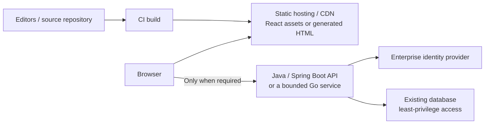

# Migrating PHP: Static React, Java or Go?

**Daily learning · 23 October 2026 · Primary-source research; recommendations are engineering judgments**

> **Recommendation for this organization:** use static hosting for the external demo if it needs only public pages and browser interaction. Where server logic is necessary, prefer React + Java/Spring Boot because the organization already operates Java heavily. Evaluate Go for bounded services; Rust is a specialist option.

## 1. Start with what PHP actually does

The current site uses plain PHP. The organization already uses React extensively, Java heavily, and some Go and Rust. Its actual code and deployment have not been audited; the choices below depend on its features.

| Current requirement | Best starting point here | Reason |
|---|---|---|
| Public pages; PHP only assembles templates | Static HTML/CSS/JS, using existing React/Vite tooling where helpful | Removes the PHP request runtime entirely. Plain HTML is also sufficient. |
| Interactive browser-only demo | React + Vite production build on static hosting | Reuses team skills without adding a Node application server. |
| Content-heavy marketing site needing pre-rendered pages | Astro static output, optionally using React components | Produces pages at build time; selectively adds browser interaction. |
| Login, private data, database operations or business workflows | React + Java/Spring Boot/Spring Security | Fits existing backend experience and enterprise security integrations. |
| Small, independently owned API | Go, if the team can support it | Suitable for focused HTTP services; avoid introducing it solely for a language change. |
| High-performance parser or low-level component | Consider Rust with experienced owners | Useful memory-safety model; disproportionate learning/maintenance cost for a simple demo. |

Static build capabilities: [Vite deployment](https://vite.dev/guide/static-deploy.html), [Astro rendering](https://docs.astro.build/en/guides/on-demand-rendering/), [React integration](https://docs.astro.build/en/guides/integrations-guide/react/). Backend capabilities: [Spring Security](https://spring.io/projects/spring-security/), [Go HTTP library](https://pkg.go.dev/net/http). The fit ranking is based on this organization's skills, not measured vulnerability rates.

| Term | Meaning |
|---|---|
| Static hosting | Serves previously built files; no application code renders each request. |
| Build-time code | Runs in CI to produce those files. Still needs dependency and credential protection. |
| API | Server endpoint for operations that cannot safely happen in the browser. |
| SSR | Server-side rendering: application code generates pages on incoming requests. React does not require SSR. |

## 2. What security improvement can migration deliver?

**PHP application code already abstracts memory allocation. PHP2Shell was in the native PHP runtime.** Moving to another managed language does not prove its runtime will have fewer critical flaws. The strongest improvement for a page-only site is removing unnecessary application execution from public requests.

| Change | What improves | What remains |
|---|---|---|
| PHP pages → static files | Public requests no longer reach PHP parsing, sessions or extensions | Hosting/CDN configuration, build supply chain, browser XSS and exposed secrets |
| PHP app → Java or .NET | Managed application code and established authentication/authorization frameworks | Runtime/native-library flaws, dependency compromise, injection and authorization bugs |
| Focused Go service with few native dependencies | Can keep much of HTTP/application processing in Go | Compiler/runtime defects, `unsafe`, C integration, logic bugs and denial of service |
| Safe Rust component | Ownership/lifetime enforcement reduces memory-error classes | Unsafe dependencies, C integration and compiler soundness defects |

Evidence: [PHP advisory](https://www.php.net/archive/2026.php#2026-10-21-1), [Java security model](https://docs.oracle.com/en/java/javase/25/security/java-security-overview1.html), [ASP.NET Core security](https://learn.microsoft.com/en-us/aspnet/core/security/), [Go unsafe](https://pkg.go.dev/unsafe), [cgo](https://pkg.go.dev/cmd/cgo), [Rust soundness issue](https://github.com/rust-lang/rust/issues/164250). These mechanisms support the architectural reasoning; they are not a comparative security benchmark.

Memory-safe languages reduce specific bug classes; they do not eliminate web application risks. [NSA/CISA guidance](https://www.nsa.gov/Press-Room/Press-Releases-Statements/Press-Release-View/Article/4223298/nsa-and-cisa-release-csi-highlighting-importance-of-memory-safe-languages-in-so/), [OWASP Top 10](https://top10.owasp.org/2025/).

## 3. Recommended target architecture

Conceptual target, not an inspected deployment. If the demo has no server operations, omit the API and database. Keep credentials server-side: hiding a database password or API secret in a React build does not protect it. Authorization must be enforced by the API, not just by hidden buttons.

**For this Java-heavy organization:** use a supported JDK + supported Spring Boot/Spring Security for the first substantial backend migration. Keep the current database and frontend where practical. A modular application is sufficient; language migration does not require microservices.

**Other stacks:** C#/ASP.NET Core is a credible enterprise alternative when C# skills and operational support exist, but adds an unnecessary platform here. TypeScript/Node can fit web teams; TypeScript types do not replace Node's native runtime. [ASP.NET security](https://learn.microsoft.com/en-us/aspnet/core/security/), [TypeScript type erasure](https://www.typescriptlang.org/docs/handbook/2/basic-types.html), [Node native components](https://nodejs.org/api/addons.html).

## 4. WordPress and mixed estates

**WordPress is a publishing platform built on PHP and a database, not inherently a static site.** [WordPress architecture context](https://wordpress.org/about/).

| Need | Alternative / migration choice |
|---|---|
| Occasional developer-written pages | Markdown/source files → static build → CDN. |
| Nontechnical editors, drafts and approvals | Headless or managed CMS → static build → CDN; validate editorial features before choosing a product. |
| Existing WordPress editor must remain | Use it as a separately secured content source; publish static pages. PHP still exists in the CMS and must be patched. |
| Plugin-dependent commerce, membership or workflows | Treat this as product replacement: map checkout, permissions, integrations and data. A static export alone cannot replace those features. |

This is architectural guidance, not a CMS product endorsement. A static public frontend reduces direct exposure only if the old PHP origin and unused endpoints are actually removed or access-restricted. Caching a live PHP site behind a CDN does not remove its backend attack surface.

## 5. Migrate in small, verifiable steps

1. **Inventory:** pages, forms, sessions, uploads, database calls, jobs, email and third-party integrations. Patch existing PHP while migration proceeds.
2. **Classify:** which features can be built once, and which need server-side execution? Preserve URLs, redirects and required search indexing.
3. **Pilot one route:** static output where possible; otherwise a Java endpoint with explicit access controls. Compare behavior with the existing site.
4. **Shift traffic gradually:** keep rollback available; avoid uncontrolled writes to shared data during coexistence.
5. **Verify retirement:** old PHP origin is unreachable or decommissioned, forms/auth work, secrets are absent from public files, and every live backend is supported and monitored.

This follows the [Strangler Fig migration pattern](https://learn.microsoft.com/en-us/azure/architecture/patterns/strangler-fig): replace capabilities incrementally. Static deployment uses production build artifacts, not a development or preview server. [Vite production deployment](https://vite.dev/guide/static-deploy.html).

## 6. Long-term support is part of the stack

| Choice | Operational commitment |
|---|---|
| Java/Spring | Track JDK vendor support **and** Spring/framework dependencies separately; JDK LTS does not extend framework support. [Spring policy](https://spring.io/support-policy/) |
| Go | A major release is supported until two newer majors exist; keep upgrading, rebuilding and redeploying. Use `govulncheck` for relevant advisories. [Release policy](https://go.dev/doc/devel/release), [security tools](https://go.dev/doc/security/best-practices) |
| .NET | Choose supported LTS and current servicing patches; .NET 10 support runs through November 2028 as checked on 23 Oct 2026. [Microsoft policy](https://learn.microsoft.com/en-us/dotnet/core/releases-and-support) |
| Static frontend | Maintain build dependencies, protect deployment credentials and audit published assets. “No application server” does not mean no maintenance. |

No stack can promise freedom from PHP2Shell-scale incidents. Compare exposed components, native dependencies, patch ownership and recovery time; raw CVE counts are not a normalized safety ranking.

## 7. Source context

Researched after PHP2Shell to distinguish language choice from removing unnecessary runtime exposure. Official runtime, framework, deployment and security guidance is linked inline. Recommendations reflect the stated React/Java-heavy organization; no estimate of migration cost or percentage risk reduction is claimed without inspecting the application.

---

**Related:**
- [PHP2Shell: History, UAF and ASLR](../../News/Security/PHP2Shell-History-UAF-And-ASLR-Oct-2026.md) — The native-runtime incident motivating this migration comparison.
- [Scaling Java Services](Scaling-1M-RPS-Java.md) — JVM deployment and performance considerations after selecting Java.
- [Java and Go Comparison](../Languages/comparisons/Java25-vs-Go1.24-Go1.25.md) — Language/runtime trade-offs relevant to the backend shortlist.
