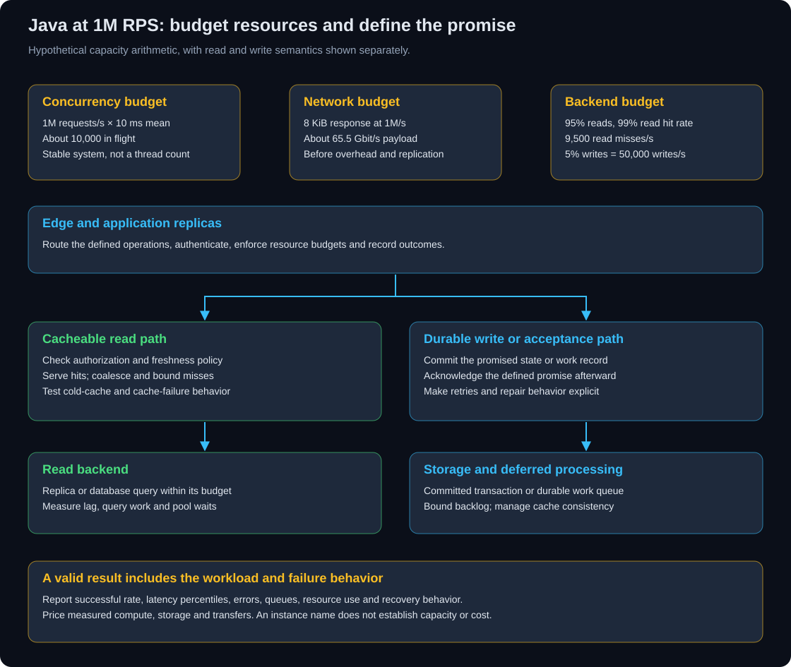
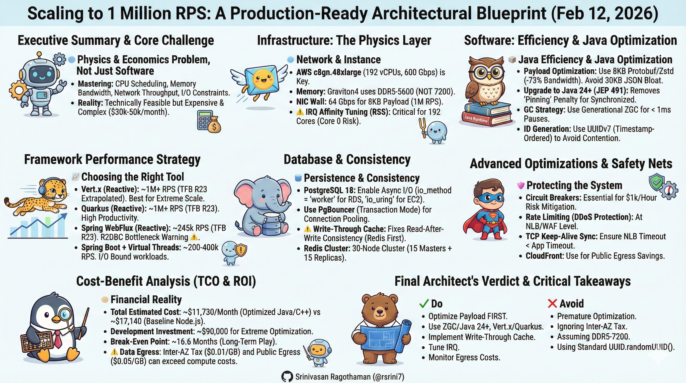

# Scaling Java Services to 1 Million RPS: Capacity, Consistency and Evidence

**Learning note · Revised 15 November 2026 · Design study, not a validated deployment blueprint**

> **Core idea:** One million requests per second is a workload target, not a property of a framework or server type. Feasibility depends on what each request does, how much data moves, what must be durable and which latency/error requirements must hold under failure.

## 1. Define the request before selecting the stack

A cached lookup, a JSON response and a transactional write consume different resources. A framework benchmark can demonstrate one particular operation on one configuration; it cannot establish the capacity or monthly cost of a full product.

[TechEmpower's test definitions](https://github.com/TechEmpower/FrameworkBenchmarks/wiki/Project-Information-Framework-Tests-Overview) distinguish plaintext, JSON serialization, database queries, updates and other workloads. Compare matching tests and configurations. A database driver or framework's ranking is not a general cause analysis of an unrelated application's bottleneck.

Before estimating capacity, specify: **read/write mix, request and response sizes, cacheability, authentication, latency/error objectives, durability, traffic duration and failure requirements**. This article uses explicit arithmetic to illustrate the budgets; it does not claim a measured Java or C++ deployment at the target rate.

## 2. Start with three resource budgets

### Concurrency: use the mean response time

For a stable system, Little's law relates average in-flight work to arrival rate and mean time in the system:

$$
\text{Average concurrency} = \text{Arrival rate} \times \text{Mean response time}
$$

At **1,000,000 requests/s** and **10 ms mean response time**, about **10,000 requests** are in flight on average. This is not a thread-count prescription or a p99 latency target. If queues grow without bound, the stable-state assumption no longer applies.

### Network: count bytes before pricing servers

For an **8 KiB response** at that sustained rate, response payload alone is:

$$
1{,}000{,}000 \times 8{,}192 = 8.192 \times 10^9\ \text{bytes/s}
$$

That is approximately **65.5 Gbit/s**, before request traffic, protocol overhead, replication or other transfers. Sustained continuously for 30 days, it is approximately **21.2 PB in decimal units**. Compression changes the bytes transmitted and consumes CPU; a synthetic short response and a realistic payload are different tests.

### Storage: separate reads and writes

Consider an illustrative mix of **95% reads and 5% writes**, with a **99% hit rate for the reads**. At the target rate, the simple model still sends **9,500 read misses/s and 50,000 writes/s** to backend paths, before retries or multiple operations per request. A good cache hit rate does not remove write durability requirements.

These calculations are planning examples, not capacity measurements. Evaluate burst traffic, expiry patterns and cache loss separately from the average case.

## 3. An architecture with explicit semantics

*The diagram separates cacheable reads from acknowledged writes. The database, cache and application capacities must each be measured for their own workload.*

| Layer | Responsibility | What to verify |
|---|---|---|
| Edge/load balancer | Route work, enforce applicable cache policy and protect capacity. | Request distribution, connection behavior, timeouts and overload handling. |
| Application replicas | Validate requests and execute the defined operation. | CPU, allocation, scheduling, downstream waits and cancellation. |
| Cache/read path | Serve eligible cached results; bound backend misses and refreshes. | Hit-rate distribution, authorization scope, freshness and stampedes. |
| Durable write path | Commit the promised state or durable work record before acknowledging that promise. | Transaction boundaries, retries, idempotency and recovery. |
| Database and async workers | Apply storage changes and any deferred work. | Useful throughput, locks, lag, backlog and failure recovery. |

HTTP caches must respect response cacheability and request context; shared caching of authenticated or personalized responses needs the appropriate controls. [HTTP caching: RFC 9111](https://www.rfc-editor.org/rfc/rfc9111.html).

For writes, choose the contract explicitly. A synchronous endpoint can acknowledge a completed database transaction. An asynchronous endpoint can acknowledge durable acceptance into a processing system and expose completion status. An in-memory cache write followed by an unrecorded background database write does not provide the same guarantee.

Updating both a database and cache introduces partial-failure and race conditions. Define invalidation, freshness and repair behavior. A transactional outbox can record a database change and its pending event in one database transaction, with separate delivery and consumer handling. It does not make all downstream effects one atomic transaction. [Debezium outbox pattern](https://debezium.io/documentation/reference/stable/transformations/outbox-event-router.html).

Redis offers different persistence mechanisms, and its replication is normally asynchronous. The selected configuration and failover behavior determine what an acknowledgement protects. [Redis persistence](https://redis.io/docs/latest/operate/oss_and_stack/management/persistence/), [replication](https://redis.io/docs/latest/operate/oss_and_stack/management/replication/).

## 4. Choose a Java execution model from the workload

| Approach | Useful property | Limit to account for |
|---|---|---|
| Platform-thread request handling | Familiar blocking control flow and mature integrations. | Waiting requests occupy threads; pool and downstream budgets need coordination. |
| Virtual threads | Many blocking-style tasks can wait without tying up an equal number of platform threads. | They do not make CPU work faster or increase database capacity. Limit access to scarce downstream resources. |
| Event loops/reactive APIs | A small number of event-loop threads can coordinate non-blocking I/O. | Blocking an event loop delays unrelated work; CPU-heavy or blocking work needs suitable execution resources. |

Virtual threads became a final feature in **JDK 21**. **JDK 24's JEP 491** removes the synchronized-monitor pinning limitation it addresses; native/foreign execution and other cases still need attention. Pinning behavior is version-specific. [JEP 444](https://openjdk.org/jeps/444), [JEP 491](https://openjdk.org/jeps/491).

Vert.x documents its event-loop model and the rule against blocking event-loop threads. Quarkus documents its virtual-thread integration and limitations. Neither source establishes a universal RPS ceiling for another Java framework. [Vert.x Core](https://vertx.io/docs/vertx-core/java/), [Quarkus virtual threads](https://quarkus.io/guides/virtual-threads).

Start with the programming model and libraries that fit the service. Compare equivalent implementations if evidence identifies framework or driver overhead as a material constraint.

## 5. Optimize with measurements, not fixed multipliers

- **Reduce work:** remove avoidable database calls, repeated parsing and unnecessary serialization. Cache only where the consistency contract allows it.
- **Bound concurrency:** coordinate application admissions, connection pools and downstream budgets. A million client requests do not require a million simultaneous database connections.
- **Control allocation and pauses:** measure allocation rate, heap occupancy, garbage-collection behavior and CPU. ZGC is a collector choice, not a guaranteed application pause or throughput result. Supported modes and flags differ by JDK version. [Generational ZGC](https://openjdk.org/jeps/439), [removal of the non-generational mode](https://openjdk.org/jeps/490).
- **Inspect network and OS limits when indicated:** bandwidth, packet rate, file descriptors, accept queues and interrupt distribution can matter. Apply hardware-specific tuning after identifying a constraint.
- **Choose payload and compression deliberately:** measure real encoded sizes, compression CPU, client support and latency. A fixed percentage saving does not transfer between datasets.

Likewise, [PostgreSQL 18's AIO improvements](https://www.postgresql.org/docs/18/release-18.html) target specified operations; they do not establish that every transactional service should expect a fixed throughput increase.

## 6. Measure sustainable capacity and degraded behavior

Use a load generator that matches the arrival model. With a closed workload, a fixed population of clients waits for responses; when the server slows, the generated request rate can fall. An open arrival model can continue introducing requests at the intended rate, revealing queues and overload. [Gatling workload models](https://docs.gatling.io/testing-concepts/workload-models/).

**Coordinated omission** occurs when a measurement procedure misses delays that would have affected requests arriving during a stall. The open-source [wrk2](https://github.com/giltene/wrk2) documents this issue and provides constant-throughput HTTP load generation. Follow its build instructions and command help, confirm its request/protocol support fits the service, and ensure the load generators are not the bottleneck. A single fast-client test is insufficient evidence of sustained capacity.

Report at least:

1. Modelled request mix, payloads, cache behavior and durability contract.
2. Application/runtime versions, hardware, topology, pools and effective configuration.
3. Offered rate, successful rate, errors, timeouts, queue growth and full latency distributions.
4. CPU, memory/GC, network, database behavior, cache misses and async backlog.
5. Warm-up and test duration, plus results during replica loss, cache failure and dependency slowdown.

A capacity result is useful when it meets the stated latency and error objectives without an unbounded queue or deferred backlog. Keep benchmark success separate from recovery and availability evidence.

## 7. Estimate cost from measured usage

A reviewable cost model separates **compute, database/storage, cache, load balancing, internet egress, inter-zone/inter-region traffic, observability and operational effort**. Record region, service, pricing date, utilization, negotiated terms and failure capacity.

The [AWS on-demand pricing reference](https://aws.amazon.com/ec2/pricing/on-demand/) illustrates why compute and data-transfer charges need separate accounting. Private connectivity can change routing and pricing, but it is not a blanket exemption from transfer or endpoint charges. Validate each applicable service tariff.

Do not attach a fixed monthly total, availability percentage or recovery time to an untested architecture. First establish workload and failure behavior, then price the measured resources and required redundancy.

## 8. Source context

Reworked from collected repository notes using official Java, PostgreSQL, Redis and framework documentation, the TechEmpower test definitions and load-tool guidance. The numerical budgets are explicit calculations. This note offers a design and validation method; it does not assert a production result of one million RPS on a named instance or framework.

### Supplementary visual

*Previously collected illustration, retained for reference. The revised explanation and source qualifications above govern the technical claims.*

---

**Related:**
- [Scaling PostgreSQL for ChatGPT](../Databases/Scaling-PostgreSQL-ChatGPT.md) — Explains the separate limits of primary writes, replica reads, pooling and workload isolation.
- [Workflow Orchestration](../Middleware/workflow-orchestration.md) — Covers durable asynchronous work, idempotency and recovery beyond a synchronous request.
- [Java Plugin Architecture](../JVM/Java-Plugin-Arch.md) — Explains extension contracts and execution boundaries within and outside a JVM.
- [Java and Go Runtime Comparison](../Languages/comparisons/Java25-vs-Go1.24-Go1.25.md) — Provides wider language/runtime context without replacing workload-specific measurements.
- [HTTP QUERY Method](HTTP-QUERY-Method-RFC-10008-Nov-2026.md) — Discusses request semantics, cache keys and retry behavior relevant to query APIs.
