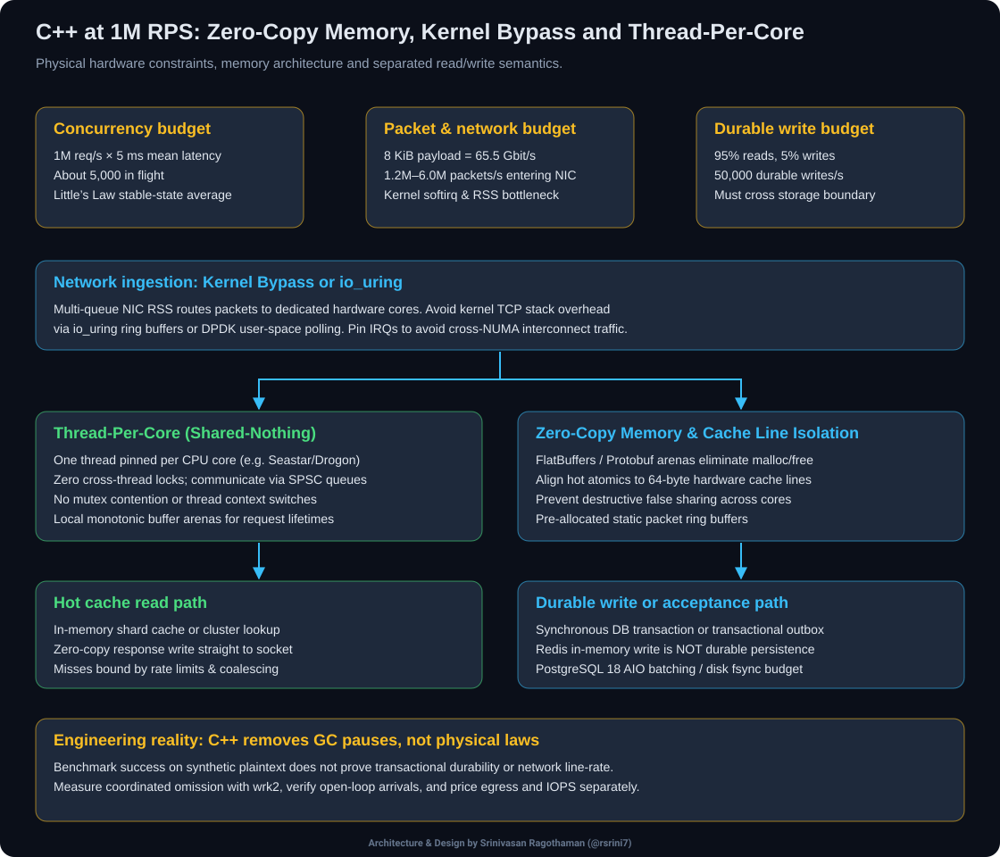
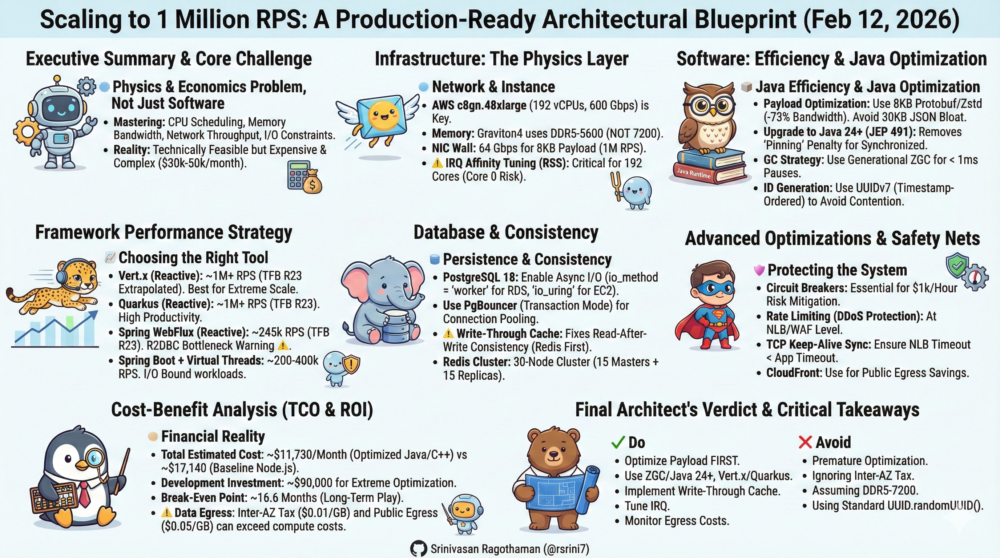

# Scaling C++ Services to 1 Million RPS: Capacity, Zero-Copy and Concurrency Models

Learning note · Revised November 2026 · Systems Programming &amp; Zero-Copy Architecture  
*By Srinivasan Ragothaman ([@rsrini7](https://github.com/rsrini7))*

> **Core idea:** Achieving one million requests per second in C++ requires eliminating kernel crossing overhead, dynamic memory allocations and lock contention on the hot path. While C++ eliminates JVM garbage-collection pauses, real-world throughput is constrained by network packet limits, cache coherence and storage durability contracts.

## 1. Define the request before selecting the stack

A synthetic in-memory benchmark, a JSON payload and a transactional write consume fundamentally different physical resources. A framework benchmark can demonstrate peak CPU efficiency under artificial conditions; it cannot establish the capacity, reliability or monthly operating cost of a production service.

[TechEmpower Framework Benchmarks](https://github.com/TechEmpower/FrameworkBenchmarks/wiki/Project-Information-Framework-Tests-Overview) illustrate this divergence: top C++ implementations (such as Drogon) can process millions of plaintext requests per second on dedicated hardware, yet throughput drops by orders of magnitude when requests touch relational databases, multiple joins or disk storage.

Before evaluating language runtimes or network frameworks, specify: **read/write ratio, request/response payload sizes, network packet budgets, caching tier boundaries, authentication overhead, p99 latency SLOs, and write durability guarantees**. This article uses explicit physical arithmetic to model capacity constraints; it does not present an untested blueprint as an empirical production result.

## 2. Start with three resource budgets

### Concurrency: Little's Law under stable state

For a queuing system in stable equilibrium, Little's Law relates average concurrency $L$ to arrival rate $\lambda$ and mean latency $W$:

$$
\text{Average concurrency} = \text{Arrival rate} \times \text{Mean response time}
$$

At **1,000,000 requests/s** and **5 ms mean response time**, an average of **5,000 requests** are concurrently in flight across the cluster. If downstream database stalls cause response times to stretch to 50 ms, concurrency surges to 50,000 requests. If inbound request queues accumulate without backpressure, queue memory explodes and tail latencies degrade exponentially.

### Network: bytes and packets per second (PPS)

For an **8 KiB response payload** delivered at 1M RPS, pure payload egress is:

$$
1{,}000{,}000 \times 8{,}192 = 8.192 \times 10^9\ \text{bytes/s} \approx 65.5\ \text{Gbit/s}
$$

Accounting for TCP/IP framing, headers and TLS records, network consumption exceeds 70 Gbit/s. Continuously sustained for 30 days, this equals approximately **21.2 PB of egress**.

Equally critical is the **packet budget**. Assuming a standard Ethernet MTU of 1,500 bytes, an 8 KiB response requires roughly 6 packets. A million requests per second translates to **6,000,000 packets per second (6 Mpps)** outbound and 1+ Mpps inbound. Under standard Linux network stack processing, handling millions of packets per second triggers high CPU softirq load, context switching and potential packet drops in socket receive buffers (`SO_RCVBUF`).

### Storage: separate reads from durable writes

Consider a service workload of **95% reads and 5% writes**, backed by a cache achieving a **99% hit rate**. At 1M RPS:

- **Cache hits:** 940,500 requests/s served from memory.
- **Cache misses:** 9,500 read misses/s hitting backend storage.
- **Durable writes:** 50,000 writes/s directed to persistence.

A high cache hit rate protects read latency, but does not relieve write durability. Sustaining 50,000 durable writes per second exceeds the single-writer limits of conventional relational databases and requires batching, write-ahead logging (WAL) tuning or distributed partitions.

## 3. An architecture with explicit semantics



*The diagram separates cacheable in-memory lookups from acknowledged durable writes. Physical network, CPU core affinity and storage limits must be budgeted independently.*

| Architectural Layer | Core Responsibility | Verification Focus |
|---|---|---|
| NIC & Ingestion | Packet routing, hardware hashing, interrupt management. | Multi-queue RSS distribution, interrupt affinity, dropped packets (`ethtool -S`). |
| I/O & Event Loop | Multiplexing network connections, non-blocking read/write. | Syscall frequency, `io_uring` completion queues, epoll wakeups, run-queue depth. |
| Worker Threads | Request decoding, business logic, response encoding. | Core affinity, CPU cache hit rate (L1/L2/L3), memory allocation frequency. |
| In-Memory Cache | Fast local/distributed key-value retrieval. | Eviction policy, cache stampede protection, invalidation races. |
| Durable Persistence | Writing committed transaction logs and state changes. | fsync latency, write-ahead log bottlenecks, outbox dispatch lag. |

### Durable writes versus in-memory acknowledgements

A common architectural trap in high-throughput designs is responding with HTTP `200 OK` after pushing a record to an in-memory Redis queue, assuming a background worker will persist it to PostgreSQL later. This trades durability for latency:
- If the Redis instance or worker node crashes before the queue is drained, uncommitted data is permanently lost.
- Redis asynchronous replication means failover to a replica may lose recently queued writes. [Redis persistence documentation](https://redis.io/docs/latest/operate/oss_and_stack/management/persistence/).
- For strict consistency, either acknowledge only after the relational transaction commits, or use a durable distributed log with acknowledged replication.
- To safely decouple writes without losing data, implement the **Transactional Outbox Pattern**: record the entity change and its pending event in the same ACID transaction, then dispatch to downstream consumers. [Debezium Outbox pattern](https://debezium.io/documentation/reference/stable/transformations/outbox-event-router.html).

## 4. C++ execution models and network architectures

The fundamental advantage of C++ is deterministic control over memory layout and system calls. Choosing the right concurrency and I/O model determines whether that advantage is realized:

| Architecture | Mechanism | Strengths | Operational Constraints |
|---|---|---|---|
| **Thread-per-Connection** | POSIX threads (`std::thread`), blocking sockets. | Simple imperative code flow. | Unusable at 1M RPS: 5,000–50,000 OS threads incur severe context-switching overhead and stack memory bloat. |
| **Worker Event Loop (Epoll)** | Non-blocking sockets multiplexed via `epoll` or `kqueue` across a fixed worker pool (e.g. Drogon, uWebSockets). | High connection density; low idle memory footprint. | Cross-thread synchronization locks on shared state; kernel-space to user-space context switches on each socket read/write. |
| **Thread-per-Core (Shared-Nothing)** | Pinned threads per CPU core with isolated state (e.g. Seastar framework). Threads communicate via lock-free queues. | Eliminates mutex contention and false sharing; maximizes L1/L2 cache locality. | Requires shared-nothing application design; complex cross-core routing for requests spanning multiple shards. |
| **Kernel Bypass & Modern I/O** | `io_uring` (Linux 5.1+) or user-space networking via DPDK (Data Plane Development Kit). | Submits batches of I/O operations via shared memory ring buffers; DPDK bypasses the kernel TCP/IP stack entirely. | DPDK requires dedicated polling cores (100% CPU utilization) and proprietary hardware support; `io_uring` requires recent Linux kernels and auditing. |

Sources: [Drogon Framework Architecture](https://drogon.org/), [Seastar Shared-Nothing Asynchronous Framework](https://seastar.io/), [Linux io_uring design](https://kernel.dk/io_uring.pdf).

## 5. Low-level C++ performance levers

Eliminating JVM garbage collection is necessary but insufficient. At one million requests per second, microarchitectural bottlenecks dominate CPU execution time:

### Eliminate dynamic heap allocations (`malloc`/`free`)
Standard system allocators use global or arena locks that suffer extreme contention when hundreds of threads allocate simultaneously. 
- Use **Polymorphic Memory Resources (`std::pmr`)**: Allocate a large thread-local `std::pmr::monotonic_buffer_resource` per worker thread, reusing memory across request lifecycles and resetting offsets with zero deallocation overhead.
- Where general-purpose allocation is unavoidable, link against scalable thread-caching allocators such as **jemalloc** or **mimalloc**.

### Prevent false sharing and align to cache lines
When multiple CPU cores write to independent variables located on the same 64-byte hardware cache line, the CPU's MESI cache-coherence protocol constantly invalidates the cache line across cores, degrading throughput.
- Align hot atomic counters, queue pointers and worker states using `alignas(std::hardware_destructive_interference_size)`:

```cpp
#include <new>
#include <atomic>

struct alignas(std::hardware_destructive_interference_size) CoreWorkerStats {
    std::atomic<uint64_t> requests_processed{0};
    std::atomic<uint64_t> bytes_sent{0};
    // Cache line isolation prevents adjacent core invalidation
};
```

### Zero-copy serialization
Parsing large JSON payloads consumes substantial CPU cycles in string allocation, UTF-8 validation and number formatting.
- Prefer binary serialization formats with in-place zero-copy decoding, such as **FlatBuffers**, **Cap'n Proto**, or **Protobuf Arena Allocation**.
- Write response buffers directly to socket ring buffers or use Vectored I/O (`writev` / `sendmsg`) to avoid staging intermediate response strings.

### Production C++ Recipe: Asynchronous Zero-Allocation Endpoint

The following pattern demonstrates a non-blocking handler using Drogon with thread-local polymorphic memory arenas to eliminate dynamic heap allocations during request processing:

```cpp
#include <drogon/HttpController.h>
#include <memory_resource>
#include <string_view>

class FastLookupController : public drogon::HttpController<FastLookupController> {
public:
    METHOD_LIST_BEGIN
    ADD_METHOD_TO(FastLookupController::lookup, "/api/v1/lookup/{key}", drogon::Get);
    METHOD_LIST_END

    void lookup(const drogon::HttpRequestPtr& req,
                std::function<void(const drogon::HttpResponsePtr&)>&& callback,
                std::string key) {
        // 1. Thread-local arena buffer (pre-allocated on worker thread stack/arena)
        std::array<std::byte, 4096> stack_pool;
        std::pmr::monotonic_buffer_resource mem_pool(stack_pool.data(), stack_pool.size());

        // 2. Monotonic string and container allocations bypass global heap lock
        std::pmr::string local_key(&mem_pool);
        local_key.assign(key);

        // 3. Fast non-blocking lookup from local thread-bound cache
        std::string_view cached_payload = get_thread_local_cache(local_key);

        if (!cached_payload.empty()) {
            // Zero-copy response: references in-memory buffer directly
            auto resp = drogon::HttpResponse::newHttpResponse();
            resp->setContentTypeCode(drogon::CT_APPLICATION_JSON);
            resp->setBody(std::string(cached_payload));
            callback(resp);
            return;
        }

        // 4. Cache-miss: forward asynchronously without blocking worker thread
        fetch_async_miss(local_key, [callback = std::move(callback)](std::string val) {
            auto resp = drogon::HttpResponse::newHttpResponse();
            resp->setBody(std::move(val));
            callback(resp);
        });
    }

private:
    std::string_view get_thread_local_cache(std::string_view k);
    void fetch_async_miss(std::string_view k, std::function<void(std::string)>&& cb);
};
```

### Hardware pinning and NUMA locality
On multi-socket or high-core-count servers (such as AWS Graviton or AMD EPYC), accessing memory across NUMA (Non-Uniform Memory Access) nodes introduces interconnect latency penalties.
- Pin worker threads to specific physical CPU cores using `pthread_setaffinity_np`.
- Configure Network Interface Card (NIC) Receive Side Scaling (RSS) and Receive Packet Steering (RPS) to direct packet processing interrupts directly to the CPU core hosting the target connection's event loop.

### Production Linux OS Network Parameter Tuning

Achieving 1M RPS on Linux requires tuning socket buffers, backlog queues and file descriptor limits in `/etc/sysctl.d/99-throughput.conf`:

| Parameter | Recommended Setting | Architectural Role |
|---|---|---|
| `net.core.somaxconn` | `65535` | Maximum socket listen backlog; prevents connection drops during sudden traffic bursts. |
| `net.ipv4.tcp_max_syn_backlog` | `65535` | Queue length for half-open SYN handshakes before drop. |
| `net.core.netdev_max_backlog` | `250000` | Maximum number of packets queued on input before processing by CPU softirq. |
| `net.ipv4.tcp_rmem` | `4096 87380 16777216` | Min / Default / Max TCP receive buffer; sizes window without wasting server RAM. |
| `net.ipv4.tcp_wmem` | `4096 65536 16777216` | Min / Default / Max TCP send buffer. |
| `net.ipv4.tcp_tw_reuse` | `1` | Allows reusing `TIME_WAIT` sockets for new outgoing connections to same host. |
| `fs.file-max` | `2097152` | Global file descriptor limit; accommodates 100k+ concurrent connections. |


## 6. Measure sustainable capacity and degraded behavior

Load test results depend heavily on the test methodology. Many high-throughput claims fail under rigorous testing due to measurement flaws:

### Coordinated omission
When a benchmark client pauses or experiences backpressure from the server, a naive load tool ceases issuing new requests until previous ones complete. This artificially hides tail-latency spikes because requests that would have arrived during the stall are never recorded.
- Use open-loop load generators such as [wrk2](https://github.com/giltene/wrk2) or [Gatling](https://docs.gatling.io/testing-concepts/workload-models/) configured for constant-rate arrival models.
- Ensure the load generator infrastructure itself is distributed across separate network segments and instances so the test client does not bottleneck on socket limits.

### What to report in a valid benchmark
1. **Request profile:** Exact payload sizes, serialization schema, compression mode, and database query complexity.
2. **Latency distribution:** Complete percentiles (p50, p90, p99, p99.9, p99.99), not merely mean latency.
3. **Failure scenarios:** Tail latency and throughput under sudden node termination, network packet drops, cache eviction storms, and database failover.
4. **Hardware utilization:** Per-core CPU utilization, softirq percentage, NUMA cross-node traffic, memory allocation rates, and context switch counts.

## 7. Estimate cost from measured usage

A credible infrastructure cost model must separate baseline compute from network transfer, storage operations and multi-zone redundancy:

- **Compute instances:** High-bandwidth, compute-optimized instances (e.g. AWS `c8gn` or bare-metal dedicated servers).
- **Network egress:** Moving 20+ PB of data per month across the public internet on major cloud providers incurs substantial data-transfer charges. Evaluate CDN caching and private direct peering to reduce egress expenses.
- **Storage IOPS & replication:** Provisioning tens of thousands of write IOPS on managed cloud storage (e.g. AWS io2 Block Express) represents a major recurring cost driver.
- **Redundancy & failover:** A production system requires multi-AZ replica clusters, active health checks, and capacity overhead to survive the sudden loss of an entire availability zone.

Do not attach an arbitrary monthly price tag or availability percentage to a conceptual architecture without benchmarking empirical usage against current cloud pricing models. [AWS On-Demand Pricing Reference](https://aws.amazon.com/ec2/pricing/on-demand/).

## 8. Source context

Synthesized from primary C++ high-performance networking documentation, the TechEmpower Framework benchmark definitions, Linux kernel documentation on `epoll` and `io_uring`, and OpenSSL/TLS zero-copy literature. This design study presents an analytical engineering framework; it does not claim an independently verified production deployment of 1M RPS on a specific hardware configuration.

## 9. Supplementary visual



*Previously collected architectural diagram, retained for reference. The revised explanation and source qualifications above govern the technical claims and resource budgets.*

---

**Related:**
- [Scaling-Java-Services-To-1-Million-RPS-2026](Scaling-Java-Services-To-1-Million-RPS-2026.md) — Analyzes JVM virtual threads, garbage collection tuning (ZGC), and memory budgets under the same 1M RPS target.
- [Scaling-PostgreSQL-High-Throughput-Architecture-2026](../Databases/Scaling-PostgreSQL-High-Throughput-Architecture-2026.md) — Examines single-primary database bottlenecks, connection pooling, and replica lag at massive query volumes.
- [Workflow Orchestration](../Middleware/workflow-orchestration.md) — Explains asynchronous durable execution, idempotency, and retries when decoupling requests from the synchronous write path.
- [Rust versus C](../Languages/comparisons/rust-vs-c.md) — Compares memory safety guarantees, zero-cost abstractions, and low-level performance characteristics.
- [HTTP QUERY Method](HTTP-QUERY-Method-RFC-10008-Nov-2026.md) — Discusses safe request caching, body hashing, and idempotent querying at scale.
