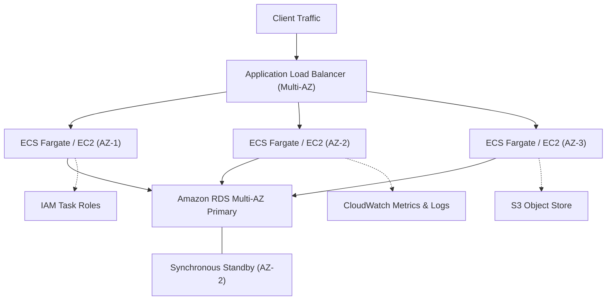
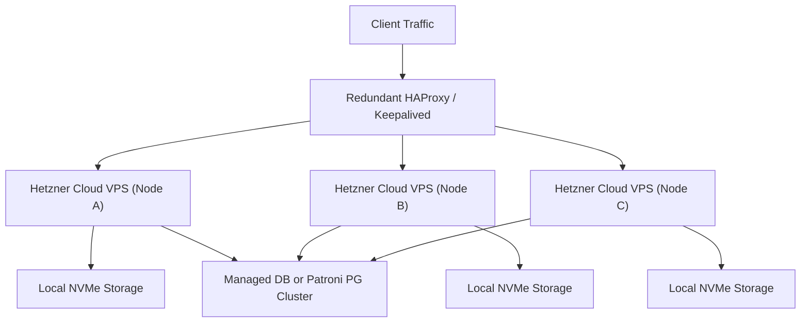
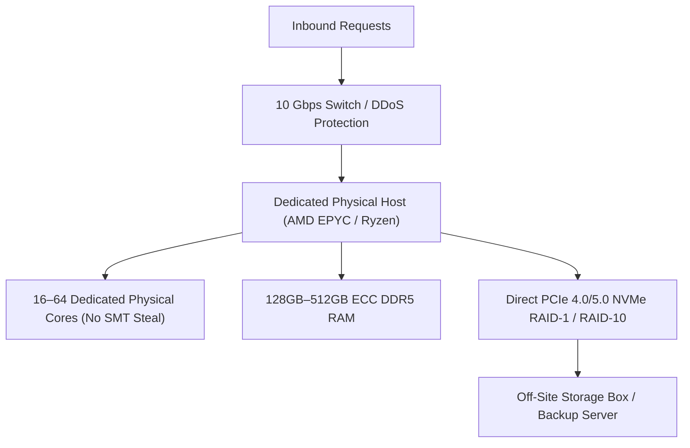
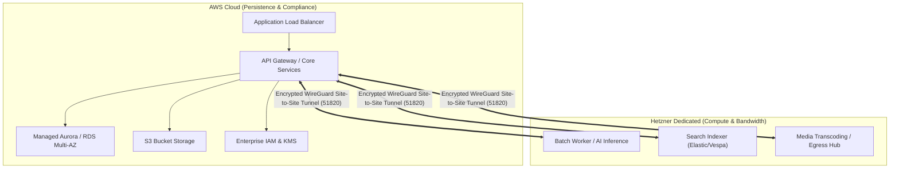
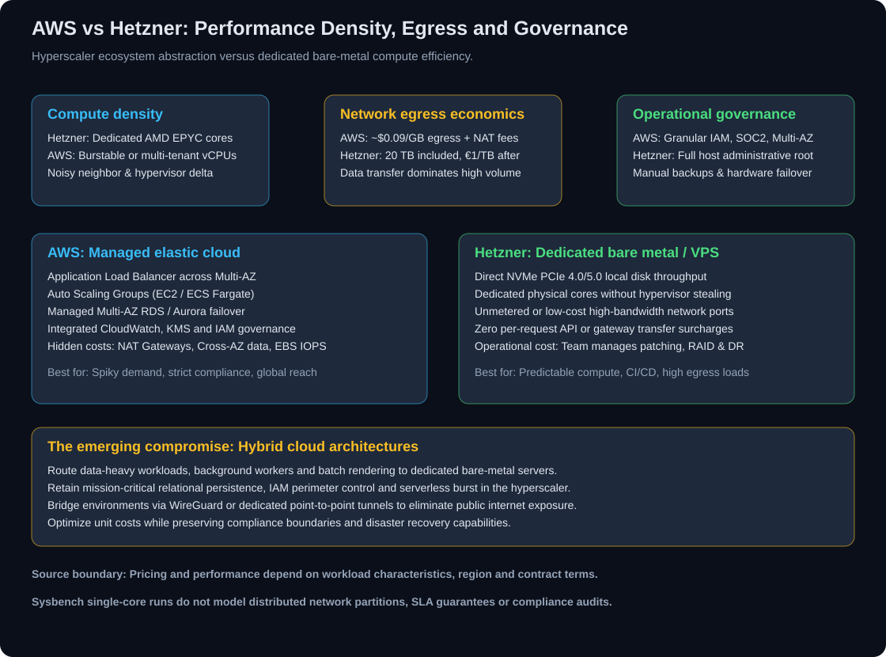

# AWS versus Hetzner: Compute Density, Egress Economics and Operational Governance

**Learning note · Revised 15 November 2026 · Infrastructure economics and operational boundary analysis**  
*By Srinivasan Ragothaman ([@rsrini7](https://github.com/rsrini7))*

> **Core idea:** Dedicated bare-metal and VPS hosting provides substantially higher raw compute, memory and I/O density per dollar alongside low-cost network bandwidth, whereas hyperscalers provide managed control planes, elastic multi-AZ failover and granular compliance governance. Engineering teams choose between managing hardware and operational reliability directly or paying a recurring cloud abstraction premium.

## 1. Foundations: hyperscale cloud versus dedicated hosting

Infrastructure hosting spans two primary operating models:

1. **Hyperscale Cloud (e.g. AWS):** Infrastructure is consumed via managed APIs. Virtual compute (EC2, ECS Fargate), storage (EBS, S3) and relational databases (RDS, Aurora) run across fault-isolated Availability Zones (AZs) backed by software-defined networking, fine-grained identity access management (IAM), and enterprise compliance attestations.
2. **Dedicated & Low-Cost VPS Hosting (e.g. Hetzner):** Infrastructure is leased as physical bare-metal hardware or lightly virtualized instances. Customers receive direct access to high-frequency desktop or server-grade CPUs (AMD EPYC, Ryzen), local NVMe drives and fixed network ports in European and North American datacenters.

| Dimension | AWS Hyperscale Cloud | Hetzner Dedicated / VPS |
|---|---|---|
| **Compute Abstraction** | Multi-tenant hypervisor (Nitro) with burstable/dedicated vCPUs. | Physical bare metal or unthrottled KVM virtual machines. |
| **Networking Model** | Software-defined VPC, security groups, private subnets, NAT gateways. | Public interfaces, basic cloud private networks, direct host firewalling. |
| **Storage Architecture** | Network-attached block volumes (EBS) with provisioned IOPS caps. | High-speed direct PCIe NVMe drives attached directly to motherboard. |
| **High Availability** | Multi-AZ automated failover, regional replication, managed load balancers. | Single datacenter blast radius; manual disaster recovery &amp; clustering. |
| **Governance &amp; IAM** | Role-based least privilege, STS temporary tokens, CloudTrail audit logs. | Linux root access, SSH key provisioning, project-level API tokens. |

## 2. Architectural topologies: four deployment models

Rather than abstracting infrastructure into a generic comparison, production systems follow distinct architectural patterns depending on whether elasticity, performance density or cost predictability is prioritized:

### Model 1: AWS Managed Elastic Cloud (Horizontal-First Topology)

AWS excels at elastic horizontal scaling where stateless application tasks scale automatically behind managed load balancers across multiple Availability Zones:



**Architectural Characteristics:**
- **Automated Fault Tolerance:** If an entire availability zone suffers a power or cooling failure, the ALB instantly redirects traffic to healthy tasks in surviving zones.
- **Synchronous Persistence Failover:** RDS Multi-AZ synchronously mirrors writes to a standby replica, promoting it via automated DNS failover in under 60 seconds with zero data loss.
- **Ecosystem Integration:** Workloads leverage managed secret management (Secrets Manager), granular role boundaries (IAM), and centralized container registries (ECR).
- **Cost Factor:** Incurs compounding per-unit premiums: ALB hourly charges + LCU usage, NAT Gateway hourly + data transfer fees, and inter-AZ data transport taxes ($0.01/GB each direction).

### Model 2: Multi-Node VPS Architecture (Balanced Compute Cluster)

Virtual Private Servers (VPS) on providers like Hetzner Cloud provide independent virtual machines with dedicated virtual cores at fixed monthly price points:



**Architectural Characteristics:**
- **High Performance per Dollar:** Delivers ~3× higher CPU and memory throughput per dollar compared to hyperscale burstable instances.
- **Independent Scaling:** Compute nodes can scale vertically (resizing CPU/RAM via reboot) or horizontally behind standard open-source reverse proxies (HAProxy, Nginx, Envoy).
- **Operational Ownership:** Engineering teams must configure floating IP failover, automated backup schedules, server monitoring (Prometheus/Grafana), and log shipping.

### Model 3: High-Density Dedicated Bare-Metal Server (Vertical Powerhouse)

For workloads requiring extreme single-box performance density—such as large relational databases, in-memory graph stores, search indexing or video rendering:



**Architectural Characteristics:**
- **Zero Hypervisor Tax:** Eliminates hypervisor context-switch overhead, noisy neighbor interference, and nested page-table translation latencies.
- **Direct PCIe NVMe Bandwidth:** Delivers millions of random read/write IOPS and gigabytes-per-second sequential disk throughput without provisioned IOPS surcharges (e.g. AWS EBS io2 fees).
- **Blast Radius:** A physical hardware fault (motherboard, memory stick, power supply) takes down the entire machine, requiring cold hardware replacement by datacenter technicians unless high-availability clustering is implemented at the application layer.

### Model 4: The Enterprise Hybrid Topology (Best of Both Worlds)

The emerging enterprise standard combines the compliance, persistence, and managed services of AWS with the raw compute density and unmetered network bandwidth of Hetzner:



**Architectural Characteristics:**
- **Compliance & Persistence:** Mission-critical transactional data, audit logs, and IAM perimeters remain securely housed within AWS SOC-2 certified environments.
- **Bandwidth & Compute Offloading:** High-throughput batch workers, heavy compute tasks, and high-volume public egress streams are routed to low-cost dedicated bare-metal servers.
- **Zero Public Exposure:** Worker nodes communicate with AWS private subnets through encrypted WireGuard point-to-point tunnels without exposing backend ports to the public internet.

## 3. Performance density and virtualization overhead



*Infrastructure trade-offs span compute virtualization overhead, bandwidth egress economics and operational failure boundaries.*

In standardized single-core and multi-core benchmarks (such as Sysbench, Geekbench, or fio), bare-metal dedicated servers consistently achieve 3× to 5× higher compute density per dollar compared to hyperscale cloud instances:

- **vCPU versus Physical Core:** Hyperscaler vCPUs (such as AWS EC2) represent an execution thread (hyperthread) on an oversubscribed host. Burstable instances (`t4g`, `t3`) throttle CPU credits when workloads sustain high utilization.
- **Hypervisor CPU Stealing:** Virtualized instances running on shared multi-tenant hosts suffer from CPU steal (`%st` in `top` or `vmstat`), which occurs when the hypervisor yields CPU execution cycles to other tenant VMs sharing the physical socket.
- **Memory Bus Contention:** Bare-metal dedicated hosts allocate 100% of physical memory channels directly to the application, eliminating hypervisor Translation Lookaside Buffer (TLB) flush penalties and nested page-table translation overhead.

## 4. The network egress trap: the decisive TCO factor

While compute pricing varies, **network egress is the single largest financial divider** between hyperscale clouds and dedicated bare-metal hosting:

- **AWS Network Transfer Taxes:** AWS charges approximately **$0.05 to $0.09 per gigabyte** of internet egress. Furthermore, traffic routed through a private VPC NAT Gateway incurs **$0.045/hour plus $0.045/GB**, and traffic traversing between Availability Zones costs **$0.01/GB in each direction**.
- **Hetzner Bandwidth Economics:** Hetzner includes **20 TB of free monthly traffic** on 1–10 Gbit/s ports, with additional bandwidth billed at roughly **€1.00 per terabyte** ($0.001/GB).

### Empirical Cost Modeling Across Monthly Egress Tiers

| Monthly Egress | AWS Data Transfer Out ($0.09/GB) | AWS NAT Gateway Fee ($0.045/GB) | Total AWS Network Cost | Hetzner Network Cost (20 TB Inc., €1/TB) | Variance |
|---|---|---|---|---|---|
| **10 TB** | ~$900 | ~$450 | **~$1,350** | **€0.00 (Included)** | AWS 1,350× higher |
| **50 TB** | ~$4,500 | ~$2,250 | **~$6,750** | **€30.00 (~$33)** | AWS 204× higher |
| **200 TB** | ~$16,000 | ~$9,000 | **~$25,000** | **€180.00 (~$198)** | AWS 126× higher |
| **500 TB** | ~$40,000 | ~$22,500 | **~$62,500** | **€480.00 (~$528)** | AWS 118× higher |

*Note: Calculations reflect US-East AWS standard data transfer pricing and Hetzner standard bandwidth tariffs. Inter-AZ transfer ($0.01/GB each way) adds further cost under multi-AZ topologies.*

## 5. Scaling models and operational governance

The raw price-to-performance ratio does not reflect the total cost of ownership (TCO). Hyperscale premiums fund engineering automation that must otherwise be built and maintained manually:

### Scaling Models Compared

| Scaling Dimension | AWS Elastic Cloud | VPS Multi-Node | Dedicated Bare Metal |
|---|---|---|---|
| **Vertical Scaling** | Instant instance resizing (few minutes reboot). | Fast virtual resizing via provider console. | Manual hardware upgrade or node migration. |
| **Horizontal Scaling** | Fully automated via Auto Scaling Groups. | Scripted provisioning (Terraform / Ansible). | Manual server leasing and deployment. |
| **Auto-Scaling Speed** | Seconds to minutes (EC2 / ECS Fargate). | Custom automation via API (minutes). | Hours to days (hardware delivery). |
| **Cost Predictability** | Variable, usage-based, potential bill shock. | Fixed, predictable monthly billing. | Completely fixed monthly lease. |

### Operational Governance Matrix

| Operational Requirement | Managed Cloud Path (AWS) | Bare-Metal / Dedicated Path (Hetzner) |
|---|---|---|
| **Hardware Failure Recovery** | Auto Scaling replaces failed EC2 instances; EBS volumes migrate automatically. | Physical disk or motherboard failure requires manual hardware swap, host re-provisioning and backup restoration. |
| **Database Failover** | RDS Multi-AZ synchronously replicates and executes zero-data-loss DNS failover in &lt;60 seconds. | Team must deploy, tune and monitor Patroni, PgBouncer, replication lag and split-brain fencing. |
| **Edge &amp; Load Balancing** | AWS ALB scales automatically to handle DDoS and traffic spikes across multi-AZ targets. | Must configure and operate redundant Keepalived, HAProxy or Envoy pairs with floating IPs. |
| **Compliance &amp; Auditing** | Out-of-the-box SOC 1/2/3, ISO 27001, HIPAA, PCI-DSS compliance frameworks. | Customer is entirely responsible for physical security assertions, OS hardening and audit compliance. |

### Decision Framework: Startup versus Enterprise

- **Early-Stage Startups &amp; Bootstrapped Products:**
  - *Pattern:* Deploy on Hetzner VPS or Dedicated hardware combined with third-party managed SaaS (e.g. Supabase/Neon for PostgreSQL, Clerk/Auth0 for auth, S3 for object storage).
  - *Rationale:* Maximizes runway by eliminating cloud markups on compute and egress while avoiding database operational overhead.
- **Enterprise &amp; Compliance-Driven Organizations:**
  - *Pattern:* Hybrid cloud deployment. Maintain core customer data, transactional databases, and compliance boundaries within AWS; burst compute-heavy background processing and media delivery to dedicated bare-metal farms.
  - *Rationale:* Satisfies enterprise vendor assessments and SOC-2 requirements while shaving 40–70% off monthly infrastructure bills.

## 6. Implementation recipe: WireGuard hybrid site-to-site mesh

To connect a Hetzner dedicated node directly into an AWS VPC private subnet (`10.0.0.0/16`) without public internet exposure:

```ini
# /etc/wireguard/wg0.conf on Hetzner Dedicated Host (10.100.0.2)
[Interface]
Address = 10.100.0.2/24
PrivateKey = <HETZNER_PRIVATE_KEY>
ListenPort = 51820
MTU = 1420

[Peer]
# AWS VPC WireGuard Gateway Instance (Public Elastic IP)
PublicKey = <AWS_GATEWAY_PUBLIC_KEY>
Endpoint = 54.210.x.x:51820
# Route AWS VPC Subnet traffic through the encrypted tunnel
AllowedIPs = 10.0.0.0/16, 10.100.0.1/32
PersistentKeepalive = 25
```

On the AWS side, an EC2 gateway instance runs in a public subnet with `net.ipv4.ip_forward = 1` and:

```bash
iptables -t nat -A POSTROUTING -o eth0 -j MASQUERADE
```

This allows all Hetzner worker processes to query internal AWS RDS Aurora endpoints, S3 VPC endpoints, and private microservices as if they resided directly within the AWS private VPC.

## 7. Practical evaluation and verification checklist

Before migrating infrastructure or selecting a hosting tier, measure the workload against these concrete criteria:

### Check for CPU stealing and noisy neighbors
On virtualized instances, monitor hypervisor CPU theft to ensure predictable execution:

```bash
# Inspect steal percentage (%st) over time (must remain <2%)
vmstat 1 10
# Inspect hardware cache topology and execution threads
lscpu
```

A consistent `%st` above 2–5% indicates noisy neighbors on the shared host, justifying dedicated instances or bare metal.

### Model the monthly bandwidth break-even
Calculate monthly data egress ($E_{\text{GB}}$) and compute spend ($C$). If:

$$
E_{\text{GB}} \times \$0.08 > C_{\text{compute}}
$$

network egress will dominate the AWS bill, making dedicated bare-metal or hybrid CDN offloading the primary architectural priority.

### Test worst-case disaster recovery
For any self-hosted database or compute tier outside a hyperscaler:
- Simulate a total host power outage.
- Measure the Time to Recovery (RTO) and Recovery Point Objective (RPO).
- Verify whether the engineering team can meet their operational SLA without managed cloud automation.

## 8. Source context

Evaluated using official AWS EC2 on-demand and data transfer pricing schedules, Hetzner Cloud and Dedicated server product specifications, Linux kernel CPU virtualization documentation, and industry case studies on cloud repatriation. Pricing and benchmark figures reflect public US-East and EU-Central data center tariffs as of late 2025/2026.

---

**Related:**
- [Scaling Java Services to 1M RPS](../Architecture/Scaling-1M-RPS-Java.md) — Demonstrates how network egress and instance bandwidth budgets dictate infrastructure costs.
- [Scaling C++ Services to 1M RPS](../Architecture/Scaling-1M-RPS-C++.md) — Evaluates hardware CPU pinning, NUMA boundaries, and kernel-bypass I/O on bare metal vs virtualized instances.
- [Scaling PostgreSQL for ChatGPT](../Databases/Scaling-PostgreSQL-ChatGPT.md) — Analyzes single-primary bottlenecks and managed database trade-offs in cloud environments.
- [Workflow Orchestration](../Middleware/workflow-orchestration.md) — Covers durable background worker processing that can be offloaded to low-cost dedicated compute tiers.
- [MacMini Setup Guide](../../DevSetup/MacMini-Setup.md) — Explores cost-efficient local homelab infrastructure as an alternative to public cloud development environments.
