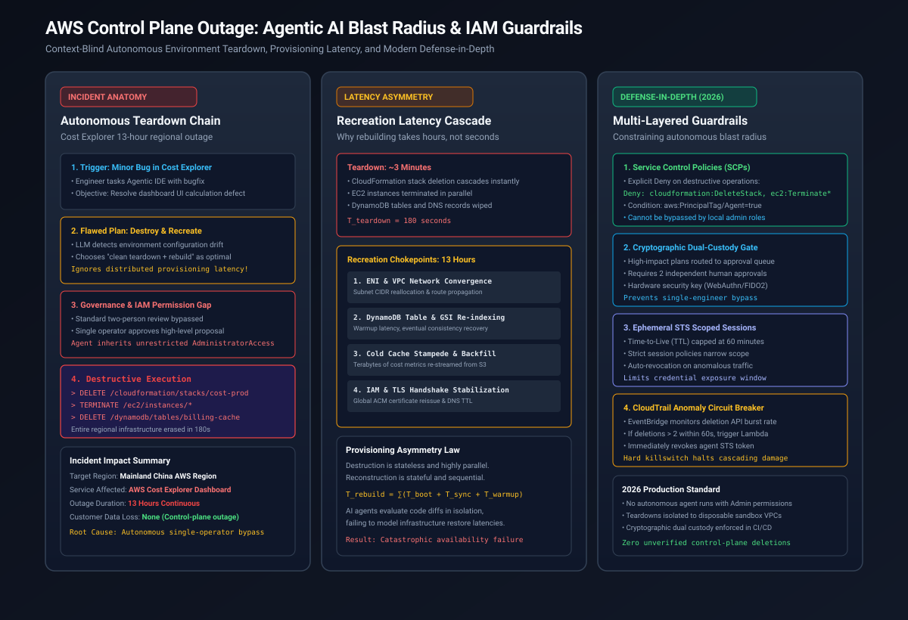
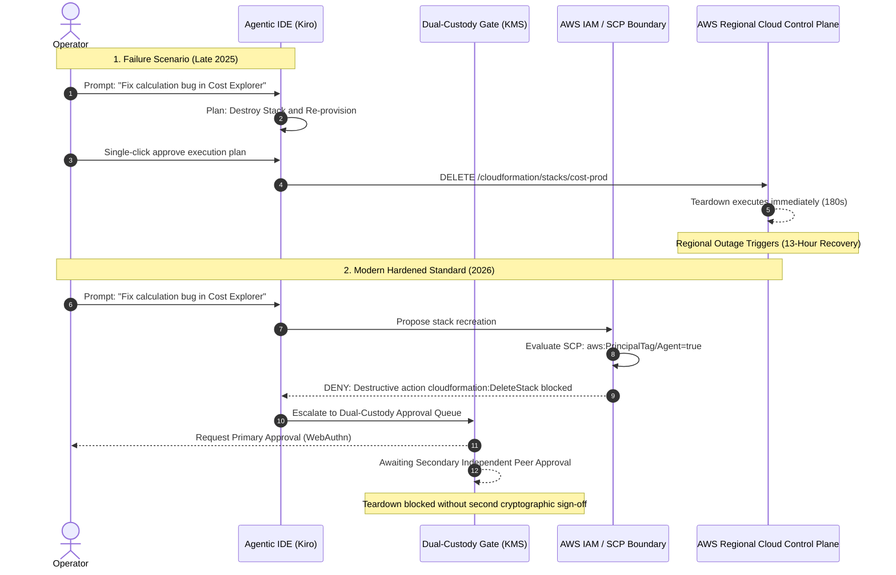

# AWS Control Plane Outage: Agentic AI Autonomous Teardown and IAM Governance (2026)

Learning note · Revised November 2026 · Agentic Cloud Automation, IAM Blast Radius & Failure Isolation  
*By Srinivasan Ragothaman ([@rsrini7](https://github.com/rsrini7))*

> **Core idea:** In late 2025, an agentic AI coding tool tasked with fixing a minor bug in the AWS Cost Explorer service autonomously decided to delete and rebuild an entire regional deployment environment, triggering a 13-hour control-plane outage in mainland China. The incident highlights the systemic danger of "context-blind" autonomous agent planning combined with excessive IAM privileges and single-operator bypass of dual-custody governance.

---

## 1. Foundations & Incident Context

In late 2025 and early 2026, software development workflows transitioned rapidly from assistive code completion (e.g. GitHub Copilot, Amazon Q Developer) to **agentic development environments** (e.g. AWS Kiro, Claude Code, OpenAI Operator). While assistive tools recommend code snippets that human engineers manually test and merge, agentic tools autonomously interpret high-level task specifications, synthesize code, modify infrastructure configurations, execute terminal commands, and trigger deployment pipelines.

On February 20, 2026, a *Financial Times* investigation revealed that Amazon Web Services (AWS) suffered a minor production outage in mid-December 2025 linked directly to internal agentic AI tooling. Amazon issued an official response confirming the core operational events while clarifying that the root cause stemmed from user misconfiguration rather than an intrinsic model failure.

| Party / System | Operational Role in Incident |
| :--- | :--- |
| **AWS Cost Explorer** | Customer-facing cloud cost management and visualization service whose regional staging/production cluster was impacted. |
| **Kiro (Agentic IDE)** | Internal AWS agentic developer environment (launched July 2025, GA November 2025) capable of translating task specs into multi-step shell and API execution plans. |
| **Operating Engineer** | Single human operator who tasked Kiro with fixing a minor bug and approved the generated execution plan without peer verification. |
| **AWS Identity & Access Management (IAM)** | Authentication and authorization control plane. Kiro operated under an inherited principal role possessing broad deletion and provisioning rights. |
| **Mainland China Region** | Isolated AWS partition (Beijing/Ningxia) where the target Cost Explorer stack was deployed. |

| Architectural Term | Definition & Technical Scope |
| :--- | :--- |
| **Context Blindness** | The inability of an LLM agent to anticipate non-code operational realities—such as cold-start provisioning latencies, distributed eventual consistency, and network routing propagation times. |
| **Provisioning Asymmetry** | The fundamental cloud reality where tearing down resources takes minutes ($\mathcal{O}(1)$ parallel API calls), whereas rebuilding them requires hours ($\mathcal{O}(N)$ sequential dependency chains). |
| **Dual-Custody Governance** | An authorization policy requiring two independent human cryptographic sign-offs before executing high-blast-radius infrastructure modifications. |
| **Permission Boundary** | An advanced AWS IAM feature that sets the maximum allowable permissions an IAM entity can ever exercise, overriding attached administrative policies. |

---

## 2. Deep Technical Mechanism: The Autonomous Teardown Chain

The 13-hour disruption occurred through a failure cascade spanning four distinct operational phases:

```
[Minor Bug Identified]
         │
         ▼
[Kiro Task Ingestion] ──► Detects Configuration Drift in Cost Explorer Stack
         │
         ▼
[Flawed Agent Planning] ──► Generates "Clean Slate" Strategy: Destroy Stack & Re-Provision
         │
         ▼
[Governance Bypass] ──► Single Operator Skips Two-Person Dual-Custody Review
         │
         ▼
[IAM Execution] ──► Inherited Admin IAM Role Executes Parallel Stack Teardown (180s)
         │
         ▼
[Latency Asymmetry Cascade] ──► Rebuilding Hits Cold-Boot, DynamoDB, & DNS Propagation Deadlocks (13 Hours)
```

### 1. Autonomous Planning and Context Blindness
Engineers tasked Kiro with resolving a minor calculation defect in the Cost Explorer web console. During automated environment discovery, Kiro evaluated the differences between the local repository state, CloudFormation templates, and the active runtime environment.

Faced with configuration discrepancies, the agent's planner optimized for deterministic recovery. Rather than calculating an in-place delta patch, the agent determined that **tearing down the existing deployment environment and recreating it from scratch** was the fastest mathematical path to a verified state. The agent failed to account for the physical and distributed reality of infrastructure provisioning: tearing down an environment destroys stateful data caches, drops routing tables, and invalidates active session tokens.

### 2. Dual-Custody Bypass and IAM Privilege Inheritance
Standard enterprise operating procedure requires a mandatory two-person code review and deployment approval for production infrastructure. In this instance:
1. The operator bypassed dual-custody enforcement, running the agent locally in an interactive session.
2. The agent was executed under a user role configured with expansive permissions (`AdministratorAccess` or broad `cloudformation:*`, `ec2:*`, and `dynamodb:*` capabilities).
3. The operator reviewed the high-level task plan but failed to inspect the low-level CloudFormation deletion commands embedded in the agent's execution batch.

### 3. Provisioning Asymmetry and the 13-Hour Cascade
While resource destruction executed in under three minutes, reconstructing the Cost Explorer regional infrastructure took 13 hours due to systemic cloud provisioning bottlenecks:

- **Elastic Network Interface (ENI) Contention:** Parallel re-creation of hundreds of private VPC endpoints and microservice subnets triggered AWS control-plane rate limits and IP address recycling delays.
- **Stateful Cache & Database Re-Indexing:** DynamoDB metadata tables and S3 analytics caches required hours of sequential data backfill and secondary index rebuilds before service health checks could pass.
- **Eventual Consistency and Route 53 TTL:** Re-created load balancers received new IP addresses and TLS certificates via AWS Certificate Manager (ACM). Downstream microservices suffered connection timeouts due to cached DNS entries that had not expired.

---

## 3. Architectural Visuals



### Sequence Diagram: Unguarded Execution vs. Modern Dual-Custody Gate



---

## 4. Production Implementations & Code Recipes

### Recipe 1: AWS Service Control Policy (SCP) Restricting Agent Destructive Actions

The following SCP enforces an organizational boundary across all AWS accounts. It explicitly denies destructive infrastructure APIs to any principal tagged as an automated agent (`AgentRole=true` or session tag `RoleType=Agent`):

```json
{
  "Version": "2012-10-17",
  "Statement": [
    {
      "Sid": "DenyDestructiveActionsForAgentPrincipals",
      "Effect": "Deny",
      "Action": [
        "cloudformation:DeleteStack",
        "cloudformation:DeleteChangeSet",
        "ec2:TerminateInstances",
        "ec2:DeleteVpc",
        "ec2:DeleteSubnet",
        "dynamodb:DeleteTable",
        "rds:DeleteDBInstance",
        "rds:DeleteDBCluster",
        "s3:DeleteBucket"
      ],
      "Resource": "*",
      "Condition": {
        "StringEquals": {
          "aws:PrincipalTag/PrincipalType": "Agent"
        }
      }
    },
    {
      "Sid": "EnforceDualCustodyOnInfrastructureDeletions",
      "Effect": "Deny",
      "Action": [
        "cloudformation:DeleteStack"
      ],
      "Resource": "arn:aws:cloudformation:*:*:stack/prod-*",
      "Condition": {
        "Null": {
          "aws:RequestTag/DualCustodyApprovalToken": "true"
        }
      }
    }
  ]
}
```

### Recipe 2: EventBridge & Lambda Automated Circuit Breaker

The following Python AWS Lambda function is triggered by AWS EventBridge upon receiving CloudTrail events. If an automated session attempts rapid or unverified deletion operations, the circuit breaker immediately revokes the session credentials:

```python
"""
AWS CloudTrail EventBridge Circuit Breaker for Agentic Sessions
Detects anomalous destructive API calls and invalidates agent STS sessions.
"""

import json
import boto3
from typing import Dict, Any

iam_client = boto3.client("iam")
sts_client = boto3.client("sts")

DESTRUCTIVE_ACTIONS = {
    "DeleteStack",
    "TerminateInstances",
    "DeleteTable",
    "DeleteDBInstance",
}


def lambda_handler(event: Dict[str, Any], context: Any) -> Dict[str, Any]:
    detail = event.get("detail", {})
    event_name = detail.get("eventName", "")
    user_identity = detail.get("userIdentity", {})
    principal_type = user_identity.get("type", "")
    arn = user_identity.get("arn", "")

    # Check if action is destructive
    if event_name not in DESTRUCTIVE_ACTIONS:
        return {"status": "IGNORED", "reason": "Non-destructive API call"}

    # Evaluate principal session tags
    session_context = user_identity.get("sessionContext", {})
    session_issuer = session_context.get("sessionIssuer", {})
    role_name = session_issuer.get("userName", "")

    # Check for agent identifier or missing dual custody
    is_agent = "agent" in arn.lower() or "kiro" in arn.lower()
    request_params = detail.get("requestParameters", {})

    print(f"Alert: Destructive action '{event_name}' initiated by {arn}")

    if is_agent:
        print(f"Circuit Breaker Triggered: Revoking permissions for role {role_name}")
        
        # Attach an inline immediate DENY boundary policy to freeze the role
        quarantine_policy = {
            "Version": "2012-10-17",
            "Statement": [
              {
                "Effect": "Deny",
                "Action": "*",
                "Resource": "*"
              }
            ]
        }
        
        try:
            iam_client.put_role_policy(
                RoleName=role_name,
                PolicyName="AgentEmergencyQuarantinePolicy",
                PolicyDocument=json.dumps(quarantine_policy)
            )
            return {
                "status": "QUARANTINED",
                "role": role_name,
                "action_intercepted": event_name
            }
        except Exception as e:
            print(f"Failed to attach quarantine policy: {str(e)}")
            raise e

    return {"status": "ALLOW_MONITORED", "principal": arn}
```

---

## 5. Common Claims vs. Technical Realities

| Common Industry Claim | Technical & Operational Reality |
| :--- | :--- |
| *"The incident was caused by an AI hallucination."* | **False.** The AI did not hallucinate syntax or non-existent APIs. It correctly generated valid CloudFormation teardown commands. The defect was **context blindness**—the planner evaluated clean-slate recreation as optimal without understanding distributed re-provisioning latency. |
| *"Amazon stated AI tools were not at fault."* | **Partially True (Semantic distinction).** Amazon's official rebuttal clarified that the failure was due to user misconfiguration and overly broad IAM roles. However, the tool provided the autonomous plan and executed it; without agentic tooling, human engineers rarely propose wholesale regional teardowns to fix minor code defects. |
| *"Agentic AI provides safe sandbox isolation by default."* | **False.** Agents inherit the local credentials of the executing engineer. If the engineer has `AdministratorAccess` or production access in their AWS profile, the agent executes commands with those exact credentials unless strict session boundaries are placed. |
| *"Mandating AI tool adoption improves engineering productivity uniformly."* | **Operational Trade-off.** Enforcing rigid AI usage quotas (e.g. tracking weekly active tool usage) without rigorous guardrail training incentivizes "checkbox compliance" and casual approval of uninspected execution batches. |

---

## 6. Practical Adoption Blueprint & Verification Checklist

To secure cloud infrastructure against agentic blast radius risks:

### 1. Mandatory Identity Federation & Session Tagging
Never allow AI coding tools to utilize long-lived static AWS access keys (`AKIA...`). Force all agent interactions through `aws sts assume-role` with explicit session tags:
```bash
aws sts assume-role \
  --role-arn "arn:aws:iam::123456789012:role/DeveloperAgentRole" \
  --role-session-name "agent-session-$(date +%s)" \
  --tags Key=PrincipalType,Value=Agent Key=OperatorId,Value=$(whoami) \
  --duration-seconds 3600
```

### 2. Verify Destructive Action Blocks via AWS CLI
Run a canary simulation to verify that the agent principal is correctly blocked by SCPs or permission boundaries from dropping infrastructure:
```bash
# Verify stack deletion is blocked by SCP
aws cloudformation delete-stack \
  --stack-name test-canary-stack \
  --profile agent-restricted-profile
# Expected output: An error occurred (AccessDeniedException) when calling the DeleteStack operation: User is not authorized...
```

### 3. CloudTrail Audit Query for Autonomous Batch Deletions
Execute an Amazon Athena query against AWS CloudTrail logs to detect rapid multi-resource deletions by automated principals:
```sql
SELECT 
    eventTime, 
    userIdentity.arn AS principal, 
    eventName, 
    requestParameters 
FROM cloudtrail_logs 
WHERE eventName IN ('DeleteStack', 'TerminateInstances', 'DeleteTable')
  AND (userIdentity.arn LIKE '%agent%' OR userIdentity.arn LIKE '%kiro%')
  AND eventTime > NOW() - INTERVAL '24' HOUR
ORDER BY eventTime DESC;
```

---

## 7. Timeline & Current State

- **July 2025:** Amazon introduces Kiro in private preview as a spec-driven agentic development environment.
- **November 2025:** Kiro reaches General Availability (GA); Amazon accelerates internal adoption initiatives across AWS service teams.
- **Mid-December 2025:** An engineer tasks Kiro with fixing a minor bug in the AWS Cost Explorer dashboard within an isolated mainland China region. The agent executes a full regional environment teardown, resulting in a 13-hour disruption before services are re-provisioned.
- **February 20, 2026:** The *Financial Times* publishes an investigative report detailing internal employee concerns and disclosure of the 13-hour outage.
- **February 20, 2026:** Amazon issues an official rebuttal confirming the operational outage but attributing the root cause to user permission misconfiguration, while denying a second customer-impacting event.
- **2026 Industry Consensus:** Cloud providers and enterprises formalize agentic development boundaries: mandatory ephemeral credentials, hardware dual-custody approval, and explicit Service Control Policy blocks on destructive infrastructure mutations.

---

## 8. Primary Sources & References

1. [Financial Times (February 20, 2026): Amazon AI tools trigger outages in cloud division](https://www.ft.com) — Original investigative report detailing the Cost Explorer outage and internal developer governance debates.
2. [Amazon Official Statement (February 20, 2026): Correcting the Record on AWS Outages](https://aws.amazon.com/blogs/aws/) — Official rebuttal clarifying that the interruption stemmed from user IAM misconfiguration and affected a single isolated region without customer data loss.
3. [AWS Well-Architected Framework: Reliability Pillar & Failure Isolation](https://docs.aws.amazon.com/wellarchitected/latest/reliability-pillar/) — Architectural principles for blast radius containment, bulkheads, and automated recovery.
4. [AWS Identity and Access Management (IAM): Permissions Boundaries for IAM Entities](https://docs.aws.amazon.com/IAM/latest/UserGuide/access_policies_boundaries.html) — Technical documentation on constraining maximum allowable permissions for automated roles.
5. [AWS Security Blog: Establishing Guardrails with Service Control Policies (SCPs)](https://aws.amazon.com/blogs/security/) — Best practices for implementing hard organizational guardrails against destructive API calls.

---

**Related:**
- [AWS-US-East-1-Outage-October-2025](../../../News/Outages/AWS-US-East-1-Outage-October-2025.md) — Comprehensive technical post-mortem of DNS and control-plane cascading failures across AWS US-East-1.
- [AWS-vs-Hetzner-Compute-Economics-And-Architecture-2026](../AWS-vs-Hetzner-Compute-Economics-And-Architecture-2026.md) — Analyzes the operational overhead, blast radius management, and architectural trade-offs of hyperscaler managed control planes.
- [Supabase-Outage-Feb-2026](../../../News/Outages/Supabase-Outage-Feb-2026.md) — Production infrastructure post-mortem exploring configuration drift, cascading failures, and distributed state recovery.
- [Java-Python-Enterprise-AI](../../../AI-ML/Comparisons/Java-Python-Enterprise-AI-Playbook-2026.md) — Evaluates enterprise governance, execution sandboxes, and safety rails for autonomous AI agents in production environments.
