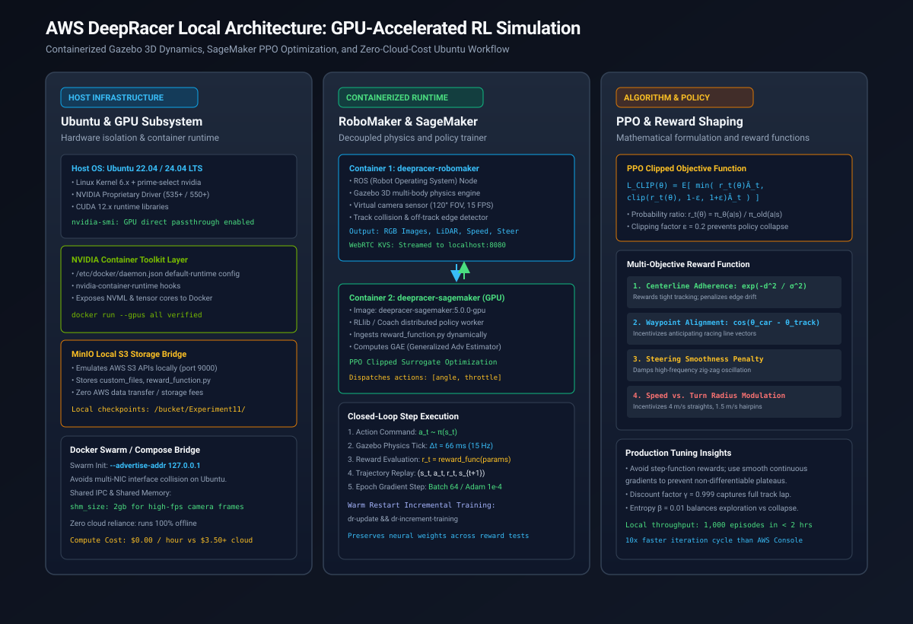
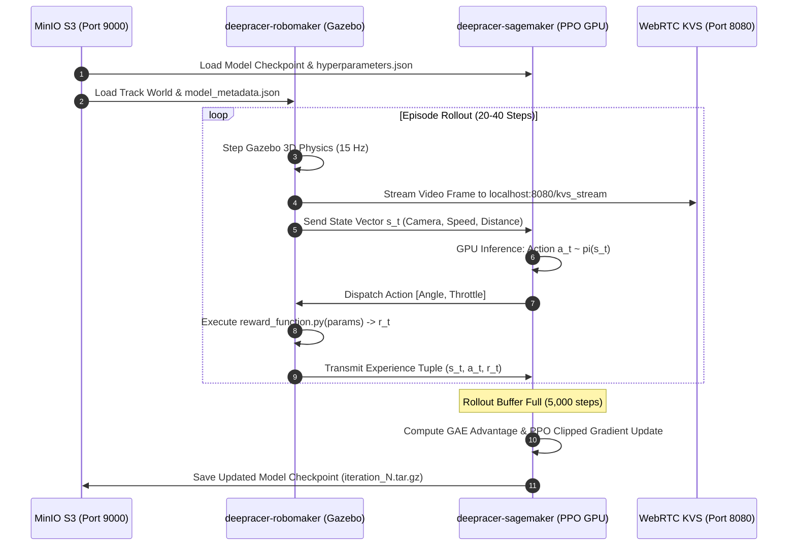

# AWS DeepRacer Local Architecture: GPU-Accelerated Reinforcement Learning on Ubuntu (2026)

Learning note · Revised November 2026 · Local Autonomous RL Simulation, Containerized Gazebo & CUDA Acceleration  
*By Srinivasan Ragothaman ([@rsrini7](https://github.com/rsrini7))*

> **Core idea:** Running AWS DeepRacer reinforcement learning locally decouples autonomous vehicle simulation from expensive cloud training loops. By containerizing Gazebo 3D physics, SageMaker PPO (Proximal Policy Optimization) trainers, and MinIO S3 storage via the NVIDIA Container Toolkit on Ubuntu, developers achieve real-time GPU-accelerated policy iteration with deterministic reward shaping and zero cloud compute spend.

---

## 1. Foundations & Architectural Context

AWS DeepRacer is a cloud-based reinforcement learning (RL) platform paired with a 1/18th scale autonomous racing vehicle equipped with single/stereo cameras, LiDAR, and an on-board compute module. In the traditional AWS Console workflow, training runs inside managed AWS RoboMaker (for 3D world simulation) and AWS SageMaker (for neural network optimization) clusters, backed by Amazon S3 and Kinesis Video Streams (KVS).

While convenient, cloud-based training incurs substantial operational costs (~$3.50 to $4.50 per training hour) and suffers from slow feedback loops during rapid reward function iteration. **DeepRacer for Cloud (DRfC)** is an open-source distributed architecture that reproduces the entire AWS DeepRacer stack locally on an Ubuntu workstation with NVIDIA CUDA acceleration:

| Architectural Component | Local Implementation | Production Role |
| :--- | :--- | :--- |
| **Simulation Engine** | `deepracer-robomaker` (ROS + Gazebo 3D) | Computes multi-body vehicle dynamics, tire friction, track boundaries, and synthetic sensor feeds (15 Hz). |
| **Policy Optimization Engine** | `deepracer-sagemaker` (RLlib / Coach PPO) | Ingests observation vectors, updates policy neural network weights via CUDA, and outputs discrete action commands. |
| **Object Storage Emulator** | `minio` (S3 API on port 9000) | Stores model checkpoints (`.pb` / `.onnx`), hyperparameters, model metadata, and custom reward scripts locally. |
| **Video Telemetry Bridge** | `kinesis_webrtc` / Web Video Server (port 8080) | Streams real-time visual simulation rendering (`localhost:8080/kvs_stream`) for driving behavior evaluation. |
| **Host Runtime & Driver** | Ubuntu LTS + NVIDIA Container Toolkit | Bridges host GPU tensor cores directly into containerized PyTorch/TensorFlow environments. |

---

## 2. Deep Technical Mechanism: Containerized Reinforcement Learning

The local DeepRacer stack operates as a multi-container distributed topology coordinated via Docker Swarm or Docker Compose over a loopback network (`127.0.0.1`):

```
+-----------------------------------------------------------------------------------+
| Host: Ubuntu Workstation (NVIDIA Driver 535+/550+ | CUDA 12.x | Docker Daemon)    |
|                                                                                   |
|  +--------------------+        State / RGB Frames        +---------------------+  |
|  | deepracer-robomaker| ───────────────────────────────► | deepracer-sagemaker |  |
|  | (Gazebo 3D Physics)| ◄─────────────────────────────── | (PPO CUDA Worker)   |  |
|  +---------┬----------+         Action [angle, speed]    +----------┬----------+  |
|            │                                                        │             |
|            │ KVS Stream                                Checkpoint   │ Checkpoint  |
|            ▼ (Port 8080)                               Load / Save  ▼ (Port 9000) |
|  +--------------------+                                  +---------------------+  |
|  | Browser Telemetry  |                                  | MinIO S3 Emulator   |  |
|  | (localhost:8080)   |                                  | (/bucket/Experiment)|  |
|  +--------------------+                                  +---------------------+  |
+-----------------------------------------------------------------------------------+
```

### 1. The Simulation-Inference Step Execution Cycle
At each time step $t$ ($\Delta t \approx 66\,\text{ms}$ at 15 FPS):
1. **Observation Collection:** Gazebo renders the 3D track environment from the virtual car's front camera (RGB image, $120 \times 160$ downsampled grayscale) and LiDAR distance ranges.
2. **State Dispatch:** RoboMaker bundles the observation vector $s_t$, current steering angle, velocity, and distance from center into an IPC message transmitted to SageMaker.
3. **Action Prediction:** The SageMaker neural network evaluates policy $\pi_\theta(a_t | s_t)$ on the GPU and selects action $a_t = [\text{steering angle}, \text{throttle}]$.
4. **Physics Integration:** Gazebo applies steering and throttle forces to the vehicle's physics model, advancing the world simulation by $\Delta t$.
5. **Reward Calculation:** The custom Python script `reward_function.py` is executed against the new vehicle state parameters, outputting scalar reward $r_t$.
6. **Replay Ingestion:** The transition tuple $(s_t, a_t, r_t, s_{t+1})$ is appended to the rollout buffer.

### 2. Proximal Policy Optimization (PPO) Mechanics
DeepRacer employs PPO, an on-policy actor-critic algorithm that balances policy improvement with stability by clipping probability ratios:

$$L^{\text{CLIP}}(\theta) = \hat{\mathbb{E}}_t \left[ \min\left(r_t(\theta)\hat{A}_t, \, \text{clip}(r_t(\theta), 1-\epsilon, 1+\epsilon)\hat{A}_t\right) \right]$$

Where:
- $r_t(\theta) = \frac{\pi_\theta(a_t | s_t)}{\pi_{\theta_{\text{old}}}(a_t | s_t)}$ represents the probability ratio between the updated and former policy.
- $\hat{A}_t$ is the Generalized Advantage Estimator (GAE), measuring whether taking action $a_t$ yielded higher returns than the baseline state value $V(s_t)$.
- $\epsilon = 0.2$ establishes the clipping threshold, preventing destabilizing gradient updates that cause catastrophic forgetting.

### 3. Warm Restart & Incremental Retraining Mechanics
In classical cloud training, modifying a reward function forces starting from iteration 0, discarding dozens of hours of learned visual perception. DRfC enables **warm restarts**:
- `DR_LOCAL_S3_PRETRAINED=True` instructs SageMaker to initialize network weights from the latest `.tar.gz` checkpoint of an earlier experiment (`Experiment11b`).
- The optimizer retains low-level spatial convolutional feature extractors while adapting policy action logits to the new reward shaping objective (`Experiment11c`).

---

## 3. Architectural Visuals



### Sequence Diagram: Local Simulation & Training Synchronization



---

## 4. Production Implementations & Setup Recipes

### 1. Workstation Host & NVIDIA Container Toolkit Setup

Execute the following configuration sequence on an Ubuntu 22.04 or 24.04 LTS host:

```bash
# 1. Update package manager and install core utilities
sudo apt update && sudo apt upgrade -y
sudo apt install -y ca-certificates curl gnupg lsb-release jq git

# 2. Install NVIDIA Driver and select performance profile
sudo apt install -y nvidia-driver-535 nvidia-utils-535
sudo prime-select nvidia

# 3. Configure Docker Official Repository
sudo mkdir -p /etc/apt/keyrings
curl -fsSL https://download.docker.com/linux/ubuntu/gpg | sudo gpg --dearmor -o /etc/apt/keyrings/docker.gpg
echo \
  "deb [arch=$(dpkg --print-architecture) signed-by=/etc/apt/keyrings/docker.gpg] https://download.docker.com/linux/ubuntu \
  $(lsb_release -cs) stable" | sudo tee /etc/apt/sources.list.d/docker.list > /dev/null

sudo apt update
sudo apt install -y docker-ce docker-ce-cli containerd.io docker-compose-plugin docker-compose
sudo usermod -aG docker $USER

# 4. Configure NVIDIA Container Toolkit
distribution=$(. /etc/os-release;echo $ID$VERSION_ID)
curl -s -L https://nvidia.github.io/nvidia-docker/gpgkey | sudo apt-key add -
curl -s -L https://nvidia.github.io/nvidia-docker/$distribution/nvidia-docker.list | sudo tee /etc/apt/sources.list.d/nvidia-docker.list
sudo apt update && sudo apt install -y nvidia-container-toolkit

# 5. Enable NVIDIA runtime as default in Docker daemon
sudo tee /etc/docker/daemon.json <<EOF
{
  "runtimes": {
    "nvidia": {
      "path": "nvidia-container-runtime",
      "runtimeArgs": []
    }
  },
  "default-runtime": "nvidia"
}
EOF

sudo systemctl restart docker
# Verify GPU acceleration inside container
docker run --rm --gpus all nvidia/cuda:12.2.0-base-ubuntu22.04 nvidia-smi
```

### 2. Initializing DeepRacer for Cloud & Swarm Networking

```bash
# 1. Clone repository
git clone https://github.com/aws-deepracer-community/deepracer-for-cloud.git
cd deepracer-for-cloud/

# 2. Pull GPU SageMaker simulation image
docker pull awsdeepracercommunity/deepracer-sagemaker:5.0.0-gpu

# 3. Initialize environment and Docker Swarm (bind to loopback to prevent multi-NIC collisions)
bin/init.sh
docker swarm init --advertise-addr 127.0.0.1

# 4. Activate shell environment
source bin/activate.sh

# 5. Configure local S3 CLI profile
aws configure --profile minio
# AWS Access Key ID: minio
# AWS Secret Access Key: miniokey
# Default region name: us-east-1
# Default output format: json
```

### 3. Production Continuous Reward Function (`reward_function.py`)

A common mistake in DeepRacer is using discrete step functions (e.g. `if distance < 0.1: reward = 1.0`), which produce non-differentiable flat gradient plateaus. The following production reward function employs smooth Gaussian continuous penalties, racing line waypoint lookaheads, and speed/steering trade-offs:

```python
"""
Production Multi-Objective Continuous Reward Function for DeepRacer
Optimizes track centerline adherence, waypoint trajectory, and steering smoothness.
"""

import math
from typing import Dict, Any, List


def reward_function(params: Dict[str, Any]) -> float:
    # 1. Read input telemetry parameters
    all_wheels_on_track: bool = params["all_wheels_on_track"]
    distance_from_center: float = params["distance_from_center"]
    track_width: float = params["track_width"]
    speed: float = params["speed"]
    steering_angle: float = abs(params["steering_angle"])
    waypoints: List[List[float]] = params["waypoints"]
    closest_waypoints: List[int] = params["closest_waypoints"]
    heading: float = params["heading"]
    is_offtrack: bool = params["is_offtrack"]

    # Hard boundary penalty: immediate near-zero reward if off-track
    if is_offtrack or not all_wheels_on_track:
        return 1e-3

    # 2. Objective A: Centerline Continuous Gaussian Reward
    # Normalizes distance into a smooth continuous curve (0 to 1)
    normalized_distance = distance_from_center / (track_width / 2.0)
    reward_centerline = math.exp(-2.5 * (normalized_distance ** 2))

    # 3. Objective B: Waypoint Heading & Racing Line Alignment
    # Compute vector from previous waypoint to next waypoint
    prev_idx = closest_waypoints[0]
    next_idx = closest_waypoints[1]
    prev_point = waypoints[prev_idx]
    next_point = waypoints[next_idx]

    track_direction = math.atan2(next_point[1] - prev_point[1], next_point[0] - prev_point[0])
    track_direction_deg = math.degrees(track_direction)

    # Difference between car heading and track direction
    direction_diff = abs(track_direction_deg - heading)
    if direction_diff > 180:
        direction_diff = 360 - direction_diff

    # Cosine alignment bonus: 1.0 when perfectly parallel, drops to 0 at 90 degrees
    reward_heading = math.cos(math.radians(direction_diff))
    reward_heading = max(0.0, reward_heading)

    # 4. Objective C: Speed vs. Steering Smoothness Penalty
    # Encourage high speed on straightaways; penalize sharp steering at maximum throttle
    reward_speed = speed / 4.0  # Normalized to max speed of 4.0 m/s

    if steering_angle > 15.0:
        # Sharp turn: incentivize controlled speed (1.5 - 2.2 m/s) to avoid understeer
        if speed > 2.5:
            reward_speed *= 0.5
    else:
        # Straight section: penalize excessive steering oscillations
        if steering_angle > 5.0:
            reward_speed *= 0.85

    # 5. Composite Weighted Return
    total_reward = (0.35 * reward_centerline) + (0.35 * reward_heading) + (0.30 * reward_speed)
    return float(max(1e-3, total_reward))
```

### 4. Warm Restart Retraining Script

To modify a reward function or action space without starting from iteration 0, update `run.env` and trigger an incremental training step:

```bash
#!/usr/bin/env bash
# incremental_train.sh - Warm restart retraining workflow

set -euo pipefail

# 1. Update run environment with new prefix and pretrained pointer
cat <<EOF > system.env
DR_LOCAL_S3_MODEL_PREFIX=Experiment12a
DR_LOCAL_S3_PRETRAINED=True
DR_LOCAL_S3_PRETRAINED_PREFIX=Experiment11c
DR_LOCAL_S3_REWARD_KEY=custom_files/reward_function.py
EOF

# 2. Upload modified reward function to local MinIO
dr-upload-custom-files

# 3. Apply updates to running swarm services
dr-update

# 4. Increment training without resetting policy weights
dr-increment-training

echo "Incremental training started for Experiment12a. Monitor at http://localhost:8080/kvs_stream"
```

---

## 5. Common Claims vs. Technical Realities

| Common Industry Claim | Technical & Operational Reality |
| :--- | :--- |
| *"AWS Cloud Console training produces higher quality models."* | **False.** Both local and cloud training run identical SageMaker/RoboMaker Docker images and PPO algorithms. Local training provides deterministic execution without cloud network latency or throttling. |
| *"DeepRacer requires an expensive multi-GPU server."* | **False.** A single mid-range workstation with an 8 GB NVIDIA GPU (RTX 3070/4060+) can easily train 2–4 parallel worker streams at 15–20 FPS, sufficient for sub-2 hour lap convergence. |
| *"Discrete threshold reward functions help the car learn faster."* | **Anti-Pattern.** Stepped reward functions (`if d < 0.1: r = 1 else: r = 0.5`) introduce non-differentiable step boundaries. The policy gradient struggles to determine which direction improves reward, causing zigzag oscillations. Smooth continuous functions converge 3x faster. |
| *"Swarm initialization defaults work automatically on all Ubuntu setups."* | **Failure Mode.** Workstations with multiple active network interfaces (Wi-Fi, Ethernet, VPN tun0, libvirt bridges) cause Docker Swarm to bind to an external IP, breaking intra-container IPC. Explicitly passing `--advertise-addr 127.0.0.1` is essential. |

---

## 6. Practical Adoption Blueprint & Verification Checklist

Follow this checklist to verify local training operations:

1. **Verify NVIDIA Docker Runtime:**  
   Confirm the NVIDIA Container Toolkit exposes GPU devices inside Docker without root permissions:
   ```bash
   docker run --rm --gpus all nvidia/cuda:12.2.0-base-ubuntu22.04 nvidia-smi --query-gpu=name,memory.total --format=csv
   ```
2. **MinIO Local Bucket Verification:**  
   Verify that custom files exist in MinIO storage before invoking `dr-start-training` to avoid `404 HeadObject operation: Not Found` failures:
   ```bash
   aws --endpoint-url http://127.0.0.1:9000 --profile minio s3 ls s3://bucket/custom_files/
   ```
3. **Live Simulation Video Stream Audit:**  
   Open `http://localhost:8080` in a web browser, select `kvs_stream`, and verify that the Gazebo 3D camera render updates smoothly at 15 FPS without dropped frames.
4. **Inspect SageMaker Training Logs:**  
   Verify that PPO policy loss and value loss are converging:
   ```bash
   docker logs -f $(docker ps -qf "name=deepracer-sagemaker") | grep "policy_loss"
   ```

---

## 7. Timeline & Current State

- **2018:** AWS announces DeepRacer at re:Invent, introducing 1/18th scale autonomous vehicles and AWS Console cloud training.
- **2019–2020:** Community engineers launch the **DeepRacer for Cloud (DRfC)** open-source project, containerizing RoboMaker and SageMaker to eliminate cloud training fees.
- **2022–2024:** DRfC standardizes on Docker Swarm, supporting multi-car racing, stereo cameras, LiDAR, and direct NVIDIA container acceleration.
- **2026 Consensus:** Local GPU training is the standard operating methodology for competitive DeepRacer teams, enabling rapid reward function prototyping, deterministic evaluation, and zero AWS cloud bill impact.

---

## 8. Primary Sources & References

1. [AWS DeepRacer Community: DeepRacer for Cloud (DRfC) GitHub Repository](https://github.com/aws-deepracer-community/deepracer-for-cloud) — Canonical open-source implementation for running DeepRacer training on local hardware.
2. [AWS Documentation: AWS DeepRacer Developer Guide](https://docs.aws.amazon.com/deepracer/latest/developerguide/) — Official guide for vehicle physics parameters, sensor configurations, and reward function specifications.
3. [Schulman et al. (arXiv:1707.06347): Proximal Policy Optimization Algorithms](https://arxiv.org/abs/1707.06347) — Foundational paper establishing clipped surrogate objectives and Generalized Advantage Estimation (GAE).
4. [NVIDIA Container Toolkit Documentation](https://docs.nvidia.com/datacenter/cloud-native/container-toolkit/latest/install-guide.html) — Guide for configuring the Docker daemon with `nvidia-container-runtime`.

---

**Related:**
- [AWS-Control-Plane-Downtime-AI-Automated-Outage-2026](AWS-Control-Plane-Downtime-AI-Automated-Outage-2026.md) — Analyzes agentic cloud automation risks, IAM blast radius management, and failure isolation across AWS.
- [AWS-vs-Hetzner-Compute-Economics-And-Architecture-2026](../AWS-vs-Hetzner-Compute-Economics-And-Architecture-2026.md) — Evaluates local workstation and bare-metal compute economics compared to managed hyperscaler cloud instances.
- [Java-Python-Enterprise-AI-Playbook-2026](../../../AI-ML/Comparisons/Java-Python-Enterprise-AI-Playbook-2026.md) — Architectural playbook on integrating high-performance Python reinforcement learning stacks with backend enterprise services.
