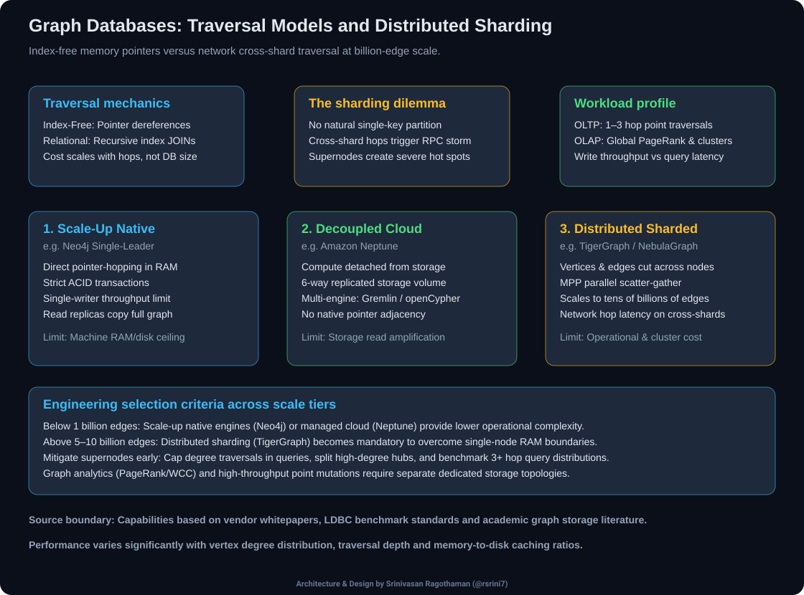
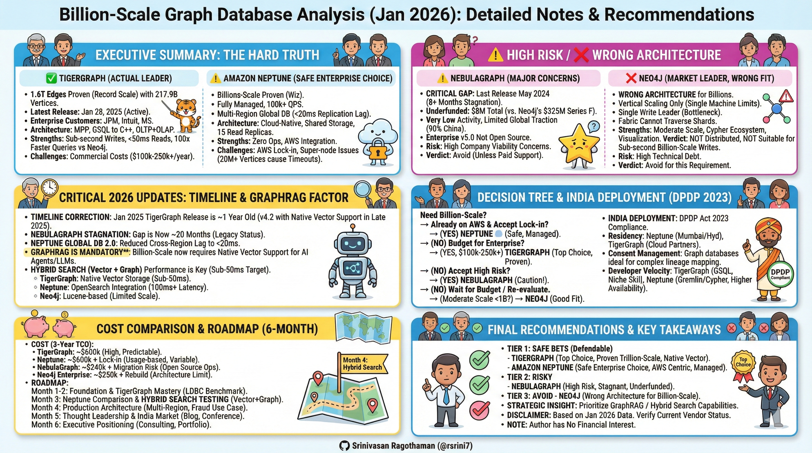

# Graph Databases at Massive Scale: Native Traversal, Distributed Sharding and Engine Trade-offs

**Learning note · Revised 15 November 2026 · Distributed systems and query model evaluation**  
*By Srinivasan Ragothaman ([@rsrini7](https://github.com/rsrini7))*

> **Core idea:** Graph database architectures diverge between single-node native engines with index-free adjacency and distributed shared-nothing clusters with partitioned vertex/edge indices. Scaling beyond billions of edges requires trading off low-latency multi-hop pointer traversals against distributed transaction coordination, network partition RPCs and supernode contention.

## 1. Foundations: when relational databases fail on connected data

Relational databases represent relationships using foreign keys and join tables. To answer multi-hop relationship queries—such as finding fraud rings, tracing supply chains or traversing permission hierarchies—a relational engine must execute sequential recursive SQL `JOIN` statements.

For a graph with an average vertex degree $d$ traversed to depth $k$, intermediate join table sizes scale as:

$$
\text{State size} = \mathcal{O}(d^k)
$$

In a relational database, each join step scans large b-tree index pages, saturating memory buffers and multiplying CPU lookups. In contrast, **native graph databases** implement **index-free adjacency**: each vertex stores physical memory pointers directly to its incoming and outgoing edges. Traversal time depends exclusively on the sub-graph visited:

$$
\text{Traversal time} = \mathcal{O}(k)
$$

independent of the total volume of data stored across the entire database.

| Term | What it means in graph architecture |
|---|---|
| **Property Graph** | Vertices (nodes) and directed edges (relationships), each holding arbitrary key-value properties and labels. |
| **Index-Free Adjacency** | Vertices maintain direct physical disk/memory pointers to adjacent records, bypassing index lookups during traversal. |
| **Supernode (Dense Node)** | A vertex with an exceptionally high degree (thousands or millions of edges), causing traversal bottlenecks and memory skew. |
| **Edge-Cut vs. Vertex-Cut** | Distributed partitioning strategies: dividing edges across machines (replicating vertices) or dividing vertices (replicating edges). |
| **Massive Parallel Processing (MPP)** | Distributing sub-graph traversals across independent cluster workers that execute queries in parallel and scatter-gather results. |

## 2. The distributed graph scaling dilemma



*Architectural comparison of single-node native graph engines, cloud-managed decoupled storage, and distributed sharded clusters.*

Tabular relational databases scale horizontally by sharding records across a discrete partition key (such as `user_id` or `tenant_id`). Graphs resist clean partitioning:
1. **Network Hop Multiplication:** Any edge spanning two physical machines requires an inter-node network RPC. A 3-hop traversal on a poorly partitioned distributed graph can trigger an exponential scatter-gather storm across the network.
2. **The Supernode Bottleneck:** Real-world networks exhibit power-law degree distributions (e.g. large merchants, celebrities, payment clearinghouses). When a query traverses a supernode holding 5,000,000 edges, the hosting machine's memory, network buffers and lock queues become severe cluster choke points.
3. **Distributed Transaction Latency:** Atomic writes touching edges between vertices hosted on different machines require two-phase commit (2PC) or distributed Raft consensus, substantially reducing write throughput compared to single-node engines.

### Supernode Mitigation Patterns

When scaling beyond 1 billion edges, supernodes cannot be eliminated; their access patterns must be governed:

- **Query-Level Degree Clamping:** Prevent unbounded breadth-first search expansions by clamping traversal degree using correlated subqueries in Cypher:

```cypher
// Clamping degree to prevent memory blowout on supernodes
MATCH (user:Account {id: $account_id})
CALL {
    WITH user
    MATCH (user)-[:TRANSACTED_WITH]->(target:Account)
    RETURN target
    ORDER BY target.risk_score DESC
    LIMIT 100 // Bounds memory and CPU expansion
}
RETURN user.id, collect(target.id) AS top_transactors;
```

- **Node Splitting (Fan-Out Sharding):** Split a supernode (e.g. `CompanyX`) into logical delegate vertices (`CompanyX_1`, `CompanyX_2`, ..., `CompanyX_N`) joined by internal partition edges, distributing incoming edges across shards.
- **Directional Indexing:** If 99% of queries traverse outgoing edges from a supernode, store incoming edge references out-of-line or in external inverted indices.
- **Parallel Accumulators (TigerGraph GSQL):** For distributed graph computation, use parallel accumulators to aggregate metrics across shards without pulling edge data into centralized coordinator memory:

```gsql
// Parallel multi-hop traversal using TigerGraph accumulators
CREATE QUERY FraudNeighborhood(VERTEX<Account> startAccount) FOR GRAPH FinGraph {
    SumAccum<int> @@riskyConnections;
    Start = {startAccount};

    // 1-Hop Traversal in Parallel across shards
    Hops1 = SELECT t FROM Start:s -(TRANSACTED_WITH:e)- Account:t;

    // 2-Hop Traversal accumulating risk count
    Hops2 = SELECT t FROM Hops1:s -(TRANSACTED_WITH:e)- Account:t
            WHERE t.is_flagged == true
            ACCUM @@riskyConnections += 1;

    PRINT @@riskyConnections;
}
```

## 3. Four architectural archetypes compared

Production graph platforms fall into four distinct architectural patterns, each tailored to different scale and operational requirements:

### Archetype 1: Scale-up native single-leader (e.g. Neo4j)
- **Architecture:** All write transactions commit to a single leader instance using write-ahead logging and native pointer storage on local NVMe disk/RAM. Read-only follower instances asynchronously replicate the full graph copy.
- **Strengths:** Unmatched single-machine multi-hop traversal speed (millions of pointer hops/sec in memory); full ACID transaction semantics; rich declarative query language (openCypher).
- **Limits:** Hard ceiling on write throughput dictated by single-leader hardware limits. The full graph must fit on a single server (or be federated using Neo4j Fabric, which requires application-level routing).
- **Best for:** Up to 1–2 billion edges with sub-millisecond 2–4 hop traversal requirements and moderate write rates.

### Archetype 2: Cloud-managed decoupled storage (e.g. Amazon Neptune)
- **Architecture:** Decouples stateless compute instances (running Gremlin or openCypher query parsers) from a distributed shared storage volume that replicates data across three Availability Zones.
- **Strengths:** Fully managed with zero operational overhead for backups, replication and failover; native integration with AWS IAM, CloudWatch and VPC security boundaries; supports RDF (SPARQL) and property graphs simultaneously.
- **Limits:** Storage layer uses shared distributed log blocks rather than native in-memory index-free adjacency. Multi-hop queries incur read amplification across network-attached storage nodes; supernodes cause storage I/O hot spots.
- **Best for:** Enterprise cloud-native workloads up to billions of edges where operational simplicity and multi-AZ resilience outweigh raw sub-millisecond traversal latencies.

### Archetype 3: Distributed sharded native MPP (e.g. TigerGraph)
- **Architecture:** Distributed shared-nothing C++ engine. Vertices and edges are partitioned across cluster nodes using vertex-cut partitioning. The GSQL query compiler translates declarative graph queries into optimized native C++ code executed across an MPP engine.
- **Strengths:** Proven scalability beyond tens of billions of edges; massively parallel processing enables both transactional OLTP queries and complex OLAP graph algorithms (PageRank, Community Detection, Shortest Path) on the same cluster.
- **Limits:** High operational and licensing complexity; schema migrations and topology re-balancing require substantial re-indexing; cross-machine RPC latency for non-local edge hops.
- **Best for:** Massive-scale financial anti-money laundering (AML), enterprise knowledge graphs, and supply-chain logistics exceeding 5+ billion edges.

### Archetype 4: Separated query and distributed key-value storage (e.g. NebulaGraph)
- **Architecture:** Separates stateless query computation services (`graphd`) from a distributed storage layer (`storaged`) backed by partitioned RocksDB instances and Raft consensus groups.
- **Strengths:** Open-source foundation; compute and storage scale independently; horizontally elastic storage expansion.
- **Limits:** Every traversal hop requires network RPCs between the stateless query nodes and the Raft storage workers; slower single-hop latency than in-memory pointer-hopping engines.
- **Best for:** Internet-scale social networks and content recommendation graphs with high horizontal write velocity and elastic compute requirements.

## 4. Architectural comparison matrix

| Architectural Dimension | Neo4j (Scale-Up Native) | Amazon Neptune (Managed Decoupled) | TigerGraph (Distributed MPP) | NebulaGraph (Decoupled Storage) |
|---|---|---|---|---|
| **Primary Storage Model** | Native index-free adjacency | Decoupled 6-way storage volume | Distributed partitioned native C++ | Sharded RocksDB key-value via Raft |
| **Max Practical Scale** | 1–3 Billion edges (Single node) | 5–10 Billion edges | 100+ Billion edges | 50+ Billion edges |
| **Write Model** | Single write leader (ACID) | Single write instance (ACID) | Distributed 2PC / Multi-node | Distributed Raft consensus |
| **1–2 Hop Read Latency** | Sub-millisecond (&lt;5 ms) | 10–50 ms | 5–25 ms | 15–60 ms |
| **Deep Traversal (4+ hops)** | Fast (if graph fits in RAM) | Slow (storage read amplification) | Fast (parallel MPP scatter-gather) | Moderate (network latency bounded) |
| **Graph Analytics (PageRank)** | Memory-intensive plugin | Limited / external batch | Native MPP compiled GSQL | Separate analytics engine required |
| **Operational Effort** | Low–Medium | Minimal (Fully managed AWS) | High (Cluster tuning &amp; re-partition) | Medium–High (Raft &amp; storage ops) |

## 5. Workload boundaries: OLTP traversal versus OLAP graph analytics

High-scale graph architectures must distinguish two conflicting access patterns:

1. **Transactional (OLTP) Graph Processing:** Low-latency point lookups, real-time fraud scoring, neighborhood lookups, and shortest-path checks (1–3 hops). Queries touch localized sub-graphs, require high concurrency and low latency, and depend on strict transactional boundaries.
2. **Analytical (OLAP) Graph Processing:** Global graph computations spanning all vertices and edges (PageRank, Weakly Connected Components, Louvain community detection, graph embeddings). These algorithms are iterative, memory-saturating and long-running.

Running heavy analytical graph algorithms on a transactional cluster saturates CPU memory buses and locks edge collections, starving real-time lookups. For production scale:
- Isolate OLTP traversal engines (Neo4j, Neptune) from analytics.
- Stream incremental vertex/edge mutations via change data capture (CDC) or Kafka into specialized graph analytics frameworks (e.g. **Apache Spark GraphX**, **GraphScope**, or GPU-accelerated **cuGraph**) for scheduled batch computation.

## 6. Practical benchmarking and evaluation roadmap

When evaluating graph database engines, avoid synthetic uniform random graphs. Real-world graphs exhibit power-law degree skews that break naive benchmarks:

### 1. Benchmark using LDBC standard profiles
Use the [Linked Data Benchmark Council (LDBC) Social Network Benchmark](https://ldbcouncil.org/benchmarks/snb/):
- **Interactive Workload:** Measures p99 latency for complex multi-hop neighborhood reads mixed with concurrent edge insertions.
- **Business Intelligence Workload:** Evaluates analytical aggregations and path traversals across large graph slices.

### 2. Inject supernode stress tests
Artificially introduce high-degree vertices (10,000 to 1,000,000 incident edges) into the test dataset:
- Measure tail latency degradation when traversals pass through supernodes.
- Test query-level degree clamping: verify whether the query planner can terminate traversals at dense nodes (e.g. `LIMIT` per hop) to prevent thread exhaustion.

### 3. Verify horizontal failover and network partition behavior
For distributed clusters (TigerGraph, NebulaGraph):
- Simulate a network partition between cluster nodes during active writes.
- Verify whether the engine enforces consistency (CP) or availability (AP), and measure recovery time after partition healing.

## 7. Dates and source context

| Date / Period | Milestone &amp; Evidence |
|---|---|
| 2024–2025 | LDBC publishes updated Social Network Benchmark (SNB) Interactive and BI benchmark results across distributed graph engines. |
| January 2025 | TigerGraph publishes production deployment data demonstrating trillion-edge processing benchmarks. |
| Mid-2025 | Amazon Neptune expands support for Neptune Analytics and global serverless engine instances. |
| 15 November 2026 | This evaluation synthesizes primary vendor documentation, academic graph storage papers, and LDBC standard methodologies into an objective technical comparison. |

### Supplementary visual



*Previously collected illustration, retained for reference. The revised explanation and source qualifications above govern the technical architecture and scaling trade-offs.*

---

**Related:**
- [Scaling PostgreSQL for ChatGPT](Scaling-PostgreSQL-ChatGPT.md) — Explains the single-primary relational write bottleneck and when relational models hit join scalability limits.
- [Scaling Java Services to 1M RPS](../Architecture/Scaling-1M-RPS-Java.md) — Analyzes concurrency, throughput budgets, and storage offloading at high query volumes.
- [Scaling C++ Services to 1M RPS](../Architecture/Scaling-1M-RPS-C++.md) — Details thread-per-core architectures and kernel-bypass I/O relevant to native graph database storage engines.
- [Workflow Orchestration](../Middleware/workflow-orchestration.md) — Covers durable asynchronous processing and retries when coordinating distributed data pipelines.
- [AWS versus Hetzner](../Cloud/AWS-vs-Hetzner.md) — Contrasts managed cloud database services (Neptune) with bare-metal dedicated hosting economics.
