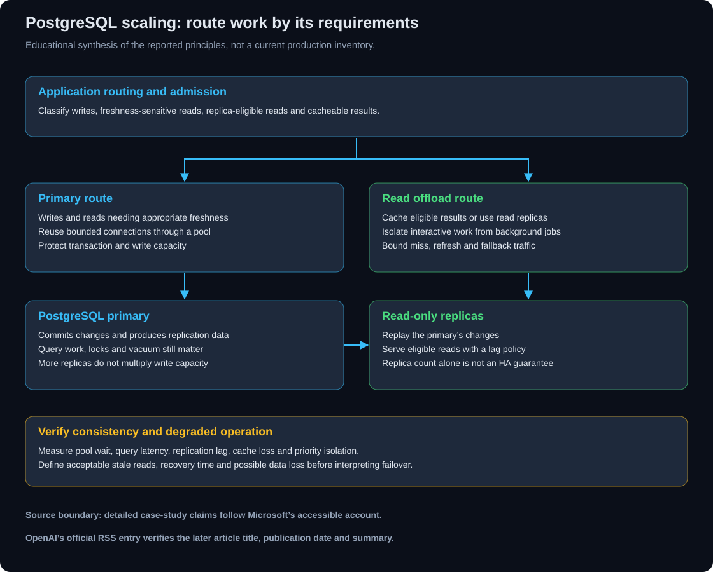
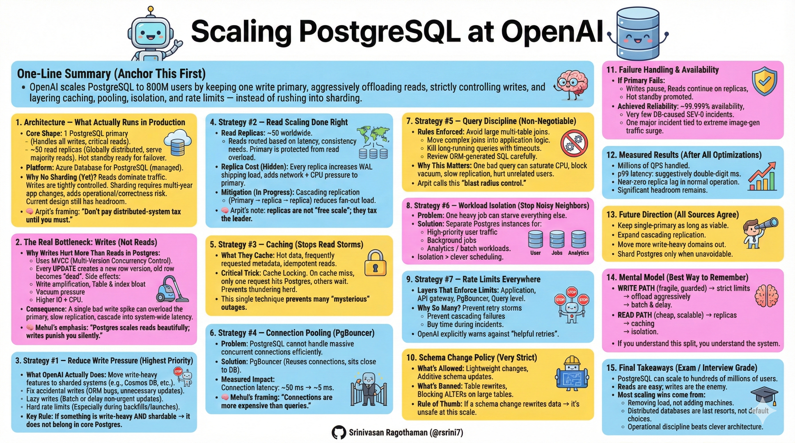

# Scaling PostgreSQL for High-Throughput Architectures: Primary-Replica Workloads, Connection Pooling, and Write Governance

Learning note · Revised November 2026 · Relational Database Architecture &amp; High-Scale Systems  
*By Srinivasan Ragothaman ([@rsrini7](https://github.com/rsrini7))*

> **Core idea:** The published accounts describe scaling a PostgreSQL workload by moving eligible reads to replicas, controlling writes, pooling connections and isolating important traffic. These techniques extend a primary/replica design, but each addresses a different bottleneck and has its own consistency and failure limits.

## 1. Foundations: the database is one part of the product

PostgreSQL is a relational database: applications use it to store structured records, run queries and commit transactions. ChatGPT also depends on model-serving, networking and other storage systems. A product's user count, HTTP request rate and database query rate describe different things.

Microsoft's [account of OpenAI's PostgreSQL deployment](https://www.microsoft.com/en-us/startups/blog/openai-and-postgresql-scaling-with-microsoft-azure/) describes a primary handling writes and multiple read-only replicas serving read traffic. Its account discusses dozens of replicas and growing write pressure. That is evidence about the described workload, not proof that all OpenAI data uses one database or that the entire platform is unsharded.

OpenAI's **22 January 2026** article is titled “Scaling PostgreSQL to power 800 million ChatGPT users.” Its [official RSS entry](https://openai.com/news/rss.xml) describes millions of queries per second and names replicas, caching, rate limiting and workload isolation. These are publication-time claims; the title is not a concurrent-user measurement or a per-server throughput figure.

| Term | What it means here |
|---|---|
| Primary | The writable PostgreSQL server for the database being discussed. |
| Read replica / standby | A server that replays changes from the primary and may serve read-only queries. |
| Replication lag | A replica has not yet received or applied all the relevant changes. |
| Connection pool | A component that reuses a bounded set of database connections across clients. |
| Cache | A faster copy or computed result that can avoid some database reads. It needs a freshness policy. |
| Workload isolation | Separating traffic or resource budgets so one class of work does not crowd out another. |

## 2. The architecture and its limits



*This is an educational synthesis of the published design principles, not an inventory of the current production deployment.*

The application classifies work before choosing a route. Writes and reads requiring the latest committed state use a path with appropriate consistency. Eligible read-only queries can use replicas. Cache hits may avoid a database query entirely; cache misses still need a controlled backend path.

PostgreSQL's [standby documentation](https://www.postgresql.org/docs/current/warm-standby.html) distinguishes synchronous and asynchronous replication. Read replicas add read capacity, but an asynchronous replica can lag. Replication mode and commit settings also affect what a failover can preserve. Neither replica count nor the label “high availability” alone establishes a recovery guarantee.

## 3. What the published case actually supports

| Technique | Reported role | Engineering limit |
|---|---|---|
| Reduce and smooth writes | Microsoft's account describes removing unnecessary writes, controlling timing and offloading suitable write-heavy work. | A write offloaded elsewhere still needs a defined owner, durability policy and recovery process. |
| Read offloading | Replicas and query routing reduce read pressure on the primary. | Replicas do not multiply the primary's write capacity; stale reads may be unacceptable for some operations. |
| Priority isolation | Dedicated replica capacity serves high-priority traffic. | Isolation requires budgets and routing rules; merely adding servers does not enforce it. |
| Query optimization and pooling | Microsoft names slow-query work and PgBouncer. | Connection reuse does not eliminate query CPU, locks, I/O or transaction time. |
| Schema and transaction governance | The account names strict schema-change rules and management of long transactions. | A fast normal workload can still be disrupted by an unsuitable migration or long-running transaction. |

Source: [Microsoft's account](https://www.microsoft.com/en-us/startups/blog/openai-and-postgresql-scaling-with-microsoft-azure/). Its performance discussion reports many queries moving from around **50 ms to under 5 ms** after connection-pooling optimizations. That is a reported application outcome, not a controlled benchmark or a measurement of connection establishment alone.

Caching, rate limiting and workload isolation are also named in [OpenAI's official RSS summary](https://openai.com/news/rss.xml). The accessible summary does not establish an exact replica count, cache-locking implementation or failover configuration.

## 4. Why writes need separate attention

PostgreSQL uses multi-version concurrency control: updates can leave older row versions that later need cleanup. Heavy updates, excessive indexes, long transactions and insufficient vacuum progress can create extra storage and I/O work. [Routine vacuuming](https://www.postgresql.org/docs/current/routine-vacuuming.html).

**Heap-only tuple, or HOT, updates** can avoid new entries in ordinary indexes when their eligibility conditions hold. The updated columns must not require changes to the relevant indexes, and the new row version needs room on the original heap page. A suitable table `fillfactor` can reserve room for updates, trading some density for that opportunity. HOT is not available for every update, and it does not remove the need for vacuuming. [PostgreSQL HOT documentation](https://www.postgresql.org/docs/current/storage-hot.html).

These are general PostgreSQL mechanisms. The accessible case-study sources do not establish that a particular HOT or fillfactor setting was responsible for OpenAI's reported results.

Likewise, [PostgreSQL 18's asynchronous I/O](https://www.postgresql.org/docs/18/release-18.html) targets operations including sequential scans, bitmap heap scans and vacuum. It is not a blanket guarantee that every transactional query or write becomes faster.

## 5. Pooling, caching and overload control

### Pool connections to protect the database

PgBouncer can pool at session or transaction boundaries. In transaction mode, a server connection returns to the pool when the transaction finishes. Applications must account for session-dependent behavior because a later transaction may use another server connection. [PgBouncer feature matrix](https://www.pgbouncer.org/features.html).

Avoid the blanket claim that transaction pooling cannot support prepared statements. PgBouncer documents support for protocol-level named prepared statements when the relevant configuration is enabled; SQL-level statements and other session features need their own compatibility check. Verify the installed version, driver behavior and [`max_prepared_statements` configuration](https://www.pgbouncer.org/config.html).

A larger client population still needs a bounded backend budget. If connections wait in the pool, increasing every application's pool size may increase contention rather than useful throughput.

### Plan the cache-miss and failure path

A high hit rate can make a system look comfortable until popular entries expire or the cache becomes unavailable. Coalesce duplicate refreshes where appropriate, stagger expiry and bound database fallback work. For consistency-sensitive reads, define when cached or replica data is acceptable.

These are architectural recommendations, not verified details of the inaccessible OpenAI article. Measure the cache-failure path as well as the warm-cache case.

### Keep important work inside its budget

Separate interactive traffic from batch jobs, use timeouts and enforce admission limits before expensive work overwhelms the database. Rate limiting is useful only when retries, priority rules and rejected work have a defined behavior. Workload isolation should be verified during an overload exercise, not inferred from normal-operation latency.

## 6. Practical inspection and verification

Start with a workload baseline: read/write mix, query rates, latency distributions, pool wait, replica lag, lock waits, transaction age and vacuum progress. Then identify the resource constraining useful completed work.

The built-in [`pg_stat_statements` extension](https://www.postgresql.org/docs/current/pgstatstatements.html), when configured and accessible, can identify expensive query patterns:

```sql
SELECT queryid, calls, total_exec_time, mean_exec_time, rows
FROM pg_stat_statements
ORDER BY total_exec_time DESC
LIMIT 10;
```

These are accumulated execution statistics, not end-to-end request latency percentiles. Compare suitable time windows and account for statistics resets. Use [`EXPLAIN`](https://www.postgresql.org/docs/current/using-explain.html) to inspect plans; `EXPLAIN ANALYZE` actually executes the statement, so choose the statement and environment deliberately.

For a proposed change, verify both normal and degraded behavior: replica delay, pool exhaustion, cache loss, long transactions and a controlled failover in staging. Define acceptable stale reads, recovery time and possible data loss before interpreting a successful availability test.

## 7. Dates and source context

| Date | Evidence |
|---|---|
| 7 October 2025 | Microsoft publishes its partner account of OpenAI's PostgreSQL scaling work. |
| 22 January 2026, 12:00 GMT | OpenAI's RSS feed records publication of the 800-million-user PostgreSQL article. |
| 15 November 2026 | This note checks the accessible partner account, official RSS entry and PostgreSQL/PgBouncer documentation. |

The [full OpenAI article](https://openai.com/index/scaling-postgresql/) returned an access error during this review. Its RSS entry verifies the title, date and summary, while detailed case-study statements above are attributed to Microsoft's account. General tuning advice is distinguished from the reported production design.

### Supplementary visual



*Previously collected illustration, retained for reference. The revised explanation and source qualifications above govern the technical claims.*


---

**Related:**
- [Scaling-Java-Services-To-1-Million-RPS-2026](../Architecture/Scaling-Java-Services-To-1-Million-RPS-2026.md) — Applies database budgets, caching and overload control to a hypothetical high-throughput service.
- [Workflow Orchestration](../Middleware/workflow-orchestration.md) — Explains durable processing and retries when work is moved outside a synchronous database path.
- [Graph-Databases-At-Massive-Scale-Architecture-2026](Graph-Databases-At-Massive-Scale-Architecture-2026.md) — Provides a different workload and data-model perspective on database scaling and join limits.
- [AWS versus Hetzner](../Cloud/AWS-vs-Hetzner.md) — Adds infrastructure and operational cost context to deployment choices.
