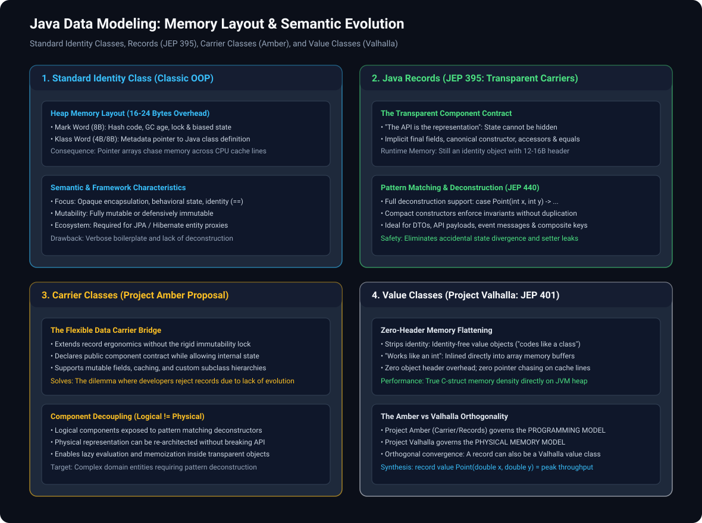
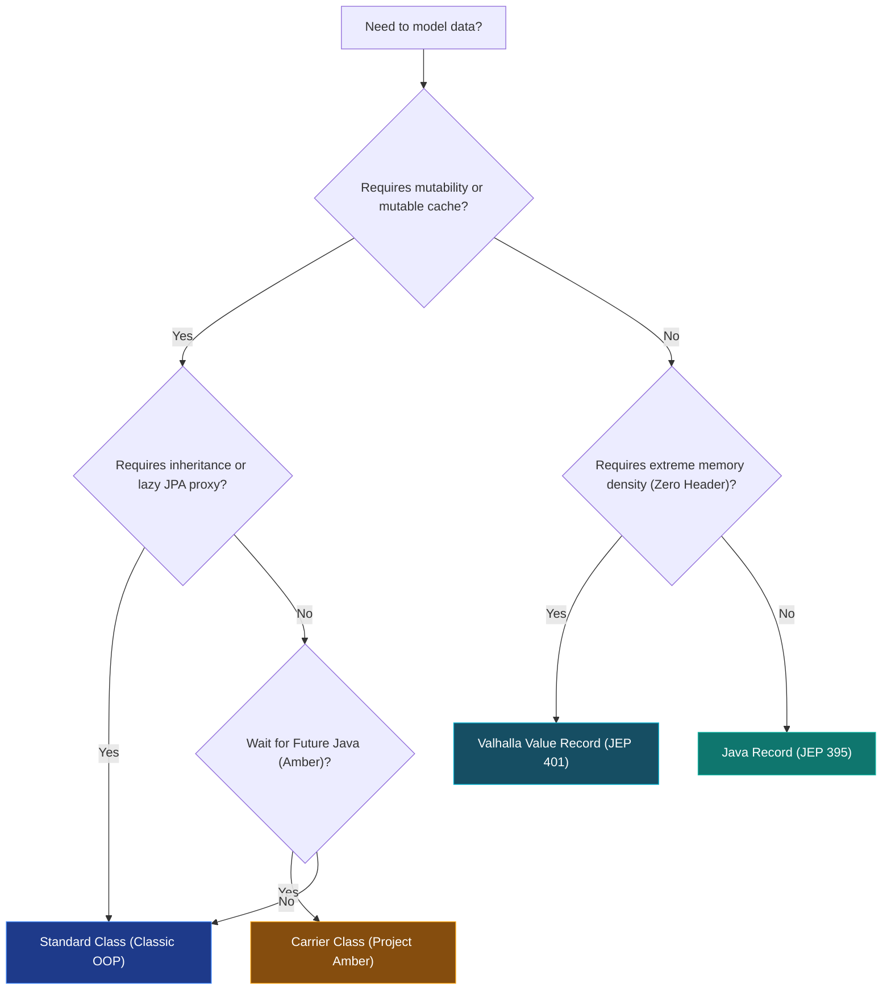
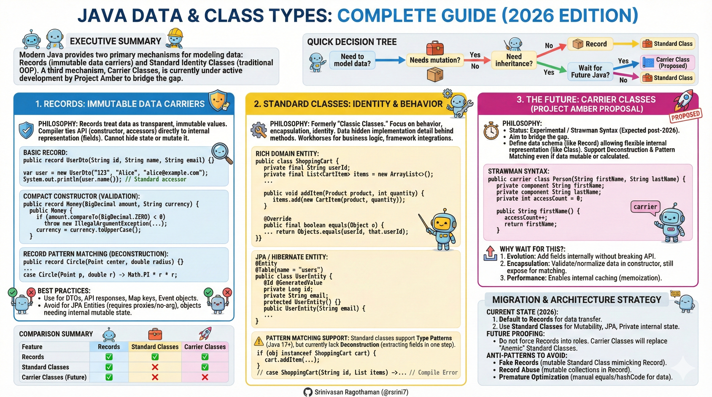

# Java Data Modeling: Classes, Records, Carrier Classes, and Valhalla Value Objects

`Learning note · Revised November 2026 · JVM Internals & Memory Architecture`  
*By Srinivasan Ragothaman ([@rsrini7](https://github.com/rsrini7))*

> Java data modeling is undergoing its most significant evolution since Java 5. While standard classes model encapsulated identity and behavior, and Records (JEP 395) enforce transparent, immutable data carriers, upcoming developments bifurcate the roadmap: Project Amber introduces Carrier Classes to decouple API components from physical representation, while Project Valhalla (JEP 401) flattens memory layouts to eliminate the 16-byte object header tax entirely.

---

## 1. Foundations: Data Modeling & The Memory Layout Spectrum

Modern Java services must balance developer ergonomics, pattern matching expressiveness, and memory density. In high-throughput architectures (e.g., financial order books, message streaming, gaming engines), the JVM's object model introduces trade-offs between memory footprint, encapsulation, and deconstructibility.

```
+-----------------------------------------------------------------------------------------------------+
|                                    JAVA DATA MODELING TAXONOMY                                      |
+-----------------------------------------------------------------------------------------------------+
|  STANDARD IDENTITY CLASS        JAVA RECORD (JEP 395)      CARRIER CLASS (AMBER)  VALHALLA (JEP 401)|
|  - Encapsulated behavior        - Transparent value        - Flexible data        - Identity-free   |
|  - Mutable or immutable         - Strictly immutable       - Optional mutability  - Inlined memory  |
|  - 16-24B Object Header         - 16B Object Header        - 16B Object Header    - ZERO Header     |
|  - Pointer indirection          - Pointer indirection      - Pointer indirection  - Flattened array |
|  - Opaque representation        - "API is representation"  - Logical != Physical  - "Works like int"|
+-----------------------------------------------------------------------------------------------------+
```

### Essential Technical Terms & Component Roles

| Term / Mechanism | Architectural Scope | Primary Semantics & Guarantees |
| :--- | :--- | :--- |
| **Identity Object** | JVM HotSpot Object Model | Object possesses memory identity (`System.identityHashCode`, `==`), lock synchronization state, and mutability boundaries. |
| **Java Record (JEP 395)** | Language Specification | Transparent immutable data carrier whose public API is strictly coupled to its component tuple representation. |
| **Compact Constructor** | Record Compiler Feature | Constructor syntax allowing validation and normalization of components without repeating field assignments. |
| **Record Pattern (JEP 440)** | Pattern Matching | Deconstruction primitive enabling `switch` and `instanceof` to extract internal components directly into local variables. |
| **Carrier Class** | Project Amber Proposal | Data-oriented class that exposes a declared component contract to pattern matching while permitting private mutable state and inheritance. |
| **Value Class (JEP 401)** | Project Valhalla | Identity-free class whose instances lack object headers and can be flattened directly into CPU registers, stack frames, and contiguous array buffers. |
| **Mark Word** | JVM 64-bit Object Header | 8-byte header field storing hash code, generational GC age, biased locking flags, and thread monitor pointer. |
| **Klass Pointer** | JVM 64-bit Object Header | 4-byte (Compressed Oops) or 8-byte pointer addressing the instance's class metadata in Metaspace. |

---

## 2. Deep Technical Mechanisms: Memory Layouts and Semantic Contracts

### 2.1 Heap Memory Layouts & The Object Header Tax

On 64-bit HotSpot JVMs with Compressed Ordinary Object Pointers (`-XX:+UseCompressedOops`), every heap object incurs an overhead before storing a single byte of payload:

```
STANDARD 64-BIT JVM OBJECT HEADER (12 BYTES + 4 BYTES PADDING)
+------------------------------------+------------------------------------+
| Mark Word (8 Bytes / 64 bits)      | Klass Pointer (4 Bytes / 32 bits)  |
| HashCode, GC Age, Lock States      | Compressed pointer to Metaspace    |
+------------------------------------+------------------------------------+
| Payload: int x (4 Bytes)           | Payload: int y (4 Bytes)           |
+------------------------------------+------------------------------------+
Total Heap Consumption: 24 Bytes (8-byte alignment padded) for just 8 bytes of data!

VALHALLA VALUE CLASS FLATTENED MEMORY (JEP 401: ZERO HEADER OVERHEAD)
+------------------------------------+------------------------------------+
| Payload: int x (4 Bytes)           | Payload: int y (4 Bytes)           |
+------------------------------------+------------------------------------+
Total Heap Consumption: 8 Bytes exactly. Array of Point is a contiguous memory buffer!
```

1. **Standard Classes & Records**: Both maintain a full object header. An array `Point[]` of 1,000,000 standard points allocates an array of 1,000,000 references (4MB) pointing to 1,000,000 distinct heap objects (24MB), totaling **28MB** with severe pointer chasing and cache misses.
2. **Project Valhalla Value Classes**: Stripping object identity allows HotSpot to inline the `x` and `y` primitives directly inside the array buffer. 1,000,000 points consume exactly **8MB** of contiguous memory, streamable in linear CPU cache lines without pointer indirection.

---

### 2.2 Semantic Contracts: Transparent vs. Encapsulated

The fundamental distinction between Records and Standard Classes is not boilerplate reduction; it is the **semantic contract**:

```
THE RECORD TRANSPARENCY THEOREM
For any Record R(c1, c2, ... cn), if r is an instance of R:
  new R(r.c1(), r.c2(), ... r.cn()).equals(r) == true

The API IS the representation. You cannot:
- Add private fields that participate in equality but are hidden from accessors.
- Introduce mutable fields that drift over time.
- Extend other classes (records implicitly extend java.lang.Record and are final).
```

When an entity requires internal caching (e.g., memoizing a complex hash, lazy-loading a secondary database association, or mutating an internal state machine), Records must not be used.

---

### 2.3 Carrier Classes vs. Value Classes: Amber vs. Valhalla

Developers frequently conflate Carrier Classes with Value Classes. They are orthogonal initiatives solving different layers of the software stack:

```
+----------------------------------------------------------------------------------------------------+
|                             THE AMBER VS VALHALLA ORTHOGONALITY                                    |
+----------------------------------------------------------------------------------------------------+
|  PROJECT AMBER (Carrier Classes)                       PROJECT VALHALLA (Value Classes)            |
|  - Layer: Programming Model & Language Syntax          - Layer: VM Execution & Memory Topology     |
|  - Problem Solved: Rigidness of record encapsulation   - Problem Solved: Memory bloat & cache miss |
|  - Mechanism: Component lists with private state       - Mechanism: Identity-free object inlining  |
|  - Deconstruction: Exposes logical components          - Optimization: Zero-header flattening      |
+----------------------------------------------------------------------------------------------------+
```

A class can be both: `record value Point(int x, int y) {}` marries Amber's transparent deconstruction syntax with Valhalla's flat, cache-line-dense hardware execution.

---

## 3. Architectural Visuals: Memory Topologies and Decision Flows

The diagram below contrasts the physical heap layouts and pointer indirections across standard classes, records, carrier classes, and Valhalla value objects:



---

### Architectural Decision Tree



---

## 4. Production Implementations & Code Recipes

### 4.1 Record Pattern Matching & Compact Invariant Verification

Java 21+ records enable compact validation constructors and nested pattern matching deconstruction:

```java
package com.enterprise.jvm.model;

import java.math.BigDecimal;
import java.util.Objects;

public class FinancialOrderDomain {

    public sealed interface PaymentMethod permits CreditCard, DigitalWallet, BankWire {}

    public record CreditCard(String pan, String expDate, int cvv) implements PaymentMethod {
        // Compact constructor: Invariants enforced at construction boundary
        public CreditCard {
            Objects.requireNonNull(pan, "PAN cannot be null");
            if (pan.length() < 13 || pan.length() > 19) {
                throw new IllegalArgumentException("Invalid PAN length");
            }
            if (cvv < 100 || cvv > 9999) {
                throw new IllegalArgumentException("Invalid CVV");
            }
        }
    }

    public record DigitalWallet(String walletId, String provider) implements PaymentMethod {}
    public record BankWire(String iban, String swiftBic) implements PaymentMethod {}

    public record Order(String orderId, BigDecimal amount, PaymentMethod payment) {}

    // Record pattern deconstruction in switch expressions
    public static String auditPaymentRouting(Order order) {
        return switch (order) {
            case Order(var id, var amt, CreditCard(var pan, _, _)) when amt.compareTo(BigDecimal.valueOf(10000)) > 0 ->
                "High-value Card Order [" + id + "] routing to manual fraud queue: PAN masked ending in " + pan.substring(pan.length() - 4);
                
            case Order(var id, var amt, CreditCard(var pan, _, _)) ->
                "Standard Card Order [" + id + "] dispatched for immediate clearing";
                
            case Order(var id, _, DigitalWallet(var wId, var provider)) ->
                "Instant Settlement [" + id + "] via " + provider + " (Wallet: " + wId + ")";
                
            case Order(var id, _, BankWire(var iban, _)) ->
                "ACH / SEPA Batch Wire Scheduled [" + id + "] to " + iban;
        };
    }
}
```

---

### 4.2 JOL (Java Object Layout) Memory Verification Recipe

To empirically verify object header sizes, field alignments, and padding in a running JVM, execute the following Java Object Layout (JOL) harness:

```java
package com.enterprise.jvm.profiler;

import org.openjdk.jol.info.ClassLayout;
import org.openjdk.jol.vm.VM;

public class MemoryLayoutProfiler {

    public static class StandardPoint {
        private int x = 10;
        private int y = 20;
    }

    public record RecordPoint(int x, int y) {}

    public static void main(String[] args) {
        System.out.println(VM.current().details());
        
        System.out.println("=== STANDARD CLASS LAYOUT ===");
        System.out.println(ClassLayout.parseClass(StandardPoint.class).toPrintable());

        System.out.println("=== RECORD LAYOUT ===");
        System.out.println(ClassLayout.parseClass(RecordPoint.class).toPrintable());
    }
}
```

When executed with `-XX:+UseCompressedOops`, JOL outputs:
```
com.enterprise.jvm.profiler.MemoryLayoutProfiler$RecordPoint object internals:
OFF  SZ   TYPE DESCRIPTION               VALUE
  0   8        (object header: mark)     0x0000000000000001
  8   4        (object header: class)    0x00062a40
 12   4    int RecordPoint.x             10
 16   4    int RecordPoint.y             20
 20   4        (loss due to the next object alignment)
Instance size: 24 bytes
Space losses: 0 bytes internal + 4 bytes external = 4 bytes total.
```

---

## 5. Comparative Structural Analysis

| Architectural Feature | Java Standard Class | Java Record (JEP 395) | Carrier Class (Amber Proposed) | Valhalla Value Class (JEP 401) |
| :--- | :--- | :--- | :--- | :--- |
| **Primary Design Intent** | Behavioral encapsulation | Transparent data tuple | Evolving data carrier | High-density value math |
| **Language Availability** | Java 1.0+ | Java 16+ GA | Project Amber Draft | Project Valhalla Early Access |
| **Declared Data Shape** | Implicit (arbitrary fields) | Explicit component list | Explicit component list | Explicit value fields |
| **Object Identity** | Mandatory (`==`, `wait()`) | Mandatory (`==`, `wait()`) | Optional / Identity-based | **Stripped** (`==` checks values) |
| **Object Header Overhead** | 12–16 Bytes | 12–16 Bytes | 12–16 Bytes | **0 Bytes** (when inlined) |
| **Pattern Deconstruction** | Type check only | Full deconstruction | Full deconstruction | Full deconstruction |
| **Mutability Supported** | Full | **None** (all fields final) | Supported (managed) | Disallowed (immutable fields) |
| **Inheritance Hierarchy** | Full (`extends`) | **Final** (`implements` only) | Supported | Disallowed (`final value`) |
| **Private Cache Fields** | Full support | **Impossible** | Supported | Disallowed |
| **JPA / Hibernate Entity** | Supported (native proxy) | Incompatible | Expected Compatible | Incompatible |

---

## 6. Common Claims vs. Technical Realities

| # | Common Industry Claim | Technical Reality & Benchmark Fact | Architectural Guidance |
| :-: | :--- | :--- | :--- |
| **1** | *"Records are just syntax sugar for Lombok `@Data` or `@Value`."* | **False.** Lombok generates standard class bytecode with getters and setters. Records alter language semantics: they enforce transparent component mapping, participate in reflection `getRecordComponents()`, and unlock native JEP 440 pattern deconstruction. | Use Records for public data contracts; do not treat them merely as boilerplate reducers. |
| **2** | *"Records reduce JVM heap memory compared to standard classes."* | **False.** Records are standard identity objects on HotSpot. A `record Point(int x, int y)` consumes the exact same 24 bytes on heap as an identical standard class. | Do not adopt records expecting memory footprint reductions; wait for Valhalla value classes for memory density. |
| **3** | *"Records cannot enforce validation invariants."* | **False.** Records provide compact constructors (`public Money { ... }`) specifically designed to validate arguments, enforce preconditions, and normalize strings prior to field assignment. | Place domain validation logic directly in the compact constructor. |
| **4** | *"Project Valhalla will make Java Records obsolete."* | **False.** Valhalla and Amber are complementary. Valhalla value classes govern physical memory inlining; Records govern declarative API semantics. The syntax `record value Complex(double re, double im)` synthesizes both. | Use records today; migrate them to `record value` once Valhalla reaches General Availability. |
| **5** | *"JPA entities can be migrated directly to Records."* | **False.** JPA / Hibernate requires proxy generation (CGLIB/ByteBuddy), non-final classes, mutable field setters, and no-argument constructors, all of which violate Record language invariants. | Keep JPA entities as Standard Classes; map them to Records at repository boundaries for DTO transport. |

---

## 7. Practical Adoption Blueprint & Verification Checklist

```
+----------------------------------------------------------------------------------------------------+
|                                    DATA MODELING ADOPTION BLUEPRINT                                |
+----------------------------------------------------------------------------------------------------+
|  1. USE RECORDS BY DEFAULT FOR:                                                                    |
|     - HTTP REST request and response payloads                                                      |
|     - Kafka / RabbitMQ event transfer objects                                                      |
|     - Composite Map keys (guarantees correct, immutable equals/hashCode)                           |
|     - Method multiple-return value tuples                                                          |
|                                                                                                    |
|  2. RETAIN STANDARD CLASSES FOR:                                                                   |
|     - JPA / Hibernate relational entities                                                          |
|     - Stateful domain services and actors                                                          |
|     - Objects requiring internal mutable caches or lazy-loaded fields                              |
|                                                                                                    |
|  3. VERIFY WITH DIAGNOSTIC FLAGS:                                                                  |
|     - Inspect object alignments: -XX:+PrintFlagsFinal | grep -i ObjectAlignment                    |
|     - Verify Compressed Oops: -XX:+PrintFlagsFinal | grep -i UseCompressedOops                     |
+----------------------------------------------------------------------------------------------------+
```

---

## 8. Technology Roadmap & Historical Evolution

```
2020 ────────────────────── 2021 ────────────────────── 2024 ────────────────────── 2026+
 │                           │                           │                           │
 ├── Java 14 Preview         ├── Java 16 GA              ├── Java 21 LTS             └── Java 26+ / Future
 │   • JEP 359: Records      • JEP 395: Records GA       • JEP 440: Record Patterns  • Project Amber Carrier Classes
 │   • Compact constructors  • Reflection component API • Pattern matching switch  • Project Valhalla JEP 401
 │                                                       • Primitive type patterns   • Flattened Value Classes
```

---

## 9. Primary Sources & References

1. [JEP 395: Records](https://openjdk.org/jeps/395) — OpenJDK specification defining transparent data carriers and record component reflection.
2. [JEP 440: Record Patterns](https://openjdk.org/jeps/440) — OpenJDK standard enabling deconstruction of records in switch expressions and instanceof checks.
3. [JEP 401: Value Classes and Objects (Preview)](https://openjdk.org/jeps/401) — Project Valhalla specification introducing identity-free value classes and memory flattening.
4. [Brian Goetz: Data-Oriented Programming in Java](https://www.infoq.com/articles/data-oriented-programming-java/) — Architectural treatise outlining the shift toward data-oriented programming with records, sealed types, and pattern matching.
5. [Nicolai Parlog: Carrier Classes; Beyond Records (Inside Java Newscast #105)](https://inside.java/2026/01/22/newscast-105/) — Oracle Developer Relations architectural briefing explaining the Amber Carrier Classes proposal.
6. [OpenJDK JOL (Java Object Layout) Project](https://github.com/openjdk/jol) — Official toolset for analyzing memory layouts, object headers, and alignment paddings inside HotSpot.

---

## 10. Supplementary visuals

The following legacy technical diagram illustrates the high-level comparison between classic identity classes and immutable record structures:


*Figure 1: Architectural comparison of OOP identity classes versus data-oriented record carriers.*

---

**Related:**
- [Java-Next-Gen-Programming-Models-Babylon-Panama-Nov-2026](Java-Next-Gen-Programming-Models-Babylon-Panama-Nov-2026.md) — Explores Code Reflection and FFM off-heap memory models that interface with Java value objects.
- [Project-Detroit-Java-Polyglot-Runtimes-Nov-2026](Project-Detroit-Java-Polyglot-Runtimes-Nov-2026.md) — In-depth analysis of JVM memory models, object header overhead, and native C++ runtime bridges.
- [Scaling-Java-Services-To-1-Million-RPS-2026](../Architecture/Scaling-Java-Services-To-1-Million-RPS-2026.md) — Demonstrates how immutable records and zero-allocation patterns achieve 1 million requests per second.
- [Java-25-vs-Go-1.25-Performance-Analysis-2026](../Languages/comparisons/Java-25-vs-Go-1.25-Performance-Analysis-2026.md) — Evaluates memory layouts, cache locality, and data structures across modern Java and Go.
- [Java-Python-Enterprise-AI-Playbook-2026](../../AI-ML/Comparisons/Java-Python-Enterprise-AI-Playbook-2026.md) — Compares Java data modeling primitives with Python dataclasses and Pydantic models in production AI pipelines.
