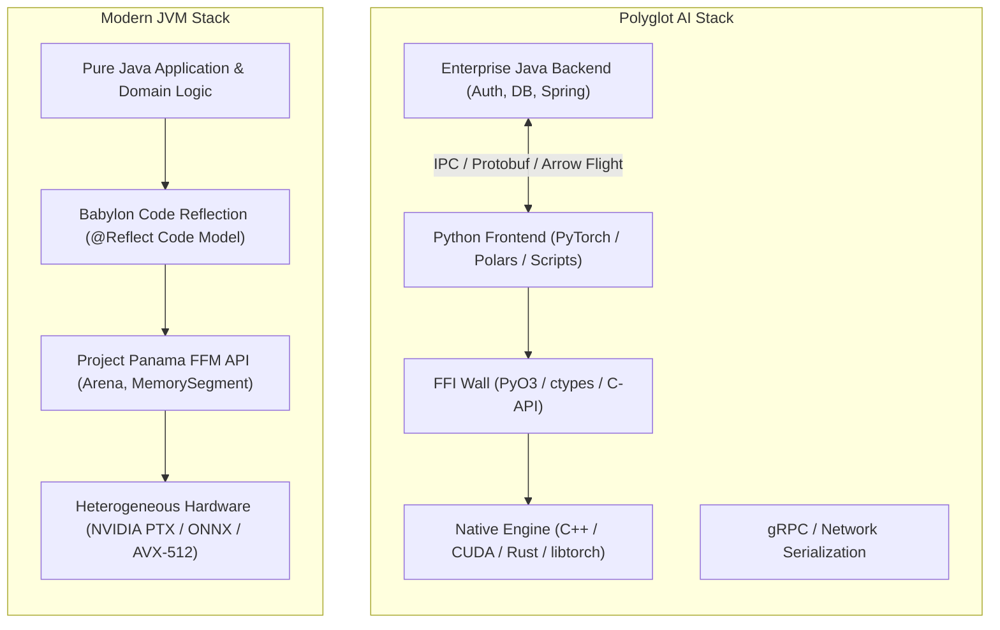
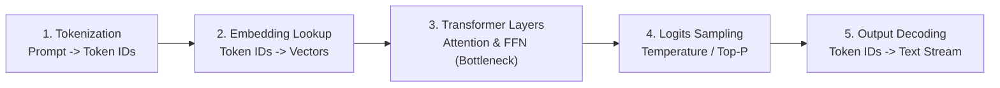
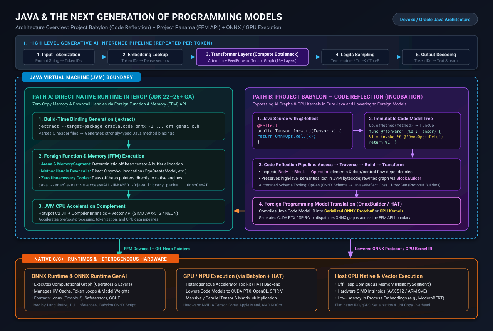
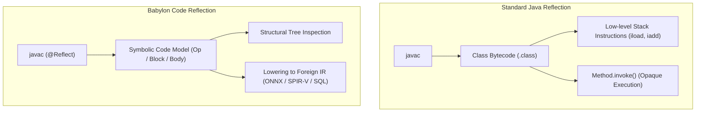
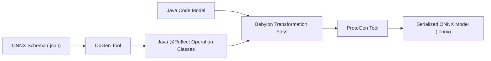
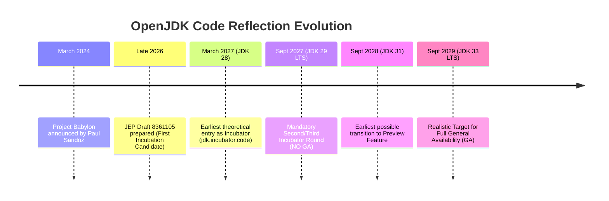
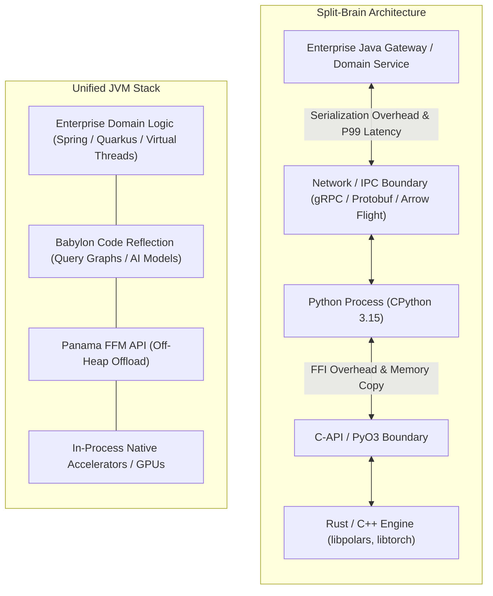
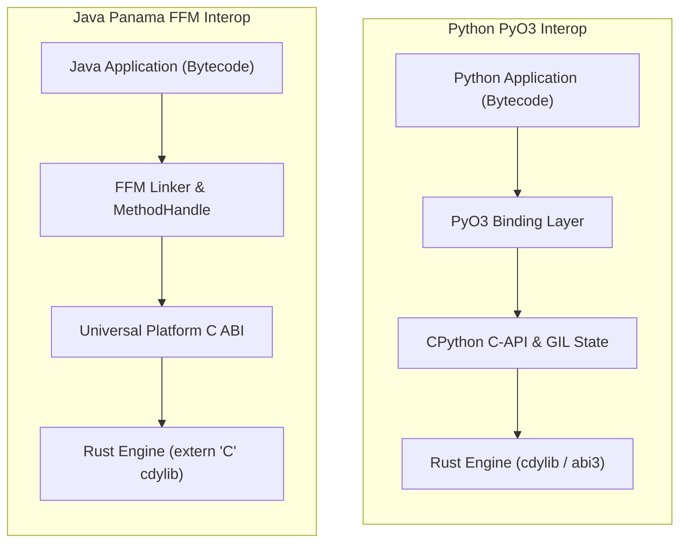

# Java and Next-Generation Programming Models: Project Babylon, Code Reflection, and Project Panama

**Daily learning · 8 November 2026 · Architectural Deep Dive · OpenJDK Project Babylon & Panama**

> **Core idea:** Project Babylon introduces compiler-backed **Code Reflection** (`jdk.incubator.code`) to capture Java code as structured, inspectable symbolic models that can be lowered directly into ONNX computation graphs and heterogeneous hardware kernels (CUDA PTX, SPIR-V), eliminating the traditional "two-language tax" (Python frontend + C++/CUDA backend). However, with Code Reflection preparing for its first incubator round and requiring multi-round incubation and preview cycles, General Availability (GA) is realistically a **JDK 31+** or **JDK 33 LTS (2029)** milestone, leaving production enterprise platforms to rely on Project Panama's finalized **Foreign Function & Memory (FFM) API** for zero-copy native runtime execution in the interim.

Modern enterprise systems increasingly face a fundamental tension in AI and accelerated data workloads: the **two-language tax**. High-level orchestration and prototyping occur in Python, while the performance-critical engine—tensor arithmetic, GPU kernels, memory management—is delegated across a foreign function interface (FFI) boundary to C++, CUDA, or Rust. While effective for exploratory research in Jupyter notebooks, this split runtime introduces significant operational fragility, memory serialization overhead, and deployment friction in 24/7 enterprise backends.

Through **Project Babylon** (Code Reflection) and **Project Panama** (Foreign Function &amp; Memory API), OpenJDK is pursuing a unified alternative: enabling Java developers to write both high-level business pipelines and mathematical execution graphs in pure, strongly-typed Java, without sacrificing native hardware acceleration.

This architectural review analyzes the mechanics of Code Reflection, evaluates the realistic delivery timeline across OpenJDK release trains, contrasts the modern Java stack against the Python + Rust paradigm (such as Polars), and details the runtime realities of CPython's JIT and free-threading initiatives.

---

## 1. Foundations: The Architectural Problem & Terminology

### The Two-Language Tax vs. The Unified Runtime

Enterprise architectures historically integrated AI models and data pipelines by maintaining polyglot topologies:



In the polyglot model, Java handles the core enterprise domain, databases, and client requests, but must communicate with Python sidecars or external model servers via gRPC, Unix domain sockets, or Apache Arrow Flight. The Python worker in turn calls native C++ or CUDA libraries. Every boundary crossing incurs data serialization, thread synchronization, and operational maintenance for separate runtime environments.

Project Babylon and Project Panama eliminate these intermediate hops by allowing the JVM to manage native memory, invoke native C libraries directly, and compile Java method logic directly into foreign execution representations.

### Essential Terminology

| Concept | Technical Definition | Role in Next-Gen Java |
|---|---|---|
| **Project Babylon** | An OpenJDK project extending Java's reflection model to analyze, transform, and compile Java code into foreign programming models (SQL, ONNX, SPIR-V, CUDA). | Bridges Java expressions to specialized accelerator runtimes without language forks. |
| **Code Reflection** | Compiler and runtime support (`jdk.incubator.code`) that produces an immutable, symbolic Intermediate Representation (IR) of Java methods annotated with `@Reflect`. | Allows runtime libraries to inspect AST-like control flow, operations, and types. |
| **Code Model** | The structured IR tree consisting of `Body`, `Block`, and `Operation` nodes generated by `javac` for reflected methods. | Provides the source data for lowering into target graphs (ONNX, PTX). |
| **Project Panama (JEP 454)** | The Foreign Function &amp; Memory (FFM) API, finalized in Java 22, enabling pure Java code to allocate off-heap memory and invoke native C symbols. | Replaces JNI with zero-copy, type-safe native interoperability. |
| **`jextract`** | An OpenJDK tool that parses C/C++ header files (`.h`) and generates strongly-typed Java binding classes utilizing the FFM API. | Automates the creation of FFM downcalls and native struct layouts. |
| **HAT (Heterogeneous Accelerator Toolkit)** | A Babylon sub-project enabling offload of Java code models directly to GPU backends (OpenCL, CUDA, Level Zero). | Translates Java Code Models directly into parallel device kernels. |
| **Project Valhalla (JEP 401)** | Value classes and flattened heap representations for Java, eliminating object identity, pointers, and memory headers. | Enables cache-efficient, contiguous in-memory columnar layouts matching C/Rust structs. |

---

## 2. High-Level AI Inference Pipeline & System Architecture

A standard generative AI or transformer inference cycle executes a five-stage loop for each generated token:



While stages 1, 2, 4, and 5 represent fast CPU operations well-suited to standard JVM execution and the Vector API, **Stage 3 (Transformer Layers)** constitutes more than 90% of total computational latency and FLOPs.

The following architectural blueprint illustrates how the modern JVM routes execution across the runtime boundary:



### Two Operational Modes for Accelerated Java

Under this architecture, Java addresses accelerated workloads via two distinct operational patterns:

#### Mode A: Pure Java Replacing Both Frontend and Native Backend (Babylon + HAT)
For specialized mathematical kernels and custom parallel operations, developers write high-level Java code annotated with `@Reflect`. At runtime:
1. `Op.ofMethod(Method)` extracts the method's symbolic Code Model.
2. The Heterogeneous Accelerator Toolkit (HAT) analyzes the computational graph.
3. HAT lowers the Code Model directly into **CUDA PTX**, **OpenCL C**, or **SPIR-V** instructions.
4. The compiled kernel is dispatched to the GPU via native driver interfaces without intermediate C++ code or external compilers.

#### Mode B: Java Replacing the Scripting Layer over Native Runtimes (Panama + ONNX)
For standardized vendor runtimes (such as ONNX Runtime, TensorRT, or `llama.cpp`), Java does not attempt to reimplement optimized C++ kernels. Instead:
1. **`jextract`** parses the foreign C API (e.g., `ort_genai_c.h`).
2. Project Babylon compiles the high-level Java model specification into a standard ONNX Protobuf graph.
3. Project Panama's **FFM API** (`Arena`, `MemorySegment`, `MethodHandle`) passes model parameters and tensor pointers off-heap directly to the execution engine.
4. The native engine executes the graph using hardware-optimized vendor backends (cuDNN, DirectML, CoreML).

---

## 3. Deep Dive: Project Babylon and Code Reflection

### Bytecode vs. Code Models

Standard Java reflection (`java.lang.reflect`) allows inspection of class signatures, methods, and annotations, but method bodies remain opaque blobs of JVM bytecode:



JVM bytecode is a stack-based instruction set optimized for HotSpot execution. During compilation to bytecode, critical high-level domain semantics are stripped away:
- Loop structures (`for`, `while`) are flattened into conditional jumps (`ifeq`, `goto`).
- Mathematical expressions lose their abstract operator identity.
- Complex types lose high-level algebraic properties.

Project Babylon addresses this by teaching `javac` to generate an immutable, symbolic **Code Model** alongside bytecode whenever it encounters the `@Reflect` annotation.

### Code Model Architecture: Ops, Blocks, and Bodies

A Code Model is organized as a hierarchical, SSA-form (Static Single Assignment) data structure modeled after MLIR (Multi-Level Intermediate Representation):

- **`Operation` (`Op`):** The foundational unit of computation (e.g., arithmetic, method invocation, branch).
- **`Block`:** A sequential list of operations that terminates with a transfer of control. Blocks can accept arguments (representing SSA phi values).
- **`Body`:** A collection of blocks forming a single control-flow region (such as a method body or lambda expression).

Consider a simple reflected tensor transformation:

```java
import jdk.incubator.code.Reflect;
import jdk.incubator.code.Op;
import java.lang.reflect.Method;

public class NeuralOps {

    @Reflect
    public static Tensor reluLinear(Tensor x, Tensor w, Tensor b) {
        Tensor y = OnnxOps.MatMul(x, w);
        Tensor z = OnnxOps.Add(y, b);
        return OnnxOps.Relu(z);
    }
}
```

At compile time, `javac` encodes the method's operations. At runtime, application code or execution frameworks can access the symbolic tree:

```java
Method m = NeuralOps.class.getMethod("reluLinear", Tensor.class, Tensor.class, Tensor.class);
CoreOp.FuncOp funcOp = Op.ofMethod(m).orElseThrow();

// Output symbolic MLIR-like code model
System.out.println(funcOp.toText());
```

The resulting code model preserves high-level operation semantics:

```text
func @"reluLinear" (%0 : Tensor, %1 : Tensor, %2 : Tensor)Tensor -> {
    %3 : Tensor = invoke %0 %1 @"OnnxOps::MatMul(Tensor, Tensor)Tensor";
    %4 : Tensor = invoke %3 %2 @"OnnxOps::Add(Tensor, Tensor)Tensor";
    %5 : Tensor = invoke %4 @"OnnxOps::Relu(Tensor)Tensor";
    return %5;
};
```

### The Code Reflection Pipeline: OpGen and ProtoGen

To integrate with foreign computational formats like ONNX without manually constructing Protobuf trees, Babylon employs automated generator pipelines:



1. **`OpGen` (Schema Parser):** In `openjdk/babylon` (`cr-examples/onnx/opgen`), `OpGen` parses the canonical ONNX operator schemas (`onnx-schema.json`). For each operator (e.g., `MatMul`, `Relu`, `Conv`, `Attention`), it automatically synthesizes strongly-typed Java operation definitions (`ir.OnnxOp`) with precise input/output tensor shapes and attributes.
2. **Analysis & Transformation Pass:** An optimization walker traverses the `FuncOp` tree, performing constant folding, algebraic simplifications, dead code elimination, and type checking across tensor dimensions.
3. **`ProtoGen` (Binary Graph Builder):** Walks the optimized Code Model and directly constructs the nested Protocol Buffer data structures (`ModelProto`, `GraphProto`, `NodeProto`, `TensorProto`). It serializes the in-memory graph into a standard `.onnx` binary payload without requiring Python or the `onnx` Python package.
4. **Connecting Babylon to Panama:** Once serialized by `ProtoGen`, the resulting byte array is mapped directly into an off-heap `MemorySegment` via Project Panama, where ONNX Runtime loads and executes it immediately via native downcalls.

```java
// End-to-end Babylon to Panama execution pipeline
Method modelMethod = NeuralOps.class.getMethod("reluLinear", Tensor.class, Tensor.class, Tensor.class);
CoreOp.FuncOp funcOp = Op.ofMethod(modelMethod).orElseThrow();

// 1. Lower Java Code Model to ONNX Protobuf bytes via ProtoGen
byte[] onnxProtobufBytes = ProtoGen.buildModel(funcOp, "relu_linear_model");

// 2. Pass bytes zero-copy into Panama off-heap memory
try (Arena arena = Arena.ofConfined()) {
    MemorySegment modelBuffer = arena.allocateFrom(ValueLayout.JAVA_BYTE, onnxProtobufBytes);
    
    // 3. Dispatch directly to native ONNX Runtime C-API
    MemorySegment session = OrtApi.createSessionFromBuffer(arena, modelBuffer);
    OrtApi.runInference(session, inputTensors, outputTensors);
}
```

---

## 4. Timeline Analysis: Why JDK 29 LTS GA Is Impossible

A frequent question in enterprise JVM roadmaps is whether Project Babylon and Code Reflection will reach General Availability (GA) in **JDK 29 LTS** (scheduled for September 2027).

An analysis of OpenJDK release mechanics and JEP track records demonstrates that **GA in JDK 29 has virtually zero probability**.



### 1. Pre-Incubation Status
As tracked in OpenJDK JEP Draft [8361105](https://openjdk.org/jeps/8361105) (*Code Reflection (Incubator)*), the feature is currently preparing for its initial incubation module (`jdk.incubator.code`). It has not yet been targeted to JDK 28 (which enters Rampdown Phase 1 in December 2026 for a March 2027 release).

### 2. Mandatory Multi-Round Incubation & Preview Cycle
The OpenJDK CSR/Implementation tracking record ([JDK-8390155](https://bugs.openjdk.org/browse/JDK-8390155)) explicitly indicates that Code Reflection will require:
- Multiple rounds of incubation under the `jdk.incubator.code` module namespace.
- Replacement of the temporary `@Reflect` annotation with a standardized Java language construct and runtime model before entering the Preview phase.
- At least two preview cycles (`--enable-preview`) to incorporate compiler and ecosystem feedback.

### 3. Historical Precedent: The Panama Benchmark
Features that introduce fundamental changes to both `javac` and the HotSpot runtime require multi-year vetting cycles. Project Panama's Foreign Function &amp; Memory (FFM) API serves as the canonical baseline:

| OpenJDK Milestone | Release Date | Status |
|---|---|---|
| **JDK 14** | March 2020 | JEP 370: Foreign-Memory Access API (Incubator 1) |
| **JDK 15** | September 2020 | JEP 383: Foreign-Memory Access API (Incubator 2) |
| **JDK 16** | March 2021 | JEP 389: Foreign Linker API (Incubator 1) |
| **JDK 17 LTS** | September 2021 | JEP 412: Foreign Function &amp; Memory API (Incubator 1) |
| **JDK 18** | March 2022 | JEP 419: Foreign Function &amp; Memory API (Incubator 2) |
| **JDK 19** | September 2022 | JEP 424: Foreign Function &amp; Memory API (Preview 1) |
| **JDK 20** | March 2023 | JEP 434: Foreign Function &amp; Memory API (Preview 2) |
| **JDK 21 LTS** | September 2023 | JEP 442: Foreign Function &amp; Memory API (Preview 3) |
| **JDK 22** | March 2024 | **JEP 454: Foreign Function &amp; Memory API (Final GA)** |

Panama required **four years** and **six intermediate iterations** (3 Incubators + 3 Previews) between its first unified incubator in JDK 17 and full GA in JDK 22.

Given that Babylon touches compiler AST synthesis, bytecode generation, serialization formats, and hardware translation layers, Code Reflection will follow a similar or longer vetting curve:

- **JDK 28 (March 2027):** Earliest incubator arrival (`jdk.incubator.code`).
- **JDK 29 LTS (September 2027):** 2nd Incubator cycle. Production enterprise baselines will evaluate it only via `--add-modules jdk.incubator.code`.
- **JDK 30 / 31 (2028):** Preview status (`--enable-preview`).
- **JDK 33 LTS (September 2029):** Realistic target for General Availability.

---

## 5. Architectural Comparison: Java vs. Python + Rust (The Polars Paradigm)

Data processing engines like **Polars** have achieved massive popularity by combining:
1. A convenient, high-level Python DSL for user queries.
2. A performance engine written in Rust using contiguous **Apache Arrow** columnar memory layouts.
3. Explicit SIMD vectorization and multi-threaded execution.

Historically, implementing a Polars-equivalent engine in pure Java failed because Java's heap model—specifically `Object[]` containing pointers to 16-to-24-byte object headers scattered across memory—degraded CPU L1/L2 cache locality and imposed severe Garbage Collector overhead.

With the convergence of **Project Panama**, **Project Valhalla**, and **Project Babylon**, the structural disparity between the two runtimes changes significantly:

| Architectural Layer | Polars (Python + Rust) | Modern Java Stack (Valhalla + Panama + Babylon) | Comparative Evaluation |
|---|---|---|---|
| **Frontend &amp; Query Plan** | Python DSL constructs a lazy expression AST; passes AST across PyO3 FFI to Rust query optimizer. | **Babylon Code Reflection** (`@Reflect`) captures standard Java lambdas and methods as an inspectable Code Model; optimizes execution graph directly. | **Tie / Java Advantage:** Java gains static type safety inside query expressions without requiring a separate DSL string or macro parser. |
| **Memory Topology** | Rust structs &amp; contiguous off-heap Arrow buffers. Deterministic deallocation; zero GC overhead. | **Panama `MemorySegment`** (off-heap memory) + **Valhalla Value Classes** (JEP 401: flat in-line arrays without object headers or pointers). | **Rust (Slight Edge):** FFM + Valhalla eliminates pointer chasing and matches native cache locality, but Rust avoids JVM GC bookkeeping and warmup latency. |
| **CPU SIMD Execution** | Rust `std::simd` and LLVM auto-vectorization compiled Ahead-Of-Time (AOT). | **Vector API** (`jdk.incubator.vector`) + HotSpot C2 JIT compiling dynamically to AVX-512 or ARM NEON matching exact host CPU. | **Tie:** In sustained server loops, HotSpot C2 dynamic intrinsics match native LLVM SIMD throughput. |
| **GPU / NPU Offloading** | Dispatches to external C++/CUDA runtimes or third-party crates (`cudarc`, `wgpu`). | **Babylon + HAT** lowers Code Model expressions directly into SPIR-V or CUDA PTX at runtime. | **Java:** Standardized compiler-supported IR reflection provides dynamic lowering without maintaining separate compilation chains. |
| **Startup &amp; Footprint** | Instant startup (<15ms), tiny binary footprint, zero warmup requirements. | JVM initialization overhead, JIT warmup cycles, baseline resident memory consumption (100MB+). | **Rust (Decisive):** For CLI tools, lambda sidecars, and serverless invocations, Rust remains strictly superior. |

### Where Rust + Python Remains Superior
For short-lived command-line utilities, lightweight proxies, and cold-start serverless functions, Rust's instant initialization, zero-footprint memory model, and predictable destruction make it the superior systems choice.

---

## 6. Runtime Realities: CPython JIT Removal and Free-Threading Status

A critical premise in comparing JVM execution against Python is the belief that Python will eventually acquire a high-performance native JIT compiler or seamlessly drop the Global Interpreter Lock (GIL). Recent developments in CPython 3.15 and 3.16 indicate major structural headwinds:

### 1. Removal of CPython's Experimental JIT
Following its initial experimental introduction in Python 3.13, CPython's copy-and-patch JIT was evaluated by the Python Steering Council in mid-2026. The council mandated a minimum 20% geometric-mean speedup target across the `pyperformance` suite to justify the maintenance and tooling complexity.

The maintainers proposed **PEP 836 (*JIT Go Brrr*)** for Python 3.15. However, empirical benchmarking showed the JIT achieved only an **average 7% to 8% speedup**, while significantly increasing memory usage, complicating platform-specific assembly targets, and breaking downstream debuggers.

Consequently, on **19 October 2026, PEP 836 was officially withdrawn**, and the experimental JIT was targeted for removal from CPython `main` ahead of Python 3.16. CPython remains an interpreted bytecode virtual machine with specialized opcode tiering, permanently reliant on compiled C/C++ or Rust extensions for raw execution performance.

### 2. Free-Threading (No-GIL) Remains Opt-In
Under Python 3.15 (Phase II of the free-threading rollout per PEP 703):
- Free-threading is officially supported through dedicated binary builds (`python3.15t`) and the `abi3t` stable ABI.
- **It is not the default configuration.**
- Removing the GIL incurs a **1% to 8% penalty on single-threaded CPU throughput** due to biased reference counting and thread-safe allocator overhead (`mimalloc`).
- It increases baseline memory consumption by **15% to 20%** due to expanded object headers and deferred collection structures.
- **The C-Extension Guard:** If an application imports even a single native C-extension that has not explicitly declared support for free-threading via `Py_MOD_PER_INTERPRETER_GIL_SUPPORTED`, CPython prints a warning and **re-enables the GIL globally at runtime**, reverting the entire process to single-threaded lock contention.

Because CPython cannot JIT-compile raw mathematical loops and must execute multi-threading under strict compatibility constraints, Python remains fundamentally tethered to native extension runtimes (C++, Rust).

---

## 7. The Split-Brain Runtime Problem: Where Java JDK 33 Wins

While the "Python + Rust" combination excels at creating standalone libraries, enterprise organizations encounter the **Split-Brain Runtime Problem** when deploying complex, long-running production systems:



### Four Structural Pain Points in Polyglot AI Infrastructure

#### 1. Cross-Boundary Optimization (The FFI Wall)
In Python + Rust, the Python interpreter cannot inspect Rust's internal LLVM IR, and Rust cannot inline Python bytecode expressions. Calling a Rust function inside a Python loop incurs C-API boxing and unboxing penalties on every iteration unless queries are laboriously pre-batched into proprietary DSLs.

In a unified JVM (HotSpot + Babylon), the JIT compiler, bytecode engine, and Code Reflection models share a single execution context. HotSpot C2 can inspect and inline across application domain logic and accelerated kernels dynamically.

#### 2. Concurrency and Memory Observability
Tracing bugs across Python's `asyncio` event loop and Rust's `tokio` runtime across PyO3 requires dual debugging stacks (`py-spy` combined with `gdb`/`lldb`). Diagnosing native memory leaks or lock contention across two distinct memory allocators (`pymalloc`/`mimalloc` vs. `jemalloc`) is notoriously difficult.

In Java, **JDK Flight Recorder (JFR)** profiles CPU consumption, Virtual Thread scheduling, off-heap `MemorySegment` allocations, and native downcalls within a single unified flamegraph with less than 1% runtime overhead.

#### 3. Enterprise Infrastructure Gravity
Large-scale enterprises (banking, logistics, telecommunications) operate core transactional services, authorization policies, and real-time streaming infrastructure on the JVM. Deploying Python + Rust requires maintaining separate Kubernetes pods, network boundaries, and serialization infrastructure (gRPC, Protobuf).

With Panama and Babylon, embedding, scoring, and data transformations run **in-process**, eliminating remote network serialization and cutting P99 latency.

#### 4. Packaging and Supply Chain Security
Managing Python wheels (`manylinux`, CUDA dependencies, dynamic `.so` bindings, `musl` vs. `glibc` targets) across locked-down enterprise build farms introduces significant operational toil.

Java bytecode remains platform-independent. Babylon lowers high-level Java models dynamically to the host's native targets (CUDA, OpenCL, or ONNX) at runtime, simplifying enterprise container packaging into a single `.jar` distribution.

---

## 8. Native Rust Interoperability: Java FFM vs. Python PyO3

A foundational question in modern systems design is whether Java can invoke high-performance native Rust code as easily as Python does. In the Python ecosystem, **PyO3** and **Maturin** power tools like Polars, Pydantic Core, and Hugging Face Tokenizers by compiling Rust into native extension modules.

Through the **Foreign Function &amp; Memory (FFM) API (JEP 454)**, Java achieves the exact same capability—and in several architectural dimensions, provides a cleaner, lower-overhead boundary than Python.



### Architectural Comparison: Java FFM vs. Python PyO3

| Architectural Dimension | Python + Rust (via PyO3) | Java + Rust (via Panama FFM) | Deep Engineering Trade-Off |
|---|---|---|---|
| **ABI &amp; Runtime Coupling** | **Tight Coupling:** Rust compiles against CPython's internal headers (`libpython`, `abi3`). If CPython alters its object layouts (e.g., Python 3.15t free-threading `abi3t`), the Rust crate must be patched and recompiled. | **Zero Coupling (Universal C ABI):** Rust compiles to a standard `cdylib` exporting `extern "C"` symbols. The Rust binary has zero knowledge of the JVM, `java.lang`, or HotSpot. The same `.so` or `.dylib` can be shared with C++, Go, or Python. | **Java Advantage:** Rust libraries remain completely decoupled, vendor-neutral native artifacts. |
| **Memory Model &amp; Marshaling** | **Object Translation Overhead:** Passing high-level Python types (`dict`, `list`, `str`) requires PyO3 to traverse Python pointers and allocate Rust equivalents, incurring memory copies unless using specialized buffer protocols (`PyBuffer`, Arrow PyCapsule). | **Direct Off-Heap Addressing:** Panama's `MemorySegment` and `Arena` operate directly on raw off-heap pointers. Java slices memory and passes 64-bit addresses directly to Rust pointers (`*mut c_void`). Rust mutates buffers in-place with zero GC overhead. | **Java Advantage:** Deterministic zero-copy data passing with manual, deterministic deallocation via `Arena.close()`. |
| **Call Overhead &amp; JIT Inlining** | **Interpreter Dispatch Penalty:** Every Python-to-Rust call must pause the bytecode loop, transition through the C-API frame, and unbox arguments (~50–150ns per call). No JIT inlining occurs across the boundary. | **HotSpot C2 JIT Intrinsics:** HotSpot compiles `MethodHandle` downcalls into direct machine assembly (`call <addr>`). When warmed up, downcall overhead drops to **~2–4ns** (equivalent to a native C call), and HotSpot can hoist bounds checks out of loops. | **Java Advantage:** Orders of magnitude faster dispatch on chatty, fine-grained cross-language invocations. |
| **Concurrency &amp; Multithreading** | **GIL Bottlenecks:** Rust threads (e.g., Rayon parallel iterators, Tokio) must explicitly release the GIL via `py.allow_threads()`. If a Rust background worker invokes a Python callback, it must re-acquire the GIL, causing lock serialization. | **Full Concurrency &amp; No Locks:** JVM threads (Platform or Project Loom Virtual Threads) and native Rust OS threads execute concurrently without global locks. Java threads can invoke Rust downcalls concurrently without blocking carrier execution. | **Java Advantage:** Effortless high-throughput parallel execution across multicore architectures. |
| **Developer Ergonomics &amp; Tooling** | **Turnkey Scripting:** `maturin` and PyO3 macros (`#[pyfunction]`, `#[pyclass]`) allow developers to write Python-native interfaces directly in Rust with automatic type conversion. | **C-Header Code Generation:** Requires configuring **`cbindgen`** to generate a C header (`.h`) from Rust, and OpenJDK's **`jextract`** to generate type-safe Java wrappers. Developers must explicitly manage memory lifetimes via `Arena`. | **Python Advantage:** PyO3 offers significantly more syntactic convenience for exploratory data science. |
| **Packaging &amp; Distribution** | **Wheel Explosion:** Maintaining `manylinux`, macOS universal, and Windows wheels across multiple Python versions (3.11, 3.12, 3.13, 3.14, 3.15t) requires matrix build farms. | **Universal Bytecode + Native Binary:** Java application logic packages into a single universal `.jar`. Only the platform-specific native Rust shared library (`.so`, `.dylib`, `.dll`) needs to be shipped per target architecture. | **Java Advantage:** Radically simplified enterprise continuous integration and deployment pipelines. |

---

### Step-by-Step Implementation: Building a Rust Accelerator for Java

The modern OpenJDK toolchain completely eliminates legacy JNI C glue code. The entire integration runs through Rust's `cbindgen` and OpenJDK's `jextract`:

#### 1. The Rust Accelerator Library
In `Cargo.toml`:

```toml
[package]
name = "rust_matrix_engine"
version = "0.1.0"
edition = "2021"

[lib]
crate-type = ["cdylib"]

[build-dependencies]
cbindgen = "0.26"
```

In `src/lib.rs`:

```rust
#[repr(C)]
pub struct TensorBuffer {
    pub data: *mut f32,
    pub length: usize,
}

#[no_mangle]
pub extern "C" fn scale_tensor(tensor: *mut TensorBuffer, factor: f32) -> i32 {
    if tensor.is_null() {
        return -1;
    }
    unsafe {
        let buf = &mut *tensor;
        let slice = std::slice::from_raw_parts_mut(buf.data, buf.length);
        for val in slice.iter_mut() {
            *val *= factor;
        }
    }
    0
}
```

In `build.rs` (automatically generating the C header on `cargo build`):

```rust
extern crate cbindgen;
use std::env;

fn main() {
    let crate_dir = env::var("CARGO_MANIFEST_DIR").unwrap();
    cbindgen::Builder::new()
        .with_crate(crate_dir)
        .with_language(cbindgen::Language::C)
        .generate()
        .expect("Unable to generate C header")
        .write_to_file("rust_matrix_engine.h");
}
```

#### 2. Generating Java Bindings with `jextract`
Running `cargo build --release` produces `librust_matrix_engine.so` and `rust_matrix_engine.h`. OpenJDK's `jextract` then generates the complete Java API:

```bash
jextract \
  --target-package com.enterprise.rust \
  --output generated-src \
  rust_matrix_engine.h
```

#### 3. Invoking Rust from Java with Panama FFM

```java
package com.enterprise.app;

import java.lang.foreign.*;
import com.enterprise.rust.rust_matrix_engine_h;
import com.enterprise.rust.TensorBuffer;

public class RustInteropDemo {

    static {
        System.loadLibrary("rust_matrix_engine");
    }

    public static void main(String[] args) {
        float[] rawData = {1.0f, 2.0f, 3.0f, 4.0f};

        // 1. Confined arena guarantees deterministic off-heap deallocation
        try (Arena arena = Arena.ofConfined()) {
            // 2. Allocate contiguous off-heap memory for float array
            MemorySegment dataSegment = arena.allocateFrom(ValueLayout.JAVA_FLOAT, rawData);

            // 3. Allocate and initialize the Rust TensorBuffer struct off-heap
            MemorySegment tensorStruct = arena.allocate(TensorBuffer.layout());
            TensorBuffer.data(tensorStruct, dataSegment);
            TensorBuffer.length(tensorStruct, rawData.length);

            // 4. Invoke native Rust function directly (near-zero overhead downcall)
            int status = rust_matrix_engine_h.scale_tensor(tensorStruct, 2.5f);
            if (status != 0) {
                throw new RuntimeException("Rust execution failed");
            }

            // 5. Read back modified data directly in-place without memory copies
            for (int i = 0; i < rawData.length; i++) {
                float modifiedVal = dataSegment.getAtIndex(ValueLayout.JAVA_FLOAT, i);
                System.out.println("Index " + i + ": " + modifiedVal); // 2.5, 5.0, 7.5, 10.0
            }
        } // Arena closes here: off-heap struct and buffer immediately freed without waiting for GC
    }
}
```

---

## 9. Practical Hands-On Implementation: Using Panama FFM Today (ONNX GenAI)

While Project Babylon matures toward JDK 31/33, developers can immediately leverage **Project Panama's Foreign Function &amp; Memory (FFM) API** (finalized in JDK 22+) to execute native AI pipelines with zero-copy efficiency.

### 1. Generating Native Bindings with `jextract`

To bind to ONNX Runtime GenAI native libraries:

```bash
# Extract strongly-typed Java interfaces from C headers
jextract \
  --target-package com.enterprise.ai.onnx \
  --header-class-name OrtGenAI \
  -I /opt/onnxruntime-genai/include \
  /opt/onnxruntime-genai/include/ort_genai_c.h
```

### 2. Zero-Copy In-Process Generative LLM Inference Loop

The generated bindings allow deterministic off-heap allocation and direct C invocation of the full generative token loop (matching the presentation's SLM/Phi-3 demo):

```java
package com.enterprise.ai;

import java.lang.foreign.*;
import java.lang.invoke.MethodHandle;
import com.enterprise.ai.onnx.OrtGenAI;

public class NativeGenAIEngine implements AutoCloseable {

    private final Arena arena;
    private final MemorySegment model;
    private final MemorySegment tokenizer;
    private final MemorySegment tokenizerStream;

    public NativeGenAIEngine(String modelPath) {
        // 1. Allocate thread-confined arena for deterministic off-heap memory
        this.arena = Arena.ofConfined();

        MemorySegment cPath = arena.allocateFrom(modelPath);
        MemorySegment modelPtr = arena.allocate(ValueLayout.ADDRESS);
        MemorySegment tokenizerPtr = arena.allocate(ValueLayout.ADDRESS);
        MemorySegment streamPtr = arena.allocate(ValueLayout.ADDRESS);

        // 2. Downcall to native C symbols (ort_genai_c.h)
        if (OrtGenAI.OgaCreateModel(cPath, modelPtr) != 0) {
            throw new RuntimeException("Failed to load native ONNX GenAI model");
        }
        this.model = modelPtr.get(ValueLayout.ADDRESS, 0);

        if (OrtGenAI.OgaCreateTokenizer(this.model, tokenizerPtr) != 0) {
            throw new RuntimeException("Failed to initialize tokenizer");
        }
        this.tokenizer = tokenizerPtr.get(ValueLayout.ADDRESS, 0);

        if (OrtGenAI.OgaCreateTokenizerStream(this.tokenizer, streamPtr) != 0) {
            throw new RuntimeException("Failed to initialize tokenizer stream");
        }
        this.tokenizerStream = streamPtr.get(ValueLayout.ADDRESS, 0);
    }

    public void generateResponse(String prompt) {
        try (Arena promptArena = Arena.ofConfined()) {
            MemorySegment cPrompt = promptArena.allocateFrom(prompt);
            MemorySegment sequencesPtr = promptArena.allocate(ValueLayout.ADDRESS);

            // Encode prompt string to token IDs
            OrtGenAI.OgaTokenizerEncode(tokenizer, cPrompt, sequencesPtr);
            MemorySegment sequences = sequencesPtr.get(ValueLayout.ADDRESS, 0);

            // Set up generation parameters
            MemorySegment paramsPtr = promptArena.allocate(ValueLayout.ADDRESS);
            OrtGenAI.OgaCreateGeneratorParams(model, paramsPtr);
            MemorySegment params = paramsPtr.get(ValueLayout.ADDRESS, 0);
            OrtGenAI.OgaGeneratorParamsSetSearchOpt(params, promptArena.allocateFrom("max_length"), 512.0);

            // Create generator instance
            MemorySegment generatorPtr = promptArena.allocate(ValueLayout.ADDRESS);
            OrtGenAI.OgaCreateGenerator(model, params, generatorPtr);
            MemorySegment generator = generatorPtr.get(ValueLayout.ADDRESS, 0);

            // Execute 5-stage inference loop: ComputeLogits -> Sample -> Decode
            while (OrtGenAI.OgaGenerator_IsDone(generator) == 0) {
                OrtGenAI.OgaGenerator_ComputeLogits(generator);
                OrtGenAI.OgaGenerator_GenerateNextToken(generator);

                // Stream decoded token string directly to output
                MemorySegment chunkPtr = promptArena.allocate(ValueLayout.ADDRESS);
                OrtGenAI.OgaTokenizerStreamDecode(tokenizerStream, generator, chunkPtr);
                MemorySegment tokenChunk = chunkPtr.get(ValueLayout.ADDRESS, 0);
                if (!tokenChunk.equals(MemorySegment.NULL)) {
                    System.out.print(tokenChunk.getString(0));
                }
            }

            // Clean up generator handles
            OrtGenAI.OgaDestroyGenerator(generator);
            OrtGenAI.OgaDestroyGeneratorParams(params);
            OrtGenAI.OgaDestroySequences(sequences);
        }
    }

    @Override
    public void close() {
        // Deterministic off-heap cleanup of native structs
        OrtGenAI.OgaDestroyTokenizerStream(tokenizerStream);
        OrtGenAI.OgaDestroyTokenizer(tokenizer);
        OrtGenAI.OgaDestroyModel(model);
        arena.close();
    }
}
```

### 3. Execution Flags for Native Access

To run FFM downcalls in production without warnings:

```bash
java --enable-native-access=ALL-UNNAMED \
     -Djava.library.path=/opt/onnxruntime-genai/lib \
     -jar target/enterprise-ai-service.jar
```

---

## 10. Primary Sources & OpenJDK Trackers

1. [OpenJDK Project Babylon Charter](https://openjdk.org/projects/babylon/) — Official project objectives, code model specifications, and mailing lists.
2. [JEP Draft: Code Reflection (Incubator)](https://openjdk.org/jeps/8361105) — OpenJDK specification defining the `jdk.incubator.code` module and AST reflection mechanics.
3. [OpenJDK CSR JDK-8390155: Code Reflection](https://bugs.openjdk.org/browse/JDK-8390155) — Technical tracking record outlining multi-stage incubation requirements.
4. [JEP 454: Foreign Function &amp; Memory API](https://openjdk.org/jeps/454) — Finalized specification for off-heap memory safety and native linker downcalls in Java 22+.
5. [JEP 401: Value Classes and Objects (Preview)](https://openjdk.org/jeps/401) — Project Valhalla specification for identityless, flattened memory layouts.
6. [Heterogeneous Accelerator Toolkit (HAT)](https://github.com/openjdk/babylon/tree/code-reflection/hat) — Sub-project under Babylon demonstrating GPU code generation (CUDA, OpenCL).
7. [OpenJDK jextract Repository](https://github.com/openjdk/jextract) — Automatic Java binding generator from C/C++ header files.
8. [Mozilla cbindgen](https://github.com/mozilla/cbindgen) — Tool for generating C/C++11 headers for Rust libraries exposing C-FFI.
9. [Python PEP 836 (JIT Go Brrr - Withdrawn)](https://peps.python.org/pep-0836/) — Proposal and benchmarking documentation leading to the withdrawal of CPython's experimental JIT compiler.
10. [Python PEP 703: Making the Global Interpreter Lock Optional](https://peps.python.org/pep-0703/) — The specification for CPython free-threading and C-extension compatibility rules.
11. [Ana-Maria Mihalceanu: Java and the Next Generation of Programming Models](https://www.youtube.com/watch?v=8dgnng27kMo) — Primary presentation covering the 5-stage inference loop, Panama bindings, and Babylon ONNX/GPU lowering.

---

## 11. Source Context

Based on user-provided research details and presentation disclosures from Ana-Maria Mihalceanu (*Java and the Next Generation of Programming Models*), cross-referenced against official OpenJDK project trackers (JEP Draft 8361105, CSR JDK-8390155, JEP 454, JEP 401), CPython development proceedings (PEP 836 withdrawal, PEP 703), and primary architectural repositories (`openjdk/babylon`, `openjdk/jextract`).

---

**Related:**
- [Project-Detroit-Java-Polyglot-Runtimes-Nov-2026](Project-Detroit-Java-Polyglot-Runtimes-Nov-2026.md) — Architectural analysis of embedding native CPython and V8 runtimes via FFM versus GraalVM Truffle.
- [Java-Standard_Classes-vs-Records-vs-Carrier_Classes](Java-Standard_Classes-vs-Records-vs-Carrier_Classes.md) — Memory layout mechanics in Java, detailing object headers, alignment, and data compactness.
- [Java-Python-Enterprise-AI](../../AI-ML/Comparisons/Java-Python-Enterprise-AI.md) — Comprehensive playbook on enterprise AI architecture, covering Spring AI, LangChain4j, and production inference tiers.
- [Scaling-1M-RPS-Java](../Architecture/Scaling-1M-RPS-Java.md) — Concurrency and scalability architecture utilizing Project Loom Virtual Threads without carrier thread pinning.
- [Deno-Joins-Cloudflare-Adoption-And-Runtime-Lessons-Oct-2026](../Languages/Deno-Joins-Cloudflare-Adoption-And-Runtime-Lessons-Oct-2026.md) — Technical review of V8 isolates, native engine embedding, and modern foreign runtime trade-offs.
