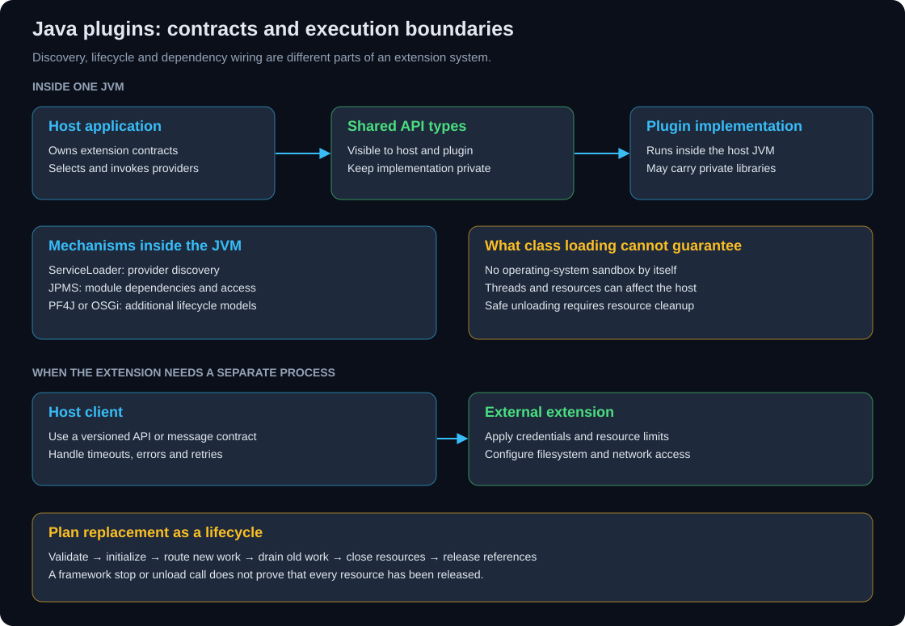
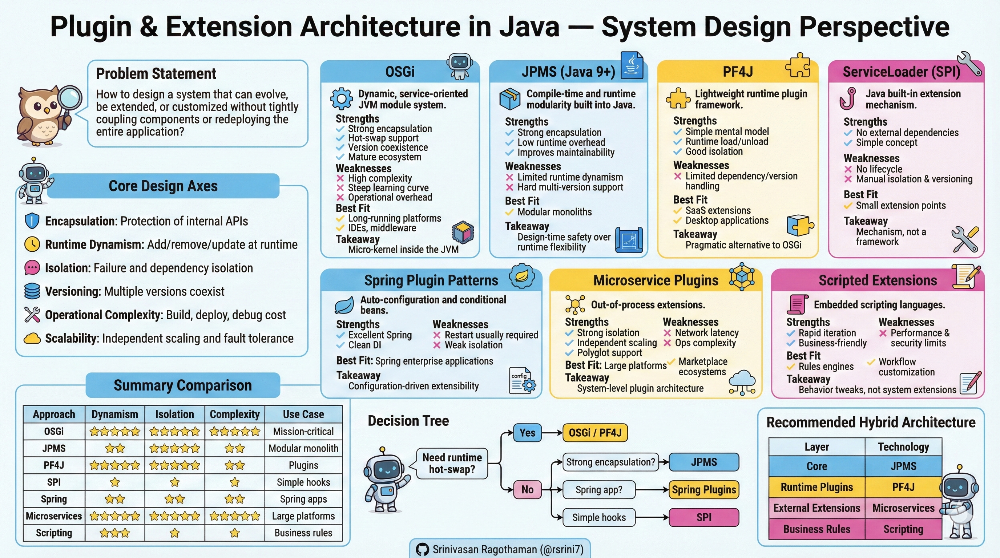

# Java Plugin Architecture: Discovery, Lifecycle and Isolation

**Learning note · Revised 15 November 2026 · Primary documentation checked**

> **Core idea:** A plugin system needs a stable host interface and clear rules for discovery, dependencies and lifecycle. A separate class loader can separate dependencies, but security and failure containment need stronger boundaries.

## 1. Foundations: the host and its extensions

A **host** is the application that owns the product's main behavior. A **plugin** supplies an implementation of an extension point, such as exporting a document, loading a data source or running a validation rule. The host calls a stable interface; the plugin implements it.

This resembles adding a new driver behind a common API. The host should not need to understand each provider's internal classes. The design becomes harder when plugins must be installed without restarting, carry conflicting library versions, or run code from parties the operator does not trust.

| Concern | Question to settle before choosing a framework |
|---|---|
| Contract | What methods, data types and errors may cross the extension boundary? |
| Discovery | How does the host find providers? |
| Lifecycle | When can a provider start, stop, update or release resources? |
| Dependencies | Which packages are shared, and which belong to a plugin? |
| Compatibility | Which host API versions can each plugin use? |
| Containment | Can plugin failure or misuse affect the host process? |

## 2. Architecture: choose the boundary first



*An in-process plugin shares the JVM with the host. An external extension crosses a protocol boundary, allowing separate resource controls and deployment.*

There are two main choices. **In-process extensions** can call Java interfaces directly and share runtime resources. **External extensions** communicate through an API or message protocol and can be deployed and limited separately. The latter adds network failures, serialization and authentication to the design.

The architectural recommendation here is to choose the boundary from the trust and failure requirements, then select the loading mechanism. A class loader alone does not prevent a plugin from using process resources, opening files or blocking application threads.

## 3. What the Java options actually provide

| Option | Documented mechanism | Good fit | What the host still owns |
|---|---|---|---|
| `ServiceLoader` | Finds implementations of a service interface using provider declarations on the class path or module path. | A few trusted, replaceable implementations. | Selection, lifecycle, compatibility and resource cleanup. |
| JPMS | Java's module system declares dependencies and controls exported and opened packages. | Explicit boundaries in a modular application. | Plugin installation policy and any runtime lifecycle. |
| PF4J | A plugin framework with extension discovery, plugin states and configurable class loading. | Applications needing packaged plugins and lifecycle operations. | Safe activation, shutdown, API compatibility and trust policy. |
| OSGi | A module framework with bundles, package wiring, lifecycle and a service registry. | Long-lived platforms needing a dynamic module and service model. | Application behavior during service changes and operational complexity. |
| Spring Boot auto-configuration | Creates and conditions application beans using configuration and class-path conditions. | Trusted extensions assembled into a Spring Boot application. | Deployment, dependencies and any runtime replacement design. |

Sources: [ServiceLoader API](https://docs.oracle.com/en/java/javase/25/docs/api/java.base/java/util/ServiceLoader.html), [JPMS: JEP 261](https://openjdk.org/jeps/261), [PF4J lifecycle](https://pf4j.org/doc/plugin-lifecycle.html) and [class loading](https://pf4j.org/doc/class-loading.html), [OSGi framework lifecycle](https://docs.osgi.org/specification/osgi.core/8.0.0/framework.lifecycle.html), [Spring Boot auto-configuration](https://docs.spring.io/spring-boot/reference/features/developing-auto-configuration.html).

These mechanisms can be combined. For example, a named module can declare a service provider, and `ServiceLoader` can discover it. A universal stack containing every framework is rarely justified by the extension requirements alone.

## 4. Discovery is different from replacement

For a simple trusted extension point, start with an interface and provider discovery:

```java
// The host and provider share this API type.
public interface DocumentExporter {
    String format();
    byte[] export(String document);
}
```

A host can discover declared providers using `ServiceLoader.load(DocumentExporter.class)`. Providers must be registered as described by the API: a `META-INF/services` file on the class path, or a `provides ... with ...` declaration in a named module. A host module also declares its use of the service. [Provider deployment rules](https://docs.oracle.com/en/java/javase/25/docs/api/java.base/java/util/ServiceLoader.html).

Calling `ServiceLoader.reload()` clears that loader's provider cache. It does not stop provider-created threads, close files, replace every live object or guarantee that old classes are unloaded. Similarly, a framework's stop/unload operation is a lifecycle capability, not proof that every application reference and resource has been released.

For runtime updates, design an explicit sequence:

1. Validate the candidate plugin's identity, API version and dependencies.
2. Create and initialize it without routing new work to it yet.
3. Switch new work at a defined point and drain work using the old instance.
4. Close the old plugin's resources and release references.
5. Record the result and retain a recovery path if activation fails.

This sequence is implementation guidance. Its details depend on the host and framework; “hot swap” should not be treated as an automatic guarantee of uninterrupted service.

## 5. Class loading: dependency separation has limits

PF4J's documented class-loading strategy normally searches plugin classes, plugin dependencies and the application, with special handling for Java and framework classes. The strategy is configurable. This supports dependency separation, but it does not make arbitrary library combinations compatible. [PF4J class loading](https://pf4j.org/doc/class-loading.html).

Put shared API types in a location visible consistently to both host and plugin. If the host and plugin load different copies of the same interface, Java can treat them as distinct types even when their package and class names match. Keep implementation libraries out of the public extension contract where possible.

| Tempting assumption | More precise interpretation |
|---|---|
| A plugin has its own class loader, so it is secure. | Class loading controls type visibility and loading. It is not an operating-system sandbox. |
| JPMS is a plugin manager. | JPMS provides module boundaries and service declarations; an application still needs an installation and lifecycle design. |
| Stop means fully unloaded. | Active threads, caches and host references can retain plugin objects or classes. |
| Multiple versions can always coexist. | Framework wiring, package rules and shared API types constrain what can coexist. |

For code with a different trust level, evaluate a separate process with restricted credentials, filesystem access, network access and resource limits. A process boundary creates a place to enforce those controls; the controls still need to be configured.

## 6. A practical selection and verification path

Use `ServiceLoader` when the need is simple provider discovery. Use JPMS when explicit module dependencies and package access are the main requirement. Evaluate PF4J or OSGi when lifecycle and dynamic dependency wiring justify a framework. In a Spring application assembled at deployment time, auto-configuration may already cover the extension need.

Before adopting runtime loading, build a small representative host and two providers. Check an incompatible API version, conflicting dependencies, a failed initialization, an in-flight call during shutdown and repeated replacement. Watch for retained threads, open connections and memory growth. `jcmd` can inspect a running JVM; begin with `jcmd <pid> help` and the [official tool reference](https://docs.oracle.com/en/java/javase/25/docs/specs/man/jcmd.html). A clean memory snapshot alone does not establish correctness under concurrent updates.

## 7. Source context

Reworked from collected repository notes. The mechanisms above were checked against the Java API and JPMS specification proposal, OSGi specification, PF4J documentation and Spring Boot documentation. The boundary and lifecycle recommendations are engineering guidance, not a comparative performance benchmark.

## 8. Supplementary visual



*Previously collected illustration, retained for reference. The revised explanation above distinguishes lifecycle, dependency separation and security boundaries.*

---

**Related:**
- [Project Detroit and Polyglot Runtimes](Project-Detroit-Java-Polyglot-Runtimes-Nov-2026.md) — Extends the discussion to native language runtimes and interoperation boundaries.
- [Java Remote Debugging](Java_remote_debug.md) — Explains how to inspect JVM behavior while diagnosing an extension host.
- [Workflow Orchestration](../Middleware/workflow-orchestration.md) — Covers durable coordination when extensions become independently deployed workers.
- [Kafka 4.0](../Middleware/kafka-4.0.md) — Provides an example of a JVM platform with brokers, clients and extensible integration components.
