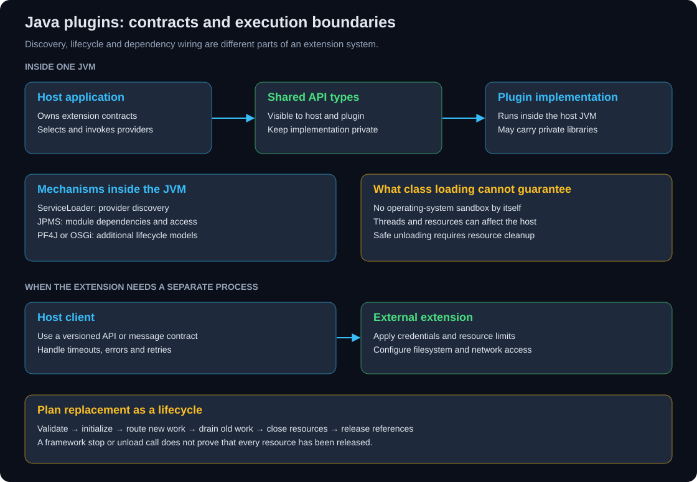
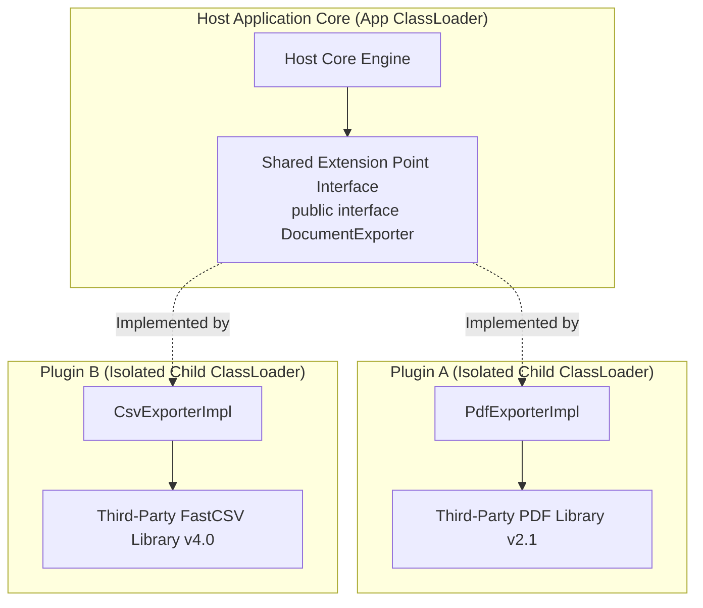
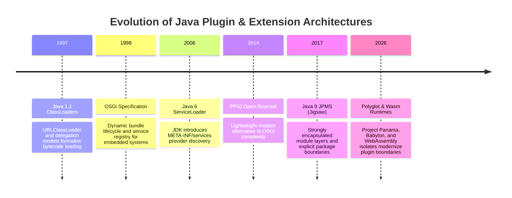
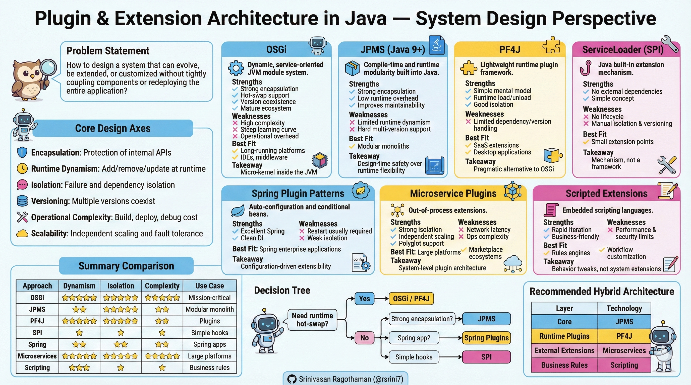

# Java Plugin Architecture: Dynamic Classloaders, Module Boundaries, and Process Isolation

Learning note · Revised November 2026 · JVM Extensibility &amp; Modular Systems Architecture  
*By Srinivasan Ragothaman ([@rsrini7](https://github.com/rsrini7))*

> **Core idea:** Building a reliable Java plugin system requires establishing strict boundaries between the host contract and dynamic extension implementations. While custom `URLClassLoader` hierarchies and JPMS modules provide dependency and type isolation, they do not create operating-system security sandboxes—demanding that untrusted extensions, resource limits, and crash resilience be handled via process isolation or WebAssembly runtimes.


*Figure 1: High-level architectural taxonomy comparing in-process classloader isolation against out-of-process protocol boundaries for dynamic Java extensions.*

---

## 1. Foundations: The Host, Extension Point, and Provider

A modular plugin architecture decouples an application core (the **Host**) from pluggable business features (the **Plugin / Extension**). The host defines and owns a public, stable interface (the **Extension Point**), while plugins compile against that interface and supply concrete implementations:



### The Three Fundamental Extensibility Challenges

1. **Dependency Hell (Jar Hell):** Plugin A depends on `commons-codec:1.15`, while Plugin B depends on `commons-codec:1.9`. If loaded on a single flat application classpath, the JVM's first-loaded class wins, causing silent binary incompatibility (`NoSuchMethodError` or `AbstractMethodError`).
2. **Lifecycle &amp; Unloading Leaks:** Installing, stopping, or updating plugins at runtime without restarting the JVM. If the host retains even a single reference to a plugin-instantiated class, the entire plugin `ClassLoader` and its associated Metaspace allocations leak permanently.
3. **Security &amp; Fault Containment:** A plugin running in-process can invoke `System.exit()`, consume 100% of the host CPU, exhaust the heap, or read arbitrary host filesystem memory. Classloaders control *type visibility*, not *system security*.

---

## 2. Deep Technical Mechanisms

### 2.1 The Java ClassLoader Delegation Hierarchy

The standard Java classloader model operates under **Parent-First (Upward) Delegation**:
1. When asked to load a class (e.g., `com.example.Service`), a classloader first delegates the request to its parent.
2. Only if the parent and all its ancestors return `ClassNotFoundException` does the child classloader attempt to find the class in its own local byte array/JAR.

```
       Bootstrap ClassLoader (C++ Native Core: java.base)
                ▲
                │
       Platform ClassLoader (JDK Extensions: java.sql, java.xml)
                ▲
                │
       System / App ClassLoader (Host Application Classpath)
                ▲
     ┌──────────┴──────────┐
     │                     │
Plugin-A ClassLoader   Plugin-B ClassLoader
(Child URLClassLoader) (Child URLClassLoader)
```

#### The Child-First (Plugin-First) Inversion
To resolve conflicting third-party dependencies, advanced plugin systems (such as PF4J or Apache Flink) implement **Child-First Classloading**:
- **Shared API Packages (`com.host.api.*`):** Always delegated to the parent System ClassLoader to ensure type identity compatibility.
- **Plugin Private Packages &amp; Dependencies:** Loaded locally by the plugin's child classloader, completely shielding the host and other plugins from version conflicts.

### 2.2 Framework Comparison Matrix

| Mechanism / Tool | Isolation Model | Dynamic Reloading | Security Boundary | Best Architectural Fit |
| :--- | :--- | :--- | :--- | :--- |
| **`java.util.ServiceLoader`** | Flat classpath / modulepath | No (Static bootstrap) | Zero (In-process) | Simple compile-time replaceable providers (e.g. SLF4J, JDBC drivers). |
| **Java Platform Module System (JPMS)** | Module encapsulation (`exports`/`opens`) | No (Static layer graph) | Module access rules | Strongly encapsulated enterprise modular applications. |
| **PF4J (Plugin Framework for Java)** | Custom child-first `PluginClassLoader` | Yes (Dynamic start/stop) | Zero (In-process) | Desktop IDEs, CLI tools, and modular server applications. |
| **OSGi (Equinox / Felix)** | Dynamic bundle wiring &amp; package graphs | Yes (Full bundle lifecycle) | Zero (In-process) | Legacy telecom platforms &amp; Eclipse IDE; very high cognitive complexity. |
| **Out-of-Process (gRPC / Subprocess)** | Operating System process sandbox | Yes (Process spawn/kill) | **High (OS cgroups &amp; IAM)** | Untrusted plugins, AI agents, polyglot scripting (Python/Node). |

---

## 3. Production Implementations & Code Recipes

### Child-First Isolated Plugin ClassLoader (Java 21+)

The following runnable Java implementation creates a custom `IsolatedPluginClassLoader`. It enforces child-first loading for plugin dependencies while strictly delegating the shared host API contract to the parent classloader, preventing both type collisions and `NoSuchMethodError` crashes.

```java
package com.host.plugins;

import java.io.IOException;
import java.net.URL;
import java.net.URLClassLoader;
import java.util.List;

/**
 * Child-First Isolated ClassLoader for Dynamic Java Plugins.
 * Ensures plugin-bundled libraries take precedence over host libraries,
 * while keeping the shared Extension Point contract unified.
 */
public class IsolatedPluginClassLoader extends URLClassLoader {

    private final ClassLoader parentClassLoader;
    // Shared packages that MUST be loaded by the parent host classloader
    private final List<String> sharedPackagePrefixes;

    public IsolatedPluginClassLoader(URL[] pluginJarUrls, ClassLoader parent, List<String> sharedPackages) {
        super(pluginJarUrls, null); // Set null parent to control delegation manually
        this.parentClassLoader = parent;
        this.sharedPackagePrefixes = sharedPackages;
    }

    @Override
    protected Class<?> loadClass(String name, boolean resolve) throws ClassNotFoundException {
        synchronized (getClassLoadingLock(name)) {
            // Check if the class has already been loaded by this classloader
            Class<?> loadedClass = findLoadedClass(name);
            if (loadedClass != null) {
                return loadedClass;
            }

            // Rule 1: Always delegate core JDK and shared API packages to parent
            if (isSharedOrJdk(name)) {
                return parentClassLoader.loadClass(name);
            }

            // Rule 2: Child-First Search (Look inside the plugin JAR first)
            try {
                Class<?> pluginLocalClass = findClass(name);
                if (resolve) {
                    resolveClass(pluginLocalClass);
                }
                return pluginLocalClass;
            } catch (ClassNotFoundException ignored) {
                // Not found in plugin JAR; fall back to parent classloader
            }

            // Rule 3: Fall back to host application classpath
            return parentClassLoader.loadClass(name);
        }
    }

    private boolean isSharedOrJdk(String className) {
        if (className.startsWith("java.") || className.startsWith("javax.")) {
            return true;
        }
        for (String prefix : sharedPackagePrefixes) {
            if (className.startsWith(prefix)) {
                return true;
            }
        }
        return false;
    }

    @Override
    public void close() throws IOException {
        super.close();
        System.out.println("[CLASSLOADER] Closed plugin classloader; resources released.");
    }
}
```

#### Shared API and Host Plugin Manager
```java
package com.host.plugins;

import java.io.File;
import java.net.URL;
import java.util.List;

public class PluginManager {

    // Define the contract interface that both host and plugins share
    public interface DocumentExporter {
        String getFormatName();
        byte[] exportDocument(String content);
    }

    public static DocumentExporter loadPlugin(File jarFile, String implClassName) throws Exception {
        URL[] urls = new URL[]{ jarFile.toURI().toURL() };
        List<String> sharedPackages = List.of("com.host.plugins.PluginManager$DocumentExporter");

        // Instantiate isolated classloader
        IsolatedPluginClassLoader loader = new IsolatedPluginClassLoader(
            urls,
            PluginManager.class.getClassLoader(),
            sharedPackages
        );

        // Load the implementation class from the isolated JAR
        Class<?> clazz = loader.loadClass(implClassName);
        Object instance = clazz.getDeclaredConstructor().newInstance();

        // Safe cast: Interface was resolved by the parent classloader
        return (DocumentExporter) instance;
    }

    public static void main(String[] args) {
        System.out.println("Plugin manager initialized. Shared API bound to Host ClassLoader.");
    }
}
```

---

## 4. Impact, Real-World Edge Cases & Gotchas

### Common Claims vs. Technical Realities

| Common Claim | Technical Reality | Systems Engineering Implication |
| :--- | :--- | :--- |
| **"A custom classloader sandboxes untrusted code."** | Classloaders only restrict class name resolution and bytecode visibility. A loaded plugin retains full access to `System.exit()`, native threads, memory allocation, and disk I/O. | Never use classloaders to sandbox untrusted third-party code. Use WebAssembly (e.g. Chicory) or out-of-process containers with Linux cgroups. |
| **"Unloading a plugin immediately frees Metaspace memory."** | A `ClassLoader` can only be garbage-collected if **zero** instances, static references, thread-locals, or active threads retain references to any class it loaded. | A single leaking thread or `ThreadLocal` retains the entire classloader in Metaspace, causing eventual `OutOfMemoryError: Metaspace`. |
| **"Identical class names with matching bytecodes are interchangeable."** | In Java, type identity is defined by the pair: `(Class Name, ClassLoader Instance)`. If the host and plugin load identical copies of `ExportService` through different classloaders, casting between them throws `ClassCastException`. | Always load shared contract interfaces strictly from the parent classloader. |
| **"JPMS completely replaces third-party plugin frameworks."** | JPMS provides static module layering and package encapsulation. It does not provide dynamic lifecycle operations (install, start, pause, rollback) without complex programmatic Layer manipulation. | Use `ServiceLoader` + JPMS for static modules; use PF4J for dynamic desktop/server plugins. |

---

## 5. Practical Adoption Blueprint & Verification Checklist

### 5.1 Architecture Decision Tree

```
How should your Java application handle extensions?
  │
  ├── Are extensions trusted, bundled at build time, and rarely modified?
  │     └── YES ──> Use java.util.ServiceLoader or Spring Boot Auto-Configuration
  │                 • Zero framework overhead; native JDK support
  │
  ├── Do plugins require dynamic runtime lifecycle (install/unload without restarts) by trusted teams?
  │     └── YES ──> Use PF4J (Plugin Framework for Java)
  │                 • Child-first classloading per plugin JAR
  │                 • Clean lifecycle states (CREATED, STARTED, STOPPED)
  │
  └── Are extensions submitted by untrusted third parties or written in multiple languages?
        └── YES ──> Run Out-of-Process via gRPC or WebAssembly (Wasm)
                    • Isolated memory and OS process limits (cgroups/Docker)
                    • Host process immune to plugin crashes or OOMs
```

### 5.2 Verification Checklist for Production Plugin Hosts

- [ ] **Metaspace Leak Audit:** Trigger 100 consecutive load/unload cycles of a plugin. Monitor Metaspace memory using `jcmd <pid> VM.metaspace` to confirm memory returns to baseline without leaking.
- [ ] **Thread Termination Hook:** Enforce that plugin `stop()` callbacks terminate all spawned executor services and worker threads.
- [ ] **Shared API Isolation:** Verify that the shared API module contains zero heavy third-party dependencies (e.g., keep Jackson, Guava, Netty out of the API JAR).
- [ ] **ClassCastException Defense:** Unit test classloading boundaries to ensure contract interfaces are never loaded by child plugin loaders.

---

## 6. Timeline and Evolution of JVM Extensibility



---

## 7. Primary Sources & References

### Official Specifications & Documentation

1. [Oracle: ServiceLoader API Specification](https://docs.oracle.com/en/java/javase/25/docs/api/java.base/java/util/ServiceLoader.html) — Standard provider-configuration and discovery mechanism in the Java standard library.
2. [JEP 261: Java Platform Module System (JPMS)](https://openjdk.org/jeps/261) — Formal specification for module boundaries, layer graphs, and encapsulated package access.
3. [PF4J: Plugin Framework for Java Documentation](https://pf4j.org/doc/class-loading.html) — Authoritative guide on plugin lifecycle management and child-first classloader hierarchies.
4. [OSGi Alliance: OSGi Core Release 8 Specification](https://docs.osgi.org/specification/osgi.core/8.0.0/) — Comprehensive specification of dynamic module systems and bundle lifecycle wiring.
5. [OpenJDK: JEP 454 — Foreign Function &amp; Memory API](https://openjdk.org/jeps/454) — Enables high-performance native interop without JNI classloader memory traps.

### Companion Architecture Notes

6. [Project-Detroit-Java-Polyglot-Runtimes-Nov-2026](Project-Detroit-Java-Polyglot-Runtimes-Nov-2026.md) — Architectural evaluation of running dynamic foreign runtimes (CPython, V8) inside the JVM.
7. [Java-Remote-Debugging-JDWP-And-Troubleshooting-2026](Java-Remote-Debugging-JDWP-And-Troubleshooting-2026.md) — Production diagnostic workflows for inspecting dynamic classloaders and Metaspace memory leaks.

---

## 8. Supplementary Visuals

The following visual documentation preserves the foundational architecture diagram detailing host/plugin classloader wiring:


*Figure 2: Previously collected architectural illustration detailing Java extension layers, retained for reference.*

---

**Related:**
- [Project-Detroit-Java-Polyglot-Runtimes-Nov-2026](Project-Detroit-Java-Polyglot-Runtimes-Nov-2026.md) — Extends the discussion to native language runtimes and interoperation boundaries.
- [Java-Remote-Debugging-JDWP-And-Troubleshooting-2026](Java-Remote-Debugging-JDWP-And-Troubleshooting-2026.md) — Explains how to inspect JVM behavior while diagnosing an extension host.
- [Workflow-Orchestration-And-Durable-Execution-Engines-2026](../Middleware/Workflow-Orchestration-And-Durable-Execution-Engines-2026.md) — Covers durable coordination when extensions become independently deployed workers.
- [Scaling-Java-Services-To-1-Million-RPS-2026](../Architecture/Scaling-Java-Services-To-1-Million-RPS-2026.md) — High-throughput capacity planning and zero-allocation patterns in modern JVM architectures.
- [Kafka-4.0-KRaft-Architecture-And-Migration-2026](../Middleware/Kafka-4.0-KRaft-Architecture-And-Migration-2026.md) — Provides an example of a JVM platform with brokers, clients, and extensible connector plugins.