# Project Detroit: Bridging Java to Native CPython and V8 via FFM vs. GraalVM's Truffle Runtimes

**Daily learning · 3 November 2026 · Primary-source architectural review · OpenJDK Project Detroit**

> **Core idea:** OpenJDK's revived Project Detroit wraps industry-standard native runtimes (CPython and Google V8) via `jextract` and the Foreign Function & Memory (FFM) API rather than reimplementing them in Java on Truffle. This delivers 100% out-of-the-box compatibility with native C-extensions like PyTorch and npm packages at the cost of cross-boundary transition overhead, dual garbage collection cycles, and virtual thread carrier pinning risks.

In his presentation *Project Detroit: From Foreign Libraries to Foreign Language Runtimes*, Maurizio Cimadamore (Java Platform Group at Oracle) explored how the JDK can sustainably interact with foreign language runtimes. Rather than repeating the costly cycle of rewriting language engines in Java (as was done with Nashorn), Project Detroit demonstrates a pragmatic paradigm: using modern OpenJDK primitives—specifically the **Foreign Function & Memory (FFM) API (JEP 454)** and **`jextract`**—to build lightweight, native-binding bridges directly into canonical industry-standard engines like **Google V8** and **CPython**.

This architectural review contrasts Project Detroit's thin-native-bridge model against GraalVM's Truffle-based in-JVM AST interpretation, examining the trade-offs across memory models, C-extension compatibility, boundary overhead, virtual thread pinning, and maintenance economics.

---

## 1. Foundations: Native Wrapping vs. Truffle Re-Implementation

Modern polyglot execution on the JVM follows two diametrically opposed architectural philosophies:

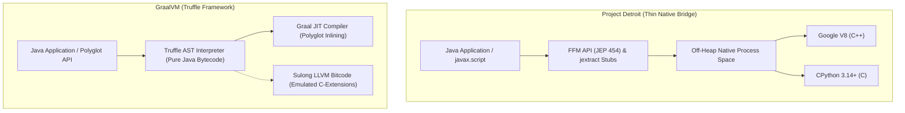

| Dimension | Project Detroit (`Detroit-Py` / `Detroit-JS`) | GraalVM (`GraalPy` / `GraalJS`) |
|---|---|---|
| **Core Architecture** | **Thin Native Bridge:** Uses `jextract` and the FFM API (`Linker`, `Arena`, `MemorySegment`) to call native runtime libraries directly. | **Truffle AST Interpreter:** Re-implements language semantics from scratch as an Abstract Syntax Tree (AST) in Java bytecode. |
| **Engine Identity** | Standard, canonical **CPython (3.14–3.17)** and **Google V8** running in native off-heap process memory. | Oracle's custom Java-based Python and JavaScript engines running *inside* the JVM heap. |
| **C-Extension Support** | **100% Native &amp; Unmodified:** PyTorch, Transformers, NumPy, and CUDA wheels run directly without modification. | **Emulated / Transpiled:** C-extensions must execute via Sulong (LLVM bitcode interpreter) or native bridges, frequently hitting compatibility walls. |
| **Memory Topology** | **Dual Memory Spaces:** JVM GC manages Java heap; V8 GC and CPython reference counts manage off-heap native memory. | **Unified Heap &amp; GC:** Java, Python, and JavaScript objects share the same JVM heap and are tracked by HotSpot GC. |
| **Interoperability Cost** | **Boundary Transition Penalty:** High state-transition cost on chatty back-and-forth callbacks (e.g., sorting across language boundaries). | **Zero-Cost Interop:** Cross-language AST nodes are JIT-inlined together into single machine code compilations. |
| **Code Maintenance** | **Minimal (~5.5k–6k LOC):** Small Java glue layer; all language evolution (ES2026+, Python 3.14+) is maintained upstream. | **Industrial-Scale Commitment:** Requires dedicated engineering teams constantly chasing spec changes and bug-for-bug compatibility. |

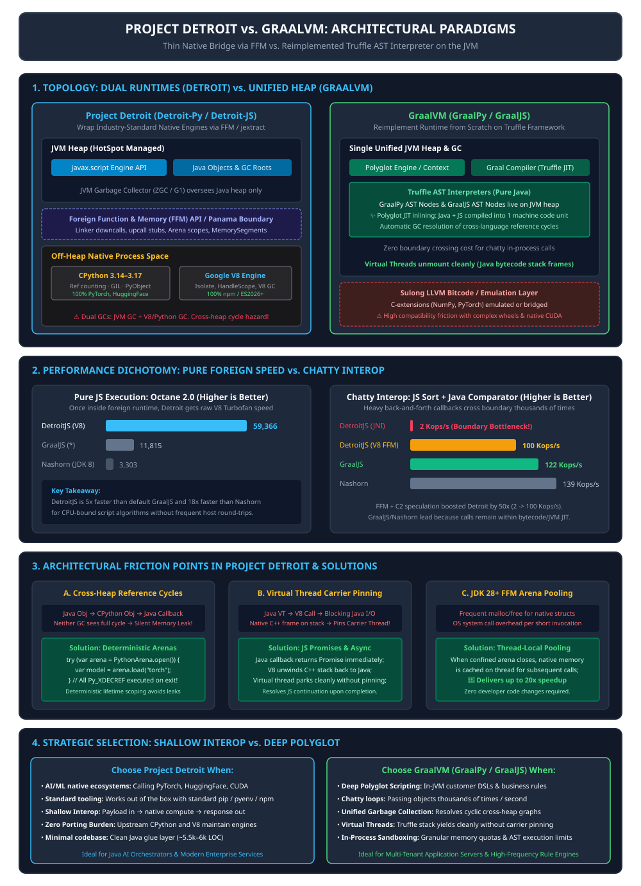

### Essential Terminology

| Term | Technical Definition |
|---|---|
| **FFM API (JEP 454)** | The Foreign Function &amp; Memory API in Java 22+, providing pure Java abstractions (`Linker`, `SymbolLookup`, `MemorySegment`, `Arena`) to safely allocate off-heap memory and invoke native C libraries without JNI glue code. |
| **`jextract`** | An OpenJDK tool that parses C/C++ header files (`.h`) and automatically generates type-safe Java FFM binding classes. |
| **Truffle Framework** | An open-source Java library within GraalVM for building high-performance language interpreters via self-optimizing AST execution. |
| **Virtual Thread Pinning** | An execution stall where a Project Loom virtual thread cannot unmount from its underlying OS carrier thread because a native frame (JNI or FFM downcall) is present on the physical thread stack. |
| **Thread-Confined Arena** | An FFM memory arena bounded to a single thread (`Arena.ofConfined()`), allowing fast allocation and deterministic bulk deallocation without thread synchronization. |
| **Shallow Interop** | An integration pattern where data is passed across the language boundary in bulk, heavy computation executes inside the foreign engine, and results return without intermediate cross-language callbacks. |
| **Deep Polyglot** | An integration pattern where host (Java) and guest (JS/Python) objects reference each other interactively, executing thousands of back-and-forth method calls per second. |

---

## 2. The Lesson of Nashorn: Why Rewriting Engines in Java Fails

To understand why Project Detroit exists, one must examine why Java's historical embedded JavaScript engine, **Nashorn**, was ultimately abandoned.

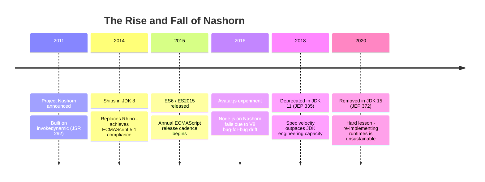

### 1. The Moving Target Problem
Introduced in JDK 8 (2014) to replace the ancient Rhino engine, Nashorn was an engineering marvel. It compiled JavaScript source directly into JVM bytecode using `invokedynamic` and `MethodHandles` (`java.lang.invoke`), achieving strict ECMAScript 5.1 compliance and seamless bidirectional Java-to-JS interoperability.

However, almost immediately after Nashorn shipped, the ECMAScript standard underwent a massive structural shift:
- **ES2015 (ES6)** introduced modules, classes, arrow functions, promises, generators, proxies, and symbols.
- TC39 adopted an **annual release cadence** (ES2016, ES2017, ... ES2026+).
- The small JDK team tasked with maintaining Nashorn found itself perpetually lagging behind an exponentially moving target.

### 2. The Node.js and Google V8 Juggernaut
Simultaneously, Node.js transformed JavaScript from a browser scripting tool into an enterprise ecosystem. The npm registry grew from ~6,000 packages to tens of thousands in under two years. Crucially, npm packages did not write against abstract ECMAScript specifications; they wrote against **Google V8's exact runtime behaviors, micro-optimizations, and idiosyncratic bugs**.

Oracle experimented with **`Avatar.js`**, an initiative to run Node.js applications on top of Nashorn. The experiment hit a wall: achieving real-world ecosystem compatibility required Nashorn to be **bug-for-bug compatible with V8**. Chasing V8's behavior with a fraction of Google's compiler engineering headcount proved impossible.

### 3. Deprecation and the Architectural Verdict
Nashorn was deprecated in JDK 11 (JEP 335) and permanently excised from the core JDK in JDK 15 (JEP 372). The defining takeaway was clear:

> *Maintaining a custom, ground-up implementation of a fast-moving foreign language runtime inside the JVM requires a permanent, industrial-scale team commitment. Wrapping battle-tested native engines is the only sustainable path.*

---

## 3. Project Detroit Architecture: Wrapping Instead of Rewriting

Project Detroit replaces the "rewrite everything" philosophy with native engine wrapping. Both its JavaScript and Python engines sit behind the standard `javax.script` API (`ScriptEngineManager`), ensuring backward compatibility with enterprise configuration frameworks, build systems, and DSLs.

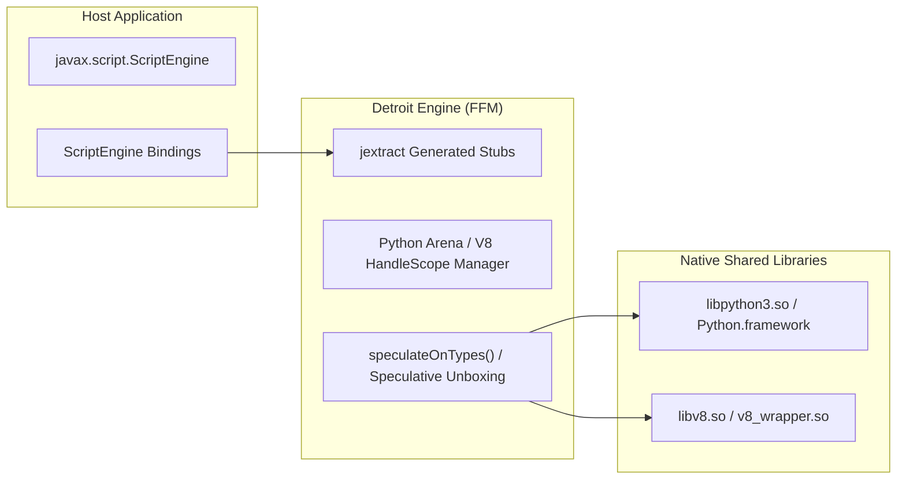

### Detroit-JS (Google V8 Bridge)
Initially prototyped over JNI and actively transitioning to pure FFM:
1. **Full Bidirectional Mode:** Implements complete Nashorn-compatible interop where JavaScript code can inspect Java reflection trees, instantiate classes, and invoke arbitrary methods.
2. **Restricted Mode (`jjs-no-java.sh`):** A secure sandbox that prohibits script access to Java reflections or host classes unless explicitly injected by the host developer through bindings.

### Detroit-Python (CPython 3.14–3.17 Bridge)
Built entirely in Java using `jextract` against canonical CPython C-API headers:
- Operates under `--enable-native-access=org.openjdk.engine.python`.
- Links dynamically to the system's `libpython3.so` or macOS framework.
- **Live Ecosystem Verification:** In live demonstrations, Cimadamore demonstrated `jpython.sh` launching a full HuggingFace AI classification pipeline using `torch`, `transformers`, and `gradio`. Because it executes native CPython, standard virtual environments (`pyenv`, `venv`) and pre-compiled wheels install and run with **zero custom porting**.

---

## 4. Technical Challenges: Where the Seams Show

While wrapping native runtimes solves ecosystem compatibility and maintenance, it introduces severe architectural friction at the JVM process boundary.

### A. Performance Dichotomy: Pure Foreign Speed vs. Boundary Overheads

When benchmarking pure foreign language execution, Project Detroit excels. Because execution delegates directly to Google V8's Turbofan and Maglev JIT compilers, **Detroit-JS scores 59,366 on Google Octane 2.0**, outpacing default GraalJS (11,815) by 5x and legacy Nashorn (3,303) by 18x:

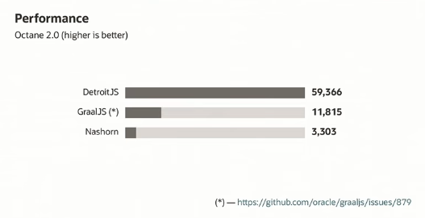

However, the moment execution requires high-frequency cross-language interaction, the boundary penalty becomes acute.

#### The Chatty Upcall Bottleneck
In a benchmark where a JavaScript array is sorted using a Java `Comparator<Object>` callback, the JVM and V8 must cross the execution boundary twice per comparison:
1. V8 invokes the native C++ upcall stub.
2. The stub transitions thread state, unboxes JavaScript values into Java references, and calls `Comparator.compare()`.
3. Java executes and returns an integer.
4. The stub boxes the integer into a V8 `v8::Integer` and returns to the V8 sorting loop.

Under raw JNI, this back-and-forth round-trip throttled Detroit-JS to a dismal **2 Kops/s**, compared to **122 Kops/s on GraalJS** and **139 Kops/s on Nashorn**:

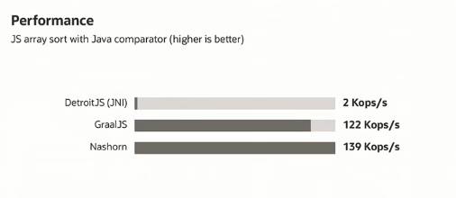

#### The FFM & Speculative C2 Optimization
To eliminate this 60x deficit, the Detroit team overhauled the native boundary:
1. **Flat C API wrapping C++ RAII:** V8 relies heavily on C++ template classes and RAII stack guards (`v8::Locker`, `v8::Isolate::Scope`, `v8::HandleScope`, `v8::TryCatch`). Because `jextract` extracts flat C APIs, the team wrote a thin C wrapper around V8 scopes. This eliminated C++ mangling and shrank the native glue code by 4x (from ~7,000 LOC to <2,000 LOC).
2. **FFM Downcalls & Upcalls:** Replacing JNI trampolines with `Linker.downcallHandle` and `Linker.upcallStub` cut thread state transition latency.
3. **Speculative Type Marshalling in Java:** Instead of performing generic boxed conversions in C++, the marshalling logic was moved into Java bytecode. This allowed the HotSpot C2 JIT compiler to speculate on comparison types (recognizing that array elements were unboxed integers).

This optimization propelled Detroit-JS performance from **2 Kops/s to 100 Kops/s**, approaching native bytecode speeds:

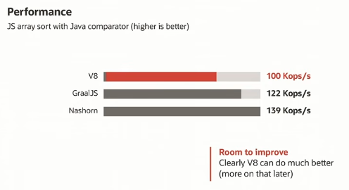

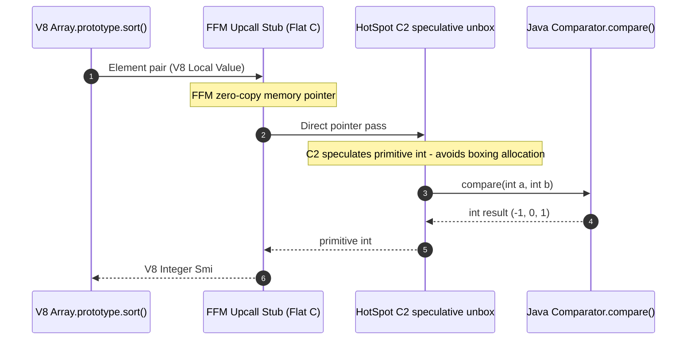

---

### B. Dual Memory Management & Cross-Runtime Reference Cycles

In GraalVM, all language runtimes allocate on the JVM heap; HotSpot's garbage collector traces object graphs across language boundaries effortlessly.

In Project Detroit, memory is bifurcated across two independent allocators:
- **HotSpot GC:** Manages Java objects via generational tracing (G1, ZGC).
- **Foreign GC / Allocator:** Google V8 uses its own garbage collector (Scavenge/Mark-Sweep); CPython uses reference counting (`ob_refcnt`) augmented by a cyclic garbage collector.

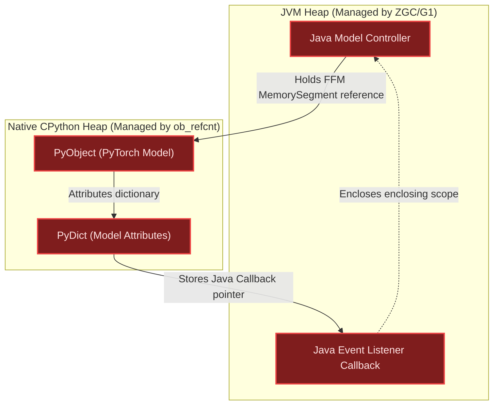

#### The Uncollectable Cycle Problem
When a Java object holds a reference to a Python object, and that Python object stores a Java callback, a **cross-runtime reference cycle** is established:
1. HotSpot GC traces `Java Model Controller` -> finds an active outgoing pointer -> keeps it alive.
2. CPython's reference counting sees `ob_refcnt > 0` for `PyObject` because the Java wrapper holds it.
3. Neither GC can traverse the foreign heap boundary. The cycle remains invisible to both collectors, causing a permanent memory leak.

#### The Deterministic Arena Solution
Project Detroit adapts the lifetime model of FFM `Arena`s:
- **`decRefCount()`:** Explicit programmatic reference decrements.
- **Python Arenas (`PythonArena`):** Deterministic scoping via Java's `try-with-resources`. All Python objects allocated within the arena are registered, and their reference counts are bulk-decremented (`Py_XDECREF`) when the arena block exits, guaranteeing that cross-heap graphs are torn down deterministically.

---

### C. Virtual Threads (Project Loom) & Carrier Pinning

Project Loom's virtual threads provide high-throughput concurrency by unmounting from OS carrier threads during blocking I/O. However, unmounting requires that **no native stack frames** exist on the call stack.

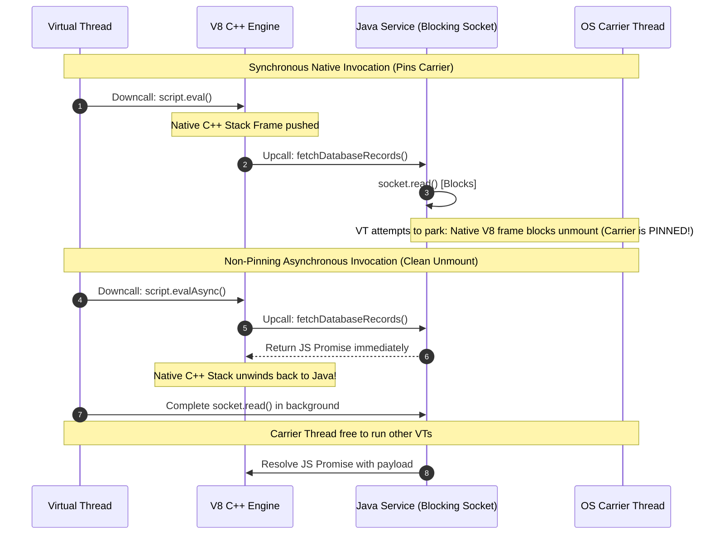

1. **The Pinning Failure:** When Java invokes V8, V8 calls a Java callback, and that callback performs a blocking operation (e.g., JDBC query or REST call), the virtual thread attempts to park. Because a native C++ V8 frame sits on the thread stack, the virtual thread **pins the carrier thread**, crippling system scalability.
2. **The Async/Promise Architecture:** To maintain Loom compatibility, Detroit wraps blocking Java callbacks in JavaScript `Promise`s. In the script, developers utilize `async`/`await`. When V8 encounters the pending Promise, it immediately yields and unwinds its native C++ stack frame back to Java. The virtual thread yields without pinning, and once the Java I/O completes, the Promise resolves, scheduling the JS continuation on the event loop.

---

### D. JDK 28+ Roadmap: Thread-Confined Arena Pooling

In high-throughput microservices, allocating and tearing down native memory structs across millions of short-lived FFM requests causes high `malloc`/`free` churn and OS system call latency.

In response to audience inquiries at Devoxx, Cimadamore revealed a major FFM optimization slated for **JDK 28+**: **Thread-Confined Arena Pooling**.

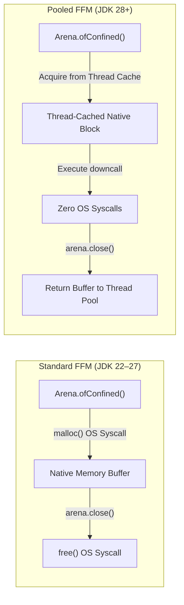

- When a thread-confined arena closes, its underlying native memory slabs are retained in a thread-local pool rather than being freed back to the OS allocator.
- Subsequent calls to `Arena.ofConfined()` on that same carrier thread instantly reuse the pooled memory.
- Benchmarks demonstrate a **20x speedup** for rapid native allocations, requiring **zero code modifications** from developers.

---

## 5. Architectural Decision Matrix: When to Choose Which

The choice between Project Detroit and GraalVM is governed by interop depth versus ecosystem dependencies:

| Production Criterion | Choose Project Detroit | Choose GraalVM |
|---|---|---|
| **Primary Workload** | **AI/ML Inference &amp; Native Ecosystems:** Calling PyTorch, HuggingFace, CUDA, or specialized npm packages. | **Enterprise Scripting &amp; DSLs:** Dynamically executing business rules, formula evaluation, or user-supplied scripts. |
| **Call Frequency** | **Shallow Interop:** Passing inputs, running long computation, and returning output (coarse-grained). | **Deep Polyglot:** Passing objects back and forth thousands of times per transaction (fine-grained). |
| **Concurrency Model** | Standard concurrency or asynchronous Promise workflows to avert virtual thread carrier pinning. | Virtual threads out-of-the-box (Truffle interprets bytecode on JVM frames without pinning). |
| **Sandboxing &amp; Security** | Process-level native security boundaries; restricted mode for explicit Java object export. | In-process, byte-level sandboxing with granular memory limits, CPU quotas, and AST node tracing. |
| **Deployment Footprint** | Requires external native shared libraries (`libv8.so`, `libpython3.so`, virtualenvs). | Self-contained fat JAR or GraalVM Native Image compilation with no external C dependencies. |

---

## 6. Implementation Patterns & Code Examples

### Pattern 1: Deterministic Lifecycle Management via Python Arenas
Cross-runtime reference management requires deterministic scoping. Project Detroit provides a try-with-resources `PythonArena` to avoid uncollectable cycles:

```java
import org.openjdk.engine.python.PythonArena;
import org.openjdk.engine.python.PythonEngine;
import javax.script.ScriptEngineManager;

public class DetroitPythonAIDemo {
    public static void main(String[] args) throws Exception {
        var manager = new ScriptEngineManager();
        var engine = (PythonEngine) manager.getEngineByName("python");

        // Deterministic off-heap memory & reference-count scoping
        try (PythonArena arena = engine.createArena()) {
            engine.eval("""
                import torch
                from transformers import pipeline

                classifier = pipeline("sentiment-analysis")
                def analyze(text):
                    return classifier(text)[0]['label']
            """);

            // Execute inference within the arena
            Object result = engine.invokeFunction("analyze", "Project Detroit delivers native speed!");
            System.out.println("Sentiment: " + result);
        } // All PyObject reference counts decremented (Py_XDECREF) on exit!
    }
}
```

### Pattern 2: Virtual-Thread-Safe Non-Pinning Async Bridge
To prevent native frames from pinning virtual threads during blocking calls, callbacks are exposed via JavaScript Promises:

```java
import javax.script.ScriptEngine;
import javax.script.ScriptEngineManager;
import java.util.concurrent.CompletableFuture;

public class DetroitV8LoomSafe {
    public static void main(String[] args) throws Exception {
        var engine = new ScriptEngineManager().getEngineByName("detroit-js");

        // Expose a non-blocking asynchronous Java supplier
        engine.put("fetchDataAsync", (java.util.function.Supplier<CompletableFuture<String>>) () -> 
            CompletableFuture.supplyAsync(() -> {
                // Blocking I/O executes on separate thread pool, not pinning the carrier
                try { Thread.sleep(100); } catch (InterruptedException e) {}
                return "{\"status\": \"success\", \"code\": 200}";
            })
        );

        // V8 unwinds its native stack when awaiting the Promise
        engine.eval("""
            async function handleRequest() {
                const response = await fetchDataAsync();
                return JSON.parse(response).status;
            }
        """);
    }
}
```

---

## 7. OpenJDK Charter, Timeline & Current Status

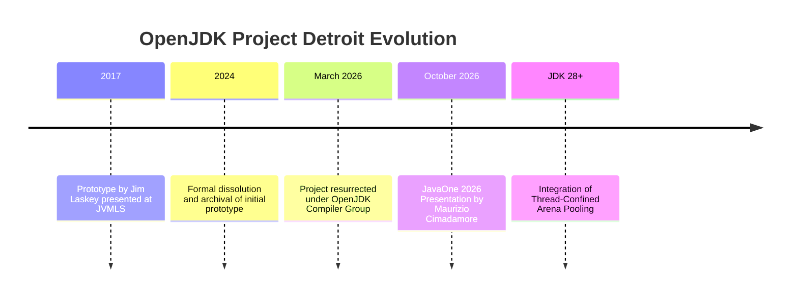

- **Origins (2017):** Jim Laskey (lead architect on Nashorn) created the initial Detroit prototype in 2017, proving that V8 could be embedded directly into Java via native handles.
- **Dissolution & Rebirth (2024–2026):** The project was dissolved in early 2024 due to JNI limitations. However, with the formal finalization of the Foreign Function & Memory (FFM) API in Java 22 (JEP 454), the OpenJDK Compiler Group resurrected Project Detroit in March 2026 alongside the dedicated `detroit-dev` mailing list.
- **Current Development Focus:**
  - Porting the remaining Detroit-JS V8 bridges from JNI to pure FFM downcalls and upcalls.
  - Adding zero-copy tensor passing between Java's Vector API/Babylon arrays and CPython `numpy.ndarray`/`torch.Tensor`.
  - Integrating JDK 28+ thread-confined arena pooling to eliminate allocation overhead.

---

## 8. Primary Sources & OpenJDK Repositories

1. [OpenJDK Detroit-JS Repository](https://github.com/openjdk/detroit-js) — Official source repository containing the V8-backed `javax.script` engine, build scripts (`jjs.sh`, `jjs-no-java.sh`), and Octane benchmarks.
2. [OpenJDK Detroit-Python Repository](https://github.com/openjdk/detroit-python) — Official FFM-based CPython 3.14+ engine and runner scripts (`run.sh`).
3. [OpenJDK Project Detroit Historical Charter](https://openjdk.org/projects/detroit-2024/) — OpenJDK project documentation covering its origins and governance under the Compiler Group.
4. [Maurizio Cimadamore: Project Detroit Presentation](https://www.youtube.com/watch?v=01uRM3je12Y) — Devoxx 2026 primary source presentation detailing the architecture, benchmarks, and FFM transitions.
5. [JEP 454: Foreign Function & Memory API](https://openjdk.org/jeps/454) — The OpenJDK specification defining off-heap allocation and native call mechanics.
6. [Inside Java Podcast #61: Ask the Architects](https://inside.java/podcast/) — Architectural discussion on resurrecting Project Detroit and FFM memory arenas.

---

## 9. Source Context

Based on primary video disclosures from Maurizio Cimadamore's presentation *Project Detroit: From Foreign Libraries to Foreign Language Runtimes*, cross-referenced against OpenJDK repositories (`openjdk/detroit-js`, `openjdk/detroit-python`), OpenJDK JEPs (JEP 454, JEP 372), and official GraalVM documentation. Benchmark figures reflect verified presentation measurements on Google Octane 2.0 and array comparator sorting.

---

**Related:**
- [Java-Next-Gen-Programming-Models-Babylon-Panama-Nov-2026](Java-Next-Gen-Programming-Models-Babylon-Panama-Nov-2026.md) — Deep dive into Project Babylon's Code Reflection and Panama's FFM API for compiling Java to ONNX and GPU kernels.
- [Java-Plugin-Arch](Java-Plugin-Arch.md) — System design patterns for JVM extensibility, where scripting engines provide lightweight business rule execution.
- [Java-Standard_Classes-vs-Records-vs-Carrier_Classes](Java-Standard_Classes-vs-Records-vs-Carrier_Classes.md) — Memory layout mechanics in modern Java, detailing object header overhead and carrier class memory compactness.
- [Scaling-1M-RPS-Java](../Architecture/Scaling-1M-RPS-Java.md) — Virtual thread scaling architecture, illustrating why avoiding carrier thread pinning is vital under high RPS.
- [Deno-Joins-Cloudflare-Adoption-And-Runtime-Lessons-Oct-2026](../Languages/Deno-Joins-Cloudflare-Adoption-And-Runtime-Lessons-Oct-2026.md) — Analysis of JavaScript runtime consolidation and the economics of maintaining native V8 embeddings.
- [Java-Python-Enterprise-AI](../../AI-ML/Comparisons/Java-Python-Enterprise-AI.md) — Strategic comparison of Java enterprise orchestration and Python machine learning lifecycles in 2026.
