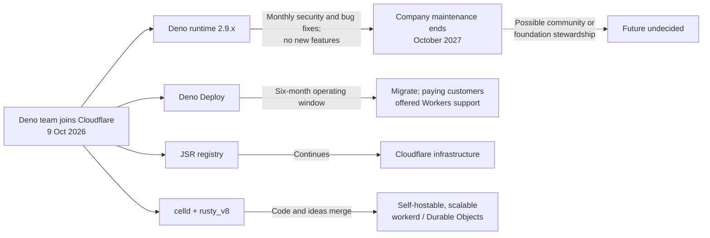
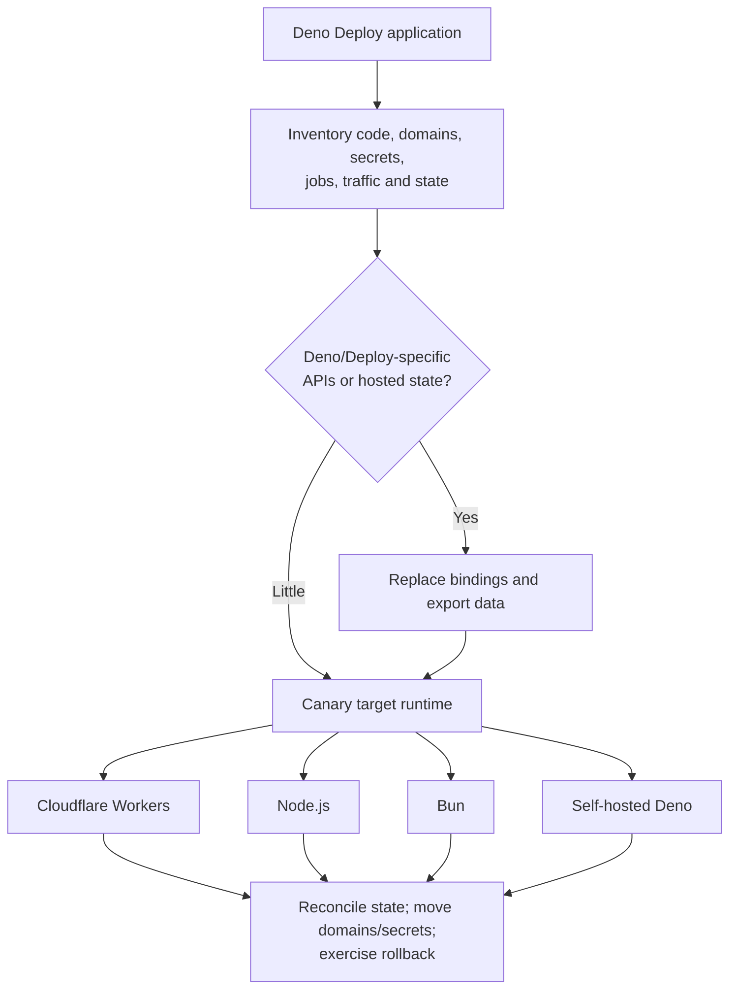

# Deno Joins Cloudflare: Real Adoption, Product Shutdowns and Runtime Lessons

**Daily learning · 24 October 2026 · Primary-source review · Transition in progress**

> **Core idea:** Deno's team has joined Cloudflare to work on self-hostable Workers and Durable Objects. Deno Deploy is closing, while the open-source runtime enters a maintenance period and Deno-derived platforms continue under their respective operators.

This note explains the transition, identifies organizations with publicly documented Deno use, and collects the strongest first-party reading for further research. It was inspired by the [source video](https://www.youtube.com/watch?v=nsZlZRZsg1k) and expanded with official announcements, documentation and public source repositories.

## 1. Foundations: “Deno” names several different things

| Layer | What it is | Why the distinction matters now |
|---|---|---|
| Deno runtime | The open-source JavaScript, TypeScript and WebAssembly executable, built around V8 and Rust. | The binary does not switch off with Deno Deploy. Company-led feature work has stopped, but maintenance continues through October 2027. |
| Deno Deploy | Deno's proprietary managed hosting service. | This is the product with the six-month shutdown window. |
| Deno KV | A key-value API backed locally by SQLite and, historically on Deploy, by FoundationDB. | Local/runtime use and hosted data are different dependencies; Deploy users need a data-migration plan. [Deno KV design](https://deno.com/blog/kv) |
| JSR | A TypeScript-first, cross-runtime package registry. | Deno says it will continue on Cloudflare infrastructure. |
| `rusty_v8` | Rust bindings for Google's V8 engine. | Deno says support continues and integration into Cloudflare's `workerd` is planned. |
| `celld` | Deno's open-source implementation of self-hosted, distributed Workers and Durable Objects. | Its code and ideas are moving into `workerd`; this is the work the Deno team is joining Cloudflare to pursue. |

Deno's original appeal combined native TypeScript, web-standard APIs, a deny-by-default permission model and built-in tools. The ecosystem constraint eventually pulled it toward Node: Deno 2 added deep npm, `package.json`, `node_modules` and CommonJS compatibility. That history is why “Node won” is directionally useful as an ecosystem observation, but too simple as a technical conclusion. [Deno 2](https://deno.com/blog/v2.0), [Node and npm compatibility](https://docs.deno.com/runtime/fundamentals/node/)

## 2. Current state and transition timeline

| Date or period | Development and consequence |
|---|---|
| **June 2022** | Deno raised a **$21 million Series A** after a $4.9 million seed round, funding its runtime, Deploy and developer-platform strategy. [Series A](https://deno.com/blog/series-a) |
| **May 2025** | Deploy contracted from 35 regions to six as cost and database locality weakened the original everywhere-at-the-edge thesis. [Strategy update](https://deno.com/blog/greatly-exaggerated) |
| **9 October 2026** | Deno's team joined Cloudflare to work on self-hosted Workers and Durable Objects; neither announcement disclosed the corporate structure or financial terms. [Deno](https://deno.com/blog/cloudflare), [Cloudflare](https://blog.cloudflare.com/deno-joins-cloudflare/) |
| **October 2026–October 2027** | Deno 2.9.x receives monthly bug and security fixes without new company-led features; later stewardship remains unresolved. [Runtime status](https://github.com/denoland/deno/issues/37030) |
| **Six-month transition** | Deno Deploy will shut down, with Workers migration support promised to paying customers but no exact final date or complete plan for every tier. [Deno announcement](https://deno.com/blog/cloudflare) |
| **Continuing** | JSR will operate on Cloudflare infrastructure under its published governance board, while its longer-term legal home and funding remain open. [Deno](https://deno.com/blog/cloudflare), [JSR governance](https://jsr.io/docs/governance) |
| **Future work** | Cloudflare plans to combine `celld` code and ideas with `workerd` for self-hosted Durable Objects rather than preserve Deno Deploy under another name. [Cloudflare plan](https://blog.cloudflare.com/deno-joins-cloudflare/) |

A Durable Object is a globally addressable, single-threaded unit that colocates compute with private persistent storage. New namespaces use a SQLite-backed storage model, WebSockets are supported, and applications scale by sharding work across many objects—for example, one object per chat room. [Cloudflare concept guide](https://developers.cloudflare.com/durable-objects/concepts/what-are-durable-objects/), [design rules](https://developers.cloudflare.com/durable-objects/best-practices/rules-of-durable-objects/)

Node remains the compatibility centre of the JavaScript ecosystem, but that does not make Deno's contribution disappear. Deno-derived runtimes continue to power services, JSR continues, and Deno's work on web APIs, secure-by-default execution, TypeScript and integrated tooling influenced the broader runtime market.

## 3. What is actually ending

The announcement affects three different layers that are easy to conflate:

1. **Deno runtime:** the open-source executable remains available. Deno/Cloudflare will provide maintenance—but no feature development—through October 2027. Community stewardship after that is undecided.
2. **Deno Deploy:** Deno's managed hosting service is closing after six months. This is the immediate migration risk for its direct customers. Deno Deploy Classic was a separate predecessor that had already been scheduled to shut down on 20 July 2026. [Classic migration guide](https://docs.deno.com/deploy/migration_guide/)
3. **Deno-based and Deno-compatible platforms:** these do not automatically shut down with Deploy. Netlify operates an edge runtime based on Deno; Supabase operates its own Deno-compatible Edge Runtime; Appwrite explicitly says its Deno containers do not depend on Deno Deploy. Their longer-term upgrade and security plans remain their own responsibility. [Netlify runtime documentation](https://docs.netlify.com/build/edge-functions/overview/), [Supabase Edge Runtime](https://github.com/supabase/edge-runtime), [Appwrite continuity statement](https://appwrite.io/blog/post/deno-deploy-alternative)

The diagram separates confirmed commitments from the dashed, unresolved stewardship path. The announcement gives Deno Deploy a duration, not an exact final date.

### Status of adjacent Deno projects and distribution channels

The October announcement explicitly commits only to the runtime maintenance window, Deploy shutdown, JSR continuity and `rusty_v8`; silence about another project is not a shutdown notice, but it is also not a support promise.

| Component | Verified status on 24 October 2026 | Practical reading |
|---|---|---|
| **Fresh** | Fresh moved to the independent `freshframework` GitHub organization in June 2026 so it could develop public governance; its maintainers said Deno contributors would continue where useful. [Maintainer announcement](https://github.com/freshframework/fresh/discussions/3830), [repository](https://github.com/freshframework/fresh) | Fresh remains active and separately governed, but the Cloudflare announcements made no Fresh-specific commitment. |
| **`deno compile`** | It remains documented and received a bug fix in the 21 October 2026 Deno 2.9.8 maintenance release. [`deno compile`](https://docs.deno.com/runtime/reference/cli/compile/), [2.9.8 release](https://github.com/denoland/deno/releases/tag/v2.9.8) | It is part of the maintained runtime, not a separately guaranteed product; no post-October-2027 roadmap was announced. Existing binaries embed `denort`, so rebuild and security-update plans still matter. |
| **Standard library (`@std`)** | Current packages are hosted on JSR; the older `deno.land/std` line remains available but Deno's migration policy directs new features to `@std` on JSR. [Standard Library repository](https://github.com/denoland/std), [move to JSR](https://deno.com/blog/std-on-jsr) | JSR's operation is explicitly continuing, but no separate October 2026 maintenance commitment for the `@std` packages was published. |
| **`deno.land/x`** | The service is already read-only: existing immutable modules remain available, but new packages and versions cannot be published; official guidance directs new packages to JSR. [`deno.land/x`](https://deno.land/x), [publishing guidance](https://docs.deno.com/runtime/packages/publishing/) | Continued availability is stated without a dated service guarantee, so active publishers should migrate to JSR. |

## 4. Organizations with documented Deno involvement

The table distinguishes a core production runtime from internal tooling and from merely offering Deno as an option. This avoids confusing SDK examples or logo walls with operational use.

| Organization | Evidence category | How Deno is used | Current state and sources |
|---|---|---|---|
| **Slack** | Managed production platform | Slack's “Run On Slack Infrastructure” hosts TypeScript workflow apps on an architecture built with Deno and AWS. | Slack's current developer documentation still names Deno as the managed runtime. [Architecture](https://docs.slack.dev/workflows/run-on-slack-infrastructure/), [Deno Slack SDK](https://docs.slack.dev/tools/deno-slack-sdk/) |
| **Netlify** | Managed production platform | Netlify Edge Functions execute customer code with the Deno runtime/API model and selected Node/npm compatibility. | On 29 September 2026 Netlify said execution had moved onto Unikraft microVMs in its own edge network, so this is not evidence of continued dependence on Deno Deploy. [Runtime API](https://docs.netlify.com/build/edge-functions/api/), [infrastructure update](https://www.netlify.com/blog/edge-functions-firecracker-microvms/) |
| **Supabase** | Deno-derived production runtime | Launched Edge Functions on Deno/Deno Deploy in March 2022, then open-sourced its own Rust server on `deno_core` for hosted, local and self-hosted functions. | Current docs describe a Deno-compatible Edge Runtime. [Launch](https://supabase.com/blog/supabase-edge-functions), [self-hosted runtime](https://supabase.com/blog/edge-runtime-self-hosted-deno-functions), [current docs](https://supabase.com/docs/guides/functions) |
| **Val Town** | Core production runtime | Moved its multi-tenant JavaScript/TypeScript execution platform from Node to Deno in March 2023; user “vals” run on Deno. | It upgraded the production runtime to Deno 2.9.6 in September 2026. [Migration](https://www.val.town/embed/x/valdottown/docs/pages/upgrading/upgrade-to-deno.md), [runtime docs](https://docs.val.town/reference/runtime), [2026 update](https://blog.val.town/changelog-2026-09-10) |
| **The Guardian** | Internal operational tooling | Runs Deno scripts daily in GitHub Actions to audit articles for accessibility defects and oversized media. | This does not mean Deno serves the Guardian website. [Case study](https://deno.com/blog/guardian), [audit script](https://github.com/guardian/dotcom-rendering/blob/main/scripts/deno/iframe-titles.ts) |
| **Plaid** | Internal operational tooling | Used Deno, TypeScript, `dax` and Jupyter notebooks for executable runbooks in a 100-service database migration. | This does not mean Deno serves Plaid's customer-facing API. [Deno case study](https://deno.com/blog/how-plaid-migrated-critical-services-with-deno), [Plaid account](https://engineering.plaid.com/cutting-over-our-journey-from-aws-aurora-mysql-to-tidb-d9b98e8d3b1c) |
| **Windmill** | Customer-code runtime | Used Deno to execute customer-authored TypeScript workflows with granular permissions and immutable scripts. | Deno remains selectable, although plain TypeScript now defaults to Bun. [Production account](https://deno.com/blog/immutable-scripts-windmill-production-grade-ops), [current runtimes](https://www.windmill.dev/docs/getting_started/scripts_quickstart/typescript) |
| **Deco.cx** | Framework plus Subhosting customer | Built its commerce platform with Deno, Fresh and Deno Subhosting to render storefronts at the edge. | Its speed and conversion results are company-reported; Subhosting continuity now needs confirmation. [Case study](https://deno.com/blog/deco-cx-subhosting-serve-their-clients-storefronts-fast), [repository](https://github.com/deco-cx/deco) |
| **Appwrite** | Ecosystem/platform support | Offers Deno versions as isolated Function runtimes and Sites build runtimes. | Customer-code support is not evidence that Appwrite's backend is Deno; Appwrite says these containers are independent of Deploy. [Runtime list](https://appwrite.io/docs/products/functions/runtimes), [Deploy response](https://appwrite.io/blog/post/deno-deploy-alternative) |
| **Stripe** | Ecosystem/SDK support only | `stripe-node` documents a Deno import path and ships a Deno webhook example. | No cited Stripe source identifies an internal Stripe production service running on Deno. [`stripe-node` usage](https://github.com/stripe/stripe-node#usage-with-deno), [webhook example](https://github.com/stripe/stripe-node/blob/master/examples/webhook-signing/deno/main.ts) |
| **tea / pkgx** | Historical product tooling | The original tea CLI was written in TypeScript, distributed with `deno compile`, and built with Deno scripts. | The main pkgx binary is now Rust, although related tools still use Deno. [Founder account](https://deno.com/blog/tea-simplifies-distributing-software), [`pkgm` source](https://github.com/pkgxdev/pkgm/blob/main/pkgm.ts) |

SDK support, publishing a package on JSR and running a business workload on Deno are three different forms of ecosystem participation. Keeping them separate makes the adoption picture more useful.

## 5. The more useful business story

The evidence supports a more interesting explanation than “good runtime lost to bad runtime”:

- **Compatibility was the adoption bottleneck.** Deno's 2024 survey said missing Node/npm and framework compatibility could be a non-starter. Deno 2 therefore adopted `package.json`, `node_modules`, CommonJS and npm compatibility while keeping its TypeScript, permissions and web-API model. In Deno's own 4,457-test Node harness, it reported the pass rate rising from roughly 42% for Deno 2.7 to 3,405 of 4,457 tests (76.4%) for Deno 2.8; that is a same-harness trend reported by Deno, not proof of complete Node compatibility. [Survey and roadmap](https://deno.com/blog/2024-survey-results-and-roadmap), [Deno 2](https://deno.com/blog/v2.0), [Deno 2.8](https://deno.com/blog/v2.8)
- **The original edge-hosting thesis changed.** In May 2025, Ryan Dahl wrote that Deploy had shrunk from 35 regions to six partly because of cost and because most applications were full-stack services located near a regional database, not stateless functions benefiting from every edge location. That is a direct product-learning signal, not proof that the runtime technology failed. [Strategy response](https://deno.com/blog/greatly-exaggerated)
- **The commercial product was the vulnerable layer.** The runtime is permissively licensed and embeddable, which allowed Supabase, Netlify, Slack, Val Town and others to use it in different ways. The proprietary hosting service depended on Deno the company continuing to operate it.
- **The corporate structure is undisclosed.** The first-party announcements say that the Deno team is “joining Cloudflare,” but do not say whether Cloudflare bought shares, assets, intellectual property or some other combination, and they disclose no price or terms. [Deno announcement](https://deno.com/blog/cloudflare), [Cloudflare announcement](https://blog.cloudflare.com/deno-joins-cloudflare/)
- **Interpretation, not disclosed fact:** Cloudflare's stated technical destination suggests the team's runtime, multi-tenant execution and distributed-state experience is strategically important, especially for combining `celld` ideas and code with `workerd`; that interpretation should not be restated as a claim about what Cloudflare legally purchased.
- **Maturity still matters.** Deno's eventual embrace of Node compatibility is evidence that ecosystem access, libraries, operational familiarity and migration cost can outweigh a cleaner greenfield design. It does not prove that Node is technically superior in every workload.

## 6. Practical response: first identify which Deno dependency you have

| Your dependency | What to do now | Urgency |
|---|---|---|
| App hosted directly on Deno Deploy | Inventory source, build settings, domains, secrets, traffic, scheduled jobs and rollback needs. Test a replacement behind a staging or canary path before the six-month window closes. Paying customers should use the promised migration support. | **High** |
| Hosted Deno KV, queues, cron or other Deploy state | Document data volume, consistency assumptions and export/replay needs. Copy recoverable data early and ask support for the product-specific migration procedure; the announcement does not yet define one. | **High** |
| Deno Subhosting v2 or Deno Sandbox | Ask Deno for a written continuity and export plan now: Deno describes Subhosting as using the same infrastructure as Deploy, while Sandbox is documented as microVMs in the Deno Deploy cloud and may include volumes, snapshots, tokens and deployed tenant code. Inventory every tenant and persistent artifact before choosing a replacement. [Subhosting](https://deno.com/subhosting), [Sandbox architecture](https://deno.com/blog/introducing-deno-sandbox) | **High** |
| Self-hosted Deno runtime | Stay on the monthly 2.9.x maintenance line, follow security releases, test a Node-compatible or other fallback, and decide who owns runtime risk after October 2027. There is no immediate service shutdown. | **Medium** |
| Embedded `deno_core` or a vendor's Deno-derived runtime | Ask the vendor who will maintain V8, TypeScript and security updates. A provider-controlled fork is operationally different from depending on Deno Deploy. | **Medium** |
| Packages consumed from JSR | No migration has been announced. Keep lockfiles and reproducible builds, while tracking JSR's governance and infrastructure transition. | **Low today** |
| Slack, Netlify, Supabase, Val Town or another managed product | Follow that provider's roadmap. Do not assume Deno Deploy's closure automatically closes a separately operated runtime, and do not assume silence guarantees support after 2027. | **Provider-dependent** |

### Migration targets are not interchangeable

Effort is a relative starting estimate for a typical HTTP/TypeScript service; `Deno.*` APIs, native npm modules, background jobs and hosted state can change it substantially.

| Target | Likely application effort | Replacement for Deploy-hosted state | Permission and isolation model |
|---|---|---|---|
| **Cloudflare Workers** | **Medium–high:** Web APIs overlap, but handlers, bindings, limits and unsupported Deno/Node APIs require testing; Workers implements only a defined Node subset. [Runtime APIs](https://developers.cloudflare.com/workers/runtime-apis/), [Node compatibility](https://developers.cloudflare.com/workers/runtime-apis/nodejs/) | Choose by semantics: Workers KV, SQLite-backed Durable Objects, D1, R2 or an external database; this is a data-model migration, not a name change. [Storage options](https://developers.cloudflare.com/workers/platform/deploy-buttons/#automatic-resource-provisioning) | Hosted isolates plus capability-style APIs and process sandboxing; application code does not receive host filesystem or direct network access. [Security model](https://developers.cloudflare.com/workers/reference/security-model/) |
| **Node.js** | **Medium:** npm dependencies are usually the easiest fit, but Deno namespaces, URL imports, TypeScript execution assumptions and Deploy bindings need replacements. | Use the application's normal database, Redis-compatible store or SQLite; export and consistency design remain workload-specific. | Node's stable permission model is opt-in with `--permission`; otherwise rely on the process, OS, container and cloud controls. [Node permissions](https://nodejs.org/download/release/v26.7.0/docs/api/permissions.html) |
| **Bun** | **Medium:** TypeScript and much Node-compatible code transfer, but Deno APIs, permission flags and Deploy bindings do not. | Use an external database, Redis-compatible store or SQLite according to required semantics. | Bun's runtime documentation does not specify a Deno-style deny-by-default capability model; plan OS/container isolation for untrusted code. [Bun runtime](https://bun.sh/docs/runtime) |
| **Self-hosted Deno** | **Low code change, high operations:** run `deno serve`, a container or a `deno compile` binary, while taking responsibility for deployment and the post-October-2027 runtime plan. [Self-hosting](https://docs.deno.com/runtime/deploy/) | Local `Deno.openKv()` uses SQLite; distributed Deploy KV, queues and cron need independently operated substitutes. [Deno KV](https://docs.deno.com/deploy/kv/) | Preserves Deno's deny-by-default, resource-scoped `--allow-*`/`--deny-*` model; host isolation is still needed for hostile native code. [Deno permissions](https://docs.deno.com/runtime/reference/permissions/) |

A quick audit should search deployment configuration and code for `deno deploy`, `Deno.openKv`, `*.deno.net`, Deploy/Subhosting API calls, queues and cron declarations. Verification is complete only when the replacement serves real test traffic, state has been reconciled, domains and secrets have moved, and rollback has been exercised.

## 7. Best first-party reading list

Read these in order for a well-grounded follow-up article:

1. [Deno is joining Cloudflare](https://deno.com/blog/cloudflare) — definitive product-support and shutdown commitments.
2. [Cloudflare's joint Deno announcement](https://blog.cloudflare.com/deno-joins-cloudflare/) — the technical reason for combining `celld` and `workerd` and the exact self-hosting gap.
3. [The state of Deno after the Cloudflare announcement](https://github.com/denoland/deno/issues/37030) — the maintainer's concrete monthly-maintenance policy through October 2027 and no-feature-work rule.
4. [Reports of Deno's Demise Have Been Greatly Exaggerated](https://deno.com/blog/greatly-exaggerated) — unusually candid pre-transaction context on Deploy's cost/usage mismatch, KV's limits and Deno's platform strategy.
5. [Announcing Deno 2](https://deno.com/blog/v2.0) and [Deno 2.8](https://deno.com/blog/v2.8) — how compatibility became central and how far the runtime moved toward Node.
6. [JavaScript Containers](https://tinyclouds.org/javascript-containers/) — Ryan Dahl's 2022 architectural thesis connecting Deno Deploy, Workers and the later `celld` direction.
7. [`celld`](https://github.com/denoland/celld), [`workerd`](https://github.com/cloudflare/workerd) and [JSR governance](https://jsr.io/docs/governance) — the open-source integration targets and the registry's governance baseline.

## 8. Open questions worth tracking

- What corporate or contractual structure underlies the team joining Cloudflare, and will any financial terms be disclosed?
- Will the Deno runtime move to a foundation or obtain funded maintainers after October 2027?
- What is the exact Deno Deploy shutdown date, and what migration help will free-tier and Subhosting customers receive?
- Will JSR's legal home and funding move to a foundation, or will Cloudflare become its long-term operator?
- Which `celld` capabilities and compatibility guarantees will land in `workerd`, on what timeline, and under what support model?
- How will independent Deno embedders handle V8, TypeScript, security and Node-compatibility updates after company-led feature development stops?

## 9. Source context

Inspired by the user-shared details and developed through Deno, Cloudflare and JSR announcements, vendor documentation and public source repositories. Performance and business outcomes from company case studies are presented as company-reported figures.

**Related runtime landscape:** Anthropic's [Bun announcement](https://www.anthropic.com/news/anthropic-acquires-bun-as-claude-code-reaches-usd1b-milestone) and [Bun's account](https://bun.com/blog/bun-joins-anthropic) document a different commercial outcome for another JavaScript runtime; they do not establish Deno's transaction structure.

---

**Related:**
- [cloudflare-down-nov-2025](../../News/Outages/cloudflare-down-nov-2025.md) — operational context for depending on Cloudflare's platform.
- [Node.js-Async-Hooks-DoS-Vulnerability](../../News/Security/Node.js-Async-Hooks-DoS-Vulnerability.md) — Node.js runtime security and maintenance context.
- [PHP-Migration-Static-React-Java-And-Go-Oct-2026](../Architecture/PHP-Migration-Static-React-Java-And-Go-Oct-2026.md) — another case where ecosystem maturity and migration cost shape runtime choices.
- [WASM-Rust](WASM-Rust.md) — related runtime and portable-execution foundations.
