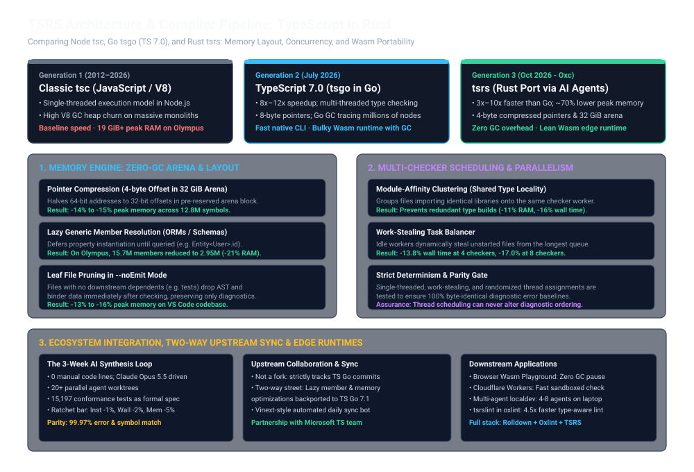
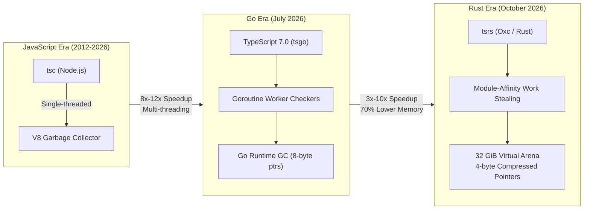
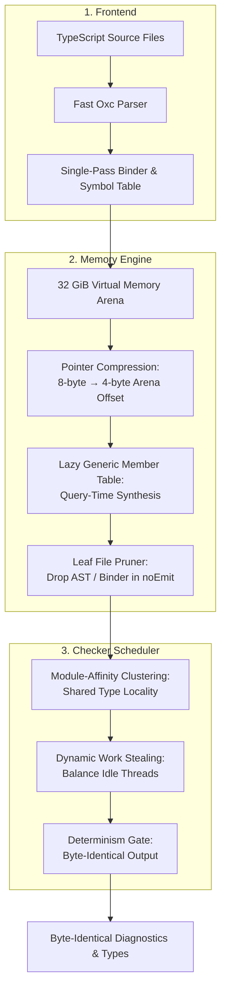
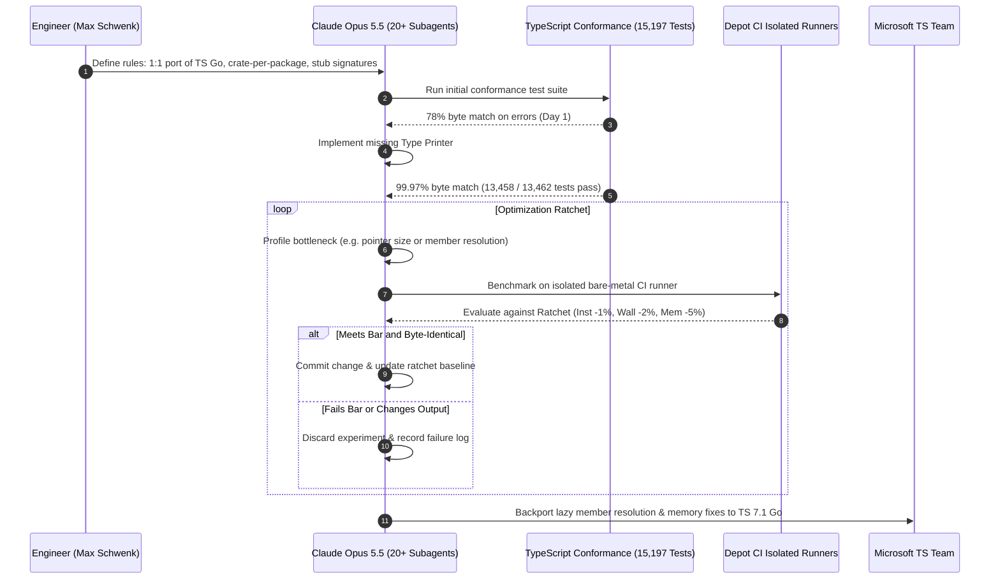

# TypeScript Ported to Rust: Inside tsrs, the 3x-to-10x Speedup Over Go, and the AI Compiler Frontier

**Daily learning · 5 November 2026 · Primary-source review · Systems Architecture**

> **Core idea:** Microsoft rewrote the TypeScript compiler in Go (TypeScript 7.0 / Project Corsa) to escape Node.js single-threaded constraints. In October 2026, an experimental port of that compiler to Rust—**`tsrs`**—was synthesized in three weeks using autonomous AI coding agents (Claude Opus 5.5). Incubated under the **Oxc** project alongside Cloudflare and VoidZero, `tsrs` achieves an additional 3x to 10x speedup and ~70% lower memory usage via 4-byte pointer compression, lazy generic member resolution, module-affinity work stealing, and zero-GC linear memory that compiles natively to WebAssembly.

This research note breaks down the architectural evolution, memory layout innovations, multi-agent synthesis methodology, and ecosystem impact of `tsrs`. It begins with the Better Stack technical overview ([source video](https://www.youtube.com/watch?v=Quf05tmWjaQ)) and expands across primary disclosures from Owner.com, Cloudflare, VoidZero, Oxc, and the Microsoft TypeScript compiler team.



---

## 1. Foundations: The Three Compiler Generations and Key Players

To understand why `tsrs` exists and why its performance numbers matter, one must first distinguish the three distinct generations of the TypeScript compiler toolchain.

### The Three Compiler Generations

| Generation | Era / Release | Implementation | Concurrency & Execution | Memory Model | WebAssembly Story |
|---|---|---|---|---|---|
| **Gen 1: `tsc`** | 2012 – July 2026 | JavaScript / TypeScript (Node.js runtime) | Single-threaded event loop | V8 GC heap; high allocation churn on large symbol graphs | Compiles via JS bundle; heavy memory footprint |
| **Gen 2: `tsgo`** | July 2026 (TS 7.0, *Project Corsa*) | Go (Microsoft official port) | Multi-threaded checker pools; Goroutines | Go runtime GC; 8-byte 64-bit pointers for all AST/type references | Bulky Wasm binary embedding full Go GC & runtime scheduler |
| **Gen 3: `tsrs`** | October 2026 (Oxc incubation) | Rust (AI-synthesized port of Go codebase) | Module-affinity clustering + dynamic work stealing | 32 GiB pre-reserved arena; 4-byte compressed pointers; zero-GC RAII | Lean linear-memory Wasm; runs natively in browser & edge workers |

### Key Organizations and Roles

| Party / Person | Role in Ecosystem | Primary Contribution / Perspective |
|---|---|---|
| **Microsoft TypeScript Team**<br/>*(Anders Hejlsberg, Jake Bailey, Daniel Rosenwasser)* | Language author & spec custodian | Developed TypeScript 7.0 (Go port); maintains the authoritative 15,197 conformance test cases; collaborates with `tsrs` maintainers and upstreamed performance patches into TS 7.1. |
| **Max Schwenk & Owner.com** | Author of `tsrs` / Head of AI DX | Directed Claude Opus 5.5 across 20+ parallel worktrees to port the Go compiler to Rust in 3 weeks, solving severe memory bloat on Owner's 37,000-file monolith (*Olympus*). |
| **Cloudflare**<br/>*(Christoph Nakazawa, Dimitri Mitropoulos)* | Co-sponsor & edge platform operator | Sponsoring `tsrs` development; bringing TypeScript compilation and type-checking to Cloudflare Workers and client-side sandboxes via zero-GC WebAssembly. |
| **VoidZero & Oxc Project**<br/>*(Evan You, Boshen Chen)* | High-performance JS toolchain & project host | Incubating `tsrs` under `oxc-project`; unifying the parser, linter (`oxlint`), bundler (`rolldown`), and type-checker (`tsrslint`) under a shared Rust memory graph. |
| **Theo Browne (`tsc-rs`)** | Independent compiler developer | Built an early parallel TypeScript Rust port; merged efforts with `tsrs` and Oxc to unify Language Server Protocol (LSP) and compiler execution. |

---

## 2. Historical Context: Why Microsoft Chose Go for TypeScript 7.0

For 14 years, `tsc` was self-hosting in JavaScript. While self-hosting made TypeScript easy for web developers to contribute to, enterprise monorepos eventually outgrew single-threaded V8 execution:

1. **V8 Heap Saturation:** Single-process Node.js heaps struggled when symbol tables and abstract syntax trees (ASTs) climbed into the tens of millions of objects, causing frequent garbage collection pauses.
2. **Lack of Shared-Memory Multithreading:** Node worker threads communicate via structured cloning or shared array buffers; sharing complex recursive type graphs across workers in pure JS required expensive serialization.

In July 2026, Microsoft released TypeScript 7.0 (*Project Corsa*), porting `tsc` entirely to **Go**:



Microsoft selected Go over Rust for several deliberate reasons:
- **GC Parity with TypeScript:** TypeScript's internal data structures are deeply cyclic, self-referential graph nodes. Mapping cyclic graphs to Go's garbage-collected pointers is structurally direct, whereas doing so in safe Rust requires complex arenas, generational indices, or explicit lifetimes.
- **Fast Developer Iteration:** Go compiles quickly, has a simple specification, and allowed Microsoft's compiler team to maintain a 1:1 structural correspondence with the original TypeScript codebase.

TypeScript 7.0 delivered an immediate **8x to 12x speedup** over JS `tsc`. However, at the extreme scale of enterprise monorepos and parallel agent development, Go's memory model revealed distinct ceilings.

---

## 3. The Memory Wall: Why Go Hit Limits on Massive Codebases

At Owner.com, the backend monolith (*Olympus*) contains ~37,000 TypeScript files typechecked as a single unified `Program`. Under TypeScript 7.0:
- A single-threaded typecheck consumed **19 GiB of RAM** and took **80 seconds**.
- Running `tsgolint` (which spins up its own checker backend) doubled memory usage.
- Adding language servers and developer environments pushed total workstation consumption past **50 GiB**.

On a 36 GiB developer workstation or cloud sandbox, engineers could not run multiple autonomous coding agents in parallel without triggering out-of-memory (OOM) kernel panics.

### Three Inherent Bottlenecks in the Go Implementation

1. **64-bit Pointer Bloat:** Every node, symbol, type parameter, and scope binding in Go holds standard 8-byte machine pointers. In a graph with tens of millions of objects, pointer addresses alone account for gigabytes of heap overhead.
2. **GC Tracing Overhead:** The Go runtime garbage collector must periodically mark and sweep millions of small heap allocations. Even with concurrent mark-sweep, scanning a 20+ GiB heap with millions of references degrades CPU cache efficiency.
3. **WebAssembly and Edge Inefficiency:** Compiling Go to WebAssembly embeds Go's runtime, scheduler, and garbage collector into the Wasm binary. This creates substantial binary footprints and poor memory interaction across the host/guest boundary—severely limiting in-browser execution and edge sandboxing on Cloudflare Workers.

---

## 4. Technical Mechanism: Inside the `tsrs` Optimization Engine

`tsrs` did not achieve its 3x to 10x performance gains through rewriting algorithms from scratch. Instead, it enforced strict 1:1 algorithmic fidelity with Microsoft's Go compiler while replacing Go's generic memory model with custom, systems-level Rust memory architectures.



### 1. Pointer Compression (4-byte Arena Offsets)

In standard 64-bit architectures, pointers consume 8 bytes. However, `tsrs` reserves a contiguous 32 GiB virtual address space upfront using virtual memory mapping (`mmap`).

Because all compiler allocations live inside this single block, an object does not need a full 64-bit memory address; it only needs a 32-bit offset relative to the arena's base address:

$$
\text{VirtualAddress} = \text{ArenaBase} + (\text{Offset}_{32} \ll \text{Scale})
$$

- **Memory Impact:** Halves pointer sizes across 12.8+ million `Symbol` structs, saving **14% to 15% peak memory** (nearly 500 MB on symbols alone).
- **CPU Trade-off:** Requires a simple base addition when dereferencing, adding ~6.5% CPU instructions, but the massive reduction in memory footprint and L3 cache misses nets a large overall speedup.

### 2. Lazy Member Resolution for Generic Types

Modern TypeScript applications make heavy use of complex generic types, particularly in database ORMs like Drizzle, Prisma, or MikroORM. An entity type may define dozens or hundreds of columns and relations:

```typescript
type UserEntity = Entity<UserSchema>;
```

Under eager evaluation, when code queries `user.id`, the compiler immediately instantiates specialized symbols for *all* 240+ properties in `Entity<UserSchema>`. On Owner's *Olympus* codebase, the compiler built **15.7 million member symbols** but only accessed **2.95 million**. Over 80% were constructed needlessly.

`tsrs` introduced a lazy member table:
- It stores the original member template alongside the substitution recipe ($T \to \text{User}$).
- It defers property instantiation until a specific member is actually resolved during type analysis.
- **Impact:** Reduced memory by **21%** (15.34 GiB vs 19.53 GiB) and cut wall-clock check time by **13%**.

### 3. AST and Binder Eviction for Leaf Files in `--noEmit` Mode

Most CI and pre-commit checks run with `tsc --noEmit`—meaning the compiler only outputs errors and generates no JavaScript or declaration files.

In `--noEmit` mode, once a "leaf file" (a file that is not imported or referenced by any other file in the dependency graph, such as a test file or standalone script) has completed type checking:
- `tsrs` drops its AST syntax tree and binder structures from memory entirely.
- Only the diagnostic error list is retained.
- **Impact:** On VS Code's codebase, this pruning reduced peak memory by **13% to 16%** at lower checker thread counts.

### 4. Module-Affinity Clustering and Dynamic Work Stealing

Both Go and Rust compilers parse and bind files once, then spawn worker checker threads. However, Go assigned files across workers in simple round-robin fashion. This meant that every worker thread had to independently instantiate identical core library types (such as `lib.dom.d.ts`, React, Express, and Zod).

`tsrs` changed worker scheduling in two ways:
1. **Module-Affinity Clustering:** Files that share imported modules are routed to the same checker worker. Grouping related files reduced redundant type synthesis, cutting peak memory by **11%** and wall time by **16%** on four checkers.
2. **Work-Stealing Balancer:** In fixed-assignment scheduling, the slowest thread sets the total wall time. `tsrs` implements work stealing: idle checker threads dynamically pull unstarted files from the busiest checker's queue, cutting wall time by **13.8%** on 4 checkers and **17.0%** on 8 checkers.
3. **Strict Determinism Gate:** To ensure that work stealing does not produce non-deterministic error ordering (a compiler whose errors depend on thread race conditions), `tsrs` enforces a determinism barrier where output ordering is strictly reproducible across runs.

---

## 5. The AI Synthesis Loop: How 0 Handwritten Lines Built a Compiler

One of the most consequential aspects of `tsrs` is its creation methodology: **Max Schwenk wrote zero manual lines of code.** The entire port was orchestrated through autonomous AI coding agents (Claude Opus 5.5).



### The Architectural Guardrails

To prevent the agent from producing unusable or drifting code ("slop"), Schwenk established strict engineering constraints:

1. **Tests as the Formal Specification:** Microsoft's previous port had left behind **15,197 conformance test cases**. This suite provided an unambiguous, executable ground truth.
2. **Contract-First Scaffolding:** Agents first created crate definitions and function signatures with mocked-out stubs (`todo!()`). This allowed 20+ parallel agent worktrees to write implementations without running into Git merge conflicts.
3. **The Optimization Ratchet:** An automated CI gate rejected any proposed optimization unless it demonstrated:
   - At least **1% reduction in single-threaded instructions**,
   - At least **2% reduction in wall-clock time**, or
   - At least **5% reduction in peak memory**,
   - **While preserving 100% byte-identical diagnostic output.**
4. **Isolated Hardware Benchmarks:** All benchmarks were run on dedicated Depot CI runners with identical cloud hardware to prevent local machine thermal throttling from corrupting performance data.
5. **Memory Safety Verification with Miri:** Because the virtual memory arena uses `unsafe` Rust, the CI pipeline runs tests under Miri (Rust's undefined behavior interpreter) paired with fault-injection tests to verify that Miri is actively detecting violations.

---

## 6. Empirical Benchmarks: JavaScript vs Go vs Rust

The following data reflects the median of 20 runs on Owner.com's backend monolith (*Olympus*, ~37,000 files) comparing official Microsoft Go releases against `tsrs`:

### Benchmark: Owner Monolith (*Olympus*, 37,000 Files)

| Compiler Version | Implementation | Checkers | Wall Time (s) | Peak Memory (GiB) | Speedup vs Go | Memory vs Go |
|---|---|---|---|---|---|---|
| `tsgo 7.0.2` | Go (Official) | 4 | 61.4 s | 36.0 GiB | Baseline | Baseline |
| `tsgo 7.0.2` | Go (Official) | 8 | 56.6 s | 49.8 GiB | Baseline | Baseline |
| `tsgo 7.1 nightly` *(Sept 29)* | Go (Upstreamed fixes) | 4 | 43.4 s | 28.8 GiB | 1.4x faster | 20% less RAM |
| `tsgo 7.1 nightly` *(Sept 29)* | Go (Upstreamed fixes) | 8 | 40.8 s | 40.1 GiB | 1.4x faster | 19% less RAM |
| **`tsrs 0.14.0`** | **Rust (Oxc)** | **4** | **8.75 s** | **6.1 GiB** | **7.0x faster** | **5.9x less RAM** |
| **`tsrs 0.14.0`** | **Rust (Oxc)** | **8** | **5.80 s** | **7.5 GiB** | **9.8x faster** | **6.6x less RAM** |
| **`tsrs 0.14.0 (adaptive)`** | **Rust (Oxc)** | **16** | **4.24 s** | **9.5 GiB** | **13.3x faster** | **5.2x less RAM** |

*Across 17 public open-source projects (including VS Code, Drizzle, and MikroORM), `tsrs` consistently runs 2.5x to 5x faster while consuming roughly 3x less memory than TypeScript 7.1 Go nightlies.*

### Impact on Type-Aware Linting (`oxlint`)

Type-aware linting has historically been an even worse resource bottleneck because tools like `tsgolint` spin up a secondary checker instance:
- `tsgolint` (Go backend): Checked 8 open-source projects in **169.4 seconds**, peaking at **45.0 GiB RAM**.
- `tsrslint` (Rust backend): Checked the same projects in **37.3 seconds** (**4.5x faster**), peaking at **11.5 GiB RAM** (**3.9x less memory**).

---

## 7. Ecosystem Dynamic: "Not a Fork" and Upstream Collaboration

A common danger in language tooling is fragmentation: a community port creates diverging type semantics, splitting library authors into incompatible camps.

The maintainers of `tsrs` (Cloudflare, VoidZero, and Owner.com) have taken an explicit, binding stance:

> "To be clear, we are **not** forking TypeScript. We believe the TypeScript team should remain in full control of the language's design and direction... A Rust port has to follow those decisions closely, or it will eventually fall apart and become incompatible."
> — *Cloudflare & VoidZero Announcement*

### The Two-Way Upstream Pipeline

1. **Automated Synchronization (The Vinext Model):** Modeled after Cloudflare's `Vinext` (which tracks Next.js), an automated agent runs daily:
   - Scans upstream Microsoft TypeScript Git commits.
   - Generates diffs and opens tracking issues for semantic changes.
   - Runs the full compatibility test matrix every night against `tsrs`.
   - Proposes automated PRs to bridge any newly introduced gaps.
2. **Upstream Contribution:** Several performance optimizations pioneered in `tsrs` (such as lazy member resolution techniques and memory layout ideas) were contributed back to Microsoft's Go compiler, making TypeScript 7.1 Go up to 2.5x faster than 7.0.
3. **Toolchain Consolidation:** With `tsrs` joining the **Oxc** organization, developers gain a unified Rust toolchain where the parser, AST, linter (`oxlint`), bundler (`rolldown`), and type-checker share identical in-memory representations, eliminating multi-process IPC serialization.

---

## 8. Practical Impact: Why This Matters for Developers and AI Agents

The consequences of dropping typecheck times from 80s to 7s and memory from 36 GiB to 6 GiB extend far beyond CI waiting times:

### 1. High-Density Parallel AI Agent Worktrees
When human engineers write code, they run one compiler at a time. When autonomous coding agents (like Antigravity, Claude Code, or Codex) work in a repository, 4 to 8 agents may operate simultaneously in separate Git worktrees. Under Go's 36+ GiB footprint, a single developer machine locked up instantly. With `tsrs` using 6 GiB, a standard 36 GiB M-series MacBook can comfortably host several parallel agent loops.

### 2. Client-Side Browser and Edge Wasm Execution
Because Rust compiles to lean, linear-memory WebAssembly without bundling a garbage collector, `tsrs` can run directly inside:
- **Browser Playgrounds & WebContainers:** Full, instant TypeScript typechecking directly on the client machine without spinning up remote backend servers.
- **Cloudflare Workers:** Sub-second sandboxed validation and compilation within edge worker request lifecycles.

### 3. Immediate Developer Verification
```bash
# Install the experimental tsrs compiler
npm install -D tsrs

# Run type-checking without emitting files
npx tsrs --noEmit

# Point oxlint to the high-performance tsrs lint backend
npx oxlint --type-check
```

---

## 9. Source Context and Verification

This research note synthesized technical findings across the following primary disclosures:

1. **Source Video:** Better Stack overview, *[TypeScript Got Ported To Rust... And It's 3x Faster Than Go](https://www.youtube.com/watch?v=Quf05tmWjaQ)* (November 2026).
2. **Owner.com Engineering Disclosure:** Max Schwenk, *[tsrs: A Rust port of TypeScript, written entirely by agents, cut our typecheck from 80 seconds to 7](https://building.owner.com/tsrs)* (October 2026).
3. **Cloudflare & VoidZero Joint Announcement:** Boshen Chen, Dimitri Mitropoulos, Christoph Nakazawa, *[Introducing tsrs: A Port of TypeScript to Rust](https://blog.cloudflare.com/typescript-rust-port)* (October 2026).
4. **Oxc Repository & Toolchain:** Boshen Chen et al., *[oxc-project/tsrs](https://github.com/oxc-project)* (October 2026).
5. **Microsoft TypeScript 7.0 Architecture:** Official Microsoft disclosures on *Project Corsa* and the Go port (July 2026).

---

**Related:**
- [Deno-Joins-Cloudflare-Adoption-And-Runtime-Lessons-Oct-2026](Deno-Joins-Cloudflare-Adoption-And-Runtime-Lessons-Oct-2026.md) — Cloudflare's runtime strategy, edge isolation, and Rust integration with `workerd`.
- [WASM-Rust](WASM-Rust.md) — WebAssembly linear memory models, zero-GC execution, and Rust compilation advantages.
- [Java25-vs-Go1.24-Go1.25](comparisons/Java25-vs-Go1.24-Go1.25.md) — Comparative analysis of Go runtime scheduling, garbage collection overhead, and concurrency models.
- [PHP-Migration-Static-React-Java-And-Go-Oct-2026](../Architecture/PHP-Migration-Static-React-Java-And-Go-Oct-2026.md) — Architectural trade-offs in systems rewrites and cross-language runtime transitions.
