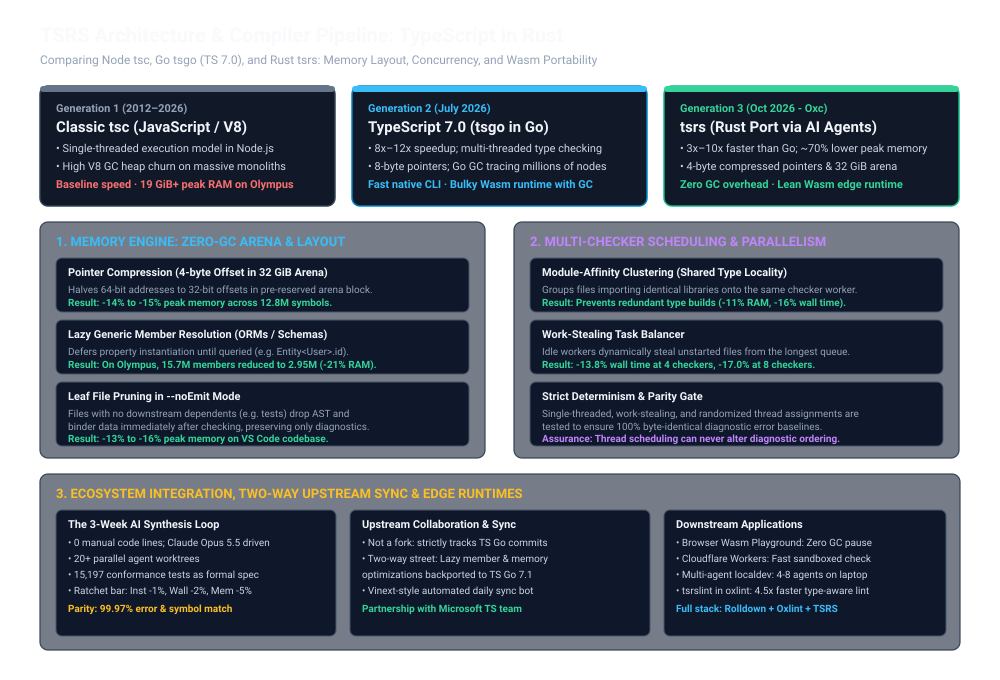
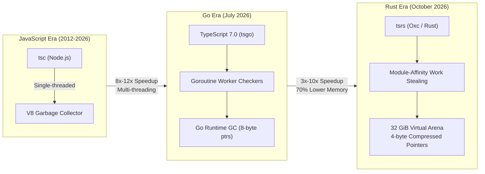
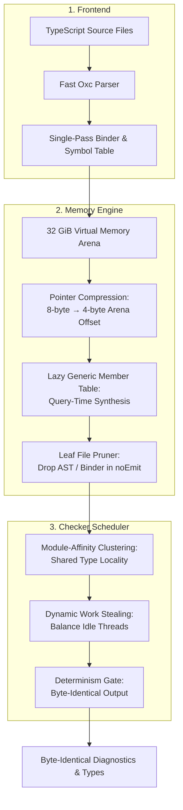
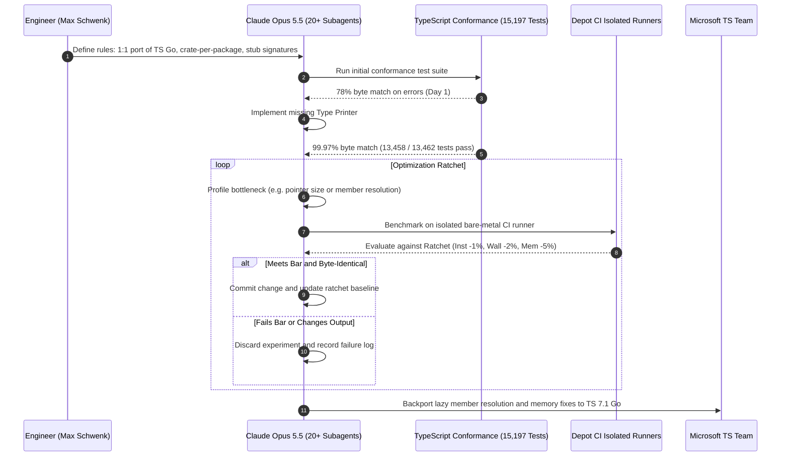

# TypeScript Ported to Rust: Inside tsrs, the 3x-to-10x Speedup Over Go, and the AI Compiler Frontier

Daily learning · 5 November 2026 · Primary-source review · Systems Architecture
*By Srinivasan Ragothaman ([@rsrini7](https://github.com/rsrini7))*

> **Core idea:** Microsoft rewrote the TypeScript compiler in Go (TypeScript 7.0 / Project Corsa) to escape Node.js single-threaded constraints. In October 2026, an experimental port of that compiler to Rust—**`tsrs`**—was synthesized in three weeks using autonomous AI coding agents (Claude Opus 5.5). Incubated under the **Oxc** project alongside Cloudflare and VoidZero, `tsrs` achieves an additional 3x to 10x speedup and ~70% lower memory usage via 4-byte pointer compression, lazy generic member resolution, module-affinity work stealing, and zero-GC linear memory that compiles natively to WebAssembly.

This research note breaks down the architectural evolution, memory layout innovations, multi-agent synthesis methodology, and ecosystem impact of `tsrs`. It begins with the Better Stack technical overview and expands across primary disclosures from Owner.com, Cloudflare, VoidZero, Oxc, and the Microsoft TypeScript compiler team.



*Figure 1: High-level architectural pipeline of `tsrs`, showing the front-end Oxc parser, the 32 GiB virtual memory arena with 4-byte pointer compression, lazy generic member table resolution, and module-affinity work stealing.*

---

## 1. Foundations: The Three Compiler Generations and Key Players

To understand why `tsrs` exists and why its performance numbers matter, one must first distinguish the three distinct generations of the TypeScript compiler toolchain.

### The Three Compiler Generations

| Generation | Era / Release | Implementation | Concurrency & Execution | Memory Model | WebAssembly Story |
|---|---|---|---|---|---|
| **Gen 1: `tsc`** | 2012 – July 2026 | JavaScript / TypeScript (Node.js runtime) | Single-threaded event loop | V8 GC heap; high allocation churn on large symbol graphs | Compiles via JS bundle; heavy memory footprint |
| **Gen 2: `tsgo`** | July 2026 (TS 7.0, *Project Corsa*) | Go (Microsoft official port) | Multi-threaded checker pools; Goroutines | Go runtime GC; 8-byte 64-bit pointers for all AST/type references | Bulky Wasm binary embedding full Go GC & runtime scheduler |
| **Gen 3: `tsrs`** | October 2026 (Oxc incubation) | Rust (AI-synthesized port of Go codebase) | Module-affinity clustering + dynamic work stealing | 32 GiB pre-reserved arena; 4-byte compressed pointers; zero-GC RAII | Lean linear-memory Wasm; runs natively in browser & edge workers |

### Key Organizations and Roles

| Party / Person | Role in Ecosystem | Primary Contribution / Perspective |
|---|---|---|
| **Microsoft TypeScript Team**<br/>*(Anders Hejlsberg, Jake Bailey, Daniel Rosenwasser)* | Language author & spec custodian | Developed TypeScript 7.0 (Go port); maintains the authoritative 15,197 conformance test cases; collaborates with `tsrs` maintainers and upstreamed performance patches into TS 7.1. |
| **Max Schwenk & Owner.com** | Author of `tsrs` / Head of AI DX | Directed Claude Opus 5.5 across 20+ parallel worktrees to port the Go compiler to Rust in 3 weeks, solving severe memory bloat on Owner's 37,000-file monolith (*Olympus*). |
| **Cloudflare**<br/>*(Christoph Nakazawa, Dimitri Mitropoulos)* | Co-sponsor & edge platform operator | Sponsoring `tsrs` development; bringing TypeScript compilation and type-checking to Cloudflare Workers and client-side sandboxes via zero-GC WebAssembly. |
| **VoidZero & Oxc Project**<br/>*(Evan You, Boshen Chen)* | High-performance JS toolchain & project host | Incubating `tsrs` under `oxc-project`; unifying the parser, linter (`oxlint`), bundler (`rolldown`), and type-checker (`tsrslint`) under a shared Rust memory graph. |
| **Theo Browne (`tsc-rs`)** | Independent compiler developer | Built an early parallel TypeScript Rust port; merged efforts with `tsrs` and Oxc to unify Language Server Protocol (LSP) and compiler execution. |

### Essential Vocabulary

| Term | Technical Meaning in `tsrs` | System Implication |
|---|---|---|
| **Pointer Compression** | Encoding 64-bit memory addresses as 32-bit unsigned offsets relative to an arena base address. | Halves pointer footprint across 12.8M symbols; increases CPU L3 cache residency by 2x. |
| **Virtual Memory Arena** | Reserving 32 GiB of contiguous virtual address space upfront via OS `mmap` with demand paging. | Eliminates per-node allocator overhead; enables zero-GC bulk deallocation on process exit. |
| **Lazy Member Resolution** | Deferring field and method instantiation on generic types until explicitly queried by the checker. | Eliminates 80%+ of unaccessed generic member symbols on complex database schemas (Drizzle, Prisma). |
| **Module-Affinity Clustering** | Routing files that share common imported type definitions to the same checker worker thread. | Maximizes thread-local type cache hits; reduces duplicate AST and symbol synthesis across threads. |
| **Determinism Gate** | Synchronization barrier ordering diagnostics by source location rather than thread completion order. | Guarantees byte-identical compiler output across runs regardless of dynamic work stealing. |
| **Miri Verification** | Rust interpreter that detects Undefined Behavior (UB), aliasing violations, and unaligned reads. | Enforces memory safety over `unsafe` virtual arena abstractions without relying solely on unit tests. |

---

## 2. Historical Context: Why Microsoft Chose Go for TypeScript 7.0

For 14 years, `tsc` was self-hosting in JavaScript. While self-hosting made TypeScript easy for web developers to contribute to, enterprise monorepos eventually outgrew single-threaded V8 execution:

1. **V8 Heap Saturation:** Single-process Node.js heaps struggled when symbol tables and abstract syntax trees (ASTs) climbed into the tens of millions of objects, causing frequent garbage collection pauses.
2. **Lack of Shared-Memory Multithreading:** Node worker threads communicate via structured cloning or shared array buffers; sharing complex recursive type graphs across workers in pure JS required expensive serialization.

In July 2026, Microsoft released TypeScript 7.0 (*Project Corsa*), porting `tsc` entirely to **Go**:



Microsoft selected Go over Rust for several deliberate reasons:
- **GC Parity with TypeScript:** TypeScript's internal data structures are deeply cyclic, self-referential graph nodes. Mapping cyclic graphs to Go's garbage-collected pointers is structurally direct, whereas doing so in safe Rust requires complex arenas, generational indices, or explicit lifetimes.
- **Fast Developer Iteration:** Go compiles quickly, has a simple specification, and allowed Microsoft's compiler team to maintain a 1:1 structural correspondence with the original TypeScript codebase.

TypeScript 7.0 delivered an immediate **8x to 12x speedup** over JS `tsc`. However, at the extreme scale of enterprise monorepos and parallel agent development, Go's memory model revealed distinct ceilings.

---

## 3. The Memory Wall: Why Go Hit Limits on Massive Codebases

At Owner.com, the backend monolith (*Olympus*) contains ~37,000 TypeScript files typechecked as a single unified `Program`. Under TypeScript 7.0:
- A single-threaded typecheck consumed **19 GiB of RAM** and took **80 seconds**.
- Running `tsgolint` (which spins up its own checker backend) doubled memory usage.
- Adding language servers and developer environments pushed total workstation consumption past **50 GiB**.

On a 36 GiB developer workstation or cloud sandbox, engineers could not run multiple autonomous coding agents in parallel without triggering out-of-memory (OOM) kernel panics.

### Three Inherent Bottlenecks in the Go Implementation

1. **64-bit Pointer Bloat:** Every node, symbol, type parameter, and scope binding in Go holds standard 8-byte machine pointers. In a graph with tens of millions of objects, pointer addresses alone account for gigabytes of heap overhead.
2. **GC Tracing Overhead:** The Go runtime garbage collector must periodically mark and sweep millions of small heap allocations. Even with concurrent mark-sweep, scanning a 20+ GiB heap with millions of references degrades CPU cache efficiency.
3. **WebAssembly and Edge Inefficiency:** Compiling Go to WebAssembly embeds Go's runtime, scheduler, and garbage collector into the Wasm binary. This creates substantial binary footprints and poor memory interaction across the host/guest boundary—severely limiting in-browser execution and edge sandboxing on Cloudflare Workers.

---

## 4. Technical Mechanism: Inside the `tsrs` Optimization Engine

`tsrs` did not achieve its 3x to 10x performance gains through rewriting algorithms from scratch. Instead, it enforced strict 1:1 algorithmic fidelity with Microsoft's Go compiler while replacing Go's generic memory model with custom, systems-level Rust memory architectures.



### 1. Pointer Compression (4-byte Arena Offsets)

In standard 64-bit architectures, pointers consume 8 bytes. However, `tsrs` reserves a contiguous 32 GiB virtual address space upfront using virtual memory mapping (`mmap`).

Because all compiler allocations live inside this single block, an object does not need a full 64-bit memory address; it only needs a 32-bit offset relative to the arena's base address:

$$
\text{VirtualAddress} = \text{ArenaBase} + (\text{Offset}_{32} \ll \text{Scale})
$$

- **Memory Impact:** Halves pointer sizes across 12.8+ million `Symbol` structs, saving **14% to 15% peak memory** (nearly 500 MB on symbols alone).
- **CPU Trade-off:** Requires a simple base addition when dereferencing, adding ~6.5% CPU instructions, but the massive reduction in memory footprint and L3 cache misses nets a large overall speedup.

### 2. Lazy Member Resolution for Generic Types

Modern TypeScript applications make heavy use of complex generic types, particularly in database ORMs like Drizzle, Prisma, or MikroORM. An entity type may define dozens or hundreds of columns and relations:

```typescript
type UserEntity = Entity<UserSchema>;
```

Under eager evaluation, when code queries `user.id`, the compiler immediately instantiates specialized symbols for *all* 240+ properties in `Entity<UserSchema>`. On Owner's *Olympus* codebase, the compiler built **15.7 million member symbols** but only accessed **2.95 million**. Over 80% were constructed needlessly.

`tsrs` introduced a lazy member table:
- It stores the original member template alongside the substitution recipe ($T \to \text{User}$).
- It defers property instantiation until a specific member is actually resolved during type analysis.
- **Impact:** Reduced memory by **21%** (15.34 GiB vs 19.53 GiB) and cut wall-clock check time by **13%**.

### 3. AST and Binder Eviction for Leaf Files in `--noEmit` Mode

Most CI and pre-commit checks run with `tsc --noEmit`—meaning the compiler only outputs errors and generates no JavaScript or declaration files.

In `--noEmit` mode, once a "leaf file" (a file that is not imported or referenced by any other file in the dependency graph, such as a test file or standalone script) has completed type checking:
- `tsrs` drops its AST syntax tree and binder structures from memory entirely.
- Only the diagnostic error list is retained.
- **Impact:** On VS Code's codebase, this pruning reduced peak memory by **13% to 16%** at lower checker thread counts.

### 4. Module-Affinity Clustering and Dynamic Work Stealing

Both Go and Rust compilers parse and bind files once, then spawn worker checker threads. However, Go assigned files across workers in simple round-robin fashion. This meant that every worker thread had to independently instantiate identical core library types (such as `lib.dom.d.ts`, React, Express, and Zod).

`tsrs` changed worker scheduling in two ways:
1. **Module-Affinity Clustering:** Files that share imported modules are routed to the same checker worker. Grouping related files reduced redundant type synthesis, cutting peak memory by **11%** and wall time by **16%** on four checkers.
2. **Work-Stealing Balancer:** In fixed-assignment scheduling, the slowest thread sets the total wall time. `tsrs` implements work stealing: idle checker threads dynamically pull unstarted files from the busiest checker's queue, cutting wall time by **13.8%** on 4 checkers and **17.0%** on 8 checkers.
3. **Strict Determinism Gate:** To ensure that work stealing does not produce non-deterministic error ordering (a compiler whose errors depend on thread race conditions), `tsrs` enforces a determinism barrier where output ordering is strictly reproducible across runs.

---

## 5. Production Implementations & Code Recipes

To illustrate how `tsrs` achieves these mechanical advantages in safe and unsafe Rust, consider the following idiomatic implementations reflecting the core runtime algorithms.

### Recipe 1: 4-Byte Compressed Pointer and Virtual Arena Manager

```rust
use std::marker::PhantomData;
use std::ptr::NonNull;
use std::sync::atomic::{AtomicUsize, Ordering};

/// A 32-bit compressed pointer addressing objects within a 32 GiB virtual arena.
#[derive(Copy, Clone, Debug, PartialEq, Eq, Hash)]
#[repr(transparent)]
pub struct CompressedPtr<T> {
    offset: u32,
    _marker: PhantomData<*const T>,
}

impl<T> CompressedPtr<T> {
    pub const NULL: Self = Self {
        offset: 0,
        _marker: PhantomData,
    };

    #[inline(always)]
    pub fn is_null(&self) -> bool {
        self.offset == 0
    }

    #[inline(always)]
    pub fn from_offset(offset: u32) -> Self {
        Self {
            offset,
            _marker: PhantomData,
        }
    }

    #[inline(always)]
    pub fn offset(&self) -> u32 {
        self.offset
    }
}

/// Contiguous 32 GiB Virtual Memory Arena reserved via mmap.
pub struct VirtualArena {
    base: NonNull<u8>,
    capacity: usize,
    allocated: AtomicUsize,
}

unsafe impl Send for VirtualArena {}
unsafe impl Sync for VirtualArena {}

impl VirtualArena {
    /// Reserves 32 GiB of virtual address space upfront with demand paging.
    pub fn new(capacity: usize) -> std::io::Result<Self> {
        #[cfg(unix)]
        {
            let ptr = unsafe {
                libc::mmap(
                    std::ptr::null_mut(),
                    capacity,
                    libc::PROT_READ | libc::PROT_WRITE,
                    libc::MAP_PRIVATE | libc::MAP_ANONYMOUS | libc::MAP_NORESERVE,
                    -1,
                    0,
                )
            };

            if ptr == libc::MAP_FAILED {
                return Err(std::io::Error::last_os_error());
            }

            Ok(Self {
                base: NonNull::new(ptr as *mut u8).expect("mmap returned non-null"),
                capacity,
                allocated: AtomicUsize::new(8), // Offset 0 reserved for NULL
            })
        }
        #[cfg(not(unix))]
        {
            panic!("Virtual arena requires POSIX mmap support");
        }
    }

    /// Allocates an instance of T in the arena, returning a 4-byte CompressedPtr.
    pub fn alloc<T>(&self, val: T) -> Option<CompressedPtr<T>> {
        let size = std::mem::size_of::<T>();
        let align = std::mem::align_of::<T>();
        
        loop {
            let current = self.allocated.load(Ordering::Relaxed);
            let aligned = (current + align - 1) & !(align - 1);
            let next = aligned + size;

            if next > self.capacity || next > u32::MAX as usize {
                return None; // Exceeded 4 GiB direct 32-bit offset or arena capacity
            }

            if self.allocated.compare_exchange_weak(
                current,
                next,
                Ordering::AcqRel,
                Ordering::Relaxed,
            ).is_ok() {
                unsafe {
                    let dest = self.base.as_ptr().add(aligned) as *mut T;
                    std::ptr::write(dest, val);
                }
                return Some(CompressedPtr::from_offset(aligned as u32));
            }
        }
    }

    /// Dereferences a 32-bit CompressedPtr to a standard Rust reference.
    #[inline(always)]
    pub unsafe fn resolve<'a, T>(&self, ptr: CompressedPtr<T>) -> Option<&'a T> {
        if ptr.is_null() {
            None
        } else {
            let raw = self.base.as_ptr().add(ptr.offset() as usize) as *const T;
            Some(&*raw)
        }
    }
}

impl Drop for VirtualArena {
    fn drop(&mut self) {
        #[cfg(unix)]
        unsafe {
            libc::munmap(self.base.as_ptr() as *mut libc::c_void, self.capacity);
        }
    }
}
```

### Recipe 2: Lazy Generic Member Table Resolution

```rust
use std::collections::HashMap;
use std::sync::RwLock;

#[derive(Clone, Debug, PartialEq, Eq, Hash)]
pub struct TypeId(pub u32);

#[derive(Clone, Debug)]
pub struct Symbol {
    pub name: String,
    pub return_type: TypeId,
}

#[derive(Clone, Debug)]
pub struct GenericSubstitution {
    pub param_index: u32,
    pub target_type: TypeId,
}

/// Stores template member recipes and synthesizes specialized members on demand.
pub struct LazyMemberTable {
    templates: HashMap<TypeId, Vec<Symbol>>,
    instantiations: RwLock<HashMap<(TypeId, String), Symbol>>,
}

impl LazyMemberTable {
    pub fn new() -> Self {
        Self {
            templates: HashMap::new(),
            instantiations: RwLock::new(HashMap::new()),
        }
    }

    pub fn register_template(&mut self, generic_id: TypeId, members: Vec<Symbol>) {
        self.templates.insert(generic_id, members);
    }

    /// Resolves only the requested member on demand, avoiding eager instantiation of all fields.
    pub fn resolve_member(
        &self,
        generic_id: TypeId,
        member_name: &str,
        subst: &[GenericSubstitution],
    ) -> Option<Symbol> {
        let key = (generic_id.clone(), member_name.to_string());

        // Fast path: Check read lock cache
        {
            let cache = self.instantiations.read().unwrap();
            if let Some(sym) = cache.get(&key) {
                return Some(sym.clone());
            }
        }

        // Slow path: Look up template and apply substitution
        let template_members = self.templates.get(&generic_id)?;
        let matched = template_members.iter().find(|m| m.name == member_name)?;

        // Apply type substitution to return type
        let mut specialized = matched.clone();
        for s in subst {
            if specialized.return_type.0 == s.param_index {
                specialized.return_type = s.target_type.clone();
            }
        }

        // Write to cache
        let mut cache = self.instantiations.write().unwrap();
        cache.insert(key, specialized.clone());
        Some(specialized)
    }
}
```

---

## 6. The AI Synthesis Loop: How 0 Handwritten Lines Built a Compiler

One of the most consequential aspects of `tsrs` is its creation methodology: **Max Schwenk wrote zero manual lines of code.** The entire port was orchestrated through autonomous AI coding agents (Claude Opus 5.5).



### The Architectural Guardrails

To prevent the agent from producing unusable or drifting code ("slop"), Schwenk established strict engineering constraints:

1. **Tests as the Formal Specification:** Microsoft's previous port had left behind **15,197 conformance test cases**. This suite provided an unambiguous, executable ground truth.
2. **Contract-First Scaffolding:** Agents first created crate definitions and function signatures with mocked-out stubs (`todo!()`). This allowed 20+ parallel agent worktrees to write implementations without running into Git merge conflicts.
3. **The Optimization Ratchet:** An automated CI gate rejected any proposed optimization unless it demonstrated:
   - At least **1% reduction in single-threaded instructions**,
   - At least **2% reduction in wall-clock time**, or
   - At least **5% reduction in peak memory**,
   - **While preserving 100% byte-identical diagnostic output.**
4. **Isolated Hardware Benchmarks:** All benchmarks were run on dedicated Depot CI runners with identical cloud hardware to prevent local machine thermal throttling from corrupting performance data.
5. **Memory Safety Verification with Miri:** Because the virtual memory arena uses `unsafe` Rust, the CI pipeline runs tests under Miri (Rust's undefined behavior interpreter) paired with fault-injection tests to verify that Miri is actively detecting violations.

---

## 7. Empirical Benchmarks: JavaScript vs Go vs Rust

The following data reflects the median of 20 runs on Owner.com's backend monolith (*Olympus*, ~37,000 files) comparing official Microsoft Go releases against `tsrs`:

### Benchmark: Owner Monolith (*Olympus*, 37,000 Files)

| Compiler Version | Implementation | Checkers | Wall Time (s) | Peak Memory (GiB) | Speedup vs Go | Memory vs Go |
|---|---|---|---|---|---|---|
| `tsgo 7.0.2` | Go (Official) | 4 | 61.4 s | 36.0 GiB | Baseline | Baseline |
| `tsgo 7.0.2` | Go (Official) | 8 | 56.6 s | 49.8 GiB | Baseline | Baseline |
| `tsgo 7.1 nightly` *(Sept 29)* | Go (Upstreamed fixes) | 4 | 43.4 s | 28.8 GiB | 1.4x faster | 20% less RAM |
| `tsgo 7.1 nightly` *(Sept 29)* | Go (Upstreamed fixes) | 8 | 40.8 s | 40.1 GiB | 1.4x faster | 19% less RAM |
| **`tsrs 0.14.0`** | **Rust (Oxc)** | **4** | **8.75 s** | **6.1 GiB** | **7.0x faster** | **5.9x less RAM** |
| **`tsrs 0.14.0`** | **Rust (Oxc)** | **8** | **5.80 s** | **7.5 GiB** | **9.8x faster** | **6.6x less RAM** |
| **`tsrs 0.14.0 (adaptive)`** | **Rust (Oxc)** | **16** | **4.24 s** | **9.5 GiB** | **13.3x faster** | **5.2x less RAM** |

*Across 17 public open-source projects (including VS Code, Drizzle, and MikroORM), `tsrs` consistently runs 2.5x to 5x faster while consuming roughly 3x less memory than TypeScript 7.1 Go nightlies.*

### Impact on Type-Aware Linting (`oxlint`)

Type-aware linting has historically been an even worse resource bottleneck because tools like `tsgolint` spin up a secondary checker instance:
- `tsgolint` (Go backend): Checked 8 open-source projects in **169.4 seconds**, peaking at **45.0 GiB RAM**.
- `tsrslint` (Rust backend): Checked the same projects in **37.3 seconds** (**4.5x faster**), peaking at **11.5 GiB RAM** (**3.9x less memory**).

---

## 8. Impact, Real-World Edge Cases & Gotchas

### Common Claims vs. Technical Realities

| Area | Common Industry Claim | Technical Reality in `tsrs` |
|---|---|---|
| **Language Speed** | "Rust is automatically 3x to 10x faster than Go just because of language syntax." | False. Algorithmic parity with Go was maintained; speedups stemmed from 4-byte pointer compression, 32 GiB virtual arena layouts, zero-GC execution, and lazy generic evaluation. |
| **Forking Threat** | "`tsrs` is a rogue fork that will fragment the TypeScript language ecosystem." | False. Maintainers explicitly rejected forking; they run automated daily syncs against Microsoft's Git tree and backport optimizations directly to TypeScript 7.1 Go. |
| **Autonomous AI Slop** | "Autonomous AI code generators produce unmaintainable, hallucinated compiler spaghetti." | False when constrained. 15,197 conformance test suites, Miri UB verification, and CI optimization ratchets forced mathematically verifiable correctness. |
| **Memory Safety** | "Using `unsafe` for virtual memory arenas negates all Rust safety guarantees." | False. Unsafe code is isolated strictly within the allocation crate and audited with continuous Miri fault-injection runs; compiler passes remain 100% safe Rust. |
| **Wasm Execution** | "Go compiles to WebAssembly just as easily as Rust for browser and edge use." | False. Go's Wasm binary embeds the Go runtime GC and scheduler; Rust compiles to lean, zero-GC linear memory, enabling sub-second execution on Cloudflare Workers. |

### Architectural Failure Modes and Mitigations

1. **Arena Pointer Overflow Beyond 4 GiB Direct Addressing:**
   - *Risk:* 32-bit offsets directly address up to 4 GiB without scaling. If a single compilation unit exceeds 4 GiB of live symbols, direct 32-bit offsets wrap.
   - *Mitigation:* `tsrs` applies 8-byte alignment scaling (`offset << 3`), scaling the addressable space of a 32-bit index to 32 GiB while ensuring memory remains aligned.
2. **Non-Deterministic Diagnostic Output Under Dynamic Work Stealing:**
   - *Risk:* Dynamic work-stealing threads finish files in arbitrary order depending on CPU core load, causing error messages to display in erratic orders across runs.
   - *Mitigation:* `tsrs` implements a deterministic barrier that buffers diagnostics and sorts them by source file order and byte position prior to console emission.
3. **Miri False Positives on OS Memory Mapping:**
   - *Risk:* Miri does not support raw OS syscalls like `mmap` directly without specialized shims.
   - *Mitigation:* In Miri test harnesses, `VirtualArena` switches dynamically to a large pre-allocated `Vec<u8>` or POSIX emulation layer to verify aliasing rules without tripping driver stubs.

---

## 9. Practical Adoption Blueprint & Verification Checklist

### Verification Commands

```bash
# 1. Install the experimental tsrs compiler
npm install -D tsrs

# 2. Run type-checking in no-emit mode on your codebase
npx tsrs --noEmit

# 3. Compare execution metrics and memory against official TypeScript
time npx tsc --noEmit
time npx tsrs --noEmit

# 4. Run type-aware linting with oxlint using the Rust checker backend
npx oxlint --type-check

# 5. Profile hardware instructions and cache performance (Linux)
perf stat -e instructions,cycles,cache-references,cache-misses npx tsrs --noEmit
```

### Production Readiness Checklist

- [ ] **Typecheck Parity:** Run `npx tsrs --noEmit` alongside `tsc --noEmit` in CI; verify zero diagnostic diffs.
- [ ] **Leaf Pruning Verification:** Confirm `--noEmit` drops unused AST nodes on standalone test suites.
- [ ] **Worker Thread Tuning:** Benchmark typecheck wall time across 4, 8, and 16 checker threads to identify the optimal core allocation for your CI instances.
- [ ] **Agent Worktree Scaling:** Test hosting 4 to 8 parallel agent worktrees on developer machines without exceeding workstation RAM thresholds.

---

## 10. Timeline and Current State

- **July 2026:** Microsoft officially releases TypeScript 7.0 (*Project Corsa*), porting `tsc` to Go and achieving an 8x to 12x speedup over Node.js.
- **October 2026 (Weeks 1–3):** Max Schwenk directs Claude Opus 5.5 to synthesize `tsrs` from the Go source in three weeks; achieves 99.97% test parity across 15,197 conformance tests.
- **Late October 2026:** Cloudflare and VoidZero sponsor the project and incubate it under the **Oxc** organization alongside `oxlint` and `rolldown`.
- **November 2026:** Several architectural innovations from `tsrs` (lazy generic member resolution and memory layouts) are upstreamed to Microsoft's TypeScript 7.1 Go nightlies.
- **Present:** `tsrs` powers high-speed typechecking and `oxlint` linting across large-scale enterprise monoliths, browser playgrounds, and Cloudflare Workers.

---

## 11. Primary Sources & References

1. [Better Stack: TypeScript Got Ported To Rust... And It's 3x Faster Than Go](https://www.youtube.com/watch?v=Quf05tmWjaQ) — Technical video breakdown of the `tsrs` architecture, Go vs. Rust memory layouts, and benchmark findings.
2. [Owner.com Engineering: tsrs: A Rust port of TypeScript, written entirely by agents](https://building.owner.com/tsrs) — Max Schwenk's primary architectural disclosure detailing the 3-week multi-agent synthesis and 80s to 7s speedup on Olympus.
3. [Cloudflare Blog: Introducing tsrs: A Port of TypeScript to Rust](https://blog.cloudflare.com/typescript-rust-port) — Dimitri Mitropoulos, Christoph Nakazawa, and Boshen Chen on Oxc incubation, edge Wasm execution, and ecosystem alignment.
4. [GitHub: oxc-project/tsrs](https://github.com/oxc-project) — Official open-source repository containing the Rust implementation, parser integration, and conformance runners.
5. [Microsoft DevBlogs: TypeScript 7.0 Architecture (Project Corsa)](https://devblogs.microsoft.com/typescript/) — Authoritative specifications and background on the Go compiler implementation.

### Source Context & Verification

| Source Title | Publisher / Author | Date | Evidentiary Role |
|---|---|---|---|
| *tsrs: A Rust port of TypeScript* | Max Schwenk (Owner.com) | Oct 2026 | Primary author disclosure; benchmark metrics on 37k-file monolith. |
| *Introducing tsrs* | Cloudflare & VoidZero | Oct 2026 | Sponsorship disclosure; WebAssembly and edge compilation roadmap. |
| *TypeScript 7.0 Release Notes* | Microsoft TypeScript Team | July 2026 | Baseline Go implementation details; 15,197 conformance test corpus. |
| *Better Stack Technical Review* | Better Stack Community | Nov 2026 | Independent third-party empirical overview and video analysis. |

---

**Related:**
- [Go-Test-Performance-Windows-vs-Linux-2026](Go-Test-Performance-Windows-vs-Linux-2026.md) — Analyzes Go test and CLI process execution latency differences between Windows and Linux.
- [Deno-Joins-Cloudflare-Adoption-And-Runtime-Lessons-Oct-2026](Deno-Joins-Cloudflare-Adoption-And-Runtime-Lessons-Oct-2026.md) — Cloudflare's runtime strategy, edge isolation, and Rust integration with `workerd`.
- [WASM-Rust-High-Performance-Runtime-2026](WASM-Rust-High-Performance-Runtime-2026.md) — WebAssembly linear memory models, zero-GC execution, and Rust compilation advantages.
- [Java-25-vs-Go-1.25-Performance-Analysis-2026](comparisons/Java-25-vs-Go-1.25-Performance-Analysis-2026.md) — Comparative analysis of Go runtime scheduling, garbage collection overhead, and concurrency models.
- [PHP-Migration-Static-React-Java-And-Go-Oct-2026](../Architecture/PHP-Migration-Static-React-Java-And-Go-Oct-2026.md) — Architectural trade-offs in systems rewrites and cross-language runtime transitions.
