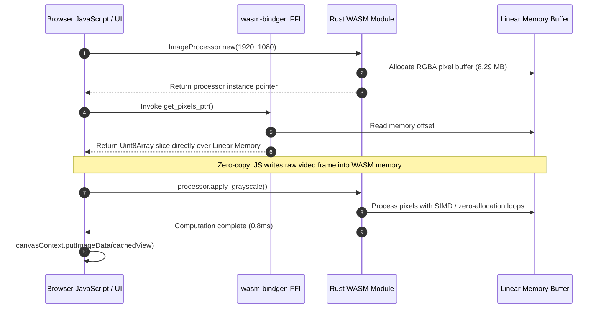
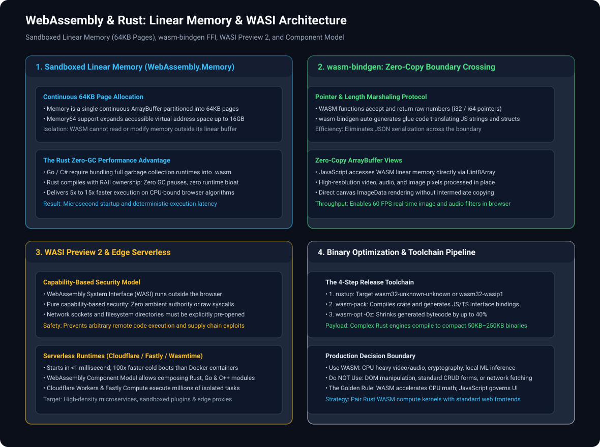

# WebAssembly & Rust: High-Performance Linear Memory, WASI Preview 2, and Runtime Architecture

`Learning note · Revised November 2026 · Systems Programming & WebAssembly Runtimes`  
*By Srinivasan Ragothaman ([@rsrini7](https://github.com/rsrini7))*

> WebAssembly (WASM) is not a replacement for JavaScript or a general programming language; it is a portable, sandboxed bytecode compilation target. By leveraging Rust's ownership model, developers achieve deterministic zero-garbage-collected execution inside a continuous linear memory buffer. In 2026, the finalization of WebAssembly 3.0, WASI Preview 2, memory64, and the Component Model transforms WASM from a browser acceleration hack into a unified execution substrate spanning edge serverless runtimes, sandboxed microservices, and in-browser compute kernels.

---

## 1. Foundations: The WebAssembly Execution Model

Traditional web performance optimizations are constrained by JavaScript's dynamic typing, JIT deoptimizations, and non-deterministic garbage collection sweeps. WebAssembly bypasses these constraints by executing pre-compiled binary modules within a sandboxed virtual machine:

```
+----------------------------------------------------------------------------------------------------+
|                                    WASM EXECUTION ARCHITECTURE                                     |
+----------------------------------------------------------------------------------------------------+
|  SOURCE CODE (Rust)                    WASM COMPILATION                    HOST RUNTIME            |
|  - Zero-cost abstractions              - Compiles to .wasm bytecode        - Browser JIT (V8/JSC)  |
|  - RAII ownership & borrow checker     - Compact binary format             - Standalone Wasmtime   |
|  - Zero runtime / No bundled GC        - 64KB Linear Memory Pages          - Edge Serverless Node  |
|  - Exports functions via C ABI         - Sandboxed capability isolation    - Sub-millisecond boot  |
+----------------------------------------------------------------------------------------------------+
```

### Essential Technical Terms & Architectural Primitives

| Component / Term | Implementation Scope | Primary Guarantee & Role |
| :--- | :--- | :--- |
| **Linear Memory** | Sandboxed contiguous byte array (`WebAssembly.Memory`) | Array of 64KB pages isolated from host memory; accessed via raw byte offsets without direct OS pointer leakage. |
| **memory64** | WebAssembly 3.0 Standard | Expands the linear memory address space from 32-bit (4GB cap) to 64-bit pointers, enabling modules to address up to 16GB of RAM. |
| **`wasm-bindgen`** | Rust FFI Tool & Code Generator | Generates type-safe marshaling glue code between JavaScript garbage-collected objects and Rust linear memory. |
| **WASI Preview 2** | WebAssembly System Interface Specification | Standardized capability-based system interface bringing native non-blocking network sockets, streams, and clocks to server-side WASM. |
| **Component Model** | W3C Standardized Interop Framework | Defines language-agnostic interface types (`.wit` files) allowing polyglot WASM modules (Rust, Go, C++) to link and call each other safely. |
| **`wasm-opt`** | Binary Optimizer (Binaryen toolset) | Runs compiler optimization passes directly on the `.wasm` binary, stripping dead code and shrinking payloads by up to 40%. |

---

## 2. Deep Technical Mechanisms: Linear Memory, FFI, and WASI

### 2.1 The Sandboxed Linear Memory Model & Zero-GC Execution

WebAssembly modules execute inside an isolated address space called **Linear Memory**:
- **Continuous Byte Buffer**: Instantiated on the host as a `WebAssembly.Memory` object backed by a contiguous virtual array.
- **64KB Page Allocation**: Memory expands dynamically in discrete 64KB page units. The module cannot access host memory outside this buffer, ensuring security sandboxing.
- **Why Rust Dominates WASM**: Managed languages (Go, C#, Java) require embedding their garbage collection runtime into the compiled `.wasm` binary, bloating file size by 2MB–10MB and causing GC pause spikes. Rust uses compile-time ownership (RAII), producing lean binaries (20KB–150KB) with **zero runtime GC pauses** and deterministic memory reclamation.

---

### 2.2 FFI & Zero-Copy Boundary Crossing via `wasm-bindgen`

Passing complex objects (strings, structs, arrays) between JavaScript and WebAssembly cannot use raw pointer dereferencing due to sandboxing boundaries. `wasm-bindgen` solves this via shared memory views:

```
ZERO-COPY ARRAYBUFFER SLICING ACROSS JS-WASM BOUNDARY
[ Rust Module (Linear Memory) ]
  ├── Allocates Vec<u8> buffer: [ R, G, B, A, R, G, B, A, ... ]
  └── Exposes memory offset pointer: 0x0040A000 and byte length: 4,000,000
                               │
                               ▼ (Returns raw i32 pointer)
[ wasm-bindgen Generated Glue ]
                               │
                               ▼
[ JavaScript Virtual Machine ]
  └── Creates direct TypedArray view: new Uint8Array(wasm.memory.buffer, 0x0040A000, 4000000)
  └── Renders directly to HTML5 Canvas: ctx.putImageData(new ImageData(view, 1000, 1000), 0, 0)
```

By passing only 32-bit pointers and lengths, the application processes multi-megapixel video and image frames in place, achieving 60 FPS in-browser throughput without copying data between heaps.

---

### 2.3 The Boundary Crossing Lifecycle



---

### 2.4 WASI Preview 2: Capability-Based Serverless Execution

Outside the browser, the WebAssembly System Interface (WASI) enables secure, high-density serverless execution on runtimes like **Wasmtime**, **Cloudflare Workers**, and **Fastly Compute**:
1. **Zero Ambient Authority**: Unlike standard POSIX operating systems where a running process inherits full access to the user's filesystem and network sockets, WASI uses strict capability-based security. A module can only access directories and network hosts that are explicitly pre-opened and passed by the host runtime at startup.
2. **Sub-Millisecond Cold Starts**: Traditional Docker container runtimes incur 100ms–500ms cold-start latency initializing namespaces, cgroups, and Linux guest kernels. A WASI module initializes in **under 1 millisecond**, consuming mere kilobytes of base memory.

---

## 3. Architectural Visuals: Linear Memory & WASI

The architectural diagram below illustrates the WebAssembly linear memory layout, zero-copy FFI boundary crossing, WASI Preview 2 capability isolation, and binary optimization:



---

## 4. Production Implementations & Code Recipes

### 4.1 Production Rust WASM Image Processing Engine

This optimized Rust module implements in-place image processing, exposing memory pointers for zero-copy JavaScript canvas rendering:

```rust
// Cargo.toml dependencies:
// wasm-bindgen = "0.2"
// [lib]
// crate-type = ["cdylib", "rlib"]

use wasm_bindgen::prelude::*;

#[wasm_bindgen]
pub struct ImageProcessor {
    width: u32,
    height: u32,
    // Buffer stores raw RGBA bytes: 4 bytes per pixel
    pixels: Vec<u8>,
}

#[wasm_bindgen]
impl ImageProcessor {
    #[wasm_bindgen(constructor)]
    pub fn new(width: u32, height: u32) -> ImageProcessor {
        let size = (width * height * 4) as usize;
        ImageProcessor {
            width,
            height,
            pixels: vec![0; size],
        }
    }

    /// Exposes raw memory pointer directly to JavaScript for zero-copy buffer mapping
    pub fn pixels_ptr(&self) -> *const u8 {
        self.pixels.as_ptr()
    }

    pub fn pixels_len(&self) -> usize {
        self.pixels.len()
    }

    /// High-performance in-place grayscale conversion using integer luminance weights
    pub fn apply_grayscale(&mut self) {
        // ITU-R BT.601 coefficients scaled to integers: (R*77 + G*150 + B*29) >> 8
        for chunk in self.pixels.chunks_exact_mut(4) {
            let r = chunk[0] as u32;
            let g = chunk[1] as u32;
            let b = chunk[2] as u32;
            let gray = ((r * 77 + g * 150 + b * 29) >> 8) as u8;

            chunk[0] = gray;
            chunk[1] = gray;
            chunk[2] = gray;
            // chunk[3] is Alpha channel; preserved as-is
        }
    }

    /// Adjusts image brightness with SIMD-friendly clamped arithmetic
    pub fn adjust_brightness(&mut self, factor: i16) {
        for chunk in self.pixels.chunks_exact_mut(4) {
            for i in 0..3 {
                let val = chunk[i] as i16 + factor;
                chunk[i] = val.clamp(0, 255) as u8;
            }
        }
    }
}
```

---

### 4.2 Production Browser Integration (Zero-Copy HTML5 Canvas)

This JavaScript module initializes the WASM runtime, maps a zero-copy typed view over linear memory, and renders processed frames directly:

```javascript
import init, { ImageProcessor } from './pkg/wasm_image_engine.js';

async function runImagePipeline(canvas, imageSource) {
  // 1. Initialize WASM module and linear memory buffer
  const wasm = await init();
  const ctx = canvas.getContext('2d');
  
  const width = canvas.width;
  const height = canvas.height;

  // 2. Instantiate Rust processor
  const processor = new ImageProcessor(width, height);
  const ptr = processor.pixels_ptr();
  const len = processor.pixels_len();

  // 3. Create zero-copy Uint8ClampedArray view directly over WebAssembly.Memory
  const wasmPixelMemory = new Uint8ClampedArray(wasm.memory.buffer, ptr, len);

  // 4. Load canvas frame directly into WASM memory
  const initialFrame = ctx.getImageData(0, 0, width, height);
  wasmPixelMemory.set(initialFrame.data);

  // 5. Execute Rust compute kernel (executes in <1ms)
  console.time('wasm_grayscale');
  processor.apply_grayscale();
  console.timeEnd('wasm_grayscale');

  // 6. Render back to canvas without copying intermediate arrays
  const outputImageData = new ImageData(wasmPixelMemory, width, height);
  ctx.putImageData(outputImageData, 0, 0);
}
```

---

### 4.3 Production Build & Binary Size Optimization Script

To minimize payload size for web and edge distribution, configure `Cargo.toml` and execute post-processing:

```toml
# In Cargo.toml:
[profile.release]
opt-level = "z"     # Optimize for size
lto = true          # Link-Time Optimization
codegen-units = 1   # Single code generation unit for maximum optimization
panic = "abort"     # Remove unwinding landing pads
strip = true        # Strip debug symbols and names
```

Execute the compilation pipeline:
```bash
# 1. Build release WASM package
wasm-pack build --target web --release

# 2. Run wasm-opt to perform dead code elimination and peephole optimizations
wasm-opt -Oz pkg/wasm_image_engine_bg.wasm -o pkg/wasm_image_engine_bg.wasm

# Inspect binary size (typical output: ~45KB)
ls -lh pkg/wasm_image_engine_bg.wasm
```

---

## 5. Comparative Runtime Analysis

| Architectural Dimension | Native JavaScript (V8 Engine) | Go WebAssembly (`wasm32`) | Rust WebAssembly (`wasm32-unknown`) | Native C++ (`emscripten`) |
| :--- | :--- | :--- | :--- | :--- |
| **Garbage Collector** | Built-in non-deterministic GC | Bundled into binary (~2MB overhead) | **Zero GC (Compile-time RAII)** | Zero GC (Manual `free`) |
| **Minimal Binary Size** | 0 KB (Native code) | ~2,500 KB | **~15 KB – 80 KB** | ~40 KB – 120 KB |
| **Execution Performance** | Baseline (Dynamic JIT) | 2x – 4x faster than JS | **5x – 15x faster than JS** | 5x – 15x faster than JS |
| **Memory Isolation** | Shared V8 Heap | Sandboxed Linear Memory | **Sandboxed Linear Memory** | Sandboxed Linear Memory |
| **Cold Start Latency** | Instant (Script parse) | 40ms – 120ms (GC boot) | **&lt;1 ms (Instant)** | &lt;1 ms (Instant) |
| **Type Safety & FFI** | Dynamic / TypeScript | Manual Syscall Stubs | **Native `wasm-bindgen` AST** | Embind / C-style FFI |
| **WASI Preview 2 Support** | N/A | Partial | **Full Component Model GA** | Supported |

---

## 6. Common Claims vs. Technical Realities

| # | Common Industry Claim | Technical Reality & Benchmark Fact | Architectural Guidance |
| :-: | :--- | :--- | :--- |
| **1** | *"WebAssembly will completely replace JavaScript in the browser."* | **False.** WebAssembly cannot directly manipulate the DOM; every DOM interaction requires crossing the JS-WASM FFI bridge, which incurs small invocation overhead. | Use JavaScript/TypeScript for UI, routing, and DOM rendering; use WASM exclusively for heavy CPU computation. |
| **2** | *"Any programming language can compile to WebAssembly with equal efficiency."* | **False.** Languages with managed runtimes (Go, Python, C#) bundle their runtime and garbage collector into the binary, resulting in multi-megabyte payloads. Rust and C/C++ produce compact, zero-GC binaries. | Standardize on Rust for production WASM modules where download latency and memory density matter. |
| **3** | *"WebAssembly is always faster than JavaScript for every task."* | **False.** For simple string manipulation, DOM querying, or data fetching, JavaScript is faster because it avoids FFI serialization overhead. WASM only wins when computation time dominates boundary crossing time. | Apply the Golden Rule: Use WASM for heavy CPU algorithms (video, audio, crypto, ML, physics); use JS for I/O and UI. |
| **4** | *"WebAssembly cannot access server resources or network sockets."* | **Outdated.** With WASI Preview 2, server-side WebAssembly runtimes (Wasmtime, Cloudflare Workers) provide standardized non-blocking TCP/UDP sockets, HTTP fetch, and filesystem capabilities. | Adopt WASI for edge computing and multi-tenant plugin sandboxing. |
| **5** | *"Passing large arrays into WASM requires expensive JSON serialization."* | **False.** Applications can create direct TypedArray views (e.g., `Uint8Array`) over the WASM linear memory buffer, achieving zero-copy read and write operations. | Pass raw pointers and lengths across the boundary; never stringify large datasets. |

---

## 7. Practical Adoption Blueprint: Decision Framework

```
                       WASM WORKLOAD DECISION FRAMEWORK
                                       │
                      Is the workload primarily CPU-bound?
                                       │
         ┌─────────────────────────────┴─────────────────────────────┐
         ▼                                                           ▼
       [ YES ]                                                     [ NO ]
  - Video / Image / Audio processing                          - DOM tree manipulation
  - Cryptographic hashing / zero-knowledge proofs              - Standard CRUD data forms
  - Complex physics / game loops                              - Simple REST API fetching
  - Local ML / ONNX inference                                 - UI state management
         │                                                           │
         ▼                                                           ▼
   ADOPT RUST WEBASSEMBLY                                      RETAIN STANDARD JAVASCRIPT / TS
   (wasm-pack + wasm-opt)                                     (React / Svelte / Vue)
```

---

## 8. Technology Roadmap & Historical Milestones

```
2017 ────────────────────── 2019 ────────────────────── 2023 ────────────────────── 2026+
 │                           │                           │                           │
 ├── WASM 1.0 Standard       ├── WASI Introduced         ├── WebAssembly 2.0         └── WebAssembly 3.0 / WASI 2
 │   • MVP in all 4 browsers • Bytecode Alliance founded • Vector SIMD (128-bit)     • WASI Preview 2 Sockets
 │   • 32-bit linear memory  • Server-side sandboxing    • Multi-value returns       • memory64 (16GB RAM)
 │   • C/C++ & Rust tooling  • Wasmtime runtime debuts   • Bulk memory operations    • Component Model GA
```

---

## 9. Primary Sources & References

1. [W3C WebAssembly Specification (Version 3.0)](https://www.w3.org/TR/wasm-core-2/) — Official W3C standard defining the core WebAssembly instruction set, memory model, and binary encoding.
2. [WebAssembly System Interface (WASI) Specification](https://wasi.dev/) — Standardized system interface defining capability-based APIs for filesystems, networking, and asynchronous I/O.
3. [Rust and WebAssembly Official Book](https://rustwasm.github.io/docs/book/) — Comprehensive guide to compiling Rust to WebAssembly using `wasm-pack` and `wasm-bindgen`.
4. [The WebAssembly Component Model](https://component-model.bytecodealliance.org/) — Specification and architecture for composable, language-agnostic WebAssembly modules.
5. [Binaryen Optimizer Toolset (`wasm-opt`)](https://github.com/WebAssembly/binaryen) — Compiler infrastructure and toolchain library for WebAssembly binary optimization and dead code elimination.

---

**Related:**
- [TypeScript-Rust-Port-TSRS-Architecture-Nov-2026](TypeScript-Rust-Port-TSRS-Architecture-Nov-2026.md) — Case study of porting TypeScript to Rust to achieve zero-GC WebAssembly compilation for in-browser and Cloudflare Workers execution.
- [Deno-Joins-Cloudflare-Adoption-And-Runtime-Lessons-Oct-2026](Deno-Joins-Cloudflare-Adoption-And-Runtime-Lessons-Oct-2026.md) — Connects sandboxed runtimes and portable execution to Deno's move toward self-hosted Workers and Durable Objects.
- [Go-SIMD-vs-NumPy-vs-Java-Vector-API-2026](comparisons/Go-SIMD-vs-NumPy-vs-Java-Vector-API-2026.md) — Analyzes compiler intrinsics, vector registers, and low-level memory layouts relevant to WebAssembly SIMD acceleration.
- [Scaling-1M-RPS-Java](../Architecture/Scaling-1M-RPS-Java.md) — Compares high-throughput managed server execution with edge-hosted WebAssembly microservices.
- [Java-25-vs-Go-1.25-Performance-Analysis-2026](comparisons/Java-25-vs-Go-1.25-Performance-Analysis-2026.md) — Evaluates memory layouts, GC pauses, and startup characteristics across compiled native runtimes.
