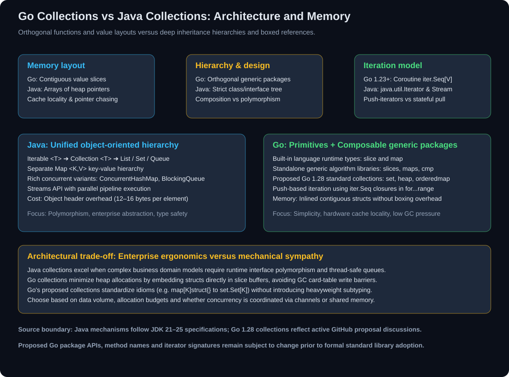
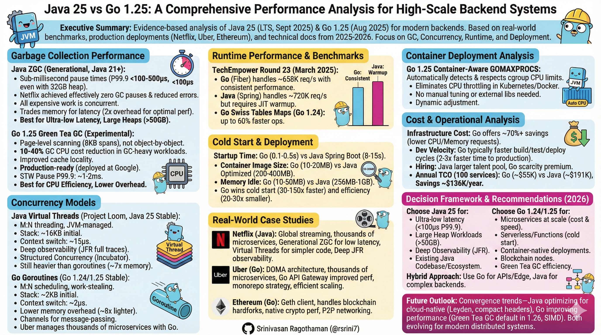

# Go Collections versus Java Collections: Architecture, Memory Layout and the Go 1.28 Proposals

**Learning note · Revised 15 November 2026 · Language design, memory layout and standard library evolution**  
*By Srinivasan Ragothaman ([@rsrini7](https://github.com/rsrini7))*

> **Core idea:** Java's Collections Framework relies on a deep object-oriented inheritance tree with reference boxing and rich concurrency primitives, while Go emphasizes flat built-in primitives, contiguous memory slices and orthogonal generic packages. Proposed Go 1.28 collections standardize custom sets, heaps and ordered maps without adopting heavyweight object hierarchies.

## 1. Foundations: language philosophies and collection design

Collection design in modern programming languages reflects fundamental architectural philosophies regarding type systems, runtime memory layout and developer ergonomics:

- **Java Collections Framework (JCF):** Introduced in JDK 1.2 and modernized with generics (Java 5) and streams (Java 8), JCF is structured around a deep, unified class and interface hierarchy. All non-map collections derive from `java.lang.Iterable<T>` and `java.util.Collection<T>`, enforcing behavioral contracts through subtyping polymorphism. Primitive data types (`int`, `double`, `boolean`) must be boxed into heap-allocated wrapper objects (`Integer`, `Double`, `Boolean`) when stored inside standard collections.
- **Go Collections Design:** Go eschews class-based inheritance and unified collection hierarchies. For over a decade, Go provided only two core collection primitives in the language runtime: **slices (`[]T`)** and **hash maps (`map[K]V`)**. The arrival of generics in Go 1.18, standard utility packages (`slices`, `maps`, `cmp`) in Go 1.21, and range-over-function iterators (`iter.Seq`) in Go 1.23 created the foundation for modern reusable data structures without altering Go's flat, composable design.

| Dimension | Java Collections Framework | Go Collections Architecture |
|---|---|---|
| **Structural Model** | Deep inheritance tree (`Collection` ➔ `List` / `Set` / `Queue`). | Built-in primitives (`slice`, `map`) + orthogonal generic packages. |
| **Element Memory** | References to heap objects (boxed wrappers for primitives). | Inlined value structs or contiguous flat memory buffers. |
| **Equality & Hashing** | Object methods (`equals()` and `hashCode()`) on reference types. | Built-in `comparable` constraint; proposed custom hash closures. |
| **Iteration Model** | External pull iterator (`Iterator<T>`) &amp; declarative `Stream<T>`. | Push-based closures (`iter.Seq[V]`) consumed by native `for...range`. |
| **Concurrency Model** | Striped and lock-free thread-safe classes (`ConcurrentHashMap`). | Unsynchronized primitives; synchronized via `sync.RWMutex` or channels. |

## 2. Memory layout: reference pointer chasing versus cache locality

The most significant performance distinction between Java and Go collections lies in **mechanical sympathy**—how collection data structures map to physical hardware CPU cache lines:

```
Java ArrayList<Point> (Pointer Chasing):
[ Array of 64-bit References ] 
  ├──> [ Object Header (16B) | Point x, y ] (Heap Location A)
  ├──> [ Object Header (16B) | Point x, y ] (Heap Location B)
  └──> [ Object Header (16B) | Point x, y ] (Heap Location C)

Go []Point (Contiguous Memory Buffer):
[ Point {x, y} | Point {x, y} | Point {x, y} | ... ] (Contiguous Buffer)
```

1. **Java Reference Indirection:** In Java, an `ArrayList<Point>` stores an array of 64-bit memory addresses pointing to separate heap-allocated `Point` instances. Each object carries an object header (typically 12–16 bytes). Iterating over the collection requires dereferencing pointers scattered across memory pages, inducing CPU L1/L2 cache misses ("pointer chasing") and increasing garbage-collection write barriers.
2. **Go Contiguous Layout:** In Go, a slice of value structs `[]Point` is allocated as a single, contiguous array of bytes. Iterating over `[]Point` streams sequential hardware cache lines directly into the CPU L1 data cache without pointer indirection, achieving maximal throughput and zero per-element GC overhead.
3. **Project Valhalla Evolution:** While OpenJDK's Project Valhalla aims to introduce value objects and primitive collections to Java, current enterprise JVM deployments remain predominantly reference-based.

## 3. The Go collection evolution timeline



*Evolutionary trajectory from built-in primitives to orthogonal generic packages and proposed standard collections.*

The progression of Go's collection capabilities followed a deliberate, multi-year sequence:

| Release | Milestone | Architectural Consequence |
|---|---|---|
| **Go 1.18** (2022) | Type Parameters (Generics) | Generic data structures became practical without `interface{}` boxing. |
| **Go 1.21** (2023) | `slices`, `maps`, `cmp` Packages | Standard algorithms (sorting, binary search, cloning) unified as standalone functions. |
| **Go 1.23** (2024) | Range-over-function Iterators | Standardized push iterators (`iter.Seq`, `iter.Seq2`) integrating with native `for...range`. |
| **Go 1.28** (Proposed) | Collections Working Group APIs | Standard `set`, `heap`, `orderedmap`, and custom-hash collection packages. |

## 4. What is proposed for Go 1.28

The Go Collections working group proposals target formal standard library packages to replace longstanding third-party libraries and repetitive idioms:

### 1. Standard Set package (`set.Set[T]`)
For over a decade, Go developers represented sets using hash maps with empty struct values: `map[T]struct{}`. While zero-memory-cost for values, this idiom lacked standard set algebra methods.

The proposed `set` package introduces a formal generic type and mathematical set operations:

```go
// Proposed Go 1.28 set operations
package main

import (
    "fmt"
    "set" // Proposed standard library package
)

func main() {
    admins := set.Of("alice", "bob", "carol")
    active := set.Of("bob", "carol", "dave")

    // Direct mathematical algebra
    onlineAdmins := set.Intersection(admins, active) // {"bob", "carol"}
    allUsers := set.Union(admins, active)           // {"alice", "bob", "carol", "dave"}
    revoked := set.Difference(admins, active)        // {"alice"}

    fmt.Println(onlineAdmins.Contains("bob")) // true
}
```

In contrast, Java developers use `java.util.Set<T>` implementations (such as `HashSet<T>` or `TreeSet<T>`), executing set algebra via mutating methods (`retainAll()`, `addAll()`, `removeAll()`) or through declarative stream collectors.

### 2. Custom-hash maps and sets
Standard Go maps require the key type $K$ to satisfy the built-in `comparable` constraint, using a compiler-injected runtime hash function. Types containing slices, functions, or custom equality rules (e.g. case-insensitive string lookups) cannot serve as map keys.

The proposed collection packages introduce custom hash and equality injection:

```go
// Conceptual custom-hash map proposal
type HashFunc[K any] func(K) uint64
type EqualFunc[K any] func(K, K) bool

// Allows non-comparable keys or custom normalization
m := custommap.New[string, User](hashCaseFold, strings.EqualFold)
```

In Java, custom hashing is either embedded directly within the key class via `hashCode()` and `equals()`, or supplied via a `java.util.Comparator<T>` in `TreeMap` and `TreeSet`.

### 3. Generic Min/Max heap (`heap.Heap[T]`)
The legacy `container/heap` package required developers to define a custom slice type and implement five separate interface methods: `Len()`, `Less()`, `Swap()`, `Push()`, and `Pop()`.

The proposed `heap.Heap[T]` provides a direct generic container parameterized by a comparison function:

```go
// Proposed generic heap API
h := heap.New(cmp.Compare[int]) // Min-heap
h.Push(42)
val, ok := h.Pop()
```

This closely aligns with Java's mature `java.util.PriorityQueue<T>`, which accepts a `Comparator<T>` and manages heap ordering internally.

### 4. Insertion-ordered map (`orderedmap.Map[K, V]`)
Standard Go maps randomize iteration order across runs to prevent applications from depending on map bucket layouts. When an application requires deterministic insertion-order iteration (e.g. JSON serialization, LRU caches), developers previously relied on external packages.

The proposed `orderedmap` package combines a hash table with a doubly-linked list, mirroring Java's classic `java.util.LinkedHashMap<K, V>`.

## 5. Iteration models: push closures versus pull streams

Iterating over collections reveals contrasting architectural mechanics:

### Java: Stateful pull iterators and streams
Java's `Iterator<T>` represents an **external pull model**:

```java
Iterator<String> it = list.iterator();
while (it.hasNext()) {
    String item = it.next();
    // Consumer pulls data on demand
}
```

Java 8 added `Stream<T>`, executing declarative functional pipelines:

```java
List<String> upper = list.stream()
    .filter(s -> s.startsWith("A"))
    .map(String::toUpperCase)
    .toList();
```

Streams support lazy evaluation and optional multi-threaded parallelism (`parallelStream()`), but incur object allocation overhead for pipeline stages.

### Go 1.23+: Range-over-function push iterators
Go 1.23 introduced `iter.Seq[V]` and `iter.Seq2[K, V]`, implementing an **internal push model** using closures:

```go
type Seq[V any] func(yield func(V) bool) bool
```

The collection controls the loop and pushes values to the `yield` callback. The native Go compiler translates standard `for...range` loops into function invocations:

```go
// Consuming a proposed Go iterator
for val := range mySet.All() {
    if val == "stop" {
        break // break cleanly halts the generator closure
    }
}
```

Push iterators avoid state-machine heap allocations required by pull iterators, integrate seamlessly with native language keywords, and support early loop termination without complex protocol negotiations.

## 6. Concurrency and thread safety

| Scenario | Java Enterprise Paradigm | Go Idiomatic Paradigm |
|---|---|---|
| **Shared Read-Heavy State** | `java.util.concurrent.ConcurrentHashMap`: Striped locks and lock-free CAS operations allow non-blocking concurrent reads and concurrent writes across separate hash buckets. | `sync.RWMutex` protecting a standard `map[K]V`, or `sync.Map` for append-mostly disjoint key access patterns. |
| **Worker Pipeline Queues** | `java.util.concurrent.ArrayBlockingQueue` or `LinkedBlockingQueue` mediating task handoffs between producer and consumer thread pools. | Native language **buffered channels (`chan T`)**: Goroutines communicate and synchronize without shared memory locks. |
| **Copy-on-Write Iteration** | `java.util.concurrent.CopyOnWriteArrayList`: Writes clone the underlying array, allowing lock-free reads during iteration. | Explicit slice cloning via `slices.Clone()` before handoff to concurrent goroutines. |

In Java, collection thread safety is embedded directly into specialized concurrent data structures. In Go, collections are deliberately thread-unsafe primitives; synchronization is orchestrated externally using mutexes or communicated across channel boundaries.

## 7. Practical selection guide

- **Choose Java Collections when:**
  - Building large-scale enterprise domain models requiring rich subtyping, polymorphic interface contracts and strict encapsulation.
  - The application depends on advanced lock-free concurrent primitives (`ConcurrentSkipListMap`, `DelayQueue`) under multi-threaded contention.
  - The software stack heavily integrates declarative functional stream processing and reactive framework pipelines.
- **Choose Go Collections when:**
  - Engineering low-latency network microservices, distributed proxies, or storage engines where CPU L1/L2 cache locality and minimal garbage-collection pause times are critical.
  - The data model benefits from inlined value structs in contiguous slice memory buffers rather than heap-allocated reference pointers.
  - Concurrency is managed via shared-nothing goroutines communicating across channel pipelines.

## 8. Source context

Evaluated against the official Java Development Kit (JDK 21–25) Java Collections Framework documentation, OpenJDK Project Valhalla proposals, Go language specifications (Go 1.18–1.23), and active standard library proposals by the Go Collections Working Group (GitHub Issue #68538 and related discussion threads). Proposed Go 1.28 package APIs represent architectural designs currently under community review and may adjust prior to formal standard library integration.

## 9. Supplementary visual



*Previously collected runtime comparison diagram, retained for reference. The revised explanation and source qualifications above govern collection data structures, memory layout and iterator semantics.*

---

**Related:**
- [Go SIMD vs NumPy vs Java Vector API](Go-SIMD-vs-NumPy-vs-Java-Vector-API-2026.md) — Analyzes compiler intrinsics, vector registers and low-level memory layout differences between Go and Java.
- [Java 25 vs Go 1.24/1.25 Runtime Comparison](Java-25-vs-Go-1.25-Performance-Analysis-2026.md) — Comprehensive architectural evaluation of garbage collection, memory consumption and execution latency.
- [Scaling-Java-Services-To-1-Million-RPS-2026](../../Architecture/Scaling-Java-Services-To-1-Million-RPS-2026.md) — Evaluates JVM garbage collection budgets (ZGC) and payload serialization costs.
- [Scaling-Cpp-Services-To-1-Million-RPS-2026](../../Architecture/Scaling-Cpp-Services-To-1-Million-RPS-2026.md) — Contrasts high-performance C++ zero-copy memory arenas with managed language collection allocations.
- [Rust versus C](rust-vs-c.md) — Examines ownership semantics and zero-cost abstraction collections in systems programming.
