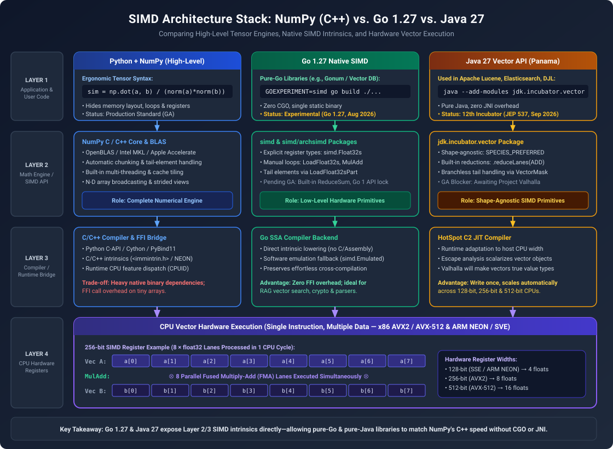
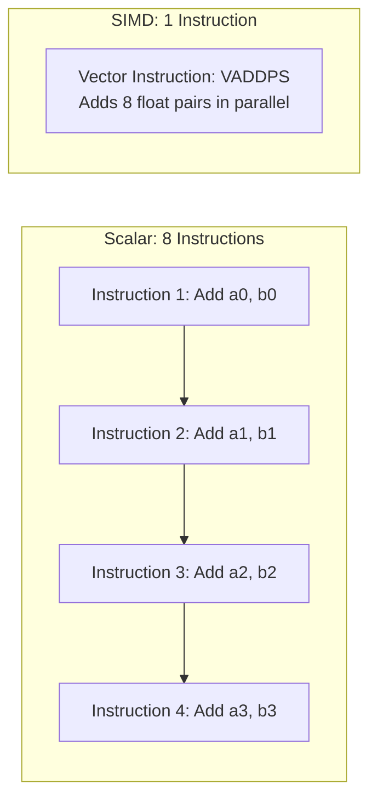
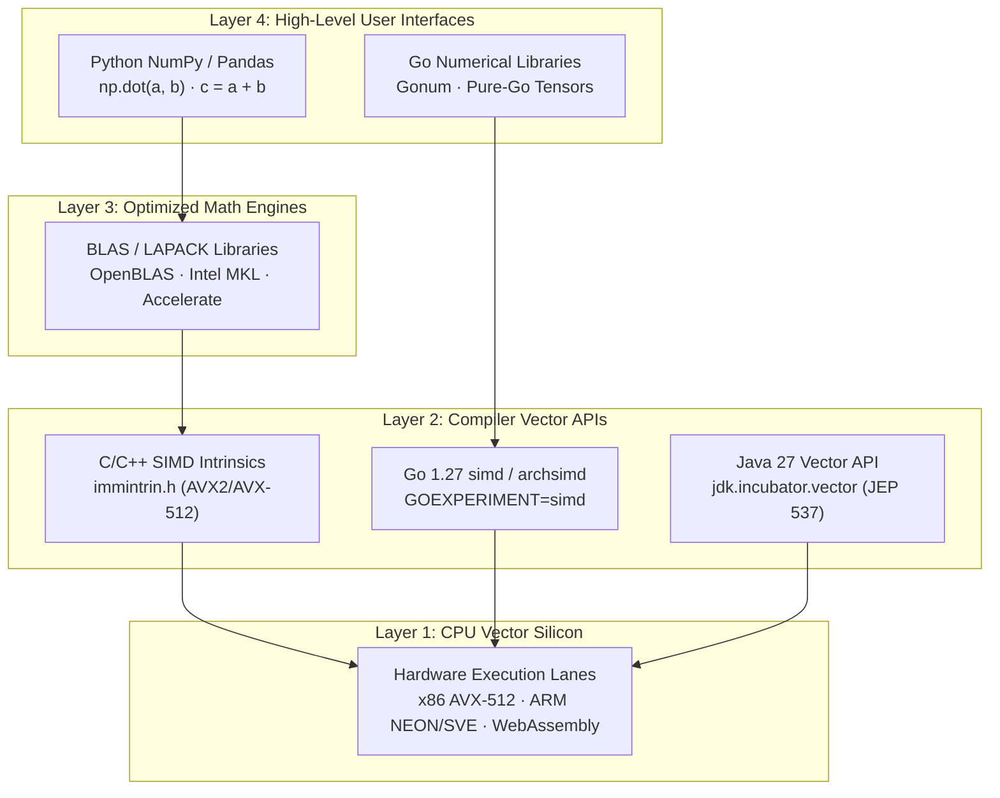
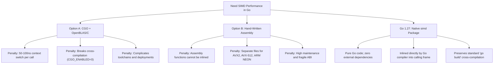
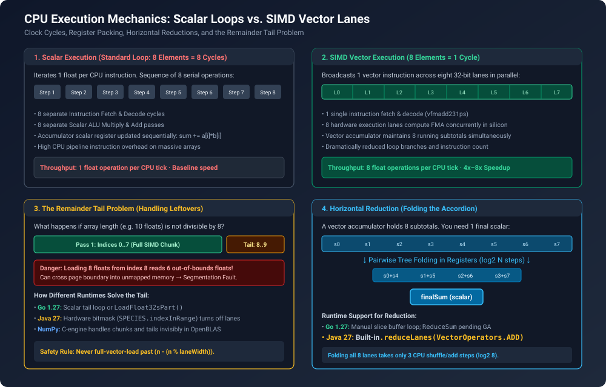
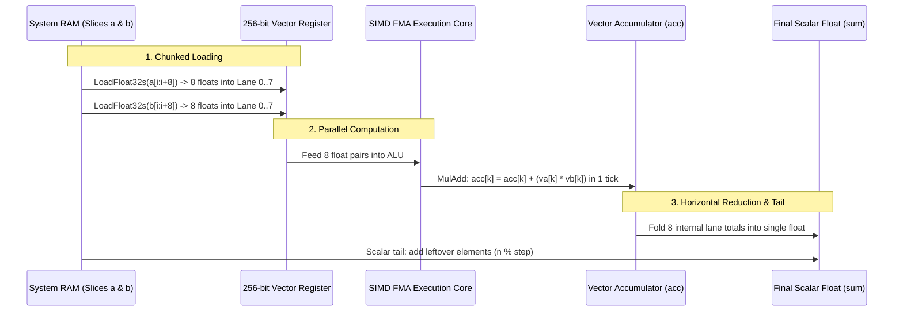
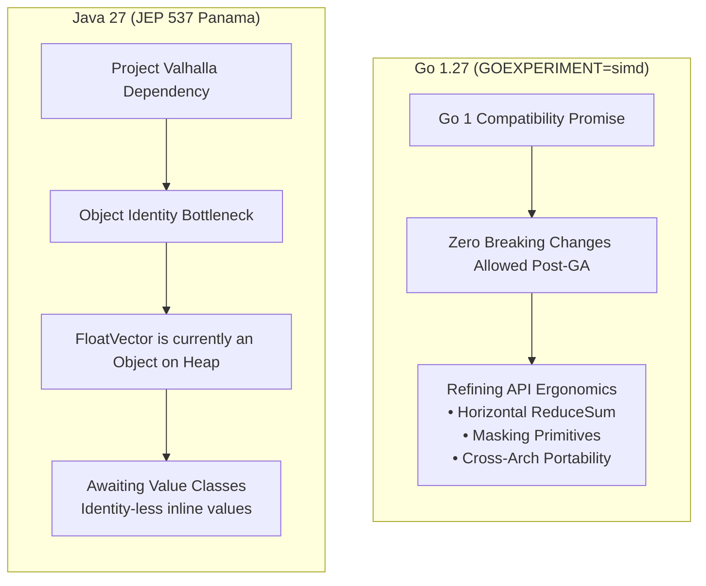

# Go 1.27 SIMD vs. NumPy vs. Java Vector API: Demystifying Vector Acceleration Across the Software Stack

Daily learning · November 14, 2026 · Technical Architecture & Performance Analysis

> **Core insight:** Go 1.27's experimental `simd` package and Python's NumPy are not competitors—they occupy completely different layers of the software pyramid. Go `simd` provides raw hardware-level engine components so systems developers can build high-speed primitives without CGO or assembly, while NumPy is a luxury dashboard that orchestrates pre-compiled C/Fortran linear algebra libraries (BLAS/LAPACK) under the hood.



---

## 1. Foundations: The Plain-Language Mental Model

To understand why low-level vector acceleration looks intimidating—and why modern languages are introducing native SIMD packages—we must first strip away compiler jargon and understand the physical hardware.

### The Kitchen Analogy: The Single Knife vs. The Multi-Blade Chopper

Imagine you run a commercial kitchen and need to dice 8 carrots into identical pieces:

* **Traditional Scalar Execution (SISD — Single Instruction, Single Data):**
  You pick up a standard kitchen knife. You place carrot 1 on the cutting board, slice down, and set it aside. You repeat this for carrot 2, carrot 3, all the way to carrot 8. You performed **8 separate physical downward cuts** to process 8 items.
* **Vector Execution (SIMD — Single Instruction, Multiple Data):**
  You buy an 8-slot mandoline grid chopper. You place all 8 carrots into the 8 parallel slots simultaneously. You slam the lever down **once**. In a single downward stroke, all 8 carrots are sliced at the exact same instant.



In CPU hardware:
* A standard scalar register holds **one** 32-bit or 64-bit number.
* A vector register is much wider: **128 bits** (SSE / ARM NEON), **256 bits** (AVX2), or **512 bits** (AVX-512 / ARM SVE).
* A 256-bit register divides into **eight 32-bit float "lanes"**. When the CPU encounters a vector instruction (like `VFMADD231PS`), it multiplies and adds eight independent pairs of numbers across all eight lanes in a single clock cycle.

### Essential Vocabulary

| Term | Simple Definition | Concrete Example |
|---|---|---|
| **Scalar** | Processing one data point per instruction. | Traditional `for i := 0; i < len(a); i++` loop. |
| **SIMD** | Processing multiple data points in parallel within a single CPU core. | Executing one assembly instruction across 8 float lanes. |
| **Vector Lane** | A single slice of a wide vector register holding one numeric element. | A 256-bit register partitioned into eight 32-bit float lanes. |
| **FMA (Fused Multiply-Add)** | Computing `(a * b) + c` in a single CPU instruction without intermediate rounding. | Dot product accumulation step (`acc.MulAdd(x, y)`). |
| **Loop Tail (Remainder)** | Elements remaining when array length does not divide evenly by lane width. | 10 elements processed in 8-lane chunks leaves 2 leftover elements. |
| **Horizontal Reduction** | Summing or combining all parallel lanes inside a vector register into one final scalar. | Folding an 8-lane accumulator vector `[s0..s7]` into a single total `sum`. |
| **Intrinsic** | A compiler-recognized function that maps directly to a specific CPU assembly instruction. | Go's `simd.Float32s.MulAdd()` mapping to x86 `vfmadd231ps`. |

---

## 2. The Software Stack: Comparing Layers, Not Tools

A frequent point of confusion for developers encountering Go 1.27's `simd` package is comparing it directly to Python's NumPy:

> *"Why is Go's SIMD code so tedious with manual loops and tail handling, while NumPy does the same thing in one line: `np.dot(a, b)`?"*

They operate at completely different strata of the computing stack. Comparing Go `simd` to NumPy is like comparing raw steel pistons to a luxury automobile dashboard.



### The Layer Breakdown

1. **Layer 1 (Silicon):** The CPU execution units (ALUs and SIMD vector registers like `%zmm0` or `%ymm0`).
2. **Layer 2 (Low-Level Vector Primitives):**
   * **Go 1.27 `simd` & `simd/archsimd`:** Direct language-level mappings to hardware vector instructions.
   * **Java 27 `jdk.incubator.vector`:** JVM JIT intrinsics compiling bytecode to vector assembly.
   * **C/C++ Intrinsics:** Header files (`<immintrin.h>`) exposing functions like `_mm256_fmadd_ps`.
3. **Layer 3 (Linear Algebra Engines):** Highly optimized libraries (OpenBLAS, Intel MKL, BLIS) authored by hardware vendors and math specialists. These libraries handle cache blocking, multithreading, and register tiling.
4. **Layer 4 (Ergonomic Data Science):** Python's NumPy, SciPy, and PyTorch. They expose clean operator overloading (`a @ b + c`) and delegate the heavy math down to Layer 3 via C foreign function interfaces (FFI).

Go's new `simd` package does not compete with NumPy's Layer 4 interface. Instead, it provides Go engineers with the native Layer 2 primitives required to build high-performance Layer 3 and Layer 4 engines inside the Go ecosystem.

---

## 3. Why Go Needed Native SIMD: The CGO and Assembly Dilemma

Historically, Go systems engineers who needed SIMD performance faced two unattractive choices:



### The CGO Barrier

Calling external C libraries using `cgo` destroys Go's greatest operational advantage: compiling clean, static, self-contained binaries. Furthermore, every CGO function invocation incurs an FFI bridge cost:

* Go switches from the lightweight goroutine stack to an operating system thread stack.
* The runtime switches execution context and manages garbage collector safepoints.
* This transition takes approximately **50 to 100 nanoseconds**.

For short vector calculations (such as calculating the cosine similarity of a 256-dimensional embedding, which takes under 40 nanoseconds on modern hardware), crossing the CGO boundary is more expensive than the calculation itself.

### The Assembly Maintenance Nightmare

Teams building high-speed vector databases or cryptographic tools in Go often resorted to writing raw assembly (`.s` files). However:
* Go assembly functions cannot be inlined by the compiler, leaving function call overhead intact.
* Supporting modern hardware requires writing and maintaining multiple assembly kernels: one for x86 SSE, one for AVX2, one for AVX-512, one for ARM NEON, and one for ARM SVE.
* Few engineering teams possess the specialized knowledge required to audit, debug, and maintain raw assembly routines.

Go 1.27's native `simd` packages eliminate this dilemma by allowing developers to write type-safe, inlinable Go code that compiles directly into vector assembly instructions.

---

## 4. Deconstructing the Mechanism: The Cosine Similarity Example

To see how Go 1.27's SIMD primitives operate in practice, consider calculating the **dot product** (the core mathematical kernel behind cosine similarity in AI embeddings and vector search):

$$\text{DotProduct}(a, b) = \sum_{i=0}^{N-1} a_i \times b_i$$

### Step 1: The Traditional Scalar Loop (Normal Go)

```go
func DotProductScalar(a, b []float32) float32 {
    var sum float32
    for i := 0; i < len(a); i++ {
        sum += a[i] * b[i]
    }
    return sum
}
```

* **How it executes:** The CPU runs a loop $N$ times. Each iteration performs one memory load, one multiplication, and one addition. If $N = 1024$, the CPU issues over 3,000 separate instructions.

### Step 2: The Vectorized Loop (Go 1.27 SIMD)

Under Go 1.27, vector support is activated via `GOEXPERIMENT=simd` and the `//go:build goexperiment.simd` build constraint:

```go
//go:build goexperiment.simd

package mathops

import "simd"

func DotProductSIMD(a, b []float32) float32 {
    n := len(a)
    // Step A: Determine runtime vector lane width (e.g., 8 for AVX2)
    step := simd.Float32sLen()
    limit := n - (n % step)

    // Step B: Initialize a zeroed accumulator vector register
    acc := simd.Float32s(0)

    // Step C: Main Vector Loop (Processes 'step' elements per iteration)
    for i := 0; i < limit; i += step {
        va := simd.LoadFloat32s(a[i:])
        vb := simd.LoadFloat32s(b[i:])
        acc = acc.MulAdd(va, vb) // Fused Multiply-Add across all lanes
    }

    // Step D: Horizontal Reduction (Sum the parallel lanes inside 'acc')
    var sum float32
    var accBuf [simd.MaxFloat32sLen]float32
    acc.Store(accBuf[:step])
    for j := 0; j < step; j++ {
        sum += accBuf[j]
    }

    // Step E: Loop Tail (Handle remaining elements that did not fill a lane)
    for i := limit; i < n; i++ {
        sum += a[i] * b[i]
    }

    return sum
}
```



### Breaking Down the 5 Steps That Confuse Learners



1. **Step A (Vector Width Discovery):** `simd.Float32sLen()` inspects the host CPU. On an AVX2 system, it returns `8` (256 bits $\div$ 32 bits). On an AVX-512 system, it returns `16`. On a system without SIMD, it falls back to a portable pure-Go width.
2. **Step B (Vector Accumulator):** `acc` is not a single floating-point number. It is a vector holding 8 independent partial sums (`[acc0, acc1, ..., acc7]`).
3. **Step C (Chunked Load & MulAdd):** `LoadFloat32s` reads 8 contiguous memory addresses into the CPU vector register in one memory operation. `MulAdd` computes `acc = acc + (va * vb)` across all 8 lanes in a single clock cycle.
4. **Step D (Horizontal Reduction / "Folding the Accordion"):** When the loop ends, you do not have one answer; you have 8 lane totals. In Go 1.27, horizontal reduction (`ReduceSum`) is not yet a single built-in opcode in the high-level package. Developers store the vector buffer and sum the 8 values into a final scalar `sum`.
5. **Step E (Handling the "Tail"):** If an array has 26 floats and your lane processes 8 at a time:
   * Chunks processed: $8 + 8 + 8 = 24$ elements.
   * Leftover elements: $26 - 24 = 2$ elements.
   * You cannot call `LoadFloat32s` on index 24, because reading 8 floats would read past the allocated slice into unmapped memory, causing a segmentation fault. You must process those final 2 elements using either a small scalar fallback loop or `LoadFloat32sPart`.

---

## 5. How Java Compares: Project Panama Vector API

Java introduced its explicit SIMD engine years ahead of Go via **Project Panama's Vector API** (`jdk.incubator.vector`), initially previewed in JDK 16 and currently in its **12th incubator release in Java 27** ([JEP 537](https://openjdk.org/jeps/537)).

### The Java Vector Loop

```java
import jdk.incubator.vector.FloatVector;
import jdk.incubator.vector.VectorSpecies;
import jdk.incubator.vector.VectorOperators;

public class VectorDotProduct {
    private static final VectorSpecies<Float> SPECIES = FloatVector.SPECIES_PREFERRED;

    public static float dotProduct(float[] a, float[] b) {
        var acc = FloatVector.zero(SPECIES);
        int i = 0;
        int limit = SPECIES.loopBound(a.length);

        // Main SIMD loop
        for (; i < limit; i += SPECIES.length()) {
            var va = FloatVector.fromArray(SPECIES, a, i);
            var vb = FloatVector.fromArray(SPECIES, b, i);
            acc = va.fma(vb, acc);
        }

        // Built-in horizontal reduction (folds all lanes in 1 line)
        float sum = acc.reduceLanes(VectorOperators.ADD);

        // Hardware-masked tail processing (No scalar loop needed!)
        var mask = SPECIES.indexInRange(i, a.length);
        var vaTail = FloatVector.fromArray(SPECIES, a, i, mask);
        var vbTail = FloatVector.fromArray(SPECIES, b, i, mask);
        sum += vaTail.mul(vbTail).reduceLanes(VectorOperators.ADD);

        return sum;
    }
}
```

### Key Differences Between Go 1.27 and Java 27

1. **Hardware-Masked Tails:** Java provides `SPECIES.indexInRange(i, length)`. This creates a hardware bitmask that instructs the CPU vector unit to disable inactive lanes during loading and computation. Java developers do not need to write scalar fallback loops.
2. **Built-in Reductions:** Java's `.reduceLanes(VectorOperators.ADD)` maps directly to CPU horizontal addition instructions (like `VEXTRACTF128` and `VHADDPS`), eliminating the manual buffer-and-sum loop required in Go 1.27.
3. **Shape-Agnostic Compilation:** Java's `FloatVector.SPECIES_PREFERRED` compiles down to 128-bit, 256-bit, or 512-bit native instructions dynamically at runtime via the HotSpot C2 JIT compiler. The same compiled `.class` file automatically utilizes AVX-512 on an Intel Xeon and NEON on an Apple Silicon M-series chip.

### Production Adoption: Apache Lucene

While still technically an incubator module requiring the `--add-modules jdk.incubator.vector` flag, Java's Vector API is already deployed in large-scale production infrastructure:
* **Apache Lucene (Elasticsearch and OpenSearch):** Uses the Vector API to power its Hierarchical Navigable Small World (HNSW) vector search engine.
* **Benchmarked Speedup:** Accelerates cosine distance and dot-product calculations by **3x to 5x** over standard Java loops, directly improving retrieval-augmented generation (RAG) and dense vector search latency without native C++ JNI libraries.

---

## 6. The Incubation Puzzle: Why Neither Go nor Java Has Shipped GA

A common question from software architects is:

> *"If SIMD provides 4x–8x performance improvements and Lucene already uses it in production, why are both Go 1.27 and Java 27 keeping it behind experimental flags?"*

The reasons reveal the contrasting governance and technical architectures of both language ecosystems.



### Go's Reason: The "Forever Contract" (Go 1 Compatibility Guarantee)

Go enforces one of the strictest backward-compatibility policies in the software industry:
* Once a package graduates into the standard library (outside `experimental`), its public API **can never be broken or modified** for the entire lifespan of Go 1.x.
* If the Go team ships an imperfect API (such as an awkward tail-loading helper or an incomplete reduction function), developers and library authors are stuck with it indefinitely.
* The Go team is intentionally keeping `simd` under `GOEXPERIMENT=simd` across multiple release cycles (Go 1.27 through Go 1.28+) to gather real-world community feedback, refine cross-architecture behavior across x86, ARM64, and WebAssembly, and add native horizontal reduction helpers before freezing the API forever.

### Java's Reason: The "Identity Crisis" (Blocked on Project Valhalla)

Java's Vector API has been syntactically and semantically stable for years, but OpenJDK architects refuse to promote it to General Availability (GA) due to Java's fundamental type system:

* In Java today, every instance of `FloatVector` is an **Object** allocated on the heap with standard object overhead: an 8-to-16-byte object header, garbage collection tracking, and identity semantics (such as `==` reference equality and synchronization monitors).
* To make vector operations fast, the HotSpot C2 JIT compiler must perform aggressive **escape analysis** to eliminate object allocations and pack the data directly into CPU vector registers.
* If escape analysis fails (due to complex branching, inlining limits, or dynamic dispatch), performance drops dramatically as the JVM starts allocating millions of short-lived vector objects per second, triggering severe GC pressure.
* **The Solution:** Java is waiting for **Project Valhalla**. Valhalla introduces **Value Classes** (identity-less objects) and primitive specialization. Once Valhalla lands, `FloatVector` will become a true inline value type that can never escape to the heap, guaranteeing zero allocation overhead under all runtime conditions.

---

## 7. Comprehensive Architectural Comparison

| Dimension | Python (NumPy) | Go 1.27 (`simd`) | Java 27 (`jdk.incubator.vector`) |
|---|---|---|---|
| **Architectural Layer** | High-level data science interface (Layer 4) | Low-level systems intrinsics (Layer 2) | Mid-to-low level JIT intrinsics (Layer 2) |
| **Current Status** | Production standard / Universal GA | **Experimental** (`GOEXPERIMENT=simd`) | **12th Incubator** (JEP 537 in JDK 27) |
| **Activation Requirement** | Standard `import numpy as np` | Build flag: `GOEXPERIMENT=simd` | JVM flag: `--add-modules jdk.incubator.vector` |
| **Underlying Engine** | C / Fortran libraries (OpenBLAS, Intel MKL) | Pure Go compiler vectorizer & `archsimd` | HotSpot C2 JIT native vector code generator |
| **Leftover Tail Handling** | Fully abstracted (handled internally by BLAS) | Manual scalar loop or `LoadFloat32sPart` | Built-in hardware `VectorMask` |
| **Horizontal Reduction** | Automatic (`np.sum()`, `np.dot()`) | Manual buffer extraction & scalar sum loop | Built-in `.reduceLanes(VectorOperators.ADD)` |
| **Deployment Model** | Dynamic C shared libraries (`.so`, `.dylib`) | **Single standalone static executable binary** | Standard `.jar` file running on JVM |
| **Zero-Dependency Safety** | Requires external C toolchain & native binaries | **100% pure Go; cross-compiles anywhere** | Pure Java bytecode; runs on any modern JVM |
| **Primary Use Cases** | Interactive notebooks, model training, Pandas | Vector search, crypto, JSON parsers, microservices | Enterprise search (Lucene), database vector scans |

---

## 8. Practical Takeaways for Systems Architects

1. **Do not wait for GA for internal infrastructure:** If you build and deploy your own containerized backend services, both Go 1.27's `simd` and Java's Vector API are safe and proven for high-throughput production paths today (as Apache Lucene demonstrates).
2. **Isolate SIMD behind a clean internal interface:** Always implement a portable scalar fallback path:

```go
type VectorEngine interface {
    DotProduct(a, b []float32) float32
}
```

By decoupling your application logic from the SIMD implementation, you can swap between experimental SIMD and standard scalar loops without refactoring business logic when the APIs graduate to GA.

3. **Mind the library consumer trade-off:**
   * In **Go**, `GOEXPERIMENT=simd` is strictly a **compile-time build flag**. Downstream end users who download your compiled binary do not need to configure anything.
   * In **Java**, `--add-modules jdk.incubator.vector` is a **runtime JVM argument**. If you ship an open-source Java library relying on the Vector API, your library's consumers must explicitly add this flag to their deployment scripts.

---

**Related:**
- [Go Proposed Collections vs. Java Collections Framework (2026)](Go-Proposed-Collections-vs-Java-Collections-Framework-2026.md) — How Go standard library evolution balances backward compatibility against enterprise developer ergonomics.
- [Java 25 vs. Go 1.24 & Go 1.25 Runtime Comparison](Java25-vs-Go1.24-Go1.25.md) — Detailed memory model, GC tracing, and concurrency primitives between modern Go and Java runtimes.
- [Go Test Performance: Windows vs. Linux (2026)](../Go-Test-Performance-Windows-vs-Linux-2026.md) — OS-level scheduling, process instantiation overhead, and filesystem bottlenecks in Go toolchains.
- [TypeScript Rust Port (TSRS) Architecture (Nov 2026)](../TypeScript-Rust-Port-TSRS-Architecture-Nov-2026.md) — Memory layout optimizations, pointer compression, and native SIMD throughput in systems compilers.
