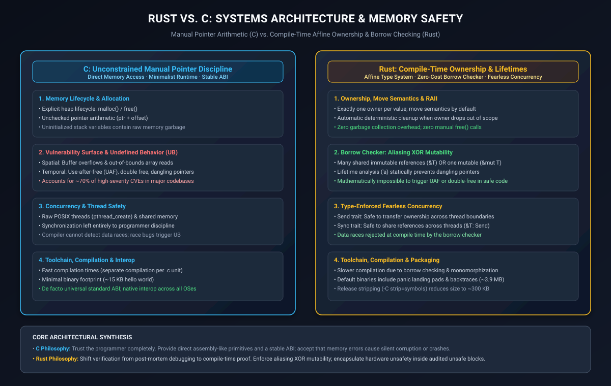
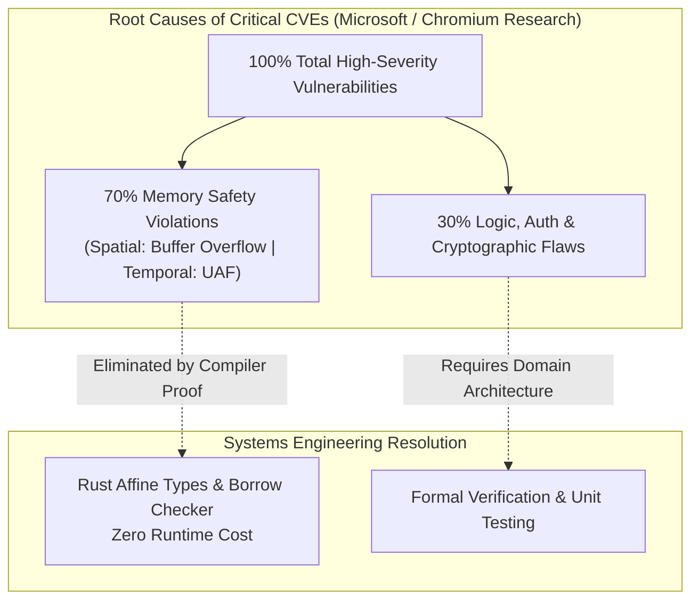
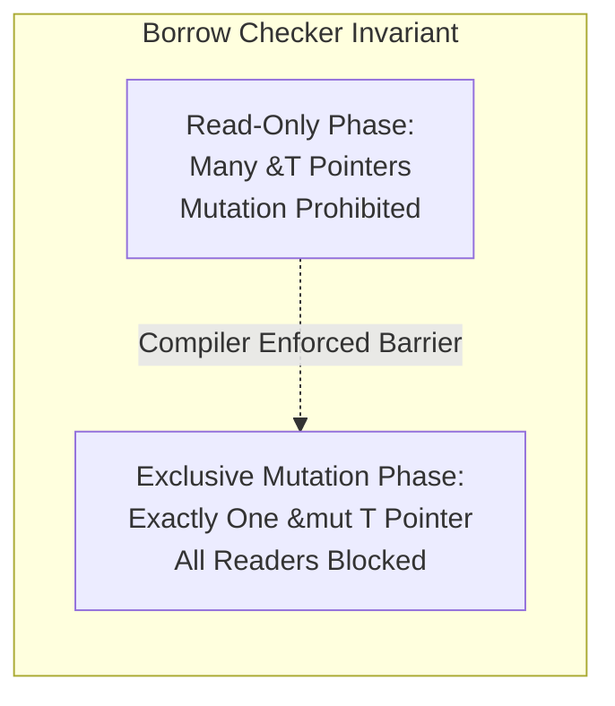
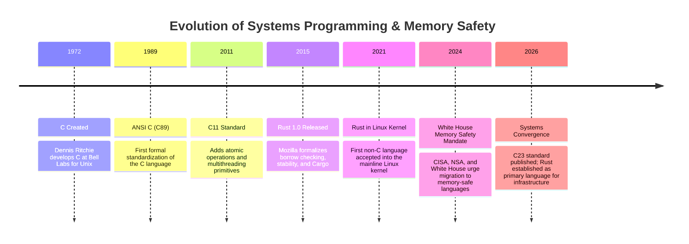
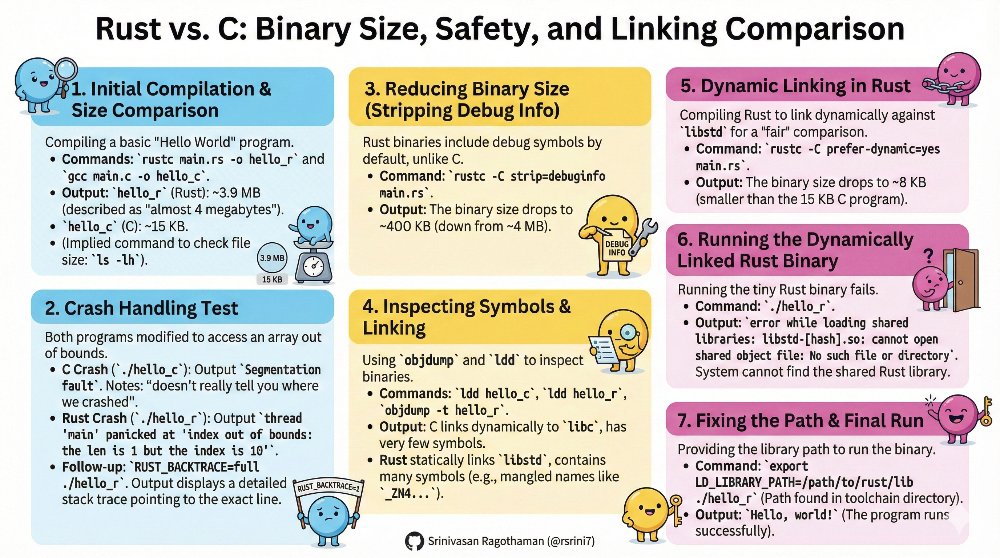

# Rust vs. C: Systems Programming, Memory Safety, and Low-Level Performance Architectures

Learning note · Revised November 2026 · Systems Programming &amp; Language Runtimes  
*By Srinivasan Ragothaman ([@rsrini7](https://github.com/rsrini7))*

> **Core idea:** While both C and Rust compile down to bare-metal native machine code without garbage collection runtime overhead, they resolve systems programming trade-offs through diametrically opposed safety models. C delegates pointer safety, memory lifecycles, and concurrency synchronization entirely to manual developer discipline, whereas Rust guarantees spatial and temporal memory safety at compile time through affine types, ownership mechanics, and the borrow checker—trading compiler complexity and strict type semantics for the elimination of entire classes of memory vulnerabilities.


*Figure 1: High-level architectural comparison contrasting C's unconstrained pointer model and manual memory discipline with Rust's compile-time affine type system, borrow checker, and thread-safety markers.*

---

## 1. Foundations: The Memory Safety Crisis in Systems Software

For over five decades, C (formalized in 1972 by Dennis Ritchie) has stood as the universal lingua franca of operating system kernels, device drivers, embedded microcontrollers, and high-throughput networking engines. C provides an unvarnished abstraction over physical hardware: memory is a flat array of addressable bytes, pointers represent raw hardware memory addresses, and execution speed is bounded only by the underlying CPU instruction set.

However, C's architectural minimalism comes at an immense security cost. C provides neither spatial nor temporal memory protection:
- **Spatial Memory Violations:** Out-of-bounds array reads and writes, buffer overflows, and format string vulnerabilities.
- **Temporal Memory Violations:** Use-After-Free (UAF), double free, uninitialized memory reads, and dangling pointers.

Empirical research from Microsoft, Google, the US Cybersecurity and Infrastructure Security Agency (CISA), and the NSA demonstrates that approximately **70% of all high-severity Common Vulnerabilities and Exposures (CVEs)** across major production codebases (Windows, Chromium, Android, Linux) stem directly from memory safety defects:



Rust was created to preserve C's bare-metal execution performance, predictable latency, and zero-runtime footprint while mathematically eliminating this entire 70% vulnerability surface at compile time.

### Architectural Comparison Matrix

| Dimension | C (ISO C17 / C23) | Rust (Edition 2021 / 2024) | Architectural Significance |
| :--- | :--- | :--- | :--- |
| **Runtime Model** | Zero runtime; direct libc syscalls | Zero runtime; no garbage collector | Both execute directly on physical CPU cores with identical theoretical throughput ceilings. |
| **Memory Management** | Manual `malloc()` / `free()` | Compile-time RAII via Ownership | Rust binds memory release deterministically to variable scope boundaries. |
| **Pointer Mechanics** | Raw unchecked memory addresses | References (`&T`, `&mut T`) + Lifetimes | Rust guarantees pointers are always valid, non-null, and non-dangling. |
| **Concurrency Model** | Unchecked threads &amp; shared memory | `Send` and `Sync` marker traits | Rust detects data races at compile time ("fearless concurrency"). |
| **ABI Stability** | Universal de facto industry standard | Unstable internal ABI (`extern "C"` supported) | C integrates natively with every OS; Rust requires explicit C FFI wrappers. |
| **Compilation Speed** | Blazing fast (linear per file) | Slower (borrow checking &amp; monomorphization) | C trades compiler verification speed for runtime debugging and vulnerability patching. |
| **Binary Size (Debug)** | Minimal (~15 KB hello world) | Larger (~3.9 MB hello world) | Rust debug binaries embed panic unwinding landing pads, backtrace tables, and symbol metadata. |
| **Binary Size (Stripped Release)** | ~15 KB | ~30 KB (with `-C strip=symbols -C panic=abort`) | Optimized release Rust binaries match C's lightweight footprint. |

---

## 2. Deep Technical Mechanisms

### 2.1 Ownership, Move Semantics, and RAII

In C, memory allocation and reclamation are decoupled from type definitions. A pointer returned by `malloc()` carries no structural metadata regarding who owns the buffer or when it should be released:

```c
// C: Ownership is implicit in documentation, unenforced by compiler
char* buffer = (char*)malloc(1024);
process_buffer(buffer);
// Who frees buffer? If caller frees and process_buffer retained a copy -> UAF.
// If neither frees -> Memory Leak. If both free -> Double Free.
```

Rust replaces manual memory management with **Resource Acquisition Is Initialization (RAII)** enforced via an **affine type system**:
1. Every value in Rust has exactly one variable that is its **owner**.
2. When the owner's scope ends, the memory is dropped automatically via the `Drop` trait.
3. Assigning a value to another variable transfers ownership (**move semantics**), invalidating the original variable at compile time:

```rust
// Rust: Ownership transfer enforced at compile time
let buffer = Vec::<u8>::with_capacity(1024);
process_buffer(buffer); // Ownership moves into process_buffer
// println!("{:?}", buffer); // COMPILE ERROR: value borrowed here after move
```

### 2.2 The Borrow Checker: The Aliasing XOR Mutability Principle

The fundamental theorem underlying Rust's memory safety is the **Aliasing XOR Mutability Principle**:

$$\text{Safety Invariant: } (\text{Shared References } \&T \land \neg \text{Mutable}) \lor (\text{Unique Reference } \&\text{mut } T \land \neg \text{Aliased})$$

At any given point in program execution:
- You may have any number of immutable references (`&T`) to a resource.
- **OR** you may have exactly one mutable reference (`&mut T`).
- You can **never** have both simultaneously.

This invariant eliminates data races, iterator invalidation, and dangling pointers without requiring runtime locks:



### 2.3 Spatial Safety: Slices vs. Null-Terminated Buffers

In C, arrays decay into raw pointers (`char*` or `int*`). Functions like `strcpy` or `memcpy` rely on encountering a null-terminator byte (`\0`) or assume the destination buffer is sufficiently sized. If input exceeds buffer capacity, the write overflows into adjacent stack frames, corrupting instruction pointers (`EIP`/`RIP`) and enabling arbitrary code execution:

$$\text{C Array Decay: } \text{char buffer[16]} \xrightarrow{\text{decays}} \text{char* (No length metadata)}$$

In Rust, arrays and slices are represented as **fat pointers** consisting of a hardware memory pointer paired with a 64-bit length scalar:

$$\text{Rust Slice: } \&[T] \iff \left(\text{pointer: } *const\ T, \quad \text{length: } usize\right)$$

Every indexing operation (`slice[i]`) performs an automatic bounds check. If `i >= length`, Rust triggers a controlled panic rather than executing an out-of-bounds memory write. In tight numeric loops, the LLVM optimizer automatically proves that induction variables stay within bounds, vectorizing the loop and eliminating the runtime bounds check entirely with zero performance penalty.

### 2.4 Why Debug Rust Binaries Are Larger (and How to Fix It)

A common developer observation is that compiling a minimal "Hello World" in C produces a ~15 KB binary, whereas `rustc main.rs` produces a ~3.9 MB executable. This disparity is frequently misunderstood as "runtime bloat":

1. **Panic Landing Pads &amp; Unwinding Tables:** By default, Rust panics unwind the stack using standard DWARF/libunwind tables, allowing destructors to execute. This machinery requires structured exception-handling metadata.
2. **Backtrace &amp; Formatting Engines:** Rust's standard library embeds rich diagnostic panic formatting engines, file/line mapping tables, and symbol name demanglers so panics display actionable tracebacks rather than opaque OS `Segmentation fault` errors.
3. **Debug Symbols:** Unstripped Rust executables include complete DWARF debug info for the entire embedded standard library.

#### Stripping Rust Binaries to Match C Footprint
By disabling stack unwinding and stripping debug symbols in `Cargo.toml`, Rust binaries collapse to a footprint nearly identical to C:

```toml
[profile.release]
opt-level = "z"     # Optimize aggressively for binary size
lto = "fat"         # Enable cross-crate Link-Time Optimization
codegen-units = 1   # Maximize compiler optimization passes
panic = "abort"     # Eliminate stack unwinding tables
strip = "symbols"   # Strip all debug symbols and section headers
```

Compiling with these flags shrinks a Rust binary from **3.9 MB down to ~30 KB**.

---

## 3. Production Implementations & Code Recipes

### 3.1 Memory Safety & Bounds Violations: C vs. Rust

The following side-by-side examples demonstrate how C permits catastrophic out-of-bounds buffer corruption while Rust prevents it deterministically.

#### The C Failure Mode (Undefined Behavior)
```c
// bounds_bug.c - Demonstrates silent memory corruption in C
#include <stdio.h>
#include <stdlib.h>

void vulnerable_access(int index) {
    int array[2] = {10, 20};
    // Accessing out-of-bounds memory: No compiler warning by default!
    // Silently reads arbitrary stack memory or crashes with Segmentation Fault
    printf("Value at index %d: %d\n", index, array[index]);
}

int main() {
    vulnerable_access(10); // Out of bounds read: Undefined Behavior
    return 0;
}
```

#### The Rust Safe Defense (Controlled Diagnostic Panic)
```rust
// bounds_safe.rs - Demonstrates compile-time & runtime safety in Rust
fn safe_access(index: usize) {
    let array = [10, 20];

    // Method 1: Idiomatic safe lookup using Option
    match array.get(index) {
        Some(val) => println!("Value: {val}"),
        None => println!("[SAFE] Index {index} is out of bounds; handled gracefully"),
    }

    // Method 2: Direct indexing panics with exact diagnostic backtrace
    // println!("Direct: {}", array[index]);
    // Triggers: thread 'main' panicked at 'index out of bounds: the len is 2 but the index is 10'
}

fn main() {
    safe_access(10);
}
```

### 3.2 Concurrency & Data Race Elimination: C vs. Rust

#### C: Unsynchronized Data Race
```c
// race_condition.c - Compiles cleanly in C, but contains a severe data race
#include <stdio.h>
#include <pthread.h>

long counter = 0; // Shared mutable global state

void* increment(void* arg) {
    for (int i = 0; i < 100000; i++) {
        counter++; // DATA RACE: Unsynchronized read-modify-write
    }
    return NULL;
}

int main() {
    pthread_t t1, t2;
    pthread_create(&t1, NULL, increment, NULL);
    pthread_create(&t2, NULL, increment, NULL);
    pthread_join(t1, NULL);
    pthread_join(t2, NULL);
    // Expected: 200,000. Actual: Inconsistent garbage (e.g. 134,812)
    printf("Final Counter: %ld\n", counter);
    return 0;
}
```

#### Rust: Compiler Rejection of Data Races
```rust
// race_prevention.rs - Rust guarantees data race prevention at compile time
use std::sync::{Arc, Mutex};
use std::thread;

fn main() {
    // Shared mutable state must be wrapped in an Arc (atomic ref count) and Mutex
    let counter = Arc::new(Mutex::new(0i64));
    let mut handles = vec![];

    for _ in 0..2 {
        let counter_clone = Arc::clone(&counter);
        let handle = thread::spawn(move || {
            for _ in 0..100_000 {
                // MutexGuard automatically locks here and unlocks on drop
                let mut data = counter_clone.lock().unwrap();
                *data += 1;
            }
        });
        handles.push(handle);
    }

    for handle in handles {
        handle.join().unwrap();
    }

    // Guaranteed deterministic result: Exactly 200,000
    println!("Final Counter: {}", *counter.lock().unwrap());
}
```

### 3.3 Safe Interoperability: Calling C from Rust via FFI

Rust provides native, zero-overhead foreign function interop (FFI) with C libraries through the `extern "C"` calling convention:

```rust
// c_ffi_example.rs - Interfacing Rust with standard C libc
use std::ffi::CStr;
use std::os::raw::c_char;

// Declare external C symbol from libc
extern "C" {
    fn getenv(name: *const c_char) -> *mut c_char;
}

pub fn get_environment_variable(var_name: &str) -> Option<String> {
    // Null-terminate the string for C
    let c_name = std::ffi::CString::new(var_name).ok()?;

    // Unsafe block strictly isolated to the foreign function call
    let raw_ptr: *mut c_char = unsafe { getenv(c_name.as_ptr()) };

    if raw_ptr.is_null() {
        None
    } else {
        // Safely parse the null-terminated C string into an owned Rust String
        let c_str = unsafe { CStr::from_ptr(raw_ptr) };
        c_str.to_str().ok().map(|s| s.to_string())
    }
}

fn main() {
    match get_environment_variable("USER") {
        Some(user) => println!("Current System User (via C libc): {user}"),
        None => println!("USER variable not set"),
    }
}
```

---

## 4. Impact, Real-World Edge Cases & Gotchas

### 4.1 Engineering Constraints & Trade-Offs

1. **Compilation Time & Developer Iteration Speed:** C compilers (`gcc`, `clang`) process files as independent translation units, offering extremely fast incremental build times. Rust's borrow checker, lifetime resolution, macro expansions, and heavy template-like generic monomorphization increase build times by $3\times\text{ to }10\times$. Large Rust projects rely on `sccache` and `cargo check` to mitigate developer workflow friction.
2. **ABI Instability & Binary Interfaces:** C has a fixed, standardized Application Binary Interface (ABI) for each target architecture. A dynamic library compiled with GCC in 2012 can be linked seamlessly by Clang in 2026. Rust has **no stable internal ABI**; two crates compiled with different compiler versions cannot share native Rust data types without passing them through an `extern "C"` interface.
3. **Intrusive Data Structures & the `unsafe` Boundary:** Graph structures, doubly-linked lists, and operating system page tables involve cyclic references and multiple aliased pointers that violate Rust's single-ownership rules. Implementing these structures requires `unsafe` raw pointers (`*mut T`) or arena allocation crates (such as `bumpalo`), re-introducing manual verification obligations.

### 4.2 Common Claims vs. Technical Realities

| Common Claim | Technical Reality | Systems Engineering Implication |
| :--- | :--- | :--- |
| **"C is fundamentally faster than Rust."** | Both languages emit code through LLVM backends. In many workloads, Rust is faster because the borrow checker proves pointer non-aliasing at compile time, enabling LLVM to optimize registers without reloading memory (equivalent to C's `restrict` keyword applied globally). | Performance differences between C and Rust are typically within $\pm 3\%$, dominated by cache layout and algorithm choice rather than language semantics. |
| **"Rust binaries are bloated and unusable on embedded systems."** | Default debug binaries contain unwinding tables and backtrace formatters (~4 MB). When configured with `panic = "abort"`, LTO, and stripped symbols, Rust executables shrink to 20–30 KB and run comfortably on Cortex-M microcontrollers with 16 KB RAM. | Apply size-optimized Cargo release profiles for embedded and container targets. |
| **"Rewriting a codebase in Rust eliminates all security bugs."** | Rust eliminates *memory safety* vulnerabilities (UAF, buffer overflows). It cannot prevent business logic bugs, integer overflows (in release mode), SQL injections, or algorithmic side-channel timing leaks. | Combine Rust with formal verification, static analysis, and threat modeling for complete defense-in-depth. |
| **"Rust's borrow checker makes concurrency impossible without locks."** | Rust enables lock-free concurrency via atomic primitives (`std::sync::atomic`) and channel architectures (crossbeam). The borrow checker guarantees that data passed across threads is free of hidden aliasing. | Use message-passing channels or atomic state for high-throughput concurrency rather than coarse-grained global mutexes. |

---

## 5. Practical Adoption Blueprint & Verification Checklist

### 5.1 Systems Architecture Decision Tree

```
Do you need to write low-level systems software without garbage collection?
  │
  ├── Are you writing a micro-kernel for an obscure 8-bit MCU without LLVM support?
  │     └── YES ──> Choose C (ISO C23)
  │                 • Direct bare-metal compiler availability
  │                 • Universal toolchain compatibility
  │
  ├── Are you building a stable public C ABI shared across hundreds of foreign languages?
  │     └── YES ──> Choose C (or Rust with an audited `extern "C"` surface)
  │                 • Guaranteed stable dynamic library ABI
  │
  └── Are you building network proxies, storage engines, browser engines, or cloud infrastructure?
        └── YES ──> Choose Rust (Edition 2024)
                    • Elimination of 70% memory corruption CVEs
                    • Compile-time thread safety without runtime overhead
                    • Rich modern packaging ecosystem (Cargo, crates.io)
```

### 5.2 Verification Checklist for Systems Software

- [ ] **Release Profile Optimization:** Confirm production Cargo profiles enable `lto = "fat"`, `codegen-units = 1`, and `strip = "symbols"`.
- [ ] **Unsafe Code Audit:** Run `cargo geiger` in CI pipelines to count and audit all `unsafe` blocks. Every `unsafe` block must include a `// SAFETY:` explanatory invariant comment.
- [ ] **Sanitizer Verification (C Codebases):** If maintaining C codebases, compile with `-fsanitize=address,undefined` in CI to detect memory corruption during test execution.
- [ ] **Clippy Linter Enforcement:** Enforce strict linting rules in Rust CI: `#![deny(clippy::correctness)]` and `#![warn(clippy::perf)]`.
- [ ] **FFI Boundary Sanitization:** Ensure all pointers crossing `extern "C"` boundaries validate non-null status and string length before dereferencing.

---

## 6. Timeline and Evolution of Systems Programming Languages



- **1972 — Creation of C:** Dennis Ritchie develops C at Bell Labs to re-implement the Unix operating system, establishing pointer-based systems programming.
- **1989–1999 — ANSI C (C89) &amp; C99:** ISO formalizes C, introducing inline functions, variable-length arrays, and standardized integer types (`stdint.h`).
- **2011 — C11 Standard:** Adds standardized memory models, atomic operations (`stdatomic.h`), and thread support (`threads.h`).
- **2015 — Rust 1.0 Release:** Mozilla officially stabilizes Rust 1.0, establishing backward compatibility guarantees and proving that borrow checking can manage memory without garbage collection.
- **2021–2023 — Linux Kernel &amp; Cloud Adoption:** Linus Torvalds accepts Rust into the Linux kernel (Linux 6.1). Microsoft, Amazon, and Google adopt Rust for foundational cloud hypervisors and Android system daemons.
- **2024–2026 — White House Mandates &amp; C23:** The US White House Office of the National Cyber Director (ONCD) and CISA mandate that critical infrastructure transition away from memory-unsafe languages. The ISO C23 standard formalizes modern enhancements while Rust solidifies its position as the de facto standard for modern systems engineering.

---

## 7. Primary Sources & References

### Standards & Official Language Disclosures

1. [White House ONCD: Back to the Building Blocks — A Path Toward Secure and Measurable Software](https://www.whitehouse.gov/oncd/briefing-room/2024/02/26/press-release-technical-report/) — Executive report mandating memory-safe language adoption for national infrastructure.
2. [CISA: The Case for Memory Safe Roadmaps](https://www.cisa.gov/resources-tools/resources/case-memory-safe-roadmaps) — US Cybersecurity &amp; Infrastructure Security Agency guidance on eliminating buffer overflows and UAF vulnerabilities.
3. [The Rust Programming Language &amp; Reference](https://doc.rust-lang.org/reference/) — Steve Klabnik, Carol Nichols, and the Rust Core Team. The authoritative specification for ownership, lifetimes, and the borrow checker.
4. [ISO/IEC 9899:2024 (C23 Standard)](https://www.iso.org/standard/82075.html) — International Organization for Standardization. Official technical specification for the C programming language.
5. [Chromium Security: Memory Safety Vulnerabilities Analysis](https://www.chromium.org/Home/chromium-security/memory-safety/) — Google Chromium Security Team empirical disclosure attributing 70% of high-severity vulnerabilities to memory safety.

### Companion Architecture Notes

6. [Scaling-Cpp-Services-To-1-Million-RPS-2026](../../Architecture/Scaling-Cpp-Services-To-1-Million-RPS-2026.md) — Analyzes low-level systems programming, cache line alignment, and zero-copy `io_uring` architectures in C++.
7. [WASM-Rust-High-Performance-Runtime-2026](../WASM-Rust-High-Performance-Runtime-2026.md) — Details compiling Rust systems code to WebAssembly for zero-GC edge computing and Cloudflare Workers.

---

## 8. Supplementary Visuals

The following visual documentation preserves the foundational architectural infographic contrasting low-level C compilation against Rust's static borrow analysis:


*Figure 2: Architectural comparison illustrating memory management trade-offs, binary compilation outputs, and pointer safety boundaries between C and Rust.*

---

**Related:**
- [Scaling-Cpp-Services-To-1-Million-RPS-2026](../../Architecture/Scaling-Cpp-Services-To-1-Million-RPS-2026.md) — Compares memory safety guarantees, zero-cost abstractions, and low-level performance characteristics.
- [WASM-Rust-High-Performance-Runtime-2026](../WASM-Rust-High-Performance-Runtime-2026.md) — Compares compiled native systems execution with edge-hosted WebAssembly runtimes.
- [Go-Proposed-Collections-vs-Java-Collections-Framework-2026](Go-Proposed-Collections-vs-Java-Collections-Framework-2026.md) — Examines ownership semantics and zero-cost abstraction collections in systems programming.
- [Workflow-Orchestration-And-Durable-Execution-Engines-2026](../../Middleware/Workflow-Orchestration-And-Durable-Execution-Engines-2026.md) — Highlights Restate's Rust SDK utilizing memory-safety properties for journal-based durable execution.