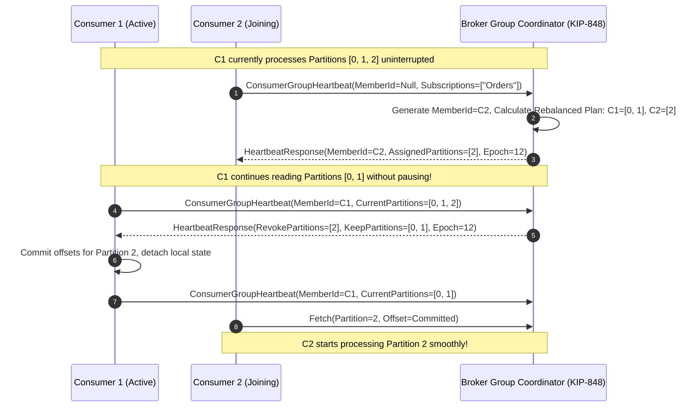
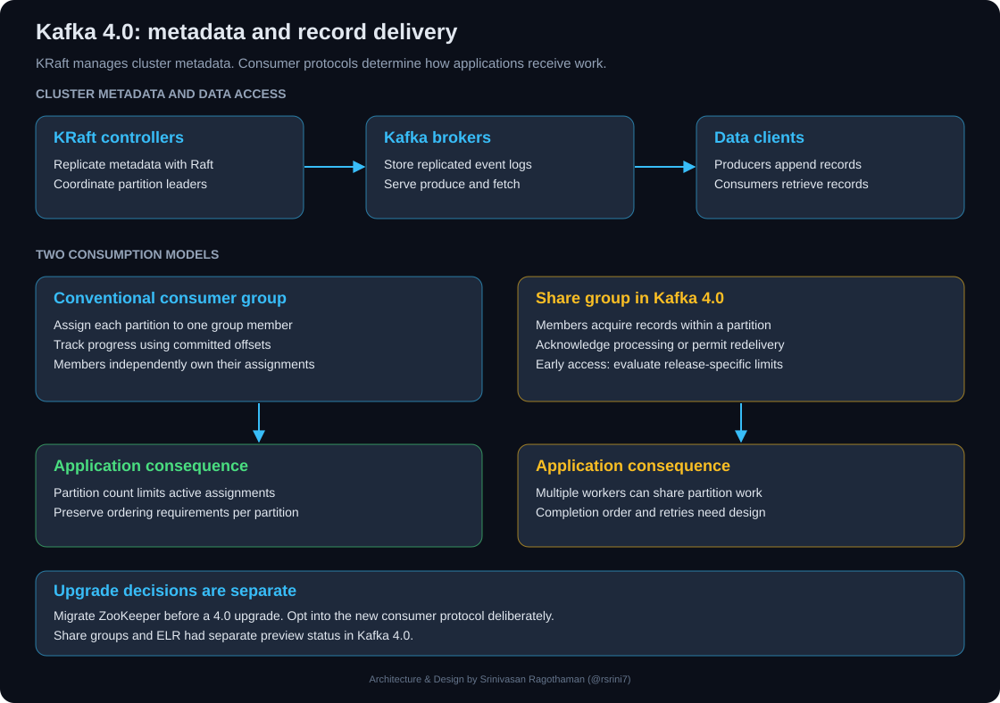

# Apache Kafka 4.0: KRaft Consensus, KIP-848 Next-Gen Consumer Protocol, and Queue Share Groups

**Learning note · Revised 15 November 2026 · Scope: The Apache Kafka 4.0 release architecture, protocol changes, and migration**

*By Srinivasan Ragothaman ([@rsrini7](https://github.com/rsrini7))*

> **Core idea:** Apache Kafka 4.0 marks the definitive removal of Apache ZooKeeper, enforcing a pure KRaft-based event metadata quorum across all deployments. Simultaneously, Kafka 4.0 introduces the generally available KIP-848 Next-Generation Consumer Rebalance Protocol—shifting partition assignment from disruptive client-side "stop-the-world" synchronization to server-side incremental reconciliation—alongside early-access KIP-932 queue-style share groups that distribute individual records within partitions.

---

## 1. Foundations: The Distributed Log and Metadata Separation

Apache Kafka decouples distributed state into two distinct planes:
1. **The Data Plane:** Partitioned, append-only commit logs. Producers append immutable records keyed by hashes; consumers read sequential byte streams from broker storage drives.
2. **The Control Plane:** Cluster metadata coordinating broker membership, topic partition configurations, leader election, and consumer group memberships.

Historically, the control plane depended on **Apache ZooKeeper**, an external coordination service. Operating two independent distributed state machines created dual network topologies, double security models, synchronization latency bottlenecks, and controller failover times exceeding 30 to 60 seconds on large clusters.

| System Component | Role in Kafka 4.0 | Architectural Change in 4.0 |
|---|---|---|
| **Broker** | Stores partition segment logs and serves produce/fetch client requests. | Receives metadata updates directly from controller quorum via Raft replication stream. |
| **KRaft Controller** | Manages cluster metadata, topic lifecycles, and partition leadership. | **ZooKeeper is completely removed.** Quorum operates via internal Raft consensus log (`@metadata`). |
| **Consumer Coordinator** | Manages group membership and tracks consumer partition assignments. | Executes **KIP-848** server-side incremental assignment directly on the broker. |
| **Share Group Coordinator** | Coordinates queue-style record acquisitions and individual message acknowledgements. | Implements **KIP-932** record-level locking and delivery tracking (Early Access). |
| **Eligible Leader Replicas (ELR)** | Maintains a dynamic sub-quorum of in-sync replicas eligible for election. | Minimizes data loss windows and prevents ungraceful offline partition lockups. |

---

## 2. Deep Technical Mechanisms

```
+--------------------------------------------------------------------------------------------------+
|                            APACHE KAFKA 4.0 CLUSTER & PROTOCOL TOPOLOGY                          |
|                                                                                                  |
|   METADATA CONTROL PLANE (KRAFT QUORUM)                                                          |
|   +-----------------------+  Raft Pull Replicate  +-----------------------+                      |
|   | Controller 1 (Leader) | <===================> | Controller 2 (Follower|                      |
|   | Reads/Writes @metadata|                       | Replicated State Mach |                      |
|   +-----------------------+                       +-----------------------+                      |
|               |                                                                                  |
|               | Metadata Push / Fetch RPCs                                                       |
|               v                                                                                  |
|   DATA PLANE (BROKER CLUSTER)                                                                    |
|   +------------------------------------------------------------------------------------------+   |
|   | Broker 101                       Broker 102                      Broker 103              |   |
|   | +------------------------------+ +-----------------------------+ +---------------------+ |   |
|   | | Partition: Orders-0 (Leader) | | Partition: Orders-1 (Leader)| | Partition: Orders-2 | |   |
|   | +------------------------------+ +-----------------------------+ +---------------------+ |   |
|   +------------------------------------------------------------------------------------------+   |
|               |                                                              |                   |
|               | KIP-848 Server-Side Assignment                               | KIP-932 Queue     |
|               v                                                              v Record Locking    |
|   CONVENTIONAL CONSUMER GROUP (KIP-848)                          SHARE GROUP (KIP-932 QUEUE)     |
|   - Partition Ownership: 1 consumer / partition                  - Concurrent reads in 1 partition|
|   - Server increments assignment without Stop-The-World          - Individual record ACK / NACK  |
|   - Offset commits track sequential progress                     - In-Flight lock timeout (30s)  |
+--------------------------------------------------------------------------------------------------+
```

### 1. KRaft: Internal Metadata Consensus Log

In Kafka 4.0, cluster metadata is stored as an internal, single-partition replicated log named `@metadata`. Controllers maintain an active Raft quorum:
- **Pull-Based Raft:** Unlike standard Raft where the leader pushes logs to followers via `AppendEntries`, KRaft uses a pull-based model. Follower controllers issue periodic `Fetch` RPCs to the active controller leader, matching the high-throughput fetch architecture already utilized by Kafka brokers.
- **Instantaneous Failover:** Because follower controllers continuously pull and apply `@metadata` records into in-memory metadata caches, electing a new controller leader completes in **sub-second time (< 500 ms)**, compared to the multi-minute partition reload cycles of ZooKeeper.
- **Split-Brain Immunity:** Every metadata change increments a 64-bit leader epoch. Outdated leader brokers attempting to write to the cluster are immediately rejected with `NOT_CONTROLLER` or `STALE_EPOCH_EXCEPTION`.

### 2. KIP-848: Next-Generation Consumer Rebalance Protocol

The legacy "Classic" consumer rebalance protocol suffered from systemic design flaws:
1. **Eager Revocation ("Stop-the-World"):** Any membership change (scaling, rolling restart, transient network blip) triggered a full revocation of all assigned partitions across all consumers in the group, halting data processing for the duration of the rebalance.
2. **Client-Side Assignment Overhead:** The broker designated one consumer as the "Group Leader", sent it full cluster topic metadata, waited for the leader to execute an assignment algorithm locally, and received the assignment plan back via `SyncGroup` RPCs.

**KIP-848 moves assignment coordination entirely to the broker**:
- **Incremental Reconciliation:** When a consumer joins or leaves, existing healthy consumers continue processing their assigned partitions uninterrupted. The broker reconciles assignments step-by-step.
- **Unified Heartbeat RPC:** Eliminates separate `JoinGroup`, `SyncGroup`, and `Heartbeat` handshakes. A single `ConsumerGroupHeartbeat` RPC carries the member ID, topic subscriptions, and current partition epochs.
- **Zero Client Computation:** Partition assignors (Range, RoundRobin, Sticky) run as broker-side plugins, preventing malformed client libraries from corrupting assignments.



### 3. KIP-932: Share Groups (Queue-Style Semantics)

Conventional consumer groups assign an entire partition to exactly one consumer. If a topic has 8 partitions, deploying 16 consumers leaves 8 instances idle.

**Share Groups (Early Access in Kafka 4.0)** introduce message queue semantics over native Kafka partitions:
- **Record-Level Delivery:** Multiple consumers in the same share group fetch records concurrently from the same partition.
- **Acquisition Locks:** When a consumer fetches a batch of records, the broker places an acquisition lock on those specific offsets for a configurable duration (`share.record.lock.duration.ms`, default 30s).
- **Explicit Acknowledgements:**
  - `ACCEPT`: Consumer successfully processed the message; offset advances in share state tracker.
  - `REJECT`: Unprocessable poison-pill; routed directly to Dead Letter Queue (DLQ).
  - `RELEASE`: Processing failed; lock released immediately for redelivery to another consumer.

---

## 3. Comparison of Consumption Paradigms

| Feature | Classic Consumer Group (Legacy) | KIP-848 Next-Gen Consumer Group | KIP-932 Share Group (Queue) |
|---|---|---|---|
| **Assignment Execution** | Client-side leader consumer | Broker-side group coordinator | Broker-side record dispenser |
| **Rebalance Impact** | Eager stop-the-world revocation | Incremental, non-blocking | Zero rebalance; dynamic record pulls |
| **Concurrency Boundary** | 1 consumer per partition max | 1 consumer per partition max | Unlimited consumers per partition |
| **Ordering Guarantee** | Strict per-partition ordering | Strict per-partition ordering | Best-effort; concurrent completions can reorder |
| **Failure Recovery** | Reprocess from last committed offset | Reprocess from last committed offset | Immediate redelivery of unacknowledged record |
| **Production Status** | Deprecated in 4.0 | **Generally Available (GA)** | Early Access (Preview) |

---

## 4. Architectural Visuals



*Upper section shows KRaft controller quorum replicating cluster metadata to brokers via Raft. Lower section highlights the operational differences between conventional partition-assigned consumer groups and KIP-932 record-level share groups.*

---

## 5. Production Implementations &amp; Configurations

### 1. Production KRaft Controller &amp; Broker Quorum (`server.properties`)

Below is a production-grade configuration for a dedicated KRaft controller and broker setup:

```properties
# ==============================================================================
# Apache Kafka 4.0 Production KRaft Configuration
# ==============================================================================

# Unique node identifier
node.id=1
process.roles=broker,controller

# Listeners configuration
listeners=PLAINTEXT://kafka-node-1.internal:9092,CONTROLLER://kafka-node-1.internal:9093
inter.broker.listener.name=PLAINTEXT
controller.listener.names=CONTROLLER

# KRaft Controller Quorum Voters (Format: id@host:port)
controller.quorum.voters=1@kafka-node-1.internal:9093,2@kafka-node-2.internal:9093,3@kafka-node-3.internal:9093

# Metadata storage log directory
metadata.log.dir=/var/lib/kafka/metadata
log.dirs=/var/lib/kafka/data

# Enable KIP-848 Next-Gen Consumer Protocol on Broker
group.coordinator.new.enable=true

# Java runtime requirements: brokers require Java 17+
# Garbage collection: G1GC with low pause targets
```

### 2. KIP-848 Java 17 Consumer with Graceful Incremental Reconciliation

The following Java 17 code snippet initializes a Kafka consumer opting into the **KIP-848 protocol (`group.protocol=consumer`)**:

```java
package com.enterprise.streaming;

import org.apache.kafka.clients.consumer.ConsumerConfig;
import org.apache.kafka.clients.consumer.ConsumerRecord;
import org.apache.kafka.clients.consumer.ConsumerRecords;
import org.apache.kafka.clients.consumer.KafkaConsumer;
import org.apache.kafka.common.serialization.StringDeserializer;
import org.slf4j.Logger;
import org.slf4j.LoggerFactory;

import java.time.Duration;
import java.util.Collections;
import java.util.Properties;
import java.util.concurrent.atomic.AtomicBoolean;

public final class NextGenOrderConsumer {
    private static final Logger log = LoggerFactory.getLogger(NextGenOrderConsumer.class);
    private static final AtomicBoolean running = new AtomicBoolean(true);

    public static void main(String[] args) {
        Properties props = new Properties();
        props.put(ConsumerConfig.BOOTSTRAP_SERVERS_CONFIG, "kafka-node-1.internal:9092");
        props.put(ConsumerConfig.GROUP_ID_CONFIG, "orders-fulfillment-v4");
        props.put(ConsumerConfig.KEY_DESERIALIZER_CLASS_CONFIG, StringDeserializer.class.getName());
        props.put(ConsumerConfig.VALUE_DESERIALIZER_CLASS_CONFIG, StringDeserializer.class.getName());

        // Opt into KIP-848 Next-Generation Consumer Group Protocol
        props.put("group.protocol", "consumer");

        // Disable automatic commit to ensure exact processing semantics
        props.put(ConsumerConfig.ENABLE_AUTO_COMMIT_CONFIG, "false");
        props.put(ConsumerConfig.AUTO_OFFSET_RESET_CONFIG, "earliest");

        // Duration-based offset reset (KIP-1075 feature in 4.0)
        // props.put(ConsumerConfig.AUTO_OFFSET_RESET_CONFIG, "by_duration:PT2H");

        try (KafkaConsumer<String, String> consumer = new KafkaConsumer<>(props)) {
            consumer.subscribe(Collections.singletonList("ecommerce.orders"));
            log.info("Subscribed to ecommerce.orders using KIP-848 consumer protocol");

            Runtime.getRuntime().addShutdownHook(new Thread(() -> {
                log.info("Shutdown initiated. Stopping consumer poll loop...");
                running.set(false);
                consumer.wakeup();
            }));

            while (running.get()) {
                ConsumerRecords<String, String> records = consumer.poll(Duration.ofMillis(250));
                for (ConsumerRecord<String, String> record : records) {
                    processOrder(record.key(), record.value(), record.partition(), record.offset());
                }
                if (!records.isEmpty()) {
                    consumer.commitSync();
                }
            }
        } catch (org.apache.kafka.common.errors.WakeupException e) {
            if (running.get()) throw e;
        } catch (Exception e) {
            log.error("Unhandled consumer error in event stream", e);
        } finally {
            log.info("Kafka 4.0 consumer shut down gracefully.");
        }
    }

    private static void processOrder(String key, String value, int partition, long offset) {
        log.info("Processed order key={} on partition={} offset={}", key, partition, offset);
    }
}
```

---

## 6. Impact, Real-World Edge Cases &amp; Gotchas

### Common Claims vs. Technical Realities

| Common Claim | Technical Reality | Production Implication |
|---|---|---|
| *"You can upgrade directly from a ZooKeeper Kafka 3.x cluster to Kafka 4.0."* | Kafka 4.0 binaries completely strip all ZooKeeper connection code. | Clusters attempting to boot with ZooKeeper configurations will fail immediately with fatal startup errors. |
| *"Upgrading brokers to 4.0 automatically upgrades all consumers to KIP-848."* | In the Kafka 4.0 Java client, the default `group.protocol` remains `classic`. | Clients must explicitly configure `group.protocol=consumer` to leverage incremental server-side rebalancing. |
| *"Share groups replace message queues for all enterprise applications."* | Share groups are **Early Access** in 4.0 and do not guarantee in-order partition processing. | Use share groups for idempotent, embarrassingly parallel tasks; retain conventional consumer groups for financial ledgers requiring partition sequencing. |
| *"Even controller quorum sizes provide better fault tolerance."* | An even quorum (e.g., 4 controllers) provides the exact same failure tolerance ($F = 1$) as a 3-node quorum, while increasing split-brain risk. | Always deploy an **odd number of controllers** (3 for small/medium clusters, 5 for large enterprise environments). |

### Practical Operational Pitfalls

1. **Metadata Disk I/O Starvation:** In shared broker/controller nodes, heavy partition log flush I/O on `log.dirs` can saturate storage controllers, causing KRaft controllers to miss heartbeat deadlines and trigger spurious leader elections.
   - *Mitigation:* Mount `metadata.log.dir` on an isolated physical NVMe drive or deploy dedicated controller nodes (`process.roles=controller`).
2. **KIP-848 Configuration Incompatibility:** Legacy consumer tuning parameters such as `max.poll.interval.ms` and `session.timeout.ms` behave differently under server-side coordination; configuring aggressive legacy client timeouts can cause premature member eviction.
3. **Rollback Impossibility:** Once metadata is migrated to KRaft format and finalized to metadata version 4.0, **downgrading back to ZooKeeper is technically impossible without restoring from cold backups**.

---

## 7. Practical Adoption Blueprint &amp; Migration Checklist

### Supported ZooKeeper-to-KRaft Migration Workflow

```
Step 1: Upgrade to Bridge Release (Kafka 3.8 / 3.9)
  |-- Deploy KRaft controllers in standalone mode alongside ZooKeeper
  +-- Set zookeeper.metadata.migration.enable=true on all brokers

Step 2: Execute Dual-Write Metadata Migration
  |-- KRaft controller pulls cluster state from ZooKeeper into @metadata log
  |-- Validate that partition leadership matches between ZK and KRaft
  +-- Migrate brokers one-by-one to KRaft communication mode

Step 3: Finalize KRaft Mode
  |-- Decommission ZooKeeper cluster
  |-- Execute: bin/kafka-metadata-migration.sh --finalize
  +-- Validate clean cluster operation under pure KRaft on Kafka 3.8/3.9

Step 4: Execute Binary Upgrade to Apache Kafka 4.0
  |-- Perform rolling restart with Kafka 4.0 binaries
  |-- Upgrade cluster metadata version: bin/kafka-features.sh upgrade --metadata 4.0
  +-- Enable KIP-848 on consumers: group.protocol=consumer
```

### Verification Checklist

- [ ] **Quorum Status:** Run `bin/kafka-metadata-shell.sh` to confirm all KRaft controllers are active and in-sync.
- [ ] **ZooKeeper Disconnection:** Ensure zero brokers retain active TCP socket connections to port 2181.
- [ ] **Consumer Protocol Verification:** Query `bin/kafka-consumer-groups.sh --describe --group <group-id> --state` and confirm group type reports `Consumer` rather than `Classic`.
- [ ] **Java Runtime Baseline:** Confirm all broker host environments run Java 17+ via `java -version`.

---

## 8. Timeline &amp; Architectural Milestones

- **June 2011:** LinkedIn open-sources Apache Kafka, featuring Apache ZooKeeper as the external coordination engine.
- **April 2020:** KIP-500 is approved, establishing the roadmap to remove ZooKeeper and replace it with an internal Raft metadata quorum (KRaft).
- **October 2022:** Kafka 3.3 declares KRaft **production-ready** for new clusters.
- **March 2024:** KIP-848 (Next-Generation Consumer Rebalance Protocol) merges into trunk.
- **March 2025:** Official release of **Apache Kafka 4.0.0**, permanently eliminating ZooKeeper support and delivering KIP-848 as generally available.
- **November 2026:** Widespread enterprise adoption of KRaft-only clusters with KIP-848 incremental rebalancing across mission-critical event backbones.

---

## 9. Primary Sources &amp; References

1. [Apache Kafka 4.0.0 Release Announcement (March 18, 2025)](https://kafka.apache.org/blog/2025/03/18/apache-kafka-4.0.0-release-announcement/) — Official announcement detailing ZooKeeper removal, KIP-848 GA, and KIP-932 early access.
2. [KIP-500: Replace ZooKeeper with a Self-Managed Metadata Quorum](https://cwiki.apache.org/confluence/display/KAFKA/KIP-500%3A+Replace+ZooKeeper+with+a+Self-Managed+Metadata+Quorum) — Foundational design document for KRaft architecture.
3. [KIP-848: The Next Generation Consumer Rebalance Protocol](https://cwiki.apache.org/confluence/display/KAFKA/KIP-848%3A+The+Next+Generation+Consumer+Rebalance+Protocol) — Complete protocol specification for broker-side incremental partition assignment.
4. [KIP-932: Queues for Kafka (Share Groups)](https://cwiki.apache.org/confluence/display/KAFKA/KIP-932%3A+Queues+for+Kafka) — Specification for record-level acquisition locks and queue-style delivery.
5. [KIP-1075: Duration-based Offset Reset](https://cwiki.apache.org/confluence/display/KAFKA/KIP-1075%3A+Duration-based+offset+reset) — Introduces `by_duration` auto offset reset semantics in Kafka 4.0.
6. [Apache Kafka Official 4.0 Upgrade Guide](https://kafka.apache.org/40/getting-started/upgrade/) — Versioned upgrade procedures, migration flags, and backwards compatibility rules.

---

**Related:**
- [Workflow-Orchestration-And-Durable-Execution-Engines-2026](Workflow-Orchestration-And-Durable-Execution-Engines-2026.md) — Analyzes the boundary between append-only event streams and durable workflow orchestration engines.
- [HTTP-QUERY-Method-RFC-10008-Nov-2026](../Architecture/HTTP-QUERY-Method-RFC-10008-Nov-2026.md) — Examines message payload encapsulation and gateway routing protocols.
- [Java-Plugin-Architecture-And-Dynamic-Classloaders-2026](../JVM/Java-Plugin-Architecture-And-Dynamic-Classloaders-2026.md) — Details classloader isolation and dependency management relevant to Kafka Connect hosts.
- [Java25-vs-Go1.24-Go1.25](../Languages/comparisons/Java-25-vs-Go-1.25-Performance-Analysis-2026.md) — Evaluates JVM garbage collection performance under heavy streaming workloads.
