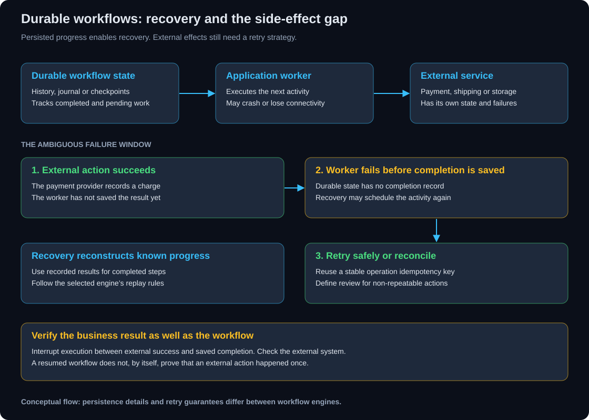
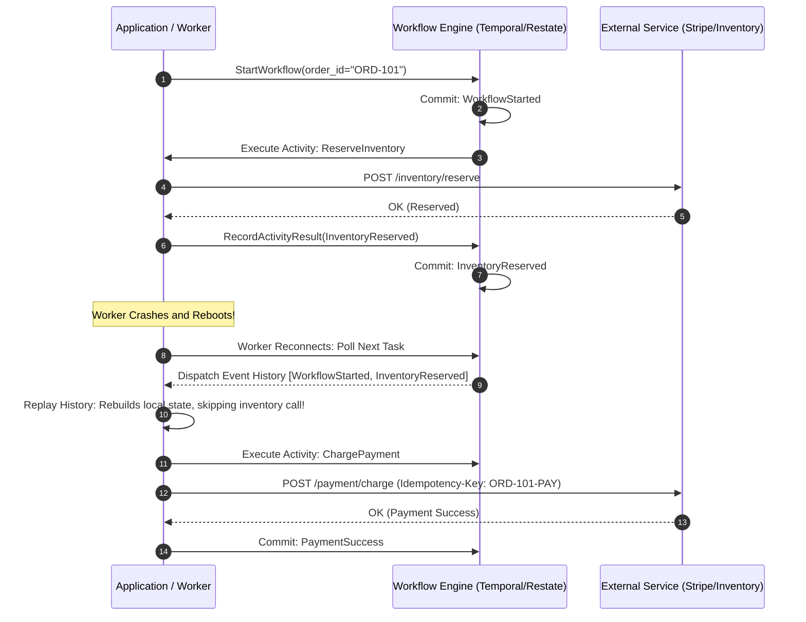
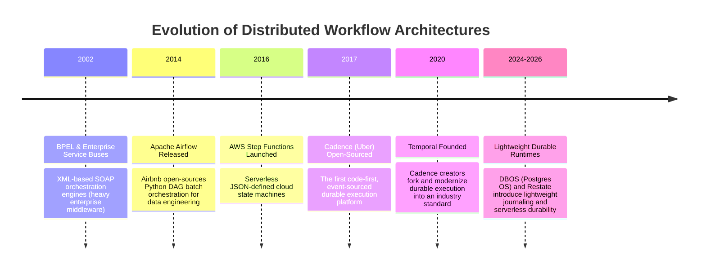
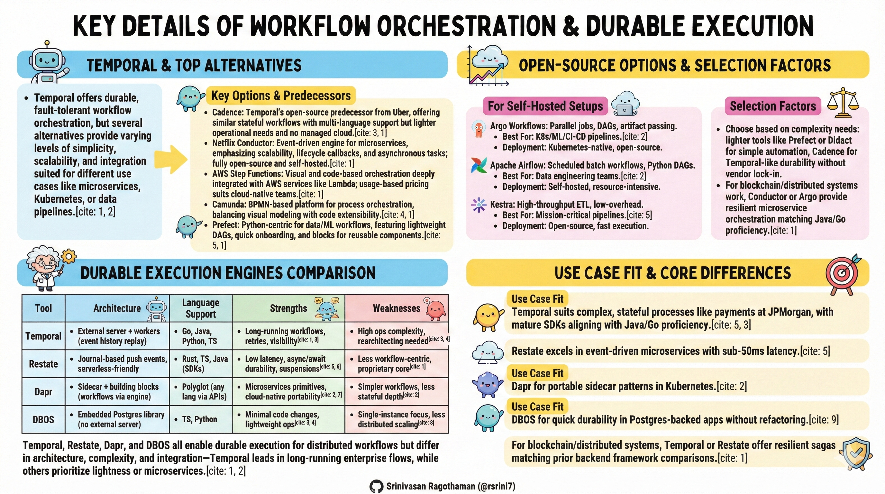

# Workflow Orchestration and Durable Execution: Failure Recovery, Idempotency, and Engine Topologies

Learning note · Revised November 2026 · Distributed Systems &amp; Durable Execution Architectures  
*By Srinivasan Ragothaman ([@rsrini7](https://github.com/rsrini7))*

> **Core idea:** A workflow engine remembers the progress of a multi-step distributed process so it can resume deterministically after infrastructure crashes or multi-day waits. Choosing an engine requires evaluating its recovery persistence model, replay semantics, and operational complexity—while recognizing that at-least-once activity retries fundamentally require application-level idempotency to prevent duplicated external side effects.


*Figure 1: State persistence boundary in durable execution engines illustrating the vulnerable side-effect window between an external action executing and its confirmation being committed to the journal.*

---

## 1. Foundations: The State Persistence Boundary

In distributed systems, multi-step business transactions (such as order fulfillment: reserving inventory, charging credit cards, scheduling warehouse dispatches, and dispatching notifications) span multiple independent microservices and third-party APIs. Each step can fail independently, workers can crash mid-execution, or external payment gateways may require multi-hour human approval callbacks.

Traditional architectures attempt to manage this with message queues (Kafka, RabbitMQ) and ad-hoc database polling tables. However, message brokers merely store and transport messages; they do not maintain a deterministic state machine of where an in-flight business process stands, which compensating actions have completed, or how to resume cleanly after a server crash.

A **durable execution engine** transforms ordinary programming code into an uninterrupted, crash-resilient virtual state machine by persisting event histories or execution checkpoints at every step boundary.

### Essential Architectural Terminology

| Term | Technical Meaning &amp; Function |
| :--- | :--- |
| **Workflow** | The deterministic orchestration logic that sequences activities, manages timers, and branches on external events. |
| **Activity / Step** | A non-deterministic unit of execution that interacts with the real world (database writes, HTTP requests, email dispatch). |
| **Event History / Journal** | An append-only persistent log of every completed decision, activity result, and timer event for a workflow instance. |
| **Replay** | The technique of reconstructing a workflow's in-memory state after a crash by re-running workflow code against its recorded event history. |
| **Idempotency Key** | A unique business token (e.g., `order_id + "_charge"`) passed to external APIs to guarantee an action is performed at most once. |
| **Saga / Compensation** | A series of compensating actions designed to revert already-committed operations when a later step permanently fails. |

---

## 2. The Recovery Mechanism: Event Sourcing &amp; Replay

In event-driven durable engines (such as **Temporal**), workflow code must be **strictly deterministic**. Standard non-deterministic calls (e.g., reading system clock `time.now()`, generating `random()`, or making network HTTP calls) are strictly prohibited inside workflow logic:



### The External Side-Effect Gap
The most critical vulnerability in durable workflows occurs during the network gap between executing an external call and recording its success in the engine's event history:
1. The worker calls the payment gateway: Payment succeeds.
2. The network disconnects or the worker crashes before sending `RecordActivityResult` to the workflow engine.
3. Upon restart, the engine sees that the activity did not complete and automatically triggers a retry.
4. **Without an Idempotency Key**, the customer is charged twice.

---

## 3. Durable Execution Engine Topologies

| Dimension | Temporal (Event-Sourced) | Restate (Journaling Proxy) | DBOS (Postgres Engine) | AWS Step Functions (Cloud State Machine) |
| :--- | :--- | :--- | :--- | :--- |
| **Persistence Model** | Append-only event history in Cassandra/Postgres | Distributed log journal of handler inputs/outputs | Checkpoint tables in PostgreSQL database | Managed AWS JSON state machines |
| **Worker Architecture** | Long-polling gRPC workers executing code | HTTP/gRPC handlers invoked by Restate server | Normal Python/TypeScript app backed by DBOS library | Serverless Lambda / ECS tasks coordinated by AWS |
| **Replay Requirement** | **Strictly required; code must be deterministic** | Journaled execution; avoids code re-evaluation | Checkpoint-based resumption; no code replay | Declarative JSON states; zero code replay |
| **Max Process Duration** | Indefinite (Years) | Indefinite (Months/Years) | Indefinite (Bounded by DB retention) | 1 Year (Standard) / 5 Minutes (Express) |
| **Operational Footprint**| High (Multi-cluster Temporal server + DB) | Low (Single lightweight proxy binary) | Low (Runs on standard Postgres) | Zero (Fully managed AWS cloud service) |
| **Best Fit** | Complex enterprise distributed sagas &amp; long waits | Microservice coordination &amp; durable RPCs | Full-stack apps already using PostgreSQL | AWS-centric serverless cloud integrations |

---

## 4. Production Implementations & Code Recipes

### Idempotent Durable Workflow with Compensating Sagas (Python)

The following runnable Python script implements a production-grade durable execution simulator. It models deterministic step execution, crash recovery, activity retry policies with exponential backoff, and compensating saga transactions.

```python
"""
Durable Workflow Execution Simulator with Idempotent Sagas.
Demonstrates deterministic replay, activity failure recovery, and compensation.
"""

from typing import Dict, Any, List, Callable
import time
import json
import uuid


class DurableJournal:
    """Simulates a persistent, append-only event store in PostgreSQL or Cassandra."""

    def __init__(self):
        self.events: List[Dict[str, Any]] = []

    def append(self, event_type: str, payload: Dict[str, Any]) -> None:
        event = {
            "id": len(self.events) + 1,
            "type": event_type,
            "payload": payload,
            "timestamp": time.time(),
        }
        self.events.append(event)
        print(f"  [JOURNAL COMMIT] #{event['id']} {event_type}: {payload}")

    def get_completed_step_result(self, step_name: str) -> Any:
        for event in self.events:
            if (
                event["type"] == "ACTIVITY_COMPLETED"
                and event["payload"].get("step") == step_name
            ):
                return event["payload"].get("result")
        return None


class WorkflowContext:
    def __init__(self, workflow_id: str, journal: DurableJournal):
        self.workflow_id = workflow_id
        self.journal = journal
        self.compensations: List[Callable[[], None]] = []

    def execute_activity(
        self,
        step_name: str,
        activity_fn: Callable[[], Any],
        compensation_fn: Callable[[], None] | None = None,
        max_retries: int = 3,
    ) -> Any:
        """Executes an activity with idempotency, replay skipping, and retries."""
        # Step 1: Check if already committed in journal (Deterministic Replay)
        cached_result = self.journal.get_completed_step_result(step_name)
        if cached_result is not None:
            print(f"[REPLAY] Skipping step '{step_name}'; result cached from journal.")
            if compensation_fn:
                self.compensations.append(compensation_fn)
            return cached_result

        # Step 2: Execute activity with retries
        if compensation_fn:
            self.compensations.append(compensation_fn)

        idempotency_key = f"{self.workflow_id}_{step_name}"
        attempts = 0
        while attempts < max_retries:
            attempts += 1
            try:
                print(f"[EXEC] Running '{step_name}' (Attempt {attempts}, Key: {idempotency_key})")
                result = activity_fn()
                # Commit result to durable journal
                self.journal.append(
                    "ACTIVITY_COMPLETED", {"step": step_name, "result": result}
                )
                return result
            except Exception as exc:
                print(f"[WARN] Step '{step_name}' failed with error: {exc}")
                if attempts >= max_retries:
                    self.journal.append(
                        "ACTIVITY_FAILED",
                        {"step": step_name, "error": str(exc)},
                    )
                    self.rollback()
                    raise RuntimeError(f"Workflow aborted at step '{step_name}': {exc}")
                time.sleep(0.1)

    def rollback(self) -> None:
        """Executes compensating saga actions in reverse chronological order."""
        print("\n[COMPENSATION] Initiating Saga Rollback...")
        for comp in reversed(self.compensations):
            try:
                comp()
            except Exception as e:
                print(f"[ALERT] Compensation failed: {e}")
        self.journal.append("WORKFLOW_COMPENSATED", {"workflow_id": self.workflow_id})


def run_order_fulfillment(ctx: WorkflowContext, order_id: str, fail_at_payment: bool = False):
    print(f"\n--- Starting Order Workflow for {order_id} ---")

    # Activity 1: Reserve Inventory
    def reserve():
        return {"inventory_id": f"INV-{order_id}", "status": "RESERVED"}

    def cancel_reservation():
        print(f"  [COMPENSATE] Releasing inventory for order {order_id}")

    inv_result = ctx.execute_activity(
        "reserve_inventory", reserve, cancel_reservation
    )

    # Activity 2: Charge Payment
    def charge():
        if fail_at_payment:
            raise ValueError("Payment gateway declined transaction (Insufficient Funds)")
        return {"charge_id": f"CHG-{order_id}", "amount": 150.0}

    def refund():
        print(f"  [COMPENSATE] Refunding payment for order {order_id}")

    pay_result = ctx.execute_activity("charge_payment", charge, refund)

    # Activity 3: Dispatch Warehouse Shipment
    def dispatch():
        return {"tracking_num": "TRK-992819", "carrier": "FedEx"}

    ship_result = ctx.execute_activity("dispatch_shipment", dispatch)

    ctx.journal.append(
        "WORKFLOW_COMPLETED", {"order_id": order_id, "tracking": ship_result}
    )
    return ship_result


if __name__ == "__main__":
    journal = DurableJournal()

    print("================ Scenario 1: Successful Execution ================")
    ctx1 = WorkflowContext("ORD-2026-001", journal)
    run_order_fulfillment(ctx1, "ORD-2026-001", fail_at_payment=False)

    print("\n================ Scenario 2: Crash & Replay ================")
    # Replay existing workflow against the same journal
    ctx_replay = WorkflowContext("ORD-2026-001", journal)
    run_order_fulfillment(ctx_replay, "ORD-2026-001", fail_at_payment=False)

    print("\n================ Scenario 3: Payment Failure & Saga Rollback ================")
    journal_fail = DurableJournal()
    ctx_fail = WorkflowContext("ORD-2026-002", journal_fail)
    try:
        run_order_fulfillment(ctx_fail, "ORD-2026-002", fail_at_payment=True)
    except RuntimeError as err:
        print(f"[CAUGHT] {err}")
```

---

## 5. Impact, Real-World Edge Cases & Gotchas

### Common Claims vs. Technical Realities

| Common Claim | Technical Reality | Systems Engineering Implication |
| :--- | :--- | :--- |
| **"Durable workflows guarantee exactly-once execution of everything."** | Engines guarantee *exactly-once execution of workflow code state*. External activities are executed with *at-least-once* guarantees due to network failures during result acknowledgment. | All external side-effects (payment charges, database mutations) must be guarded with stable idempotency keys. |
| **"Durable workflow code is written just like normal application code."** | Workflow definitions must be strictly deterministic. Reading random numbers, querying system clocks, or modifying static mutable variables breaks replay reconstruction and corrupts execution state. | Confine all non-deterministic logic, external I/O, and UUID generation to activities. |
| **"Compensating sagas guarantee total system rollback."** | Compensations are business-level compensating actions (e.g., issuing a refund credit), not ACID database rollbacks. If an external service is unavailable, compensation tasks themselves can fail and require operator escalation. | Implement dead-letter queues and administrative retry interfaces for failed compensating sagas. |
| **"Workflow engines replace message brokers like Kafka."** | Event streams (Kafka) excel at high-throughput append-only data transport ($10^6\text{ msg/s}$). Workflow engines excel at complex stateful coordination and durable timers ($10^2\text{ to }10^4\text{ steps/s}$). | Use Kafka for data streaming and event ingestion; use workflow engines to coordinate the multi-step business transactions triggered by those events. |

---

## 6. Practical Adoption Blueprint & Verification Checklist

### 6.1 Engine Selection Decision Tree

```
Do you need to coordinate long-running distributed processes?
  │
  ├── Is it a scheduled, batch-oriented data analytics pipeline (DAGs, Spark, SQL)?
  │     └── YES ──> Choose Apache Airflow or Argo Workflows
  │                 • Scheduled cron batches, data dependencies, and artifact tracking
  │
  ├── Is your entire stack built on AWS serverless services (Lambda, DynamoDB, SQS)?
  │     └── YES ──> Choose AWS Step Functions
  │                 • Managed JSON state machines with native IAM integration
  │
  ├── Do you want durable functions embedded directly in a PostgreSQL application?
  │     └── YES ──> Choose DBOS
  │                 • Ultra-low operational overhead; uses existing Postgres tables
  │
  └── Are you building complex, multi-language enterprise microservice sagas with durable waits?
        └── YES ──> Choose Temporal or Restate
                    • Temporal: Battle-tested event-sourced workflows (Uber, Stripe, Netflix)
                    • Restate: Lightweight journaling proxy for HTTP/gRPC services
```

### 6.2 Reliability Verification Checklist

- [ ] **Deterministic Replay Audit:** Verify that workflow logic contains zero direct calls to `Math.random()`, `System.currentTimeMillis()`, or network sockets.
- [ ] **Idempotency Key Propagation:** Confirm that every activity calling an external mutating endpoint attaches a unique, deterministic idempotency key.
- [ ] **Simulated Worker Crash Recovery:** Run a chaos engineering drill killing application worker containers mid-activity. Confirm the replacement worker resumes execution from the last committed journal checkpoint without re-running completed steps.
- [ ] **Workflow Versioning Strategy:** Ensure new workflow code deployments maintain backward compatibility with in-flight workflows using engine versioning APIs (`workflow.getVersion()` or Restate deployment tags).
- [ ] **Storage Retention Pruning:** Configure automated tombstone and history pruning policies in Cassandra/PostgreSQL to prevent completed workflow logs from exhausting database disk capacity.

---

## 7. Timeline and Evolution of Workflow Orchestration



---

## 8. Primary Sources & References

### Official Specifications & Vendor Disclosures

1. [Temporal Documentation: Workflow Execution &amp; Determinism](https://docs.temporal.io/workflow-execution) — Temporal Technologies. Authoritative guide on event history, replay mechanics, and activity idempotency.
2. [Restate Architecture &amp; Key Concepts](https://docs.restate.dev/foundations/key-concepts) — Restate Foundation. Technical specification for log-journaled durable execution proxies.
3. [DBOS: A Database-Oriented Operating System for Reliable Cloud Applications](https://www.vldb.org/pvldb/vol17/p1656-stonebraker.pdf) — Stonebraker et al. (VLDB 2024). Foundational academic paper formalizing durable functions backed by standard PostgreSQL state.
4. [AWS Step Functions Developer Guide: Standard vs. Express Workflows](https://docs.aws.amazon.com/step-functions/latest/dg/choosing-workflow-type.html) — Amazon Web Services. Compares at-least-once vs exactly-once state machine execution models.
5. [Sagas: An Architecture for Distributed Transactions](https://www.cs.cornell.edu/andru/cs711/2002fa/reading/sagas.pdf) — Hector Garcia-Molina and Kenneth Salem (1987). Seminal paper defining compensating transactions in distributed systems.

### Companion Architecture Notes

6. [Kafka-4.0-KRaft-Architecture-And-Migration-2026](Kafka-4.0-KRaft-Architecture-And-Migration-2026.md) — Analyzes the boundary between append-only event streaming and durable process state machines.
7. [Scaling-Java-Services-To-1-Million-RPS-2026](../Architecture/Scaling-Java-Services-To-1-Million-RPS-2026.md) — High-throughput capacity planning when decoupling synchronous API paths from durable background workers.

---

## 9. Supplementary Visuals

The following visual documentation preserves the foundational comparative overview of workflow orchestration engines:


*Figure 2: Previously collected architectural illustration detailing workflow orchestration categories, retained for reference.*

---

**Related:**
- [Kafka-4.0-KRaft-Architecture-And-Migration-2026](Kafka-4.0-KRaft-Architecture-And-Migration-2026.md) — Distinguishes event-log consumption and queue delivery from end-to-end process coordination.
- [Java-Plugin-Architecture-And-Dynamic-Classloaders-2026](../JVM/Java-Plugin-Architecture-And-Dynamic-Classloaders-2026.md) — Explains contracts and process boundaries for independently deployed extensions and workers.
- [AWS-vs-Hetzner-Compute-Economics-And-Architecture-2026](../Cloud/AWS-vs-Hetzner-Compute-Economics-And-Architecture-2026.md) — Adds infrastructure context when comparing managed orchestration with self-hosted services.
- [Rust-vs-C-Systems-Programming-And-Memory-Safety-2026](../Languages/comparisons/Rust-vs-C-Systems-Programming-And-Memory-Safety-2026.md) — Restate's Rust SDK uses these same memory-safety properties for journal-based durable workflow execution.