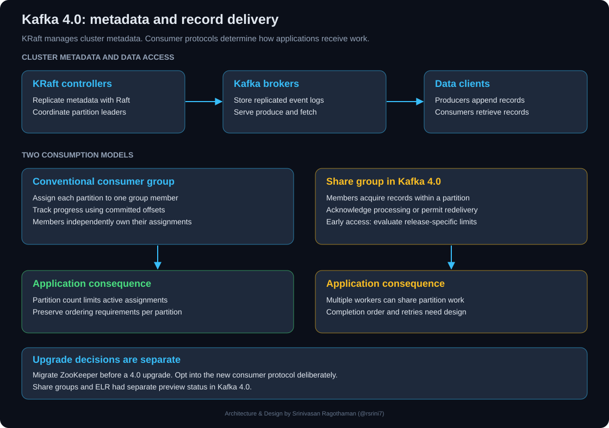

# Apache Kafka 4.0: KRaft, Consumer Groups and Queue Semantics

**Learning note · Revised 15 November 2026 · Scope: the Kafka 4.0 release**

> **Core idea:** Kafka 4.0 removes ZooKeeper and makes the new consumer rebalance protocol generally available. Its queue-style share groups were early access in this release, so migration requirements and feature maturity need separate decisions.

## 1. Foundations: what Kafka stores and who uses it

Apache Kafka stores streams of records in **topics**. Each topic is divided into **partitions**, which are ordered logs. Producers append records; consumers read them. Brokers store the partitions and serve clients. Applications use Kafka for event streams, data pipelines and communication between services.

A traditional consumer group shares partitions among its members. Within that group, a partition is assigned to one consumer at a time. Different groups can independently read the same topic. An **offset** identifies a record's position in a partition, allowing a consumer to track its progress. See the [official introduction](https://kafka.apache.org/40/getting-started/introduction/).

| Term | Role in the system |
|---|---|
| Broker | Stores partition data and serves produce/fetch requests. |
| Controller | Coordinates cluster metadata, including partition leadership. |
| KRaft | Kafka's Raft-based metadata system, replacing the separate ZooKeeper dependency. |
| Consumer coordinator | Broker-side component that manages a consumer group. It has a different job from the KRaft metadata controller. |
| Rebalance | Changes the partition assignments when group membership or the subscribed topics change. |
| Share group | Queue-style consumption in which consumers acquire records for processing and acknowledge the results. |

## 2. KRaft: the metadata architecture changed

Older Kafka clusters could use Apache ZooKeeper, a separate coordination service, to manage cluster metadata. Kafka 4.0 supports **KRaft mode only**. It retains replicated partition logs for event data while using a controller quorum for metadata. Controllers and brokers can have separate roles; KRaft does not mean every broker is a controller. [Kafka 4.0 release announcement](https://kafka.apache.org/blog/2025/03/18/apache-kafka-4.0.0-release-announcement/), [KRaft versus ZooKeeper](https://kafka.apache.org/40/getting-started/zk2kraft/).



*The upper path shows cluster metadata management. The lower paths compare conventional consumer groups with the queue-style share groups introduced in early access in 4.0.*

Removing ZooKeeper removes a component to operate, but the controller quorum, broker storage, replication and capacity planning still need attention. For an existing ZooKeeper cluster, **complete the supported migration to KRaft before upgrading to 4.0**. The [versioned upgrade guide](https://kafka.apache.org/40/getting-started/upgrade/) defines the prerequisites and supported paths.

## 3. Consumer groups: a different rebalance protocol

**KIP-848** became generally available in Kafka 4.0. The new protocol moves assignment coordination to the server and supports incremental reconciliation of assignments. It is designed to reduce the disruption of group changes; the size of the improvement depends on the workload and deployment. [Release announcement, KIP-848](https://kafka.apache.org/blog/2025/03/18/apache-kafka-4.0.0-release-announcement/).

Server support does not mean every consumer uses it. In the Kafka 4.0 Java client, the default `group.protocol` is `classic`. A compatible client opts into the new protocol with:

```properties
# Kafka 4.0 Java consumer configuration
# Confirm support before applying this to another client implementation.
group.protocol=consumer
```

With the new protocol, relevant heartbeat and session settings are controlled on the broker, so existing client tuning cannot simply be copied. Check the [4.0 consumer configuration reference](https://kafka.apache.org/40/configuration/consumer-configs/) and the upgrade instructions for the group transition.

The change optimizes coordination. It does not remove the partition assignment model of a conventional consumer group or turn every application into queue-style processing.

## 4. Share groups: distributing records rather than partition ownership

**KIP-932** introduced early-access queue semantics in Kafka 4.0. A share group lets multiple consumers process records from the same partition through record acquisition, locks and acknowledgements. A record being acquired by one member is not a broadcast to every member. Failed or unacknowledged processing can lead to redelivery. [Release announcement](https://kafka.apache.org/blog/2025/03/18/apache-kafka-4.0.0-release-announcement/), [KIP-932 design](https://cwiki.apache.org/confluence/display/KAFKA/KIP-932%3A+Queues+for+Kafka).

| Conventional consumer group | Share group |
|---|---|
| Assigns a partition to one group member at a time. | Shares record processing among members, including within a partition. |
| Tracks consumer progress using offsets. | Uses acquisition and acknowledgement to track record delivery. |
| Useful for ordered stream processing within each partition. | Useful for work distribution where records can be processed independently. |
| Adding consumers beyond the partition count does not add active partition assignments. | Multiple consumers can take work from the same partition. |

Ordering requirements and side effects still need application design. Concurrent completion can differ from log order, and redelivery means an external write must tolerate retries.

**Version boundary:** “early access” describes Kafka 4.0. Do not use this historical status to judge a later version, or enable the 4.0 preview for production solely on the strength of newer documentation. Evaluate the exact release and its operational limits.

## 5. Other changes worth knowing

| Change in 4.0 | Practical meaning |
|---|---|
| Java baselines | Brokers, Connect and tools require Java 17; Java clients and Kafka Streams require Java 11. Runtime requirements are component-specific. |
| Duration-based offset reset | `auto.offset.reset=by_duration:PT1H` selects a reset position about one hour before the current timestamp when no usable offset exists. It does not rewind a healthy consumer on every poll. |
| Metadata rebootstrap improvements | Clients can recover from stale broker discovery information through timeout- or server-triggered rebootstrap. Bootstrap endpoints must remain reachable. |
| Eligible Leader Replicas | ELR was a preview in 4.0. Evaluate its configuration and version requirements separately from the base upgrade. |

Sources: [4.0 release announcement](https://kafka.apache.org/blog/2025/03/18/apache-kafka-4.0.0-release-announcement/), [consumer configuration](https://kafka.apache.org/40/configuration/consumer-configs/), [upgrade guide](https://kafka.apache.org/40/getting-started/upgrade/). This is a focused explanation; the release announcement also covers Kafka Streams and other API changes.

## 6. Practical migration and verification

1. **Inventory components.** Record broker mode, software and metadata versions, JVM versions, client libraries, Connect plugins and Streams applications.
2. **Choose a supported path.** Follow the upgrade guide for the actual starting version. ZooKeeper migration and a 4.0 binary upgrade are distinct operations.
3. **Establish a baseline in staging.** Measure produce/fetch errors, request latency, consumer lag, rebalances and controller health with representative traffic.
4. **Change group protocol deliberately.** Confirm client support and use the documented transition process. Compare assignment behavior and recovery under consumer restarts.
5. **Exercise application failures.** Restart a consumer after an external action but before progress is recorded. Verify duplicate handling and partition-order assumptions.
6. **Treat previews as separate evaluations.** The base upgrade, new consumer protocol, share groups and ELR need their own acceptance criteria.

Kafka's distribution includes `kafka-topics.sh` and `kafka-consumer-groups.sh`. Start with their `--help` output and the [4.0 operations guide](https://kafka.apache.org/40/operations/basic-kafka-operations/) to inspect topic state and conventional consumer groups. Lag is a progress signal; it does not by itself prove correct downstream business processing. Use the separate share-group tooling for share-group experiments.

## 7. Source context

Reworked from collected repository notes, with the release claims checked against Apache's 4.0 announcement, versioned documentation and KIP-932. Kafka 4.0.0 was announced on **18 March 2025**. This note explains that release rather than claiming it is the current recommended version.

---

**Related:**
- [Workflow Orchestration](workflow-orchestration.md) — Explains why an event log and a durable business workflow solve different coordination problems.
- [Java Plugin Architecture](../JVM/Java-Plugin-Arch.md) — Covers dependency and lifecycle decisions relevant to extensible JVM services and connector hosts.
- [Java and Go Runtime Comparison](../Languages/comparisons/Java25-vs-Go1.24-Go1.25.md) — Provides broader runtime context for applications around a Kafka deployment.
