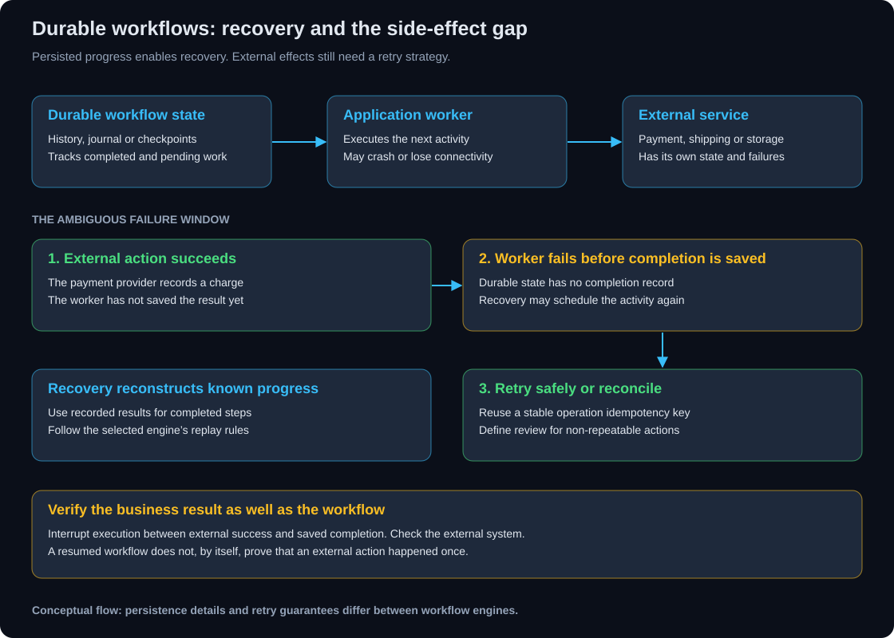
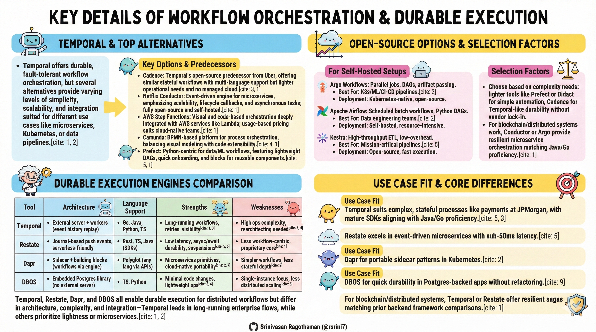

# Workflow Orchestration: Durable Execution and Choosing an Engine

**Learning note · Revised 15 November 2026 · Primary documentation checked**

> **Core idea:** A workflow engine remembers the progress of a multi-step process so it can continue after failures or long waits. Choose an engine from the work it coordinates, its recovery rules and its operational requirements; retries still require careful handling of external side effects.

## 1. Foundations: what a workflow engine remembers

Consider an order that must reserve stock, charge a payment, arrange delivery and send a receipt. These steps can fail independently. Some may finish before the application crashes; others may wait hours for a callback. A workflow engine records progress and schedules the remaining work.

An event broker such as Kafka stores and transports events. A workflow engine tracks a process: which step is complete, what is waiting, when to retry and how to react to failure. They can be used together. Having a durable message log does not, by itself, define the application's order process.

| Term | Plain meaning |
|---|---|
| Workflow | The logic coordinating a process across steps, waits and decisions. |
| Activity or step | A unit of work, often involving an external system. Naming differs by engine. |
| Durable state | Progress saved outside the worker's memory so it survives a worker failure. |
| Replay | Reconstructing execution from recorded history or results instead of repeating completed work blindly. |
| Idempotency | Repeating an operation has the same intended effect as performing it once. |
| Compensation | A business action that responds to earlier completed work, such as refunding a charge. It is not a database rollback across all services. |

## 2. The recovery mechanism

In Temporal, the service records workflow event history; workers execute workflow logic and activities. Replaying a history reconstructs workflow state, which requires workflow code to follow deterministic rules. External interactions belong in activities rather than being repeated freely during replay. [Temporal workflow execution](https://docs.temporal.io/workflow-execution), [activity definitions](https://docs.temporal.io/activity-definition).

Other engines use different APIs and persistence designs. Restate documents a journal of operations and results. DBOS records workflow progress and step outputs in its system database. These are examples of durable execution, but their deployment models and execution contracts should be evaluated separately. [Restate concepts](https://docs.restate.dev/foundations/key-concepts), [DBOS architecture](https://docs.dbos.dev/architecture).

*The risky window is between an external action succeeding and its completion being durably recorded. The exact recording mechanism depends on the engine.*

### Why retries do not guarantee one external effect

Suppose a payment succeeds, then the worker fails before the engine records the result. A retry may call the payment service again. The engine cannot generally determine what happened inside an unrelated system just from its own missing completion record.

Use a stable **idempotency key**, such as an order-and-payment-operation identifier, when the external API supports one. Reuse it across retries. For a database write you control, enforce the business key with a suitable unique constraint or transaction. If an external operation cannot be safely retried, define reconciliation or manual review. Temporal explicitly recommends idempotent activities. [Activity idempotency guidance](https://docs.temporal.io/activity-definition).

## 3. Durable execution options

| Engine | Documented design | Evaluate it when… | Operational question |
|---|---|---|---|
| **Temporal** | Workflow service with event history and application workers. | Business processes need durable waits, retries and a code-based workflow model. | Will you operate the service or use a managed offering, and how will you version running workflows? |
| **Restate** | Runtime journals supported operations and results for durable handlers and workflows. | Durable service interactions fit your application model. | Which operations must be journaled, and how will handlers be deployed and updated? |
| **DBOS** | Library-based workflow execution with persisted checkpoints and step results. Its documented distributed architecture uses a shared Postgres system database and durable queues. | You want durable functions integrated into an application and can operate the backing database. | How will database capacity, worker recovery and distributed queues be managed? |
| **Dapr Workflow** | Durable workflow runtime with authoring SDKs and management APIs within Dapr. | You already use Dapr's runtime and need workflow coordination. | Does the authoring SDK support your language, and does the state store support the workflow requirements? |
| **AWS Step Functions** | Managed state machines with AWS integrations and distinct Standard and Express execution models. | An AWS-managed orchestration service fits the deployment and integration needs. | Which execution type, quotas, duration limits and billing model fit the workflow? |

Sources: [Temporal](https://docs.temporal.io/workflow-execution), [Restate](https://docs.restate.dev/foundations/key-concepts), [DBOS architecture](https://docs.dbos.dev/architecture) and [workflow tutorial](https://docs.dbos.dev/python/tutorials/workflow-tutorial), [Dapr overview](https://docs.dapr.io/developing-applications/building-blocks/workflow/workflow-overview/), [Step Functions workflow types](https://docs.aws.amazon.com/step-functions/latest/dg/choosing-workflow-type.html).

There is no performance ranking in this table. Operational effort and latency depend on deployment, workload, storage and the application's use of each engine.

## 4. Batch pipelines and container jobs have different needs

For a scheduled data pipeline, the central objects may be tasks, dependencies, artifacts and repeated runs. For a long-running business process, they may be events, durable timers, callbacks and compensation.

| Tool | Useful starting point | What to compare |
|---|---|---|
| **Apache Airflow** | Developing, scheduling and monitoring batch-oriented workflows defined in Python. | Scheduling, task dependencies, backfills and provider integrations. |
| **Argo Workflows** | Orchestrating container-based jobs on Kubernetes, including steps and directed acyclic graphs. | Container execution, artifacts, parallel jobs and Kubernetes operations. |

These descriptions follow the projects' [Airflow documentation](https://airflow.apache.org/docs/apache-airflow/stable/index.html) and [Argo Workflows documentation](https://argo-workflows.readthedocs.io/en/latest/). Choose using the process's execution needs rather than a generic “workflow tool” label. A pipeline tool can also call a durable business service when the system needs both.

## 5. Execution guarantees need a precise scope

| Claim | What to check |
|---|---|
| “The workflow is exactly once.” | Does that describe workflow execution, a recorded step, or the external business action? Read the integration and retry contract. |
| “The engine resumes after a crash.” | Which state was durably saved, which work may retry, and what happens when workers or the state store are unavailable? |
| “A compensation reverses everything.” | Is there a valid business action for each completed side effect? A delivered email or shipped parcel cannot simply be rolled back. |
| “Durable workflow code is ordinary code.” | Which operations must go into activities or journaled steps, and which changes are compatible with existing histories? |

For example, AWS documents **exactly-once workflow execution** for Standard, **at-least-once** for asynchronous Express and **at-most-once** for synchronous Express. Those execution semantics do not eliminate the need to examine external integrations and configured retries. [AWS execution models](https://docs.aws.amazon.com/step-functions/latest/dg/choosing-workflow-type.html).

## 6. A practical evaluation

Start with one representative process and explicit success criteria:

1. **Model real waits and failures.** Include an external callback, a retryable error, a permanent error and a business timeout.
2. **Restart workers mid-step.** Verify what resumes, what retries and whether the external action is duplicated.
3. **Interrupt access to persistence.** Check whether new work stops safely and how recovery proceeds after storage returns.
4. **Change the workflow code.** Confirm the engine's documented strategy for histories created by the old version.
5. **Inspect operations.** Find a stuck execution, its last successful step, pending timers, retry count and the procedure for operator intervention.
6. **Measure the complete cost.** Include persistence, workers, service operations, retained history and engineering effort, using representative traffic.

For a working starting point, the official open-source [Temporal samples](https://github.com/temporalio/samples-java), [Restate examples](https://github.com/restatedev/examples) and [DBOS demos](https://github.com/dbos-inc/dbos-demo-apps) show their respective programming models. Follow each repository's setup instructions and adapt one example to include the failure window described above. A tutorial that completes successfully once does not demonstrate safe retries or production recovery.

## 7. Source context

Based on collected repository notes, with mechanism and deployment claims checked against the linked project documentation. Product capabilities and supported SDKs change; verify them for the version being adopted.

## 8. Supplementary visual

*Previously collected illustration, retained for reference. Current capabilities and recovery guarantees should be interpreted using the primary sources and qualifications above.*

---

**Related:**
- [Kafka 4.0](Kafka-4.0-KRaft-Architecture-And-Migration-2026.md) — Distinguishes event-log consumption and queue delivery from end-to-end process coordination.
- [Java Plugin Architecture](../JVM/Java-Plugin-Arch.md) — Explains contracts and process boundaries for independently deployed extensions and workers.
- [AWS versus Hetzner](../Cloud/AWS-vs-Hetzner.md) — Adds infrastructure context when comparing managed orchestration with self-hosted services.
