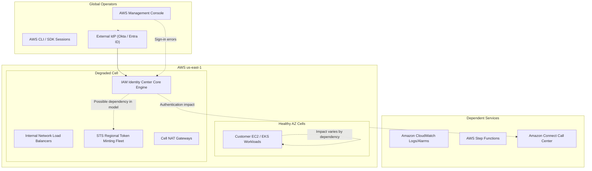
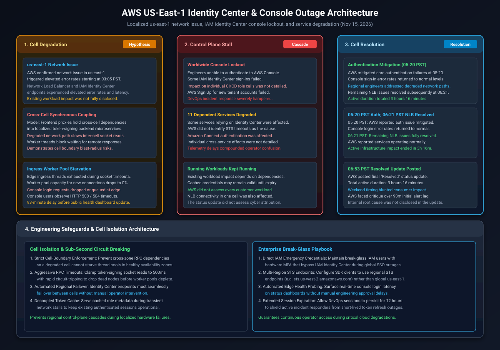

# AWS US-East-1 Identity Center Outage: Single Availability Zone Cell Network Degradation & Console Lockout

Daily learning · November 2026 · Incident review
*By Srinivasan Ragothaman ([@rsrini7](https://github.com/rsrini7))*

> **Core idea:** On Sunday, November 15, 2026, Amazon Web Services (AWS) experienced an authentication and service disruption in `us-east-1` (N. Virginia) beginning at 03:05 PST. Core authentication issues were mitigated by 05:20 PST (2 hours 15 minutes), and remaining Network Load Balancer (NLB) issues were resolved at 06:21 PST (3 hours 16 minutes), before the final resolved update was posted at 06:53 PST. A localized network issue within `us-east-1` degraded AWS IAM Identity Center (SSO), locking engineering teams out of the AWS Management Console and causing API degradations across 11 dependent regional services.

> [!NOTE]
> **Provenance & Observational Scope:** This review examines the November 15, 2026 cloud authentication disruption based on official AWS Service Health Dashboard updates archived by StatusStack.
>
> **Verified Public Facts:** AWS reported authentication errors beginning at 03:05 PST in `us-east-1`, mitigation at 05:20 PST, and resolution of remaining NLB connectivity issues at 06:21 PST. The final resolved update was posted at 06:53 PST. Its archived update does not describe the internal authentication mechanism or assess a cybersecurity cause.
>
> **Analytical Scope:** The specific microservice failure dynamics—such as cross-cell synchronous STS RPC dependencies and ingress worker-thread starvation—represent an analytical systems architecture case study evaluating cell-based isolation boundaries, rather than an internal software disclosure by AWS.

---

## 1. Foundations: AWS IAM Identity Center & STS Control Plane

AWS IAM Identity Center (formerly AWS SSO) is the centralized authentication portal used by enterprise organizations to manage federated workforce logins across hundreds of multi-account AWS Organizations.



### Architectural Subsystems & Failure Modes

| Subsystem | Architectural Role | Incident Failure Mode |
|---|---|---|
| **IAM Identity Center** | Federated workforce identity provider and portal | AWS reported authentication errors; it did not disclose the internal handshake or HTTP status codes. |
| **AWS STS** | Issues temporary credentials | A possible dependency in the model; the incident update does not identify an STS failure. |
| **Network Load Balancers (NLB)** | L4 load balancing | A subset in one cell of `use1-az1` experienced connectivity issues until 06:21 PST. |
| **AWS Service Health Dashboard** | Customer-facing operational status telemetry | The first archived public update appeared at 04:38 PST, 93 minutes after the reported start. |

---

## 2. Systems Failure Mode: Cell-Level Degradation & Control Plane Impact (Hypothetical Architecture Case Study)



### 2.1 The Single-AZ Networking Fault (Hypothetical Model)

AWS partitions its control planes into localized failure domains called **cells** to prevent outages in one availability zone from impacting the broader region. On November 15 at 03:05 PST:
1. A localized network issue within `us-east-1` degraded Network Load Balancers and authentication endpoints.
2. While AWS updates confirmed localized networking and NLB failures in `us-east-1`, systems architects evaluate the failure through a cell-based dependency model: If frontend authentication proxies hold cross-zone RPC dependencies that are not fully decoupled from backend signing workers, failure in one zone can propagate latency.
3. In this hypothetical model, if worker threads block waiting for unthrottled socket reads, connection pools exhaust, dropping arriving console sign-in attempts at the edge.

```
+--------------------------------------------------------------------------+
|                  IAM Identity Center Ingress Thread Starvation           |
|                                                                          |
|   Console Request ----> [ Identity Center Worker Pool ]                  |
|                               |          |         |                     |
|                               v          v         v                     |
|                   [ Thread 1 ]   [ Thread 2 ]  [ Thread N ]              |
|                         \              |             /                   |
|                          +-------------+------------+                    |
|                                        |                                 |
|                                        v                                 |
|                         TCP SYN / RPC to use1-az1 STS                    |
|                             (Hypothetical Block)                         |
|                                        |                                 |
|                   Socket Read Timeout: 30,000ms                          |
|                   Worker Threads Exhausted: New Logins Dropped           |
+--------------------------------------------------------------------------+
```

### 2.2 Control Plane vs. Data Plane Divergence

The distinction between control and data planes is useful when evaluating impact, although the public update does not establish the status of every workload:
* **Existing workloads:** An authentication outage does not necessarily stop workloads using still-valid credentials. Actual impact depends on their service dependencies and credential renewal.
* **Sign-in:** AWS reported errors in IAM Identity Center and account signup. The status update does not establish the outcome of every STS or deployment request.
* **Dependent services:** AWS reported authentication impact on services relying on IAM Identity Center, including Kiro and Amazon Connect.

The status archive also listed CloudWatch, Step Functions, NAT Gateway, VPC Lattice, OpenSearch Service, IoT Device Management, and Elastic Load Balancing among affected components. A shared incident listing does not establish the same failure mode for every service. [Archived AWS event](https://status.hershey.k12.pa.us/status/aws/incidents/687443-increased-connectivity-issues-in-us-east-1-n-virginia)

For example, an EC2 application using an instance role obtains temporary credentials through the instance metadata service. Its SDK normally refreshes those credentials before expiration. A request using still-valid credentials may continue if its target service is healthy; later refreshes or requests can fail if their own dependencies are unavailable. This is a general credential-lifecycle example, not evidence that every EC2, ECS, or RDS workload was unaffected during this incident. [AWS: Using temporary credentials](https://docs.aws.amazon.com/IAM/latest/UserGuide/id_credentials_temp_use-resources.html)

---

## 3. Systems Failure Modes & Common Misconceptions

| Common Assumption | Technical Reality |
|---|---|
| **"All of AWS went down globally."** | AWS described authentication and connectivity problems in `us-east-1`; the update does not establish the status of every workload. |
| **"Multi-AZ architecture automatically protects against SSO failure."** | If an authentication frontend has hard runtime synchronous RPC dependencies on single-cell backend services, cell failure breaches AZ boundaries. |
| **"A cyberattack caused the console login failure."** | The archived AWS status updates do not attribute the incident to a cyberattack or rule one out. |

---

## 4. Operational Timeline & Recovery

* **03:05 PST (11:05 UTC, Nov 15, 2026):** Elevated error rates and latency emerge for AWS IAM Identity Center, AWS Sign-In, and dependent services in `us-east-1`.
* **04:38 PST (12:38 UTC):** After 93 minutes, AWS posts its first official advisory on the Service Health Dashboard acknowledging elevated error rates.
* **05:20 PST (13:20 UTC):** Authentication mitigation confirmed (2h 15m elapsed): AWS reports that the underlying authentication issue is mitigated and sign-in error rates return to normal.
* **06:21 PST (14:21 UTC):** Infrastructure resolution (3h 16m active duration): AWS reports that the remaining Network Load Balancer (NLB) issues in the region are fully resolved.
* **06:53 PST (14:53 UTC):** Final status update posted to the dashboard confirming all services operating normally.

---

## 5. Engineering Lessons & Architectural Safeguards

1. **Decouple Control Plane Login from Core Automation:** Production automation pipelines and emergency runbooks should utilize break-glass IAM roles and pre-provisioned regional endpoints rather than depending exclusively on interactive Identity Center SSO.
2. **Aggressive RPC Circuit Breaking:** Microservices querying internal STS or identity dependencies must implement sub-second timeouts and rapid failover circuits to avoid thread-pool exhaustion.
3. **Observability Transparency:** Status dashboards must automate health alerts from edge probe telemetry rather than relying on manual authorization for public incident disclosures.

---

## 6. Primary Sources & References

1. [StatusStack: AWS IAM Identity Center Incident Status Updates (Nov 15, 2026)](https://statusstack.com/service/aws-iam/incidents/01a1df3e-b564-7ce9-8f4e-db6a3e07e4f4) — Full archive of official AWS status updates tracking 03:05 PST onset, 05:20 PST auth mitigation, 06:21 PST NLB resolution, and 06:53 PST dashboard posting.
2. [AWS Well-Architected Framework: Reliability Pillar — Cell-Based Architecture](https://docs.aws.amazon.com/wellarchitected/latest/reliability-pillar/cell-based-architecture.html) — Official design guidance on fault containment and eliminating cross-cell synchronous dependencies.
3. [AWS Security Token Service (STS): Regional Endpoints Architecture](https://docs.aws.amazon.com/STS/latest/UserGuide/best-practices.html) — Documentation on resilient regional STS token federation and caching best practices.

---

**Related:**
- [AWS-US-East-1-Outage-October-2025.md](AWS-US-East-1-Outage-October-2025.md) — Previous major DNS and DynamoDB control plane outage in AWS N. Virginia.
- [Microsoft-365-Outlook-Cascading-Outage-Nov-2026.md](Microsoft-365-Outlook-Cascading-Outage-Nov-2026.md) — Gateway lock contention and multi-core thread starvation in M365 during the same week.
- [FAA-FTI-Router-Telecommunications-Ground-Stop-Nov-2026.md](FAA-FTI-Router-Telecommunications-Ground-Stop-Nov-2026.md) — Nationwide air traffic ground stop following network flooding.
- [Supabase-Outage-Feb-2026.md](Supabase-Outage-Feb-2026.md) — VPC Block Public Access kill-switch isolating cloud subnets.
