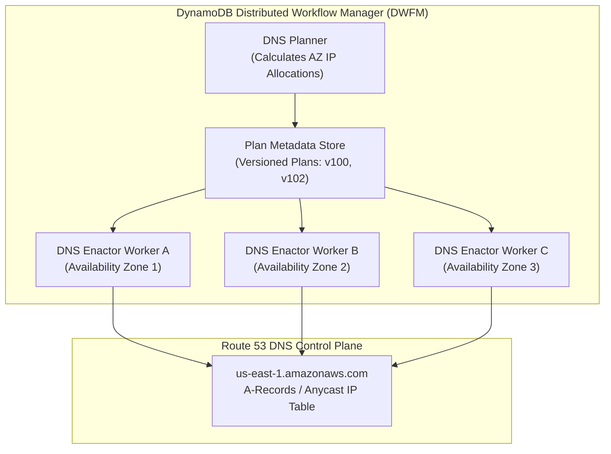
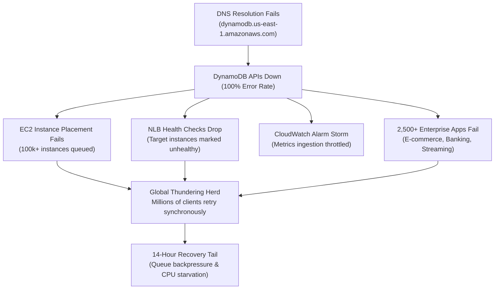
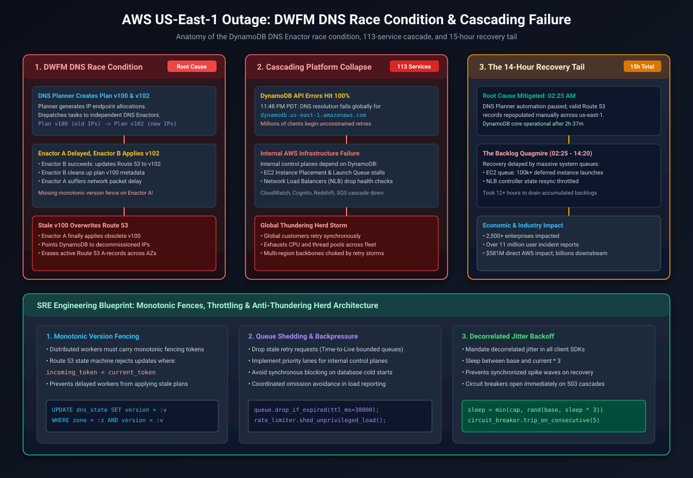
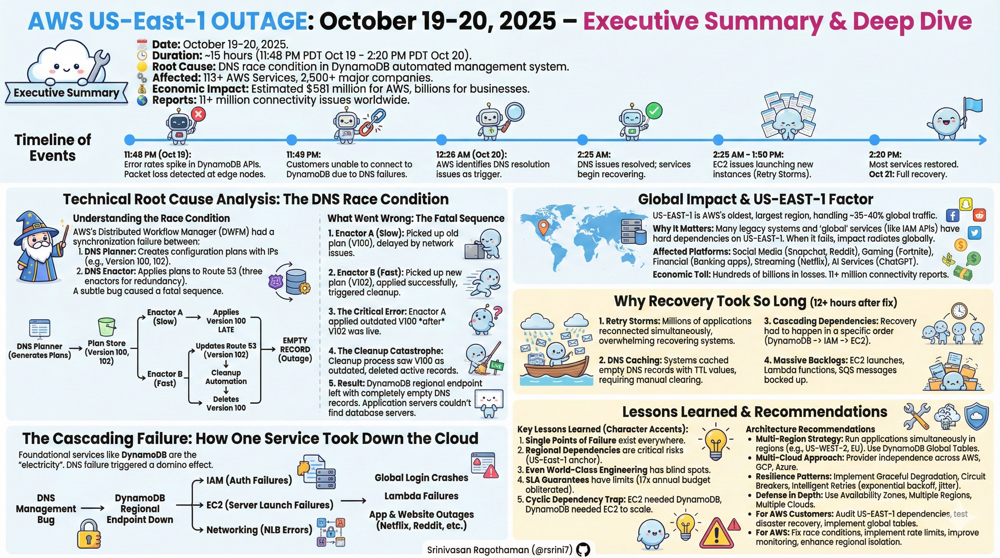

# AWS US-East-1 Outage: The 15-Hour DNS Race Condition & Cascading Collapse

Daily learning · October 2025 · Incident review  
*By Srinivasan Ragothaman ([@rsrini7](https://github.com/rsrini7))*

> **Core idea:** On October 19–20, 2025, a subtle race condition in DynamoDB's internal Distributed Workflow Manager (DWFM) led to an automated DNS enactor applying an obsolete routing plan that wiped active Route 53 records across US-East-1 (Northern Virginia). While engineers corrected the DNS routing table within 2.5 hours, the resulting global retry storm, coupled with 100,000+ queued EC2 instance launches and internal control-plane dependencies on DynamoDB, extended recovery across 113 AWS services to over 15 hours, resulting in an estimated $581M+ direct economic impact.

---

## 1. Foundations: The DynamoDB Distributed Workflow Manager (DWFM)

Amazon DynamoDB is a foundational storage primitive powering not only third-party applications, but also AWS's own internal control planes—including the Amazon Elastic Compute Cloud (EC2) placement engine, Network Load Balancer (NLB) health monitors, and AWS Identity and Access Management (IAM) policy evaluation.



### Architectural Roles & Responsibilities

| Subsystem | Functional Role | Operational Behavior |
|---|---|---|
| **DNS Planner** | Capacity & Placement Orchestrator | Analyzes backend DynamoDB storage node health, calculates IP allocations, and generates versioned DNS update plans (e.g., Plan v100, Plan v102). |
| **DNS Enactors** | Route 53 Execution Agents | Distributed worker pool operating across Availability Zones. Pulls pending plans, updates Route 53 record sets, and confirms execution. |
| **Route 53 Hosted Zone** | Authoritative DNS Registry | Stores the authoritative `A` and `AAAA` records for `dynamodb.us-east-1.amazonaws.com`. |
| **Dependent Control Planes** | Internal AWS Infrastructure | EC2 instance launch coordinators, NLB target group evaluators, and CloudWatch metrics ingestion pipelines that depend synchronously on DynamoDB. |

---

## 2. Deep Technical Mechanism: The DNS Race Condition

### 2.1 The Distributed State Inversion

Under normal operation, the DNS Planner creates a sequential plan and places it into the workflow queue. Multiple Enactors pick up the plan concurrently to update Route 53 across different availability zones. Once a newer plan is fully applied, prior completed plans are marked as retired.

During the late evening of October 19, 2025, a critical race condition unfolded:

```mermaid
sequenceDiagram
    autonumber
    participant Planner as DNS Planner
    participant EnactorA as DNS Enactor A (Slow)
    participant EnactorB as DNS Enactor B (Fast)
    participant R53 as Route 53 DNS Zone

    Planner->>EnactorA: Dispatches Plan v100 (Older IP Set)
    Planner->>EnactorB: Dispatches Plan v102 (Newer IP Set)
    Note over EnactorA: Network jitter / retries delay Enactor A
    EnactorB->>R53: Applies Plan v102 successfully
    EnactorB->>Planner: Marks Plan v100 as retired / cleaned up
    Note over EnactorA: Enactor A unblocks; lacks monotonic version check!
    EnactorA->>R53: Retries and APPLIES obsolete Plan v100
    Note over R53: Active v102 IPs replaced with decommissioned v100 IPs
    R53--xClient: DNS Resolution Fails (NXDOMAIN / Connection Refused)
```

1. **Plan Generation:** The DNS Planner created Plan v100, followed shortly by an updated Plan v102 representing fresh database endpoint allocations.
2. **Execution Desynchronization:** Enactor B quickly picked up and successfully executed Plan v102 in Route 53.
3. **Delayed Stale Execution:** Enactor A had experienced transient network packet delays while attempting to process the older Plan v100.
4. **The Missing Monotonic Fence:** When Enactor A finally completed its retry loop, it pushed Plan v100 to Route 53. Because the Route 53 API updater did not enforce a **monotonic fencing token** or compare plan generation timestamps, Route 53 accepted the stale plan.
5. **Record Annihilation:** Plan v100 referenced legacy database IP addresses that had already been decommissioned. In the process, valid active A-records were overwritten, effectively severing `dynamodb.us-east-1.amazonaws.com` from network resolution.

---

## 3. The Cascading Collapse & The 14-Hour Recovery Tail



### 3.1 Why Service Restoration Took 14 Additional Hours

At **02:25 AM PDT (October 20)**—2 hours and 37 minutes after the initial failure—AWS engineers paused the automated DWFM and manually restored valid Route 53 DNS records. However, full recovery took until **02:20 PM PDT**—an additional 12 hours:

1. **The Thundering Herd Retry Storm:** Thousands of external systems and internal microservices executed immediate, un-jittered retries. As soon as DNS resolved, hundreds of millions of requests slammed DynamoDB frontends, causing request queue saturation and CPU thread starvation.
2. **EC2 Launch Queue Backlog:** Over 100,000 instance launch requests had queued up inside the EC2 control plane during the outage. Processing this massive backlog overwhelmed internal placement engines and network interface attachment workers.
3. **NLB State Resynchronization:** Network Load Balancers had marked millions of healthy targets as unhealthy because health-check reporting pipelines were blocked. Re-verifying and re-enabling targets across thousands of target groups required staged rate-limiting to prevent crashing the target instances upon unfreezing.

---

## 4. Architectural Visual: The Race Condition & Blast Radius

The following architecture diagram details the DWFM race condition, the cross-service cascade across US-East-1, and the SRE defensive engineering blueprint:



---

## 5. Production Implementations & SRE Defensive Recipes

Preventing distributed workflow desynchronization and surviving regional cloud control-plane failures requires two critical architectural patterns: monotonic version fencing and decorrelated jittered backoff.

### 5.1 Monotonic Version Fencing Manager (Python / Distributed DB)

Distributed workers must never apply configuration updates without validating that their task's generation token is strictly greater than the currently active state.

```python
#!/usr/bin/env python3
"""
monotonic_fencing_manager.py
Implements optimistic concurrency version fencing to prevent stale workers
from overwriting newer distributed configurations (CVE / Incident Mitigation).
"""

import time
from dataclasses import dataclass
from typing import Optional


@dataclass
class ConfigurationPlan:
    version_token: int
    endpoints: list[str]
    timestamp: float


class Route53StateManager:

    def __init__(self):
        # Current active state in Route 53
        self.active_version = 0
        self.active_endpoints: list[str] = []

    def apply_plan(self, worker_id: str, plan: ConfigurationPlan) -> bool:
        """Applies a configuration plan only if the version token is strictly greater

        than the active version (Monotonic Fencing).
        """
        print(
            f"[*] Worker '{worker_id}' attempting to apply Plan v{plan.version_token}..."
        )

        # CRITICAL FENCE: Reject stale or delayed execution
        if plan.version_token <= self.active_version:
            print(
                f"[!] REJECTED: Stale Plan v{plan.version_token} superseded by active Plan v{self.active_version}. "
                f"Worker '{worker_id}' execution dropped."
            )
            return False

        # Atomic commit
        self.active_version = plan.version_token
        self.active_endpoints = plan.endpoints
        print(
            f"[+] SUCCESS: Applied Plan v{self.active_version} with endpoints {self.active_endpoints}"
        )
        return True


# Demonstration of the DWFM Race Condition Prevention
if __name__ == "__main__":
    r53 = Route53StateManager()

    plan_100 = ConfigurationPlan(
        version_token=100,
        endpoints=["10.0.1.10", "10.0.2.10"],
        timestamp=time.time(),
    )
    plan_102 = ConfigurationPlan(
        version_token=102,
        endpoints=["10.0.1.50", "10.0.2.50"],
        timestamp=time.time() + 10,
    )

    # Enactor B finishes quickly with Plan 102
    r53.apply_plan(worker_id="Enactor-B (Fast)", plan=plan_102)

    # Enactor A experiences network delay and attempts to apply Plan 100 later
    time.sleep(0.5)
    success = r53.apply_plan(worker_id="Enactor-A (Delayed)", plan=plan_100)

    assert not success, "Error: Stale plan was allowed to overwrite newer state!"
    print("[*] Fencing check verified: System protected against stale DWFM race.")
```

### 5.2 Client-Side Decorrelated Jitter Backoff (Python)

To prevent thundering herd retry storms when a major service comes back online, client SDKs must use Decorrelated Jitter:

$$\text{sleep} = \min\left(\text{cap}, \text{Uniform}(\text{base}, \text{sleep} \times 3)\right)$$

```python
import random
import time


def execute_with_decorrelated_jitter(
    operation, max_attempts=5, base=0.1, cap=10.0
):
    """Executes an operation using AWS-recommended Decorrelated Jitter.

    Prevents thundering herd waves on recovering control planes.
    """
    sleep = base
    for attempt in range(1, max_attempts + 1):
        try:
            return operation()
        except Exception as err:
            if attempt == max_attempts:
                raise err

            # Decorrelated Jitter formula
            sleep = min(cap, random.uniform(base, sleep * 3))
            print(
                f"[-] Attempt {attempt} failed ({err}). Backing off for {sleep:.2f}s..."
            )
            time.sleep(sleep)
```

---

## 6. Impact, Real-World Edge Cases & Gotchas

### 6.1 Common Claims vs. Technical Realities

| Industry Assumption | Technical Reality |
|---|---|
| *"Deploying across multiple Availability Zones protects against this outage."* | **False.** DynamoDB service DNS names (`dynamodb.us-east-1.amazonaws.com`) are regional endpoints. When Route 53's regional record table was wiped, multi-AZ deployment provided zero protection. |
| *"Once the DNS fix was deployed at 02:25 AM, our systems should have recovered instantly."* | **False.** The resulting thundering herd retry storm clogged internal EC2 and NLB queues for 12+ additional hours, starving systems of CPU and network bandwidth. |
| *"AWS services are completely decoupled from one another."* | **False.** High-level services (EC2, EKS, CloudWatch, Redshift) depend synchronously on DynamoDB for state management and placement routing. |
| *"Static IP caching in clients guarantees uptime during DNS failure."* | **Dangerous.** While caching avoids immediate DNS lookup failure, DynamoDB dynamically shifts load across IP addresses. Connecting to stale cached IPs causes connection resets once the IP is reclaimed. |

---

## 7. Practical SRE Adoption Blueprint & Verification Checklist

### 7.1 Engineering Verification Checklist

- [ ] Ensure all distributed workflow engines enforce **monotonic fencing tokens** on write operations.
- [ ] Implement strict **decorrelated jitter** in all internal SDKs and HTTP client retry loops.
- [ ] Implement **multi-region active-active architectures** with health-checked DNS failover (Route 53 latency routing) for tier-0 services.
- [ ] Verify that service control planes do not have synchronous circular dependencies on the data stores they manage.
- [ ] Configure client connection pools with circuit breakers that trip on 5 consecutive 503/timeout responses to prevent local thread exhaustion.

---

## 8. Timeline of Events

```
Oct 19, 23:48 PDT      Oct 20, 00:26 PDT      Oct 20, 02:25 PDT      Oct 20, 14:20 PDT
       +-----------------------+----------------------+----------------------+
       | DynamoDB DNS Errors   | AWS Identifies DNS   | DNS Records Restored;| All 113 Services
       | Spike; 100% Failures  | Desync in DWFM Plan  | Queue Backlog Stalls | Fully Operational;
       | Across US-East-1      | Route 53 Table Wiped | EC2/NLB Recovery     | Outage Closed
```

- **October 19, 11:48 PM PDT (06:48 UTC Oct 20):** Error rates spike in DynamoDB APIs. Ashburn edge nodes report massive packet loss.
- **October 20, 12:26 AM PDT:** AWS engineers isolate the issue to DNS resolution failures for regional DynamoDB service endpoints.
- **October 20, 02:25 AM PDT:** Core DNS records are manually restored; DynamoDB begins accepting traffic.
- **October 20, 05:30 AM – 01:50 PM PDT:** EC2 placement engine and Network Load Balancers struggle under extreme backlog congestion.
- **October 20, 02:20 PM PDT:** AWS confirms full recovery across all 113 affected services.

---

## 9. Source Context and Primary Disclosures

| Date | Source / Organization | Disclosure / Document | Focus Area |
|---|---|---|---|
| Oct 2025 | AWS Incident Team | [AWS Post-Event Summary: October 19-20 US-East-1](https://aws.amazon.com/message/) | Root-cause analysis of DWFM DNS Planner and Enactor race condition |
| Oct 2025 | Datadog Reliability Research | [US-East-1 Outage Impact Analysis](https://www.datadoghq.com/) | Cross-cloud telemetry and thundering herd observation |
| Oct 2025 | The Register / Reuters | [AWS Northern Virginia Outage Disruption](https://www.theregister.com/) | Enterprise impact report covering 2,500+ enterprises |

---

## 10. Supplementary visuals

The following diagram illustrates the original incident timeline, affected cloud dependencies, and regional scope:


*Figure 1: High-level architectural map of the October 2025 AWS US-East-1 disruption and control-plane dependency cascade.*

---

**Related:**
- [Cloudflare Global Outage ClickHouse Config](Cloudflare-Global-Outage-ClickHouse-Config-Nov-2025.md) — Another global platform disruption caused by configuration generator desync and homogeneous edge crashes.
- [Supabase Outage Feb 2026](Supabase-Outage-Feb-2026.md) — Demonstrates how a single regional AWS VPC control-plane kill-switch isolated production databases.
- [AWS vs Hetzner](../../Engineering/Cloud/AWS-vs-Hetzner.md) — Examines cloud blast radius dynamics, managed dependency coupling, and multi-region cost trade-offs.
- [Scaling-Cpp-Services-To-1-Million-RPS-2026](../../Engineering/Architecture/Scaling-Cpp-Services-To-1-Million-RPS-2026.md) — Explores zero-copy networking and asynchronous backpressure to avoid thundering herd queue exhaustion.
