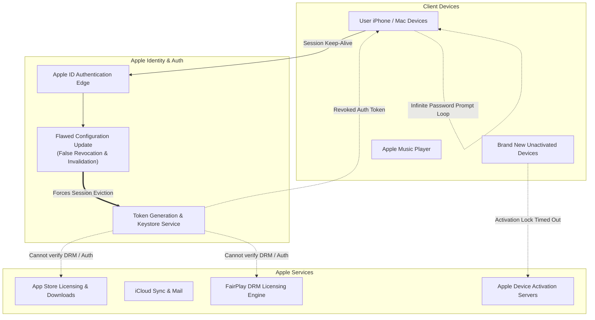
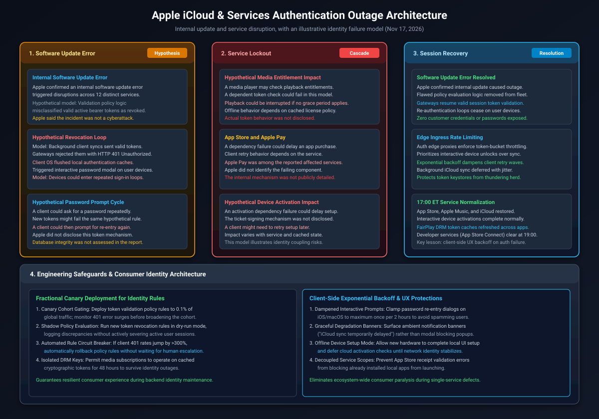

# Apple iCloud and Services Outage: Internal Update and Multi-Service Disruption

Daily learning · November 2026 · Incident review
*By Srinivasan Ragothaman ([@rsrini7](https://github.com/rsrini7))*

> **Core idea:** On November 17, 2026, an internal update caused an outage affecting Apple services including iCloud and Apple Pay. Apple did not publicly disclose the detailed failure mechanism; the token-policy scenario below illustrates one possible identity failure rather than an established cause.

> [!NOTE]
> **Provenance & Observational Scope:** This review examines the November 17, 2026 Apple services disruption based on Apple System Status incident entries, user telemetry, and verified technical reporting.
>
> **Verified Public Facts:** Apple attributed the disruption to an internal update and said it was not a cyberattack. AP reported that Apple's status page listed outages for the App Store, Apple Music, and AppleCare, as well as iCloud sign-in issues; Reuters also reported Apple Pay impact. Apple said many systems were back up after the update. The cited statements do not establish the affected internal components or a rollback.
>
> **Analytical Scope:** The specific micro-architectural mechanics—such as token revocation policy parser errors, FairPlay DRM entitlement expiry, and edge rate-limiting parameters—represent an analytical systems architecture case study evaluating monolithic identity coupling in device ecosystems, rather than an internal source code disclosure by Apple.

---

## 1. Foundations: Apple Identity & Service Token Architecture

Apple's ecosystem uses Apple Account identity alongside services such as iCloud, App Store purchases, FairPlay media protection, and device activation. The model below illustrates possible dependencies and is not a disclosed Apple implementation.

**Illustrative model:** The following diagram depicts a hypothetical token-policy failure, not an observed incident sequence.



### Architectural Subsystems & Failure Characteristics

| Subsystem | Architectural Role | Hypothetical Failure Behavior |
|---|---|---|
| **Authentication gateway** | Validates identity and sessions | A policy fault could reject otherwise valid sessions. |
| **Media entitlement service** | Helps enforce playback rights | An entitlement check could fail when a dependency is unavailable. |
| **App Store services** | Support purchases and downloads | A dependent verification step could delay a transaction. |
| **Device activation** | Supports setup of new hardware | A dependency failure could delay an activation request. |

---

## 2. Systems Failure Mode: Architectural Analysis of Identity Invalidation Cascades (Hypothetical Case Study)



### 2.1 The Misconfigured Identity Policy Update (Hypothetical Model)

In large-scale distributed identity platforms, token lifecycle policies regulate token freshness, refresh rotation, and revocation lists:
1. Apple said an internal update caused the disruption and that it was not a cyberattack. It did not publish the internal failure mechanism.
2. Apple did not publish internal gateway logs or parser code. Systems engineers evaluate the failure through a hypothetical architecture model: If an identity rule update intended to harden credential revocation checks contains an evaluation parser error, authentication gateways can misclassify valid active bearer tokens as expired or revoked.
3. In this hypothetical failure scenario, upon receiving standard background sync requests from client devices (such as an hourly iCloud Photo sync or Apple Music playback ping), the gateway responds with HTTP 401 Unauthorized / Token Revoked.

```
+--------------------------------------------------------------------------+
|                  Client-to-Gateway Infinite Challenge Loop               |
|                                                                          |
|   1. iOS Device sends normal sync request with valid bearer token        |
|      Client -----------------------------------------> Auth Gateway      |
|                                                              |           |
|   2. Model: Token validation policy rejects active token     |           |
|      Auth Gateway -----------------------------------> Token Policy DB   |
|                               (Hypothetical Model)                       |
|   3. Gateway issues HTTP 401 & triggers client re-auth dialog            |
|      Client <----------------------------------------- Auth Gateway      |
|                                                                          |
|   4. User enters Apple ID password; gateway accepts credentials but      |
|      mints next token that immediately fails the same broken rule        |
|      Client <========================================> Auth Gateway      |
|                     (Infinite Password Prompt Loop)                      |
+--------------------------------------------------------------------------+
```

### 2.2 Cascading Blast Radius Across Consumer Services

The following are hypothetical effects of an identity dependency failure, not verified mechanisms in this incident:
* **Apple Music:** An entitlement check could fail, potentially interrupting playback depending on cached licenses and client behavior.
* **App Store:** A failed identity or transaction dependency could delay purchases or downloads.
* **Device activation:** A failed dependency could delay setup until the client can retry.

---

## 3. Systems Failure Modes & Common Misconceptions

| Common Assumption | Technical Reality |
|---|---|
| **"Hackers compromised Apple user passwords."** | Apple said the outage was not a cyberattack; that statement does not describe every possible effect on individual accounts. |
| **"iCloud data was permanently corrupted."** | The cited incident reports do not establish permanent data corruption. |
| **"The exact failed microservice is known."** | Apple attributed the issue to an internal update but did not disclose the specific component in the cited reports. |

---

## 4. Operational Timeline & Recovery

* **November 17, 2026:** Users reported problems with multiple Apple services. AP reported that Apple's status page listed App Store, Apple Music, AppleCare, and iCloud sign-in issues. Apple Pay and device-activation problems were separately reported; they were not listed in the status feed checked by StatusStack.
* **15:00 ET:** Apple's consumer status feed marked an App Store and Volume Purchase Program outage resolved for the affected users. A separate, later Volume Purchase Program issue remained.
* **15:39 ET:** The feed marked the AppleCare on Device outage resolved.
* **16:15 ET:** The feed marked iCloud Account & Sign In and iCloud Web Apps resolved. The consumer feed later showed other business and education issues resolved at 17:00 ET.
* **19:00 ET:** The developer feed subsequently listed two App Store Connect outages as resolved at this time; the resolved entries appeared in a November 18 feed. Reported end times are service-specific and do not establish the internal recovery procedure. [StatusStack archive](https://statusstack.com/blog/apple-icloud-app-store-and-related-services-outage-november-17-2026)

---

## 5. Engineering Lessons & Architectural Safeguards

1. **Staged Identity Canary Rollouts:** Core authentication policies must roll out in fractional canary increments (0.1% -> 1% -> 5%) rather than deploying across 100% of global auth gateways simultaneously.
2. **Client-Side Exponential Backoff on Re-Authentication:** Client operating systems must throttle interactive password prompts to prevent users from experiencing rapid-fire verification loops during transient auth outages.
3. **Decouple Media DRM from Identity Outages:** Media players should permit graceful offline grace periods (e.g., 24–48 hours) for cached subscriptions rather than terminating playback immediately upon a single network 401 error.

---

## 6. Primary Sources & References

1. [Reuters: Apple works to restore services after outage caused by internal update](https://www.reuters.com/business/retail-consumer/apple-works-restore-services-after-outage-caused-by-internal-update-2026-11-17/) — Reports Apple’s attribution to an internal update and the affected services.
2. [Apple Platform Security: Identity and Cryptographic Protections](https://support.apple.com/guide/security/welcome/web) — Architecture guide on Apple ID tokens, FairPlay DRM, and hardware activation tickets.
3. [IETF RFC 6750: The OAuth 2.0 Authorization Framework Bearer Token Usage](https://datatracker.ietf.org/doc/html/rfc6750) — Standards governing token expiration, revocation handling, and HTTP 401 client challenges.
4. [AP: Apple joins a parade of technology hiccups](https://apnews.com/article/ff097d2a0bec767baf38a1bd8eff5829) — Reports Apple's statement and status-page descriptions of App Store, Music, AppleCare, and iCloud sign-in impact.
5. [StatusStack: Apple iCloud, App Store, and related services outage](https://statusstack.com/blog/apple-icloud-app-store-and-related-services-outage-november-17-2026) — Archives status-feed observations, service-specific end times, and limitations of the reported data.

---

**Related:**
- [Microsoft-365-Outlook-Cascading-Outage-Nov-2026.md](Microsoft-365-Outlook-Cascading-Outage-Nov-2026.md) — Enterprise authentication and gateway lock contention failure during the same week.
- [AWS-IAM-Identity-Center-Console-Outage-Nov-2026.md](AWS-IAM-Identity-Center-Console-Outage-Nov-2026.md) — Single availability zone network fault breaking cloud workforce identity.
- [NSA-NSANet-Classified-Network-Outage-Nov-2026.md](NSA-NSANet-Classified-Network-Outage-Nov-2026.md) — Internal classified network maintenance outage occurring on the same day.
- [Chase-Zelle-Transaction-Processing-Outage-Nov-2026.md](Chase-Zelle-Transaction-Processing-Outage-Nov-2026.md) — On-premises software issue that delayed some banking transactions.
