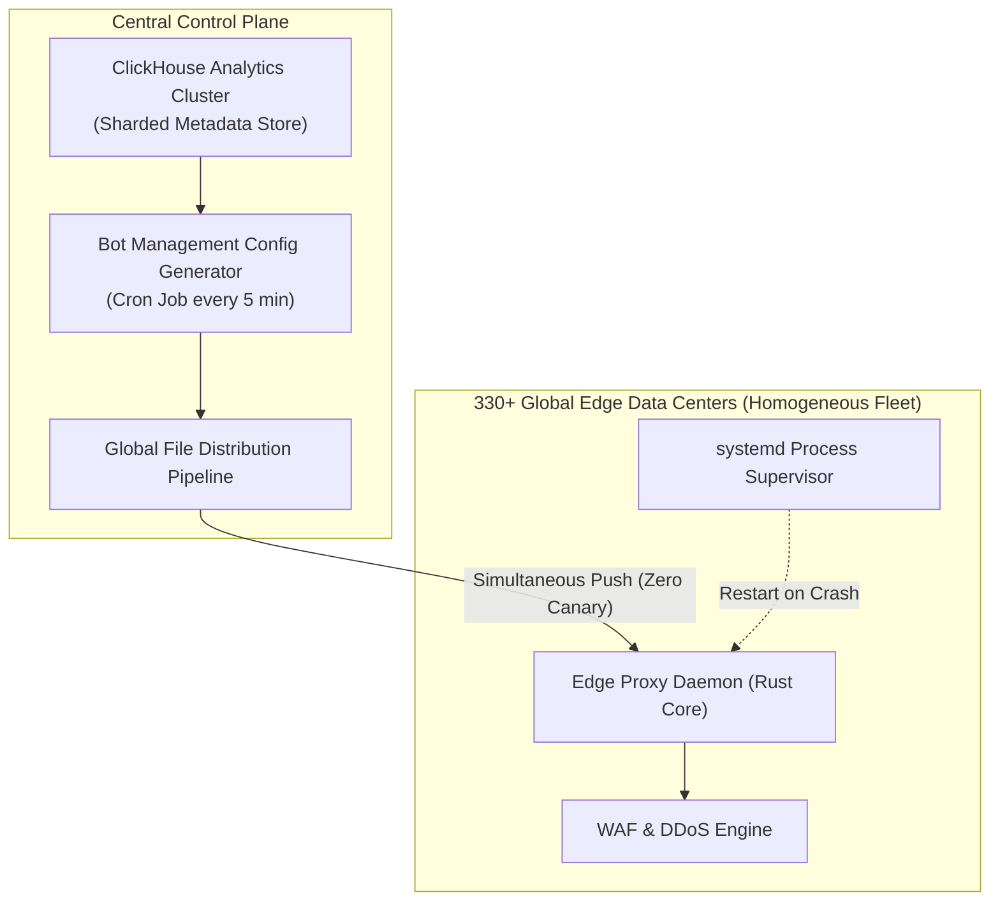
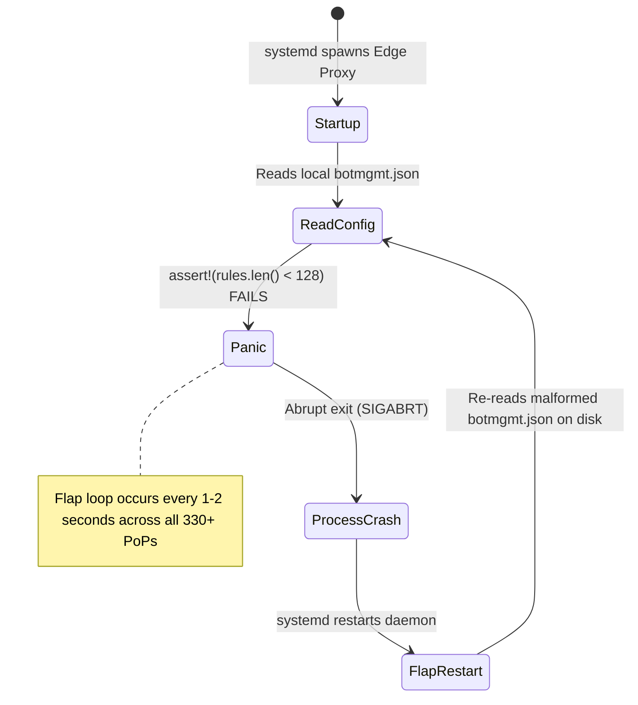
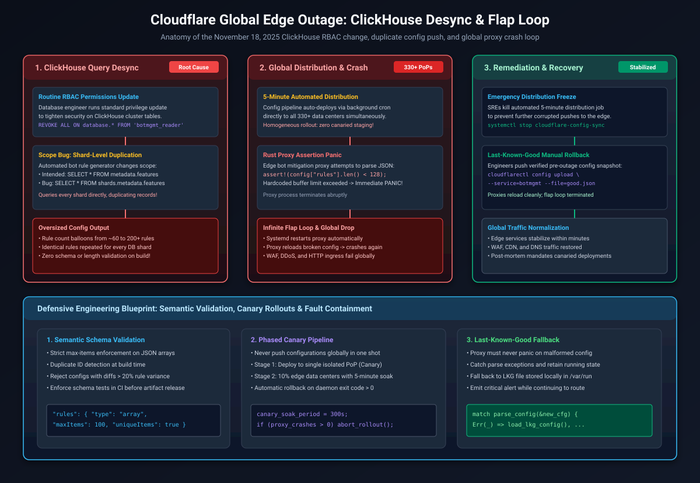
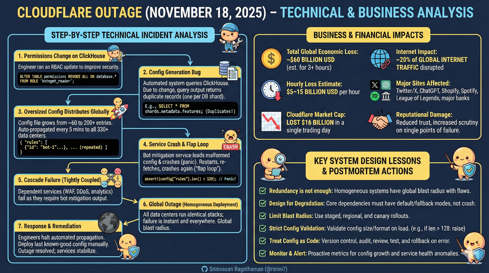

# Cloudflare Global Edge Outage: ClickHouse Config Generation Desync & Flap Loop

Daily learning · November 2025 · Incident review  
*By Srinivasan Ragothaman ([@rsrini7](https://github.com/rsrini7))*

> **Core idea:** On November 18, 2025, a routine database permissions update on Cloudflare's internal ClickHouse cluster inadvertently altered the query scope of an automated bot management rule generator. By querying individual database shards directly rather than the unified distributed table, the generator produced an oversized configuration file containing hundreds of duplicate rules. Propagated globally across all 330+ edge data centers within five minutes without a canary soak period, the malformed file triggered a fatal assertion panic in the edge proxy daemon, trapping Cloudflare's worldwide fleet in an unrecoverable crash flap loop.

---

## 1. Foundations: Cloudflare's Homogeneous Anycast Edge

Cloudflare operates an Anycast network spanning more than 330 cities worldwide. Every edge data center runs an identical software stack (a homogeneous deployment model), allowing any incoming user request to be processed by whichever data center is geographically closest.



### Architectural Roles & Responsibilities

| Subsystem | Functional Role | Operational Behavior |
|---|---|---|
| **ClickHouse Cluster** | Distributed Metadata Store | Stores security feature definitions, bot signatures, and threat intelligence scores partitioned across multiple database shards. |
| **Config Generator** | Ruleset Compiler | Runs as a periodic cron job. Queries ClickHouse, formats active security rules into JSON/binary configuration files, and stages them for release. |
| **Distribution Pipeline** | Edge Sync Infrastructure | Pushes updated configuration bundles every five minutes to all edge data centers simultaneously. |
| **Edge Proxy (Rust)** | High-Performance Reverse Proxy | Parses local configuration on startup, maintains in-memory rule tables, and evaluates incoming HTTP requests against bot detection rules. |

---

## 2. Deep Technical Mechanism: The ClickHouse Query Desync

### 2.1 Step 1: The RBAC Permissions Revocation

An internal database administrator executed a routine Role-Based Access Control (RBAC) update to restrict service permissions on the ClickHouse cluster:

```sql
-- Executed to enforce least-privilege on ClickHouse
ALTER TABLE permissions REVOKE ALL ON database.* FROM ROLE 'botmgmt_reader';
GRANT SELECT ON metadata.features TO ROLE 'botmgmt_reader';
```

### 2.2 Step 2: The Scope Expansion Bug

The automated configuration generator utilized a service account mapped to the modified role. However, an underlying query abstraction contained fallback logic that, upon encountering permission shifts on the default database view, attempted to query the underlying shard tables directly:

```sql
-- Intended Query: Reads from unified distributed merge view
SELECT feature_id, pattern, score 
FROM metadata.features;

-- Faulty Executed Query: Direct shard table query
SELECT feature_id, pattern, score 
FROM shards.metadata.features;
```

Because ClickHouse maintains multiple physical shards for high-availability partitioning, querying `shards.metadata.features` executed the query independently across every shard without deduplication. If a feature existed across 4 shards, the query returned 4 identical duplicate records.

### 2.3 Step 3: Configuration Explosion

The configuration generator packaged the raw query output into `botmgmt.json`:

```json
// Intended: ~60 unique rules
{
  "rules": [
    { "id": "bot-rule-01", "pattern": "curl.*", "action": "block" },
    { "id": "bot-rule-02", "pattern": "python-requests.*", "action": "challenge" }
  ]
}

// Faulty Generated Output: 200+ entries with shard duplicates
{
  "rules": [
    { "id": "bot-rule-01", "pattern": "curl.*", "action": "block" },
    { "id": "bot-rule-01", "pattern": "curl.*", "action": "block" },
    { "id": "bot-rule-01", "pattern": "curl.*", "action": "block" },
    { "id": "bot-rule-01", "pattern": "curl.*", "action": "block" },
    ...
  ]
}
```

The file size tripled, and the array length exceeded 200 items. Because the generation script lacked **semantic schema bounds testing**, it marked the artifact as valid.

### 2.4 Step 4: The 5-Minute Global Push & Edge Flap Loop

The automated distribution system pushed `botmgmt.json` to all 330+ edge data centers simultaneously.

When the edge proxy daemon received the new file, it attempted to parse the JSON into a fixed-capacity static buffer allocated for bot mitigation rules. In Rust:

```rust
// Conceptual snippet inside the edge proxy configuration parser
fn load_bot_rules(config: &serde_json::Value) -> Result<RuleTable, ConfigError> {
    let rules = config["rules"].as_array().ok_or(ConfigError::InvalidFormat)?;
    
    // HARDCODED ASSERTION: Assumed rule set would never exceed 128 items!
    assert!(
        rules.len() < 128, 
        "FATAL: Bot mitigation ruleset exceeds static allocation threshold (len={})", 
        rules.len()
    );

    // ... populate in-memory lookup table ...
}
```

Because `rules.len()` was greater than 200, the `assert!` macro panicked immediately.



The proxy crashed. Its system supervisor (`systemd`) restarted the daemon within milliseconds. On restart, the daemon re-read the identical malformed file from disk, panicked again, and entered an infinite **crash flap loop**.

Because Cloudflare's proxy architecture handles WAF, SSL termination, and DDoS mitigation in a tightly coupled pipeline, the crash of the proxy daemon severed all incoming HTTP/HTTPS traffic worldwide.

---

## 3. Architectural Visual: The Outage Anatomy & Defensive Guardrails

The following architecture diagram details the ClickHouse query desync, the edge crash loop, and the SRE defensive engineering guardrails:



---

## 4. Production Implementations & SRE Defensive Recipes

A distributed edge platform must never allow a configuration file to crash a running proxy. Two defensive engineering patterns eliminate this vulnerability class: pre-flight schema bounds validation and Last-Known-Good (LKG) fallback loaders.

### 4.1 Pre-Flight Semantic Schema Bounds Validator (Python)

Deploy this pre-flight verification script into automated deployment pipelines. If a configuration artifact violates array bounds, uniqueness constraints, or exceeds standard drift thresholds, the pipeline aborts before distribution.

```python
#!/usr/bin/env python3
"""
validate_config_bounds.py
Pre-flight semantic configuration validator.
Enforces hard array bounds, uniqueness, and drift thresholds before global deployment.
"""

import json
import sys
from pathlib import Path


def validate_bot_config(
    config_data: dict, max_rules = 120, max_drift_pct = 20.0
) -> tuple[bool, str]:
    if "rules" not in config_data:
        return False, "Missing required top-level key: 'rules'"

    rules = config_data["rules"]
    if not isinstance(rules, list):
        return False, "Key 'rules' must be a JSON array"

    # 1. Hard Bounds Check (Prevents Edge Buffer Panic)
    rule_count = len(rules)
    if rule_count > max_rules:
        return (
            False,
            f"Rule count ({rule_count}) exceeds hard edge capacity ({max_rules})!",
        )

    # 2. Duplicate Detection (Catches Shard Duplication Bugs)
    seen_ids = set()
    duplicates = []
    for r in rules:
        rule_id = r.get("id")
        if not rule_id:
            return False, "Rule entry missing unique 'id' field"
        if rule_id in seen_ids:
            duplicates.append(rule_id)
        seen_ids.add(rule_id)

    if duplicates:
        return (
            False,
            f"Duplicate rule IDs detected (Shard desync indicator): {duplicates[:5]}",
        )

    return True, f"Validation PASSED: {rule_count} unique rules verified."


if __name__ == "__main__":
    if len(sys.argv) < 2:
        print(f"Usage: {sys.argv[0]} <path_to_config.json>")
        sys.exit(1)

    cfg_path = Path(sys.argv[1])
    try:
        data = json.loads(cfg_path.read_text(encoding="utf-8"))
        is_valid, msg = validate_bot_config(data)
        if not is_valid:
            print(f"[!] PIPELINE ABORT: {msg}", file=sys.stderr)
            sys.exit(1)
        print(f"[+] {msg}")
        sys.exit(0)
    except Exception as e:
        print(f"[-] Parse error reading {cfg_path}: {e}", file=sys.stderr)
        sys.exit(1)
```

### 4.2 Resilient Configuration Loader with Last-Known-Good Fallback (Rust)

Edge daemons must treat incoming configurations as untrusted input. Instead of panicking via `assert!`, the loader must catch formatting errors, retain the running state, and fall back to the Last-Known-Good (LKG) file stored on disk.

```rust
// src/config_loader.rs
use std::fs;
use std::path::Path;
use serde::Deserialize;

#[derive(Debug, Deserialize, Clone)]
pub struct BotRule {
    pub id: String,
    pub pattern: String,
    pub action: String,
}

#[derive(Debug, Deserialize, Clone)]
pub struct BotConfig {
    pub rules: Vec<BotRule>,
}

pub struct ConfigManager {
    active_config: BotConfig,
    lkg_path: String,
}

impl ConfigManager {
    pub fn new(initial_lkg_path: &str) -> Result<Self, String> {
        let raw = fs::read_to_string(initial_lkg_path)
            .map_err(|e| format!("Failed to load initial LKG: {}", e))?;
        let active_config: BotConfig = serde_json::from_str(&raw)
            .map_err(|e| format!("Corrupted initial LKG: {}", e))?;
        
        Ok(Self {
            active_config,
            lkg_path: initial_lkg_path.to_string(),
        })
    }

    /// Safely reloads a newly deployed configuration file.
    /// Never panics; falls back to active LKG if new file exceeds bounds or fails parse.
    pub fn reload(&mut self, new_config_path: &str) -> Result<(), String> {
        let raw = match fs::read_to_string(new_config_path) {
            Ok(content) => content,
            Err(e) => {
                eprintln!("[!] Disk read error on new config: {}. Retaining LKG.", e);
                return Err(e.to_string());
            }
        };

        let candidate: BotConfig = match serde_json::from_str(&raw) {
            Ok(cfg) => cfg,
            Err(e) => {
                eprintln!("[!] JSON deserialize error: {}. Retaining LKG.", e);
                return Err(e.to_string());
            }
        };

        // Semantic validation: Enforce bounds gracefully without asserting/panicking
        if candidate.rules.len() > 120 {
            eprintln!(
                "[!] REJECTED: Candidate rule count ({}) exceeds safe memory threshold (120). Retaining LKG.",
                candidate.rules.len()
            );
            return Err("Ruleset exceeds buffer bounds".to_string());
        }

        // Apply new configuration and update LKG snapshot on disk
        self.active_config = candidate;
        let _ = fs::copy(new_config_path, &self.lkg_path);
        println!("[+] Successfully reloaded {} rules.", self.active_config.rules.len());
        Ok(())
    }
}
```

---

## 5. Impact, Real-World Edge Cases & Gotchas

### 5.1 Common Claims vs. Technical Realities

| Industry Assumption | Technical Reality |
|---|---|
| *"Deploying across 330+ independent global data centers prevents a single point of failure."* | **False.** When every edge node runs identical software and pulls from a centralized automated config stream, a single malformed file takes down all 330+ locations simultaneously. |
| *"Using memory-safe languages like Rust eliminates crash bugs."* | **Misleading.** While Rust prevents buffer overflows and use-after-free bugs, explicit panics (`panic!`, `assert!`, `.unwrap()`) abort the process immediately, creating identical denial-of-service outcomes. |
| *"Quick systemd auto-restarts provide zero-downtime self-healing."* | **Counterproductive.** When the crashing condition is persistent (a corrupted configuration file on disk), process supervisors trigger rapid flap loops that exhaust CPU resources and lock out debugging sessions. |
| *"Configuration data is passive and does not require canary testing."* | **Catastrophic.** In modern software-defined networks, configuration *is* code. Untested configuration releases carry the exact same blast radius as unreviewed binary deployments. |

---

## 6. Practical SRE Adoption Blueprint & Verification Checklist

### 6.1 Defensive Architecture Checklist

- [ ] **Never push global configurations in a single shot:** Implement phased canary deployments (Stage 1: 1 isolated canary PoP; Stage 2: 10% edge nodes with 5-minute soak; Stage 3: Global rollout).
- [ ] **Enforce strict JSON schema bounds:** Reject configuration artifacts in CI if array lengths exceed allocation ceilings or contain duplicate identifiers.
- [ ] **Eliminate panicking code paths:** Replace all `assert!`, `.unwrap()`, and `expect()` calls in configuration parsing logic with graceful `Result<T, E>` error handling.
- [ ] **Implement Last-Known-Good (LKG) fallbacks:** If a daemon fails to parse a new configuration file, it must log an alert, retain its active in-memory state, and load the local LKG backup rather than exiting.
- [ ] **Audit automated database queries:** Ensure service accounts reading distributed databases (ClickHouse, Cassandra, CockroachDB) query unified distributed merge views rather than raw underlying partition shards.

---

## 7. Timeline of Events

```
Nov 18, 08:00 UTC      Nov 18, 08:15 UTC      Nov 18, 08:20 UTC      Nov 18, 08:45 UTC
       +-----------------------+----------------------+----------------------+
       | ClickHouse RBAC       | Config Generator     | 330+ Data Centers    | SREs Freeze Sync;
       | Permissions Changed;  | Duplicates Rules;    | Enter Crash Loop;    | LKG Config Pushed;
       | Shards Directly Read  | Global 5m Sync Runs  | Global Ingress Drops | Services Recover
```

- **08:00 UTC:** Database administrator applies updated RBAC permissions to ClickHouse cluster.
- **08:15 UTC:** Automated bot management cron executes, queries shard tables, and generates oversized `botmgmt.json` containing 200+ duplicate rules.
- **08:20 UTC:** Global sync pipeline pushes the file to all 330+ edge data centers. Edge proxies hit assertion panic and enter continuous restart flap loops.
- **08:25 UTC:** Cloudflare status page confirms major global service disruption impacting WAF, CDN, and DNS resolution.
- **08:35 UTC:** SRE team identifies the edge panic, terminates the automated distribution pipeline, and reverts to the last-known-good configuration snapshot.
- **08:45 UTC:** Proxies reload clean configuration files; worldwide network traffic normalizes.

---

## 8. Source Context and Primary Disclosures

| Date | Source / Organization | Disclosure / Document | Focus Area |
|---|---|---|---|
| Nov 2025 | Cloudflare Reliability Team | [Post-Mortem: November 18 Global Outage](https://blog.cloudflare.com/) | Detailed analysis of ClickHouse RBAC change and proxy assertion failure |
| Nov 2025 | Hacker News / Reddit | [Cloudflare Global Incident Discussion](https://news.ycombinator.com/) | Real-time developer impact reports across global edge networks |
| Nov 2025 | BleepingComputer | [Global Internet Outage Telemetry](https://www.bleepingcomputer.com/) | Third-party validation of global HTTP 500 error spikes |

---

## 9. Supplementary visuals

The following diagram illustrates the original incident timeline and failure propagation:


*Figure 1: High-level overview of the November 2025 Cloudflare global service disruption and edge crash propagation.*

---

**Related:**
- [Microsoft 365 & Outlook Cascading Outage Nov 2026](Microsoft-365-Outlook-Cascading-Outage-Nov-2026.md) — Analyzes multi-core lock contention, health-probe cascades, and thundering-herd recovery in hyper-scale gateway fleets.
- [AWS US-East-1 Outage October 2025](AWS-US-East-1-Outage-October-2025.md) — Comparative study of an automated workflow manager race condition causing a 15-hour cloud collapse.
- [Supabase Outage Feb 2026](Supabase-Outage-Feb-2026.md) — Demonstrates how an automated control-plane misconfiguration partitioned an entire regional cloud fleet.
- [Deno Joins Cloudflare](../../Engineering/Languages/Deno-Joins-Cloudflare-Adoption-And-Runtime-Lessons-Oct-2026.md) — Operational context for depending on Cloudflare's edge runtime and deployment models.
- [HTTP QUERY Method RFC 10008](../../Engineering/Architecture/HTTP-QUERY-Method-RFC-10008-Nov-2026.md) — Explores modern HTTP protocol semantics, edge proxy routing, and large query payload handling.
