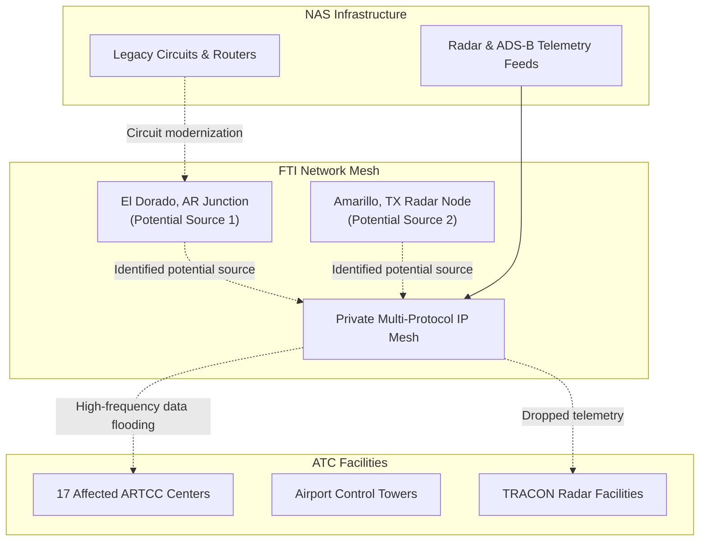
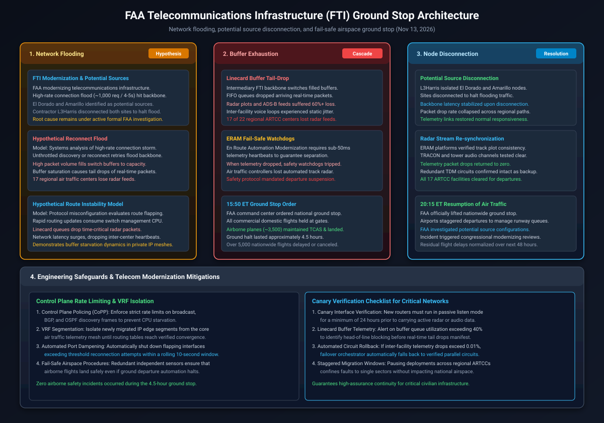

# FAA Telecommunications Infrastructure (FTI) Outage: Network Flooding and the Nationwide Ground Stop

Daily learning · November 2026 · Incident review
*By Srinivasan Ragothaman ([@rsrini7](https://github.com/rsrini7))*

> **Core idea:** On November 13, 2026, the Federal Aviation Administration (FAA) issued a nationwide ground stop halting departing flights across the United States for nearly 4.5 hours. The disruption was triggered by network flooding (~1,000 connection requests every 4–5 seconds) on the private FAA Telecommunications Infrastructure (FTI) backbone during maintenance, impacting radar and telemetry feeds across 17 of 22 Air Route Traffic Control Centers (ARTCCs). Contractor L3Harris isolated the flood by disconnecting two potential source locations—a telecommunications junction in El Dorado, Arkansas (where a new router was being installed) and an existing radar facility in Amarillo, Texas—allowing feeds to stabilize and flights to resume safely while the formal root cause remained under federal investigation.

> [!NOTE]
> **Provenance & Observational Scope:** This review examines the November 13, 2026 air traffic disruption based on official briefings from the Department of Transportation (DOT), the FAA Incident Q&A, and congressional hearing records.
>
> **Verified Public Facts:** The nationwide ground stop was ordered at approximately 3:50 p.m. ET and lifted at 8:15 p.m. ET (~4.5 hours). The FAA identified two potential source locations: an FTI telecommunications junction in El Dorado, Arkansas (where a new router was being installed) and an existing radar facility in Amarillo, Texas. Contractor L3Harris disconnected those two potential source locations to isolate high-rate connection flooding (~1,000 connection requests every 4–5 seconds) that degraded radar telemetry feeds across 17 of 22 Air Route Traffic Control Centers (ARTCCs). Airborne aircraft (~3,500 planes) were managed safely via onboard TCAS and secondary radar, resulting in zero airborne safety breaches. The FAA affirmed that the underlying root cause of the data flooding remained under active formal investigation.
>
> **Analytical Scope:** Protocol-level explanations—such as BGP/OSPF peer handshake dampening, bridging loops, and specific linecard buffer tail-drops—represent hypothetical systems architecture failure models illustrating how control-plane storms can saturate network buffers, rather than an established FAA forensic finding.

---

## 1. Foundations: FAA Telecommunications Infrastructure (FTI)

The U.S. National Airspace System (NAS) depends on the FAA Telecommunications Infrastructure (FTI), a dedicated nationwide private telecommunications network managed by primary contractor L3Harris Technologies. FTI bridges air traffic control towers, terminal radar approach controls (TRACONs), remote communication air-ground (RCAG) radio sites, and En Route Air Route Traffic Control Centers (ARTCCs).



### Key System Entities & Operational Coupling

| Entity / System | Architectural Role | Incident Observation / Role |
|---|---|---|
| **FTI Private Backbone** | Dedicated mission-critical network for NAS communications | Experienced high-frequency connection flooding (~1,000 req / 4–5s) during maintenance. |
| **Air Route Traffic Control Centers (ARTCC)** | 22 regional facilities managing high-altitude commercial airspace | 17 facilities suffered radar telemetry drops and display flickers, prompting safety ground stops. |
| **Potential Source Locations (El Dorado &amp; Amarillo)** | Telecommunications junction (El Dorado, AR) and radar facility (Amarillo, TX) | Identified by FAA as potential source locations and disconnected by L3Harris to halt flooding while root cause remained under investigation. |
| **L3Harris Network Operations** | Prime contractor monitoring and operating FTI backbone | Disconnected the two identified locations to isolate flooding and stabilize backbone telemetry. |
| **Hypothetical Peering Model** | Systems engineering failure analysis | Evaluates how unthrottled reconnect storms or bridging loops could generate 1,000 req / 4–5s floods. |

---

## 2. Systems Failure Mode: Network Flooding &amp; Buffer Saturation (Hypothetical Architecture Case Study)



### 2.1 Network Flooding &amp; Hypothetical Peering Scenarios

During scheduled maintenance on November 13, 2026, high-frequency network traffic flooded the private FTI backbone, disrupting radar displays across 17 ARTCCs:
1. The FAA identified two potential source locations—an FTI junction in **El Dorado, Arkansas** (where a new router was being installed) and an existing radar facility in **Amarillo, Texas**. Contractor L3Harris disconnected both locations to arrest the flooding.
2. The FAA affirmed that the underlying root cause of the data flooding remained under active formal investigation.
3. To evaluate how ~1,000 connection requests every 4–5 seconds could saturate network buffers, systems engineers evaluate hypothetical protocol failure modes: if newly provisioned IP interfaces encounter mismatched peering, unthrottled reconnect attempts, or bridging feedback, control-plane storms can overwhelm linecard queues.

```
+--------------------------------------------------------------------------+
|                  FTI Backbone Ingress Packet Saturation                  |
|                                                                          |
|  [El Dorado Router]                     [Amarillo Radar Node]            |
|         \                                         /                      |
|          +-----> [ Unthrottled Discovery Loop ] <+                       |
|                             |                                            |
|                  1,000 SYN / Hello / 4-5s                                |
|                             v                                            |
|          +--------------------------------------+                        |
|          |    Legacy Switch Linecard Buffer     |                        |
|          |     (FIFO Queue 100% Saturated)      |                        |
|          +--------------------------------------+                        |
|                             |                                            |
|   Tail Drop Kills Real-Time Radar Strings & Inter-Sector Audio Channels  |
+--------------------------------------------------------------------------+
```

### 2.2 Cascading Drop in ARTCC Telemetry Feeds

Air traffic automation platforms (such as ERAM—En Route Automation Modernization) enforce strict packet jitter and latency deadlines (sub-50ms) for secondary surveillance radar (SSR) and Automatic Dependent Surveillance-Broadcast (ADS-B) plots:
* When linecard queues on intermediary switches reached 100% capacity from the routing flood, head-of-line blocking and tail drops occurred.
* ERAM safety watchdogs detected missing radar heartbeat signals across **17 of the nation's 22 ARTCCs**.
* When radar tracks flicker or controller-to-pilot voice loops degrade, federal aviation safety regulations mandate a complete halt to ground departures under standard "fail-safe" operating procedures.

---

## 3. Systems Failure Modes & Common Misconceptions

| Common Speculation | Technical Reality |
|---|---|
| **"Nationwide cyberattack compromised FAA radars."** | Confirmed by DOT and FAA to be an internal network data flood during maintenance rather than a hostile intrusion; formal root cause remains under investigation. |
| **"Airborne aircraft lost collision avoidance."** | Airborne flights (~3,500 planes) maintained continuous onboard TCAS and redundant primary radar, landing safely. |
| **"The software automation system crashed."** | ERAM functioned as designed; it refused new departures when peripheral sensor telemetry dropped below certified safety thresholds. |

---

## 4. Operational Timeline & Recovery

* **15:50 ET (Nov 13, 2026):** Telemetry packet drops and radar display flickers across 17 ARTCC facilities prompt the FAA to issue a nationwide ground stop halting all domestic airline departures.
* **16:45 ET:** Network engineers identify high-frequency data flooding (~1,000 requests every 4–5 seconds) linked to FTI facilities in El Dorado, AR and Amarillo, TX as potential source locations.
* **18:15 ET:** Contractor L3Harris disconnects the two identified locations, isolating the flooding traffic and stabilizing backbone latency.
* **20:15 ET:** Telemetry stream stability across all 17 ARTCCs is confirmed; the FAA officially lifts the nationwide ground stop.

---

## 5. Engineering Lessons & Architectural Safeguards

1. **Strict Control-Plane Rate Limiting (CoPP):** Edge routing devices performing discovery or adjacency handshakes must enforce aggressive Control Plane Policing (CoPP) and exponential backoff to prevent interface storms.
2. **Blast Radius Segmentation in Hybrid Networks:** Legacy TDM gateways must terminate in isolated VRFs (Virtual Routing and Forwarding instances) so that edge misconfigurations cannot exhaust backbone linecard buffer memory.
3. **Automated Canary Cutover Gates:** Router activations must incorporate traffic rate verification tests before joining multi-facility broadcast domains.

---

## 6. Primary Sources & References

1. [FAA: Nationwide Ground Stop Questions and Answers](https://www.faa.gov/newsroom/nationwide-ground-stop-questions-and-answers) — Official agency incident briefing detailing the FTI telecommunications instability, El Dorado and Amarillo nodes, and ongoing investigation.
2. [L3Harris FTI Modernization Program](https://www.l3harris.com) — Architecture overview of the FAA Telecommunications Infrastructure network and TDM circuit retirement.
3. [DOT / FAA Congressional Briefing on Aviation Modernization](https://www.transportation.gov) — Investigation report on the legacy TDM-to-IP router migration failure and ATC radar feed protection.

---

**Related:**
- [Microsoft-365-Outlook-Cascading-Outage-Nov-2026.md](Microsoft-365-Outlook-Cascading-Outage-Nov-2026.md) — Sibling outage during the mid-November 2026 infrastructure cascade caused by gateway lock contention.
- [AWS-IAM-Identity-Center-Console-Outage-Nov-2026.md](AWS-IAM-Identity-Center-Console-Outage-Nov-2026.md) — Technical postmortem of the November 15, 2026 AWS auth outage.
- [Cloudflare-Global-Outage-ClickHouse-Config-Nov-2025.md](Cloudflare-Global-Outage-ClickHouse-Config-Nov-2025.md) — Analysis of configuration-driven cascading control plane collapse.
- [Supabase-Outage-Feb-2026.md](Supabase-Outage-Feb-2026.md) — Accidental regional network isolation and monitoring blind spots.
