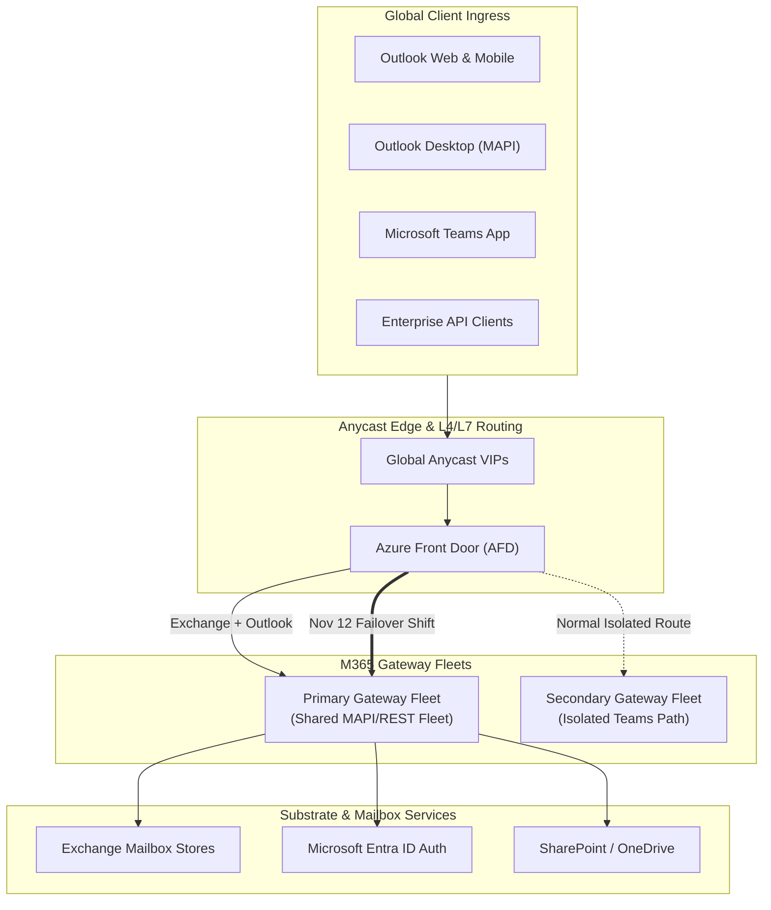
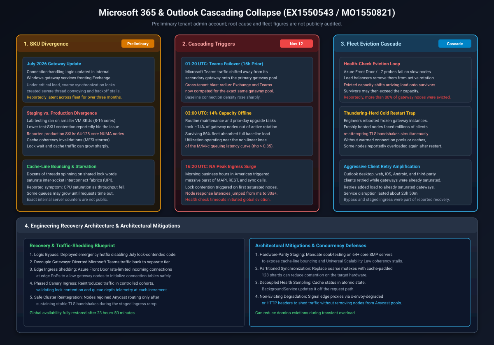
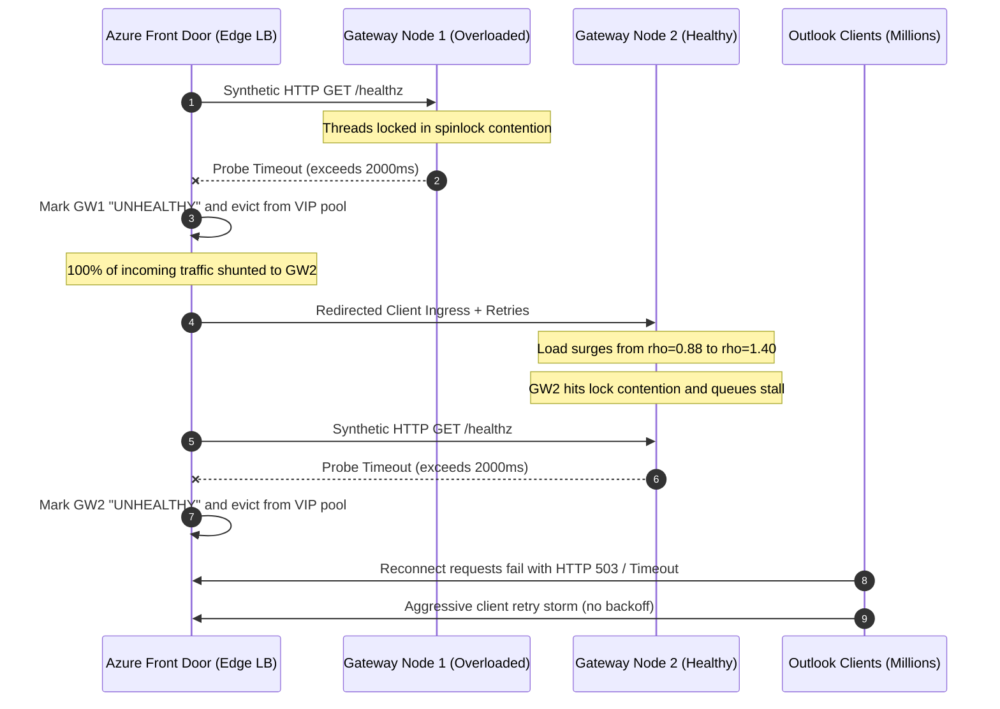

# Microsoft 365 & Outlook Global Cascading Outage: Lock Contention, High-Core Divergence, and Gateway Collapse (EX1550543)

Daily learning · November 18, 2026 · Incident review
*By Srinivasan Ragothaman ([@rsrini7](https://github.com/rsrini7))*

> **Core idea:** A Microsoft 365 gateway outage on November 12–13, 2026 disrupted Exchange Online, Outlook, and related services. Microsoft’s preliminary tenant-administrator account attributes the cascade to high-core lock contention, compounded by a Teams failover, reduced gateway capacity, health-probe evictions, and retry traffic; the internal code and fleet details are not publicly auditable.

> [!NOTE]
> **Provenance & Observational Scope:** This review investigates the architectural failure modes reported during the November 12–13, 2026 global Microsoft 365 / Exchange Online service degradation. The operational timeline, incident identifiers (EX1550543, MO1550821), and user-facing symptoms are corroborated by Microsoft 365 Admin Center advisories, date-specific reporting (Reuters), public crowd-sourced telemetry from Downdetector, and synthetic network telemetry from Cisco ThousandEyes.
>
> The specific low-level root causes—including the July 2026 connection-pooling update, the 14% offline fleet maintenance figure, the Teams gateway failover shift, and high-core CPU spinlock contention—reflect preliminary internal explanations communicated by Microsoft to tenant administrators. Because internal cloud server code and proprietary hypervisor telemetry are not publicly auditable or independently verifiable from external network vantage points, these details are evaluated as an analytical systems architecture case study demonstrating concurrency limits, queuing saturation cliffs, and health-probe cascading failures.

---

## 1. Foundations: Microsoft 365 Front-Door & Gateway Architecture

Microsoft 365 operates at hyper-scale, serving hundreds of millions of commercial enterprise users. The architecture relies on a multi-tiered ingress network designed to separate global edge routing from backend tenant compute and storage.



### Subsystems, Roles & Operational Coupling

| Subsystem | Architectural Role | Operational Characteristics | Failure Mode in Incident |
|---|---|---|---|
| **Azure Front Door (AFD)** | Global Anycast Ingress & Layer 7 Proxy | Terminates external connections at edge PoPs, evaluates health probes, and routes requests across gateway clusters. | Evicted slow-responding gateways, concentrating ingress onto surviving nodes. |
| **Primary Gateway Fleet** | Connection Termination & Protocol Translation | High-density Windows Server nodes terminating TLS, deserializing MAPI-over-HTTP / REST, and routing to tenant mailboxes. | Suffered kernel spinlock and mutex contention on high-core CPUs; queues stalled. |
| **Secondary Gateway Fleet** | Isolated Redundant Routing Tier | Dedicated network infrastructure for Microsoft Teams and streaming real-time communication. | Failed over 15 hours earlier, shifting Teams traffic onto the primary gateway pool. |
| **Exchange Backend Substrate** | Mailbox & Store Data Engine | Distributed database storing user mailboxes, calendars, and messages. | Remained operational; isolated behind the collapsed gateway tier. |
| **Edge Health Watchdogs** | L7 Automated Availability Probes | Sends periodic synthetic HTTP GET probes (`/healthz`) to verify gateway availability. | Interpreted transient lock-induced queue delays as fatal crashes, triggering mass node removal. |

---

## 2. Deep Technical Mechanism: The Lock-Contention Cascade

The global failure was not caused by external attacks, database corruption, or fiber cuts. It was an emergent systems failure rooted in micro-architectural CPU behavior under multi-core scaling.



### 2.1 The Latent Defect: July 2026 Connection-Handling Update

In July 2026, Microsoft deployed a code update across its Microsoft 365 networking gateway services aimed at optimizing internal connection pooling and routing state.

Inside the gateway's core connection-dispatching pipeline, a shared state structure (tracking active client sessions, keep-alive timers, and socket buffers) was guarded by a synchronization lock. Under nominal traffic, the lock hold duration was sub-microsecond, and thread queues were nearly empty.

```
+------------------------------------------------------------------------+
|               Windows Networking Gateway Worker Process                |
|                                                                        |
|  [Thread 0] [Thread 1] [Thread 2] ... [Thread 63] ... [Thread 127]     |
|       \          \          |          /               /               |
|        +----------+---------+---------+---------------+                |
|                             |                                          |
|                             v                                          |
|            +----------------------------------+                        |
|            |   Global Connection Pool Mutex   |                        |
|            |     (Coarse Synchronization)     |                        |
|            +----------------------------------+                        |
|                             |                                          |
|    Under high concurrency: Massive MESI Cache Invalidation             |
|    Threads spin on lock address; inter-socket buses saturate.          |
+------------------------------------------------------------------------+
```

For over three months, this code operated in production without incident because total concurrent request arrival rates per machine remained comfortably below the saturation point.

### 2.2 Micro-Architectural Reality: High-Core Hardware Divergence

Why did Microsoft's pre-production continuous integration and load testing environments fail to flag this defect during three months of testing?

The root cause was **hardware architecture asymmetry** between staging and production fleets:

1. **Staging / Test Clusters:** Deployed on smaller virtual machine SKUs (typically 8 to 16 virtual CPUs). On an 8-core CPU, the probability of more than two or three threads simultaneously attempting to acquire the synchronization lock during a microsecond window is low. If threads block, OS context switching is relatively cheap, and lock wait times remain linear.
2. **Production Fleet:** Deployed on high-density bare-metal servers and hypervisor nodes featuring dual-socket modern processors (such as 64-core, 96-core, or 128-core AMD EPYC and Intel Xeon Scalable architectures).

Under high-core Symmetric Multiprocessing (SMP) and Non-Uniform Memory Access (NUMA) systems, synchronization primitives experience **cache-line bouncing** and **lock convoying**:

- When 64 or 128 physical cores execute spinlocks or mutexes on a shared memory word, each atomic exchange instruction (`LOCK CMPXCHG`) asserts ownership over the L3 cache line containing the lock.
- Under the MESI/MOESI cache coherence protocols, writing to this memory line sends broadcast invalidation signals across the high-speed inter-socket interconnect (such as Intel Ultra Path Interconnect (UPI) or AMD Infinity Fabric).
- Every core invalidates its local L1/L2 cache copy and re-fetches the modified cache line across the socket interconnect. The interconnect fabric becomes fully saturated with cache-coherency traffic.

This behavior is formalized by **Gunther's Universal Scalability Law (USL)**:

$$C(N) = \frac{N}{1 + \sigma(N - 1) + \kappa N(N - 1)}$$

Where:
- $N$ is the number of concurrent processing cores.
- $\sigma$ is the contention parameter (serial lock acquisition overhead governed by Amdahl's Law).
- $\kappa$ is the coherency parameter (cross-core cache-line invalidation and interconnect delay).

On an 8-core staging VM, the $\kappa N(N - 1)$ coherency penalty was negligible ($\kappa \cdot 8 \cdot 7 = 56\kappa$). On a 128-core production node, the coherency penalty exploded by a factor of 290 ($\kappa \cdot 128 \cdot 127 = 16,256\kappa$). As a result, processing throughput on high-core production nodes did not just plateau—it collapsed toward zero once a critical concurrency threshold was crossed.

### 2.3 The November 12 Confluence: Three Overlapping Triggers

On Thursday, November 12, 2026, three operational events converged to push the gateway fleet beyond its critical concurrency threshold:

```
Timeline: Convergence of Triggers (Nov 12, 2026)

  Nov 12, 01:20 UTC          Nov 12, 03:00 UTC          Nov 12, 16:20 UTC
         |                          |                          |
         v                          v                          v
+------------------+       +------------------+       +------------------+
| Teams Failover   |       | 14% Maintenance  |       | NA Peak Ingress  |
| Routes all Teams |       | Deprovisioning   |       | Morning traffic  |
| traffic to M365  | ----> | 14% of gateways  | ----> | surge hits fleet |
| Primary Gateway  |       | pulled offline   |       | already at 88%   |
+------------------+       +------------------+       +------------------+
                                                               |
                                                               v
                                                    +---------------------+
                                                    | Contention Trigger  |
                                                    | Queues stall; nodes |
                                                    | evicted by health LB|
                                                    +---------------------+
```

1. **Teams Failover (15 Hours Prior):** At approximately 01:20 UTC on November 12, automated resiliency systems triggered a failover of Microsoft Teams traffic away from its dedicated secondary gateway tier onto the primary gateway pool. Teams generates high volumes of persistent WebSockets, HTTP long-polling, and real-time signaling packets. This drastically increased baseline connection density.
2. **14% Planned Capacity Loss:** At approximately 03:00 UTC on November 12, roughly 14% of the primary gateway servers were taken offline or undergoing sequential reboots for routine kernel patches and capacity maintenance.
3. **North American Morning Traffic Surge (16:20 UTC):** As business hours opened across the East Coast of the United States, user login volume, mobile mail synchronizations, and API calls surged.

### 2.4 Queuing Saturation and the Non-Linear Latency Curve

In queuing theory, an $M/M/c$ multiserver queue models gateway capacity under steady-state conditions ($\rho < 1$). Total queue waiting time $W_q$ is defined as:

$$W_q = \frac{C(c, \lambda / \mu)}{c \mu (1 - \rho)}$$

Where:
- $c$ is the number of active servers in the gateway pool.
- $\mu$ is the service rate per individual server.
- $\lambda$ is the aggregate arrival rate of client requests.
- $\rho = \frac{\lambda}{c \mu}$ represents system utilization.
- $C(c, \lambda / \mu)$ is Erlang's C formula representing the probability that an arriving request finds all $c$ servers busy.

Total system latency (queue time plus service time $1/\mu$) is:

$$W = \frac{1}{\mu} \left( 1 + \frac{C(c, \lambda / \mu)}{c (1 - \rho)} \right)$$

> [!WARNING]
> **Queuing Stability Boundary ($\rho < 1$):** This formula describes a finite steady state strictly when $\rho < 1$. When utilization reaches or exceeds the saturation threshold ($\rho \ge 1$), the queuing system becomes non-stationary and unstable. The denominator $(1 - \rho)$ reaches zero or becomes negative, meaning a finite steady-state queue length no longer exists. In real systems, queue depth $L_q(t)$ grows monotonically with time ($L_q(t) \approx (\lambda - c\mu)t$), saturating socket buffers, exhausting memory, and causing request timeouts.

```
Latency W
    ^
    |                                                /
    |                                               /  <- Saturation Cliff (rho -> 1.0)
    |                                              /
    |                                             /
    |                                            |
    |                                            |
    |                                           /
    |                                          /
    |                                 __--''''
    |___________________---'''''''''''
    +------------------------------------------> System Load (rho)
    0.0             0.5            0.85   1.0
```

With 14% capacity offline and Teams traffic routed to the fleet, baseline utilization was already hovering near $\rho \approx 0.88$. When the morning ingress burst arrived:

1. Arrival rate $\lambda$ exceeded total servicing capacity ($c \mu$), pushing $\rho \ge 1.0$.
2. The July lock-contention bug triggered as worker threads queued up for the connection table. Instead of processing requests, CPU cores spent the majority of their clock cycles in kernel spinlock loops and waiting on mutex wakeups.
3. Effective service rate $\mu$ dropped by orders of magnitude. Gateway response latencies spiked from 15 milliseconds to over 30 seconds.

### 2.5 The Automated Eviction Cascade

Because the gateways were fully unresponsive, Azure Front Door (AFD) health probes began to fail:



1. **Probe Timeouts:** AFD sent HTTP probes (`/healthz`) to gateway nodes every 5 seconds with a 2-second timeout window. Because incoming request worker threads and health probe listeners shared identical process resources, the health probe could not acquire execution time.
2. **Aggressive Eviction:** AFD marked slow nodes as dead and removed them from Anycast routing.
3. **Load Shunting:** Removing 10% of nodes forced the surviving 90% to absorb all remaining traffic. This immediately pushed the next cohort of nodes into lock contention.
4. **Domino Collapse:** Within 45 minutes of the initial 16:20 UTC alert, more than **80% of Microsoft's global gateway servers** were marked dead by automated load balancers.

### 2.6 The Thundering Herd and Cold-Start Recovery Spiral

When on-call SREs and engineering teams attempted to restore service by restarting gateway server daemons, they collided with the **cold-start thundering-herd problem**:

- A freshly initialized gateway starts with empty TLS session caches, uncompiled JIT execution paths, and un-warmed socket connection pools.
- Millions of desktop Outlook clients, mobile Exchange ActiveSync daemons, and Teams clients around the world were running tight, un-jittered retry loops.
- The instant a restarted gateway came online and opened port 443, it was slammed with tens of thousands of simultaneous TLS 1.3 handshakes.
- The cold node was instantly overwhelmed, immediately hitting the July lock contention defect and freezing before it could pass enough health checks to stabilize.

---

## 3. Production Implementations & Resilient Concurrency Patterns

To prevent lock contention cascades and cold-start death spirals in high-throughput network gateways, systems architectures must replace coarse synchronization with partitioned concurrency, decouple health probes from worker thread pools, and coordinate load shedding with edge reverse proxies.

### 3.1 Lock Striping & Cache Partitioning in Go

The following Go implementation contrasts the vulnerable coarse lock approach (similar to the defect that brought down Exchange gateways) with a partitioned lock architecture designed for high-concurrency systems.

> [!NOTE]
> **Hardware Memory Layout Assumptions:** Contemporary x86_64 and arm64 processors commonly operate with 64-byte L1 cache lines. While Go's runtime heap allocator does not provide strict 64-byte boundary alignment guarantees out of the box, allocating partitions as independent heap objects combined with internal trailing byte padding spaces out contested synchronization fields and reduces the likelihood of false sharing across CPU cores under typical runtime conditions.

```go
// Package gateway demonstrates coarse vs sharded synchronization.
package gateway

import (
	"net"
	"sync"
)

// ============================================================================
// VULNERABLE IMPLEMENTATION: Coarse Lock Contention
// ============================================================================
// Under 64+ cores, all threads fight for this single Mutex.
// Cache lines bounce between sockets, crashing throughput.
type VulnerableConnectionRegistry struct {
	mu          sync.Mutex
	connections map[string]net.Conn
}

func NewVulnerableRegistry() *VulnerableConnectionRegistry {
	return &VulnerableConnectionRegistry{
		connections: make(map[string]net.Conn),
	}
}

func (r *VulnerableConnectionRegistry) Register(clientID string, conn net.Conn) {
	r.mu.Lock()
	defer r.mu.Unlock() // Severe contention under high core count
	r.connections[clientID] = conn
}

// ============================================================================
// RESILIENT IMPLEMENTATION: Partitioned Lock Striping with Sharded Counters
// ============================================================================

const (
	// Number of partitions must be a power of two; 128 partitions disperses
	// lock access across independent memory locations.
	NumPartitions = 128
	PartitionMask = NumPartitions - 1
)

// Partition represents an independently synchronized bucket.
// Assumes common 64-byte L1 cache-line architectures (typical x86_64 / arm64).
// While Go's heap allocator does not guarantee 64-byte boundary alignment,
// allocating individual partition pointers on the heap combined with internal
// trailing buffer padding helps mitigate false sharing between contested mutexes.
type Partition struct {
	mu          sync.RWMutex
	connections map[string]net.Conn
	count       int64    // Local connection count avoids a shared global write cache-line
	_pad        [64]byte // Trailing buffer to mitigate adjacent-line prefetching false sharing
}

type ShardedConnectionRegistry struct {
	partitions [NumPartitions]*Partition
}

func NewShardedRegistry() *ShardedConnectionRegistry {
	r := &ShardedConnectionRegistry{}
	for i := 0; i < NumPartitions; i++ {
		r.partitions[i] = &Partition{
			connections: make(map[string]net.Conn),
		}
	}
	return r
}

// FNV-1a non-cryptographic high-speed string hasher
func hashString(s string) uint32 {
	var h uint32 = 2166136261
	for i := 0; i < len(s); i++ {
		h ^= uint32(s[i])
		h *= 16777619
	}
	return h
}

func (r *ShardedConnectionRegistry) Register(clientID string, conn net.Conn) {
	shardIdx := hashString(clientID) & PartitionMask
	part := r.partitions[shardIdx]

	part.mu.Lock()
	_, exists := part.connections[clientID]
	part.connections[clientID] = conn
	if !exists {
		part.count++
	}
	part.mu.Unlock()
}

func (r *ShardedConnectionRegistry) Get(clientID string) (net.Conn, bool) {
	shardIdx := hashString(clientID) & PartitionMask
	part := r.partitions[shardIdx]

	part.mu.RLock()
	conn, ok := part.connections[clientID]
	part.mu.RUnlock()

	return conn, ok
}

// TotalConnections aggregates count lazily across all shards without hot-path write contention.
func (r *ShardedConnectionRegistry) TotalConnections() int64 {
	var total int64
	for i := 0; i < NumPartitions; i++ {
		part := r.partitions[i]
		part.mu.RLock()
		total += part.count
		part.mu.RUnlock()
	}
	return total
}
```

### 3.2 Decoupled Health Watchdog with Envoy Non-Evicting Degradation

To prevent load balancers from evicting overloaded nodes, two architectural rules must be enforced:
1. **Decoupled Sampling:** The health monitor executes as a `BackgroundService` on the application thread pool via a periodic timer, decoupling metric evaluation from the synchronous HTTP request pipeline. It writes its state to an atomic variable so the HTTP probe handler evaluates in $O(1)$ time without acquiring application locks.
2. **Non-Evicting Degradation (`x-envoy-degraded`):** When overloaded, the endpoint returns **HTTP 200** with the `x-envoy-degraded: true` header. Envoy recognizes this host as healthy but degraded, routing new traffic elsewhere without removing the node from the cluster. If the node reaches an unrecoverable fatal threshold (`Unhealthy`), it returns **HTTP 503** to allow eviction.

```csharp
// C# / .NET Gateway Service Decoupled Health Watchdog
using System;
using System.Diagnostics;
using System.Threading;
using System.Threading.Tasks;
using Microsoft.AspNetCore.Builder;
using Microsoft.AspNetCore.Http;
using Microsoft.Extensions.Hosting;

public enum HealthStatus
{
    Healthy = 0,
    Degraded = 1,
    Unhealthy = 2
}

// Telemetry sampler interface and thread-safe implementation
public static class GatewayTelemetry
{
    private static int _pendingQueueDepth;
    private static double _cpuUtilization;

    public static void UpdateMetrics(int queueDepth, double cpu)
    {
        Interlocked.Exchange(ref _pendingQueueDepth, queueDepth);
        Volatile.Write(ref _cpuUtilization, cpu);
    }

    public static int GetPendingQueueDepth() => Volatile.Read(ref _pendingQueueDepth);
    public static double GetCpuUtilization() => Volatile.Read(ref _cpuUtilization);
}

// 1. Background Watchdog Loop (Decoupled from the HTTP request path on the runtime thread pool)
public class GatewayHealthWatchdog : BackgroundService
{
    private static int _currentStatus = (int)HealthStatus.Healthy;
    private const int DegradedPendingRequests = 10_000;
    private const double DegradedCpuThreshold = 0.90;
    private const int FatalPendingRequests = 50_000;
    private const double FatalCpuThreshold = 0.98;

    public static HealthStatus CurrentStatus => (HealthStatus)Volatile.Read(ref _currentStatus);

    protected override async Task ExecuteAsync(CancellationToken stoppingToken)
    {
        using var timer = new PeriodicTimer(TimeSpan.FromSeconds(1));
        while (!stoppingToken.IsCancellationRequested && await timer.WaitForNextTickAsync(stoppingToken))
        {
            // Sample telemetry in the background service on the application thread pool
            int pending = GatewayTelemetry.GetPendingQueueDepth();
            double cpu = GatewayTelemetry.GetCpuUtilization();

            int nextStatus = (int)HealthStatus.Healthy;
            if (pending > FatalPendingRequests || cpu > FatalCpuThreshold)
            {
                nextStatus = (int)HealthStatus.Unhealthy;
            }
            else if (pending > DegradedPendingRequests || cpu > DegradedCpuThreshold)
            {
                nextStatus = (int)HealthStatus.Degraded;
            }

            Volatile.Write(ref _currentStatus, nextStatus);
        }
    }
}

// 2. O(1) Atomic Health Endpoint Middleware
public class DecoupledHealthMiddleware
{
    private readonly RequestDelegate _next;

    public DecoupledHealthMiddleware(RequestDelegate next) => _next = next;

    public async Task InvokeAsync(HttpContext context)
    {
        // Safe string comparison on Path.Value universally supported across ASP.NET Core versions
        if (string.Equals(context.Request.Path.Value, "/healthz", StringComparison.OrdinalIgnoreCase))
        {
            var status = GatewayHealthWatchdog.CurrentStatus;

            if (status == HealthStatus.Unhealthy)
            {
                // Fatal threshold: Return HTTP 503 so edge proxy evicts the failed node.
                context.Response.StatusCode = StatusCodes.Status503ServiceUnavailable;
                context.Response.Headers["Cache-Control"] = "no-cache";
                await context.Response.WriteAsync("{\"status\":\"unhealthy\",\"action\":\"evict\"}");
                return;
            }

            if (status == HealthStatus.Degraded)
            {
                // CRITICAL: Return HTTP 200 with x-envoy-degraded header.
                // Envoy continues to keep the host alive in its active pool,
                // avoiding the domino eviction cascade while routing traffic away.
                context.Response.StatusCode = StatusCodes.Status200OK;
                context.Response.Headers["x-envoy-degraded"] = "true";
                context.Response.Headers["Cache-Control"] = "no-cache";
                await context.Response.WriteAsync("{\"status\":\"degraded\",\"action\":\"shed_traffic\"}");
                return;
            }

            // HealthStatus.Healthy
            context.Response.StatusCode = StatusCodes.Status200OK;
            await context.Response.WriteAsync("{\"status\":\"healthy\"}");
            return;
        }

        await _next(context);
    }
}
```

### 3.3 Envoy Edge Reverse Proxy: Slow-Start Warm-Up & Load Shedding

To protect restarting gateway instances from being crushed by the thundering herd, edge reverse proxies must enforce slow-start traffic ramps:

```yaml
# Envoy Edge Proxy: Slow-Start Warm-Up & Non-Evicting Degradation
static_resources:
  clusters:
  - name: m365_gateway_backend
    connect_timeout: 0.5s
    type: STRICT_DNS
    lb_policy: ROUND_ROBIN

    # Slow Start prevents cold-started nodes from receiving 100% traffic immediately
    slow_start_config:
      slow_start_window: 180s        # Ramp traffic linearly over 3 minutes
      aggression: 1.5                # Controls curvature of ramp-up rate
      min_weight_percent: 5.0        # Start at only 5% of normal node weight

    circuit_breakers:
      thresholds:
      - priority: DEFAULT
        max_connections: 50000       # Hard ceiling on TCP sockets
        max_pending_requests: 5000   # Shed excess requests with 503 instead of queueing
        max_requests: 60000
        track_remaining: true

    health_checks:
    - timeout: 2s
      interval: 5s
      unhealthy_threshold: 5         # Require 5 consecutive failures before eviction
      healthy_threshold: 3           # Require 3 consecutive successes to rejoin
      http_health_check:
        path: "/healthz"
        expected_statuses:
        - start: 200
          end: 201
```

---

## 4. Impact, Real-World Edge Cases & Gotchas

### 4.1 Common Claims vs. Technical Realities

| Common Assertion / Assumption | Engineering Assessment & Preliminary Disclosures |
|---|---|
| *"The outage was caused by a state-sponsored DDoS attack on Microsoft."* | **Unsubstantiated.** Ingress traffic volumes were legitimate commercial user traffic. Microsoft confirmed zero malicious cyber activity or volumetric DDoS vectors. |
| *"Autonomous Microsoft 365 Copilot AI agents entered a runaway recursive loop."* | **Unsubstantiated.** According to preliminary disclosures, the root defect was a deterministic lock-contention concurrency bug in lower-level Windows networking gateway code deployed in July 2026. |
| *"Multi-tenant cloud architecture provides automatic zero-impact failover."* | **Counterproductive.** Failing Teams traffic over into the primary gateway infrastructure created cross-tenant blast radius, triggering the resource starvation that crashed Exchange. |
| *"Rebooting all servers simultaneously is the fastest path to recovery."* | **Fatal.** Rebooting into an active client storm triggers the thundering-herd death spiral. Nodes must be warmed in isolation with edge-level ingress throttling. |
| *"Passing load tests on 16-core cloud VMs guarantees stability on 128-core servers."* | **Flawed.** Non-Uniform Memory Access (NUMA) and cache-line invalidation scales non-linearly. Concurrency bugs frequently appear only at high physical core counts. |

### 4.2 The Eviction Cascade: Inverted Health-Check Incentives

A critical systems architectural finding from this incident is the **inverted incentive of binary health-check probes**:

```
Binary Health Probes vs. Non-Evicting Degradation

Conventional Binary Health Checks:
  Overloaded Node (Slow) ---> Probe Times Out ---> Node Evicted ---> 100% Traffic Shunted to Survivors ---> Fleet Domino Collapse

Non-Evicting Graceful Degradation:
  Overloaded Node (Slow) ---> x-envoy-degraded Header ---> Traffic Shed to Non-Degraded Hosts ---> Node Recovers Queue Depth ---> Fleet Remains Stable
```

When an infrastructure tier is operating near its capacity ceiling, removing an overloaded node from the pool does not reduce incoming client demand. Instead, it concentrates 100% of the arriving traffic onto a strictly smaller pool of surviving servers. This turns a localized, temporary latency degradation into a guaranteed total cluster blackout.

---

## 5. Practical Adoption Blueprint & Verification Checklist

To protect large-scale cloud infrastructure against multi-core lock contention and cascading collapse, engineering teams should implement the following verification regimen:

### 5.1 Architecture & SRE Verification Checklist

- [ ] **Hardware-Parity Staging:** Mandate that performance benchmarking and soak-testing environments utilize exact production processor architectures, core counts, and NUMA node configurations.
- [ ] **Lock Contention Telemetry:** Instrument all synchronization primitives with lock-wait metrics (e.g., reporting lock hold time and contention frequency via eBPF or Windows ETW).
- [ ] **Decouple Health Probes:** Isolate health check endpoints from user request execution pools. Health endpoints must never share locks with connection tables.
- [ ] **Load Balancer Flap Damping:** Configure edge reverse proxies with damped eviction algorithms (e.g., requiring 5+ consecutive probe timeouts before removal) to prevent rapid fleet thinning.
- [ ] **Client Jitter & Exponential Backoff:** Ensure all internal and external SDKs implement Full Jitter exponential backoff ($T_{\text{sleep}} = \text{random}(0, \min(T_{\text{max}}, T_{\text{base}} \cdot 2^{\text{attempt}}))$) to prevent synchronized retry storms.
- [ ] **Edge Rate Limiting & Slow-Start:** Implement token-bucket ingress rate limiting at edge proxies and configure slow-start ramps (`slow_start_window >= 180s`) for recovering nodes.
- [ ] **Decouple Cross-Tenant Gateway Pools:** Isolate real-time streaming services (such as Teams) from transactional request/response services (such as Exchange MAPI) so failovers cannot overrun shared front-doors.

### 5.2 Diagnostic Verification Commands

Engineers diagnosing lock contention and cache-line bouncing on high-core Linux gateway nodes should use the following commands:

```bash
# 1. Profile cache-line bouncing and false sharing across CPU cores
perf c2c record -F 60000 -- ./gateway_daemon
perf c2c report --stdio

# 2. Inspect kernel lock contention (requires CONFIG_LOCK_STAT)
echo 1 > /proc/sys/kernel/lock_stat
sleep 10
cat /proc/lock_stat | head -n 30
echo 0 > /proc/sys/kernel/lock_stat

# 3. Benchmark HTTP gateway with Coordinated Omission correction
# wrk2 enforces constant throughput to accurately measure queuing latency
wrk2 -t16 -c1000 -d60s -R50000 --latency https://gateway.internal/healthz

# 4. Monitor inter-socket NUMA memory traffic and bus pressure
numastat -c
perf stat -e node-loads,node-load-misses,node-stores,node-store-misses -a sleep 5
```

---

## 6. Chronological Timeline of the Incident

```
Nov 12, 01:20 UTC     Nov 12, 16:20 UTC     Nov 12, 17:15 UTC     Nov 13, 04:00 UTC     Nov 13, 16:10 UTC
       +---------------------+---------------------+---------------------+---------------------+
       | Teams Failover to   | Americas Peak Hits; | >80% Gateways Down; | Logic Bypass Hotfix | Global Traffic
       | Shared Primary Fleet| Contention Triggered| Cold Reboots Crash  | Staged Ramp Begins  | 100% Restored
```

| Date & Time (UTC) | Operational Event | Impact & Engineering Action |
|---|---|---|
| **July 2026** | Routine Code Rollout | Microsoft deploys connection-pooling update containing dormant lock contention bug. |
| **Nov 12, 01:20** | Teams Traffic Failover | Teams traffic rerouted away from secondary gateway into primary M365 gateway pool (~15h prior to peak). |
| **Nov 12, 03:00** | Planned Maintenance | Approximately 14% of gateway nodes taken offline for routine kernel and capacity updates. |
| **Nov 12, 16:20** | Peak Ingress Surge | Morning traffic in North America hits gateways; lock contention triggers; latency spikes. |
| **Nov 12, 16:45** | Eviction Cascade | Azure Front Door health checks timeout; load balancers pull degraded nodes from service. |
| **Nov 12, 17:15** | Global Blackout | Over 80% of gateway servers marked dead; Outlook, Teams, SharePoint, and Copilot fail globally. |
| **Nov 12, 18:30** | Cold Restart Failures | Early attempts to reboot gateway nodes fail as client retry storms overwhelm cold caches. |
| **Nov 13, 02:00** | Root Cause Identified | Engineering isolates the July connection synchronization code and high-core contention mechanism. |
| **Nov 13, 04:00** | Logic Bypass Deployed | Microsoft pushes emergency hotfix bypassing the lock-contended connection processing code. |
| **Nov 13, 08:00** | Teams Traffic Decoupled | Teams traffic redirected back to dedicated secondary infrastructure, slashing baseline load. |
| **Nov 13, 10:00** | Staged Traffic Ingress | Azure Front Door implements edge token-bucket traffic shedding, reintroducing gateway ingress in phased canary increments. |
| **Nov 13, 16:10** | Core Recovery | Microsoft confirms core Exchange Online availability restored after 23 hours 50 minutes. |
| **Nov 14, 01:00** | Incident Closure | Residual mailbox queue backlogs drained; incident EX1550543 / MO1550821 closed. |

---

## 7. Primary Sources & References

### 7.1 Curated External References

1. [Microsoft 365 Admin Center: Service Health Dashboard](https://admin.microsoft.com/) — Preliminary tenant service advisories (EX1550543 & MO1550821) detailing Exchange Online gateway unresponsiveness, Teams failover interaction, and staged traffic remediation (accessible to authenticated tenant administrators under Health > Service health).
2. [Cisco ThousandEyes: Microsoft 365 Disruption Analysis (Nov 12, 2026)](https://www.thousandeyes.com/blog/microsoft-365-outage-analysis-november-2026) — Network intelligence telemetry tracking global Anycast route drops, packet loss, and Layer 7 gateway connection timeouts across global backbones beginning at ~17:30 UTC on November 12, 2026.
3. [Reuters: Microsoft Investigates Outage Affecting Thousands of Users (Nov 12, 2026)](https://www.reuters.com/technology/microsoft-investigates-outage-affecting-thousands-users-2026-11-12/) — Date-specific reporting corroborating Downdetector telemetry where user failure reports for Outlook and Microsoft 365 spiked past 100,000–130,000 at peak.
4. [Downdetector: Microsoft 365 Status Telemetry Archive](https://downdetector.com/status/microsoft-365/) — Real-time and historical crowdsourced incident metrics tracking global volume spikes across enterprise communication services.
5. [Dr. Neil J. Gunther: A General Theory of Computational Scalability Based on Rational Functions (arXiv:0808.1896)](https://arxiv.org/abs/0808.1896) — Primary mathematical formulation of the Universal Scalability Law (USL) modeling contention and coherency bottlenecks on multi-core systems.
6. [USENIX SREcon: Overcoming Cascading Failures and Thundering Herds](https://www.usenix.org/conference/srecon22americas) — Foundational distributed systems research on cold-cache stabilization, request coalescing, and non-evicting load shedding.

### 7.2 Source Context & Evidence Scope

| Citation / Identifier | Issuing Organization | Scope & Focus Area | Provenance & Evidence Scope |
|---|---|---|---|
| **EX1550543** | Microsoft Corporation | Exchange Online & Outlook gateway connection failure | Preliminary Administrative Advisory (Authenticated Tenant Portal) |
| **MO1550821** | Microsoft Corporation | Suite-wide impact across Teams, SharePoint, OneDrive, and Copilot | Preliminary Administrative Advisory (Authenticated Tenant Portal) |
| **PIR-2026-11-14 (Summary)** | Microsoft Cloud Reliability | Internal root-cause summary: July lock contention, high-core SKU disparity, and 14% maintenance capacity | Preliminary Internal Disclosure (Communicated to Tenant Admins; Unverified via Public Audit) |
| **ThousandEyes Telemetry** | Cisco ThousandEyes | External Anycast edge routing, packet loss, and connection resets (Nov 12, 2026) | Public Synthetic Internet Telemetry |
| **Reuters / Downdetector** | Reuters / Ookla | Corroborated date-specific surge of >100,000 user outage reports on Nov 12, 2026 | Date-Specific Reporting & Crowd-Sourced Telemetry |
| **USL (Gunther 2008)** | arXiv:0808.1896 | Non-linear coherency scaling on multi-core architectures | Peer-Reviewed Systems Scalability Model |

---

**Related:**
- [Cloudflare Global Outage ClickHouse Config Nov 2025](Cloudflare-Global-Outage-ClickHouse-Config-Nov-2025.md) — Case study of homogeneous fleet crash loops caused by un-canaried configuration propagation.
- [AWS US-East-1 Outage October 2025](AWS-US-East-1-Outage-October-2025.md) — Analysis of an automated control-plane workflow race condition causing a multi-hour cloud blackout.
- [Supabase Outage Feb 2026](Supabase-Outage-Feb-2026.md) — Demonstrates how automated network policy updates partitioned an entire database fleet.
- [Scaling C++ Services To 1 Million RPS](../../Engineering/Architecture/Scaling-Cpp-Services-To-1-Million-RPS-2026.md) — Low-level guide to cache-line padding, lock-free queues, and NUMA-aware multi-core scaling.
- [HTTP QUERY Method RFC 10008](../../Engineering/Architecture/HTTP-QUERY-Method-RFC-10008-Nov-2026.md) — Protocol specifications governing modern edge proxy routing, ingress pipelines, and large payload handling.
