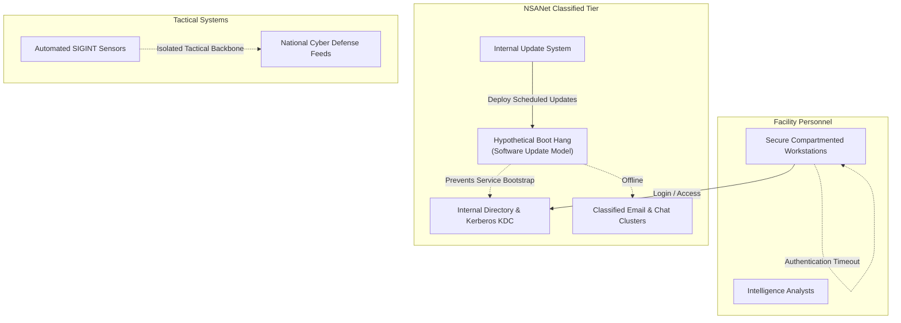
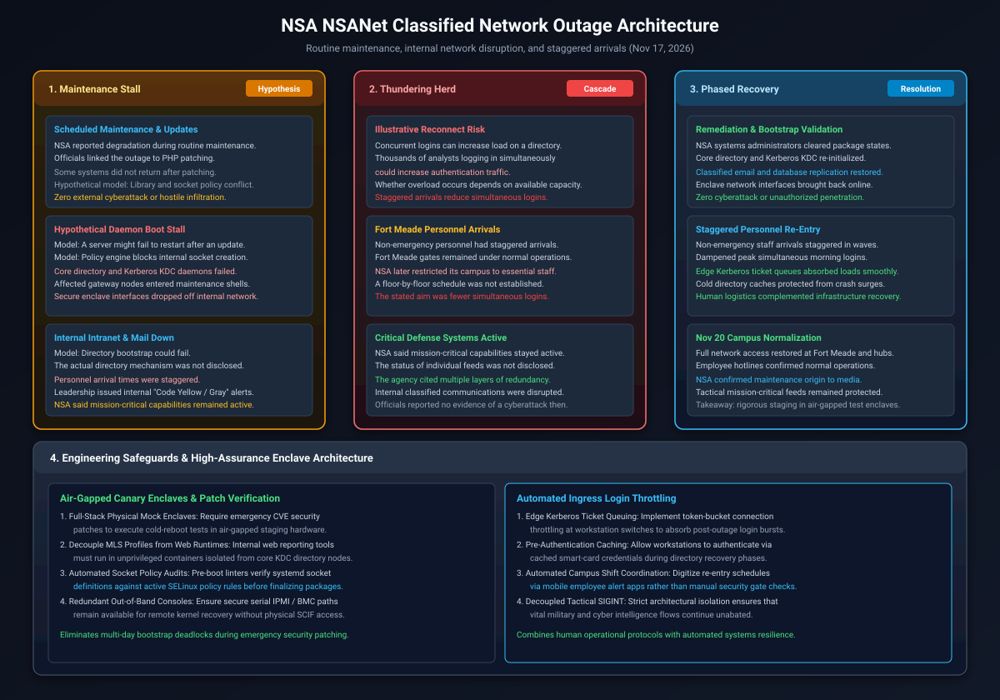

# NSA NSANet Classified Network Outage: Routine Maintenance and Staggered Arrivals

Daily learning · November 2026 · Incident review
*By Srinivasan Ragothaman ([@rsrini7](https://github.com/rsrini7))*

> **Core idea:** On November 17, 2026, NSANet, an internal NSA network used for classified communications, experienced a disruption during routine maintenance. Officials linked the incident to software patching involving PHP and said mission-critical capabilities remained operational. The agency staggered arrivals, later restricted access to its own campus, and, according to CNN, restored the network by November 20.

> [!NOTE]
> **Provenance & Observational Scope:** This review examines the November 17–20, 2026 NSANet classified network disruption based on national news reporting (CNN, The Guardian, CBS News), official agency briefings, and intelligence community disclosures.
>
> **Verified Public Facts:** The NSA described temporary degradation during scheduled routine maintenance and said mission-critical capabilities remained fully operational. The director of national intelligence said some systems did not return as expected after patching; subsequent reporting linked the maintenance to PHP updates. CBS reported staggered non-emergency arrivals and normal operations at Fort Meade's gates and base-wide services. CNN later reported that the NSA restricted its own secured campus to essential personnel on Tuesday night. Officials reported no evidence of a cyberattack at that point.
>
> **Analytical Scope:** The boot-time SELinux and socket-permission scenario below is a hypothetical failure model, not an NSA technical postmortem.

---

## 1. Foundations: NSANet Classified Architecture & Air-Gapped Redundancy

NSANet is an isolated, cryptographically encrypted high-security intranet connecting NSA headquarters at Fort Meade, Maryland, with regional cryptologic centers (e.g., NSA Georgia, NSA Texas, NSA Hawaii) and intelligence community partners.



### Infrastructure Enclaves & Operational Coupling

| Enclave / System | Security Role | Incident Observation / Role |
|---|---|---|
| **NSANet Internal Core** | Classified internal communications and knowledge sharing | Officials described systems failing to return as expected after patching; the exact component failure was not disclosed. |
| **Identity and access management** | Controls access to protected systems | The internal authentication mechanism and its incident behavior were not disclosed. |
| **Mission-critical capabilities** | National security operations | The NSA said these capabilities remained fully operational; it did not detail every underlying system. |
| **Personnel reporting** | Staff arrival and workplace logistics | Sources reported staggered arrivals for non-emergency personnel to reduce simultaneous logins. |

---

## 2. Systems Failure Mode: Enclave Boot Deadlocks & Authentication Surges (Hypothetical Case Study)



### 2.1 The Security Patch Maintenance Failure (Hypothetical Model)

High-security intelligence enclaves frequently utilize hardened distributions of enterprise web platforms for internal knowledge sharing, reporting wikis, and administrative portals. On November 17:
1. The NSA reported temporary degradation during scheduled routine maintenance. The director of national intelligence said some systems did not come back as expected after a patch; CNN and The Record reported a connection to maintenance involving PHP security updates. The internal component and failure sequence were not disclosed. [CNN](https://abc17news.com/politics/national-politics/cnn-us-politics/2026/11/17/exclusive-highly-classified-us-national-security-communications-network-goes-down-sources-say/), [The Record](https://therecord.media/nsa-continues-response-to-nsa-net-problems)
2. The NSA said mission-critical capabilities remained fully operational, without identifying the status of each network or sensor.
3. Systems engineers analyze the internal disruption through an analytical failure model: In hardened operating systems enforcing Multi-Level Security (MLS) and mandatory access controls (e.g., SELinux), a runtime security update containing mismatched library dependencies or socket permissions can prevent critical system daemons from binding to network interfaces during operating system boot.

```
+--------------------------------------------------------------------------+
|                  Classified Gateway Bootstrap Deadlock                   |
|                                                                          |
|   1. Patch Deployment writes updated runtime libraries                   |
|      [ Maintenance Script ] ----> [ Hardened Linux / MLS Kernel ]        |
|                                                  |                       |
|   2. System executes scheduled node reboot       v                       |
|      [ Systemd Service Units ] ---> [ MLS Policy Engine ]                |
|                               (Hypothetical Model)                       |
|   3. Model: Policy mismatch blocks socket creation during boot           |
|      [ AVC Denial: Socket Permission Blocked on Enclave Interface ]      |
|                                                  |                       |
|   4. Host fails health-check; network interface drops offline            |
|      [ Gateway Offline: Analysts Locked Out of Secure Intranet ]         |
+--------------------------------------------------------------------------+
```

### 2.2 The Thundering Herd Mitigation Strategy

When an enterprise network serving tens of thousands of cleared intelligence professionals drops offline, restoring the infrastructure presents a severe concurrency hazard:
* If many users reconnect simultaneously, authentication infrastructure can experience a surge. Whether that surge would cause a failure depends on capacity and safeguards.
  For scale, an illustrative 30,000 logins over one minute averages 500 logins per second. Each login may involve directory lookups, ticket issuance, and certificate checks, so peak downstream request rates can be higher. Caching, arrival distribution, and provisioned capacity determine the actual load; the 30,000 figure is not an incident measurement.
* CBS reported that the agency staggered arrivals for some non-emergency personnel to avoid simultaneous logins while the network was experiencing problems:
  * Non-emergency personnel were given modified arrival times.
  * CBS sources said Fort Meade gates and campus-wide services remained under normal operating conditions.
  * CNN later reported that the NSA restricted its own secured campus to essential personnel on Tuesday night. This is distinct from the earlier report about Fort Meade's wider gates and services.
  * On November 20, CNN reported that employees were returning on staggered schedules tied to building opening times; the precise floor-by-floor schedule was not disclosed.

---

## 3. Systems Failure Modes & Common Misconceptions

| Common Assumption | Technical Reality |
|---|---|
| **"Foreign adversaries penetrated the classified network."** | Officials told CBS there was no evidence of a cyberattack at that point; this is not proof of a complete security assessment. |
| **"All national security capabilities stopped."** | The NSA said mission-critical capabilities remained fully operational, without a detailed public inventory. |
| **"The precise technical cause is known."** | Sources reported routine patching, but said the circumstances of the disruption remained unclear. |

---

## 4. Operational Timeline & Recovery

* **November 17, 2026:** The NSA reported degradation during scheduled routine maintenance; officials reported a disruption to its classified internal network.
* **November 17:** Sources reported staggered arrivals for non-emergency personnel. CBS reported normal operations at Fort Meade's gates and base-wide services; CNN later reported that the NSA restricted its own campus to essential personnel that night.
* **November 18:** The Record reported continued staggered arrivals while the network was working and being restored. A source corroborated the reported link to PHP maintenance.
* **November 20:** CNN reported that the outage had been resolved after more than three days. An employee recording described normal operations with exceptions and staggered building opening times; detailed technical recovery steps were not disclosed.

---

## 5. Engineering Lessons & Architectural Safeguards

1. **Air-Gapped Canary Testing Enclaves:** Security patches applied to isolated, air-gapped enclaves must undergo identical staging restarts in a physical mock enclave before enterprise-wide distribution.
2. **Staggered Boot & Reconnect Throttling:** Distributed directory tiers must enforce automated connection queuing at the edge to absorb burst logins without requiring manual physical workplace restrictions.
3. **Decouple Administrative Portals from Identity Backbones:** Operational web tools must never share binary library dependencies with core cryptographic authentication services.

---

## 6. Primary Sources & References

1. [CBS News: NSA classified internal network goes down](https://www.cbsnews.com/news/nsa-network-down-classified-fort-meade/) — Reports the NSA statement, maintenance context, staggered arrivals, and limits of available information.
2. [The Guardian: National Security Agency network for internal communications goes down](https://www.theguardian.com/us-news/2026/nov/17/nsa-national-security-classified-communications-network-down) — Reports the disruption and employee reporting notices.
3. [NIST SP 800-53 Rev. 5: Security and Privacy Controls for Information Systems](https://csrc.nist.gov/publications/detail/sp/800-53/rev-5/final) — Federal guidelines on maintenance isolation, multi-level security policies, and fail-safe recovery.
4. [CNN: NSA classified network outage resolved](https://kesq.com/news/national-politics/cnn-us-politics/2026/11/20/outage-at-nsas-highly-classified-communications-network-has-been-resolved/) — Reports the restoration, staggered return, and officials' account of the PHP update connection.
5. [The Record: NSA continues response to internal network interruptions](https://therecord.media/nsa-continues-response-to-nsa-net-problems) — Reports the second-day response and corroboration of maintenance involving PHP.
6. [CNN: Classified network disruption and staff restrictions](https://abc17news.com/politics/national-politics/cnn-us-politics/2026/11/17/exclusive-highly-classified-us-national-security-communications-network-goes-down-sources-say/) — Attributes the patching and restart description to the director of national intelligence and reports the NSA campus restriction.

---

**Related:**
- [Apple-iCloud-Services-Authentication-Outage-Nov-2026.md](Apple-iCloud-Services-Authentication-Outage-Nov-2026.md) — Consumer services disrupted by an internal update on the same date.
- [Microsoft-365-Outlook-Cascading-Outage-Nov-2026.md](Microsoft-365-Outlook-Cascading-Outage-Nov-2026.md) — Global M365 gateway collapse earlier during the mid-November 2026 wave.
- [AWS-IAM-Identity-Center-Console-Outage-Nov-2026.md](AWS-IAM-Identity-Center-Console-Outage-Nov-2026.md) — Cloud identity and SSO outage locking out administrators.
- [FAA-FTI-Router-Telecommunications-Ground-Stop-Nov-2026.md](FAA-FTI-Router-Telecommunications-Ground-Stop-Nov-2026.md) — Nationwide air traffic telecommunications network disruption.
