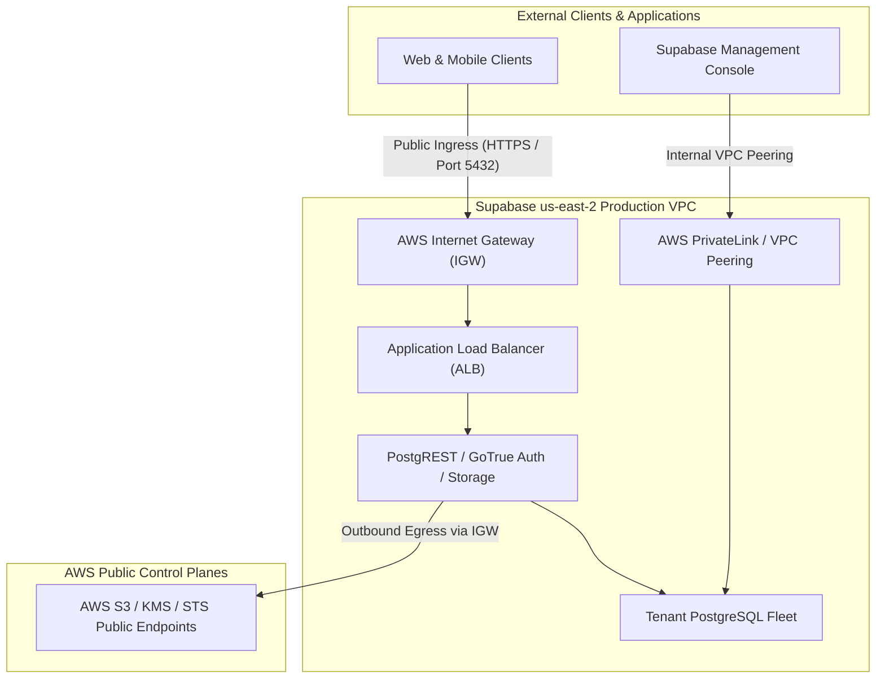
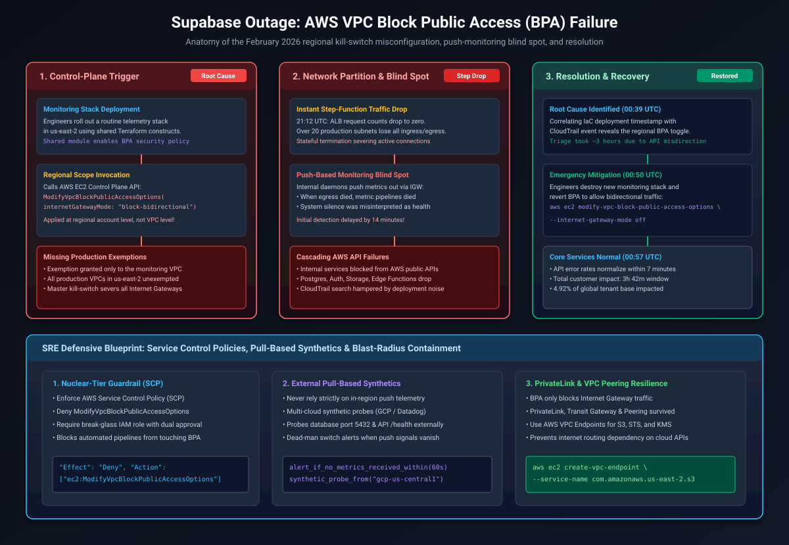
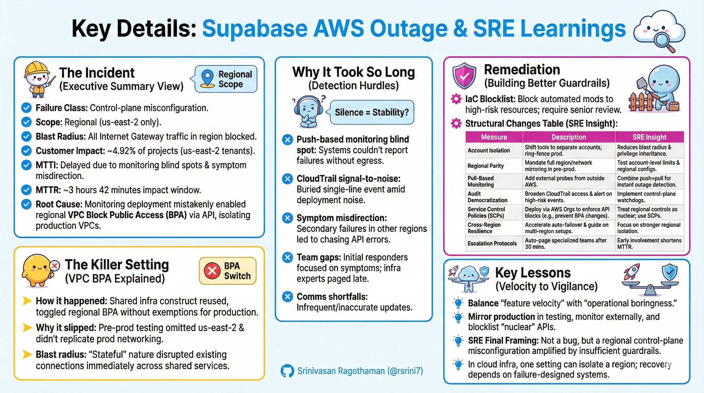

# Supabase Regional Outage: The AWS VPC Block Public Access Kill-Switch & Push-Monitoring Blind Spot

Daily learning · February 2026 · Incident review  
*By Srinivasan Ragothaman ([@rsrini7](https://github.com/rsrini7))*

> **Core idea:** On February 12–13, 2026, a deployment of an internal monitoring stack in AWS us-east-2 (Ohio) inadvertently invoked the account-level `ModifyVpcBlockPublicAccessOptions` API, enabling regional VPC Block Public Access (BPA) in bidirectional blocking mode. This master kill-switch instantly severed all Internet Gateway (IGW) ingress and egress traffic across more than 20 production subnets. Compounding the 3-hour-and-42-minute outage was a critical SRE detection blind spot: internal daemons designed to push metrics outward fell silent, leading automated monitoring systems to misinterpret network isolation as operational stability.

---

## 1. Foundations: The Supabase Cloud Infrastructure on AWS

Supabase is an open-source Firebase alternative providing managed PostgreSQL databases, authentication (GoTrue), instant REST/GraphQL APIs (PostgREST), real-time change-data-capture engines, and edge functions.



### Architectural Roles & Responsibilities

| Subsystem | Functional Role | Vulnerability / Failure Mode |
|---|---|---|
| **Internet Gateway (IGW)** | Regional Ingress & Egress | Connects VPC subnets to the public internet for client API queries and outbound requests to public AWS service endpoints. |
| **VPC Block Public Access (BPA)** | AWS Regional Security Control | Acts as a master network circuit-breaker. When enabled in `block-bidirectional` mode at the account level, it drops all traffic transiting Internet Gateways across the region unless explicitly exempted. |
| **Push-Based Telemetry Daemons** | SRE Observability Agents | Background agents co-located on database hosts that sample health metrics and push time-series data outward to observability endpoints via the IGW. |
| **PrivateLink / VPC Peering** | Private Inter-VPC Routing | Dedicated point-to-point network channels that do not traverse Internet Gateways and are immune to BPA enforcement. |

---

## 2. Deep Technical Mechanism: The Regional Kill-Switch

### 2.1 The Shared IaC Construct Defect

In distributed infrastructure, security teams frequently apply Infrastructure-as-Code (IaC) modules to enforce compliance. AWS provides **VPC Block Public Access (BPA)** to prevent accidental public exposure of private subnets.

While deploying a new internal monitoring stack in the `us-east-2` region, the deployment pipeline executed a shared Terraform/CloudFormation module intended to lock down the new telemetry VPC:

```json
// The Fatal AWS API Call Executed at Account/Regional Scope
{
  "eventSource": "ec2.amazonaws.com",
  "eventName": "ModifyVpcBlockPublicAccessOptions",
  "awsRegion": "us-east-2",
  "requestParameters": {
    "ModifyVpcBlockPublicAccessOptionsRequest": {
      "InternetGatewayMode": "block-bidirectional"
    }
  }
}
```

The underlying Terraform module called `ModifyVpcBlockPublicAccessOptions` at the **regional account level** rather than scoping it exclusively to the new monitoring VPC. Furthermore, the module configured an exemption only for its own monitoring subnet, leaving all production database and API VPCs completely unexempted.

### 2.2 The Step-Function Network Partition

Unlike software bugs that degrade performance gradually under memory pressure or lock contention, BPA enforcement is a **binary step-function**:

```mermaid
sequenceDiagram
    autonumber
    participant IaC as Monitoring Deployment Pipeline
    participant AWS as AWS EC2 Control Plane (us-east-2)
    participant IGW as Internet Gateways (20+ Subnets)
    participant ALB as Application Load Balancers
    participant Push as Internal Push Monitoring Agent

    IaC->>AWS: Invoke ModifyVpcBlockPublicAccessOptions(block-bidirectional)
    AWS->>IGW: Enforce regional packet drop immediately (21:12 UTC)
    Note over IGW: All ingress and egress traffic blocked instantly!
    ALB--xClients: Request counts plunge to 0; connections terminated
    Push--xObservability: Outbound metric push fails; agents go dark
    Note over Observability: Monitoring Blind Spot: Absence of errors mistaken for health
```

1. **Stateful Connection Termination:** At 21:12 UTC, AWS immediately dropped all bidirectional packets transiting Internet Gateways across us-east-2.
2. **ALB Request Collapse:** Application Load Balancer request counts plummeted from peak throughput to exactly zero.
3. **AWS API Severance:** Supabase microservices running inside the VPC lost egress connectivity to public AWS service endpoints (`s3.us-east-2.amazonaws.com`, `kms.us-east-2.amazonaws.com`, `sts.amazonaws.com`), cascading into authentication and storage failures.
4. **Survival of Private Networking:** Because BPA only restricts Internet Gateways, private network routes (VPC Peering, AWS Transit Gateway, and Direct Connect) remained completely operational throughout the event.

### 2.3 The Push-Based Monitoring Blind Spot

The incident was exacerbated by a structural flaw in observability design: **exclusive reliance on push-based telemetry**.

When production servers push metrics outward to an external monitoring service, a complete network partition drops both application traffic and the telemetry channel simultaneously. The monitoring dashboards stopped receiving health metrics, but because no active 500 error packets were being returned (the network was simply dropping packets), automated alerting systems registered zero errors.

It took **14 minutes** before internal secondary alerts triggered, and nearly **three hours** of triage before responders correlated the failure to the regional BPA change rather than an API bug in foreign regions.

---

## 3. Architectural Visual: The Regional Partition & Defensive Guardrails

The following architecture diagram illustrates the regional BPA kill-switch, the push-monitoring blind spot, and the SRE defensive engineering guardrails:



---

## 4. Production Implementations & SRE Defensive Recipes

Preventing automated pipelines from triggering account-wide network partitions requires hard architectural guardrails: Service Control Policies (SCPs) and independent external synthetic probing.

### 4.1 AWS Service Control Policy (SCP) to Block Regional BPA Modification

Apply this Service Control Policy at the AWS Organizations root. It completely forbids any IAM user, role, or CI/CD deployment pipeline from modifying VPC Block Public Access options unless explicitly assuming a break-glass administrative role.

```json
{
  "Version": "2012-10-17",
  "Statement": [
    {
      "Sid": "DenyRegionalVpcBlockPublicAccessChanges",
      "Effect": "Deny",
      "Action": [
        "ec2:ModifyVpcBlockPublicAccessOptions",
        "ec2:ModifyVpcBlockPublicAccessExclusion"
      ],
      "Resource": "*",
      "Condition": {
        "StringNotLike": {
          "aws:PrincipalARN": [
            "arn:aws:iam::*:role/aws-reserved/sso.amazonaws.com/AWSReservedSSO_BreakGlassAdmin_*"
          ]
        }
      }
    }
  ]
}
```

### 4.2 Multi-Cloud Pull-Based Synthetic Prober (Python)

To detect network partitions when in-region push agents fall silent, run this independent synthetic probe from an external network (e.g., Google Cloud or an on-premise monitoring server). It connects to database endpoints and triggers a dead-man alert if connections drop.

```python
#!/usr/bin/env python3
"""
external_synthetic_prober.py
Independent multi-cloud health probe.
Probes external ingress to detect regional network partitions (BPA kill-switch).
"""

import socket
import ssl
import sys
import time
import urllib.request


def probe_tcp_port(host: str, port: int, timeout = 3.0) -> bool:
    """Verifies TCP port connectivity (e.g., PostgreSQL port 5432)."""
    try:
        with socket.create_connection((host, port), timeout=timeout):
            return True
    except (socket.timeout, ConnectionRefusedError, OSError):
        return False


def probe_http_health(url: str, timeout = 3.0) -> bool:
    """Verifies HTTP health check endpoint through external Internet Gateway."""
    ctx = ssl.create_default_context()
    req = urllib.request.Request(url, headers={"User-Agent": "SyntheticProber/2.0"})
    try:
        with urllib.request.urlopen(req, timeout=timeout, context=ctx) as resp:
            return resp.status == 200
    except Exception:
        return False


def run_synthetic_audit(db_host: str, api_health_url: str):
    print(f"[*] Executing external synthetic probe against {db_host}...")

    tcp_ok = probe_tcp_port(db_host, 5432)
    api_ok = probe_http_health(api_health_url)

    if not tcp_ok and not api_ok:
        print(
            "[!] CRITICAL ALERT: Complete ingress blackout detected! Possible regional network partition (BPA)."
        )
        sys.exit(2)
    elif not tcp_ok or not api_ok:
        print("[!] WARNING: Partial service degradation detected.")
        sys.exit(1)
    else:
        print("[+] SUCCESS: All external synthetic ingress probes healthy.")
        sys.exit(0)


if __name__ == "__main__":
    if len(sys.argv) < 3:
        print(f"Usage: {sys.argv[0]} <db_hostname> <api_health_url>")
        sys.exit(1)

    run_synthetic_audit(sys.argv[1], sys.argv[2])
```

---

## 5. Impact, Real-World Edge Cases & Gotchas

### 5.1 Common Claims vs. Technical Realities

| Industry Assumption | Technical Reality |
|---|---|
| *"Testing Infrastructure-as-Code modules in a staging environment guarantees production safety."* | **False.** Pre-production testing for the monitoring stack ran for a week in other regions, but because tests did not run in `us-east-2` with production VPC topologies, the regional scope flaw was never triggered. |
| *"Our databases are isolated inside private subnets, so Internet Gateway changes don't affect us."* | **False.** Even when databases sit in private subnets, user traffic routes through public ALBs, and backend instances call AWS public APIs (S3, KMS) via NAT gateways attached to Internet Gateways. |
| *"CloudTrail provides instant visibility into infrastructure failures."* | **Misleading.** During a large infrastructure deployment, CloudTrail logs are flooded with thousands of routine API calls. Identifying a single `ModifyVpcBlockPublicAccessOptions` event requires knowing what to look for. |
| *"If push metrics report zero errors, the system is operating normally."* | **Deadly SRE Fallacy.** In a network partition, the reporting channel is severed. Zero reported errors can represent total system silence rather than high availability. |

---

## 6. Practical SRE Adoption Blueprint & Verification Checklist

### 6.1 SRE Guardrails Checklist

- [ ] **Deploy AWS Organizations SCPs:** Deny `ec2:ModifyVpcBlockPublicAccessOptions` across all member accounts without multi-party break-glass approval.
- [ ] **Implement Dead-Man Switch Monitoring:** Configure monitoring alerts that trigger when the *volume* of incoming metrics drops below historical baselines (alert on silence).
- [ ] **Deploy Multi-Cloud Synthetic Probes:** Run continuous external health probes from AWS-external networks (GCP, Azure, Cloudflare Workers) directly to ingress ALBs and database ports.
- [ ] **Adopt AWS VPC Endpoints (PrivateLink):** Configure VPC Endpoints for S3, KMS, Secrets Manager, and STS so internal services do not route across Internet Gateways to reach AWS APIs.
- [ ] **Establish 30-Minute Auto-Escalation:** In high-severity incidents where API debugging yields no root cause within 30 minutes, mandate auto-escalation to cloud infrastructure and networking specialists.

---

## 7. Timeline of Events

```
Feb 12, 21:12 UTC      Feb 12, 21:26 UTC      Feb 13, 00:39 UTC      Feb 13, 00:57 UTC
       +-----------------------+----------------------+----------------------+
       | Monitoring Stack      | Internal Alerts      | SREs Identify        | Core Services
       | Enables Regional      | Trigger; 14-Minute   | Regional BPA Toggle  | Fully Restored;
       | BPA; Traffic Plunges  | Blind Spot Window    | in CloudTrail Logs   | 3h 42m Impact Closes
```

- **21:12 UTC (Feb 12):** Monitoring deployment invokes `ModifyVpcBlockPublicAccessOptions`, instantly severing internet gateway traffic across us-east-2.
- **21:26 UTC (Feb 12):** First internal alarms trigger; initial responders misdiagnose secondary API errors in other regions.
- **22:37 – 23:58 UTC:** Investigation focuses on cross-region reads and engages AWS support (who confirm no underlying AWS platform outages).
- **00:39 UTC (Feb 13):** Infrastructure engineers isolate the single regional BPA API call in CloudTrail.
- **00:50 UTC:** Mitigation initiates: the monitoring stack is torn down, and BPA is set back to `off`.
- **00:57 UTC:** Ingress traffic normalizes; API error rates drop to zero across us-east-2.
- **01:53 UTC:** Full incident resolution declared after background task queues finish draining.

---

## 8. Source Context and Primary Disclosures

| Date | Source / Organization | Disclosure / Document | Focus Area |
|---|---|---|---|
| Feb 2026 | Supabase Engineering Team | [Official Incident Post-Mortem](https://supabase.com/blog/) | Root-cause analysis of us-east-2 VPC Block Public Access outage |
| Feb 2026 | AWS Documentation | [VPC Block Public Access Options Guide](https://docs.aws.amazon.com/vpc/latest/userguide/vpc-block-public-access.html) | Technical specification of regional vs VPC-level BPA controls |
| Feb 2026 | SRE Community Discussions | [Hacker News / Reddit Triage Review](https://news.ycombinator.com/) | Analysis of push vs pull monitoring blind spots and control-plane blast radius |

---

## 9. Supplementary visuals

The following diagram illustrates the original incident timeline, affected cloud dependencies, and regional scope:


*Figure 1: High-level architectural map of the February 2026 Supabase us-east-2 outage and VPC network partition.*

---

**Related:**
- [AWS US-East-1 Outage October 2025](AWS-US-East-1-Outage-October-2025.md) — Demonstrates how internal control-plane dependencies cascade into cross-service outages.
- [Cloudflare Global Outage ClickHouse Config](Cloudflare-Global-Outage-ClickHouse-Config-Nov-2025.md) — Another homogeneous automated configuration failure that caused worldwide service disruption.
- [AWS vs Hetzner](../../Engineering/Cloud/AWS-vs-Hetzner.md) — Compares managed cloud blast radiuses and network dependency risks against dedicated infrastructure.
- [Scaling PostgreSQL (ChatGPT Architecture)](../../Engineering/Databases/Scaling-PostgreSQL-ChatGPT.md) — Deep dive into PostgreSQL primary-replica scaling, connection pooling, and connection failover.
