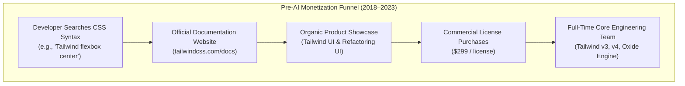
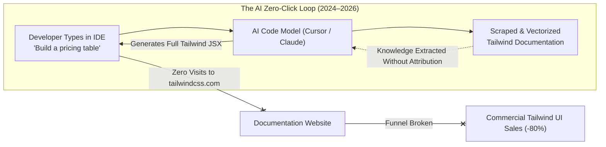
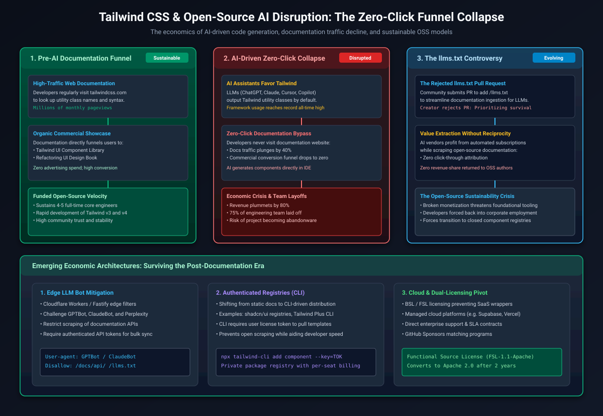
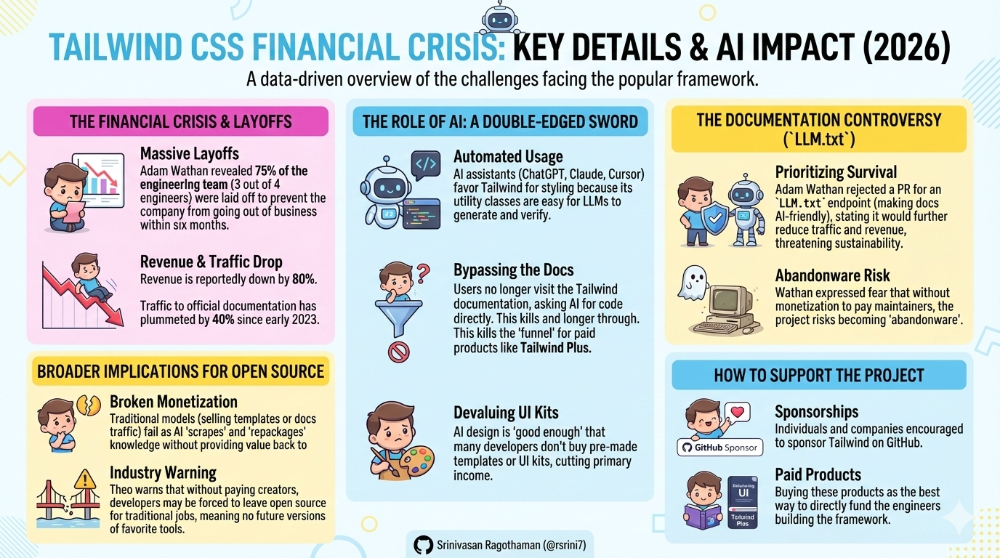

# Tailwind CSS & Open-Source AI Disruption: The Zero-Click Conversion Collapse

Daily learning · July 2026 · Case analysis  
*By Srinivasan Ragothaman ([@rsrini7](https://github.com/rsrini7))*

> **Core idea:** While generative AI assistants (ChatGPT, Claude, Cursor, v0) propelled Tailwind CSS to record adoption due to the token efficiency of atomic utility classes in JSX, they simultaneously destroyed the business model funding its development. By answering developer syntax queries in-editor, AI eliminated the documentation pageviews that funneled buyers to commercial UI kits (Tailwind UI) and books (*Refactoring UI*), causing an 80% revenue collapse and forcing 75% engineering team layoffs. This incident exposed the systemic vulnerability of open-source projects whose economic survival depends on documentation web traffic.

---

## 1. Foundations: The Open-Source Documentation Monetization Engine

Tailwind Labs established one of the most successful independent commercial open-source software (COSS) models in modern web development. The foundational framework—**Tailwind CSS**—is free, open-source software under the permissive MIT license.



### The Economic Components of Tailwind Labs

| Component / Asset | Legal & Economic Model | Role in the Ecosystem |
|---|---|---|
| **Tailwind CSS Framework** | Open Source (MIT License) | Zero-cost utility-first CSS compiler; drives universal developer adoption. |
| **Documentation Website** | Proprietary Content (Free Access) | Comprehensive syntax manual; acted as the top-of-funnel traffic driver (millions of monthly visits). |
| **Tailwind UI / Tailwind Plus** | Commercial Proprietary ($149–$299) | Pre-designed application templates and UI components; primary revenue engine funding core salaries. |
| **Refactoring UI Book** | Commercial Digital Educational Product | Design handbook authored by Adam Wathan and Steve Schoger; generated early foundational capital. |

Under this model, documentation was not merely a cost center; it was the entire commercial marketing engine. Because developers constantly revisited documentation to verify utility class names (e.g. `grid-cols-4`, `translate-x-1/2`), a predictable 2% to 5% converted into commercial template customers.

---

## 2. Deep Technical & Economic Mechanism: The Zero-Click Collapse

### 2.1 Why LLMs Favor Tailwind Utility Classes

Generative AI code models (Anthropic Claude 3.5/3.7 Sonnet, OpenAI GPT-4o, Cursor) exhibit a strong architectural bias toward generating Tailwind CSS rather than traditional CSS or CSS Modules:

1. **Token Efficiency:** A complete UI component can be expressed in a single JSX block (`<button className="px-4 py-2 bg-indigo-600 text-white rounded-lg shadow hover:bg-indigo-700">`) without needing to generate a secondary `.css` file or coordinate cross-file class mappings.
2. **Context Window Density:** In multi-turn coding chats, atomic classes eliminate the need for the model to keep global CSS cascades or BEM selectors in working memory.
3. **Deterministic Verification:** LLM feedback loops can verify visual styling directly from inline string tokens without evaluating external stylesheet imports.

Consequently, AI toolchains made Tailwind CSS the default styling layer for modern frontend code generation.

### 2.2 The Zero-Click Funnel Disruption

As developers migrated from browser search engines to in-editor AI assistants (Cursor, GitHub Copilot, Windsurf), their interaction pattern fundamentally shifted:



1. **Traffic Plunge:** Developers stopped visiting `tailwindcss.com/docs`. Overall web traffic declined by more than **40%** between early 2023 and 2026.
2. **Revenue Severance:** Because users never landed on the website, they never saw Tailwind UI banners or previews. Commercial revenue plummeted by **80%**.
3. **Devaluation of UI Kits:** As generative models became proficient at scaffolding complex components on demand from natural language prompts, the perceived value of pre-built, static template kits declined.
4. **The Layoffs:** Creator Adam Wathan revealed that to prevent complete insolvency within six months, Tailwind Labs had to lay off **75% of its engineering team** (retaining only 1 out of 4 full-time engineers).

### 2.3 The `llms.txt` Pull Request Controversy

The crisis intensified in mid-2024 when a community contributor submitted a Pull Request to the official Tailwind repository proposing the addition of an `/llms.txt` endpoint.

The `/llms.txt` standard proposes serving markdown-formatted, optimized plain-text documentation specifically designed for automated LLM web crawlers and vector search indexing.

Adam Wathan rejected the pull request with a public rationale that highlighted the existential crisis facing open source:

> *"Facilitating the automated scraping of our documentation directly accelerates the destruction of our business. If AI assistants can ingest our content with zero friction, users have even less reason to visit our site, our revenue continues to decline, and Tailwind CSS risks becoming abandonware because we cannot pay engineers to maintain it."*

---

## 3. Architectural Visual: The Economic Disruption of Open Source

The following architecture diagram details the pre-AI conversion funnel, the zero-click AI disruption, and emerging post-documentation monetization models:



---

## 4. Production Implementations & Defensive Engineering Recipes

Open-source authors and technical content creators must adapt their web architecture to mitigate uncompensated automated ingestion while exploring authenticated distribution channels.

### 4.1 Edge Middleware for Automated LLM Crawler Mitigation (Next.js / Cloudflare)

Deploy this edge middleware to identify, rate-limit, or challenge aggressive automated AI scrapers (`GPTBot`, `ClaudeBot`, `PerplexityBot`, `Bytespider`) while ensuring human developers and legitimate search engine indexers (Googlebot) retain unhindered access.

```typescript
// middleware.ts - Edge AI Crawler Gatekeeper
import { NextResponse } from 'next/server';
import type { NextRequest } from 'next/server';

// Known commercial LLM scraping user-agent signatures
const AI_CRAWLER_USER_AGENTS = [
  /GPTBot/i,
  /ChatGPT-User/i,
  /Claude-Web/i,
  /ClaudeBot/i,
  /PerplexityBot/i,
  /Bytespider/i,
  /CCBot/i,
  /Diffbot/i,
];

export function middleware(request: NextRequest) {
  const userAgent = request.headers.get('user-agent') || '';
  const pathname = request.nextUrl.pathname;

  // Block or challenge direct access to bulk AI endpoints or docs APIs
  const isAiCrawler = AI_CRAWLER_USER_AGENTS.some((pattern) => pattern.test(userAgent));

  if (isAiCrawler) {
    // Specifically block bulk export endpoints
    if (pathname.startsWith('/llms.txt') || pathname.startsWith('/api/docs-export')) {
      return new NextResponse(
        JSON.stringify({
          error: 'ContentLicensingRequired',
          message:
            'Bulk automated ingestion of documentation is restricted. Inquire for enterprise API licensing.',
        }),
        {
          status: 403,
          headers: { 'Content-Type': 'application/json' },
        }
      );
    }

    // Rate limit general documentation scraping
    return new NextResponse('Automated scraping rate limit exceeded. Please visit via standard browser.', {
      status: 429,
      headers: {
        'Retry-After': '86400',
        'X-Robots-Tag': 'noindex, noarchive',
      },
    });
  }

  return NextResponse.next();
}

export const config = {
  matcher: ['/docs/:path*', '/llms.txt', '/api/:path*'],
};
```

### 4.2 Authenticated CLI-Driven Registry Distribution Model

Rather than selling static component zip files that get leaked into LLM training sets, modern open-source businesses are transitioning to **token-authenticated CLI package registries** (similar to private npm registries or the shadcn/ui registry pattern):

```bash
# Developer authenticates CLI with paid license token
npx tailwind-plus login --token=USR_PRO_LICENSE_KEY_84920

# CLI pulls components directly into the local project working directory
npx tailwind-plus add dashboard-header --variant=enterprise

# Prevents open public web scraping while delivering superior developer ergonomics
```

---

## 5. Impact, Real-World Edge Cases & Gotchas

### 5.1 Common Claims vs. Technical Realities

| Industry Assumption | Technical Reality |
|---|---|
| *"Widespread adoption by AI models will naturally increase framework revenue."* | **False.** AI models act as a lossy proxy. They extract the syntax and utilities while completely bypassing the commercial website, starving the creator of eyeballs and conversions. |
| *"GitHub Sponsors can replace commercial template revenue."* | **False.** Public GitHub sponsorships rarely exceed a few thousand dollars a month—insufficient to sustain 4–5 senior systems engineers working on compiler infrastructure (such as the Rust-based Oxide engine). |
| *"Adding `/llms.txt` improves developer experience with zero downside."* | **High Commercial Risk.** While convenient for users, for small COSS companies it voluntarily accelerates the death of their primary customer acquisition funnel without receiving any attribution or API revenue from AI providers. |
| *"Traditional open source (MIT license) remains viable for UI tooling."* | **Questionable.** Without proprietary registries, SaaS cloud pairings, or dual licensing, pure open-source UI tooling faces severe sustainability headwinds under AI code generation. |

---

## 6. Practical Open-Source Sustainability Blueprint

### 6.1 Strategic Framework for Post-Documentation Monetization

1. **Pivot from Documentation Funnels to Workflow Integrations:** Do not rely on pageviews. Distribute commercial assets through CLI tools, IDE extensions, or Figma plugins that authenticate the user.
2. **Adopt Functional Source Licensing (FSL):** Transition proprietary extensions from permissive MIT to FSL (e.g., FSL-1.1-Apache), allowing free personal and development use while prohibiting commercial SaaS wrappers, converting to pure open-source after two years.
3. **Enforce Edge Crawler Restrictions:** Use Cloudflare Bot Management or custom edge middleware to block automated scrapers from consuming API documentation without commercial data-licensing agreements.
4. **Partner with AI Ecosystems for Revenue Attribution:** Form direct licensing agreements with AI tooling vendors (Cursor, GitHub, OpenAI) where framework authors receive developer tool credits or revenue-sharing for verified documentation access.

---

## 7. Timeline of Events

```
2023 - Early 2024      Mid-2024               Late 2024 - 2025       2026 Present
       +-----------------------+----------------------+----------------------+
       | AI Assistants Surge;  | Docs Traffic Down    | Tailwind Labs Layoff | Community Debate on
       | Tailwind Usage at     | 40%; Commercial      | (75% of Team);       | llms.txt & Open-
       | All-Time Record High  | Revenue Drops 80%    | llms.txt PR Rejected | Source Sustainability
```

- **Early 2024:** AI coding tools adopt Tailwind CSS as the primary styling convention. Usage metrics hit all-time records across GitHub.
- **Mid-2024:** Tailwind Labs observes a continuous 40% decline in documentation traffic. In-editor code generation eliminates visits to `tailwindcss.com`.
- **Late 2024:** Commercial sales decline by 80%. Adam Wathan announces the layoff of three full-time engineers (75% of the team) to preserve six months of operating runway.
- **Mid-2025 – 2026:** The rejected `/llms.txt` pull request becomes a central case study across the tech industry on the uncompensated extraction of open-source intellectual property by AI platforms.

---

## 8. Source Context and Primary Disclosures

| Date | Source / Organization | Disclosure / Document | Focus Area |
|---|---|---|---|
| 2024–2025 | Adam Wathan / Tailwind Labs | [Tailwind Labs Public Disclosures](https://adamwathan.me/) | Creator announcements regarding company runway, layoffs, and revenue impact |
| 2025 | GitHub Repository | [Tailwind CSS Issue Tracker](https://github.com/tailwindlabs/tailwindcss/pulls) | Public discussions surrounding the rejected `/llms.txt` pull request |
| 2025 | Theo - t3.gg | [The Tailwind Financial Crisis Breakdown](https://youtube.com/watch?v=tSgch1vcptQ) | Industry analysis on open-source monetization failure modes under AI |

---

## 9. Supplementary visuals

The following diagram illustrates the original financial impact, documentation traffic decline, and community discussions:


*Figure 1: High-level overview of the Tailwind CSS financial disruption, traffic collapse, and open-source economic debate.*

---

**Related:**
- [AWS-vs-Hetzner-Compute-Economics-And-Architecture-2026](../../Engineering/Cloud/AWS-vs-Hetzner-Compute-Economics-And-Architecture-2026.md) — Examines cloud economics, infrastructure cost discipline, and operational viability for small engineering teams.
- [Deno Joins Cloudflare](../../Engineering/Languages/Deno-Joins-Cloudflare-Adoption-And-Runtime-Lessons-Oct-2026.md) — Another case study of modern runtime economics and the pressures driving independent developer tool companies into larger platforms.
- [n8n Automation RCE Suite](../Security/N8n-Workflow-Automation-RCE-Suite-CVE-2025-68613-2026.md) — Examines sustainability and security boundaries in commercial open-source automation platforms.
- [Cloudflare Global Outage ClickHouse Config](Cloudflare-Global-Outage-ClickHouse-Config-Nov-2025.md) — Analyzes edge infrastructure, proxy routing, and the operational dependencies of modern web platforms.
