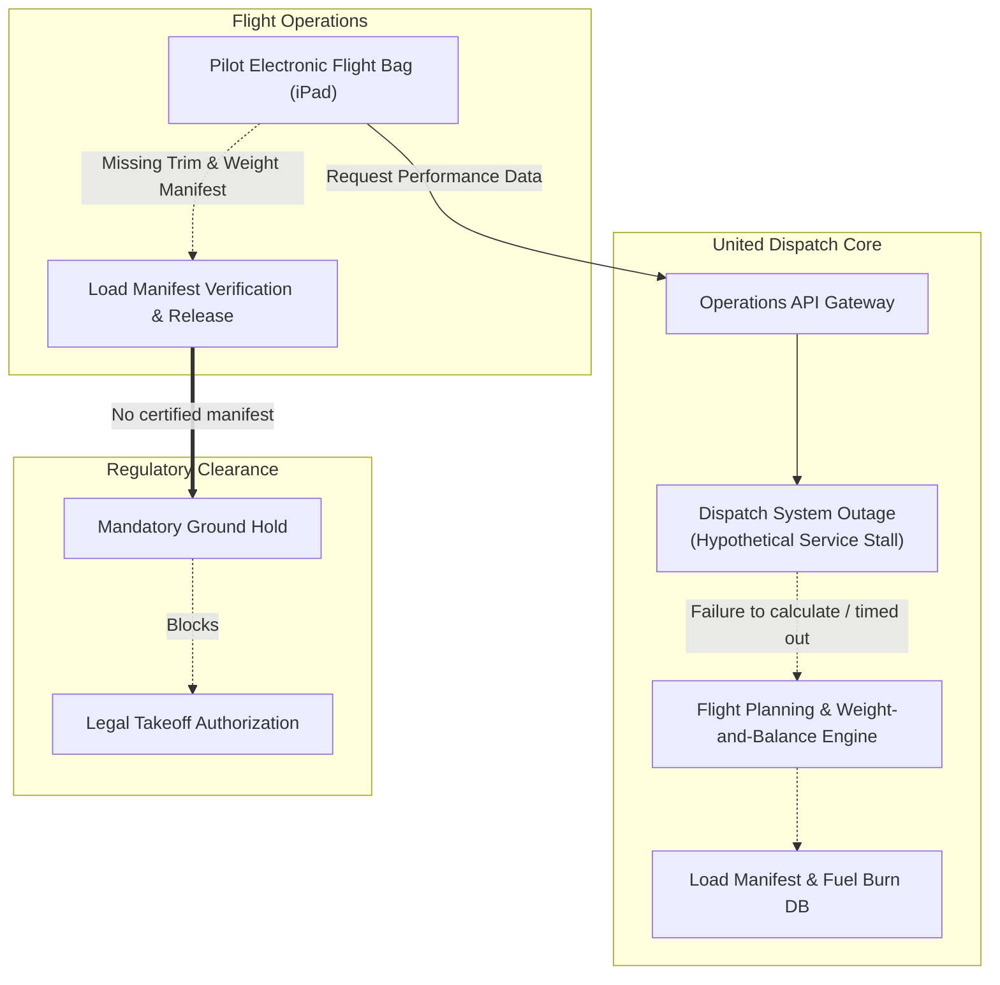
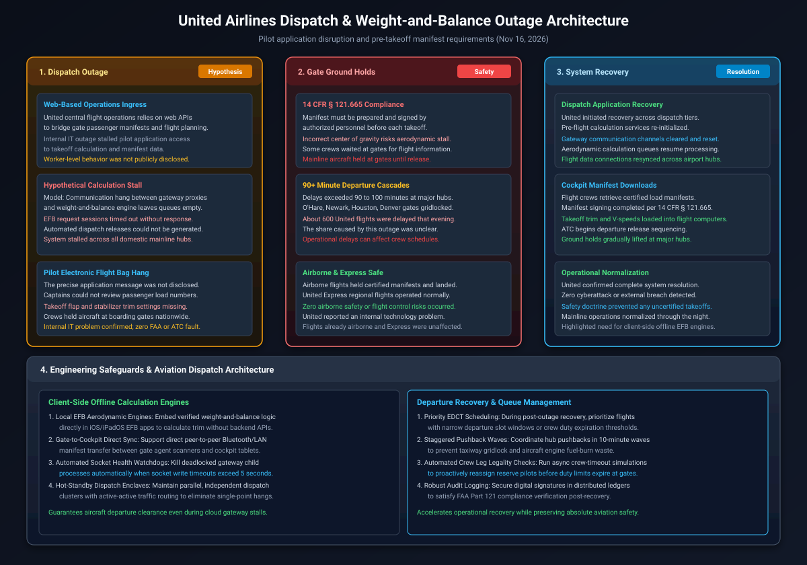

# United Airlines Flight Dispatch & Weight-and-Balance Outage: Pre-Flight Calculation Stall & Ground Holds

Daily learning · November 2026 · Incident review
*By Srinivasan Ragothaman ([@rsrini7](https://github.com/rsrini7))*

> **Core idea:** On November 16, 2026, a United Airlines technology outage delayed departing flights and affected pilot-facing tools, including access to final aircraft weights. AP reported that the outage lasted more than 90 minutes. Federal regulation requires an appropriately signed load manifest before takeoff. FlightAware reported about 600 United delays that evening, but the number caused by this incident was unclear.

> [!NOTE]
> **Provenance & Observational Scope:** This review examines the November 16, 2026 flight dispatch disruption based on United Airlines operational updates, Airline Pilots Association (ALPA) union bulletins, and statements by the Department of Transportation (DOT) and the FAA.
>
> **Verified Public Facts:** The pilots’ union reported disruption to pilot-facing applications and final aircraft weight information. United said flights already airborne and United Express flights were not affected, and that there was no indication of a cybersecurity issue. FlightAware counted about 600 United delays that evening; AP could not determine how many resulted from the outage.
>
> **Analytical Scope:** The specific low-level mechanics—such as web gateway socket freezes and IPC thread-pool depletion—represent an analytical systems architecture case study demonstrating operational flight planning dependencies, rather than an internal software disclosure by United Airlines.

---

## 1. Foundations: The Flight Dispatch & Weight-and-Balance Pipeline

Commercial aviation safety relies on strict pre-flight aerodynamic and performance calculations. Before an aircraft can depart, pilots and dispatchers must verify the aircraft's center of gravity (CG), takeoff trim settings, passenger manifest weight, cargo distribution, and fuel reserves.

The final weight and balance incorporates passengers, baggage, cargo, and fuel. Pilots use it to check performance and prepare flight guidance. AP reported that a pilot at Houston asked to remain at the gate until the affected system was working; it did not identify the internal system responsible. [AP](https://abcnews.com/Business/wireStory/15-hour-long-system-outage-forces-united-airlines-138190979)



### Critical Systems & Regulatory Requirements

| System / Component | Functional Responsibility | Incident Failure Mode |
|---|---|---|
| **Weight-and-Balance Engine** | Computes center of gravity (CG), fuel density, and flap/trim settings | Disrupted pre-flight calculation services prevented generation of aerodynamic performance figures. |
| **Electronic Flight Bag (EFB)** | Cockpit tablet interface used by flight crews to review flight plans and manifests | Flight crews unable to retrieve required weight-and-balance manifests. |
| **FAA 14 CFR § 121.665** | Requires preparation and signing of the load manifest by authorized personnel before takeoff | Some crews waited at gates for required flight information during the disruption. |
| **United Express Infrastructure** | Regional carrier operations running on independent regional dispatch contracts | Completely unaffected; regional feeder flights departed on schedule. |

---

## 2. Systems Failure Mode: Pre-Flight Calculation Pipeline (Hypothetical Architecture Case Study)



### 2.1 The Pre-Flight Calculation Dependency (Hypothetical Model)

Modern airlines have transitioned from paper-based load manifests to cloud-connected Electronic Flight Bags (EFBs) communicating with centralized dispatch clusters. On November 16:
1. United Airlines confirmed an internal technology outage affecting pilot applications and pre-flight calculation systems, but did not disclose proprietary backend server traces.
2. Systems architects evaluate the disruption through a hypothetical systems architecture model: When gate agents finalize passenger boarding and baggage counts, the payload is dispatched to automated weight-and-balance calculation services.
3. In this hypothetical failure scenario, if communication layers between ingress gateways and calculation workers experience a connection hang, calculation worker queues fail to process incoming requests.
4. Without automated computation, pilot EFBs remain in a spinning "Awaiting Dispatch Release" state.

```
+--------------------------------------------------------------------------+
|                 United Flight Dispatch Telemetry Pipeline                |
|                                                                          |
|   [ Gate Passenger Scan ]   [ Cargo Baggage Weights ]                    |
|             \                         /                                  |
|              +-----------+-----------+                                   |
|                          |                                               |
|                          v                                               |
|             +--------------------------+                                 |
|             | Operations API Gateway   |                                 |
|             +--------------------------+                                 |
|                          |                                               |
|            (Hypothetical Service Hang)                                   |
|                          v                                               |
|             +--------------------------+                                 |
|             | Weight-and-Balance Engine|                                 |
|             |  [ Queue Stalled: Model] |                                 |
|             +--------------------------+                                 |
|                          |                                               |
|   Result: No Takeoff Trim Sheets Transmitted to Cockpit EFBs             |
|   Operational Status: Gate Hold Enforced under 14 CFR § 121.665          |
+--------------------------------------------------------------------------+
```

### 2.2 Pre-Takeoff Manifest Requirements & Gate Holds

In standard enterprise software, a server timeout might result in a temporary user retry or degraded rendering. In commercial aviation:
* Taking off with an incorrectly calculated center of gravity can cause aerodynamic stall, unrecoverable pitch trim divergence, or tail-strike during rotation.
* Federal regulations (**14 CFR § 121.665**) mandate that the load manifest be prepared and signed by employees responsible for loading or manifest preparation (or other authorized qualified persons) prior to takeoff.
* While § 121.665 specifically governs takeoff rather than gate pushback, standard airline operational doctrine dictates holding planes at boarding gates ("gate holds") when dispatch computation fails. Pushing back onto active aprons without certified takeoff performance numbers wastes jet fuel, congests taxiways, and risks exceeding flight crew duty-time limits while waiting on taxiways.
* Because the automated dispatch release services were unresponsive and manual paper calculations for hundreds of concurrent flights were logistically impossible, aircraft held at gates nationwide.

---

## 3. Systems Failure Modes & Common Misconceptions

| Common Assumption | Technical Reality |
|---|---|
| **"The FAA ordered another nationwide ground stop."** | The FAA and DOT confirmed this was strictly an internal United Airlines IT failure; all other airlines operated normally. |
| **"Airborne United planes were in danger."** | Aircraft already airborne held valid, certified flight plans and landing performance numbers; zero in-flight safety issues occurred. |
| **"Cyberattackers hacked airline dispatch systems."** | United confirmed the disruption was an internal technical infrastructure malfunction with zero indication of external tampering. |

---

## 4. Operational Timeline & Recovery

* **November 16, 2026:** Pilots reported problems obtaining final aircraft weights, and United reported an outage affecting departing flights.
* **During the disruption:** Some crews waited at gates for required information; the precise timing and number of affected flights are not established by the sources cited here.
* **Later on November 16:** United said the system outage had been resolved. Public reports differ on its duration.
* **Evening:** FlightAware showed about 600 United delays, without identifying how many were attributable to the outage.

---

## 5. Engineering Lessons & Architectural Safeguards

1. **Local Offline-Capable EFB Fallback:** Cockpit applications should maintain local client-side calculation engines capable of computing basic weight-and-balance algorithms locally when backend cloud dispatch services hang.
2. **Graceful Degradation for Dispatch Telemetry:** Flight operations infrastructure must have redundant hot-standby gateways running on decoupled network paths to prevent single-point-of-failure bottlenecks.
3. **Queue Eviction under Surges:** Pre-flight calculation queues must prioritize flights closest to scheduled departure time (EDCT) rather than processing requests under naive FIFO order during recovery.

---

## 6. Primary Sources & References

1. [AP: System outage forces United Airlines to delay departing flights](https://abcnews.com/Business/wireStory/15-hour-long-system-outage-forces-united-airlines-138190979) — Reports United’s statement, pilot observations, and the limits of the FlightAware delay count.
2. [Electronic Code of Federal Regulations: 14 CFR § 121.665 Load Manifest](https://www.ecfr.gov/current/title-14/section-121.665) — Federal statutory requirements governing preparation, signing, and inspection of load manifests prior to takeoff.
3. [NBC News: United Airlines says widespread system outage is over](https://www.nbcchicago.com/news/national-international/united-airlines-widespread-system-outage/4017582/) — Reports the pilots’ union description of affected applications.

---

**Related:**
- [FAA-FTI-Router-Telecommunications-Ground-Stop-Nov-2026.md](FAA-FTI-Router-Telecommunications-Ground-Stop-Nov-2026.md) — Nationwide air traffic ground stop following network flooding.
- [Chase-Zelle-Transaction-Processing-Outage-Nov-2026.md](Chase-Zelle-Transaction-Processing-Outage-Nov-2026.md) — Parallel on-premise software defect paralyzing banking transfers on the same day.
- [AWS-IAM-Identity-Center-Console-Outage-Nov-2026.md](AWS-IAM-Identity-Center-Console-Outage-Nov-2026.md) — Single availability zone network failure locking out cloud administrators.
- [Microsoft-365-Outlook-Cascading-Outage-Nov-2026.md](Microsoft-365-Outlook-Cascading-Outage-Nov-2026.md) — High-core lock contention and gateway collapse in M365.
