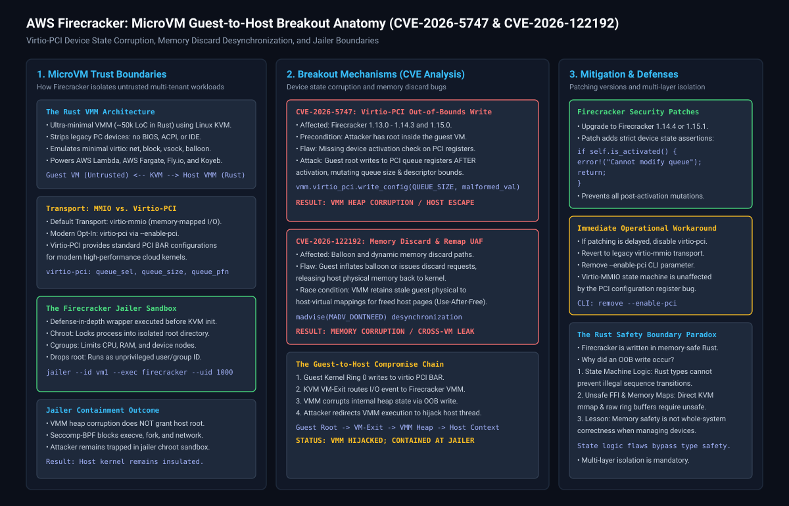
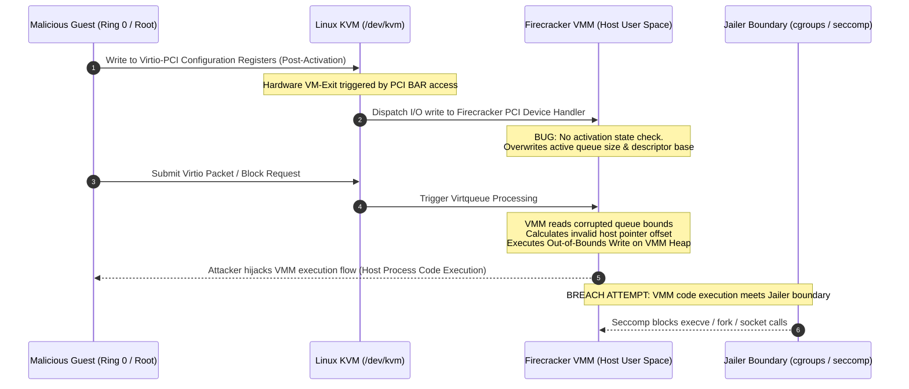

# AWS Firecracker: MicroVM Guest-to-Host Escapes and Virtio Device Flaws (CVE-2026-5747 & CVE-2026-122192)

**Daily learning · 07 November 2026 · Technical deep dive cross-checked against vendor advisories and primary sources**

> **Core idea:** Vulnerabilities in AWS Firecracker's opt-in `virtio-pci` device emulation layer and memory-discard mechanisms allowed an attacker with root privileges inside a guest microVM to trigger an out-of-bounds write in the host Virtual Machine Monitor (VMM) process, demonstrating potential guest-to-host breakout. The flaw highlights that memory-safe languages like Rust cannot eliminate state-machine logic errors at hardware and device emulation boundaries.

---

## 1. Foundations: why Firecracker and microVM isolation matter

Virtualization security traditionally relies on heavy hypervisors like QEMU and KVM. However, cloud-native workloads—such as serverless functions (AWS Lambda), containerized tasks (AWS Fargate), and multi-tenant code execution platforms (Fly.io, Koyeb, Appfleet)—require isolation that boots in milliseconds with negligible memory overhead.

To meet this demand, Amazon Web Services open-sourced **Firecracker** in 2018: an ultra-minimalist Virtual Machine Monitor (VMM) written in **Rust** that runs on the Linux Kernel-based Virtual Machine (**KVM**).

### Comparing virtualization architectures

| Layer / Component | Traditional Virtualization (QEMU + KVM) | Firecracker MicroVMs |
|---|---|---|
| **Codebase Size** | Millions of lines of C code; large attack surface. | ~50,000 lines of Rust; aggressive minimalism. |
| **Device Model** | Hundreds of legacy devices (IDE, floppy, ACPI, PCI bridges, USB, audio). | Minimal virtio devices only: `virtio-net`, `virtio-block`, `virtio-vsock`, and `virtio-balloon`. |
| **Boot Latency** | Several seconds to minutes. | Under 5 milliseconds (~150 microVMs spawned per second per host). |
| **Memory Footprint** | ~100–500 MB overhead per VM. | ~5 MB memory overhead per microVM. |
| **Transport Protocol** | Comprehensive PCI/PCIe bus emulation. | Historically `virtio-mmio` (Memory-Mapped I/O); recently added opt-in `virtio-pci`. |
| **Primary Use Cases** | General-purpose enterprise OS hosting (Windows, full Linux). | Serverless functions (AWS Lambda), ephemeral code execution, edge multi-tenancy. |

### Essential terminology

| Term | Meaning in MicroVM Security |
|---|---|
| **VMM (Virtual Machine Monitor)** | The host user-space process (Firecracker) that manages microVM lifecycles, intercepts VM-Exits, and emulates virtual hardware. |
| **KVM (`/dev/kvm`)** | The Linux kernel module that leverages CPU virtualization extensions (Intel VT-x / AMD-V) to execute guest code directly on the physical processor. |
| **Virtio** | A standardized abstraction for paravirtualized device drivers in Linux, allowing guests to communicate with host device models via shared memory ring buffers (`virtqueues`). |
| **Virtio-MMIO vs. Virtio-PCI** | `virtio-mmio` exposes device registers directly via fixed memory addresses. `virtio-pci` exposes devices over an emulated PCI bus with standard PCI configuration spaces and Base Address Registers (BARs). |
| **VM-Exit** | A hardware transition where the physical CPU halts guest VM execution and hands control back to the host kernel/VMM to handle privileged operations or I/O. |
| **Jailer** | Firecracker's companion security wrapper that places the VMM process inside a chroot jail, cgroup limits, seccomp filters, and unprivileged user namespaces before KVM initialization. |

---

## 2. Mechanism: device state corruption and memory discard bugs

While Firecracker was authored from scratch in Rust to prevent memory-safety errors (like buffer overflows and use-after-free conditions common in C-based QEMU), two high-severity vulnerabilities revealed that architectural state machines and memory-mapping interfaces remain vulnerable to logic flaws.



### CVE-2026-5747: Virtio-PCI out-of-bounds write

Tracked under **CVE-2026-5747** and GitHub Advisory **GHSA-776c-mpj7-jm3r** (CVSS 8.7), this flaw resided in Firecracker's opt-in `virtio-pci` transport implementation.

#### The virtio device lifecycle
In standard virtio specifications, a virtual device proceeds through strict lifecycle phases:
1. **Device Discovery & Configuration:** The guest kernel reads device capabilities, selects queues (`queue_sel`), configures ring buffer addresses (`queue_pfn` or `queue_desc`), and specifies queue capacities (`queue_size`).
2. **Device Activation:** The guest sets the `DRIVER_OK` status bit. At this moment, the VMM initializes internal queue structures, caches buffer boundaries, and begins processing live I/O descriptors.
3. **Operational Lockdown:** Once active, the virtio specification dictates that device configuration registers must **never** be reconfigured on the fly without an explicit device reset.

#### The state-machine violation
In vulnerable versions of Firecracker (versions `1.13.0` through `1.14.3` and `1.15.0`), the PCI transport layer failed to verify whether the device was already active before executing register writes:

```
[Guest Kernel (Ring 0)]
        │
        ▼  Writes malformed values to PCI configuration BAR
[KVM VM-Exit]
        │
        ▼  Dispatches write to Firecracker virtio-pci handler
[Firecracker VMM]
        │
        ├── BUG: Missing `if self.is_activated()` check!
        ├── Overwrites live virtqueue descriptors in host VMM memory
        ▼
[Out-of-Bounds Heap Write in Host Process Context]
```

When an attacker with root privileges inside the guest kernel wrote to the PCI configuration space of an active device, Firecracker mutated the live `virtqueue` structures in place. On subsequent virtio ring processing, the VMM used the corrupted queue size and ring descriptors to calculate memory offsets, causing an **out-of-bounds write** into the host Firecracker process heap.

### CVE-2026-122192: Memory discard and ballooning desynchronization

A second critical vector involved dynamic memory ballooning and memory discard mechanisms (`virtio-balloon` and memory discard requests):
1. **Host Memory Discard:** To reclaim unused guest memory in dense multi-tenant environments, guest memory can be marked as discarded or inflated into a balloon driver, triggering host-side `madvise(MADV_DONTNEED)` system calls to release host physical RAM back to the host kernel.
2. **Desynchronized Address Tables:** Due to improper mapping invalidations during snapshot restoration or rapid memory discard sequences, the Firecracker VMM maintained stale guest-physical-to-host-virtual memory pointers.
3. **Use-After-Free & Cross-Tenant Leakage:** When the guest kernel re-accessed the discarded memory range, the host KVM subsystem and VMM accessed unmapped or reallocated memory pages on the host, leading to memory disclosure or hypervisor instability.

### The guest-to-host breakout flow



---

## 3. Impact and limits: who is exposed?

The vulnerability generated significant concern across the cloud-native ecosystem because Firecracker is the foundational isolation engine behind AWS Lambda, AWS Fargate, and modern serverless platforms.

### Vulnerability matrix across environments

| Firecracker Version | Virtio Transport Layer | Guest Privilege Level | Vulnerable? | Mitigation Status |
|---|---|---|---|---|
| **1.13.0 – 1.14.3** | **`virtio-pci` (`--enable-pci`)** | Guest Root / Kernel | **YES** | Out-of-bounds write triggers host VMM crash or RCE. |
| **1.15.0** | **`virtio-pci` (`--enable-pci`)** | Guest Root / Kernel | **YES** | Out-of-bounds write triggers host VMM crash or RCE. |
| **Any Version** | **`virtio-mmio` (Default)** | Guest Root / Kernel | **NO** | MMIO transport enforces strict boundary validation; immune to PCI flaw. |
| **1.14.4+ / 1.15.1+** | **`virtio-pci` (`--enable-pci`)** | Guest Root / Kernel | **NO** | Patched with explicit `is_activated()` guard rails. |
| **Any Version** | Any Transport | Unprivileged Guest User | **NO** | Unprivileged users cannot issue raw PCI configuration writes without kernel exploit. |

### Essential prerequisites for exploitation

An attacker cannot exploit CVE-2026-5747 remotely or from outside the VM. Successful breakout requires four simultaneous conditions:
1. **Initial Guest Compromise:** The attacker must already possess administrative or kernel-level execution (`Ring 0` or `CAP_SYS_ADMIN`) inside the guest microVM (e.g. by exploiting a web application running inside Lambda/Fargate, followed by a local privilege escalation).
2. **Opt-in Virtio-PCI Transport:** The Firecracker host must have launched the microVM with the optional `--enable-pci` command-line flag. Systems running default `virtio-mmio` transport are unaffected.
3. **Targeted MicroVM Version:** The host must execute an unpatched Firecracker binary (v1.13.0 through v1.14.3 or v1.15.0).
4. **VMM Heap Predictability:** Exploiting an out-of-bounds write into reliable host code execution requires precise heap layout manipulation inside the Firecracker Rust runtime.

### The Jailer: why a VMM crash does not mean host takeover

In a production Firecracker deployment, breaching the VMM process does **not** grant unrestricted host root access. AWS built the **Jailer** wrapper precisely to anticipate hypervisor vulnerabilities:

```
[Guest VM] ──(Breakout)──> [Firecracker VMM Process] ──(CONTAINED)──> [Host OS Kernel]
                                   │
                                   ├── Chroot: Confined to empty directory
                                   ├── Cgroups: Hard ceiling on RAM and CPU
                                   ├── Unprivileged UID/GID: No root privileges
                                   └── Seccomp-BPF: Blocks execve(), fork(), socket()
```

If an operator launches Firecracker directly as `root` without the Jailer, a VMM compromise immediately compromises the host. However, when deployed using the recommended Jailer setup:
- The VMM process runs as an unprivileged user (e.g., UID 1000).
- Strict **seccomp-bpf** rules filter system calls, forbidding the creation of new processes (`execve`, `fork`, `clone`) or unauthorized network sockets.
- The attacker remains trapped inside the jailed VMM sandbox unless they possess a second zero-day kernel exploit against the host Linux kernel.

### Common misconceptions vs. demonstrated facts

| Misconception | Demonstrated Reality |
|---|---|
| *"Rust software cannot have memory corruption or escape vulnerabilities."* | **False.** Rust prevents spatial and temporal memory safety bugs in *safe* code, but hypervisors require `unsafe` Rust for memory mapping and FFI. Furthermore, state-machine logic flaws can feed illegal offsets into memory operations. |
| *"Every AWS Lambda invocation was exposed to host breakout."* | **False.** AWS Lambda uses custom proprietary orchestrators and defense-in-depth jailers. AWS confirmed that infrastructure updates were applied prior to public disclosure. |
| *"The bug is remotely exploitable over the internet."* | **False.** The attack requires local root execution inside the guest VM to write to PCI configuration registers. |
| *"Virtio-MMIO was also vulnerable."* | **False.** Only the opt-in `virtio-pci` transport layer contained the missing activation check. |

---

## 4. The upstream fix in Firecracker 1.14.4 & 1.15.1

AWS Firecracker maintainers patched CVE-2026-5747 by introducing strict device activation guard rails in the PCI configuration handling routines.

### Code diff analysis

In `src/devices/src/virtio/pci/device.rs`, the maintainers added assertions ensuring that configuration writes are rejected once the device is marked active:

```rust
// Firecracker patch in virtio/pci/device.rs
impl PciDevice for VirtioPciDevice {
    fn write_config(&mut self, offset: usize, data: &[u8]) {
        // Reject all queue configuration mutations once device is active
        if self.is_activated() && is_queue_config_register(offset) {
            error!(
                "Guest attempted to modify virtio queue configuration after device activation! Offset: {}",
                offset
            );
            return;
        }

        self.handle_pci_config_write(offset, data);
    }
}
```

By verifying `self.is_activated()` before modifying queue descriptor parameters, Firecracker ensures that live queue layouts cannot be altered, completely closing the out-of-bounds write vector.

---

## 5. Practical response, hardening, and audit

Operators managing self-hosted Firecracker clusters, microVM platforms, or multi-tenant code execution sandboxes must audit their infrastructure immediately.

### 1. Upgrade Firecracker binaries
Ensure all host worker nodes are running patched Firecracker releases:
```bash
# Check running Firecracker version
firecracker --version

# Target versions:
# - Branch 1.14: Firecracker v1.14.4 or later
# - Branch 1.15: Firecracker v1.15.1 or later
```

### 2. Immediate operational workaround (disable virtio-pci)
If upgrading the binary requires scheduled maintenance, disable `virtio-pci` across all microVM startup scripts. Remove the `--enable-pci` flag from your Firecracker invocation:
```bash
# VULNERABLE:
firecracker --enable-pci --config-file vm_config.json

# SAFE WORKAROUND (Reverts to virtio-mmio):
firecracker --config-file vm_config.json
```
`virtio-mmio` is the battle-tested, default transport in Firecracker and is completely unaffected by CVE-2026-5747.

### 3. Enforce the Firecracker Jailer
Never invoke the raw `firecracker` binary directly in production. Always wrap execution with the official `jailer`:
```bash
jailer --id microvm-tenant-42 \
       --node 0 \
       --exec-file /usr/bin/firecracker \
       --uid 1000 \
       --gid 1000 \
       --chroot-base-dir /srv/jailer \
       --seccomp-level 2 \
       -- --config-file /srv/jailer/microvm-tenant-42/root/config.json
```

### 4. Verify host seccomp enforcement
Confirm that the host kernel is enforcing seccomp filters on active Firecracker processes:
```bash
# Verify seccomp status of running Firecracker process
grep -i "Seccomp" /proc/$(pgrep firecracker | head -n1)/status

# Output should show Seccomp: 2 (SECCOMP_MODE_FILTER)
```

---

## 6. Architectural lessons: the Rust safety paradox

The Firecracker breakout vulnerabilities offer profound lessons for systems engineering in modern safe languages:

1. **State Machine Logic Outweighs Type Safety:** Rust's borrow checker and type system ensure that references point to valid memory and data races are prevented. However, Rust cannot inherently verify that a hardware protocol state machine is being respected. Writing to a register out of order is a logical violation that compilers cannot detect without explicit typestate modeling.
2. **The Inevitability of `unsafe` in Systems Software:** Virtual Machine Monitors must interface with hardware virtualization extensions (`/dev/kvm`), manage raw guest memory page tables, and handle low-level device DMA ring buffers. These operations fundamentally require `unsafe` blocks and raw pointer manipulation, creating potential vulnerabilities if upstream boundary validation fails.
3. **Multi-Layered Defense is Non-Negotiable:** AWS's architectural decision to pair Firecracker with the `jailer` proved essential. A vulnerability in the hypervisor core was prevented from becoming a catastrophic multi-tenant cloud compromise because outer sandbox rings (chroot, cgroups, seccomp) contained the blasted radius.

---

## 7. Source context

User-provided details supplied the starting technical summary from [Mehul Mohan's Linux security deep dive](https://www.youtube.com/watch?v=twLgobLLO5U) covering the Firecracker escape and OpenSSH logic flaws.

Material technical claims, commit diffs, and historical milestones were checked against:
- [AWS Security Advisory for Firecracker Virtio-PCI (GHSA-776c-mpj7-jm3r / CVE-2026-5747)](https://github.com/firecracker-microvm/firecracker/security/advisories/GHSA-776c-mpj7-jm3r).
- [Firecracker v1.14.4 & v1.15.1 Release Notes](https://github.com/firecracker-microvm/firecracker/releases).
- [National Vulnerability Database record for CVE-2026-5747](https://nvd.nist.gov/).
- [Firecracker Virtio-PCI Implementation and Jailer Documentation](https://github.com/firecracker-microvm/firecracker/blob/main/docs/jailer.md).

---

**Related:**
- [OpenSSH and musl libc: The *sshole Authentication Bypass](OpenSSH-Musl-Asterisk-Bypass-Sshhole-Nov-2026.md) — Compare how logic flaws and contract drift create severe security bypasses across systems software.
- [Ubuntu Server CVE-2026-98432 Kernel UAF and Patch Lag](Ubuntu-Server-CVE-2026-98432-Kernel-UAF-And-Patch-Lag-Nov-2026.md) — Comparing Linux kernel-level memory corruption with microVM device emulation vulnerabilities.
- [Local AI and Agent Security Threat Model](Local-AI-And-Agent-Security-Threat-Model-Nov-2026.md) — MicroVM and container execution sandboxes for untrusted agent workflows.
- [HTTP Egress Credential Proxies vs MCP Gateways](HTTP-Egress-Credential-Proxies-Vs-MCP-Gateways-Nov-2026.md) — Sandboxing techniques and multi-layer isolation boundaries.
