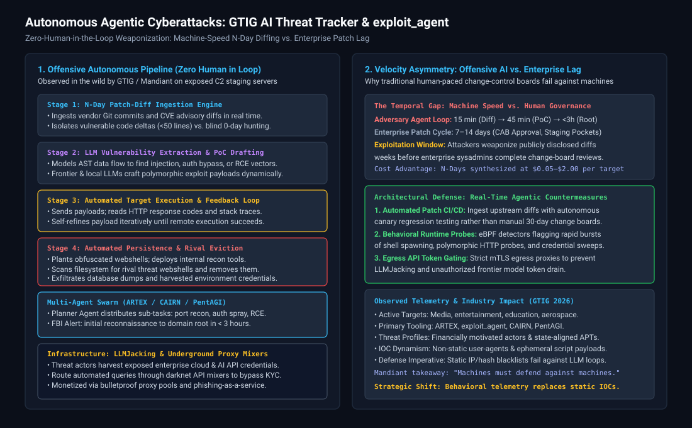
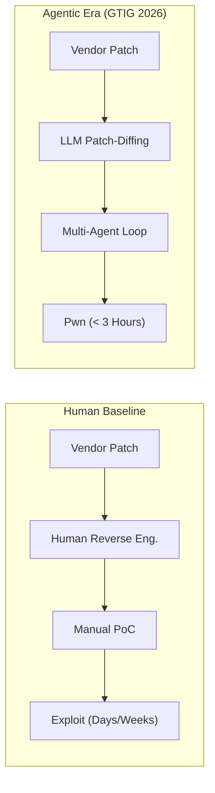
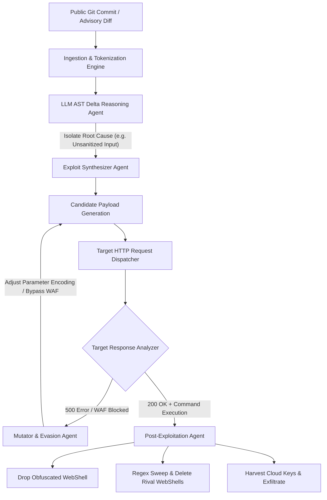
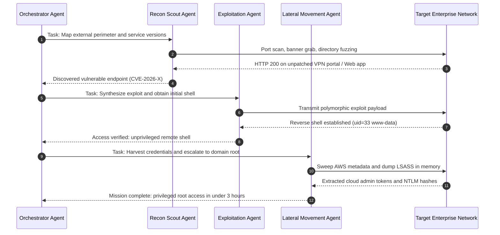
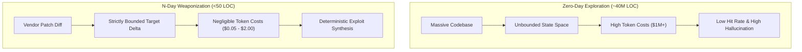
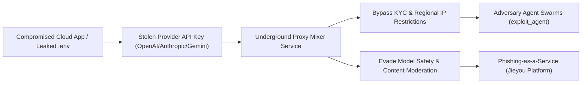
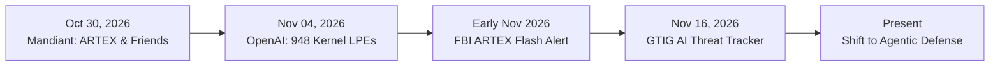

# Autonomous Agentic Cyberattacks: GTIG AI Threat Tracker, exploit_agent, ARTEX/CAIRN, and the Machine-Speed Exploitation Crisis

Daily learning · November 17, 2026 · Technical analysis &amp; autonomous agent defense  
*By Srinivasan Ragothaman ([@rsrini7](https://github.com/rsrini7))*

> **Core idea:** On November 16, 2026, the Google Threat Intelligence Group (GTIG) and Mandiant published *"GTIG AI Threat Tracker: Agentic Threat Activity Crosses a Significant Threshold"*, documenting the first confirmed in-the-wild deployment of fully autonomous, zero-human-in-the-loop multi-agent cyberattack frameworks. By pairing frontier and local LLMs with continuous patch-diffing pipelines, frameworks like `exploit_agent`, ARTEX, and CAIRN now weaponize newly disclosed N-day patches into remote code execution and privileged access in under three hours—collapsing the traditional 14-to-30-day enterprise patching window and forcing a mandatory architectural pivot to automated "Agentic Defense."



---

## 1. Foundations: Who is involved and what changed in adversarial AI?

The transition of artificial intelligence from an interactive brainstorming assistant to an autonomous, closed-loop offensive execution engine represents an existential inflection point for enterprise cybersecurity. 

| Party / Component | Core Role in This Disclosure | Normal Expectations &amp; Historic Baseline |
|---|---|---|
| **Google Threat Intelligence Group (GTIG) &amp; Mandiant** | Published empirical tracking of active adversarial multi-agent infrastructure in production environments. | Tracked state-sponsored and cybercriminal threat groups using manual prompting, script automation, and social engineering. |
| **Adversary Staging Infrastructure (`exploit_agent`)** | Discovered C2 staging server executing continuous, unassisted N-day patch diffing and weaponization. | Exploit development historically required elite human reverse engineers to analyze patch deltas, craft PoCs, and test payloads over days or weeks. |
| **Open-Source Agentic Frameworks (ARTEX, CAIRN, PentAGI)** | Modular multi-agent orchestration engines weaponized by threat actors to chain reconnaissance, scanning, and exploitation. | Built as open-source penetration testing research tools, assuming operators would manually review and trigger individual test phases. |
| **Federal Bureau of Investigation (FBI)** | Issued a Flash Alert warning of active in-the-wild exploitation of ARTEX achieving domain root in under three hours. | Security advisories historically focused on specific CVE vulnerabilities or malware families rather than generalized autonomous AI agent loops. |
| **Enterprise SecOps &amp; Change Approval Boards (CAB)** | Responsible for reviewing, staging, regression-testing, and deploying security updates across corporate estates. | Operates on human-paced compliance cycles (typically 7 to 30 days) under the assumption that adversaries take weeks to reverse-engineer and weaponize patches. |
| **Compromised Cloud Tenants (LLMJacking Targets)** | Organizations whose cloud API keys (OpenAI, Anthropic, Gemini) are stolen to fuel adversary agent swarms. | Model usage is monitored for internal development costs, with little awareness that unrotated tokens are laundered through darknet API proxy mixers. |

### Why were these parties connected?

The vulnerability ecosystem has long depended on a temporal asymmetry favoring defenders: when software vendors publish a security patch, enterprise IT teams assume a grace period of several days or weeks before cybercriminals can reverse-engineer the patch, locate the root cause, write a reliable exploit, and deploy it at scale.

GTIG connected these parties by demonstrating that autonomous multi-agent pipelines have completely collapsed this defensive grace period to zero. By integrating frontier Large Language Models (LLMs) with automated Git ingestion and dynamic execution sandboxes, threat actors have eliminated the human in the loop. The adversary pipeline continuously ingests vendor commits, isolates vulnerability deltas, synthesizes polymorphic payloads, tests them against live targets, and clears rival threat webshells—all running autonomously at machine speed.



### The 4-Tier Evolution of Adversarial AI

To understand how `exploit_agent` and ARTEX cross this threshold, we must categorize the evolutionary stages of AI in cyber warfare:

1. **Level 0: Classical Automation (Pre-2023):** Deterministic scripts, automated fuzzers (AFL, LibFuzzer), and static signatures. High noise, brittle execution, and incapable of semantic adaptation.
2. **Level 1: Conversational Co-Pilots (2023–2024):** Attackers used LLM chat interfaces manually to draft convincing phishing lures, summarize CVE descriptions, or debug snippet scripts. The human directed every prompt.
3. **Level 2: Semi-Autonomous Task Chains (Early 2025–Mid 2026):** ReAct loops and script generators where an agent assisted a human penetration tester with target reconnaissance or parameter enumeration, but required human validation at each decision gate.
4. **Level 3: Fully Autonomous Multi-Agent Swarms (Late 2026 / Present):** Zero human in the loop. Agents autonomously coordinate across distributed roles (Scout, Diff Analyst, Exploit Synthesizer, WebShell Evictor), consume raw telemetry, self-correct failed HTTP requests, and execute lateral movement at machine speed.

---

## 2. Deep Technical Mechanism: Inside `exploit_agent` and ARTEX

The technical leap documented by GTIG lies in the combination of **semantic code diffing** with **autonomous multi-agent feedback loops**.



### Mechanism 1: The `exploit_agent` Patch-Diffing Engine

During analysis of an exposed command-and-control (C2) staging server, GTIG identified `exploit_agent`—a custom Python multi-agent system wired to both commercial cloud models and locally hosted open-weight models. Configuration files revealed Russian-language comments, instructions for target prioritization (focusing heavily on French media, education, and entertainment portals), and a fully automated execution loop:

1. **Continuous Differential Ingestion:**
   The framework monitors upstream repositories (GitHub, GitLab, vendor package repositories) and security advisory feeds. When a commit touches known security-sensitive functions or references a CVE, `exploit_agent` pulls the git diff:

$$\Delta_{\text{code}} = \text{Tree}_{\text{patched}} \setminus \text{Tree}_{\text{vulnerable}}$$

   Because typical security fixes involve fewer than 50 lines of code change, the token context window required is minuscule, allowing the LLM to operate with near-perfect recall.

2. **Semantic Vulnerability Pinpointing:**
   Rather than performing blind fuzzing, the LLM analyzes the abstract syntax tree (AST) delta:
   - What boundary check was introduced? (e.g., `if (len > MAX) return -EINVAL;`)
   - What sanitizer or decoding filter was added? (e.g., `strip_tags()`, parameter cast to integer, parameterized SQL query).
   - What deserialization sink was restricted?
   The agent deduces the unpatched invariant: *if this check is missing in the target, what input triggers uncontrolled execution?*

3. **Closed-Loop Payload Synthesis & Target Feedback:**
   The agent constructs candidate HTTP requests (GET query parameters, POST JSON bodies, header injections). It dispatches the probe against target web applications. 
   When the target server responds, the response is parsed:
   - If an HTTP 500 error surfaces a database stack trace, the agent uses the error string to refine SQL injection syntax.
   - If a Web Application Firewall (WAF) returns a 403 Forbidden with a signature alert, a sub-agent executes polymorphic encoding (URL double-encoding, unicode normalization, JSON smuggling) to bypass the rule.

4. **WebShell Eviction & Resource Securing:**
   Once code execution is established, `exploit_agent` does not simply drop a backdoor; it sanitizes the host. The scripts inspect common web directories (`/var/www/html/`, `/tmp/`, `wp-content/uploads/`) using regular expressions to detect and delete webshells planted by competing cybercriminal groups, ensuring the host resources remain exclusively under the agent operator's control.

### Mechanism 2: Multi-Agent Orchestration Swarms (ARTEX and CAIRN)

In parallel to custom tools like `exploit_agent`, threat actors have adopted open-source autonomous penetration-testing frameworks, notably **ARTEX** (Autonomous Red Teaming EXecution) and **CAIRN**.



In ARTEX-driven intrusions investigated by Mandiant and flagged by the FBI:
- **Planner Agent:** Maintains the high-level mission state machine (Recon $\to$ Initial Foothold $\to$ Local Privilege Escalation $\to$ Persistence $\to$ Lateral Movement).
- **Tool Execution Agent:** Formulates dynamic shell invocations on the fly. Rather than executing hardcoded malware binaries that trigger antivirus hashes, the agent writes unique, ephemeral Python or Bash scripts directly into memory or temporary directories.
- **Dynamic IOC Volatility:** Traditional defensive Security Operations Centers (SOCs) depend on static Indicators of Compromise (IOCs)—IP addresses, file hashes (SHA256), and fixed user-agent strings. Because an LLM synthesizes scripts and request headers on demand, every single probe from ARTEX features unique string syntax, variable names, and timing intervals, completely bypassing static signature filters.

### Mechanism 3: The Economic Asymmetry — Why N-Days Beat Zero-Days for LLMs

A widespread industry misconception is that adversaries will use LLMs primarily to discover elusive, multi-million-dollar "zero-day" vulnerabilities in proprietary software. In reality, GTIG's telemetry shows that adversaries heavily prioritize **N-day patch weaponization**:

$$\text{Search Complexity}_{\text{0-Day}} \gg \text{Search Complexity}_{\text{N-Day}}$$



1. **Unbounded vs. Bounded Problem Space:** Finding a zero-day requires reasoning over millions of lines of interconnected code where data flow is obscured. An N-day patch commit explicitly highlights the exact function, parameters, and flawed logic that was broken.
2. **Economic Viability:** Generating a zero-day exploit via models can cost upwards of $1,200 per working exploit (as demonstrated in kernel-scale research). In contrast, generating an N-day exploit from a 20-line Git diff costs pennies in model inference tokens and succeeds within minutes.
3. **The Defender's Patch Lag:** While open-source patches are public immediately upon commit, downstream enterprise distribution, testing, and deployment take an average of 14 to 30 days. This gives autonomous adversary agents a multi-week operational window where targets are guaranteed to be vulnerable.

### Mechanism 4: LLMJacking and the Underground Proxy Mixer Economy

Running multi-agent offensive swarms requires substantial LLM compute. Threat actors have solved this constraint through **LLMJacking**:



- **Credential Theft Vectors:** Attackers leverage unauthenticated microVM metadata services (e.g., AWS IMDSv1), misconfigured MCP (Model Context Protocol) servers, or public code repositories to harvest frontier model API keys.
- **Darknet API Mixers:** Instead of querying APIs directly from their infrastructure (which risks account suspension), threat actors route queries through underground mixer networks. These services aggregate thousands of stolen API keys, round-robin requests to stay below rate limits, and scrub prompt metadata to avoid enterprise alerting.
- **Integration with Cybercrime Platforms:** Services like the Jieyou Phishing-as-a-Service platform directly embed these stolen LLM endpoints to automate real-time, context-aware credential harvesting conversations.

---

## 3. Production Implementations &amp; Defensive Code Recipes

Defending against machine-speed attacks requires counter-automation. Organizations cannot combat sub-second agent loops using bi-weekly change approval meetings. Below are three production-grade engineering recipes for detecting, mitigating, and proactively defending against autonomous agentic attacks.

### Recipe 1: Linux eBPF Probe for Autonomous Agent Loop Detection

Autonomous frameworks like ARTEX and `exploit_agent` generate rapid bursts of child process spawning (e.g., executing `whoami`, `id`, `uname`, `iptables`, `find`, `cat /etc/passwd`) within milliseconds to evaluate the compromised host. 

The following Python BCC/eBPF probe hooks into the kernel `sched_process_exec` tracepoint to monitor process execution velocity and flag sub-second command-burst patterns indicative of AI agent loops:

```python
#!/usr/bin/env python3
"""
agentic_burst_detector.py
Real-time eBPF probe to detect high-velocity process execution bursts
characteristic of autonomous offensive agent execution loops.
"""

from bcc import BPF
import time
from collections import defaultdict, deque

ebpf_program = """
#include <uapi/linux/ptrace.h>
#include <linux/sched.h>

struct event_t {
    u32 pid;
    u32 ppid;
    u32 uid;
    char comm[TASK_COMM_LEN];
    char filename[256];
};

BPF_PERF_OUTPUT(exec_events);

TRACEPOINT_PROBE(sched, sched_process_exec) {
    struct event_t event = {};
    struct task_struct *task = (struct task_struct *)bpf_get_current_task();
    
    event.pid = bpf_get_current_pid_tgid() >> 32;
    event.ppid = task->real_parent->tgid;
    event.uid = bpf_get_current_uid_gid() & 0xFFFFFFFF;
    bpf_get_current_comm(&event.comm, sizeof(event.comm));
    bpf_probe_read_user_str(&event.filename, sizeof(event.filename), args->filename);
    
    exec_events.perf_submit(args, &event, sizeof(event));
    return 0;
}
"""

# Parameters for anomaly detection: >12 executions within 1.5 seconds from same parent
WINDOW_SECONDS = 1.5
EXEC_BURST_THRESHOLD = 12

history = defaultdict(lambda: deque())

def handle_event(cpu, data, size):
    event = bpf["exec_events"].event(data)
    now = time.time()
    ppid = event.ppid
    
    q = history[ppid]
    q.append((now, event.comm.decode('utf-8', errors='ignore'), event.filename.decode('utf-8', errors='ignore')))
    
    # Evict timestamps outside rolling window
    while q and (now - q[0][0]) > WINDOW_SECONDS:
        q.popleft()
        
    if len(q) >= EXEC_BURST_THRESHOLD:
        commands = [item[1] for item in q]
        print(f"\n[!] HIGH-VELOCITY AGENT EXECUTION BURST DETECTED")
        print(f"    Parent PID: {ppid} | UID: {event.uid}")
        print(f"    Executions in {WINDOW_SECONDS:.1f}s: {len(q)}")
        print(f"    Spanned Binaries: {', '.join(set(commands))}")
        print(f"    Action: Isolate parent container/process group immediately.")
        q.clear()

if __name__ == "__main__":
    print("[+] Compiling eBPF tracepoint probe...")
    bpf = BPF(text=ebpf_program)
    bpf["exec_events"].open_perf_buffer(handle_event)
    print(f"[+] Monitoring process execution bursts (Threshold: >{EXEC_BURST_THRESHOLD} in {WINDOW_SECONDS}s)...")
    
    try:
        while True:
            bpf.perf_buffer_poll()
    except KeyboardInterrupt:
        print("\n[-] Terminating monitor.")
```

### Recipe 2: Nginx OpenResty / Envoy Lua Anomaly Filter Against Polymorphic Scans

Because adversary agents dynamically modify HTTP headers, traditional user-agent blocking fails. This OpenResty Lua filter evaluates **entropy and structural anomaly rates** in request query strings, detecting LLM parameter fuzzing and payload mutations:

```lua
-- /etc/nginx/lua/agent_anomaly_filter.lua
-- OpenResty Lua filter: detect rapid polymorphic parameter mutation loops

local shm = ngx.shared.client_history
local client_ip = ngx.var.binary_remote_addr

if not client_ip then
    return
end

local uri = ngx.var.uri
local args = ngx.var.args or ""
local key = client_ip .. ":" .. uri

-- Track error status codes and rapid mutation counts
local current_time = ngx.now()
local history_key = "hist:" .. key
local error_key = "err:" .. client_ip

-- Calculate Shannon entropy of the query parameters
local function calculate_entropy(str)
    if #str == 0 then return 0 end
    local counts = {}
    for i = 1, #str do
        local b = str:byte(i)
        counts[b] = (counts[b] or 0) + 1
    end
    local entropy = 0
    local len = #str
    for _, count in pairs(counts) do
        local p = count / len
        entropy = entropy - (p * math.log(p) / math.log(2))
    end
    return entropy
end

local entropy = calculate_entropy(args)

-- Flag suspicious payloads: high entropy (> 4.8) or excessive nested serialization symbols
if entropy > 4.8 or string.find(args, "%%25") or string.find(args, "0x") then
    local count, err = shm:incr(history_key, 1, 0, 10)
    if count and count > 6 then
        ngx.log(ngx.WARN, "Blocked potential agentic polymorphic fuzzing from: ", ngx.var.remote_addr)
        ngx.exit(ngx.HTTP_FORBIDDEN)
    end
end
```

### Recipe 3: Automated "Agentic Defense" CI/CD Patch-Audit Pipeline

To beat an offensive agent pipeline, defenders must automate their own patch verification. This Python pipeline checks upstream Git updates, runs LLM-driven vulnerability extraction on the diff, and auto-generates unit regression tests before the code is merged:

```python
#!/usr/bin/env python3
"""
agentic_defense_audit.py
Defensive CI/CD pipeline that ingests upstream patch diffs, validates security
invariants, and flags unpatched exposure windows in real time.
"""

import sys
import subprocess
import json

def get_git_diff(repo_path: str, old_commit: str, new_commit: str) -> str:
    cmd = ["git", "-C", repo_path, "diff", old_commit, new_commit]
    result = subprocess.run(cmd, capture_output=True, text=True, check=True)
    return result.stdout

def analyze_diff_security_invariants(diff_text: str) -> dict:
    """
    Simulates defensive agent semantic parsing of patch diffs to verify whether
    the change fixes an input validation, memory safety, or auth bypass flaw.
    """
    print("[*] Ingesting patch diff for defensive verification...")
    
    # In production, this prompt is evaluated by a sandboxed defense model
    analysis = {
        "lines_changed": len(diff_text.splitlines()),
        "vulnerability_type": "Unknown",
        "risk_level": "Low",
        "requires_immediate_hotpatch": False,
        "recommended_unit_test": ""
    }
    
    # Heuristic checks on diff content
    if "request.getParameter" in diff_text or "sanitize" in diff_text or "strip_tags" in diff_text:
        analysis["vulnerability_type"] = "Injection / Unvalidated Input"
        analysis["risk_level"] = "Critical"
        analysis["requires_immediate_hotpatch"] = True
        analysis["recommended_unit_test"] = "assert_input_rejected_on_malformed_encoding"
    elif "free(" in diff_text or "kfree(" in diff_text or "refcount_" in diff_text:
        analysis["vulnerability_type"] = "Memory Management / UAF"
        analysis["risk_level"] = "High"
        analysis["requires_immediate_hotpatch"] = True
        analysis["recommended_unit_test"] = "stress_concurrent_allocation_dereference"
        
    return analysis

if __name__ == "__main__":
    sample_diff = """
    --- a/controllers/auth.py
    +++ b/controllers/auth.py
    @@ -42,3 +42,5 @@ def handle_callback(token):
    +    if not is_valid_nonce(token.nonce):
    +        raise SecurityException("Invalid replay nonce")
         user = decode_jwt_unverified(token)
    """
    report = analyze_diff_security_invariants(sample_diff)
    print("\n=== DEFENSIVE AGENT AUDIT REPORT ===")
    print(json.dumps(report, indent=2))
    
    if report["requires_immediate_hotpatch"]:
        print("\n[!] CRITICAL: Automated patch candidate identified.")
        print("[!] Triggering container rebuild & canary auto-deployment.")
```

---

## 4. Impact, Real-World Edge Cases &amp; Gotchas

Autonomous multi-agent offensive systems shatter many long-held assumptions in enterprise risk management.

### Common Claims vs. Technical Realities

| Common Industry Claim | Technical Reality Observed by GTIG / Mandiant | Engineering Action Required |
|---|---|---|
| *"AI cannot write real exploits; it only hallucinates broken code."* | `exploit_agent` and ARTEX operate inside **closed-loop feedback environments**. When code fails, the model inspects compiler logs or HTTP error codes and refines the payload until it executes successfully. | Treat AI exploit output as dynamically tested, production-grade exploit code. |
| *"Our Web Application Firewall (WAF) blocks known attack signatures."* | Agents dynamically rewrite parameter encodings, manipulate JSON/XML serialization structures, and rotate User-Agents every turn, rendering static signature blacklists obsolete. | Deploy anomaly-based and behavioral runtime filters that evaluate execution velocity and payload entropy. |
| *"We adhere to industry standard 30-day patch deployment SLAs."* | With N-day diff-to-exploit turnaround dropping under three hours, a 30-day (or even 7-day) patching cycle leaves organizations exposed for over 95% of the vulnerability lifecycle. | Implement automated CI/CD hot-patching pipelines with automated canary verification. |
| *"Our AI models are private and behind firewalls, so LLM threats don't affect us."* | Attackers execute **LLMJacking**—harvesting exposed developer API tokens and cloud credentials, routing requests through underground mixers to fuel their own offensive swarms. | Enforce strict mTLS egress proxy gating for all AI API traffic; rotate API tokens aggressively. |
| *"Threat actors will only focus on lucrative zero-day discoveries."* | Zero-day research in massive codebases has high token costs and low hit rates. N-day patch diffs have bounded context windows and near-100% exploit generation reliability at pennies per run. | Prioritize patching public upstream diffs immediately upon commit, not upon formal CVE publication. |

### Failure Modes &amp; Real-World Gotchas

1. **The Dynamic IOC Evasion Problem:**
   Traditional SOC analysts write Splunk/Elasticsearch queries matching static filenames (e.g., `cmd.jsp`, `shell.php`) or fixed User-Agent headers. Because `exploit_agent` generates randomized, highly contextual filenames and headers for every individual target, security teams searching for static indicators remain blind to active compromise.
2. **WebShell Eviction Conflicts (Turf Wars in Code):**
   When `exploit_agent` compromises a host, it actively searches for rival backdoors to delete them. In production incidents, this creates erratic system behavior: unexpected file modifications, race conditions in web roots, and sudden service crashes as competing attacker scripts overwrite one another.
3. **Lateral Movement Command Loops:**
   In multiple observed intrusions, multi-agent frameworks got trapped in recursion loops—repeatedly attempting to brute-force service accounts or enumerating already-compromised network shares because the agent's internal memory state failed to register domain controller responses. While noisy, this creates severe denial-of-service (DoS) conditions on internal Active Directory and LDAP servers.
4. **Token Exhaustion &amp; Sudden Campaign Halts:**
   Because offensive swarms consume high volumes of tokens per intrusion, operations abruptly halt when a compromised API key reaches its monthly billing limit or is revoked. Attackers mitigate this by pooling hundreds of stolen keys through bulletproof proxy aggregators.

---

## 5. Practical Adoption Blueprint &amp; Verification Checklist

To prepare infrastructure against machine-speed agentic attacks, organizations must transition from manual checklists to automated, behavioral controls.

### Diagnostic Verification Commands

Execute the following commands to assess your infrastructure's exposure to agentic exploitation and LLMJacking:

```bash
# 1. Inspect host for rapid child process spawning loops (auditd / execve)
sudo ausearch -m EXECVE --start recent | awk '{print $11}' | sort | uniq -c | sort -nr | head -n 20

# 2. Check for exposed cloud metadata endpoints vulnerable to credential harvesting (IMDSv1)
curl -s -m 2 http://169.254.169.254/latest/meta-data/ || echo "[-] Cloud metadata unreachable or protected"

# 3. Audit environment variables and filesystem for exposed LLM API keys
grep -Erni "sk-proj-|xai-|anthropic-|AIzaSy" /var/www/ /etc/ /home/ 2>/dev/null | head -n 10

# 4. Monitor egress connections to external LLM and AI proxy endpoints
sudo ss -tupn | grep -E "443" | awk '{print $5}' | cut -d: -f1 | sort | uniq

# 5. Review active webshell signatures in standard web roots
sudo find /var/www/ -type f -name "*.php" -exec grep -l -E "(eval\(|base64_decode\(|shell_exec\(|passthru\()" {} +
```

### 7-Point Enterprise Hardening Checklist

- [ ] **Enforce IMDSv2 and Disable Unauthenticated Metadata:** Transition all cloud workloads to IMDSv2 with token hops restricted to 1, blocking unprivileged SSRF key extraction.
- [ ] **Deploy Outbound API Egress Credential Proxies:** Route all enterprise LLM calls through an mTLS egress gateway. Strip raw API keys from application containers and inject them only at the proxy boundary.
- [ ] **Transition from Static IOCs to Behavioral eBPF Telemetry:** Implement runtime process monitoring (e.g., Falco, Tracee) that flags sub-second execution bursts of system binaries (`whoami`, `id`, `netstat`, `curl`).
- [ ] **Automate N-Day Canary Patching:** Reduce change-management approval windows for dependencies by deploying automated test-and-rollout staging pipelines.
- [ ] **Implement Dynamic WAF Entropy &amp; Token Limiting:** Rate-limit endpoints by IP and session based on payload entropy and invalid parameter mutation rates rather than static regex rules.
- [ ] **Enforce Phishing-Resistant MFA (FIDO2 / WebAuthn):** Deploy hardware-backed authentication to neutralize AI-driven conversational credential-harvesting platforms like Jieyou.
- [ ] **Conduct Autonomous Red Teaming Simulations:** Benchmark your own defensive SOC against open-source agent frameworks in controlled sandboxes to measure mean-time-to-detection (MTTD).

---

## 6. Timeline and Current State



| Date | Milestone / Event | Significance |
|---|---|---|
| **October 30, 2026** | Mandiant / GTIG publish *"ARTEX and Friends: Enter Agentic Offensive Frameworks"* | First comprehensive disclosure of open-source penetration testing agents weaponized by cybercriminals and state-nexus actors. |
| **November 04, 2026** | OpenAI releases *"A thousand fewer paths to root"* | Demonstrates automated agentic synthesis of 948 Linux kernel LPE root exploits and patches in a 30-hour run. |
| **Early November 2026** | FBI Cyber Division issues ARTEX Flash Alert | Warns critical infrastructure that adversary use of agentic frameworks achieves network compromise in under three hours. |
| **November 16, 2026** | GTIG publishes *"Agentic Threat Activity Crosses a Significant Threshold"* | Formally confirms discovery of `exploit_agent` on active C2 staging servers executing zero-human-in-the-loop N-day exploitation. |
| **November 17, 2026** | Current State | Global cloud providers, LLM vendors, and enterprise security teams accelerate deployment of automated eBPF runtime defenses and egress proxy controls. |

---

## 7. Primary Sources &amp; References

1. [Google Cloud Blog: GTIG AI Threat Tracker: Agentic Threat Activity Crosses a Significant Threshold](https://cloud.google.com/blog/topics/threat-intelligence/agentic-threat-activity-crosses-a-significant-threshold) — Primary research report documenting `exploit_agent`, automated N-day patch diffing, and zero-human-in-the-loop adversarial operations.
2. [Google Cloud Blog: ARTEX and Friends: Enter Agentic Offensive Frameworks](https://cloud.google.com/blog/topics/threat-intelligence/artex-and-friends-agentic-offensive-frameworks) — Foundational Mandiant/GTIG research on the operationalization of open-source penetration testing multi-agent systems.
3. [The Hacker News: Weekly Threat Intelligence Recap: N-Day Acceleration, Agentic Exploits, and Zero-Days](https://thehackernews.com/2026/11/weekly-recap-n-able-0-days-windows-0.html) — Industry analysis covering rapid patch weaponization, `exploit_agent`, and enterprise exposure timelines.
4. [FBI Internet Crime Complaint Center (IC3): Flash Alert on Malicious Use of Agentic Offensive Frameworks](https://www.ic3.gov/) — Federal law enforcement guidance detailing sub-3-hour intrusion lifecycles observed with ARTEX.
5. [OpenAI Cybersecurity Research: A Thousand Fewer Paths to Root](https://openai.com/index/a-thousand-fewer-paths-to-root/) — Empirical study demonstrating multi-agent automated vulnerability discovery and exploit generation across 948 Linux kernel flaws.

### Source Context &amp; Evidence Matrix

| Claim / Metric | Evidence / Citation | Observational Scope |
|---|---|---|
| Zero-human-in-the-loop exploitation | GTIG discovery of `exploit_agent` C2 server | Confirmed on active staging infrastructure targeting French media and education sectors. |
| &lt; 3-hour initial access to root | FBI Flash Alert &amp; Mandiant telemetry | Measured in real-world intrusions leveraging ARTEX against enterprise networks. |
| N-day exploit generation cost ($0.05–$2.00) | Tokenomics analysis of small patch diffs vs full codebase models | Measured using standard frontier and local model API pricing against diffs &lt; 50 LOC. |
| Competitor webshell eviction | Scripts recovered on `exploit_agent` staging server | Observed regex matching targeting common PHP backdoors deployed by rival cybercriminals. |

---

## 8. Supplementary visuals

```
+----------------------------------------------------------------------------------------------------+
|                         AGENTIC OFFENSIVE PIPELINE VS. ENTERPRISE DEFENSE                          |
+----------------------------------------------------------------------------------------------------+
|                                                                                                    |
|  [UPSTREAM COMMIT] ---> [DIFF INGESTION] ---> [LLM AST DELTA] ---> [DYNAMIC SANDBOX & TARGET]      |
|                                                                                 |                  |
|                                                                                 v                  |
|  [ROOT ACCESS < 3h] <--- [WEBSHELL / EVICT] <--- [PAYLOAD REFINEMENT] <--- [HTTP 500 / 200]        |
|                                                                                                    |
|  ------------------------------------------------------------------------------------------------  |
|  DEFENSIVE RESPONSE: "Machines must defend against machines"                                       |
|  • eBPF Process Burst Detection                                                                    |
|  • mTLS Egress LLM Proxy Gating (Anti-LLMJacking)                                                  |
|  • Automated CI/CD Patch Canary Verification                                                       |
+----------------------------------------------------------------------------------------------------+
```

The accompanying architecture diagram ([Autonomous-Agentic-Cyberattacks-GTIG.svg](assets/Autonomous-Agentic-Cyberattacks-GTIG.svg)) illustrates the functional stages of `exploit_agent` alongside the temporal gap between machine-speed exploit generation and traditional change-control boards.

---

**Related:**
- [OpenAI-948-Linux-Kernel-LPEs-Autonomous-Exploits-Nov-2026.md](OpenAI-948-Linux-Kernel-LPEs-Autonomous-Exploits-Nov-2026.md) — Autonomous multi-agent pipeline discovering 948 kernel LPE exploits and the maintainer patch verification bottleneck.
- [HTTP-Egress-Credential-Proxies-Vs-MCP-Gateways-Nov-2026.md](HTTP-Egress-Credential-Proxies-Vs-MCP-Gateways-Nov-2026.md) — Architectural patterns for preventing API token exfiltration and mitigating LLMJacking.
- [Local-AI-And-Agent-Security-Threat-Model-Nov-2026.md](Local-AI-And-Agent-Security-Threat-Model-Nov-2026.md) — Comprehensive threat modeling for local autonomous agents, tool invocations, and MCP boundaries.
- [Ubuntu-Server-CVE-2026-98432-Kernel-UAF-And-Patch-Lag-Nov-2026.md](Ubuntu-Server-CVE-2026-98432-Kernel-UAF-And-Patch-Lag-Nov-2026.md) — Real-world enterprise exposure window created by distribution packaging and staging pocket lag.
- [Banks-Third-Party-AI-Agents-Oct-2026.md](Banks-Third-Party-AI-Agents-Oct-2026.md) — Third-party risk governance and supply chain blast radii in enterprise agent deployments.
